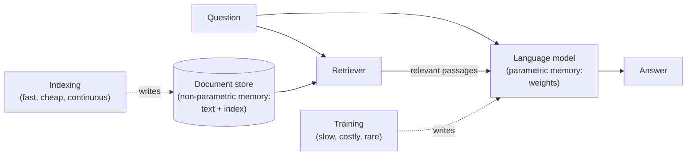

A system that answers questions has to keep its knowledge somewhere. There are only two places it can live: inside the model, as numbers learned during training, or outside the model, as text that is looked up when a question arrives. The research paper that named RAG called these **parametric** and **non-parametric** memory, and the whole design of a RAG system follows from the difference between them.

This lesson defines both kinds of knowledge precisely, compares what each is good and bad at, and builds a miniature of each so you can watch them behave differently when a fact is added or deleted. The earlier lessons described the symptoms ([knowledge cutoffs](/learn/introduction-to-rag/knowledge-limitations-of-llms), [hallucinations](/learn/introduction-to-rag/hallucinations-and-factual-reliability)); this one gives you the vocabulary for the cause.

## Learning objectives

- Define parametric and non-parametric knowledge and say where each is physically stored.
- Compare the two on updating, deletion, provenance, access control, coverage and cost.
- Explain why a language model's language skill is best kept parametric while its facts are best kept non-parametric.
- Classify a given piece of knowledge as belonging in the weights, in a store, or in both.
- Demonstrate in code that adding a document changes a non-parametric system immediately and a parametric one not at all.

## Prerequisites

- [What is RAG?](/learn/introduction-to-rag/what-is-rag)
- [Knowledge limitations of LLMs](/learn/introduction-to-rag/knowledge-limitations-of-llms)
- [Hallucinations and factual reliability](/learn/introduction-to-rag/hallucinations-and-factual-reliability)

## Why this matters

Almost every design argument about RAG is an argument about where a piece of knowledge should live. "Should we fine-tune the model on our handbook or retrieve from it?" is a question about parametric versus non-parametric storage. So is "why can the model not tell me which document that came from?" and "we deleted the customer's data, so why does the assistant still know it?".

Without the distinction, teams make the same expensive mistake in different forms: they try to push changing, private, auditable facts into model weights, where facts cannot be updated cheaply, cannot be traced to a source, cannot be hidden from one user and shown to another, and cannot be reliably removed. With the distinction, the decision becomes mechanical: you ask what properties the knowledge needs and put it where those properties are available.

## The intuition

Think of two students sitting the same exam.

The first sits it **closed book**. Everything she knows was absorbed during months of study and now exists only as her memory. She answers fluently and instantly, she is good at reasoning and explaining, but she cannot tell you which page a fact came from, she does not know anything published after she stopped studying, and when her memory is hazy she may write something that sounds right and is wrong.

The second sits it **open book**. He has the same general education, but he also has the textbook on the desk. For each question he finds the relevant page, reads it, and answers from what it says. He is a little slower because he has to look things up. In return he can quote the page, he is right about anything the book covers even if it was printed yesterday, and if you swap the book for a newer edition his answers change at once, with no further studying.

The first student's knowledge is parametric. The second student's textbook is non-parametric knowledge. Notice that the second student still needs his education: the book is useless to someone who cannot read or reason. RAG is the open-book arrangement, and it uses both kinds at once.

## How it works

### Parametric knowledge

A neural network is a function with a very large number of adjustable numbers called **parameters** (also called **weights**). Training adjusts those numbers so that the network becomes good at predicting the next piece of text in its training data. Whatever the model "knows" after training, it knows only because of the values those numbers ended up with. That is **parametric knowledge**: knowledge stored implicitly in a model's parameters.

Three properties follow directly from how it gets there.

1. **It is distributed.** There is no single place where "annual leave is 25 days" is written. A fact is a pattern spread across a great many weights, and each weight takes part in a great many facts.
2. **It is lossy.** The parameters are far smaller than the training text, so the model keeps regularities, not a verbatim copy. Things that appeared often are remembered well; things that appeared once or twice are remembered vaguely or not at all. Petroni et al. (2019) showed that pre-trained language models can be probed for facts like a knowledge base, and that the recall is real but uneven.
3. **It is frozen.** After training ends, the weights stop changing. The model's knowledge stops at its [knowledge cutoff](/learn/introduction-to-rag/knowledge-limitations-of-llms), and the only way to change it is more training.

Parametric knowledge is not only facts. A model's grammar, its ability to summarise, translate, follow instructions and reason through a problem are all parametric too. This matters: those general skills change slowly, apply to every question, and do not need a source citation. They are exactly what weights are good at holding.

### Non-parametric knowledge

**Non-parametric knowledge** is knowledge kept outside the model, in a store that is searched when needed: a folder of documents, a search index, a database, a vector index. The term comes from statistics, where a *parametric* model summarises its data in a fixed number of parameters and a *non-parametric* method (such as nearest-neighbour classification) keeps the data itself and consults it at prediction time. The amount a non-parametric memory can hold grows with the data you put in it, not with the size of any model.

Its properties are the mirror image of the first list.

1. **It is explicit.** The fact is a piece of text at a known location. You can read it, point to it and quote it.
2. **It is exact.** The store holds the document as written, so a number in the document is the number the system sees.
3. **It is editable.** Adding, changing or deleting a fact is a write to a data store. No training is involved.

It has its own weakness: knowledge in a store does nothing until something finds it. If the search step fails to return the right passage, the fact might as well not exist. Parametric recall fails by being vague or wrong; non-parametric recall fails by not being found.

### What the original paper meant

Lewis et al. (2020), the paper that introduced the name RAG, describe their models as combining the two memories: the parametric memory is a pre-trained sequence-to-sequence model (a model that maps an input text to an output text), and the non-parametric memory is a dense vector index of Wikipedia reached through a pre-trained neural retriever. The same split describes every RAG system built since, whatever the components: a generator whose weights hold language ability, and an external store that holds the facts.



The dotted arrows are the important part. Each memory has a different *write path*. Weights are written by training, which takes hours to weeks and is done rarely. The store is written by indexing, which takes seconds per document and can run all day.

### The two compared

| Property | Parametric (in the weights) | Non-parametric (in a store) |
| --- | --- | --- |
| Where it lives | Billions of numbers, no fact has an address | Text at a known location |
| How it is written | Training or fine-tuning | Inserting or editing a document |
| Time to add one fact | A training run | One write and one index update |
| Deleting one fact | No reliable operation exists | Delete the document |
| Provenance (showing the source) | Not available | Built in: the passage is the source |
| Per-user access control | Not possible: every user gets the same weights | Filter the search by the user's permissions |
| Fidelity | Approximate, worse for rare facts | Exact, if the passage is found |
| How it fails | Confident wrong answer | Passage not retrieved |
| Cost at question time | Nothing extra | A search, plus the tokens of the passages |
| Best at | Language, reasoning, widely known stable knowledge | Specific, changing, private or auditable facts |

> [!KEY]
> Put a piece of knowledge in the store if it changes, is private, must be cited, must be deletable, or differs between users. Leave it to the weights if it is general skill or stable common knowledge. Most systems need both.

### How the two interact in a RAG answer

When a RAG system answers a question, both memories are in play in a fixed sequence.

1. The question arrives. The model's weights already contain its language ability and whatever it absorbed in training.
2. The retriever searches the store and returns a few passages.
3. The passages are placed in the prompt next to the question.
4. The model reads the prompt. Its parametric knowledge supplies comprehension and reasoning; the passages supply the facts.
5. The model writes an answer that should rest on the passages, and can cite them.

Step 4 hides a subtlety. The model now has two sources that may disagree: what the passage says and what its weights "remember". This is called a **knowledge conflict**. If Meridian's handbook says 25 days of leave and the model's training data mostly described companies offering 20, the two memories pull in different directions. Research on knowledge conflicts (for example Longpre et al., 2021) shows that models do not always side with the passage. In practice current models follow a clear, relevant passage most of the time, and a system prompt that says to answer only from the provided context pushes further in that direction, but it is a tendency to be measured, not a guarantee. [How retrieval improves generation](/learn/introduction-to-rag/how-retrieval-improves-generation) looks at the mechanism.

### The middle ground

Two things blur the line, and you will meet both later in the course.

- **Fine-tuning** moves knowledge or behaviour from documents into weights by continuing training. It is a parametric write. [RAG versus fine-tuning](/learn/introduction-to-rag/rag-versus-fine-tuning) compares it with retrieval properly.
- **The retriever's own model** is parametric. An embedding model that turns text into vectors learned what "similar" means during training. So a RAG system's store is non-parametric, but the thing that searches it has weights, a training cutoff and blind spots of its own.

There is also research on editing individual facts directly inside weights (often called model editing). It is an active research area and not an established engineering practice, so do not plan a product around it.

## In code

**The problem.** Words like "frozen" and "editable" are easy to nod along to. This example makes them concrete by building the smallest possible version of each memory over six Meridian policy facts, then adding one document and deleting another to see which system notices.

The parametric system is a logistic-regression classifier trained to map a question to an answer. It is a stand-in, not a language model, but it shares the property that matters here: after training, the facts exist only as a matrix of learned weights. The non-parametric system keeps the facts as text and finds the closest one with TF-IDF, a classic way of scoring word overlap that a later module covers in detail.

**Dependencies.**

```bash
pip install scikit-learn numpy
```

**The source.**

```python
import numpy as np
from sklearn.feature_extraction.text import TfidfVectorizer
from sklearn.linear_model import LogisticRegression
from sklearn.metrics.pairwise import cosine_similarity

# --- The facts AskMeridian should know on training day -------------------
facts = {
    "leave":    "Annual leave is 25 days per year.",
    "carry":    "Up to 5 unused leave days carry over and must be used by 31 March.",
    "remote":   "Staff may work remotely up to 3 days a week.",
    "budget":   "The home-office equipment budget is £400.",
    "expenses": "Expenses must be submitted within 30 days.",
    "password": "Passwords must be rotated every 90 days.",
}

# --- 1. Parametric: the facts are baked into weights by training ---------
training_questions = [
    ("How many days of annual leave do I get?", "leave"),
    ("What is my holiday allowance each year?", "leave"),
    ("How much annual leave do staff have?", "leave"),
    ("Can unused leave carry over to next year?", "carry"),
    ("How many leave days carry over?", "carry"),
    ("When must carried over leave be used by?", "carry"),
    ("How many days a week can I work remotely?", "remote"),
    ("Am I allowed to work from home?", "remote"),
    ("What is the remote work policy?", "remote"),
    ("How much is the home-office equipment budget?", "budget"),
    ("What can I spend on home office equipment?", "budget"),
    ("Is there a budget for a desk and chair at home?", "budget"),
    ("When do I have to submit expenses?", "expenses"),
    ("What is the deadline for an expense claim?", "expenses"),
    ("How long do I have to submit my expenses?", "expenses"),
    ("How often must I change my password?", "password"),
    ("When do passwords expire?", "password"),
    ("What is the password rotation policy?", "password"),
]
questions = [q for q, _ in training_questions]
labels = [label for _, label in training_questions]

question_vectoriser = TfidfVectorizer()
X = question_vectoriser.fit_transform(questions)
model = LogisticRegression(C=10.0, max_iter=1000, random_state=0).fit(X, labels)


def parametric_answer(question: str) -> tuple[str, float]:
    """Answer from the weights alone. There is no document to point to."""
    probabilities = model.predict_proba(question_vectoriser.transform([question]))[0]
    best = int(np.argmax(probabilities))
    return facts[model.classes_[best]], float(probabilities[best])


# --- 2. Non-parametric: the facts stay in a store that is searched -------
store_ids = list(facts)
store_texts = list(facts.values())


def non_parametric_answer(question: str, threshold: float = 0.4) -> tuple[str, str, float]:
    """Look the answer up. Returns (text, source id, similarity)."""
    vectoriser = TfidfVectorizer(stop_words="english").fit(store_texts)
    scores = cosine_similarity(vectoriser.transform([question]), vectoriser.transform(store_texts))[0]
    best = int(np.argmax(scores))
    if scores[best] < threshold:
        return "No matching document.", "-", float(scores[best])
    return store_texts[best], store_ids[best], float(scores[best])


def show(question: str) -> None:
    p_text, p_conf = parametric_answer(question)
    n_text, n_source, n_score = non_parametric_answer(question)
    print(f"Q: {question}")
    print(f"   parametric     -> {p_text}  (confidence {p_conf:.2f}, source: none)")
    print(f"   non-parametric -> {n_text}  (similarity {n_score:.2f}, source: {n_source})")


print(f"Parametric model: {model.coef_.size + model.intercept_.size} numbers "
      f"({model.coef_.shape[0]} answers x {model.coef_.shape[1]} word weights, plus {model.intercept_.size} biases)")
print(f"Non-parametric store: {len(store_texts)} documents\n")

print("== A question both were prepared for ==")
show("How many days of annual leave do I get?")

print("\n== A fact that did not exist on training day ==")
show("How often are laptops refreshed?")

print("\n== One new document is added to the store; the weights are untouched ==")
store_ids.append("laptops")
store_texts.append("Laptops are refreshed on a 3 year cycle.")
show("How often are laptops refreshed?")

print("\n== The remote-work document is deleted from the store ==")
position = store_ids.index("remote")
del store_ids[position], store_texts[position]
show("How many days a week can I work remotely?")
```

**The important lines.**

- `LogisticRegression(...).fit(X, labels)` is the training run. After it, the six facts are represented only by `model.coef_` and `model.intercept_`. Nothing in those arrays says "25 days" anywhere you could find it.
- `parametric_answer` calls `predict_proba` and takes the largest probability. It has no option to say "I do not know": the probabilities over the six known answers always sum to one, so it must pick one of them.
- `non_parametric_answer` rebuilds a small index over `store_texts` on every call and returns the closest text with its id. Because it returns a similarity score, it can refuse when the best match is weak.
- `store_texts.append(...)` and `del store_texts[position]` are the entire update and deletion procedure for the non-parametric system.

**The output.**

```output
Parametric model: 390 numbers (6 answers x 64 word weights, plus 6 biases)
Non-parametric store: 6 documents

== A question both were prepared for ==
Q: How many days of annual leave do I get?
   parametric     -> Annual leave is 25 days per year.  (confidence 0.77, source: none)
   non-parametric -> Annual leave is 25 days per year.  (similarity 0.70, source: leave)

== A fact that did not exist on training day ==
Q: How often are laptops refreshed?
   parametric     -> Passwords must be rotated every 90 days.  (confidence 0.41, source: none)
   non-parametric -> No matching document.  (similarity 0.00, source: -)

== One new document is added to the store; the weights are untouched ==
Q: How often are laptops refreshed?
   parametric     -> Passwords must be rotated every 90 days.  (confidence 0.41, source: none)
   non-parametric -> Laptops are refreshed on a 3 year cycle.  (similarity 0.74, source: laptops)

== The remote-work document is deleted from the store ==
Q: How many days a week can I work remotely?
   parametric     -> Staff may work remotely up to 3 days a week.  (confidence 0.77, source: none)
   non-parametric -> No matching document.  (similarity 0.32, source: -)
```

**What it means.** Read the four blocks as four properties.

1. On a question both were prepared for, the two agree. Parametric knowledge is not bad; for covered material it works.
2. On a fact neither has, the parametric model produces a fluent, wrong answer about passwords, because picking something is all it can do. This is a miniature of [hallucination](/learn/introduction-to-rag/hallucinations-and-factual-reliability). The store reports that it found nothing.
3. Adding one document fixes the non-parametric system at once and leaves the parametric one exactly as wrong as before. Fixing the classifier would mean writing new training questions and training again.
4. Deleting the remote-work document removes the fact from the store. The classifier still recites it, and there is no row to delete from a weight matrix. (The best remaining match, the expenses policy, shares the word "days" and scored 0.32, below the threshold. Without a threshold the store would have returned an irrelevant passage: retrieval has failure modes of its own.)

**Errors people commonly hit.** A `ValueError` about a feature-count mismatch means a vectoriser was fitted on one set of texts and a matrix from another vectoriser was passed to the model; always transform questions with the same vectoriser the model was trained with. If every non-parametric answer comes back "No matching document", the threshold is too high for your texts; print the scores before choosing one.

**How to extend it.** Train the classifier again with three laptop questions added and confirm that it now answers correctly, then count how many lines changed compared with the one-line `append`. Or replace TF-IDF with the embedding approach from later modules so that "holiday" finds the "annual leave" document.

## A real-world example

Northgate Mutual, a fictional insurer, built a claims-handling assistant by fine-tuning a model on two years of internal claims guidance. In testing it answered well. Three problems appeared within a quarter of launch.

First, the guidance on storm-damage excess changed. The assistant kept giving the old figure, and the team's only remedy was another training run, which their process scheduled monthly. For up to four weeks the assistant was confidently out of date. Second, a compliance officer asked which document a particular answer was based on, and nobody could say; the fact had been absorbed into weights along with everything else. Third, a set of guidance notes turned out to contain a named customer's details and had to be erased. The source files were deleted the same day, but the team could not demonstrate that the model no longer reproduced the content.

The redesign moved the guidance out of the weights and into a searchable store, and kept a general-purpose model for reading and writing. Updates became a re-index of the changed document. Every answer listed the passages it used. Erasure became a delete from the store followed by a check that the passage no longer appeared in search results. The team's summary of the lesson was that they had asked parametric memory to do a job that needed an address for every fact.

## Common mistakes

- **Treating fine-tuning as a way to "upload documents" to a model.** Training adjusts weights to imitate patterns; it does not store your documents for exact recall, so specific figures come back approximately or not at all.
- **Assuming non-parametric means no model is involved.** The retriever usually relies on an embedding model, which is parametric and can be blind to your domain's vocabulary; retrieval quality then silently limits the whole system.
- **Believing that a passage in the prompt always overrides the model's memory.** Knowledge conflicts are real; without grounding instructions and evaluation, some answers will come from the weights while looking as if they came from the documents.
- **Promising deletion from a model.** If personal or confidential data went into training, removing the source file does not remove what the weights learned, and you cannot easily prove otherwise.
- **Putting everything in the store, including things the model already does well.** Retrieving a passage that explains what a PDF is wastes tokens and can distract from the passage that matters.

## Best practices

- Classify knowledge before you build: for each kind, write down how often it changes, who may see it, and whether answers must cite it. That table decides where it lives.
- Keep volatile, private and auditable facts in the store, and rely on the model's weights for language, reasoning and stable general knowledge.
- Instruct the model to answer from the provided passages and to say when they do not contain the answer, then measure how often it complies.
- Give every stored passage a stable identifier and carry it through to the answer, so provenance is a lookup and not an investigation.
- Record which model version and which index version produced each answer; when an answer is wrong you need to know which memory was at fault.

## Performance considerations

The two memories cost you in different places.

**Memory and storage.** Parametric knowledge occupies the model's weights whether or not a question uses it. A model with 7 billion parameters stored as 16-bit numbers takes $7 \times 10^9 \times 2$ bytes, about 14 GB. A non-parametric store grows with the corpus instead. One million passages embedded as 384-dimensional vectors of 32-bit floats take $10^6 \times 384 \times 4$ bytes, about 1.5 GB, plus the text itself. Doubling the corpus doubles the store and leaves the model untouched.

**Latency.** A parametric answer needs one model call. A non-parametric answer adds a search before the call and adds the retrieved passages to the prompt, so the model has more to read. The search is usually the smaller part; the extra prompt tokens are usually the larger.

**Cost of change.** This is where the difference is largest. Updating a store costs one embedding call and one write per changed passage. Updating weights costs a training run, plus the evaluation needed to check the run did not make anything else worse. If knowledge changes weekly, the first is a background job and the second is a recurring project.

**Cost per question.** Retrieved passages are paid for as input tokens on every question. If a system adds 1,500 tokens of passages to each of 20,000 questions a month, that is 30 million extra input tokens a month. [RAG versus fine-tuning](/learn/introduction-to-rag/rag-versus-fine-tuning) turns this into money.

## Security considerations

- **Access control exists only on the non-parametric side.** A store can filter results by the asking user's permissions. Weights cannot: anything trained into a model is available to everyone who can query it. Never train a shared model on documents that only some of its users may read.
- **Training data can leak.** Models can reproduce fragments of what they were trained on. Treat anything placed in weights as potentially recoverable by anyone with access to the model.
- **Deletion and the right to erasure.** Regulations that give people the right to have their data erased are far easier to satisfy when the data sits in a store you can delete from.
- **The store is an attack surface too.** Because the model trusts retrieved text, a malicious document placed in the store can carry instructions. This is covered in [Indirect prompt injection](/learn/rag-security-fundamentals/indirect-prompt-injection).

## Summary

- Parametric knowledge is stored implicitly in a model's weights; non-parametric knowledge is stored explicitly in an external store that is searched at question time.
- Weights are written by training, slowly and rarely. A store is written by indexing, quickly and continuously.
- Parametric knowledge is fluent but approximate, frozen, unattributable, the same for every user, and cannot be reliably deleted.
- Non-parametric knowledge is exact, current, citable, filterable and deletable, but only helps if the retriever finds it.
- RAG combines them: weights for language and reasoning, a store for facts.
- When the two disagree, the model does not automatically prefer the passage, so grounding must be instructed and measured.

## Exercises

**1. Classify the knowledge.** For each item, say whether AskMeridian should rely on parametric or non-parametric knowledge, and why: (a) how to write a polite, clear paragraph; (b) the current home-office equipment budget; (c) what a VPN is; (d) the support desk's opening hours; (e) a manager's notes on one employee's performance.

<details><summary>Show solution</summary>

(a) Parametric. Writing ability is a general skill held in the weights; no document is needed.

(b) Non-parametric. It is a company-specific figure (£400) that can change and that staff may want to see the source for.

(c) Parametric is sufficient. It is stable, widely known general knowledge. Retrieving a definition would spend tokens for nothing.

(d) Non-parametric. The hours (08:00 to 18:00 UK time) are specific to Meridian and no model was trained on them.

(e) Non-parametric, with access control. It is private to a few people, so it must be in a store that filters by the asker's permissions. It must never be trained into a shared model, because weights are the same for every user.

</details>

**2. Explain the failure.** In the code example, the parametric model answered the laptop question with the password policy at confidence 0.41. Explain why it could not answer "I do not know", and what the equivalent behaviour is in a large language model.

<details><summary>Show solution</summary>

The classifier outputs a probability for each of the six answers it was trained on, and those probabilities always sum to one. "None of these" is not one of the classes, so the largest probability always wins, however small it is. The model has no representation of the edge of its own knowledge.

A large language model behaves analogously: at each step it produces a probability distribution over the next token and one token is chosen. A fluent continuation always exists, so unless the model has learned to produce a refusal in that situation, it continues with plausible text. That is a hallucination. The confidence of 0.41 is a hint the classifier was unsure; a language model's fluent prose gives the reader no such hint.

</details>

**3. Retrain the parametric model (code).** Extend the example so that the parametric model also knows the laptop fact. Report what you had to change and compare it with the change needed on the non-parametric side.

<details><summary>Show solution</summary>

Add the fact, add training questions for it, and fit the model again:

```python
facts["laptops"] = "Laptops are refreshed on a 3 year cycle."
training_questions += [
    ("How often are laptops refreshed?", "laptops"),
    ("When will I get a new laptop?", "laptops"),
    ("What is the laptop replacement cycle?", "laptops"),
]
questions = [q for q, _ in training_questions]
labels = [label for _, label in training_questions]
question_vectoriser = TfidfVectorizer()
X = question_vectoriser.fit_transform(questions)
model = LogisticRegression(C=10.0, max_iter=1000, random_state=0).fit(X, labels)
```

Three things were needed: new training examples (someone had to write questions, not only the fact), a refit of the vectoriser because the vocabulary grew, and a complete retraining of the model. Every weight may have changed, so strictly the old questions should be tested again too. On the non-parametric side the change was a single `append`. With a real language model the gap is far larger: the retraining is a fine-tuning job measured in hours and money, and the regression testing is an evaluation suite.

</details>

**4. Design decision.** Meridian's legal team wants AskMeridian to answer questions about supplier contracts. Contracts are amended several times a year, only the legal and finance teams may read them, and every answer must quote the clause. A colleague proposes fine-tuning a model on all the contracts "so it really understands them". Write a short reply.

<details><summary>Show solution</summary>

A sound reply declines the proposal for the facts and offers what does work:

- **Amendments.** Contracts change several times a year. In weights, each amendment needs a training run; in a store, it is a re-index of one document.
- **Access.** Only legal and finance may read contracts. A fine-tuned model gives the same weights to every user, so anyone who can query it can potentially extract contract terms. A store can filter by the asker's group before anything reaches the model.
- **Quoting the clause.** Weights cannot reliably reproduce a clause verbatim or say where it came from. A retrieved passage is the clause, with its document and section identifier.
- **What fine-tuning could still be for.** If the model reads legal language poorly or should answer in a house style, that is a behaviour, and fine-tuning or better prompting can address it. That is separate from where the contract text lives.

So: keep contracts in a permission-filtered store, retrieve the relevant clauses, and require the answer to quote and cite them.

</details>

## Check your understanding

```quiz
[
  {
    "q": "Where is a language model's parametric knowledge stored?",
    "options": [
      "In a vector database that the model queries during generation",
      "In the values of the model's weights, set during training",
      "In the system prompt sent with each request",
      "In the documents the model was trained on, which it re-reads when asked"
    ],
    "answer": 1,
    "why": "Parametric knowledge is whatever the training process encoded in the model's parameters. The training documents themselves are not kept or consulted afterwards."
  },
  {
    "q": "Meridian raises a policy figure and wants AskMeridian to give the new value within the hour. Which design makes that practical?",
    "options": [
      "Keeping the policy in a document store that is re-indexed when the document changes",
      "Fine-tuning the model on the new policy",
      "Asking the model to forget the old value in the system prompt, with no document supplied",
      "Increasing the model's context window"
    ],
    "answer": 0,
    "why": "A non-parametric store is updated by a write and an index update, which takes seconds. Changing weights needs a training run, and a bigger context window does nothing unless the new text is put in it."
  },
  {
    "q": "Which of these can a non-parametric store do that model weights cannot?",
    "options": [
      "Produce fluent text",
      "Reason about a question it has never seen",
      "Return different knowledge to different users according to their permissions",
      "Answer without any extra latency"
    ],
    "answer": 2,
    "why": "Search results can be filtered per user before anything reaches the model. Weights are identical for every user of the model, so they cannot enforce access control."
  },
  {
    "q": "A retrieved passage says one thing and the model's training data suggests another. What is this called, and what happens?",
    "options": [
      "A context overflow; the request is rejected",
      "A cache miss; the retriever runs again",
      "A knowledge cutoff; the model always uses its training data",
      "A knowledge conflict; the model usually follows a clear passage but is not guaranteed to"
    ],
    "answer": 3,
    "why": "This is a knowledge conflict between parametric and non-parametric memory. Models tend to follow relevant context, especially when instructed to, but this has to be measured, not assumed."
  },
  {
    "q": "In the lesson's code, why did the parametric classifier answer the laptop question with the password policy?",
    "options": [
      "The TF-IDF store was empty at that point",
      "It can only choose among the answers it was trained on, so it picked the most probable of those",
      "Logistic regression cannot handle questions with more than four words",
      "The random seed was not fixed"
    ],
    "answer": 1,
    "why": "Its output is a probability distribution over the six trained answers that always sums to one, so it must return one of them even for a question outside its knowledge."
  }
]
```

## Further reading

- Lewis, P. et al. (2020). *Retrieval-Augmented Generation for Knowledge-Intensive NLP Tasks.* [arxiv.org/abs/2005.11401](https://arxiv.org/abs/2005.11401). The paper that introduced the parametric and non-parametric memory framing.
- Petroni, F. et al. (2019). *Language Models as Knowledge Bases?* [arxiv.org/abs/1909.01066](https://arxiv.org/abs/1909.01066). Probes how much factual knowledge pre-trained models hold in their weights.
- Khandelwal, U. et al. (2020). *Generalization through Memorization: Nearest Neighbor Language Models.* [arxiv.org/abs/1911.00172](https://arxiv.org/abs/1911.00172). A clear example of adding a non-parametric datastore to a language model.
- Longpre, S. et al. (2021). *Entity-Based Knowledge Conflicts in Question Answering.* [arxiv.org/abs/2109.05052](https://arxiv.org/abs/2109.05052). Studies what models do when context and memory disagree.
- Hastie, T., Tibshirani, R. and Friedman, J. (2009). *The Elements of Statistical Learning*, 2nd edition, chapter 13 (prototype methods and nearest neighbours), for the statistical meaning of non-parametric methods.
