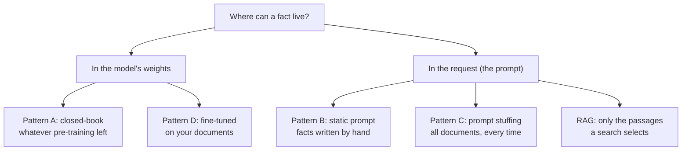

Before retrieval became the default, teams connected language models to their own information in a handful of simpler ways: ask the model and hope, write the facts into the prompt by hand, paste whole documents into every request, or retrain the model on the documents. Each of these still gets built today, usually as a first prototype, and each runs into the same set of engineering walls once real users and real documents arrive.

This lesson looks at those designs as *applications*: where the knowledge is kept, who can change it, what a request costs, and how you find out why an answer was wrong. The two lessons after it look inside the model, at [what it cannot know](/learn/introduction-to-rag/knowledge-limitations-of-llms) and [why it invents things](/learn/introduction-to-rag/hallucinations-and-factual-reliability). Here the model is treated as a box, and the subject is the system around it.

## Learning objectives

- Identify the four pre-retrieval application patterns and say where each one stores its knowledge.
- Explain why a model API call is stateless and what that implies for supplying knowledge.
- Evaluate a design against six operational requirements: coverage, freshness, provenance, cost, access control and debuggability.
- Estimate the per-request and daily token cost of pasting a knowledge base into every prompt.
- Recognise the symptoms that indicate an application has outgrown its pattern.

## Prerequisites

- [What is RAG?](/learn/introduction-to-rag/what-is-rag)
- [Why RAG was introduced](/learn/introduction-to-rag/why-rag-was-introduced)

## Why this matters

Nobody sets out to build a bad architecture. The patterns in this lesson are attractive because each takes an afternoon and demos well. The trouble shows up in month three: the prompt has grown to forty pages and nobody dares edit it, a policy change needs an engineer and a deployment, the finance team's figures have been shown to an intern, and when an answer is wrong there is nothing to inspect except the final text.

Recognising these patterns early saves a rewrite. It also gives you the vocabulary to explain to a stakeholder why "just tell the AI our policies" does not scale, without hand-waving. And it sets a fair standard for RAG itself: a retrieval system is only worth its extra moving parts if it actually does better on the requirements listed below, so you should know what they are before building one.

## The intuition

Picture four ways to staff a company help desk.

1. **Hire a well-read generalist and give them nothing.** They are articulate and know how companies usually work. Asked about *your* expenses policy, they describe a typical one.
2. **Give the generalist a sticky note.** You write the ten most-asked facts on a note stuck to their monitor. It works until the eleventh question, and until the note is out of date.
3. **Make them re-read the entire manual before every call.** Every answer is now informed, every call takes far longer and costs far more, and when the manual outgrows what a person can read in one sitting the scheme collapses.
4. **Send them on a training course whenever anything changes.** After the course they know the policies by heart, more or less. But courses are slow and expensive, they cannot un-learn what was true last year, and they cannot tell you which page a fact came from.

What you want is the fifth arrangement: the generalist sits next to a well-organised filing cabinet and pulls the relevant page for each call. Patterns one to four are the subject of this lesson; the filing cabinet is the rest of the course.

## How it works

### First, a fact about model APIs: every call starts from nothing

A hosted language model does not remember your previous requests. Each API call is independent: the model sees the text in that request and nothing else, and when the response has been sent, nothing is retained. This property is called being **stateless**. A chat product appears to remember because the application resends the whole conversation with each new message.

The consequence for knowledge is direct. There are exactly two places an application can put a fact so that the model can use it:

- **in the model's weights**, through training, or
- **in the request**, as text in the prompt.

Every pattern below is a choice between these two, and so is RAG. What distinguishes RAG is *how the text for the request is chosen*: by a search, per question.



### The four patterns

**Pattern A: closed-book.** The application forwards the user's question to the model with, at most, a short instruction about tone. All knowledge is whatever the model absorbed in training. This is correct for tasks that need no private facts (rewriting a paragraph, explaining recursion) and wrong for any question about your organisation.

**Pattern B: the static prompt.** Someone writes the important facts into the system prompt (the standing instructions sent with every request): "Annual leave is 25 days. The support desk is open 08:00 to 18:00." It is simple and it works for a small, stable set of facts. The prompt is now a hand-maintained database with no schema, no owner and no history.

**Pattern C: prompt stuffing.** The application loads the documents themselves, all of them, into every request. No one has to decide which facts matter, and the model sees original wording. The cost is paid on every call, and there is a hard ceiling: a model accepts only a limited amount of input, called its **context window** (covered in [Context windows](/learn/understanding-large-language-models/context-windows)).

**Pattern D: fine-tuning on the documents.** **Fine-tuning** means continuing a model's training on your own examples so that its weights change. Teams try it to "teach the model the handbook". Fine-tuning is a good tool for changing *how* a model behaves (style, format, a specialised task) and a poor one for storing facts that must be exact, current and attributable. [RAG versus fine-tuning](/learn/introduction-to-rag/rag-versus-fine-tuning) makes the comparison in full; the points that matter here are operational and appear in the table below.

### Six requirements, and how the patterns score

A knowledge application in production has to satisfy more than "gives a good answer in the demo". These six requirements recur throughout the course.

1. **Coverage.** Can it answer from *all* the relevant private material, not a sample?
2. **Freshness.** When a document changes, how long until answers change, and who has to do what?
3. **Provenance.** Can a user see which document an answer came from and check it?
4. **Cost and latency.** What does one request cost, and how does that grow as the knowledge base grows?
5. **Access control.** Can two users with different permissions get different answers from the same system?
6. **Debuggability.** When an answer is wrong, is there an intermediate result to inspect?

| Requirement | A: closed-book | B: static prompt | C: prompt stuffing | D: fine-tuning |
| --- | --- | --- | --- | --- |
| Coverage of private knowledge | None | Only what someone typed in | Everything, until the window is full | Partial and inexact |
| Freshness | Fixed at the model's training | Edit and redeploy the prompt | Reload documents | Run another training job |
| Provenance | None | None, unless hand-labelled | Possible if documents are labelled | None |
| Cost per request as knowledge grows | Flat | Grows with the prompt | Grows linearly with the corpus | Flat per request; training cost per update |
| Per-user access control | Not applicable | No: one prompt for everyone | Only by building a prompt per user | No: weights are shared by all users |
| Debuggability | Only the output | Read the prompt | Read a very long prompt | Only the output |

Reading across the rows explains most real-world disappointments.

**Freshness is an organisational problem as much as a technical one.** In patterns B and D the people who own the knowledge (HR, IT, product) cannot update it themselves. A policy change becomes a ticket for an engineer, then a prompt edit or a training run, then a deployment. The delay is measured in days, and during it the assistant is confidently out of date.

**Provenance decides whether anyone trusts the system.** An answer with no source has to be taken on faith or checked by hand, and if it must be checked by hand the assistant has saved nothing. Patterns A and D cannot supply a source at all, because a model cannot report which training text a statement came from.

**Cost in pattern C scales with the wrong variable.** The price of a request should depend on how hard the question is. In prompt stuffing it depends on how much documentation the company owns. The "In code" section puts numbers on this.

**Access control cannot be bolted on.** If salary bands are in the prompt or the weights, they are available to every user who phrases a question well. An instruction such as "do not reveal salary information to non-managers" is a request to the model, not a control, and instructions can be talked around.

**Deletion is a special case of freshness.** Removing a fact from a prompt is an edit. Removing a fact from trained weights has no reliable procedure short of retraining without it, which matters when the fact is a person's data and they have asked for it to be erased.

**Debuggability is what lets a system improve.** With only an output to look at, the options for fixing a wrong answer are to reword the prompt and try again. There is no way to tell "the model never had the fact" from "the model had it and ignored it".

### What RAG changes, and what it does not

RAG keeps knowledge in the request, like patterns B and C, but selects it per question from an index that lives outside the application code. That one change moves every row: coverage is the whole index, freshness is a re-index of the changed document by whoever owns it, provenance comes from the labelled passages, cost depends on the number of passages retrieved, access control is a filter applied during search, and the retrieved passages are an intermediate result you can read.

It is not free. A RAG system adds an indexing pipeline, a search component and a new way to fail (retrieving the wrong thing). For a task with no private knowledge, pattern A is the right design. For five stable facts, pattern B is. The patterns are problems only when they are stretched past what they suit.

## In code

**The problem.** Put numbers on pattern C. How many tokens does it take to paste a knowledge base into every request, when does it stop fitting, and what does it cost per day compared with sending only a few retrieved passages?

**Dependencies.** tiktoken, a tokeniser library, to convert text into token counts.

```bash
pip install tiktoken
```

First, what pattern C looks like in an application. This block needs an API key and was not run; it is here so you can recognise the pattern:

```python
import anthropic

client = anthropic.Anthropic()  # reads ANTHROPIC_API_KEY from the environment

HANDBOOK = open("handbook.txt", encoding="utf-8").read()   # the entire document, every time


def ask(question: str) -> str:
    prompt = f"Handbook:\n{HANDBOOK}\n\nQuestion: {question}"
    response = client.messages.create(
        model="claude-opus-5-5",
        max_tokens=1024,
        system="Answer only from the provided context. If the answer is not there, say you don't know.",
        messages=[{"role": "user", "content": prompt}],
    )
    return "".join(block.text for block in response.content if block.type == "text")
```

Nothing in `ask` depends on what the question is about. A question about the support desk's opening hours pays for the model to read the parental-leave policy, the expenses rules and everything else.

Now the arithmetic, which runs anywhere. The script measures how many tokens a word of handbook text costs, then projects three sizes of knowledge base. Three inputs are assumptions you should replace with your own: the context window, the price, and the traffic.

```python
import tiktoken

DOCS = [
    "Annual leave is 25 days per year. Up to 5 unused days carry over and must be used by 31 March.",
    "Staff may work remotely up to 3 days a week. The home-office equipment budget is £400.",
    "Expenses must be submitted within 30 days. Any expense over £75 needs a receipt.",
    "Passwords must be rotated every 90 days. The VPN is required on public Wi-Fi.",
    "Laptops are replaced on a 3-year refresh cycle.",
    "The support desk is open from 08:00 to 18:00 UK time.",
]

# An approximation: every model family has its own tokeniser, so treat counts as estimates.
enc = tiktoken.get_encoding("cl100k_base")

words = sum(len(d.split()) for d in DOCS)
tokens = sum(len(enc.encode(d)) for d in DOCS)
ratio = tokens / words
print(f"mini-corpus: {words} words, {tokens} tokens, {ratio:.2f} tokens per word\n")

WINDOW = 200_000           # assumed context window, in tokens
PRICE_PER_MILLION = 3.0    # assumed input price in pounds; substitute your model's real price
QUERIES_PER_DAY = 2_000
RETRIEVED_WORDS = 5 * 200  # a retriever handing over 5 passages of about 200 words each


def daily_cost(prompt_tokens: float) -> float:
    return prompt_tokens * QUERIES_PER_DAY * PRICE_PER_MILLION / 1_000_000


knowledge_bases = {
    "one policy page": 500,
    "employee handbook": 100_000,
    "handbook + runbooks + docs": 2_000_000,
}

print(f"{'knowledge base':<28}{'stuffed tokens':>15}{'fits?':>7}{'cost/day':>11}{'retrieved tokens':>18}{'cost/day':>10}")
for name, kb_words in knowledge_bases.items():
    stuffed = kb_words * ratio
    retrieved = min(kb_words, RETRIEVED_WORDS) * ratio
    fits = "yes" if stuffed <= WINDOW else "NO"
    print(f"{name:<28}{stuffed:>15,.0f}{fits:>7}{daily_cost(stuffed):>11,.2f}{retrieved:>18,.0f}{daily_cost(retrieved):>10,.2f}")
```

```output
mini-corpus: 84 words, 114 tokens, 1.36 tokens per word

knowledge base               stuffed tokens  fits?   cost/day  retrieved tokens  cost/day
one policy page                         679    yes       4.07               679      4.07
employee handbook                   135,714    yes     814.29             1,357      8.14
handbook + runbooks + docs        2,714,286     NO  16,285.71             1,357      8.14
```

**The important lines.**

- `enc.encode(d)` turns text into the integer tokens a model would read; its length is the token count. `cl100k_base` is one widely used encoding. Other model families tokenise differently, so use your provider's own token counter for billing-grade figures and treat these as estimates.
- `ratio` is measured, not assumed: 114 tokens for 84 words. The Meridian sentences are dense with numbers, times and a currency symbol, which split into several tokens each; plainer prose usually comes out lower.
- `min(kb_words, RETRIEVED_WORDS)` reflects that retrieval cannot send more than exists. For a single page, stuffing and retrieval are the same thing.

**What the output means.** Three regimes are visible. For one policy page the two approaches are identical, and adding a retriever would be wasted effort. For the whole handbook, stuffing still *fits* in the assumed window but each request carries about 136,000 input tokens, a hundred times what the retrieval prompt carries, and the daily bill reflects that ratio exactly. For the full knowledge base the question of cost never arises, because the prompt is more than thirteen times too large to send. The retrieved column does not change between the last two rows: per-request cost has been decoupled from corpus size.

The cost column is input tokens only and depends entirely on the assumed price and traffic. The ratio between the two columns does not.

**Errors people commonly hit.** tiktoken downloads its encoding file the first time it is used, so the first call fails on a machine with no network access. Counting characters or words instead of tokens gives estimates that are off by a variable factor, as the measured 1.36 shows. And people forget the output side: the answer's tokens are billed too, usually at a higher price than input.

**How to extend it.** Add output tokens to `daily_cost`. Replace the fixed traffic with a range to find the break-even point. Add a row for your own document set by counting its words with `len(text.split())`.

## A real-world example

Corran Logistics, a fictional parcel carrier, launches a customer-support assistant. The first version is pattern B: a system prompt containing about forty question-and-answer pairs written by the support lead. It handles the commonest questions well and the project is declared a success.

Over the next six months the prompt grows. Every escalated ticket ends with "add it to the prompt". By the autumn it holds several hundred entries, written by a dozen people. Three problems arrive together. Two entries about weekend delivery contradict each other, because the surcharge changed and only one was updated; the assistant gives either answer depending on the phrasing of the question. Depot-specific instructions meant for business customers are quoted to consumers, because everything is in one prompt that every user shares. And each change still goes through an engineer and a release, so the support team keeps a private list of "things the bot gets wrong this week".

The team's first reaction is pattern C: drop the hand-written entries and load the full help-centre export into each request. It fits, and answers improve, but the monthly bill rises by roughly the factor the arithmetic above predicts, and responses slow noticeably because the model reads the whole export for every "where is my parcel?".

What finally works is moving the knowledge out of the prompt into an index that the support team edits through their existing help-centre tool, with each article tagged by audience. The engineering lesson they record is not that the early versions were foolish. It is that nobody had written down the requirements, so nobody noticed when freshness, access control and cost stopped being met.

## Common mistakes

- **Using the prompt as a database.** Facts accumulate in a system prompt with no owner or review, and contradictions and stale entries follow. The assistant's answers then vary with phrasing.
- **Judging a design by a demo.** Ten hand-picked questions against a small document set say nothing about cost, freshness or access control at production scale.
- **Assuming the model remembers earlier requests.** Developers "tell" the model a fact in one call and expect it in the next. Each call is independent; anything not resent is gone.
- **Fine-tuning to store facts.** Teams spend weeks preparing training data, then find the model paraphrases figures loosely and cannot cite them, and that the next policy change requires doing it again.
- **Treating instructions as access control.** "Do not reveal X" in a prompt is routinely circumvented. If a user must not see a fact, it must not be in their request.
- **Sizing cost on input price alone.** Latency and output tokens also grow, and a long prompt is slower for every user, not only expensive.

## Best practices

- Write the six requirements down for your application before choosing a design, with a concrete target for each ("a policy edit is live within an hour", "every answer names its source").
- Choose the simplest pattern that meets them. Closed-book for tasks with no private knowledge, a static prompt for a handful of stable facts, retrieval once knowledge is large, changing or permissioned.
- Keep knowledge out of application code. Whoever owns a document should be able to change what the assistant says without an engineer.
- Measure prompt size in tokens on every request and alert when it grows, in the same way you would watch a database query's row count.
- Keep an intermediate, inspectable artefact between the question and the answer. Being able to see what the model was given is worth more than any amount of prompt rewording.

## Performance considerations

For a hosted model, the time to produce an answer has two parts: reading the input and writing the output. Both grow with length. The arithmetic for pattern C is therefore unfavourable in three ways at once.

*Cost.* Input cost per day is prompt tokens × requests × price. With the figures above, the handbook case is $135{,}714 \times 2{,}000 = 271$ million input tokens a day, against $1{,}357 \times 2{,}000 = 2.7$ million for retrieval. Whatever the price per token, the ratio is 100 to 1.

*Latency.* A model must process every input token before it emits its first output token, so a prompt a hundred times longer delays the start of every answer. The user asking about support-desk hours waits for the model to read the entire handbook.

*Throughput.* Providers limit the tokens you may send per minute. A fixed limit shared among requests that are a hundred times larger serves a hundredth as many users.

Some providers offer **prompt caching**, which reduces the price and delay of a repeated prompt prefix. It softens the cost of patterns B and C for stable content; it does not raise the context-window ceiling, and it does nothing for provenance or access control. [RAG versus long-context prompting](/learn/introduction-to-rag/rag-versus-long-context-prompting) weighs these trade-offs properly.

Pattern D inverts the profile: requests are cheap because the prompt is short, and the cost moves to training, which is paid again on every knowledge update.

## Security considerations

- **Shared knowledge is shared with everyone.** In patterns B, C and D there is one prompt or one set of weights for all users. Anything in it should be treated as readable by any user of the application, including through deliberate attempts to extract the system prompt.
- **Weights can leak training text.** A model fine-tuned on internal documents may reproduce passages from them. Personal data and credentials must be removed before training, and cannot be reliably removed afterwards.
- **Secrets do not belong in prompts.** API keys, internal URLs and credentials written into a system prompt for the model's convenience are exposed to the same extraction risk.
- **Erasure requests need a mechanism.** If a person's data must be deletable, store it where deletion is an operation you can perform and verify, which rules out weights.

## Summary

- A model API call is stateless, so a fact can reach the model in only two ways: through its weights or through the text of the request.
- The four pre-retrieval patterns are closed-book, static prompt, prompt stuffing and fine-tuning on documents; each is reasonable within limits.
- Six requirements expose those limits: coverage, freshness, provenance, cost and latency, access control, and debuggability.
- Prompt stuffing makes per-request cost proportional to the size of the knowledge base, and it fails outright when the documents exceed the context window.
- Knowledge held in a shared prompt or in weights cannot be permissioned per user, and knowledge in weights cannot be reliably deleted or cited.
- RAG keeps knowledge in the request but chooses it per question from an external index, which is what moves all six requirements.

## Exercises

**1.** For each application, name the simplest adequate pattern (A, B, C or retrieval) and justify it in one sentence: (a) a tool that rewrites emails in a friendlier tone; (b) a bot that answers "what are your opening hours and address?" for a single shop; (c) an assistant over 40,000 support articles that change daily; (d) a tool that answers questions about one 12-page contract the user has just uploaded.

<details><summary>Show solution</summary>

(a) Pattern A: the task needs no private knowledge. (b) Pattern B: two stable facts fit comfortably in a system prompt and rarely change. (c) Retrieval: the corpus is far too large to send, changes daily, and needs sources. (d) Pattern C: a 12-page document fits easily in one request and the user wants answers from all of it, so a search step adds little. The principle is to choose by size, rate of change and permission needs, not by fashion.

</details>

**2.** A developer writes two API calls. The first says "Remember that our support desk closes at 18:00." The second asks "When does our support desk close?" and the model answers that it has no information about this. Explain what happened and give two ways to fix it.

<details><summary>Show solution</summary>

Each call is stateless: the second request did not contain the fact, and the model retains nothing from the first. Fixes: include the fact in the second request, either by resending the earlier exchange as conversation history or by placing the fact in the system prompt (pattern B); or store the fact in an index and retrieve it when a relevant question arrives (RAG). "Telling the model" persistently is not possible through the API.

</details>

**3.** Using the script's measured ratio of 1.36 tokens per word, a 200,000-token window and 1,000 tokens reserved for the question and answer, what is the largest knowledge base, in words, that pattern C can handle? If your documents average 400 words each, how many is that? Then modify the script to compute it.

<details><summary>Show solution</summary>

Available input: $200{,}000 - 1{,}000 = 199{,}000$ tokens. In words: $199{,}000 / 1.357 \approx 146{,}600$. At 400 words per document that is about 366 documents.

```python
RESERVED = 1_000
max_words = (WINDOW - RESERVED) / ratio
print(f"max knowledge base: {max_words:,.0f} words, about {max_words / 400:,.0f} documents of 400 words")
```

Appended to the lesson's script this prints `max knowledge base: 146,632 words, about 367 documents of 400 words` (the script uses the unrounded ratio, hence the small difference from the hand calculation). The practical ceiling is lower still: this is the point where the prompt stops fitting, and cost and latency become unacceptable well before it.

</details>

**4.** Meridian's finance team wants AskMeridian to answer budget questions, but budget documents may only be seen by managers. A colleague proposes adding the documents to the shared prompt with the instruction "Only discuss budgets with managers." Explain why this fails the access-control requirement and outline a design that meets it.

<details><summary>Show solution</summary>

In the proposal every user's request contains the budget documents, so the only barrier is the model's willingness to follow an instruction. The model cannot verify who is a manager, and instructions can be evaded by rephrasing or by text that tells the model to disregard them. The data has already been disclosed to the request of an unauthorised user.

A design that meets the requirement keeps unauthorised text out of the request entirely. Tag each document with the groups allowed to read it. Authenticate the user in the application, not in the prompt, and look up their groups. At retrieval time, search only documents whose tags match the user's groups, so a non-manager's prompt never contains budget text. Log which documents were retrieved for which user so the control can be audited. The module [RAG Security Fundamentals](/learn/rag-security-fundamentals) develops this.

</details>

## Check your understanding

```quiz
[
  {
    "q": "A hosted model's API is described as stateless. What does that mean for an application?",
    "options": [
      "The model cannot process more than one request at a time",
      "The model's weights change slightly after every request",
      "The model only sees what is in the current request; nothing carries over from earlier calls",
      "The application does not need to send a system prompt"
    ],
    "answer": 2,
    "why": "Each call is independent. Any fact or conversation history the model should use must be included in that request, which is why chat applications resend the conversation."
  },
  {
    "q": "In prompt stuffing (pattern C), what mainly determines the input cost of a request?",
    "options": [
      "The size of the whole knowledge base",
      "The difficulty of the question",
      "The number of users online",
      "The length of the answer"
    ],
    "answer": 0,
    "why": "Every request carries all the documents, so input tokens, and therefore cost and delay, grow with the corpus regardless of what was asked."
  },
  {
    "q": "The lesson's script printed 135,714 stuffed tokens and 1,357 retrieved tokens for the handbook. If the price per token doubled, what would happen to the ratio between the two daily costs?",
    "options": [
      "It would double",
      "It would halve",
      "It would depend on the number of queries per day",
      "It would stay at about 100 to 1"
    ],
    "answer": 3,
    "why": "Both costs are tokens x requests x price, so price and traffic cancel in the ratio. Only the token counts matter: 135,714 / 1,357 is about 100."
  },
  {
    "q": "Why is fine-tuning a model on the employee handbook a weak way to meet the provenance requirement?",
    "options": [
      "Fine-tuned models cannot answer questions",
      "A model cannot report which training text a statement came from",
      "Fine-tuning makes responses slower",
      "Fine-tuned models refuse to discuss policies"
    ],
    "answer": 1,
    "why": "Training blends documents into weights. There is no record linking an output to a source passage, so the answer cannot be cited or checked against its origin."
  },
  {
    "q": "A system prompt contains salary bands plus the line \"Never reveal salary bands to non-managers.\" Why is this not access control?",
    "options": [
      "System prompts are ignored by current models",
      "The instruction is too short to be effective",
      "The data is present in every user's request, and an instruction to the model can be circumvented",
      "Salary data cannot be tokenised"
    ],
    "answer": 2,
    "why": "Real access control keeps unauthorised data out of the request. Once it is in the prompt, the only safeguard is the model's compliance, which a determined user can often get around."
  }
]
```

## Further reading

- Lewis, Perez, Piktus et al. (2020), *Retrieval-Augmented Generation for Knowledge-Intensive NLP Tasks*: [arxiv.org/abs/2005.11401](https://arxiv.org/abs/2005.11401). The introduction lists the shortcomings of parametric-only models that this lesson restates in engineering terms.
- Anthropic API documentation, for the Messages API, context window sizes, token counting and prompt caching: [docs.anthropic.com](https://docs.anthropic.com/).
- Carlini, Tramèr, Wallace et al. (2021), *Extracting Training Data from Large Language Models*, USENIX Security Symposium. The standard reference for models reproducing text they were trained on.
- Jurafsky and Martin, *Speech and Language Processing* (3rd edition draft), chapters on large language models and on retrieval-augmented generation: [web.stanford.edu/~jurafsky/slp3](https://web.stanford.edu/~jurafsky/slp3/).
- The later lessons [RAG versus fine-tuning](/learn/introduction-to-rag/rag-versus-fine-tuning) and [RAG versus long-context prompting](/learn/introduction-to-rag/rag-versus-long-context-prompting), which take patterns D and C in turn and compare each with retrieval in depth.
