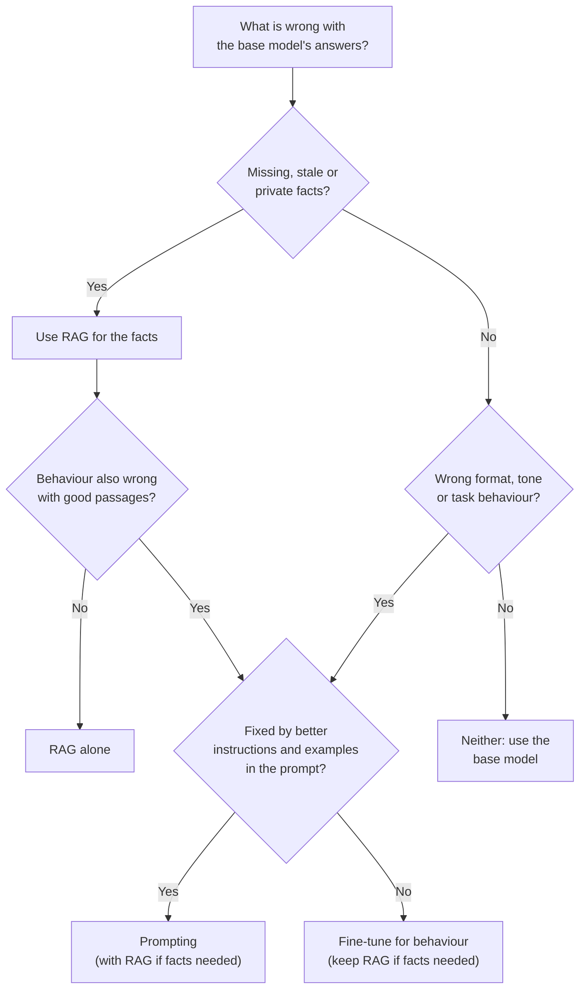

When a team wants a language model to "know about our business", two approaches are always proposed. One is retrieval-augmented generation: keep the documents in a store and show the relevant passages to the model at question time. The other is **fine-tuning**: continue training the model on your own data so that its weights change. They are often presented as rivals. They are better understood as tools for different jobs, and a good engineer can say which job each one does, what each costs, and when to use both.

This lesson compares the two fairly. It explains what fine-tuning really does to a model, sets out where each approach is strong and weak, gives a decision framework, and works through the cost arithmetic in Python. The prices in that arithmetic are assumptions chosen for illustration, not quotes; the method is what you should take away.

## Learning objectives

- Describe what fine-tuning changes in a model and how that differs from what retrieval changes.
- Compare RAG and fine-tuning on knowledge freshness, provenance, access control, behaviour change, latency and cost.
- Apply a decision framework to choose RAG, fine-tuning, both or neither for a stated requirement.
- Calculate the monthly cost of each approach and the query volume at which they break even, from explicit assumptions.
- Explain how the two approaches are combined in practice.

## Prerequisites

- [What is RAG?](/learn/introduction-to-rag/what-is-rag)
- [Parametric versus non-parametric knowledge](/learn/introduction-to-rag/parametric-versus-non-parametric-knowledge)
- [How retrieval improves generation](/learn/introduction-to-rag/how-retrieval-improves-generation)

## Why this matters

This is usually the first architectural decision on a project, and it is expensive to reverse. A team that fine-tunes when it should have retrieved discovers, months later, that its model gives yesterday's prices, cannot say where an answer came from, and needs a training run for every policy change. A team that builds retrieval when it needed fine-tuning discovers that no amount of context makes the model produce the exact output format its downstream system requires, and that every request carries two thousand tokens of instructions and examples.

Both mistakes come from the same confusion: treating "make the model better at our domain" as one requirement. It is at least two. One is about **knowledge** (what facts are available when answering). The other is about **behaviour** (how the model responds: its format, tone, task and vocabulary). The two approaches act on different ones.

## The intuition

Suppose Meridian hires a new support engineer.

There are things you *train* her in: how Meridian writes to customers, how to triage a ticket, the shape of a good incident report. This takes weeks, it changes how she works, and once learnt it applies to every ticket without her consulting anything. That is fine-tuning.

There are things you would never try to train into her: the current password rotation period, this quarter's on-call rota, the text of each runbook. You give her access to the documentation and expect her to look things up. If a runbook changes on Tuesday, she is right on Tuesday, because she reads the new version. That is retrieval.

Nobody asks whether training or documentation is "better" for an employee. A trained engineer with no documentation guesses at specifics. An untrained one with perfect documentation reads the right page and writes a poor reply. You train for skills and you document facts.

## How it works

### What fine-tuning does

A model's weights are set by training on a very large body of general text. **Fine-tuning** is a further, much smaller round of training on examples you supply, starting from the already-trained weights. Each example is typically an input and the output you want for it. The training process nudges the weights so that the model's outputs move towards yours.

1. **Collect examples.** Hundreds to many thousands of input-and-desired-output pairs that show the behaviour you want.
2. **Hold some back.** Keep a portion out of training so that you can test on examples the model has not seen.
3. **Train.** Run the examples through the model for a few passes (each pass over the data is called an **epoch**), adjusting weights to reduce the difference between the model's output and yours.
4. **Evaluate.** Check the held-back examples, and also check that general abilities you rely on have not got worse.
5. **Deploy** the result as a new model version.
6. **Repeat** from step 1 whenever the desired behaviour, or any knowledge you trained in, changes.

Full fine-tuning updates every weight. A widely used cheaper alternative is **LoRA** (low-rank adaptation; Hu et al., 2021), which freezes the original weights and trains a small set of additional ones. Either way, the outcome is the same kind of thing: a change to [parametric memory](/learn/introduction-to-rag/parametric-versus-non-parametric-knowledge).

Whether you *can* fine-tune depends on the model. Some hosted models offer it as a service, many do not, and open-weight models can be fine-tuned on your own hardware. Check before you design around it.

### What each approach changes

| | Fine-tuning | RAG |
| --- | --- | --- |
| What is modified | The model's weights | The prompt, per question |
| When the work happens | Before deployment, in a training run | At question time, in a search |
| What it is good at changing | Behaviour: format, tone, task, vocabulary | Knowledge: which facts are in view |
| Result of a change in your documents | Out of date until retrained | Up to date after re-indexing |

A short way to remember it: fine-tuning teaches the model *how* to respond; retrieval tells it *what* is true right now.

### Why fine-tuning is a poor way to add facts

It is natural to think that training on your handbook "puts the handbook in the model". It does so only loosely.

- **Recall is unreliable.** Training adjusts weights to imitate patterns across examples. A fact that appears once in the training data is weakly learnt. Ovadia et al. (2023) compared retrieval with unsupervised fine-tuning for adding knowledge and reported that retrieval performed better in their experiments, and that models struggled to learn new facts through fine-tuning unless the same fact was presented in many variations.
- **There is no source.** A fine-tuned model cannot say which document a claim came from, because the document no longer exists as far as the model is concerned.
- **It goes stale.** Every change to the facts needs a new training run and a new evaluation.
- **Everyone gets the same model.** Anything trained in is available to every user. There is no per-user permission on weights.
- **It still hallucinates.** A fine-tuned model asked about something outside its training produces a fluent guess, now in your house style, which makes the guess more convincing.
- **It can damage other abilities.** Training hard on a narrow dataset can degrade skills the model had before, an effect known as catastrophic forgetting.

### Where fine-tuning is the right tool

A fair comparison must say as clearly where fine-tuning wins.

- **Strict, consistent output.** If every response must follow an exact structure or a house style, hundreds of examples teach this more reliably than instructions, and without spending prompt tokens on the instructions every time.
- **A narrow task done at volume.** Classifying tickets, extracting fields from invoices, routing requests. A small fine-tuned model can match a large general one on the single task at a fraction of the running cost.
- **Domain language.** If the model misreads your field's abbreviations or notation, examples can teach it to read and write them.
- **Short prompts and low latency.** Behaviour baked into weights does not need to be explained in the prompt, so each request is shorter and faster.
- **Constrained deployment.** A small tuned model can run on your own hardware or offline, where sending documents to a hosted model is not allowed.

None of those is about supplying facts. That is the pattern.

### Where RAG is the right tool

- **Knowledge that changes**, because updating is a re-index, not a training run.
- **Answers that must cite a source**, because the retrieved passage is the source.
- **Knowledge that differs by user**, because search results can be filtered by permission before the model sees them.
- **Knowledge that must be deletable**, because a document can be removed from a store.
- **Large or long-tail knowledge**, because a store holds millions of rarely needed facts exactly, where weights would hold them vaguely.
- **Getting started quickly**, because it needs no training data and works with any model, including ones you cannot fine-tune.

Retrieval has real costs too: a search step and an index to operate, more input tokens on every request, and a new way to fail (the right passage is not found, as [the previous lesson](/learn/introduction-to-rag/how-retrieval-improves-generation) showed).

### A decision framework

Start from the requirement, not from the technique.

| If your requirement is... | Reach first for | Why |
| --- | --- | --- |
| Answers must reflect documents that change | RAG | Updating is a write to a store |
| Answers must show their source | RAG | The passage has an identifier |
| Different users may see different documents | RAG | Filter at retrieval; weights cannot |
| Output must follow a strict format or voice | Prompting, then fine-tuning | Behaviour lives in instructions or weights |
| One narrow task, very high volume | Fine-tuning a small model | Short prompts, cheap inference |
| The model misreads domain jargon | Fine-tuning (or a glossary in the prompt) | It is a reading skill, not a fact |
| The model ignores or misuses retrieved passages | Better prompts, then fine-tuning for RAG | A behaviour problem inside a RAG system |
| Stable general knowledge, general tasks | Neither | The base model already does this |



The order of the questions reflects cost. Better prompting takes hours and is reversible. Retrieval takes days to weeks to build and is easy to change afterwards. Fine-tuning needs a dataset, a training pipeline and an evaluation suite, and each iteration is slow. Try them in that order and stop when the requirement is met.

### Using both

The two combine in three established ways.

- **Fine-tune the generator, retrieve the facts.** A model tuned for your output format and tone, fed passages by a retriever. Behaviour comes from weights and knowledge from the store.
- **Fine-tune the generator to use context well.** Training examples that contain retrieved passages, including irrelevant ones, teach the model to quote the relevant passage and ignore the rest. RAFT (Zhang et al., 2024) is one published method of this kind.
- **Fine-tune the retriever.** The embedding model that powers search can be trained on your domain so that the right passages are found more often. This is covered in [Fine-tuning embeddings](/learn/embedding-optimisation/fine-tuning-embeddings).

The original RAG paper did a version of this: Lewis et al. (2020) trained the retriever's query encoder and the generator together, so RAG and fine-tuning have been combined since the first paper to use the name.

## The mathematics

**Intuition.** RAG pays a little extra on every question, because the passages are extra input tokens. Fine-tuning pays a lump sum for each training run and then has shorter prompts. Which is cheaper depends on how many questions you answer and how often your knowledge changes.

Let $Q$ be questions per month. The monthly cost of RAG is

$$
C_{\text{RAG}} = F + Q \cdot \frac{(t_q + t_s + t_c)\,p_{\text{in}} + t_a\,p_{\text{out}}}{10^6}
$$

and the monthly cost of a fine-tuned model with no retrieval is

$$
C_{\text{FT}} = U \cdot \frac{T \cdot E \cdot p_{\text{train}}}{10^6} + Q \cdot m \cdot \frac{(t_q + t_s)\,p_{\text{in}} + t_a\,p_{\text{out}}}{10^6}
$$

where:

- $t_q$, $t_s$, $t_a$ are the tokens in the question, the system prompt and the answer; $t_c$ is the tokens of retrieved context, which only RAG pays for.
- $p_{\text{in}}$ and $p_{\text{out}}$ are the base model's prices per million input and output tokens.
- $F$ is the fixed monthly cost of running retrieval (the vector store).
- $U$ is the number of retraining runs per month, $T$ the training tokens per run, $E$ the number of epochs and $p_{\text{train}}$ the training price per million tokens.
- $m$ is a multiplier for running a fine-tuned model compared with the base model ($m = 1$ if it costs the same).

Setting the two equal gives the break-even volume:

$$
Q^{*} = \frac{U \cdot R - F}{c_{\text{RAG}} - c_{\text{FT}}}
$$

where $R$ is the cost of one training run and $c_{\text{RAG}}$, $c_{\text{FT}}$ are the per-question costs. Above $Q^{*}$ fine-tuning is cheaper; below it RAG is. If $c_{\text{FT}} \ge c_{\text{RAG}}$ there is no break-even and RAG is always cheaper.

**Worked example.** All prices here are **assumed for illustration**: $p_{\text{in}} = \text{\textdollar}3$ and $p_{\text{out}} = \text{\textdollar}15$ per million tokens, $p_{\text{train}} = \text{\textdollar}25$ per million training tokens per epoch, $m = 1.5$, $F = \text{\textdollar}50$. The workload: $t_q = 50$, $t_s = 100$, $t_a = 200$, $t_c = 5 \times 300 = 1{,}500$, $Q = 20{,}000$, and $U = 4$ retraining runs a month of $T = 3$ million tokens for $E = 3$ epochs.

Per question:

$$
c_{\text{RAG}} = \frac{1{,}650 \times 3 + 200 \times 15}{10^6} = \frac{4{,}950 + 3{,}000}{10^6} = \text{\textdollar}0.00795
$$

$$
c_{\text{FT}} = 1.5 \times \frac{150 \times 3 + 200 \times 15}{10^6} = 1.5 \times \frac{3{,}450}{10^6} = \text{\textdollar}0.005175
$$

One training run costs $R = 3 \times 3 \times 25 = \text{\textdollar}225$. So for the month:

$$
C_{\text{RAG}} = 50 + 20{,}000 \times 0.00795 = 50 + 159 = \text{\textdollar}209
$$

$$
C_{\text{FT}} = 4 \times 225 + 20{,}000 \times 0.005175 = 900 + 103.50 = \text{\textdollar}1{,}003.50
$$

and the break-even volume is $Q^{*} = (900 - 50) / (0.00795 - 0.005175) = 850 / 0.002775 \approx 306{,}000$ questions a month.

The same in Python:

```python
M = 1_000_000

# ASSUMED prices in US dollars per million tokens. Not quotes from any provider.
p_in, p_out = 3.00, 15.00            # base model
premium = 1.5                        # fine-tuned model costs 1.5x the base model to run
p_train = 25.00                      # per million training tokens, per epoch

Q = 20_000                           # questions per month
t_question, t_system, t_answer = 50, 100, 200
t_context = 5 * 300                  # RAG adds five 300-token chunks

rag_per_query = ((t_question + t_system + t_context) * p_in + t_answer * p_out) / M
ft_per_query = ((t_question + t_system) * p_in + t_answer * p_out) * premium / M

rag_fixed = 50.00                    # vector store, per month
training_run = 3 * M * 3 * p_train / M   # 3M training tokens, 3 epochs
updates_per_month = 4

print(f"RAG per query        ${rag_per_query:.6f}")
print(f"Fine-tuned per query ${ft_per_query:.6f}")
print(f"One training run     ${training_run:.2f}")
print(f"RAG per month        ${rag_fixed + Q * rag_per_query:,.2f}")
print(f"Fine-tuned per month ${updates_per_month * training_run + Q * ft_per_query:,.2f}")
```

```output
RAG per query        $0.007950
Fine-tuned per query $0.005175
One training run     $225.00
RAG per month        $209.00
Fine-tuned per month $1,003.50
```

## In code

**The problem.** One scenario proves little. The useful question is how the comparison moves as query volume and update frequency change, and where the break-even lies. This example turns the formulas into a small cost model you can re-run with your own numbers.

**Dependencies.** Only the Python standard library (Python 3.10 or later).

**The source.**

```python
from dataclasses import dataclass

M = 1_000_000


@dataclass(frozen=True)
class Prices:
    """ASSUMED prices in US dollars per million tokens. Replace with your provider's."""
    base_input: float = 3.00
    base_output: float = 15.00
    tuned_premium: float = 1.5        # fine-tuned inference costs this multiple of base
    training: float = 25.00           # per million training tokens, per epoch
    embedding: float = 0.02           # per million tokens embedded
    vector_store_month: float = 50.00


@dataclass(frozen=True)
class Workload:
    queries_per_month: int
    updates_per_month: int            # how often the knowledge changes enough to matter
    question_tokens: int = 50
    system_tokens: int = 100
    answer_tokens: int = 200
    chunks_per_query: int = 5
    chunk_tokens: int = 300
    corpus_tokens: int = 2 * M        # handbook, runbooks and product documentation
    changed_fraction: float = 0.05    # share of the corpus re-embedded per update
    training_tokens: int = 3 * M      # question-and-answer pairs derived from the corpus
    epochs: int = 3


def rag_monthly(w: Workload, p: Prices) -> float:
    context = w.chunks_per_query * w.chunk_tokens
    per_query = ((w.question_tokens + w.system_tokens + context) * p.base_input
                 + w.answer_tokens * p.base_output) / M
    re_embedding = w.updates_per_month * w.corpus_tokens * w.changed_fraction * p.embedding / M
    return p.vector_store_month + re_embedding + w.queries_per_month * per_query


def fine_tuned_monthly(w: Workload, p: Prices) -> float:
    per_query = ((w.question_tokens + w.system_tokens) * p.base_input
                 + w.answer_tokens * p.base_output) * p.tuned_premium / M
    training_run = w.training_tokens * w.epochs * p.training / M
    return w.updates_per_month * training_run + w.queries_per_month * per_query


def break_even_queries(updates_per_month: int, p: Prices) -> float | None:
    """Monthly volume above which fine-tuning is cheaper, or None if it never is."""
    zero = Workload(queries_per_month=0, updates_per_month=updates_per_month)
    one = Workload(queries_per_month=1, updates_per_month=updates_per_month)
    fixed_gap = fine_tuned_monthly(zero, p) - rag_monthly(zero, p)
    saving_per_query = ((rag_monthly(one, p) - rag_monthly(zero, p))
                        - (fine_tuned_monthly(one, p) - fine_tuned_monthly(zero, p)))
    if saving_per_query <= 0:
        return None
    return max(fixed_gap, 0.0) / saving_per_query


prices = Prices()
print("One-off cost of embedding the whole corpus: "
      f"${Workload(0, 0).corpus_tokens * prices.embedding / M:.2f}\n")

print(f"{'queries/month':>13} {'updates/month':>14} {'RAG $':>12} {'fine-tuned $':>13}  cheaper")
for updates in (1, 4, 30):
    for queries in (1_000, 20_000, 100_000, 1_000_000):
        w = Workload(queries_per_month=queries, updates_per_month=updates)
        rag, tuned = rag_monthly(w, prices), fine_tuned_monthly(w, prices)
        print(f"{queries:>13,} {updates:>14} {rag:>12,.2f} {tuned:>13,.2f}  "
              f"{'RAG' if rag < tuned else 'fine-tuned'}")

print()
for updates in (1, 4, 30):
    volume = break_even_queries(updates, prices)
    print(f"{updates:>2} update(s) a month: fine-tuning is cheaper above {volume:,.0f} queries a month")

no_premium = Prices(tuned_premium=1.0)
print(f"\nSame, if the tuned model cost no more to run than the base model "
      f"(4 updates): {break_even_queries(4, no_premium):,.0f}")
```

**The important lines.**

- `Prices` and `Workload` hold every assumption in one visible place. A cost model with numbers scattered through the code cannot be audited.
- In `rag_monthly`, `context` is the term that only RAG pays: five chunks of 300 tokens added to every request. `re_embedding` is the cost of keeping the index current, and it is tiny.
- In `fine_tuned_monthly`, the prompt has no context, so it is shorter, but `training_run` is multiplied by `updates_per_month`. That product is the recurring price of keeping facts in weights.
- `break_even_queries` finds the per-query saving by evaluating each cost function at zero and one query, so it stays correct if you change the cost functions.

**The output.**

```output
One-off cost of embedding the whole corpus: $0.04

queries/month  updates/month        RAG $  fine-tuned $  cheaper
        1,000              1        57.95        230.18  RAG
       20,000              1       209.00        328.50  RAG
      100,000              1       845.00        742.50  fine-tuned
    1,000,000              1     8,000.00      5,400.00  fine-tuned
        1,000              4        57.96        905.17  RAG
       20,000              4       209.01      1,003.50  RAG
      100,000              4       845.01      1,417.50  RAG
    1,000,000              4     8,000.01      6,075.00  fine-tuned
        1,000             30        58.01      6,755.18  RAG
       20,000             30       209.06      6,853.50  RAG
      100,000             30       845.06      7,267.50  RAG
    1,000,000             30     8,000.06     11,925.00  RAG

 1 update(s) a month: fine-tuning is cheaper above 63,062 queries a month
 4 update(s) a month: fine-tuning is cheaper above 306,303 queries a month
30 update(s) a month: fine-tuning is cheaper above 2,414,393 queries a month

Same, if the tuned model cost no more to run than the base model (4 updates): 188,887
```

**What it means.** Under these assumptions:

- Embedding the entire two-million-token corpus costs four cents. Indexing is not where RAG's money goes; the context tokens on every question are.
- At low and moderate volume RAG is cheaper in every row, because fine-tuning's training runs are a fixed cost that few questions share.
- At high volume with rarely changing knowledge, fine-tuning's shorter prompts win on price. That is a real advantage and the reason fine-tuned small models are popular for narrow, high-volume tasks.
- The break-even climbs steeply with update frequency: from about 63,000 questions a month at one update to about 2.4 million at daily updates. Volatile knowledge makes parametric storage expensive.

Two caveats matter more than any row of the table. First, the model leaves out people: building and maintaining a training set, and evaluating each new model version, usually costs more than the training run itself. Second, the comparison treats the two systems as if they gave equally good answers, and for factual questions they do not: the fine-tuned model has no citations, no access control and less reliable recall. Cost decides between options that both meet the requirement. It does not rescue one that fails it.

**Errors people commonly hit.** `TypeError: unsupported operand type(s) for |` on the `float | None` annotation means Python older than 3.10; write `Optional[float]` from `typing` instead. Passing `None` from `break_even_queries` into a format string with `:,.0f` raises `TypeError`, which happens if you set prices so that the fine-tuned model is not cheaper per query; check for `None` first.

**How to extend it.** Add a third function for the combined design (a fine-tuned generator with retrieval): it pays the training runs *and* the context tokens, but retrains only when behaviour changes, not when facts do, so its `updates_per_month` is near zero. Then add an `engineer_hours` field with an hourly rate and see how quickly it dominates.

## A real-world example

Brightwater Energy, a fictional utility, wanted an assistant to help its contact-centre staff answer tariff questions. The data science team fine-tuned a model on the tariff guide and several thousand past question-and-answer pairs. In the pilot it sounded exactly like a Brightwater agent, and staff liked it.

Then prices changed, as energy prices do. The assistant continued to quote the old unit rates in a perfectly on-brand voice. Retraining took the team most of a week once data preparation and evaluation were counted, and a second change arrived before the first retrained model shipped. Separately, the regulator's guidance required that staff be able to see the source of any figure they quoted, and the model had none to give.

The team rebuilt the factual side with retrieval: the tariff guide went into an index that was refreshed whenever the document was republished, and answers cited the section they drew on. They did not throw the fine-tuning work away. The examples of good agent replies had real value as behaviour training, so they kept a tuned model for tone and structure and fed it retrieved passages. They also kept a second, much smaller fine-tuned model for a task that had nothing to do with facts: sorting incoming emails into a dozen categories, tens of thousands of times a day, with a short prompt. Each technique ended up doing the job it suits.

## Common mistakes

- **Fine-tuning to add facts that change.** The model is out of date from the first change onward, and each fix is a training run plus an evaluation.
- **Expecting a fine-tuned model to cite sources.** It cannot; provenance needs a passage with an identifier.
- **Fine-tuning before trying a better prompt.** Many format and tone problems disappear with clear instructions and a few examples in the prompt, at no training cost.
- **Using RAG to fix a behaviour problem.** If the output format is wrong, adding documents will not correct it and will make each request longer.
- **Training a shared model on restricted documents.** Every user of the model can then elicit that content; access control cannot be added afterwards.
- **Comparing costs without counting people or quality.** A spreadsheet that shows fine-tuning is cheaper per token says nothing about the dataset work or about whether the answers are right.
- **Evaluating only on the training examples.** A fine-tuned model looks excellent on data it has memorised and may be worse than the base model elsewhere.

## Best practices

- Write the requirement as "knowledge" or "behaviour" before choosing a technique; if it is both, plan for both.
- Escalate in order of cost: prompt, then retrieval, then fine-tuning. Stop when the requirement is met.
- Keep facts that change, need citing, or are permission-restricted out of the weights.
- If you fine-tune, hold out a test set, and also test general abilities you depend on, before and after.
- Version everything: the base model, the training data, the tuned model and the index, so a regression can be traced.
- Recalculate the cost model with your provider's actual prices and your measured token counts before making a decision on cost grounds.

## Performance considerations

**Latency.** A fine-tuned model without retrieval makes one call with a short prompt. In the worked example that is 150 input tokens against 1,650 for RAG, eleven times fewer for the model to read before it starts writing, and no search step in front. For high-volume, latency-sensitive, narrow tasks this is fine-tuning's strongest argument.

**Throughput.** Shorter prompts also mean more requests served for a given capacity, whether that capacity is a rate limit on a hosted model or a GPU you own.

**Size of a LoRA adapter.** LoRA replaces the update to a weight matrix of size $d \times d$ with two small matrices of sizes $d \times r$ and $r \times d$, where $r$ is a small number called the rank. That is $2dr$ trained numbers in place of $d^2$. With $d = 4{,}096$ and $r = 8$: $2 \times 4{,}096 \times 8 = 65{,}536$ against $4{,}096^2 = 16{,}777{,}216$, about 0.4% of the matrix. This is why adapter fine-tuning is cheap to train and why several adapters can share one base model.

**Time to update.** Often the deciding number is not money but delay. A re-index of a changed document completes in seconds to minutes. A fine-tuning cycle (prepare data, train, evaluate, deploy) takes hours at best and commonly days. If the business needs a change live today, only one of the two can do it.

## Security considerations

- **Weights have no access control.** Whatever a model was fine-tuned on is, in principle, obtainable by anyone who can query it. Fine-tune only on data that every user of the model is allowed to see.
- **Training data can be extracted.** Models can reproduce fragments of their training data verbatim. Personal data and secrets do not belong in a training set.
- **Erasure.** A deletion request against a document store is a delete. Against a fine-tuned model it means retraining without the data, and proving the result.
- **Where the data goes.** Fine-tuning a hosted model means uploading your training set to the provider; check the terms for retention and use.
- **RAG's own exposure.** Retrieved documents are untrusted input and can carry injected instructions; see [Indirect prompt injection](/learn/rag-security-fundamentals/indirect-prompt-injection). Permission filtering must happen at retrieval, as [Document-level permissions](/learn/access-control-and-privacy/document-level-permissions) explains.

## Summary

- Fine-tuning changes a model's weights and is suited to changing behaviour; RAG changes the prompt and is suited to supplying knowledge.
- For facts, RAG gives freshness, citations, per-user access control and deletion; fine-tuning gives none of these and recalls facts unreliably.
- For format, tone, narrow high-volume tasks and short prompts, fine-tuning is the stronger tool.
- Try prompting first, then retrieval, then fine-tuning, and combine them when a system needs both knowledge and behaviour.
- RAG's cost is per question (context tokens); fine-tuning's is per update (training runs). Fine-tuning becomes cheaper only at high volume with stable knowledge, and the break-even rises quickly as knowledge changes more often.
- Cost comparisons assume both options meet the requirement; check that first.

## Exercises

**1. Knowledge or behaviour?** Classify each requirement and name the technique you would try first: (a) the assistant must always reply in British English with a bulleted summary followed by a details section; (b) the assistant must know that the laptop refresh cycle is 3 years; (c) the assistant must label each incoming IT ticket as hardware, software, access or other; (d) the assistant must answer questions about a product manual that is republished monthly.

<details><summary>Show solution</summary>

(a) Behaviour. Try a clear system prompt with one or two examples first. Fine-tune only if the format still drifts or the instructions cost too many tokens at your volume.

(b) Knowledge. Retrieval from the handbook. It is a company-specific fact that could change and that staff may want to verify.

(c) Behaviour (a narrow task). Prompting with examples first; if volume is high, a small fine-tuned classifier is a strong candidate because prompts are short and the task is stable.

(d) Knowledge that changes monthly. Retrieval, with the index refreshed on each republication. Fine-tuning would need a monthly training run and could not cite the manual.

</details>

**2. Recompute the break-even.** Using the lesson's assumed prices, suppose retrieval is tuned to send three chunks of 300 tokens instead of five, and knowledge changes once a month. Compute the new per-question cost of RAG and the new break-even volume by hand.

<details><summary>Show solution</summary>

RAG input tokens are now $50 + 100 + 900 = 1{,}050$.

$$
c_{\text{RAG}} = \frac{1{,}050 \times 3 + 200 \times 15}{10^6} = \frac{3{,}150 + 3{,}000}{10^6} = \text{\textdollar}0.00615
$$

$c_{\text{FT}}$ is unchanged at $\text{\textdollar}0.005175$, so the saving per question is $0.00615 - 0.005175 = \text{\textdollar}0.000975$.

With one update a month the fixed gap is $225 - 50 = \text{\textdollar}175$ (ignoring the few tenths of a cent of re-embedding), so

$$
Q^{*} = \frac{175}{0.000975} \approx 179{,}500 \text{ questions a month}
$$

With five chunks the same case broke even at about 63,000. Sending less context narrowed fine-tuning's per-question advantage and pushed the break-even almost three times higher. Trimming retrieved context is often the cheapest optimisation available to a RAG system.

</details>

**3. Add the combined design (code).** Extend the lesson's cost model with a function `hybrid_monthly` for a fine-tuned generator that also uses retrieval. Assume it retrains only when behaviour changes, once every six months. Compare it with pure RAG at 20,000 questions and 4 knowledge updates a month.

<details><summary>Show solution</summary>

```python
def hybrid_monthly(w: Workload, p: Prices, behaviour_retrains_per_month: float = 1 / 6) -> float:
    context = w.chunks_per_query * w.chunk_tokens
    per_query = ((w.question_tokens + w.system_tokens + context) * p.base_input
                 + w.answer_tokens * p.base_output) * p.tuned_premium / M
    training_run = w.training_tokens * w.epochs * p.training / M
    re_embedding = w.updates_per_month * w.corpus_tokens * w.changed_fraction * p.embedding / M
    return (p.vector_store_month + re_embedding
            + behaviour_retrains_per_month * training_run
            + w.queries_per_month * per_query)


w = Workload(queries_per_month=20_000, updates_per_month=4)
print(f"RAG    ${rag_monthly(w, prices):,.2f}")
print(f"hybrid ${hybrid_monthly(w, prices):,.2f}")
```

```output
RAG    $209.01
hybrid $326.01
```

The hybrid pays for context tokens at the tuned model's higher price ($20{,}000 \times 0.00795 \times 1.5 = \text{\textdollar}238.50$), the vector store ($\text{\textdollar}50$), and one sixth of a training run a month ($\text{\textdollar}37.50$). It costs more than pure RAG, which is expected: it is bought for behaviour, not for savings. Knowledge updates still cost almost nothing, because facts live in the index and only behaviour lives in the weights. If the tuned model lets you shorten the system prompt or drop in-prompt examples, reduce `system_tokens` accordingly and the gap narrows.

</details>

**4. Design decision.** A hospital group wants an assistant for nurses that answers questions from clinical protocols. Protocols are revised often, each ward may only see its own, and every answer must show the protocol section. The vendor proposes "a model fine-tuned on all your protocols for maximum accuracy". Evaluate the proposal and suggest a design.

<details><summary>Show solution</summary>

The proposal fails three stated requirements regardless of how accurate the tuned model is on a test set.

- **Frequent revisions.** Each revision would require retraining and re-evaluating. Between revision and deployment the assistant would give superseded guidance, which in a clinical setting is a safety issue.
- **Per-ward visibility.** A single fine-tuned model exposes all protocols to all users. Training one model per ward multiplies the retraining problem by the number of wards.
- **Showing the section.** Weights cannot provide a source.

A design that fits: store protocols in an index with ward and version metadata; filter retrieval by the nurse's ward and by the current version; pass the retrieved sections to a general model with instructions to answer only from them and cite the section; decline and refer to a clinician when nothing relevant is found. Fine-tuning may still have a place for behaviour, for example a concise, standard answer layout, or for improving the retriever on clinical abbreviations, but the protocol text itself belongs in the store.

</details>

## Check your understanding

```quiz
[
  {
    "q": "What does fine-tuning modify?",
    "options": [
      "The documents in the vector store",
      "The prompt sent with each question",
      "The model's weights, through further training on your examples",
      "The size of the context window"
    ],
    "answer": 2,
    "why": "Fine-tuning is additional training that starts from the pre-trained weights and adjusts them. It is a change to parametric memory."
  },
  {
    "q": "A team needs every answer to follow an exact JSON structure, and clear instructions with examples in the prompt have not made it reliable. Facts are not a problem. What should they consider?",
    "options": [
      "Fine-tuning on examples of the desired output, because this is a behaviour problem",
      "Adding more documents to the retrieval index",
      "Increasing the number of retrieved chunks",
      "Lowering the price per token"
    ],
    "answer": 0,
    "why": "Output structure is behaviour, which lives in instructions or weights. Retrieval supplies facts and will not change how the model formats its response."
  },
  {
    "q": "Using the lesson's assumed prices, RAG costs $0.00795 per question plus $50 a month, and the fine-tuned model costs $0.005175 per question plus $225 per training run. With 4 training runs a month, roughly where is the break-even?",
    "options": [
      "About 3,000 questions a month",
      "About 30,000 questions a month",
      "There is no break-even",
      "About 306,000 questions a month"
    ],
    "answer": 3,
    "why": "The fixed gap is 4 x 225 - 50 = 850 dollars and the per-question saving is 0.002775 dollars, so 850 / 0.002775 is about 306,000."
  },
  {
    "q": "Which requirement can RAG meet that fine-tuning alone cannot?",
    "options": [
      "Producing a consistent tone of voice",
      "Showing each user only the documents they are permitted to read",
      "Keeping prompts short",
      "Running without a network connection"
    ],
    "answer": 1,
    "why": "Retrieval can filter by the user's permissions before the model sees anything. A fine-tuned model's weights are the same for every user."
  },
  {
    "q": "In the cost model's output, the break-even rises from about 63,000 to about 2.4 million questions a month as updates go from 1 to 30 a month. What does this show?",
    "options": [
      "Embedding a corpus is the dominant cost of RAG",
      "Fine-tuned models are always more expensive to run",
      "The more often knowledge changes, the more expensive it is to keep that knowledge in weights",
      "RAG gets more expensive as knowledge changes more often"
    ],
    "answer": 2,
    "why": "Each change needs a training run, a fixed cost repeated per update, while re-indexing changed documents costs almost nothing. Volatile knowledge favours retrieval."
  }
]
```

## Further reading

- Lewis, P. et al. (2020). *Retrieval-Augmented Generation for Knowledge-Intensive NLP Tasks.* [arxiv.org/abs/2005.11401](https://arxiv.org/abs/2005.11401). Trains retriever and generator together.
- Ovadia, O. et al. (2023). *Fine-Tuning or Retrieval? Comparing Knowledge Injection in LLMs.* [arxiv.org/abs/2312.05934](https://arxiv.org/abs/2312.05934). An experimental comparison of the two for adding knowledge.
- Hu, E. J. et al. (2021). *LoRA: Low-Rank Adaptation of Large Language Models.* [arxiv.org/abs/2106.09685](https://arxiv.org/abs/2106.09685). The standard parameter-efficient fine-tuning method.
- Zhang, T. et al. (2024). *RAFT: Adapting Language Model to Domain Specific RAG.* [arxiv.org/abs/2403.10131](https://arxiv.org/abs/2403.10131). Fine-tuning a generator to use retrieved context.
- Kirkpatrick, J. et al. (2017). *Overcoming catastrophic forgetting in neural networks.* [arxiv.org/abs/1612.00796](https://arxiv.org/abs/1612.00796). The classic reference on forgetting during further training.
