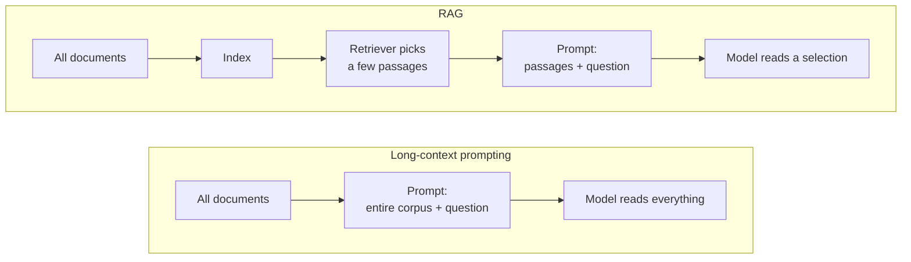
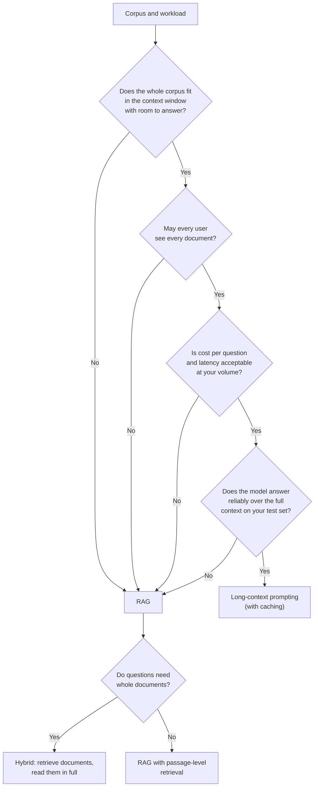

RAG was invented when language models could read only a few thousand tokens at a time, so selecting a handful of passages was the only way to get external knowledge in front of them. Models can now read hundreds of thousands of tokens in one request, and some read a million or more. That raises an obvious and fair question: why build a retrieval system at all? Why not paste every document into the prompt and let the model find what it needs?

Sometimes that is exactly the right design, and a good RAG engineer should say so. This lesson compares **long-context prompting** (put the whole corpus in the prompt) with RAG (put a retrieved selection in the prompt), shows where each is the better choice, and works out the cost crossover in Python. As in the previous lesson, the prices are assumptions chosen for illustration, not quotes from any provider.

## Learning objectives

- Describe long-context prompting and prompt caching, and how they differ mechanically from RAG.
- Compare the two on corpus size limits, cost per question, latency, answer quality, access control and operational complexity.
- Calculate the cost per question of each approach and the corpus size at which RAG becomes cheaper, from explicit assumptions.
- Apply a decision framework to choose long-context prompting, RAG or a combination for a given corpus and workload.
- Explain why large context windows change how RAG is built instead of making it obsolete.

## Prerequisites

- [What is RAG?](/learn/introduction-to-rag/what-is-rag)
- [How retrieval improves generation](/learn/introduction-to-rag/how-retrieval-improves-generation)
- [RAG versus fine-tuning](/learn/introduction-to-rag/rag-versus-fine-tuning), for the style of cost model used here

## Why this matters

Both wrong choices are common, and both are costly.

Teams with a thirty-page policy document build an indexing pipeline, a vector database and a chunking strategy, then spend weeks debugging answers that are wrong because a chunk boundary cut a table in half. Pasting the document into the prompt would have taken an afternoon and avoided every one of those failures.

Other teams prototype with a small document set in the prompt, see excellent answers, and plan the production system the same way. Then the corpus grows past the model's limit, or the monthly bill arrives, or a user is shown a paragraph from a document they were never allowed to read. The prototype's simplicity came from ignoring problems that retrieval exists to solve.

Knowing where the crossover lies, and which factors move it, lets you choose deliberately.

## The intuition

Imagine staffing an enquiries desk.

If the organisation's entire rulebook is a four-page leaflet, you would hand the clerk the leaflet. For every question the clerk reads all four pages and answers. Nothing can be missed, because everything is in view. Building a card catalogue for four pages would be absurd.

If the rulebook is a library, the clerk cannot read all of it for each question: it would take all day per enquiry even if the building fitted on the desk. You need a librarian who fetches the two relevant pages. Now the clerk is quick again, but there is a new way to fail: the librarian may fetch the wrong pages.

Long-context prompting is the leaflet. RAG is the librarian. The engineering question is how big the rulebook has to be before the librarian is worth employing, and the answer depends on how many enquiries arrive, what each page costs to read, and whether every clerk is allowed to see every page.

## How it works

### Long-context prompting

A model's **context window** is the maximum number of tokens it can take in for one request, counting the prompt and the answer together. ([Context windows](/learn/understanding-large-language-models/context-windows) covers them in depth.) Long-context prompting uses that window as the knowledge store.

1. Gather every document the assistant should know about.
2. Concatenate them into one block of text, usually with a clear label on each document.
3. Place that block in the prompt, typically in the system prompt, followed by the user's question.
4. The model reads the entire block and answers.

There is no index, no retriever, no chunking and no embedding model. The whole "pipeline" is string concatenation.

### RAG, for contrast

RAG inserts a selection step: a retriever picks a few passages relevant to this question, and only those go into the prompt. The model reads perhaps 1,500 tokens instead of 150,000. The saving is paid for with an index to build and maintain, and with the possibility that the selection is wrong.



You can see how quickly documents fill a window here:

```playground
context-window
```

### Prompt caching

Reading the same 100,000 tokens for every question sounds wasteful, and providers have an answer to that: **prompt caching**. When consecutive requests begin with an identical block of text, the provider can keep the model's internal processing of that block and reuse it. Requests that reuse the cache are billed at a reduced rate for the cached tokens and usually start responding sooner.

Three properties of caching decide how much it helps.

- **The prefix must be identical.** Any change to the cached text, such as updating one document, invalidates the cache from that point on, and the next request pays to write it again.
- **Caches expire.** A cache entry lives for a limited time after it was last used, commonly minutes. A busy assistant keeps it warm; a quiet one pays the write price again and again.
- **Writing can cost more than reading normally.** Some providers charge a premium on the request that creates the cache.

The details, prices and lifetimes differ by provider and change over time, so read the current documentation before relying on any of them.

With the Anthropic SDK, caching is requested by marking the block to be cached. This block needs an API key and was not run for this lesson:

```python
import anthropic

client = anthropic.Anthropic()  # reads ANTHROPIC_API_KEY from the environment

handbook = open("meridian_handbook.txt", encoding="utf-8").read()

response = client.messages.create(
    model="claude-opus-5-5",
    max_tokens=1024,
    system=[
        {"type": "text", "text": "Answer only from the handbook below. If the answer is not there, say you don't know."},
        {"type": "text", "text": handbook, "cache_control": {"type": "ephemeral"}},
    ],
    messages=[{"role": "user", "content": "How many unused leave days carry over?"}],
)
answer = "".join(block.text for block in response.content if block.type == "text")
print(answer)
print(response.usage.cache_creation_input_tokens, response.usage.cache_read_input_tokens)
```

The two usage fields report how many tokens were written to the cache and how many were read from it. On the first request the first number is large and the second is zero; on a follow-up request soon afterwards they swap.

### What long-context prompting does well

- **It is simple.** There are no components to build, tune or operate. Fewer parts means fewer ways to fail.
- **It cannot miss.** In the terms of [the earlier lesson](/learn/introduction-to-rag/how-retrieval-improves-generation), the hit rate is 1 by construction, because every passage is in the prompt.
- **It handles whole-document questions.** "Summarise the handbook", "which policies mention deadlines?" and "do sections 3 and 7 contradict each other?" need the model to see everything. Retrieving five chunks cannot answer them.
- **It has no chunk boundaries.** Nothing is split, so tables, lists and cross-references stay intact.

### Where it strains

- **A hard size limit.** If the corpus does not fit in the window, the approach is not expensive; it is impossible.
- **Cost proportional to the corpus.** Every question pays for every token of every document, relevant or not. Caching reduces the rate; it does not change the proportionality.
- **Latency.** More input takes longer to process before the first word of the answer appears.
- **Finding the needle.** A hit rate of 1 does not mean the model uses the right passage. Liu et al. (2023) found that the models they tested used information at the start and end of a long context more reliably than information in the middle. Models have improved since, but the principle stands: accuracy given a very long context is something you measure, not something you assume. See [Lost-in-the-middle problem](/learn/context-engineering/lost-in-the-middle-problem).
- **Access control.** One shared prompt means every user's question is answered from every document. If some users may not see some documents, you need a different prompt per user group, and choosing which documents go in which prompt is retrieval under another name.
- **Updates and the cache.** Editing any document changes the prefix and discards the cache.

### Side by side

| | Long-context prompting | RAG |
| --- | --- | --- |
| Corpus size | Must fit in the context window | Effectively unlimited |
| Components to build | None beyond the prompt | Chunking, embedding, index, retriever |
| Can miss the relevant passage | No (everything is present) | Yes (retrieval miss) |
| Can overlook a present passage | Yes, more so as context grows | Yes, less so with a short context |
| Input tokens per question | The whole corpus | A few passages |
| Latency | Grows with corpus size | Search plus a short prompt |
| Whole-corpus questions (summaries, comparisons) | Natural | Poor without extra design |
| Per-user access control | Awkward: separate prompts per audience | Filter at retrieval |
| Updating a document | Edit the text; cache is invalidated | Re-index that document |
| Citations | Possible, by quoting; harder to verify | Passage identifiers come for free |

### A decision framework

| Situation | Reasonable choice | Why |
| --- | --- | --- |
| Corpus is a small fraction of the window; modest traffic | Long context | Simplest thing that works; no retrieval errors |
| Corpus does not fit in the window | RAG | Long context is not possible |
| Corpus fits, but traffic is high | RAG | Per-question cost and latency scale with corpus size |
| Users may see different subsets of documents | RAG | Permissions are enforced at retrieval |
| Questions are mostly summaries or comparisons across a document | Long context for that document | The model must see all of it |
| Corpus is large, but each question concerns one or two whole documents | Retrieve documents, then read them whole | Retrieval narrows; long context reads |
| Corpus changes many times a day and traffic is steady | RAG | Frequent edits keep invalidating a cached prefix |



### Large windows change RAG, they do not end it

The two approaches are ends of a dial, not separate products. The dial is "how much do I put in the prompt?".

- **Retrieve coarsely, read generously.** With a large window you can retrieve twenty passages, or three entire documents, instead of five small chunks. That raises the hit rate and makes the system less sensitive to chunking decisions.
- **Route by question.** Send "summarise this document" questions down a long-context path and specific factual questions down a retrieval path.
- **Start simple.** If the corpus fits today, begin with long context, collect real questions, and add retrieval when size, cost or permissions require it. The test questions you collect will be exactly what you need to evaluate the retriever.

Research comparing the two is active and its conclusions depend on the models tested. For example, Li et al. (2024) reported that on their benchmarks long-context prompting gave better answers on average with the models they evaluated, while RAG cost far less, and proposed routing questions between the two. Treat such results as evidence about specific models at a specific time. The course returns to this in [Long-context versus RAG](/learn/advanced-rag-research/long-context-versus-rag).

## The mathematics

**Intuition.** Long-context prompting pays for the whole corpus on every question. RAG pays for a few passages on every question, plus a fixed amount to run retrieval. For a small corpus the first is cheaper; as the corpus grows, there is a size at which they cross.

Let $N$ be the corpus size in tokens. Counting only the knowledge-carrying input tokens (the question and the answer cost the same in both designs), the cost per question is

$$
c_{\text{long}} = \frac{N \cdot p}{10^6}, \qquad c_{\text{RAG}} = \frac{t_c \cdot p_{\text{in}}}{10^6}
$$

where $p_{\text{in}}$ is the price per million ordinary input tokens, $t_c$ is the tokens of retrieved context, and $p$ is the price the corpus tokens are actually billed at: $p_{\text{in}}$ with no caching, or the cache-read price $p_{\text{read}}$ when the cache is warm.

Over a month with $Q$ questions and a fixed retrieval cost $F$:

$$
C_{\text{long}} = Q \cdot c_{\text{long}}, \qquad C_{\text{RAG}} = F + Q \cdot c_{\text{RAG}}
$$

Setting these equal and solving for $N$ gives the break-even corpus size:

$$
N^{*} = \frac{F / Q + t_c \cdot p_{\text{in}} / 10^6}{p / 10^6}
$$

Below $N^{*}$ long context is cheaper; above it RAG is. Notice that $N^{*}$ shrinks as $Q$ grows: the busier the assistant, the smaller the corpus at which retrieval pays for itself.

**Worked example.** All prices are **assumed for illustration**: $p_{\text{in}} = \text{\textdollar}3.00$ per million tokens, $p_{\text{read}} = \text{\textdollar}0.30$ (a tenth of the input price), $F = \text{\textdollar}50$ a month. Take $N = 100{,}000$ tokens, $t_c = 5 \times 300 = 1{,}500$ and $Q = 20{,}000$.

$$
c_{\text{long, no cache}} = \frac{100{,}000 \times 3.00}{10^6} = \text{\textdollar}0.30, \qquad
c_{\text{long, cached}} = \frac{100{,}000 \times 0.30}{10^6} = \text{\textdollar}0.03, \qquad
c_{\text{RAG}} = \frac{1{,}500 \times 3.00}{10^6} = \text{\textdollar}0.0045
$$

Per month: $20{,}000 \times 0.30 = \text{\textdollar}6{,}000$ without caching, $20{,}000 \times 0.03 = \text{\textdollar}600$ with a perfectly warm cache, and $50 + 20{,}000 \times 0.0045 = \text{\textdollar}140$ for RAG.

The break-even against the cached price:

$$
N^{*} = \frac{50 / 20{,}000 + 0.0045}{0.30 / 10^6} = \frac{0.0025 + 0.0045}{0.0000003} \approx 23{,}333 \text{ tokens}
$$

So at this volume and these prices, long context is the cheaper design only for a corpus under roughly 23,000 tokens, which is a few dozen pages.

The same in Python:

```python
M = 1_000_000

# ASSUMED prices in US dollars per million tokens. Not quotes from any provider.
p_in = 3.00            # ordinary input tokens
p_read = 0.30          # input tokens read from the prompt cache
p_write = 3.75         # input tokens written to the prompt cache

N = 100_000            # corpus size in tokens
rag_context = 5 * 300  # five 300-token chunks
Q = 20_000             # questions per month
retrieval_fixed = 50.00

long_uncached = N * p_in / M
long_cached = N * p_read / M
rag = rag_context * p_in / M

print(f"long context, no cache : ${long_uncached:.4f} per question, ${Q * long_uncached:,.2f} per month")
print(f"long context, cached   : ${long_cached:.4f} per question, ${Q * long_cached:,.2f} per month")
print(f"RAG                    : ${rag:.4f} per question, ${retrieval_fixed + Q * rag:,.2f} per month")

break_even_tokens = (retrieval_fixed / Q + rag) / (p_read / M)
print(f"break-even corpus size : {break_even_tokens:,.0f} tokens")
```

```output
long context, no cache : $0.3000 per question, $6,000.00 per month
long context, cached   : $0.0300 per question, $600.00 per month
RAG                    : $0.0045 per question, $140.00 per month
break-even corpus size : 23,333 tokens
```

## In code

**The problem.** Meridian wants to know whether AskMeridian needs retrieval at all. Answering that takes three steps: estimate how many tokens the corpus actually is, check whether it fits in a window, and price both designs at realistic traffic, including the fact that a cache is not always warm.

**Dependencies.**

```bash
pip install tiktoken
```

`tiktoken` is OpenAI's tokeniser library. Different models split text differently, so its counts are an approximation for other models; for a final decision use the token-counting facility of the model you will deploy.

**The source.**

```python
from dataclasses import dataclass

import tiktoken

M = 1_000_000

# --- 1. Measure tokens instead of guessing --------------------------------
sample = (
    "Annual leave is 25 days per year. Up to 5 unused days carry over and must be "
    "used by 31 March. Staff may work remotely up to 3 days a week, and the "
    "home-office equipment budget is £400. Expenses must be submitted within 30 "
    "days, and anything over £75 needs a receipt. Passwords must be rotated every "
    "90 days, and the VPN is required on public Wi-Fi. Laptops are refreshed every "
    "3 years. The support desk is open from 08:00 to 18:00 UK time."
)
encoding = tiktoken.get_encoding("cl100k_base")
words, tokens = len(sample.split()), len(encoding.encode(sample))
tokens_per_word = tokens / words
print(f"sample: {words} words, {tokens} tokens, {tokens_per_word:.2f} tokens per word")

WORDS_PER_PAGE = 400                      # ASSUMED average for Meridian's documents
pages = {"employee handbook": 120, "IT runbooks": 300, "product documentation": 1_500}
corpus_tokens = {name: round(n * WORDS_PER_PAGE * tokens_per_word) for name, n in pages.items()}
for name, count in corpus_tokens.items():
    print(f"  {name:<22}{pages[name]:>6} pages  ~{count:>9,} tokens")
print(f"  {'everything':<22}{sum(pages.values()):>6} pages  ~{sum(corpus_tokens.values()):>9,} tokens\n")


# --- 2. Price the two designs ----------------------------------------------
@dataclass(frozen=True)
class Prices:
    """ASSUMED prices in US dollars per million tokens. Replace with your provider's."""
    input: float = 3.00
    cache_read: float = 0.30
    cache_write: float = 3.75
    output: float = 15.00
    retrieval_month: float = 50.00        # vector store and embedding calls


WINDOW = 200_000                           # ASSUMED context window of the chosen model
QUESTION, ANSWER = 50, 200                 # tokens
RAG_CONTEXT = 5 * 300                      # five 300-token chunks


def long_context_monthly(corpus: int, queries: int, cache_hit_rate: float, p: Prices) -> float:
    corpus_cost = corpus * (cache_hit_rate * p.cache_read + (1 - cache_hit_rate) * p.cache_write)
    return queries * (corpus_cost + QUESTION * p.input + ANSWER * p.output) / M


def rag_monthly(queries: int, p: Prices) -> float:
    per_query = ((RAG_CONTEXT + QUESTION) * p.input + ANSWER * p.output) / M
    return p.retrieval_month + queries * per_query


prices = Prices()
scenarios = [
    ("handbook only", corpus_tokens["employee handbook"]),
    ("handbook + runbooks", corpus_tokens["employee handbook"] + corpus_tokens["IT runbooks"]),
    ("everything", sum(corpus_tokens.values())),
]
for queries in (500, 20_000):
    print(f"{queries:,} questions a month")
    print(f"  {'corpus':<21}{'tokens':>10}  {'fits?':<6}{'long, 95% cached':>17}{'long, 50% cached':>17}{'RAG':>10}")
    for name, corpus in scenarios:
        fits = corpus + QUESTION + ANSWER <= WINDOW
        if fits:
            hot = f"{long_context_monthly(corpus, queries, 0.95, prices):,.2f}"
            cold = f"{long_context_monthly(corpus, queries, 0.50, prices):,.2f}"
        else:
            hot = cold = "impossible"
        print(f"  {name:<21}{corpus:>10,}  {'yes' if fits else 'no':<6}{hot:>17}{cold:>17}"
              f"{rag_monthly(queries, prices):>10,.2f}")
    print()

# --- 3. Where the two lines cross -------------------------------------------
print("Corpus size at which RAG becomes cheaper (95% of questions hit the cache):")
for queries in (500, 5_000, 20_000, 100_000):
    per_token = (0.95 * prices.cache_read + 0.05 * prices.cache_write) / M
    rag_only = prices.retrieval_month / queries + RAG_CONTEXT * prices.input / M
    print(f"  {queries:>7,} questions a month: {rag_only / per_token:>9,.0f} tokens")
```

**The important lines.**

- `encoding.encode(sample)` counts real tokens. The ratio it yields replaces the folk rule of thumb with a measurement on text that looks like yours.
- `fits = corpus + QUESTION + ANSWER <= WINDOW` is the first gate. The window must hold the corpus, the question and the answer together.
- `long_context_monthly` blends the cache-read and cache-write prices by `cache_hit_rate`. A hit rate of 0.95 models a busy assistant whose cache stays warm; 0.50 models one whose cache expires between many of its questions.
- `rag_monthly` is the previous lesson's RAG cost with the same prices, so the two columns are comparable.
- The final loop rearranges the break-even formula to give a corpus size for each traffic level.

**The output.**

```output
sample: 84 words, 113 tokens, 1.35 tokens per word
  employee handbook        120 pages  ~   64,571 tokens
  IT runbooks              300 pages  ~  161,429 tokens
  product documentation   1500 pages  ~  807,143 tokens
  everything              1920 pages  ~1,033,143 tokens

500 questions a month
  corpus                   tokens  fits?  long, 95% cached long, 50% cached       RAG
  handbook only            64,571  yes               16.83            66.95     53.83
  handbook + runbooks     226,000  no           impossible       impossible     53.83
  everything            1,033,143  no           impossible       impossible     53.83

20,000 questions a month
  corpus                   tokens  fits?  long, 95% cached long, 50% cached       RAG
  handbook only            64,571  yes              673.20         2,678.13    203.00
  handbook + runbooks     226,000  no           impossible       impossible    203.00
  everything            1,033,143  no           impossible       impossible    203.00

Corpus size at which RAG becomes cheaper (95% of questions hit the cache):
      500 questions a month:   221,164 tokens
    5,000 questions a month:    30,688 tokens
   20,000 questions a month:    14,815 tokens
  100,000 questions a month:    10,582 tokens
```

**What it means.** Under these assumptions:

- The sample came to 1.35 tokens per word. It is dense with numbers and symbols, which tokenise into more pieces than ordinary prose, so this is on the high side; measure your own documents.
- Only the handbook fits in the assumed 200,000-token window. Adding the runbooks takes the corpus past the limit, and for "everything" long context is not an option at all. A larger window would move this line but not remove it, because corpora grow.
- For the handbook at 500 questions a month, a warm cache makes long context cheaper than RAG (about 17 dollars against 54), since RAG's fixed monthly cost is spread over few questions. But the warm-cache figure deserves suspicion at that traffic: 500 questions a month is roughly one every 25 minutes of a working day, and if cache entries expire after a few minutes of disuse, most questions will find the cache cold. The 50% column, at about 67 dollars, is already above RAG, and the true figure may be worse.
- At 20,000 questions a month RAG is cheaper even with a 95% warm cache: 203 dollars against 673.
- The crossover falls from about 221,000 tokens at 500 questions a month to about 15,000 at 20,000. Traffic, not only corpus size, decides the answer.

Remember what the table leaves out. It does not price the engineering time to build and maintain retrieval, which favours long context for small systems. And it does not measure answer quality, which can favour either: long context cannot miss a passage, while RAG gives the model less to wade through.

**Errors people commonly hit.** `tiktoken.get_encoding` downloads the encoding file the first time it is called, so it fails without a network connection on a fresh machine. A `KeyError` in the `scenarios` list means a name does not match a key in `pages`. If every row says "impossible", check that `WINDOW` is in tokens, not characters.

**How to extend it.** Replace `WINDOW` with a larger assumed window and see which rows change from "impossible" to a price. Add a latency estimate by assuming a processing rate in tokens per second. Or model the hybrid design: retrieve the three most relevant documents (say 8,000 tokens each) and compare its cost with five 300-token chunks.

## A real-world example

Kestrel Surveying, a fictional practice of fifteen people, wanted an assistant for its office manual: forty pages on expenses, site safety and equipment booking. A contractor proposed a full RAG stack. One of the partners, who had read about context windows, suggested trying the simple thing first. They put the manual in the system prompt with caching switched on, wrote thirty test questions from real staff queries, and checked the answers. It worked, it was live in two days, and there was nothing to operate.

Eighteen months later the practice wanted the assistant to cover its archive of project specifications, several thousand documents, some of them confidential to particular clients. Three things broke at once. The archive was far larger than any context window. Even a subset large enough to be useful would have cost many times more per question, for a tool used by fifteen people a few times a day, so the cache was usually cold. And staff working for one client could not be shown another client's specifications.

They added retrieval for the archive, with client permissions enforced as a filter on the search. They did not remove the original design: the office manual stayed in the prompt, because it was small, public to all staff and often needed in full. The thirty test questions from the first phase, grown to a few hundred, became the evaluation set for the retriever. Each approach was used where its assumptions held.

## Common mistakes

- **Building RAG for a corpus that fits comfortably in the prompt.** You take on chunking and retrieval errors and an index to maintain, for no benefit.
- **Assuming that fitting in the window means it is the right design.** Cost and latency scale with every token on every question, and accuracy over a very long context has to be tested.
- **Assuming the cache is always warm.** Low or bursty traffic and frequent document edits both produce cache misses, each billed at the write price.
- **Putting volatile content before stable content in a cached prompt.** A timestamp or user name at the top changes the prefix on every request and prevents any cache hit.
- **Ignoring permissions in a shared long prompt.** Every document in the prompt is available to every user of the assistant, whatever the instructions say.
- **Planning for today's corpus size.** Document sets grow; a design that just fits now will stop fitting.
- **Reading benchmark comparisons as permanent.** Results depend on the models and tasks tested and shift with each model generation.

## Best practices

- Count tokens before choosing: measure the corpus with a tokeniser and compare it with the window and your traffic.
- If the corpus is small, public to all users and stable, start with long-context prompting and caching, and collect real questions as a test set.
- Put stable content first and per-request content last, so the cacheable prefix stays identical.
- Label each document clearly in a long prompt and ask the model to quote the passage it relied on.
- Move to retrieval when the corpus approaches the window, when cost per question matters at your volume, or when users have different permissions.
- With a large window, prefer retrieving more or larger passages over tuning tiny chunks.
- Re-run the cost model with your provider's current prices, cache rules and your measured cache hit rate.

## Performance considerations

**Latency.** Before a model can write the first word it must process the input. A 100,000-token prompt has about 67 times as much to process as a 1,500-token one ($100{,}000 / 1{,}500 \approx 67$). A warm cache removes much of that work for the cached prefix; a cold one does not. RAG adds a search step, which is normally small beside the difference in prompt length.

**Throughput and rate limits.** Hosted models limit how many input tokens you may send per minute. Suppose, as an assumption, a limit of 2 million input tokens a minute. With a 100,000-token prompt that is $2{,}000{,}000 / 100{,}000 = 20$ questions a minute. With a 1,550-token RAG prompt it is $2{,}000{,}000 / 1{,}550 \approx 1{,}290$. Providers differ in whether cached tokens count towards such limits, so check.

**Cost shape.** Long-context cost is proportional to corpus size times questions. RAG cost is proportional to questions only, plus a fixed amount. Doubling the corpus doubles the first and leaves the second almost unchanged.

**Operational load.** Long context has nothing to run. RAG has an ingestion pipeline, an index and a retriever, each needing monitoring. For a small team this is a real cost that no token price captures.

```playground
latency-cost
```

## Security considerations

- **Everything in the prompt is exposed.** Instructions such as "do not reveal section 9" are not access control. If a user must not see a document, it must not be in their prompt. Per-user filtering is natural in retrieval and is covered in [Document-level permissions](/learn/access-control-and-privacy/document-level-permissions).
- **A larger injection surface.** Any document in the prompt can carry text that the model may treat as instructions. Putting the whole corpus in every prompt means every document can influence every answer; see [Indirect prompt injection](/learn/rag-security-fundamentals/indirect-prompt-injection).
- **Data minimisation.** Long-context prompting sends the entire corpus to the model provider on every request. Retrieval sends only the passages needed. Where documents contain personal or confidential data, sending less is the safer default.
- **Cached content is still your data held by a provider.** Check how long cached prompts are retained and how they are isolated.

## Summary

- Long-context prompting puts the whole corpus in the prompt; RAG puts a retrieved selection in the prompt.
- Long context is simple, cannot miss a passage and suits whole-document questions, but it is bounded by the window, costs in proportion to corpus size on every question, and cannot enforce per-user permissions.
- Prompt caching lowers the cost of a repeated prefix, but only while the prefix is unchanged and the cache is warm.
- The break-even corpus size falls as traffic rises; with the lesson's assumed prices it is about 23,000 tokens at 20,000 questions a month.
- Large windows make RAG more forgiving (retrieve more, or whole documents) and make it unnecessary for small, stable, public corpora. They do not remove the need for retrieval at scale.

## Exercises

**1. Fit and cost by hand.** A corpus is 40,000 tokens. Using the lesson's assumed prices ($\text{\textdollar}3.00$ input, $\text{\textdollar}0.30$ cache read, per million tokens) and 2,000 questions a month, compute the monthly cost of the corpus tokens for long context without caching and with a fully warm cache, and compare with RAG's context cost of 1,500 tokens per question plus $\text{\textdollar}50$ fixed.

<details><summary>Show solution</summary>

Without caching: $40{,}000 \times 3.00 / 10^6 = \text{\textdollar}0.12$ per question, so $2{,}000 \times 0.12 = \text{\textdollar}240$ a month.

With a warm cache: $40{,}000 \times 0.30 / 10^6 = \text{\textdollar}0.012$ per question, so $2{,}000 \times 0.012 = \text{\textdollar}24$ a month.

RAG: $1{,}500 \times 3.00 / 10^6 = \text{\textdollar}0.0045$ per question, so $50 + 2{,}000 \times 0.0045 = 50 + 9 = \text{\textdollar}59$ a month.

With a warm cache, long context is cheaper (24 against 59 dollars); without one it is four times dearer than RAG. The decision turns on the realistic cache hit rate. At 2,000 questions a month, roughly one every six minutes of a working day, a cache with a lifetime of a few minutes would often be cold, so the true figure lies somewhere between 24 and well over 240 dollars (cache writes cost more than plain input). With costs this close and the corpus this small, simplicity is a strong argument for long context.

</details>

**2. Explain the cache miss.** A team's long-context assistant begins its system prompt with "Today is {date and time}. You are AskMeridian." followed by the 60,000-token handbook. Their bill shows almost no cache reads. Explain why and fix it.

<details><summary>Show solution</summary>

A cache hit requires the start of the prompt to be identical to a previous request up to the cache point. The date and time change on every request and sit *before* the handbook, so the prefix is never identical and every request writes a new cache entry (at the write price) that no later request can use.

The fix is to order the prompt from most stable to least stable: fixed instructions, then the handbook with the cache marker at its end, then anything that varies per request (the time, the user's name, the question) after the cached block, for example in the user message. If only the date is needed, a date without the time would also keep the prefix stable for a day, but moving it after the cached block is the robust solution.

</details>

**3. Model the hybrid (code).** Extend the lesson's cost model with a hybrid design that retrieves the 3 most relevant whole documents, averaging 8,000 tokens each, with no caching. Compute its monthly cost at 20,000 questions and compare it with passage-level RAG and with long context over the handbook at a 95% cache hit rate.

<details><summary>Show solution</summary>

```python
def hybrid_monthly(queries: int, p: Prices, documents: int = 3, document_tokens: int = 8_000) -> float:
    context = documents * document_tokens
    per_query = ((context + QUESTION) * p.input + ANSWER * p.output) / M
    return p.retrieval_month + queries * per_query


q = 20_000
print(f"passage-level RAG      ${rag_monthly(q, prices):,.2f}")
print(f"hybrid, whole documents ${hybrid_monthly(q, prices):,.2f}")
print(f"long context, handbook  ${long_context_monthly(corpus_tokens['employee handbook'], q, 0.95, prices):,.2f}")
```

```output
passage-level RAG      $203.00
hybrid, whole documents $1,553.00
long context, handbook  $673.20
```

The hybrid sends 24,000 context tokens per question, sixteen times the 1,500 of passage-level RAG, and its cost reflects that: $50 + 20{,}000 \times (24{,}050 \times 3 + 3{,}000) / 10^6 = \text{\textdollar}1{,}553$. It is dearer than long context over the handbook here because its tokens are not cached (they differ per question) while the handbook's mostly are. What the hybrid buys is scale and quality: it works over a corpus of any size, and it gives the model complete documents. Whether that is worth roughly seven times the cost of passage-level RAG depends on how often passage-level answers fail for lack of surrounding context, which is something to measure.

</details>

**4. Design decision.** Meridian's product team wants a public help assistant for customers, answering from 1,500 pages of product documentation that is edited daily. Expected traffic is 100,000 questions a month. A model with a one-million-token window is available. An engineer says, "It fits, so let's skip retrieval." Evaluate.

<details><summary>Show solution</summary>

The estimate from the lesson's code puts 1,500 pages at about 807,000 tokens, so it does fit a one-million-token window, with limited room to spare and none for growth. Fitting is necessary, not sufficient.

- **Cost.** Even at an assumed cache-read price of 0.30 dollars per million tokens, each question costs $807{,}000 \times 0.30 / 10^6 \approx \text{\textdollar}0.24$ for the corpus alone, about 24,000 dollars a month at 100,000 questions, before any cache writes. Passage-level RAG's context costs $\text{\textdollar}0.0045$ per question, about 450 dollars plus fixed costs. The break-even corpus size at this traffic was roughly 10,000 tokens.
- **Daily edits.** Each edit invalidates the cached prefix, so the first request afterwards rewrites about 807,000 tokens at the write price.
- **Latency and throughput.** Every question processes around 800,000 tokens, and any per-minute token limit would cap the number of concurrent customers severely.
- **Quality.** Whether the model reliably finds one paragraph in 800,000 tokens would have to be tested; it cannot be assumed.

Recommendation: RAG, using the large window to be generous (retrieve more or larger passages, perhaps whole help articles). Long context remains useful for a different job on the same corpus, such as an occasional internal audit that asks the model to look for contradictions across the whole documentation set.

</details>

## Check your understanding

```quiz
[
  {
    "q": "What is long-context prompting?",
    "options": [
      "Training the model on the corpus so it no longer needs documents",
      "Asking the model to write longer answers",
      "Placing the entire corpus in the prompt on every request instead of retrieving a selection",
      "Splitting documents into smaller chunks before embedding them"
    ],
    "answer": 2,
    "why": "Long-context prompting uses the context window as the knowledge store: all documents go into the prompt and the model reads them all for each question."
  },
  {
    "q": "A corpus is 300,000 tokens and the chosen model's context window is 200,000 tokens. Which statement is correct?",
    "options": [
      "Long-context prompting over the whole corpus is impossible with this model",
      "Long-context prompting works but costs 50% more",
      "Prompt caching allows the extra 100,000 tokens to fit",
      "The model will read the first 300,000 tokens and summarise the rest"
    ],
    "answer": 0,
    "why": "The context window is a hard limit on what one request may contain. Caching changes price and speed, not capacity."
  },
  {
    "q": "Using the lesson's assumed prices (cache read at 0.30 dollars per million tokens), what does a 100,000-token cached corpus cost per question, and how does that compare with 1,500 tokens of RAG context at 3.00 dollars per million?",
    "options": [
      "0.003 against 0.045 dollars: long context is cheaper",
      "0.03 against 0.0045 dollars: RAG's context is about 6.7 times cheaper",
      "0.30 against 0.0045 dollars: RAG is about 67 times cheaper",
      "They cost the same"
    ],
    "answer": 1,
    "why": "100,000 x 0.30 / 1,000,000 = 0.03 and 1,500 x 3.00 / 1,000,000 = 0.0045. The ratio is about 6.7. The 67 times figure applies when the corpus is not cached."
  },
  {
    "q": "Why can long-context prompting not enforce per-user document permissions on its own?",
    "options": [
      "Models refuse prompts that mention permissions",
      "Caching mixes different users' questions together",
      "The context window is too small to hold a permission list",
      "Every document is in the shared prompt, so any user's question is answered with all of them in view"
    ],
    "answer": 3,
    "why": "Anything in the prompt can be reflected in the answer. Restricting what a user can learn means restricting what goes into their prompt, which is a retrieval-time filter."
  },
  {
    "q": "In the cost model's output, why does the break-even corpus size fall from about 221,000 tokens at 500 questions a month to about 15,000 at 20,000 questions a month?",
    "options": [
      "RAG's fixed monthly cost is spread over more questions, so its per-question disadvantage shrinks while long context still pays for the whole corpus every time",
      "The context window gets smaller as traffic rises",
      "Token prices increase with volume",
      "The retriever returns fewer passages at high traffic"
    ],
    "answer": 0,
    "why": "Long-context cost scales with corpus size times questions. RAG has a fixed cost plus a small per-question cost, so the more questions there are, the smaller the corpus at which RAG wins."
  }
]
```

## Further reading

- Liu, N. F. et al. (2023). *Lost in the Middle: How Language Models Use Long Contexts.* [arxiv.org/abs/2307.03172](https://arxiv.org/abs/2307.03172). How position in a long context affected the models tested.
- Anthropic (2024). *Introducing Contextual Retrieval.* [anthropic.com/news/contextual-retrieval](https://www.anthropic.com/news/contextual-retrieval). Includes practical guidance on when a knowledge base is small enough to place in the prompt whole.
- Anthropic documentation, *Prompt caching*. The current rules, prices and cache lifetimes for the API used in this lesson; consult the live page, as these change.
- Li, Z. et al. (2024). *Retrieval Augmented Generation or Long-Context LLMs? A Comprehensive Study and Hybrid Approach.* An experimental comparison that proposes routing between the two.
- Lewis, P. et al. (2020). *Retrieval-Augmented Generation for Knowledge-Intensive NLP Tasks.* [arxiv.org/abs/2005.11401](https://arxiv.org/abs/2005.11401). For the original motivation, when context windows were small.
