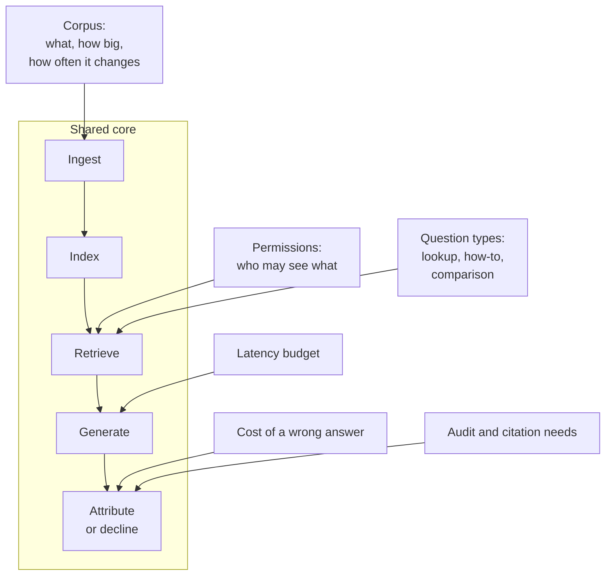

The earlier lessons in this module explained what RAG is, why it helps and how it compares with [fine-tuning](/learn/introduction-to-rag/rag-versus-fine-tuning) and [long-context prompting](/learn/introduction-to-rag/rag-versus-long-context-prompting). This last lesson looks outward: where is RAG actually used, and what does it look like there?

The pipeline is recognisably the same in a support chatbot, a legal research tool and a coding assistant: retrieve, then generate. What differs is everything around it: what the corpus is, who may see which parts of it, how fast an answer must arrive and how much a wrong answer costs. This lesson surveys the main families of application, identifies the handful of requirements that separate them, and shows in code how one retrieval core is configured into several different products. It also covers the cases where RAG is the wrong tool, because recognising those is part of the job.

## Learning objectives

- Describe the main families of RAG application and what each retrieves from.
- Characterise an application by six requirements: corpus, permissions, question type, cost of error, latency and auditability.
- Map each requirement to its consequence for the system's design.
- Recognise questions and tasks for which RAG is the wrong tool, and name the better one.
- Configure a shared retrieval core with scope, permission filtering and a refusal threshold for different applications.

## Prerequisites

- [What is RAG?](/learn/introduction-to-rag/what-is-rag)
- [How retrieval improves generation](/learn/introduction-to-rag/how-retrieval-improves-generation)
- [RAG versus fine-tuning](/learn/introduction-to-rag/rag-versus-fine-tuning)
- [RAG versus long-context prompting](/learn/introduction-to-rag/rag-versus-long-context-prompting)

## Why this matters

A tutorial RAG system answers questions over a folder of clean text files for a single user who may read all of them. No production system looks like that. Engineers who carry the tutorial design into a real setting meet the same surprises: documents contradict each other, half the corpus is scanned PDFs, a contractor is shown the salary bands, the assistant confidently answers a question nobody has documented, and users wait eight seconds for a reply.

None of these is a failure of the retrieve-then-generate idea. Each is a requirement of the *application* that the tutorial did not have. If you can look at a proposed use and say in advance which requirements will dominate, you will know which parts of this course matter most for it, and you will be able to tell a stakeholder honestly what is easy, what is hard and what should not be built with RAG at all.

## The intuition

A diesel engine works the same way in a delivery van, an ambulance and a fishing boat. Nobody would say those are the same vehicle. The ambulance needs to start instantly and never stall. The van needs to be cheap per mile. The boat needs to survive salt water. The engine is the shared core; what surrounds it is decided by the job.

RAG is the engine. A customer-support assistant is the van: high volume, cost-sensitive, mostly routine. A clinical reference tool is the ambulance: a wrong answer is serious, so everything is built around reliability and checking. A coding assistant is something else again, working with text that changes with every commit and where one wrong character matters. Learning to see the engine in each, and then to ask "what does this job need around it?", is what this lesson teaches.

## How it works

### The shared core

Every application in this lesson runs the same five steps.

1. **Ingest.** Collect documents from wherever they live and convert them to clean text.
2. **Index.** Split the text into passages and store them so they can be searched.
3. **Retrieve.** For each question, find the passages most likely to contain the answer, restricted to what this user may see.
4. **Generate.** Give the passages and the question to a language model, with instructions to answer from them.
5. **Attribute.** Return the answer with references to the passages it used, or decline if nothing relevant was found.



The boxes around the core are the application's requirements. They are what make two RAG systems different.

### Six requirements that separate applications

| Requirement | The question to ask | What it changes in the design |
| --- | --- | --- |
| **Corpus** | What are the documents, how many, in what formats, and how often do they change? | Parsing, chunking, how the index is refreshed |
| **Permissions** | May every user see every document? | Filtering at retrieval, identity integration |
| **Question type** | Lookups, how-to procedures, comparisons, summaries? | Retrieval method, how much context to pass |
| **Cost of error** | What happens if an answer is wrong? | Refusal thresholds, human review, evaluation depth |
| **Latency** | How long will a user wait? | Model choice, number of retrieval stages, streaming |
| **Auditability** | Must answers be traceable and reproducible? | Citations, logging, versioning of documents and index |

Keep this table in mind while reading the families below. Each one is a different setting of these six dials.

### Internal knowledge assistants

**What it is.** A question-answering assistant for an organisation's own staff, over handbooks, wikis, runbooks and shared drives. AskMeridian, this course's running example, is one.

**What is hard.** Permissions and document hygiene. Company knowledge is spread across many systems, each with its own access rules, and it is full of duplicates, drafts and superseded versions. The assistant must respect who may read what, and it needs a way to prefer the current policy over the three older copies. Questions are mostly lookups ("how many days of leave carry over?"), stakes are moderate and a few seconds of latency are tolerated.

### Customer support

**What it is.** Either a self-service assistant that answers customers directly from help articles and policies, or an *agent-assist* tool that suggests answers to a human support agent, who decides what to send.

**What is hard.** The cost of error is commercial and sometimes legal. An assistant that invents a refund policy has made a statement on the company's behalf. In 2024 a Canadian tribunal held an airline responsible for incorrect information that its website chatbot gave a customer about bereavement fares (*Moffatt v. Air Canada*). Support systems therefore need firm grounding, a tested refusal path and an easy hand-off to a person. Volume is high, so cost per question matters, and customers expect a reply within a few seconds. Agent-assist is the lower-risk way to start, because a human reviews every answer.

### Coding assistants

**What it is.** Tools that answer questions about a codebase, or write code that fits it, by retrieving relevant files, functions and documentation.

**What is hard.** The corpus is unlike prose. Code has structure (functions, classes, imports) that naive splitting destroys; it changes with every commit, so the index goes stale within hours; and exact identifiers matter, so a search for `rotate_password` must match that exact name, which keyword matching does well and purely meaning-based matching can miss. Developers are also unforgiving about latency inside an editor.

### Legal, compliance and financial research

**What it is.** Assistants that answer questions over contracts, regulations, case law, policies or filings.

**What is hard.** Auditability dominates. Every statement must be traceable to a specific clause, and "roughly right" is wrong. Documents are long, densely cross-referenced and versioned by date and jurisdiction, so the system must know which version applies. The danger of ungrounded generation in this field is well documented: in *Mata v. Avianca* (2023) a United States court sanctioned lawyers who filed a brief containing case citations that a chatbot had fabricated. Retrieval addresses exactly that failure, by confining the model to sources that exist, but only if citations are verified to point at real retrieved passages. Users here will accept slower answers in exchange for reliable ones.

### Healthcare and scientific literature

**What it is.** Tools that help clinicians or researchers find and summarise evidence: clinical guidelines, drug references, research papers.

**What is hard.** The cost of error is the highest of any family, so these systems are built as decision *support* with a qualified person making the decision, and they are evaluated far more heavily before release. Terminology is specialised (abbreviations, drug names, synonyms), which strains general-purpose retrieval. Sources differ in authority and date, and the system must surface that, not flatten a superseded guideline and a current one into one confident paragraph. Personal health data brings strict privacy obligations.

### Web answer engines

**What it is.** Search products that answer a question in prose with links, retrieving from the live web instead of a private index.

**What is hard.** The corpus is not yours. It is enormous, changes constantly and contains material that is wrong, out of date or written specifically to manipulate systems like this one. Source quality and resistance to [injected instructions](/learn/rag-security-fundamentals/indirect-prompt-injection) become central. Freshness is a strength (the web knows about this morning) and latency expectations are those of a search engine.

### Assistants over structured data

**What it is.** Tools that answer questions such as "what were sales in the north region last quarter?" by writing a database query. Retrieval plays a supporting role: the system retrieves descriptions of the relevant tables and columns, and example queries, so the model can write correct SQL. The database, not the model, computes the answer.

**What is hard.** Choosing the right tables out of hundreds, and verifying that a generated query means what the user meant. This family is a useful reminder that what gets retrieved need not be the answer itself; it can be whatever the model needs to *obtain* the answer.

Two further developments build on these families and have their own modules later: systems where a model decides for itself when and what to search ([Agentic RAG](/learn/agentic-rag)), and systems that retrieve images, tables and audio as well as text ([Multimodal RAG](/learn/multimodal-rag)).

### The families compared

| Application | Corpus | Dominant requirement | Characteristic risk |
| --- | --- | --- | --- |
| Internal knowledge assistant | Handbooks, wikis, runbooks | Permissions, document hygiene | Showing a restricted or superseded document |
| Customer support | Help articles, policies | Grounding, refusal, cost per question | Inventing a policy on the company's behalf |
| Coding assistant | Source code, API documentation | Freshness, exact matching, latency | Suggesting code that calls something that does not exist |
| Legal and compliance | Contracts, regulation, case law | Citations, versions | A plausible but unsupported legal claim |
| Healthcare and science | Guidelines, papers, drug references | Evaluation, human oversight, privacy | Harm from a wrong or outdated recommendation |
| Web answer engine | The public web | Source quality, manipulation resistance | Repeating an unreliable or malicious page |
| Structured-data assistant | Schemas, query examples | Query correctness | A valid query that answers a different question |

### When RAG is the wrong tool

Retrieval finds a few passages relevant to a question. Some questions cannot be answered from a few passages, and some need no passages at all.

- **Counting and aggregation.** "How many support tickets mentioned the VPN last month?" needs every matching ticket, counted. Retrieving the top five tells you nothing about the total. Use a database query.
- **Whole-corpus questions.** "What are the main themes in this year's customer feedback?" requires reading everything. Use long-context prompting if it fits, or the summarisation and graph techniques in later modules such as [Graph RAG](/learn/graph-rag).
- **Live transactional data.** "Where is my order?" is answered by calling the order system, not by indexing it. The model should use a tool or an API.
- **Exact calculation.** "What is my leave balance after these bookings?" needs arithmetic on records. Retrieve the policy if you must explain the rule, but compute the number in code.
- **No external knowledge needed.** Rewriting, translating and brainstorming rely on the model's own skill. Retrieval adds cost and distraction.
- **Behaviour, not knowledge.** If the complaint is about tone or format, see [RAG versus fine-tuning](/learn/introduction-to-rag/rag-versus-fine-tuning).

> [!KEY]
> RAG answers questions whose answer is written down in a small number of passages. If the answer must be computed, counted, looked up live or synthesised from everything, a different tool should produce it, possibly alongside RAG.

Real products usually combine these. An HR assistant retrieves the leave policy (RAG), calls the HR system for the employee's balance (a tool) and does the subtraction in code.

## In code

**The problem.** Meridian wants three assistants: an HR helper over the handbook, an IT helpdesk over the runbooks and a customer-facing support assistant over the product documentation. Building three pipelines would triple the maintenance. This example builds one retrieval core and expresses each application as configuration: which collections it may search, how many passages it retrieves and how confident a match must be before it answers. It also enforces a per-user permission filter and returns citations, the three things a tutorial pipeline leaves out.

Retrieval uses TF-IDF, a simple word-overlap score, so the example runs anywhere. The generation step is omitted: what matters here is what reaches the model.

**Dependencies.**

```bash
pip install scikit-learn
```

**The source.**

```python
from dataclasses import dataclass

from sklearn.feature_extraction.text import TfidfVectorizer
from sklearn.metrics.pairwise import cosine_similarity


@dataclass(frozen=True)
class Passage:
    id: str
    source: str                 # which collection the passage came from
    audience: frozenset[str]    # groups allowed to read it
    text: str


EVERYONE = frozenset({"staff", "it", "support"})
PASSAGES = [
    Passage("hb-leave", "handbook", EVERYONE, "Annual leave is 25 days per year."),
    Passage("hb-carry", "handbook", EVERYONE,
            "Up to 5 unused leave days carry over and must be used by 31 March."),
    Passage("hb-remote", "handbook", EVERYONE,
            "Staff may work remotely up to 3 days a week. The home-office equipment budget is £400."),
    Passage("hb-expenses", "handbook", EVERYONE,
            "Expenses must be submitted within 30 days. Anything over £75 needs a receipt."),
    Passage("rb-password", "runbook", EVERYONE,
            "Passwords must be rotated every 90 days. The VPN is required on public Wi-Fi."),
    Passage("rb-laptop", "runbook", EVERYONE,
            "Laptops are refreshed on a 3 year cycle. The support desk is open 08:00 to 18:00 UK time."),
    Passage("rb-vpn-admin", "runbook", frozenset({"it"}),
            "To reset a locked VPN account, an IT administrator revokes the user's certificate "
            "in the VPN console and issues a new one."),
    Passage("pd-export", "product-docs", EVERYONE,
            "Meridian Reports exports a dashboard as PDF or CSV from the Share menu."),
    Passage("pd-sso", "product-docs", EVERYONE,
            "Meridian Reports supports single sign-on through SAML on the Enterprise plan."),
]

# One index over everything, built once. Scores are cosine similarities from 0 to 1.
vectoriser = TfidfVectorizer(stop_words="english")
passage_matrix = vectoriser.fit_transform(p.text for p in PASSAGES)


@dataclass(frozen=True)
class Application:
    """One product built on the shared retrieval core."""
    name: str
    sources: frozenset[str]     # collections this application may search
    top_k: int
    min_score: float            # below this, refuse instead of answering


APPLICATIONS = {
    "hr-helper": Application("hr-helper", frozenset({"handbook"}), top_k=2, min_score=0.2),
    "it-helpdesk": Application("it-helpdesk", frozenset({"runbook"}), top_k=2, min_score=0.2),
    "customer-support": Application("customer-support", frozenset({"product-docs"}), top_k=1, min_score=0.2),
}


def retrieve(app: Application, user_groups: set[str], question: str) -> list[tuple[Passage, float]]:
    scores = cosine_similarity(vectoriser.transform([question]), passage_matrix)[0]
    # 1. Permission and scope filter: drop anything this app or this user may not see.
    candidates = [
        (passage, float(score))
        for passage, score in zip(PASSAGES, scores)
        if passage.source in app.sources and passage.audience & user_groups
    ]
    # 2. Rank what is left, keep the top k, and only those above the threshold.
    candidates.sort(key=lambda pair: pair[1], reverse=True)
    return [(p, s) for p, s in candidates[: app.top_k] if s >= app.min_score]


def answer(app_name: str, user_groups: set[str], question: str) -> None:
    app = APPLICATIONS[app_name]
    results = retrieve(app, user_groups, question)
    print(f"[{app.name}] groups={sorted(user_groups)}  Q: {question}")
    if not results:
        print("   -> REFUSE: nothing relevant that this user may read. Offer a human hand-off.")
        return
    for passage, score in results:
        print(f"   -> cite [{passage.id}] score={score:.2f}  {passage.text}")


answer("hr-helper", {"staff"}, "How many leave days carry over?")
answer("it-helpdesk", {"staff"}, "How do I reset a locked VPN account?")
answer("it-helpdesk", {"it"}, "How do I reset a locked VPN account?")
answer("hr-helper", {"staff"}, "How do I export a dashboard as CSV?")
answer("customer-support", {"support"}, "How do I export a dashboard as CSV?")
```

**The important lines.**

- `Passage` carries two pieces of metadata beyond its text: `source` (which collection it belongs to) and `audience` (which groups may read it). Without metadata there is nothing to filter on, and it has to be captured when documents are ingested.
- `Application` is the whole difference between the three products: scope, `top_k` and `min_score`. The customer-facing one retrieves a single passage and would, in practice, have the strictest threshold.
- In `retrieve`, the condition `passage.source in app.sources and passage.audience & user_groups` removes passages *before* ranking and long before any model is involved. `&` is set intersection: the passage survives if the user belongs to at least one permitted group.
- `if s >= app.min_score` implements refusal. If nothing clears the bar, the function returns an empty list and `answer` declines.
- `cite [{passage.id}]` is attribution: every passage that would be sent to the model keeps its identifier.

**The output.**

```output
[hr-helper] groups=['staff']  Q: How many leave days carry over?
   -> cite [hb-carry] score=0.58  Up to 5 unused leave days carry over and must be used by 31 March.
   -> cite [hb-leave] score=0.38  Annual leave is 25 days per year.
[it-helpdesk] groups=['staff']  Q: How do I reset a locked VPN account?
   -> REFUSE: nothing relevant that this user may read. Offer a human hand-off.
[it-helpdesk] groups=['it']  Q: How do I reset a locked VPN account?
   -> cite [rb-vpn-admin] score=0.64  To reset a locked VPN account, an IT administrator revokes the user's certificate in the VPN console and issues a new one.
[hr-helper] groups=['staff']  Q: How do I export a dashboard as CSV?
   -> REFUSE: nothing relevant that this user may read. Offer a human hand-off.
[customer-support] groups=['support']  Q: How do I export a dashboard as CSV?
   -> cite [pd-export] score=0.52  Meridian Reports exports a dashboard as PDF or CSV from the Share menu.
```

**What it means.** Five calls show four behaviours.

1. An ordinary lookup returns the answering passage first and a related one second, both with identifiers.
2. The same VPN question gives different results for different users. An ordinary staff member is refused: the administrator runbook was filtered out by permission, and the one remaining passage that mentions the VPN scored 0.13, below the threshold. A member of the IT group gets the procedure. The model never has the chance to leak the restricted text, because it is never given it.
3. The export question asked of the HR helper is refused, because product documentation is outside that application's scope. Asked of the support assistant, it is answered. Scope keeps each product on its own subject.
4. A refusal is an explicit outcome with a next step, not an empty answer.

**Errors people commonly hit.** If every question is refused, the threshold is too high for your scoring method; print the scores before choosing one, and expect to choose again when you change retriever. `TypeError: unsupported operand type(s) for &` means `audience` or `user_groups` was a list instead of a set. If a restricted passage appears for the wrong user, check that the filter runs before `top_k` is applied: filtering afterwards both leaks through any other code path and can leave a permitted user with fewer than `k` results.

**How to extend it.** Add a `valid_until` date to `Passage` and filter out expired passages, which is the start of handling superseded documents. Add a fourth application, an agent-assist tool for support staff that may search both runbooks and product documentation with `top_k=3`. Then put the generation call from [How retrieval improves generation](/learn/introduction-to-rag/how-retrieval-improves-generation) after `retrieve`, passing only the surviving passages.

## A real-world example

Ardent Homes, a fictional housing association, built an assistant to answer tenants' questions about repairs, rent and tenancy rules. The team spent most of the pilot comparing language models and tuning the prompt. In the demonstration the assistant was fluent and accurate.

In the first week with real tenants, it told one that a boiler repair would be attended within five working days. The current repairs policy said twenty-four hours for a household without heating. The five-day figure was real: it came from a superseded version of the policy, which was still in the shared drive under a slightly different file name and had been ingested along with everything else. Retrieval had worked and generation had worked. The assistant faithfully cited a document that should not have been in the index.

The investigation found dozens of similar cases: duplicate leaflets, drafts, a consultation document describing a policy that was never adopted. The fix had little to do with models. The team gave every document an owner, a status and an effective date at ingestion, indexed only documents marked current, and added a weekly report of documents with no owner. They also changed the product: for repairs classed as urgent, the assistant now gives the policy and immediately offers the emergency telephone line, because the cost of a wrong answer there is a tenant without heating.

Their retrospective named two lessons. The dominant requirement for their application was document hygiene, not model quality, and they had not asked about it. And the cost of error was not uniform across questions, so the assistant's behaviour should not be either.

## Common mistakes

- **Copying an architecture from a different kind of application.** A design tuned for a public support bot has no permission model; a design for legal research is far too slow and costly for chat support.
- **Treating the corpus as clean.** Real document sets contain duplicates, drafts and superseded versions, and a retriever will find them as readily as the current one.
- **Adding permissions at the end.** Access control retrofitted after launch usually means re-ingesting everything with metadata that was never captured.
- **Using RAG for counting, totals or live records.** The system returns a confident answer based on a handful of passages when the question needed every record or a live lookup.
- **Having no refusal path.** A system that must always answer will answer from weak evidence; in support and regulated fields that is the costliest failure.
- **Launching customer-facing first.** The highest-risk setting is a poor place to discover your failure modes; an internal or agent-assist version finds them with a human in the loop.
- **Measuring only with the team's own questions.** Real users phrase things differently and ask things nobody anticipated.

## Best practices

- Write the six-requirement profile for an application before designing anything, and get the stakeholders to agree to it.
- Capture metadata at ingestion: source, owner, status, effective date and who may read each document.
- Filter by permission and scope at retrieval, before ranking and before any model sees a passage.
- Decide what the system does when it finds nothing relevant, and make that a designed outcome with a hand-off.
- Match oversight to the cost of error: human review for high-stakes answers, automation for routine ones.
- Combine tools where the question needs it: retrieval for written knowledge, queries for counts, APIs for live data, code for arithmetic.
- Start with the lowest-risk audience, collect real questions and expand from there.

## Performance considerations

Different applications have very different budgets, and the budget decides how elaborate the pipeline can be.

**Latency budgets.** Suppose a chat assistant aims to show the first words of an answer within 2 seconds (an assumed target). If retrieval takes 200 ms and a second ranking stage takes 300 ms, the model has 1.5 seconds to begin responding. Every stage added before generation comes out of that allowance. A legal research tool whose users will wait 20 seconds can afford several retrieval rounds and a verification pass that a chat assistant cannot.

**Volume and cost.** Take an agent-assist tool for 200 support agents who each ask 60 questions a day over 22 working days: $200 \times 60 \times 22 = 264{,}000$ questions a month. At the assumed per-question cost of 0.00795 dollars from [RAG versus fine-tuning](/learn/introduction-to-rag/rag-versus-fine-tuning), that is about $264{,}000 \times 0.00795 \approx 2{,}099$ dollars a month. A research tool used by 20 lawyers 15 times a day asks $20 \times 15 \times 22 = 6{,}600$ questions a month; it could spend twenty times as much per question on larger contexts and extra checking and still cost about half as much in total. High-volume applications optimise cost per question; low-volume, high-stakes ones spend on quality.

**Freshness.** How quickly must a change in the corpus reach answers? For a handbook, a nightly re-index is ample. For a codebase or a news corpus, the index must follow changes within minutes, which requires an ingestion pipeline that reacts to events instead of running on a timer.

**Corpus size.** A handbook of a few hundred pages is searched trivially. An archive of millions of documents needs the approximate search structures covered in the vector database modules, and their memory and recall trade-offs become a design concern.

## Security considerations

- **Permissions are the first production requirement.** In any multi-user application, a passage the user may not read must never reach the prompt. The lessons on [Document-level permissions](/learn/access-control-and-privacy/document-level-permissions) cover how.
- **Personal and regulated data.** Support transcripts, health records and HR files contain personal data. Decide what may be indexed, how long it is kept and how a deletion request is honoured before ingesting it.
- **Untrusted corpora.** Any application that indexes content written by outsiders (web pages, customer emails, uploaded files) is exposed to [indirect prompt injection](/learn/rag-security-fundamentals/indirect-prompt-injection): instructions hidden in a document that the model may follow.
- **Statements made on the organisation's behalf.** A customer-facing assistant's answers can carry legal weight, as the airline case above shows. Constrain it to approved sources and log what it said and which passages it used.
- **Audit trails.** In regulated fields, keep the question, the retrieved passage identifiers, the document versions and the answer, so that any response can be reconstructed later.

## Summary

- Real RAG applications share one core (ingest, index, retrieve, generate, attribute) and differ in the requirements around it.
- Six requirements distinguish them: corpus, permissions, question type, cost of error, latency and auditability.
- Internal assistants are dominated by permissions and document hygiene; support by grounding, refusal and cost; code by freshness and exact matching; legal by citations; healthcare by evaluation and oversight; web answers by source quality.
- RAG suits questions whose answer is written in a few passages. Counting, whole-corpus synthesis, live data and calculation need other tools, often alongside retrieval.
- One retrieval core can serve several products when scope, permissions, retrieval depth and refusal thresholds are configuration.
- Many production failures come from the documents and the requirements, not from the model.

## Exercises

**1. Profile an application.** Write the six-requirement profile for an assistant that helps Meridian's sales team answer prospects' security questionnaires from the company's security policies and past completed questionnaires.

<details><summary>Show solution</summary>

A reasonable profile:

- **Corpus.** Security policies (a modest number of long, formal documents, revised a few times a year) and past questionnaires (many, semi-structured as question-and-answer pairs, of varying age). Past answers can be out of date, so each needs a date and ideally a link to the policy version it reflected.
- **Permissions.** Sales staff may see approved answers, but some policy detail (for example network architecture) may be restricted to the security team. Filtering is required.
- **Question type.** Mostly lookups and yes-or-no questions needing a short justification, often phrased differently from the policy's wording.
- **Cost of error.** High. An incorrect statement in a questionnaire is a representation to a customer and may become contractual. Every answer needs review by a person, at least by sales and, for anything new, by security.
- **Latency.** Relaxed. Questionnaires are completed over hours or days; a batch mode that drafts a whole questionnaire is acceptable.
- **Auditability.** Strong. Each drafted answer should cite the policy section and the previous questionnaire it drew on, and the final submitted answers should be stored.

The dominant requirements are cost of error and auditability, which points to a draft-and-review workflow with citations, not an autonomous chatbot.

</details>

**2. Right tool or wrong tool?** For each question, say whether RAG alone is suitable and, if not, what should answer it: (a) "What is the receipt threshold for expenses?" (b) "How many expense claims over £75 were rejected last quarter?" (c) "How many days of leave do I have left this year?" (d) "Summarise the main changes between last year's handbook and this year's."

<details><summary>Show solution</summary>

(a) RAG is suitable. The answer (anything over £75 needs a receipt) is written in one passage of the handbook.

(b) Not RAG. It is a count over all claims in a period. A query against the expenses database answers it. Retrieval of the top few claims would give a meaningless number.

(c) Not RAG alone. The entitlement (25 days, with up to 5 carried over) is in the handbook, but the remaining balance depends on this employee's bookings, which is live data in the HR system. Call the HR system for the balance; use retrieval only to explain the rules.

(d) Not passage-level RAG. Comparing two whole documents requires seeing both in full. If both handbooks fit in the context window, use long-context prompting; otherwise compare section by section and combine the results.

</details>

**3. Add a new application (code).** Extend the lesson's code with an `agent-assist` application for support staff that searches both `runbook` and `product-docs` with `top_k=3` and `min_score=0.15`. Run it for a user in the `support` group with the question "Is the VPN required on public Wi-Fi, and how do I export a dashboard?" and explain the result.

<details><summary>Show solution</summary>

```python
APPLICATIONS["agent-assist"] = Application(
    "agent-assist", frozenset({"runbook", "product-docs"}), top_k=3, min_score=0.15
)
answer("agent-assist", {"support"}, "Is the VPN required on public Wi-Fi, and how do I export a dashboard?")
```

```output
[agent-assist] groups=['support']  Q: Is the VPN required on public Wi-Fi, and how do I export a dashboard?
   -> cite [rb-password] score=0.70  Passwords must be rotated every 90 days. The VPN is required on public Wi-Fi.
   -> cite [pd-export] score=0.15  Meridian Reports exports a dashboard as PDF or CSV from the Share menu.
```

Only one line of configuration was needed, because scope, depth and threshold are data, not code. The question has two parts drawn from two collections, and the wider scope lets one retrieval find a passage for each. The administrator-only VPN runbook is absent even though it mentions the VPN (it would have scored 0.17 and ranked second), because the `support` group is not in its audience. The third candidate scored zero and was cut by the threshold. Notice that the export passage scored 0.15, only just reaching the threshold, where it scored 0.52 when the export question was asked on its own: a two-part question dilutes the match for each part. With the other applications' threshold of 0.2 the second half of the question would have gone unanswered, which is one reason later modules introduce splitting a question into sub-questions before retrieval.

</details>

**4. Design decision.** A hospital wants a patient-facing assistant that answers medication questions from drug information leaflets. Using the six requirements, identify the two that should most shape the design, and describe three concrete design choices that follow.

<details><summary>Show solution</summary>

The two dominant requirements are **cost of error** (a wrong dose or a missed interaction can cause harm) and **auditability** (the hospital must be able to show what was said and on what basis). Corpus quality matters too: leaflets are revised, and only the current version may be used.

Three design choices that follow:

1. **Strict grounding with a high refusal threshold and a narrow scope.** The assistant answers only from current, approved leaflets, quotes the relevant passage, and declines anything that is not directly covered, including any question about a patient's individual circumstances ("can I take this with my other tablets?"), which it routes to a pharmacist. It never falls back on the model's own knowledge.
2. **Human escalation built in.** Every refusal, and every answer in defined high-risk categories (dosage changes, pregnancy, children, interactions), offers a route to a pharmacist or the ward. The assistant is positioned as information, not advice.
3. **Full audit trail and versioning.** Each interaction stores the question, the passage identifiers, the leaflet version and the answer. Leaflets carry an effective date and are removed from the index when superseded.

Before launch it would also need evaluation by clinicians on a large set of real questions, and a staged rollout starting with staff-facing use. Latency and cost per question are secondary here.

</details>

## Check your understanding

```quiz
[
  {
    "q": "What do a customer-support assistant, a legal research tool and a coding assistant built with RAG have in common?",
    "options": [
      "The same latency budget",
      "The same retrieve-then-generate core, configured for different requirements",
      "The same corpus format",
      "The same tolerance for wrong answers"
    ],
    "answer": 1,
    "why": "The pipeline shape is shared. Corpus, permissions, question types, cost of error, latency and auditability differ, and those differences shape the design."
  },
  {
    "q": "A user asks, \"How many tickets about password resets were opened in March?\" Why is passage retrieval the wrong tool?",
    "options": [
      "Tickets cannot be embedded",
      "The question is too short to retrieve on",
      "Password information is always restricted",
      "The answer is a count over all matching records, not something written in a few passages"
    ],
    "answer": 3,
    "why": "Retrieval returns the top few passages. A count needs every matching record, which is a database query."
  },
  {
    "q": "In the lesson's code, why was a user in the `staff` group refused when asking how to reset a locked VPN account?",
    "options": [
      "The administrator runbook was removed by the permission filter and the remaining passage scored below the threshold",
      "The IT helpdesk application does not search runbooks",
      "The question contained no words from the vocabulary",
      "The top_k value was zero"
    ],
    "answer": 0,
    "why": "The passage with the procedure is readable only by the `it` group, so it was filtered out before ranking. The other runbook passage that mentions the VPN scored 0.13, under the 0.2 threshold."
  },
  {
    "q": "Which requirement most strongly dominates a legal research assistant?",
    "options": [
      "Sub-second latency",
      "Lowest possible cost per question",
      "Auditability: every claim traceable to a specific, correct source",
      "Support for images and audio"
    ],
    "answer": 2,
    "why": "Legal users need each statement tied to a real clause or case in the right version. They will accept slower, costlier answers to get that."
  },
  {
    "q": "In the Ardent Homes example, the assistant quoted a five-day repair time from a superseded policy. Where was the fault?",
    "options": [
      "In the language model, which hallucinated the figure",
      "In the retriever, which failed to find any relevant passage",
      "In the prompt, which did not ask for citations",
      "In ingestion: an out-of-date document was in the index with nothing marking it as superseded"
    ],
    "answer": 3,
    "why": "Retrieval and generation both worked as designed and the answer was faithfully cited. The index contained a document that should have been excluded, which is a document-hygiene problem."
  }
]
```

## Further reading

- Lewis, P. et al. (2020). *Retrieval-Augmented Generation for Knowledge-Intensive NLP Tasks.* [arxiv.org/abs/2005.11401](https://arxiv.org/abs/2005.11401). The original paper; its tasks (open-domain question answering, fact verification) are the ancestors of today's applications.
- Gao, Y. et al. (2023). *Retrieval-Augmented Generation for Large Language Models: A Survey.* [arxiv.org/abs/2312.10997](https://arxiv.org/abs/2312.10997). A broad map of RAG techniques and where they are applied.
- Barnett, S. et al. (2024). *Seven Failure Points When Engineering a Retrieval Augmented Generation System.* [arxiv.org/abs/2401.05856](https://arxiv.org/abs/2401.05856). Lessons from case studies of RAG systems in different domains.
- *Moffatt v. Air Canada*, 2024 BCCRT 149 (British Columbia Civil Resolution Tribunal). The decision holding a company responsible for its chatbot's incorrect statement.
- *Mata v. Avianca, Inc.* (United States District Court, Southern District of New York, 2023). The sanctions order concerning fabricated case citations produced by a chatbot.
