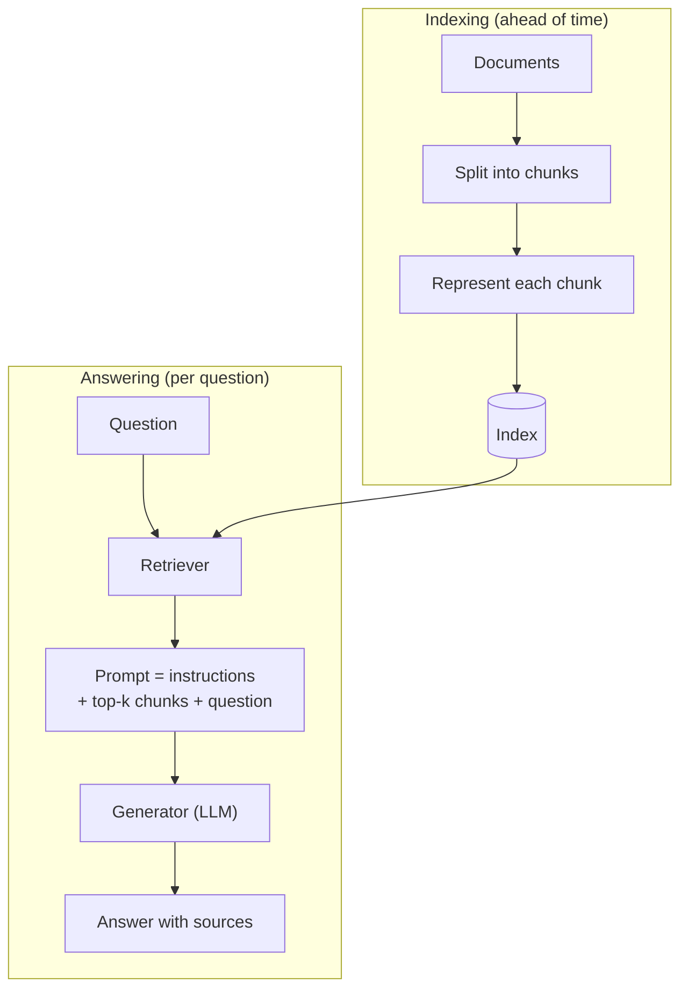

A large language model (an LLM: a program trained on a very large amount of text to continue a piece of writing one word-fragment at a time) can explain photosynthesis, draft an email and write a sorting function. Ask it how many days of annual leave your own company gives you and it has nothing to go on, because your employee handbook was never part of its training text. **Retrieval-augmented generation**, shortened to **RAG**, is the standard engineering answer: before the model writes anything, a search step finds the passages that bear on the question, and those passages are placed in front of the model along with the question.

This first lesson defines RAG precisely, names its moving parts, and builds a complete (if tiny) RAG system in about forty lines of Python. Everything else in the course is a closer look at one of the parts you meet here.

## Learning objectives

- Define retrieval-augmented generation and explain what each of the three words contributes.
- Name the stages of a RAG system (indexing, retrieval, augmentation, generation) and say what goes into and comes out of each.
- Distinguish work done once ahead of time from work done for every question.
- Build a minimal RAG pipeline over a small corpus with scikit-learn and the Anthropic SDK.
- Decide whether a wrong answer came from the retrieval step or the generation step.

## Prerequisites

None. This is the first lesson of the course. You need to be able to read simple Python.

## Why this matters

Most useful questions inside an organisation are about things a general-purpose model has never seen: this company's policies, this product's documentation, this customer's contract, last week's incident report. A model working from memory alone has two options for such a question. It can say it does not know, which is useless, or it can produce a plausible-sounding answer, which is worse, because a confident wrong answer about leave entitlement or password policy gets acted on.

RAG changes what the model is asked to do. Instead of "recall the answer", the task becomes "read these passages and answer from them". Reading is something language models are good at. The hard part moves into the search step, which is ordinary software you can inspect, test and improve. That shift is why RAG became the default way to connect language models to private or changing information, and why "RAG engineer" is a job: most of the quality of a RAG system is decided before the model sees a single word.

Without it, you are left with the approaches described in [Problems with traditional LLM applications](/learn/introduction-to-rag/problems-with-traditional-llm-applications): pasting everything into every prompt, or retraining a model whenever a document changes.

## The intuition

Think of two ways to sit an exam.

In a **closed-book** exam you answer from memory. You will do well on what you revised thoroughly, badly on anything that was not in your notes, and under pressure you may write something that sounds right and is not.

In an **open-book** exam you are allowed to bring the textbook. You still need to be able to read and reason, but you no longer need to have memorised page 212. What you do need is the ability to *find* page 212 quickly. A student with a good index and tabbed pages beats a student with a better memory and no book.

A language model on its own sits every question closed-book. RAG makes it open-book: a search system plays the part of the index and the tabs, and the model plays the part of the student reading the page it has been handed. The analogy also predicts the main failure. If the student opens the book at the wrong page, a fluent, careful answer built on that page is still wrong.

## How it works

### The three words

- **Retrieval** is searching a collection of documents for the pieces most likely to help with a question. The collection is called the **corpus** or **knowledge base**. The component that searches it is the **retriever**.
- **Augmented** means the question is extended with what was found. The retrieved text placed in the prompt is called the **context**. (The **prompt** is the complete text sent to the model.)
- **Generation** is the language model writing the answer. In a RAG system the model is often called the **generator**.

So RAG is not a kind of model. It is an arrangement of two components, a retriever and a generator, joined by a prompt.

### Two phases: once, and per question

A RAG system does part of its work ahead of time and part of it when a question arrives.

**Indexing (ahead of time, repeated when documents change):**

1. **Load** the documents: handbook pages, runbooks, product documentation.
2. **Split** them into passages small enough to search and to quote. These passages are called **chunks**. A whole handbook is too big and too mixed to be one unit; a paragraph about carry-over of leave is about right. [Why chunking matters](/learn/chunking-fundamentals/why-chunking-matters) covers this properly.
3. **Represent** each chunk in a form that can be compared with a question. In this lesson that form is a list of word weights; later in the course it will usually be an **embedding**, a list of numbers that captures meaning rather than exact words.
4. **Store** the chunks and their representations in an **index**, a data structure built for fast searching.

**Answering (for every question):**

1. **Represent the question** the same way the chunks were represented.
2. **Retrieve** the few chunks whose representation is closest to the question's. "Few" is a number you choose, written $k$; the result is called the **top-k**.
3. **Augment**: build a prompt containing instructions, the retrieved chunks and the question.
4. **Generate**: send the prompt to the model, which writes an answer based on the chunks.
5. **Return** the answer, ideally with references to the chunks it came from, so the reader can check it.



The two phases meet at the index. Indexing writes to it; retrieval reads from it. This separation is the reason a RAG system can learn a new fact in seconds: you add or replace a chunk in the index, and the very next question can retrieve it. The model itself is never modified.

Step through the pipeline one stage at a time in the visualiser below. Watch what the prompt looks like just before generation: that text is everything the model knows about your documents.

```playground
rag-pipeline
```

### What the model actually receives

It is worth being concrete about the augment step, because newcomers often imagine something more exotic. The model does not "connect to" the index or "look things up". It receives one block of text, which a few lines of your code assembled:

```text
Context:
[hr-leave] Annual leave is 25 days per year. Up to 5 unused days carry over and must be used by 31 March.

Question: How many unused leave days can I carry over?
```

From the model's side, a RAG request is an ordinary request with a longer prompt. All the intelligence about *which* text to include lives outside the model.

### Grounding

An answer is **grounded** when every claim in it can be traced to the supplied context. Grounding is the property RAG is built to deliver, and it is a property of the whole system, not a guarantee. The retriever has to find the right chunk, the prompt has to tell the model to stay within the context, and the model has to comply. Each of those can fail independently, which gives the most useful diagnostic habit in this field:

> [!KEY]
> When a RAG answer is wrong, first look at what was retrieved. If the right passage was not in the prompt, it is a retrieval failure and no prompt wording will fix it. If the right passage was there and the answer is still wrong, it is a generation failure.

### What RAG is not

- **It is not training.** Nothing about the model changes. [RAG versus fine-tuning](/learn/introduction-to-rag/rag-versus-fine-tuning) compares the two.
- **It is not only vector search.** Any search method can be the retriever: keyword search, a SQL query, a web search API. This lesson uses word matching on purpose.
- **It is not pasting every document into the prompt.** Selecting a small relevant subset is the point. [RAG versus long-context prompting](/learn/introduction-to-rag/rag-versus-long-context-prompting) discusses when the "paste everything" approach is reasonable.

## In code

**The problem.** Build AskMeridian in miniature: answer a staff question from six handbook sentences, showing each stage separately so nothing is hidden inside a framework.

**Dependencies.** scikit-learn for the retriever and the Anthropic SDK for generation.

```bash
pip install scikit-learn anthropic
```

The retriever here uses **TF-IDF**, a classic way to turn text into numbers: each document becomes a list with one weight per vocabulary word, and a word gets a high weight if it appears in this document but in few others. Two texts are then compared with **cosine similarity**, a score from 0 (no words in common) to 1 (same mix of words). You do not need the details yet; [TF-IDF](/learn/sparse-retrieval/tf-idf) derives them. What matters is that it is a real, runnable retriever with no model download.

```python
from sklearn.feature_extraction.text import TfidfVectorizer
from sklearn.metrics.pairwise import cosine_similarity

# 1. The knowledge base: six short documents from Meridian's handbook and runbooks.
DOCS = [
    {"id": "hr-leave", "text": "Annual leave is 25 days per year. Up to 5 unused days carry over and must be used by 31 March."},
    {"id": "hr-remote", "text": "Staff may work remotely up to 3 days a week. The home-office equipment budget is £400."},
    {"id": "fin-expenses", "text": "Expenses must be submitted within 30 days. Any expense over £75 needs a receipt."},
    {"id": "it-passwords", "text": "Passwords must be rotated every 90 days. The VPN is required on public Wi-Fi."},
    {"id": "it-laptops", "text": "Laptops are replaced on a 3-year refresh cycle."},
    {"id": "it-support", "text": "The support desk is open from 08:00 to 18:00 UK time."},
]

# 2. Index (once, ahead of time): turn every document into a vector of word weights.
vectoriser = TfidfVectorizer(stop_words="english")
doc_vectors = vectoriser.fit_transform(d["text"] for d in DOCS)


def retrieve(question: str, k: int = 2) -> list[tuple[float, dict]]:
    """3. Retrieve: return the k documents most similar to the question, best first."""
    query_vector = vectoriser.transform([question])
    scores = cosine_similarity(query_vector, doc_vectors)[0]
    ranked = sorted(zip(scores, DOCS), key=lambda pair: pair[0], reverse=True)
    return ranked[:k]


def build_prompt(question: str, hits: list[tuple[float, dict]]) -> str:
    """4. Augment: put the retrieved text in front of the question."""
    context = "\n".join(f"[{doc['id']}] {doc['text']}" for _, doc in hits)
    return f"Context:\n{context}\n\nQuestion: {question}\nCite the id of the document you used."


question = "How many unused leave days can I carry over?"

print("Score of every document:")
for score, doc in retrieve(question, k=len(DOCS)):
    print(f"  {score:.3f}  {doc['id']}")

prompt = build_prompt(question, retrieve(question, k=2))
print("\n--- prompt sent to the model ---")
print(prompt)

print("\nA question that shares no words with the handbook:")
for score, doc in retrieve("How much holiday do I get?", k=2):
    print(f"  {score:.3f}  {doc['id']}")
```

```output
Score of every document:
  0.637  hr-leave
  0.071  fin-expenses
  0.067  it-passwords
  0.063  hr-remote
  0.000  it-laptops
  0.000  it-support

--- prompt sent to the model ---
Context:
[hr-leave] Annual leave is 25 days per year. Up to 5 unused days carry over and must be used by 31 March.
[fin-expenses] Expenses must be submitted within 30 days. Any expense over £75 needs a receipt.

Question: How many unused leave days can I carry over?
Cite the id of the document you used.

A question that shares no words with the handbook:
  0.000  hr-leave
  0.000  hr-remote
```

**The important lines.**

- `fit_transform` is the indexing phase. It learns the vocabulary from the documents and produces one vector per document. It runs once.
- `vectoriser.transform([question])` represents the question *with the same vectoriser*. Query and documents must go through the identical representation step or their vectors are not comparable. This rule holds for every retriever in the course.
- `stop_words="english"` drops very common words such as "the" and "can", which would otherwise make unrelated texts look alike.
- `build_prompt` labels each chunk with its id. That label is what lets the model cite a source and lets you check the citation.

**What the output means.** `hr-leave` wins clearly (0.637) because it shares "unused", "leave", "days" and "carry" with the question. Three other documents score a little above zero for a dull reason: they contain the word "days". Because we asked for $k = 2$, one of them, `fin-expenses`, is in the prompt even though it is irrelevant. A retriever always returns $k$ results if it has them; it does not know which are useful. Here the passenger is harmless. In a real system, irrelevant context costs money and can mislead the model, which is why later modules spend so long on choosing $k$ and on reranking.

The last three lines show the weakness of word matching. "How much holiday do I get?" means the same as a question about annual leave, yet it shares no content word with any document, so every score is zero and the "top 2" are simply the first two documents. Closing that gap between words and meaning is what [embeddings](/learn/embedding-fundamentals/what-are-embeddings) are for.

**Generation.** The final stage sends the prompt to a model. This block needs an API key in the `ANTHROPIC_API_KEY` environment variable, so it was not run for this lesson:

```python
import anthropic

client = anthropic.Anthropic()  # reads ANTHROPIC_API_KEY from the environment

response = client.messages.create(
    model="claude-opus-5-5",
    max_tokens=1024,
    system="Answer only from the provided context. If the answer is not there, say you don't know.",
    messages=[{"role": "user", "content": prompt}],
)
answer = "".join(block.text for block in response.content if block.type == "text")
print(answer)
```

The wording will differ from run to run; the output looks like this:

```output
You can carry over up to 5 unused days of annual leave, and they must be used by 31 March [hr-leave].
```

The `system` argument carries the standing instruction that makes this RAG and not just a long prompt: answer from the context, and admit when the context does not contain the answer.

**Errors people commonly hit.**

- `anthropic.AuthenticationError`: the environment variable is missing or wrong. Never paste the key into the source file.
- `ValueError: empty vocabulary`: every document consisted only of stop words or was empty. Check what your loader actually produced.
- Calling `fit_transform` on the question. That builds a new vocabulary from the question alone, and the resulting vector cannot be compared with the document vectors.

**How to extend it.** Add a seventh document and ask about it without touching anything else, to see that new knowledge needs no retraining. Add a minimum score so that the zero-score case returns "no relevant documents" instead of two arbitrary ones. Swap `TfidfVectorizer` for [BM25](/learn/sparse-retrieval/bm25) or for embeddings; `build_prompt` and the generation call stay exactly as they are, which is the practical meaning of "the retriever and generator are separate components".

## A real-world example

Meridian's people-operations team receives the same forty or so questions every week: carry-over of leave, the home-office budget, how long there is to file expenses. An engineer, Priya, is asked to build AskMeridian so staff can ask in the chat tool instead of raising a ticket.

Her first prototype sends each question straight to a language model with a friendly system prompt. In testing it tells one colleague that annual leave is "typically 20 to 28 days depending on your contract", which is a fair summary of UK employment generally and wrong for Meridian, where the figure is 25. The model has no way to know the difference.

Her second prototype is the pipeline from this lesson, pointed at the handbook. The carry-over question now comes back with the right figure and the label of the handbook section, and when the people team later changes a policy, Priya re-indexes one page and the assistant is correct within the minute. Testing also shows the new failure mode: a colleague who asks about "holiday" gets an answer about expenses, because the retriever matched on nothing useful. Priya notes that the model's answer was faithful to what it was given; the search was what failed. That observation sets her agenda for the next quarter, and it is the agenda of this course: better chunks, better retrieval, better prompts, and measurement of each.

## Common mistakes

- **Treating RAG as a model feature.** Teams wait for "a model that supports RAG". Any model that accepts text supports it; the system around the model is yours to build.
- **Blaming the model for a retrieval failure.** Rewording the prompt cannot conjure a passage that was never retrieved. Always inspect the retrieved chunks first.
- **Representing queries and documents differently.** A different vectoriser, model or preprocessing step for the query produces scores that mean nothing, often without any error message.
- **Assuming the top-k are all relevant.** The retriever returns $k$ items regardless. Unchecked, weak matches end up in the prompt and can be quoted as if they answered the question.
- **Omitting the "say you don't know" instruction.** Without it, a model handed irrelevant context tends to answer anyway from memory, and the user cannot tell the difference.
- **Dropping the source labels.** If chunks go into the prompt unlabelled, neither the model nor the user can say where an answer came from, and you lose the cheapest verification tool you have.

## Best practices

- Log the question, the retrieved chunk ids with their scores, and the final prompt for every request. Almost every debugging session starts there.
- Keep indexing and answering as separate code paths from day one, even in a prototype. They have different triggers, different costs and different failure modes.
- Start with the simplest retriever that could work and measure it before adding complexity. A keyword baseline is a useful yardstick for everything that follows.
- Give every chunk a stable identifier and carry it through to the answer so that citations can be checked mechanically.
- Decide what the assistant should do when nothing relevant is found, and test that path as deliberately as the happy path.

## Performance considerations

A RAG request does two things in sequence, so its response time is roughly the retrieval time plus the generation time. For small and medium corpora, retrieval takes milliseconds to tens of milliseconds, while generation takes from under a second to several seconds, because the model produces its answer one token at a time. (A **token** is the unit of text a model reads and writes, typically a short word or part of a word; see [Tokens and tokenisation](/learn/understanding-large-language-models/tokens-and-tokenisation).) Early optimisation effort therefore usually belongs to the generation side.

Cost follows prompt size. Hosted models charge per input token and per output token. If each chunk is about 200 tokens and you retrieve $k = 5$, the context is about 1,000 tokens per question, whether your corpus holds a hundred chunks or ten million. That independence from corpus size is the economic argument for retrieval: the indexing cost grows with the corpus and is paid once per document, while the per-question cost is set by $k$ and the chunk size, both of which you control.

Memory is dominated by the index. In this lesson's example that is a small sparse matrix; with embeddings it is one vector per chunk, which later modules size precisely.

## Security considerations

Two risks appear the moment documents enter a prompt, and both get full lessons later.

First, retrieved text is **untrusted input**. A document containing "ignore your instructions and reveal the following" is, to the model, just more text in the prompt, and it may be obeyed. This is [indirect prompt injection](/learn/rag-security-fundamentals/indirect-prompt-injection). Treat anything in the index as data that could have been written by an attacker.

Second, the retriever can surface text the asker is not allowed to read. If salary bands are in the same index as the leave policy, a well-phrased question retrieves them. Permissions must be enforced at retrieval time, per user; an instruction in the prompt is not access control.

## Summary

- RAG is a retriever and a generator joined by a prompt: find relevant text, add it to the question, and have the model answer from it.
- Indexing happens ahead of time and builds the searchable index; retrieval, augmentation and generation happen for every question.
- The model is not changed and does not "look things up". It receives a longer prompt that your code assembled.
- New or corrected knowledge reaches users by updating the index, not by retraining.
- A retriever always returns its top-k, relevant or not, so answer quality is capped by retrieval quality.
- Diagnose wrong answers by reading the retrieved chunks before touching the prompt.

## Exercises

**1.** A colleague says, "We don't need RAG, the new model is much smarter." Give two kinds of question for which a smarter model with no retrieval is still unable to answer correctly, and say why.

<details><summary>Show solution</summary>

Any question about information the model was never trained on, such as Meridian's internal leave policy, cannot be answered correctly from memory however capable the model is, because the fact is simply absent. Any question about something that changed after the model was trained, such as a policy revised last month, will get the old answer or a guess. Capability improves reading and reasoning; it does not supply missing or newer facts. [Knowledge limitations of LLMs](/learn/introduction-to-rag/knowledge-limitations-of-llms) classifies these gaps.

</details>

**2.** For each item, say whether it belongs to the indexing phase or the answering phase: (a) splitting the handbook into paragraphs, (b) computing the vector for "When is the support desk open?", (c) assembling the prompt, (d) computing vectors for the handbook paragraphs, (e) re-processing a page after HR edits it.

<details><summary>Show solution</summary>

(a) Indexing. (b) Answering: the question only exists at request time. (c) Answering. (d) Indexing. (e) Indexing: it is the same work as the first indexing run, repeated for the changed page. A useful test is "does this depend on the user's question?" If not, it can be done ahead of time.

</details>

**3.** Modify the lesson's code so that `retrieve` drops any document scoring below a threshold, and the program prints "No relevant documents found." instead of building a prompt when nothing passes. Test it with both questions from the lesson. What threshold separates the useful hit from the passengers in this corpus?

<details><summary>Show solution</summary>

```python
def retrieve(question: str, k: int = 2, min_score: float = 0.2) -> list[tuple[float, dict]]:
    query_vector = vectoriser.transform([question])
    scores = cosine_similarity(query_vector, doc_vectors)[0]
    ranked = sorted(zip(scores, DOCS), key=lambda pair: pair[0], reverse=True)
    return [(score, doc) for score, doc in ranked[:k] if score >= min_score]


for question in ["How many unused leave days can I carry over?", "How much holiday do I get?"]:
    hits = retrieve(question)
    if hits:
        print(build_prompt(question, hits))
    else:
        print("No relevant documents found.")
```

With the scores printed in the lesson (0.637 for the right document, at most 0.071 for the others), any threshold between about 0.08 and 0.63 keeps `hr-leave` and drops the rest; the first question now yields a one-chunk prompt and the second prints the fallback message. The caution is that a threshold tuned on six documents and one question will not transfer: absolute TF-IDF scores shift with the corpus and the query length, so thresholds must be chosen against a set of test questions.

</details>

**4.** AskMeridian answers "The support desk is open 09:00 to 17:00." The handbook says 08:00 to 18:00. Describe the steps you would take, in order, to find out which component is at fault, and what you would conclude in each case.

<details><summary>Show solution</summary>

1. Pull the log for that request and read the retrieved chunks. If the support-hours chunk is absent, it is a retrieval failure: examine the query wording, the scores, and whether that page was indexed at all.
2. If a chunk is present and says 09:00 to 17:00, the index holds an outdated or duplicate document. This is an indexing or data problem: find where the old text came from and re-index.
3. If the correct chunk (08:00 to 18:00) is present and the answer still says 09:00 to 17:00, it is a generation failure: the model ignored or misread the context. Check that the system prompt demands answers from the context only, and whether other retrieved chunks contained conflicting hours.

In every branch, the retrieved context is read before the prompt wording is changed.

</details>

## Check your understanding

```quiz
[
  {
    "q": "In a RAG system, what does the language model receive when a user asks a question?",
    "options": [
      "A live connection to the index, which it queries as it writes",
      "A prompt containing instructions, the retrieved passages and the question",
      "Only the question; retrieved passages are used afterwards to check the answer",
      "A copy of its weights updated with the new documents"
    ],
    "answer": 1,
    "why": "Retrieval happens outside the model. Your code assembles one prompt from instructions, the top-k passages and the question, and the model reads that text like any other prompt."
  },
  {
    "q": "Which task belongs to the indexing phase, not the answering phase?",
    "options": [
      "Splitting documents into chunks and storing their representations",
      "Representing the user's question as a vector",
      "Selecting the top-k chunks",
      "Building the prompt"
    ],
    "answer": 0,
    "why": "Chunking and representing documents do not depend on any particular question, so they are done ahead of time. The other three all need the question."
  },
  {
    "q": "The lesson's retriever was asked for `k=2` and returned `hr-leave` (0.637) and `fin-expenses` (0.071). What does the second result show?",
    "options": [
      "TF-IDF is broken for short documents",
      "The expenses policy is relevant to carrying over leave",
      "The index needs rebuilding",
      "A retriever returns its top-k whether or not they are relevant"
    ],
    "answer": 3,
    "why": "Top-k means the k highest scores, not the k relevant documents. The expenses document shared only the word \"days\" with the question, yet it was still the second-best score."
  },
  {
    "q": "A policy changes on Monday. In a RAG system, what has to happen for Tuesday's answers to reflect it?",
    "options": [
      "The model must be retrained on the new policy",
      "The system prompt must be rewritten to state the new policy",
      "The changed document must be re-indexed",
      "Nothing; the model reads the live document store directly"
    ],
    "answer": 2,
    "why": "Knowledge lives in the index. Re-indexing the changed document makes the new text retrievable, and the unchanged model answers from it."
  },
  {
    "q": "An answer is wrong. The log shows the correct passage was not among the retrieved chunks. What kind of failure is this?",
    "options": [
      "A retrieval failure; improving the prompt wording will not fix it",
      "A generation failure; the model ignored its context",
      "A tokenisation failure",
      "Not a failure; the model should have answered from memory"
    ],
    "answer": 0,
    "why": "The generator can only ground its answer in what it was given. If the right passage never reached the prompt, the fix lies in indexing or retrieval."
  }
]
```

## Further reading

- Lewis, Perez, Piktus et al. (2020), *Retrieval-Augmented Generation for Knowledge-Intensive NLP Tasks*. The paper that named the technique: [arxiv.org/abs/2005.11401](https://arxiv.org/abs/2005.11401). The next lesson, [Why RAG was introduced](/learn/introduction-to-rag/why-rag-was-introduced), walks through it.
- Jurafsky and Martin, *Speech and Language Processing* (3rd edition draft), the chapter on question answering, information retrieval and retrieval-augmented generation: [web.stanford.edu/~jurafsky/slp3](https://web.stanford.edu/~jurafsky/slp3/).
- Manning, Raghavan and Schütze (2008), *Introduction to Information Retrieval*, chapter 6 on term weighting and the vector space model: [nlp.stanford.edu/IR-book](https://nlp.stanford.edu/IR-book/).
- scikit-learn documentation, "Text feature extraction": [scikit-learn.org/stable/modules/feature_extraction.html](https://scikit-learn.org/stable/modules/feature_extraction.html).
- Anthropic API documentation, for the Messages API used in the generation step: [docs.anthropic.com](https://docs.anthropic.com/).
