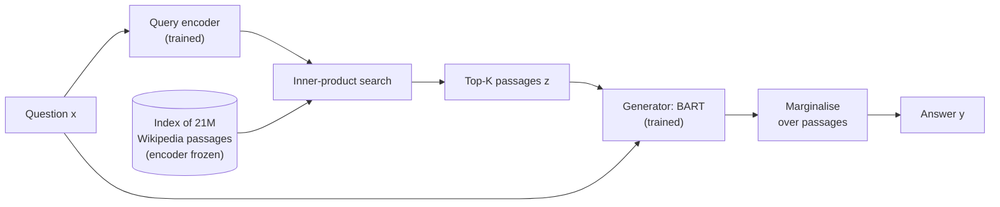

[What is RAG?](/learn/introduction-to-rag/what-is-rag) described the technique as it is practised now. This lesson explains where it came from: which research problem it was invented to solve, what the 2020 paper that named it actually built, and how the systems engineers build today differ from that original design. The history is worth an hour of your time because the paper's motivations (knowledge that can be updated, answers that can be traced, fewer invented facts) are still the three reasons anyone chooses RAG, and because much confusion in the field comes from people using one name for two rather different architectures.

## Learning objectives

- Describe the two lines of research, retrieve-and-read question answering and pre-trained language models, that RAG combined.
- State the problems the 2020 paper by Lewis and colleagues set out to address, and the components its model was built from.
- Describe in words how the 2020 model combined several retrieved passages into one answer.
- Explain how present-day RAG with a frozen model differs from the jointly trained 2020 model.
- Demonstrate that replacing an index changes a system's answers without retraining anything.

## Prerequisites

- [What is RAG?](/learn/introduction-to-rag/what-is-rag)

## Why this matters

If you know only the modern recipe, RAG can look like a trick: paste some search results into a prompt. Knowing the original problem tells you what the trick is *for*, and that tells you how to judge a design. When someone proposes removing retrieval because a model has become more capable, or proposes fine-tuning a model on the handbook instead, the right questions are the ones the paper's authors asked. How will the knowledge be updated? Where can a reader see the source of an answer? What stops the model inventing a fact that is not in its sources?

It also protects you from a common misreading. Blog posts regularly say "the RAG paper" proved things about systems the paper never built. The 2020 model was trained end to end, used a generator far smaller than today's models, and combined documents by a probability calculation, not by concatenating them into a prompt. An engineer who can state that difference will not over-claim what the research showed.

## The intuition

Imagine a brilliant trivia contestant who read an entire library two years ago and has been locked in a room ever since. Ask about anything from the library and the answers come quickly. But three things are awkward. You cannot hand over this morning's newspaper. When an answer comes back you cannot ask "which book was that in?", because the contestant no longer knows; the reading has blurred into general knowledge. And when memory fails, the contestant does not fall silent but offers a confident guess.

Now consider a second person: a librarian with a perfect card catalogue and no opinions. The librarian can find the right shelf in seconds and can always show you the page, but can only hand you passages, never a tailored explanation.

Before 2020 these two were mostly studied as separate kinds of system. The idea behind RAG was to seat them at the same desk and, importantly, to train them together so that the librarian learned to fetch what the contestant found useful.

## How it works

### The two lines of research that met

**Retrieve-and-read question answering.** Open-domain question answering means answering factual questions with no document supplied: the system must find the evidence itself. A well-known design from 2017, DrQA (Chen, Fisch, Weston and Bordes), used a two-stage pipeline over Wikipedia. A *retriever* based on word matching selected articles, and a neural *reader* then picked out a span of text from them as the answer. These systems had two properties that matter here. Their knowledge sat in a text collection that could be replaced, and every answer pointed at the passage it was copied from. Their weakness was that they were **extractive**: the answer had to be a literal substring of a document, so they could not combine facts, rephrase, or write a sentence.

**Pre-trained language models.** From 2018, models such as BERT, GPT-2, BART and T5 were trained on huge text collections and then adapted to tasks. Researchers noticed these models had absorbed facts as a side effect. Petroni and colleagues (2019), in a paper titled *Language Models as Knowledge Bases?*, probed BERT with fill-in-the-blank statements and found it could complete many factual ones without any fine-tuning. Others showed that a generative model fine-tuned on question-answer pairs could answer "closed-book", from its weights alone. These models were **generative** and fluent, which the extractive readers were not.

Knowledge held in a model's weights is called **parametric** knowledge, because weights are also called parameters. Knowledge held in an external store that the system looks things up in is **non-parametric**. A later lesson, [Parametric versus non-parametric knowledge](/learn/introduction-to-rag/parametric-versus-non-parametric-knowledge), is devoted to the distinction; here you only need the two words.

### The stated problem

The paper *Retrieval-Augmented Generation for Knowledge-Intensive NLP Tasks* by Patrick Lewis and eleven co-authors, from Facebook AI Research, University College London and New York University, appeared on arXiv in May 2020 and at the NeurIPS conference later that year. Its abstract sets out the difficulty with purely parametric models in three parts:

1. **Limited precision.** Their ability to access and precisely manipulate knowledge is limited, so on knowledge-intensive tasks they lag behind architectures built for the task.
2. **No provenance.** They cannot readily show where a statement came from.
3. **No easy updates.** Changing what they know means retraining.

The paper's introduction adds that such models may produce "hallucinations", fluent statements that are not true. ([Hallucinations and factual reliability](/learn/introduction-to-rag/hallucinations-and-factual-reliability) examines that problem in its own right.) A **knowledge-intensive task**, in the paper's sense, is one a person could not reasonably be expected to do without looking something up.

### What the authors built

The model joined two pre-trained components:

- **A retriever**, Dense Passage Retrieval or DPR (Karpukhin and colleagues, 2020). It has a *query encoder* and a *document encoder*, each a BERT model that turns text into a vector, a fixed-length list of numbers. A passage is scored for a question by the inner product of their two vectors (multiply matching positions and add up).
- **A generator**, BART-large, a sequence-to-sequence model of roughly 400 million parameters that reads input text and writes output text.

The non-parametric memory was a December 2018 copy of Wikipedia, cut into passages of 100 words, giving about 21 million passages, each stored as a vector in an index built for fast inner-product search.



The mechanism for one question:

1. Encode the question as a vector with the query encoder.
2. Find the top-$K$ passages by inner product. The paper used small values of $K$ such as 5 or 10.
3. For each retrieved passage separately, give the generator the question together with that passage, and obtain its probability for the output.
4. Combine the per-passage results into a weighted average, weighting each by how highly the retriever scored its passage. The paper calls this **marginalising** over the retrieved passages.
5. During training, compare the output with the correct answer and adjust both the generator *and the query encoder*. Nobody labelled which passage was the right one; the retriever learned from whether its passages helped produce correct answers.

The document encoder and the index were left fixed during training, because re-encoding 21 million passages every time the encoder changed would have been prohibitively expensive.

The paper described two variants. **RAG-Sequence** uses the same passage for the whole answer and combines complete answers. **RAG-Token** can lean on a different passage for each output token, which helps when an answer draws on several sources.

A small illustration of step 4. Suppose the retriever's scores, turned into weights that sum to 1, give the current handbook page 0.6, an old blog post 0.3 and an unrelated page 0.1. Reading the handbook page, the generator is 90% sure the leave allowance is "25"; reading the blog post, which quotes a superseded policy, only 10% sure; reading the unrelated page, 30% sure. The combined probability of "25" is $0.6 \times 0.9 + 0.3 \times 0.1 + 0.1 \times 0.3 = 0.60$. Two consequences are visible even in this toy. The answer inherits the retriever's judgement: had the old blog post been ranked first, the superseded figure would have won however well the generator reads. And a stale passage is not ignored; it pulls probability towards a wrong answer. [How retrieval improves generation](/learn/introduction-to-rag/how-retrieval-improves-generation) gives the formulas for both variants and works through them in code.

### What the experiments showed

The paper tested the models on open-domain question answering, on abstractive question answering, on generating quiz-show style questions, and on fact verification. Its headline claims, as stated in the abstract, were that the models set the state of the art on three open-domain question answering tasks, ahead of both parametric-only sequence-to-sequence models and specialised retrieve-and-extract systems, and that for generation tasks they produced language that was more specific, diverse and factual than a parametric-only baseline.

One experiment speaks directly to the "easy updates" motivation. The authors built a second index from a 2016 copy of Wikipedia and asked the model about world leaders who had changed between 2016 and 2018. With the 2016 index the model tended to give the 2016 office-holders; with the 2018 index, the 2018 ones. The model's weights were identical in both runs. The authors called this **index hot-swapping**: the system's knowledge was updated by replacing a file.

### From the 2020 model to today's RAG

The same month, the GPT-3 paper appeared, and over the following years very large general-purpose models reached through an API became the norm. These models read long prompts and follow instructions well, which made a simpler arrangement practical: retrieve passages with an off-the-shelf retriever, write them into the prompt, and leave the model untouched. That is the architecture from the previous lesson, and it is what almost everyone now means by "RAG".

| | Lewis et al. (2020) | Typical RAG today |
| --- | --- | --- |
| Generator | BART-large, fine-tuned for the task | A large general-purpose LLM, frozen |
| Retriever | DPR query encoder, trained jointly with the generator | Off-the-shelf embedding model or keyword search, trained separately |
| How passages reach the generator | One passage per forward pass; results combined by marginalisation | All passages concatenated into one prompt |
| Training data needed | Question-answer pairs for the task | None for the basic system |
| Knowledge update | Replace the index | Replace the index |
| Provenance | Retrieved passages can be inspected | Retrieved passages can be inspected and cited in the answer |

The bottom two rows did not change, and they are the lasting contribution: knowledge sits outside the model, where it can be replaced and inspected. The top four rows changed because the generator became capable enough to need no task-specific training. Joint training of retriever and generator remains a research topic; it is not established practice for production systems.

## In code

**The problem.** Reproduce the idea of the paper's index hot-swapping experiment at desk scale: hold the "generator" fixed, replace the index, and watch the answers change.

**Dependencies.**

```bash
pip install scikit-learn
```

The 2023 handbook below is an invented *earlier* edition, so that there is something to swap from; the 2025 edition holds Meridian's current policies. The `answer` function is a deliberately trivial stand-in for a generator: it returns the top retrieved sentence. What matters is that it contains no knowledge of its own and is never modified.

```python
from sklearn.feature_extraction.text import TfidfVectorizer
from sklearn.metrics.pairwise import cosine_similarity

HANDBOOK_2023 = [
    "Laptops are replaced on a 4-year refresh cycle.",
    "The home-office equipment budget is £250.",
    "Passwords must be rotated every 90 days.",
    "The support desk is open from 09:00 to 17:00 UK time.",
]
HANDBOOK_2025 = [
    "Laptops are replaced on a 3-year refresh cycle.",
    "The home-office equipment budget is £400.",
    "Passwords must be rotated every 90 days.",
    "The support desk is open from 08:00 to 18:00 UK time.",
]


class Index:
    """Non-parametric memory: documents plus the vectors used to search them."""

    def __init__(self, docs: list[str]):
        self.docs = docs
        self.vectoriser = TfidfVectorizer(stop_words="english")
        self.vectors = self.vectoriser.fit_transform(docs)

    def top(self, question: str) -> str:
        scores = cosine_similarity(self.vectoriser.transform([question]), self.vectors)[0]
        return self.docs[scores.argmax()]


def answer(question: str, index: Index) -> str:
    """Stand-in for the generator: it never changes, it only reads what it is given."""
    return index.top(question)


questions = [
    "How often are laptops replaced?",
    "What is the equipment budget for a home office?",
    "When is the support desk open?",
]

old, new = Index(HANDBOOK_2023), Index(HANDBOOK_2025)
for q in questions:
    print(q)
    print("  2023 index:", answer(q, old))
    print("  2025 index:", answer(q, new))
```

```output
How often are laptops replaced?
  2023 index: Laptops are replaced on a 4-year refresh cycle.
  2025 index: Laptops are replaced on a 3-year refresh cycle.
What is the equipment budget for a home office?
  2023 index: The home-office equipment budget is £250.
  2025 index: The home-office equipment budget is £400.
When is the support desk open?
  2023 index: The support desk is open from 09:00 to 17:00 UK time.
  2025 index: The support desk is open from 08:00 to 18:00 UK time.
```

**The important lines.** `Index` bundles the documents with their vectors and the vectoriser that made them; the three always travel together. `answer` takes the index as an *argument*. That signature is the lesson: the knowledge is a parameter of the call, not a property of the function.

**What the output means.** The same code, asked the same questions, reports two different states of the world depending solely on which index it was handed. No training step ran between the two columns. This is what the paper demonstrated with two Wikipedia snapshots, and it is why a production RAG system treats its index as versioned data that can be rebuilt, compared and rolled back.

**Errors people commonly hit.** Building one `TfidfVectorizer` and reusing it across both indexes produces vectors with a vocabulary learned from the wrong corpus; each index must own its vectoriser. In real systems the equivalent mistake is querying an index with a different embedding model from the one that built it.

**How to extend it.** Replace the stand-in with the real generation call:

```python
import anthropic

client = anthropic.Anthropic()  # reads ANTHROPIC_API_KEY from the environment


def answer(question: str, index: Index) -> str:
    prompt = f"Context:\n{index.top(question)}\n\nQuestion: {question}"
    response = client.messages.create(
        model="claude-opus-5-5",
        max_tokens=1024,
        system="Answer only from the provided context. If the answer is not there, say you don't know.",
        messages=[{"role": "user", "content": prompt}],
    )
    return "".join(block.text for block in response.content if block.type == "text")
```

This version needs an API key and was not run here. Its answers would be phrased as sentences ("Laptops are replaced every 3 years."), and they would still follow the index.

## A real-world example

Harrow & Vale, a fictional insurance broker, wants an assistant that answers staff questions about policy wordings. Two engineers disagree about the design.

Tomasz has read the 2020 paper and proposes "doing RAG properly": train the retriever and the generator together on the firm's documents. Ines asks what that would require. The paper's training used question-answer pairs for each task, and it fine-tuned the generator. Harrow & Vale has no such pairs, its generator would be a hosted model whose weights it cannot change, and the wordings are revised every quarter.

They separate what the paper showed from what it happened to use. What it showed, and what they need, is that knowledge kept in an index can be replaced without retraining and that the passages behind an answer can be shown to the reader. What it happened to use (joint training, a 400-million-parameter generator, marginalising over passages) solved constraints of 2020 that they do not share. They build a frozen-model pipeline with a versioned index rebuilt each quarter, and they keep the previous quarter's index so they can answer "what did the wording say when this policy was sold?". Tomasz's idea is not thrown away: it is written down as a later experiment, to be tried only if measured retrieval quality proves to be the limiting factor.

## Common mistakes

- **Attributing modern results to the 2020 paper.** The paper evaluated a fine-tuned BART model on research benchmarks. Citing it as evidence that a prompt-based system over your documents will be accurate claims more than it showed.
- **Believing RAG requires training.** The original did; the standard architecture today does not. Teams that assume otherwise delay a prototype for want of training data they do not need.
- **Saying RAG "eliminates" hallucination.** The paper's claim was comparative: more factual than a parametric-only baseline. Retrieval reduces invention; it does not remove it.
- **Forgetting that the index is the knowledge.** Teams version their code and prompts carefully and overwrite their index in place, losing the ability to explain or reproduce yesterday's answers.
- **Using "RAG" without saying which kind.** In a design discussion, "RAG-Token" and "retrieve then stuff the prompt" share little beyond the name. State the architecture.

## Best practices

- Judge any proposed architecture against the three original motivations: can knowledge be updated cheaply, can sources be shown, and is invention constrained?
- Treat the index as a versioned artefact with a build date, a source snapshot and a recorded retriever configuration.
- Read primary sources for claims that matter. The paper's abstract and introduction take ten minutes and settle most arguments about what it said.
- Keep "established practice" and "research idea" separate in design documents. Frozen generator plus separately trained retriever is established; joint training is not.
- When you update knowledge, test it the way the paper did: ask questions whose answers differ between the old and new index and confirm the answers moved.

## Performance considerations

Two cost questions sit behind the design choices in this lesson.

*How passages reach the generator.* The 2020 model ran its generator once per retrieved passage; today's systems run it once over all the passages together. The second is cheaper in generator calls but needs a model whose input limit can hold $K$ passages at once, which 2020-era generators could not and current ones can. [How retrieval improves generation](/learn/introduction-to-rag/how-retrieval-improves-generation) compares the two costs.

*The size of the index.* The paper's index can be estimated by arithmetic. DPR vectors have 768 dimensions; stored as 4-byte floats, one vector takes $768 \times 4 = 3{,}072$ bytes, and 21 million of them take about $6.5 \times 10^{10}$ bytes, roughly 65 GB before any compression or search structure. That figure explains the decision to freeze the document encoder: every update to it would have meant recomputing and rewriting all of those vectors. It also shows why index hot-swapping is an operation to plan for. Building a second index of that size means encoding every passage again and storing tens of gigabytes, cheap next to retraining a model but not free, and during a swap both the old and the new index exist at once.

Finally, compare the two ways of updating knowledge. Retraining costs the same whether one fact changed or a million did, because the whole training run is repeated. Rebuilding an index costs in proportion to the number of passages re-encoded. The hot-swap experiment replaced everything; in practice only changed documents need re-encoding, which is where most production systems end up.

## Summary

- RAG joined two older ideas: retrieve-and-read systems, whose knowledge was replaceable and traceable but whose answers were extractive, and pre-trained generative models, which were fluent but stored knowledge in weights.
- Lewis and colleagues (2020) named three problems with parametric-only models: imprecise access to knowledge, no provenance, and no easy way to update.
- Their model paired a DPR retriever with a BART generator over about 21 million Wikipedia passages, trained the query encoder and generator together, and combined passages by marginalisation.
- The model's answer was a retrieval-weighted average over passages, so the retriever's ranking directly shaped the answer.
- Today's RAG keeps the external, swappable index and drops the joint training: a frozen model reads concatenated passages in its prompt.
- Swapping the index changes what the system knows without touching the model.

## Exercises

**1.** In your own words, state the three limitations of parametric-only models that the 2020 paper set out to address, and for each give a consequence for an assistant like AskMeridian.

<details><summary>Show solution</summary>

*Imprecise access to knowledge:* the model may half-remember a fact, so AskMeridian could give a figure that is close to the leave allowance but not exactly it. *No provenance:* an employee cannot see which handbook section supports an answer, so they cannot verify it or contest it. *No easy updates:* when the home-office budget changes, a parametric-only assistant keeps giving the old amount until someone retrains it. Retrieval addresses each: the exact text is supplied, its source is known, and it can be replaced.

</details>

**2.** The paper's index held about 21 million passages of 100 words, each stored as a 768-dimensional vector of 4-byte floats. (a) Roughly how many words of text is that? (b) How large would the raw vectors be if the encoder produced 384 dimensions instead? (c) Meridian's knowledge base is 2 million words. Cut the same way and stored at 384 dimensions, how large are its vectors?

<details><summary>Show solution</summary>

(a) $21{,}000{,}000 \times 100 = 2.1$ billion words. (b) One vector takes $384 \times 4 = 1{,}536$ bytes, so the index takes $21{,}000{,}000 \times 1{,}536 \approx 3.2 \times 10^{10}$ bytes, about 32 GB, half the 768-dimensional figure because storage is proportional to the dimension. (c) $2{,}000{,}000 / 100 = 20{,}000$ passages, and $20{,}000 \times 1{,}536 = 30{,}720{,}000$ bytes, about 31 MB.

```python
BYTES_PER_FLOAT = 4
for name, passages, dims in [("paper, 768-d", 21_000_000, 768), ("paper, 384-d", 21_000_000, 384), ("Meridian, 384-d", 20_000, 384)]:
    print(f"{name:<16}{passages * dims * BYTES_PER_FLOAT / 1e9:>8.3f} GB")
```

```output
paper, 768-d      64.512 GB
paper, 384-d      32.256 GB
Meridian, 384-d    0.031 GB
```

The comparison is the useful part: a Wikipedia-scale index is an infrastructure project, while a company knowledge base of this size fits in the memory of a laptop many times over. Most of the engineering difficulty in an internal RAG system lies in retrieval quality, not in scale.

</details>

**3.** Extend the hot-swap code with a function `changed(questions, old, new)` that returns only the questions whose answers differ between two indexes. Why is this a useful thing to run after every re-index?

<details><summary>Show solution</summary>

```python
def changed(questions: list[str], old: Index, new: Index) -> list[tuple[str, str, str]]:
    report = []
    for q in questions:
        before, after = answer(q, old), answer(q, new)
        if before != after:
            report.append((q, before, after))
    return report


questions.append("How often must passwords be rotated?")
for q, before, after in changed(questions, old, new):
    print(f"{q}\n  was: {before}\n  now: {after}")
```

With the lesson's data this prints the three questions about laptops, the equipment budget and support hours, and omits the password question because both editions say 90 days. Running it after a re-index gives a reviewable list of behavioural changes: expected changes confirm the update worked, and unexpected ones reveal documents that were dropped, duplicated or altered by accident. With a real generator the comparison would need to tolerate rephrasing, for example by comparing the retrieved passages instead of the generated text.

</details>

**4.** A team with a hosted, frozen LLM and no labelled question-answer data is told by a consultant to "implement RAG-Token as in the paper". Give two reasons this is not feasible as stated, and say which parts of the paper's design they can adopt.

<details><summary>Show solution</summary>

RAG-Token marginalises over passages at every output token, which requires the generator's next-token probabilities conditioned on each passage separately and control over the decoding loop. A hosted model behind a text API does not offer that. Secondly, the paper's models were trained end to end on question-answer pairs, updating the generator and query encoder; the team can neither update a hosted model's weights nor supply the training pairs. What they can adopt is the architecture's lasting part: an external index as the store of knowledge, retrieval of the top passages per question, a generator that conditions on those passages (by concatenating them into the prompt), and index replacement as the update mechanism.

</details>

## Check your understanding

```quiz
[
  {
    "q": "Which pair of components did the model in Lewis et al. (2020) combine?",
    "options": [
      "A keyword retriever and an extractive reader",
      "A GPT-3 generator and a web search API",
      "A DPR dense retriever and a BART sequence-to-sequence generator",
      "A knowledge graph and a rule-based answer template"
    ],
    "answer": 2,
    "why": "The paper paired Dense Passage Retrieval with BART-large, using a vector index of Wikipedia passages as non-parametric memory."
  },
  {
    "q": "During training of the 2020 model, which parts were updated?",
    "options": [
      "The query encoder and the generator; the document encoder and index stayed fixed",
      "Only the document encoder",
      "Nothing; all components were frozen",
      "The document index was re-encoded after every training step"
    ],
    "answer": 0,
    "why": "The document encoder was frozen so the index of about 21 million passages would not need rebuilding; the query encoder and BART generator were fine-tuned together."
  },
  {
    "q": "What did the paper's index hot-swapping experiment demonstrate?",
    "options": [
      "That a larger index always gives better answers",
      "That retrieval makes training unnecessary",
      "That the generator memorises the index during training",
      "That replacing the index changes what the system knows without retraining the model"
    ],
    "answer": 3,
    "why": "With identical weights, the model's answers about world leaders followed whichever Wikipedia snapshot (2016 or 2018) the index was built from."
  },
  {
    "q": "Retrieve-and-read systems such as DrQA already kept knowledge in replaceable documents and could point at their evidence. What did they lack that the 2020 RAG model added?",
    "options": [
      "A retriever",
      "The ability to generate free-form answers instead of copying a span from a document",
      "Access to Wikipedia",
      "The ability to answer without any documents"
    ],
    "answer": 1,
    "why": "Earlier readers were extractive: the answer had to be a substring of a retrieved passage. RAG replaced the reader with a generative model that writes its answer while conditioning on the passages."
  },
  {
    "q": "How does typical present-day RAG differ from the 2020 model?",
    "options": [
      "It no longer uses an external index",
      "It uses a frozen general-purpose model and concatenates retrieved passages into one prompt",
      "It trains the retriever and generator jointly on every new corpus",
      "It can only extract answer spans from documents"
    ],
    "answer": 1,
    "why": "Modern systems usually leave the model's weights untouched and supply all retrieved passages in a single prompt, keeping the external, replaceable index from the original design."
  }
]
```

## Further reading

- Lewis, Perez, Piktus, Petroni, Karpukhin, Goyal, Küttler, Lewis, Yih, Rocktäschel, Riedel and Kiela (2020), *Retrieval-Augmented Generation for Knowledge-Intensive NLP Tasks*, NeurIPS 2020: [arxiv.org/abs/2005.11401](https://arxiv.org/abs/2005.11401).
- Karpukhin, Oğuz, Min et al. (2020), *Dense Passage Retrieval for Open-Domain Question Answering*: [arxiv.org/abs/2004.04906](https://arxiv.org/abs/2004.04906). The retriever used in the RAG paper.
- Petroni, Rocktäschel, Lewis et al. (2019), *Language Models as Knowledge Bases?*: [arxiv.org/abs/1909.01066](https://arxiv.org/abs/1909.01066). Evidence that pre-trained models store facts in their weights.
- Chen, Fisch, Weston and Bordes (2017), *Reading Wikipedia to Answer Open-Domain Questions*: [arxiv.org/abs/1704.00051](https://arxiv.org/abs/1704.00051). The retrieve-and-read design that preceded RAG.
- Guu, Lee, Tung, Pasupat and Chang (2020), *REALM: Retrieval-Augmented Language Model Pre-Training*: [arxiv.org/abs/2002.08909](https://arxiv.org/abs/2002.08909). A closely related contemporary approach.
- Brown, Mann, Ryder et al. (2020), *Language Models are Few-Shot Learners* (the GPT-3 paper), for the shift towards large frozen models that shaped how RAG is built today.
