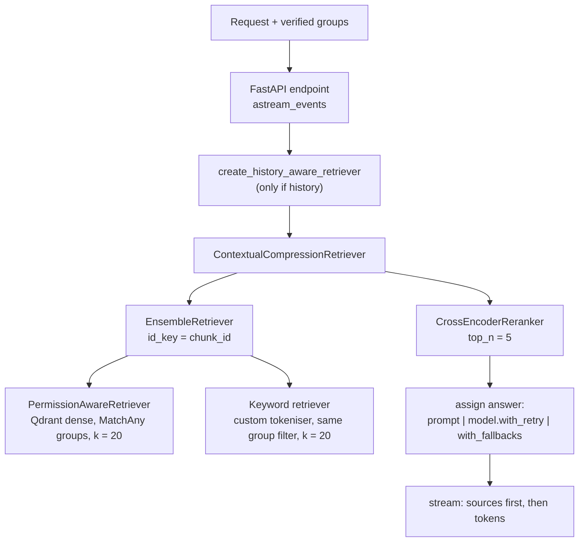

This assessment covers the whole LangChain for RAG module: the package architecture, document loaders, text splitters, embeddings, vector stores, retrievers, chains, LCEL, the Runnable interface and custom retrievers. It has five parts: a multiple-choice quiz, conceptual questions, coding exercises, an architecture design challenge and troubleshooting scenarios. Aim for at least 14 of the 18 quiz questions (about 80%) and attempt every written part before opening its model answer. The coding solutions were run with `langchain-core` 1.8 and `langchain-classic` 1.0; they need no API key and no model download.

```quiz
[
  {"q": "Since LangChain 1.0, where do the legacy chains such as `RetrievalQA` and retrievers such as `EnsembleRetriever` live?", "options": ["`langchain_core`", "`langchain_classic`", "`langchain.chains` and `langchain.retrievers`, unchanged", "`langchain_community`"], "answer": 1, "why": "LangChain 1.0 moved legacy chains and the older advanced retrievers into the separate `langchain-classic` package; `langchain` itself now focuses on agents."},
  {"q": "A custom document loader implements only `lazy_load()`. What does `load()` do?", "options": ["Raises NotImplementedError", "Returns `list(self.lazy_load())`", "Loads files in parallel", "Returns a generator"], "answer": 1, "why": "`BaseLoader.load()` materialises the generator into a list, so everything is in memory at once."},
  {"q": "A text splitter is built with `from_tiktoken_encoder(chunk_size=300, chunk_overlap=30)`. What unit are 300 and 30 measured in?", "options": ["Characters", "Words", "Tokens of the named encoding", "Sentences"], "answer": 2, "why": "The `from_tiktoken_encoder` and `from_huggingface_tokenizer` constructors make the length function count tokens while keeping boundary-aware cutting."},
  {"q": "Why does LangChain's `Embeddings` interface have separate `embed_query` and `embed_documents` methods?", "options": ["Queries are always longer", "Some models encode queries and passages differently, for example with different prefixes", "Only `embed_documents` normalises vectors", "`embed_query` is asynchronous"], "answer": 1, "why": "Asymmetric models such as E5 expect `query: ` and `passage: ` prefixes. The interface allows the two paths to differ, though it does not enforce it."},
  {"q": "What does `store.as_retriever(search_kwargs={\"k\": 3})` return?", "options": ["A list of three Documents", "A `VectorStoreRetriever` that calls the store's search with k=3 on every invoke", "A copy of the vector store with only three vectors", "A chain that answers questions"], "answer": 1, "why": "`as_retriever` wraps the store in a `VectorStoreRetriever`, which passes `search_kwargs` to the store's search method on each call."},
  {"q": "A FAISS retriever uses `similarity_score_threshold` with `score_threshold=0.3` on normalised MiniLM vectors and returns nothing for every query. The best cosine similarities are around 0.35 to 0.6. What is the most likely cause?", "options": ["The threshold must be above 0.5", "FAISS's flat L2 index returns squared distances, but the default relevance conversion assumes plain Euclidean distance, so relevance comes out too low", "MiniLM vectors cannot be thresholded", "The retriever needs `fetch_k`"], "answer": 1, "why": "Relevance is a store-specific conversion. For unit vectors the correct conversion from squared distance is 1 - d2/2; the default 1 - d/sqrt(2) makes a cosine of 0.37 look like 0.11."},
  {"q": "`BM25Retriever.from_documents(docs, k=3)` is queried with `E-4021`. The only matching runbook text is `Error E-4021: the VPN client is out of date`. Which statement is true with the default settings?", "options": ["The runbook is returned first because BM25 matches exact codes", "The default tokeniser splits on whitespace only, so `E-4021:` and `E-4021` do not match; three documents are still returned", "BM25Retriever returns an empty list", "BM25Retriever raises an error for punctuation"], "answer": 1, "why": "The default `preprocess_func` is `str.split()`. Punctuation and case are kept, so the tokens differ, and the retriever always returns k documents regardless of score."},
  {"q": "BM25 returns `[a, b, c]` and the dense retriever returns `[a, d, e]`. An `EnsembleRetriever` with weights 0.5 and 0.5 and c = 60 fuses them. What is a's score?", "options": ["0.5/61", "1/61", "1/60", "0.5/60 + 0.5/60"], "answer": 1, "why": "Ranks start at 1, so a earns 0.5/(1+60) from each list: 0.5/61 + 0.5/61 = 1/61."},
  {"q": "You wrap a vector retriever with `k=4` in a `ContextualCompressionRetriever` using a cross-encoder with `top_n=4`. What is the main problem?", "options": ["It raises a configuration error", "The reranker can only reorder the same four documents and cannot recover anything ranked fifth or lower", "The cross-encoder is never called", "It returns eight documents"], "answer": 1, "why": "Over-fetch for reranking: the base retriever's k must be larger than top_n for the reranker to change which documents are kept."},
  {"q": "What does `create_retrieval_chain(retriever, combine_docs_chain).invoke({\"input\": q})` return?", "options": ["`{\"result\": ..., \"source_documents\": ...}`", "`{\"input\": q, \"context\": [Document, ...], \"answer\": ...}`", "A string", "`{\"question\": q, \"answer\": ...}`"], "answer": 1, "why": "It keeps the input and assigns `context` (retrieved documents) and `answer` (the documents chain's output)."},
  {"q": "In a conversational chain built with `create_history_aware_retriever`, how many model calls does a follow-up turn make with the stuff strategy?", "options": ["One", "Two: one to rewrite the question, one to answer", "Three", "None until the user confirms"], "answer": 1, "why": "With non-empty chat history the rewrite step calls the model before retrieval, and the answer step calls it again."},
  {"q": "What does this print?\n```python\nfrom langchain_core.runnables import RunnableParallel, RunnablePassthrough\nr = RunnableParallel(q=RunnablePassthrough(), n=lambda x: len(x))\nprint(r.invoke(\"VPN\"))\n```", "options": ["`3`", "`{'q': 'VPN'}`", "`{'q': 'VPN', 'n': 3}`", "`['VPN', 3]`"], "answer": 2, "why": "Every branch of a RunnableParallel receives the same input; the passthrough returns it and the lambda returns its length."},
  {"q": "What does this print?\n```python\nfrom langchain_core.runnables import RunnablePassthrough\nprint(RunnablePassthrough.assign(n=lambda x: len(x[\"q\"])).invoke({\"q\": \"leave\"}))\n```", "options": ["`{'n': 5}`", "`{'q': 'leave', 'n': 5}`", "`5`", "`{'q': 5}`"], "answer": 1, "why": "`assign` keeps the original dictionary and adds the computed key."},
  {"q": "A chain ends `... | llm | StrOutputParser() | (lambda s: s.strip())`. Users of the streaming endpoint complain they see nothing until the whole answer appears. Why?", "options": ["StrOutputParser does not stream", "A plain function is not stream-aware: it waits for its complete input and emits one chunk", "Streaming requires `batch`", "The model does not support streaming"], "answer": 1, "why": "A RunnableLambda after the model collapses the stream into a single chunk. Use a generator function or move the transformation to the client."},
  {"q": "A Runnable implements only `invoke`. What does `await runnable.ainvoke(x)` do by default?", "options": ["Raises NotImplementedError", "Runs `invoke` in a thread executor so the event loop is not blocked", "Calls `invoke` directly on the event loop thread", "Returns a coroutine that never completes"], "answer": 1, "why": "The default `ainvoke` delegates to `invoke` through a thread executor."},
  {"q": "Where should `with_retry` usually be applied in a RAG chain?", "options": ["Around the whole chain", "Around the model (or other networked component) that fails transiently, restricted to transient exception types", "Around the prompt template", "Around the output parser"], "answer": 1, "why": "Retrying the whole chain repeats retrieval and can duplicate streamed output; retrying permanent errors only adds delay."},
  {"q": "A custom retriever declares `def _get_relevant_documents(self, query, *, run_manager)`. A caller writes `retriever.invoke(q, tenant=\"acme\")`. What happens?", "options": ["TypeError: unexpected keyword argument", "The tenant filter is applied", "The `tenant` argument is silently dropped and the search is not restricted", "LangChain asks for the tenant at run time"], "answer": 2, "why": "BaseRetriever only forwards extra keyword arguments if the method declares them; otherwise they are dropped without error, so permission context must not travel this way."},
  {"q": "Why should a permission filter run inside the vector search rather than on the top-k results afterwards?", "options": ["It is the only way LangChain supports filters", "Post-filtering can leave too few permitted documents and lets restricted text pass through traces and logs", "Vector databases cannot return metadata", "Post-filtering changes the embedding"], "answer": 1, "why": "Filtering inside the search ranks only permitted documents, so the top k are the best permitted ones and restricted content never leaves the database."}
]
```

## Conceptual questions

**1.** The module draws a line between indexing-side objects (loaders, splitters, embeddings, vector stores) and query-side Runnables (retrievers, prompts, models, parsers). Explain why the line falls where it does, and what `as_retriever()` has to do with it.

<details><summary>Show model answer</summary>

Indexing runs offline, in bulk, usually as a batch job: load files, split them, embed chunks and write vectors. Those objects have their own bulk methods (`lazy_load`, `split_documents`, `embed_documents`, `add_documents`) and do not need streaming, per-request configuration or composition with `|`. The query path runs once per user request and needs exactly those things: async execution, batching for evaluation, streaming, tracing, retries and composition into a chain. So query components implement the Runnable interface. The vector store sits on both sides: it is filled at indexing time and searched at query time. `as_retriever()` is the bridge: it wraps the store's search methods in a `VectorStoreRetriever`, which is a Runnable and can therefore be piped into a chain.

</details>

**2.** A retriever's contract is "string in, list of documents out", with no scores. Give two consequences of that design for a RAG engineer, one helpful and one harmful, and say how you would handle the harmful one.

<details><summary>Show model answer</summary>

Helpful: any retriever can replace any other without changing the chain, and retrievers nest (an ensemble of retrievers inside a reranking retriever is still a retriever). Harmful: a badly configured retriever looks the same as a good one, and the chain cannot tell a strong match from padding: BM25 returns k documents even with zero scores, and a threshold that removes everything returns an empty list with only a log warning. Handle it by putting scores in metadata (a custom retriever, or calling the store's scoring methods), applying a deliberate floor inside retrieval, logging retrieved identifiers and scores for every request, and testing each retriever on its own with labelled queries before composing it.

</details>

**3.** Explain the difference between `create_retrieval_chain` and the hand-written LCEL chain `{"context": retriever | format_docs, "question": RunnablePassthrough()} | prompt | llm | StrOutputParser()`. When would you choose each?

<details><summary>Show model answer</summary>

Both retrieve with the question, format documents into a prompt and call the model. The hand-written chain takes a string and returns a string; the documents are flattened into the prompt and lost. `create_retrieval_chain` takes `{"input": ...}` and returns `{"input", "context", "answer"}`, keeping the `Document` objects for citations, logging and evaluation; internally it is `RunnablePassthrough.assign(context=...).assign(answer=...)`, with `create_stuff_documents_chain` handling formatting. Choose the constructor when its key names and document formatting suit you, or when other helpers (such as `create_history_aware_retriever`) slot into it. Choose hand-written LCEL when you want different keys, custom formatting logic, extra steps (reranking, routing, guardrails), or no dependency on `langchain-classic`. In either case retrieve once and return the documents.

</details>

**4.** Why do retries and fallbacks belong on the narrowest failing component, and why should retries be limited to transient errors? Include the arithmetic for three attempts with default exponential backoff.

<details><summary>Show model answer</summary>

A wrapper re-runs everything inside it. Retrying the whole chain repeats retrieval, reranking and prompt formatting for a model timeout, wasting work, and in a streaming chain it can resend tokens the user has already seen. Wrapping only the model retries only what failed. Permanent errors (invalid requests, authentication failures, context too long) fail identically every time, so retrying them only adds latency before the inevitable error. With `tenacity`'s defaults as used by `with_retry`, the wait after failed attempt n is 2^(n-1) seconds plus up to 1 second of jitter; three attempts mean two waits of 1 to 2 and 2 to 3 seconds, 3 to 5 seconds in total, plus three times the per-attempt timeout. With a 10-second timeout, a request that fails all three attempts takes about 34 seconds before any fallback runs, which is why client timeouts must be set together with retry counts.

</details>

## Coding exercises

### Exercise 1: sources without retrieving twice

Write an LCEL chain that takes a question string and returns `{"answer": str, "sources": [ids]}`, where `sources` lists the metadata ids of the documents the model was given. Use a custom retriever that counts its own calls, and prove that one question causes exactly one retrieval. Use `FakeListChatModel` for the model.

<details><summary>Show solution</summary>

```python
from langchain_core.documents import Document
from langchain_core.retrievers import BaseRetriever
from langchain_core.prompts import ChatPromptTemplate
from langchain_core.output_parsers import StrOutputParser
from langchain_core.runnables import RunnableParallel, RunnablePassthrough
from langchain_core.language_models.fake_chat_models import FakeListChatModel

DOCS = [
    Document("Staff receive 25 days of annual leave per year.", metadata={"id": "leave"}),
    Document("Up to 5 unused leave days carry over and must be used by 31 March.", metadata={"id": "carry"}),
    Document("Expenses must be submitted within 30 days; anything over £75 needs a receipt.", metadata={"id": "expenses"}),
]

class CountingKeywordRetriever(BaseRetriever):
    """Returns documents sharing a word with the query; counts its own calls."""
    k: int = 2
    calls: int = 0

    def _get_relevant_documents(self, query, *, run_manager):
        self.calls += 1
        words = set(query.lower().replace("?", "").split())
        scored = [(len(words & set(d.page_content.lower().split())), d) for d in DOCS]
        return [d for s, d in sorted(scored, key=lambda p: -p[0]) if s > 0][: self.k]

retriever = CountingKeywordRetriever()
prompt = ChatPromptTemplate.from_messages([
    ("system", "Answer only from the context.\n\nContext:\n{context}"),
    ("human", "{question}")])
llm = FakeListChatModel(responses=["25 days [leave]."])
fmt = lambda docs: "\n".join(f"[{d.metadata['id']}] {d.page_content}" for d in docs)

chain = (
    RunnableParallel(docs=retriever, question=RunnablePassthrough())
    .assign(answer=RunnablePassthrough.assign(context=lambda x: fmt(x["docs"]))
            | prompt | llm | StrOutputParser())
    | (lambda x: {"answer": x["answer"], "sources": [d.metadata["id"] for d in x["docs"]]})
)
print(chain.invoke("How many days of annual leave do staff get?"))
print("retriever calls:", retriever.calls)
```

```output
{'answer': '25 days [leave].', 'sources': ['leave', 'carry']}
retriever calls: 1
```

The retriever appears once, in the first parallel step. `.assign(answer=...)` builds the answer from the same `docs` value, formatting a copy for the prompt, and the final function reshapes the output. The plain function at the end is fine here because the output is a dictionary that is only needed whole; for token streaming you would return the dictionary from the `assign` step directly.

</details>

### Exercise 2: retries, fallbacks and the batch path

Wrap a stand-in model so that `TimeoutError` is retried up to three attempts (no waiting, for the test) and any remaining failure falls back to a backup. The stand-in raises `TimeoutError` on its 2nd and 3rd calls and `ValueError` for any input containing `BAD`. Run three inputs (`q1`, `q2`, `BAD q3`) first with `invoke` in a loop, then with `batch`, and compare. Explain any difference, and give a fix if the batch behaviour is not what you want.

<details><summary>Show solution</summary>

```python
from langchain_core.runnables import RunnableLambda

calls = []
def primary(q: str) -> str:
    calls.append(q)
    if "BAD" in q:
        raise ValueError("invalid request")            # permanent
    if len(calls) in (2, 3):
        raise TimeoutError("timed out")                 # transient
    return f"primary answered {q!r}"

backup = RunnableLambda(lambda q: f"backup answered {q!r}")
model = (RunnableLambda(primary)
         .with_retry(retry_if_exception_type=(TimeoutError,),
                     stop_after_attempt=3, wait_exponential_jitter=False)
         .with_fallbacks([backup]))

for q in ["q1", "q2", "BAD q3"]:
    print(model.invoke(q))
print("primary calls:", calls)

calls.clear()
for answer in model.batch(["q1", "q2", "BAD q3"], config={"max_concurrency": 1}):
    print(answer)
print("primary calls:", calls)

calls.clear()
per_item = RunnableLambda(lambda q, config: model.invoke(q, config=config))
for answer in per_item.batch(["q1", "q2", "BAD q3"], config={"max_concurrency": 1}):
    print(answer)
print("primary calls:", calls)
```

```output
primary answered 'q1'
primary answered 'q2'
backup answered 'BAD q3'
primary calls: ['q1', 'q2', 'q2', 'q2', 'BAD q3']
backup answered 'q1'
backup answered 'q2'
backup answered 'BAD q3'
primary calls: ['q1', 'q2', 'BAD q3', 'q2', 'BAD q3']
primary answered 'q1'
primary answered 'q2'
backup answered 'BAD q3'
primary calls: ['q1', 'q2', 'q2', 'q2', 'BAD q3']
```

**With `invoke`**, behaviour is as designed: `q2` timed out twice and succeeded on its third attempt; `BAD q3` raised `ValueError`, which is not retried, and went straight to the backup.

**With `batch`**, every answer came from the backup, including `q1`, whose primary call had succeeded. In the installed version (`langchain-core` 1.8), the retry wrapper's batch path retries the failed inputs as a group and, once a non-retryable error remains, raises it for the batch; the fallback wrapper then treats the whole batch as failed and runs every input on the backup. (It also called the primary twice for `BAD q3`.) The precise behaviour is an implementation detail that may change between versions, which is the real lesson: **test the batch path separately**, because it is not simply a loop over `invoke`.

**The fix** shown last isolates inputs: a `RunnableLambda` that calls `model.invoke` per item gives each input its own retry and fallback, while `batch` still provides concurrency. Validating inputs before they reach the model (so `BAD q3` never becomes a model call) is the other half of the fix.

</details>

## Architecture design challenge

Meridian is opening AskMeridian to all 400 staff and to two new sources: Finance's quarterly reports (readable only by the `finance` group) and the Atlas error-code catalogue, where questions are mostly exact codes such as E-4100. Requirements:

- Answers stream to a web interface, and the sources appear before the first token.
- Paraphrased HR questions and exact error codes must both retrieve well.
- No user ever retrieves a document outside their groups.
- The model provider occasionally times out; answers must still arrive within about 15 seconds.
- A nightly evaluation of 600 questions must not disturb the live service.

Design the LangChain components and how they are composed. Name the classes, state the key parameters, and justify the trade-offs.

<details><summary>Show reference design</summary>



**Retrieval.** A custom `PermissionAwareRetriever` queries Qdrant directly with a `MatchAny` filter on a `groups` payload (with a payload index), fails closed on empty groups, and returns `chunk_id`, `source`, `score` and `groups` in metadata. Error codes need exact matching, so a keyword retriever runs alongside it; it must enforce the same group filter, so it is either a second custom retriever over Qdrant sparse vectors with the same filter or a search engine queried with the filter, not an in-memory `BM25Retriever` over all documents. Both feed an `EnsembleRetriever` (weights 0.5/0.5 to start, `id_key="chunk_id"`), with each sub-retriever at `k = 20`, and a `ContextualCompressionRetriever` with a cross-encoder keeps the best 5. Groups come from the validated identity token through `configurable` fields, never from the request body.

**Generation.** Retrieve once into a dictionary and `.assign(answer=...)`, as in the LCEL lesson, so that the documents shown are the documents the model read. The model is wrapped as `model.with_retry(retry_if_exception_type=<the SDK's timeout and rate-limit errors>, stop_after_attempt=2).with_fallbacks([second_deployment])`, with client timeouts of about 4 seconds: worst case 4 + about 1.5 + 4 + 4 ≈ 13.5 seconds, inside the budget. Follow-ups use `create_history_aware_retriever` (one extra call only when history exists; the rewritten query is logged).

**Streaming.** The endpoint uses `astream_events(version="v2")`: it sends the reranked documents from the retriever's end event as the source list, then forwards model stream events as text. No plain function sits after the model.

**Evaluation.** The nightly job calls `chain.batch` with `max_concurrency` set well below the rate limit, `return_exceptions=True`, tags and release metadata, and its own API key so it cannot exhaust the live quota. Its batch path is tested separately, given that retries and fallbacks behave differently in batch.

**Trade-offs.** The reranker adds CPU latency proportional to the 40-candidate pool (roughly 40 times the per-pair cost); reducing `k` saves time but risks recall. Two retrievers double the filtering logic to keep correct, which is why both are permission tests' targets. A second model deployment costs money to keep available but turns provider outages into slower answers rather than errors.

</details>

## Troubleshooting scenarios

**Scenario 1.** After a refactor, AskMeridian answers every question with "I don't know". The retriever is a custom `PermissionAwareRetriever`; traces show the retriever step returning an empty list in about 1 ms, with no call to Qdrant.

<details><summary>Show diagnosis and fix</summary>

A retriever that returns in about a millisecond without touching Qdrant is taking the fail-closed branch: `allowed_groups` is empty. The refactor stopped passing the groups, most likely because the `configurable` key no longer matches the `ConfigurableField(id=...)`, or a new code path builds the chain without the per-request configuration. The fail-closed design did its job: the bug caused unhelpful answers, not a data leak. Fix: restore the configuration plumbing from the verified identity, and add an integration test that asserts a known question returns documents for a normal user, alongside the existing test that an empty group list returns nothing.

</details>

**Scenario 2.** The streaming endpoint used to show text token by token. After a change that "cleans up citations", users see a blank screen for several seconds and then the full answer at once. Nothing else changed.

<details><summary>Show diagnosis and fix</summary>

The citation clean-up was almost certainly added as a plain function after the model (for example `| StrOutputParser() | clean_citations`). A `RunnableLambda` is not stream-aware: it waits for its complete input and emits one chunk, so the whole chain stops streaming. Fix: rewrite the clean-up as a generator that takes an iterator of chunks and yields cleaned chunks (LCEL wraps generator functions as `RunnableGenerator`), keeping any state needed for citations that span chunk boundaries; or perform the clean-up in the client. Add a test that asserts the chain yields more than one chunk.

</details>

**Scenario 3.** A new hybrid retriever (`EnsembleRetriever` of `BM25Retriever` and a vector retriever) was supposed to fix error-code questions. On "What does E-4100 mean?", the fused list puts the password-rotation policy second, above a closely related VPN error entry, and the prompt now contains six or seven documents instead of four.

<details><summary>Show diagnosis and fix</summary>

Two separate issues. First, `BM25Retriever` always returns `k` documents: if only one document contains the code, the others are zero-score padding, and RRF gives padding at rank 2 the same credit as a genuine rank-2 dense result, so an unrelated policy can rank highly (ties are broken by first appearance, with BM25's list first). Check the BM25 list on its own, give it a tokeniser that preserves codes such as `e-4100`, and drop zero-score results with a small custom retriever. Second, `EnsembleRetriever` has no `k`: it returns the union of its inputs, so two lists of four can yield up to eight documents. Trim afterwards, or put the ensemble inside a `ContextualCompressionRetriever` with a reranker and `top_n=4`. Set `id_key` so that duplicate chunks with slightly different text are merged.

</details>
