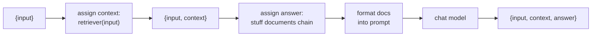

A retriever finds documents; a model writes text. Something has to sit between them: take the user's question, call the retriever, turn the documents into a prompt, call the model, and hand back the answer together with the sources. In LangChain that something is a **chain**. This lesson explains what a chain is, walks through the three prebuilt constructors that cover most RAG applications (`create_stuff_documents_chain`, `create_retrieval_chain` and `create_history_aware_retriever`), shows exactly what each one passes to the model, and explains the older document-combining strategies (stuff, map-reduce, refine, map-rerank) that you will meet in existing code bases.

The word "chain" has meant two different things in LangChain's history: a family of classes, now legacy, and a composition of components, which is how chains are built today. Knowing both lets you read old code and write new code. The composition language itself, LCEL, is the subject of [the next lesson](/learn/langchain-for-rag/lcel).

## Learning objectives

- Describe what a chain is and distinguish legacy `Chain` classes from chains built by composing Runnables.
- Build a RAG chain with `create_stuff_documents_chain` and `create_retrieval_chain`, and state the input and output keys of each.
- Control how documents are rendered into the prompt with `document_prompt` and `document_separator`.
- Add conversational memory with `create_history_aware_retriever`, and explain why follow-up questions break naive retrieval.
- Compare the stuff, map-reduce, refine and map-rerank strategies by number of model calls, latency and failure modes.

## Prerequisites

- [Retrievers](/learn/langchain-for-rag/retrievers): the string-in, documents-out contract.
- [Context injection](/learn/prompt-engineering-for-rag/context-injection): how retrieved text is placed in a prompt.
- [Multi-turn RAG](/learn/generation-strategies/multi-turn-rag): why conversations need query rewriting.

## Why this matters

The steps of a basic RAG request are always the same, and writing them by hand each time invites small, expensive mistakes. One engineer joins documents with no separator, so the model reads two policies as one sentence. Another forgets to return the retrieved documents, so the interface cannot show sources and nobody can debug a wrong answer. A third passes the raw follow-up question "and what about contractors?" to the retriever, which has no idea what "what about" refers to.

A chain packages the steps once, with conventions that prevent those mistakes: a fixed set of input and output keys, a place for the document format, and the retrieved documents returned alongside the answer. It also gives every step a name, so a tracing tool can show you what the retriever returned and what the model saw. And because the chain is a standard component, you can swap the retriever or the model without rewriting it.

The risk runs the other way too. A prebuilt chain hides its prompt and its plumbing. If you do not know what a constructor sends to the model, you cannot reason about cost, about failure, or about what to change when the answer is wrong. This lesson opens each one up.

## The intuition

Think of a chain as a recipe card pinned above a kitchen station. The card does not cook; it lists the steps in order and says what each step hands to the next: "take the order ticket, fetch the ingredients listed on it, lay them out in this arrangement, give the tray to the chef, put the dish and the ingredient list on the pass." Any cook can follow it, ingredients can come from a different supplier, and the chef can change, without rewriting the card.

The legacy approach printed a separate laminated card for every dish, each with its own quirks. The modern approach gives you a small set of standard step cards and a way to clip them together. The prebuilt RAG constructors are simply cards that LangChain has already clipped together for you.

## How it works

### Two meanings of "chain"

**Legacy chains** are subclasses of a `Chain` base class: `LLMChain`, `RetrievalQA`, `ConversationalRetrievalChain`, `StuffDocumentsChain`, `MapReduceDocumentsChain` and many more. Each is a class with its own constructor arguments, its own input and output key names, and its own internal prompt. Most are marked deprecated, and since LangChain 1.0 they live in the separate `langchain-classic` package, kept so that existing applications keep working.

**Modern chains** are compositions of **Runnables**: prompts, models, retrievers, output parsers and plain functions joined with LangChain Expression Language (LCEL). A modern chain is not a special class at all; it is whatever object the composition produces, and it has the same `invoke`, `batch` and `stream` methods as any other Runnable. The RAG constructors in this lesson return such compositions. For agent-style applications, where the model decides whether and how often to call a retriever, the LangChain project now points to LangGraph and to its agent constructors instead; that pattern is covered in [Agentic RAG](/learn/agentic-rag).

| | Legacy `Chain` classes | Composed chains |
| --- | --- | --- |
| What it is | A class per use case | Any composition of Runnables |
| Prompt | Often built in, sometimes hard to see | Always yours |
| Streaming, batch, async | Varies by class | Uniform, from the Runnable interface |
| Status | Deprecated; in `langchain-classic` | Current |

### `create_stuff_documents_chain`: documents into a prompt

"Stuffing" means putting every retrieved document into one prompt. The constructor takes a model and a prompt template, and returns a Runnable that expects a dictionary with a `context` key holding a list of `Document` objects, plus whatever other variables your prompt uses. Step by step:

1. Format each document with `document_prompt` (default: `"{page_content}"`). The template may use `page_content` and any metadata key, so `"[{id}] {page_content}"` puts a citation tag in front of each document.
2. Join the formatted documents with `document_separator` (default: two newlines).
3. Put the resulting string into the prompt variable named by `document_variable_name` (default: `context`).
4. Format the prompt, call the model and parse the output to a string (the default parser).

The model therefore sees one block of text, in retrieval order, and your prompt decides where that block goes and what instructions surround it. The constructor adds no instructions of its own.

### `create_retrieval_chain`: question to answer and sources

`create_retrieval_chain(retriever, combine_docs_chain)` wires a retriever in front of the documents chain. Its input is a dictionary with an `input` key; its output is the same dictionary with two keys added:

- `context`: the list of documents the retriever returned;
- `answer`: the output of `combine_docs_chain`.

Returning `context` is the important design choice: every answer comes back with its evidence, ready for citations, logging and evaluation. The implementation is short enough to quote. In `langchain-classic` 1.0 it is, in essence:

```python
retrieval_docs = (lambda x: x["input"]) | retriever
chain = RunnablePassthrough.assign(context=retrieval_docs).assign(answer=combine_docs_chain)
```

Read it as: keep the input dictionary, add `context` by sending `input` to the retriever, then add `answer` by sending the whole dictionary to the documents chain. That one line is LCEL, and [LCEL](/learn/langchain-for-rag/lcel) explains every symbol in it. The point here is that a "prebuilt chain" is just a composition you could have written yourself.



### `create_history_aware_retriever`: follow-up questions

In a conversation, the second question often makes no sense on its own. After "How much holiday do I get?", the follow-up "And what if I don't use them all?" contains no word about leave. An embedding of it is about not using *something*; a retriever given it will return whatever is closest to that vague idea. The fix, established practice in conversational search, is to **rewrite the follow-up into a standalone query** before retrieving.

`create_history_aware_retriever(llm, retriever, prompt)` returns a retriever-shaped Runnable that does exactly this:

1. If the input's `chat_history` is missing or empty, send `input` straight to the retriever (no model call).
2. Otherwise, format `prompt` with the history and the input, call the model, parse its reply to a string, and send that string to the retriever.

The prompt must contain an `input` variable (the constructor checks) and should contain a `chat_history` placeholder. You write the rewriting instruction yourself. Because the result is still a retriever-shaped Runnable, you pass it to `create_retrieval_chain` in place of the plain retriever, and you get a conversational RAG chain.

Two consequences are worth stating plainly. Every follow-up turn costs **one extra model call** before retrieval even starts, which adds latency to the time to the first token. And the rewrite is a new place for errors: if the model rewrites "and for contractors?" as a question about employees, the retriever faithfully fetches the wrong documents. Log the rewritten query; it is the first thing to check when a follow-up answer is wrong.

> [!NOTE]
> The chain does not store the conversation. You pass `chat_history` in with every call, and your application decides where history lives (a database, a session store) and how much of it to send. [Multi-turn RAG](/learn/generation-strategies/multi-turn-rag) covers those choices.

### Document-combining strategies

Stuffing assumes the documents fit in one prompt. When they did not, because context windows were small, LangChain offered three alternatives, still found in older code:

- **Map-reduce.** Call the model once per document (the *map*), for example "extract what this says about the question", then once more to combine the extracts (the *reduce*). If the extracts are still too long, they are collapsed in further rounds.
- **Refine.** Answer from the first document, then call the model once per remaining document with "here is the existing answer and a new document; refine the answer". The calls are strictly sequential.
- **Map-rerank.** Ask the model, for each document separately, for an answer and a score, then return the highest-scoring answer. No information from two documents is ever combined.

| Strategy | Model calls for $n$ documents | Can run in parallel? | Typical failure |
| --- | --- | --- | --- |
| Stuff | 1 | not needed | Overflows the context; long contexts dilute attention |
| Map-reduce | $n + 1$ (or more) | the map step, yes | Extracts lose details the reduce step needed |
| Refine | $n$ | no | Slow; early documents can be overwritten by later ones |
| Map-rerank | $n$ | yes | Cannot synthesise across documents |

With modern context windows of many tens of thousands of tokens, a RAG prompt of five to ten chunks fits easily, so **stuff is the default** and the alternatives are reserved for summarising or synthesising many documents, which [Multi-document synthesis](/learn/generation-strategies/multi-document-synthesis) covers. The legacy classes that implement them are deprecated; new code builds them with LCEL or LangGraph.

## In code

**The problem.** Build a RAG chain for AskMeridian with the two constructors, see exactly what the model receives, then make it conversational and show that the rewrite changes what is retrieved. To keep it runnable without an API key, the model is LangChain's `FakeListChatModel`, which returns canned replies in order, behind a small "spy" function that records each prompt. The retriever is real: `all-MiniLM-L6-v2` embeddings in an `InMemoryVectorStore`.

```bash
pip install langchain-core langchain-community langchain-classic sentence-transformers
```

```python
from langchain_core.documents import Document
from langchain_core.vectorstores import InMemoryVectorStore
from langchain_core.prompts import ChatPromptTemplate, MessagesPlaceholder, PromptTemplate
from langchain_core.runnables import RunnableLambda
from langchain_core.messages import HumanMessage, AIMessage
from langchain_core.language_models.fake_chat_models import FakeListChatModel
from langchain_community.embeddings import HuggingFaceEmbeddings
from langchain_classic.chains import create_retrieval_chain, create_history_aware_retriever
from langchain_classic.chains.combine_documents import create_stuff_documents_chain

docs = [
    Document("Staff receive 25 days of annual leave per year.", metadata={"id": "leave"}),
    Document("Up to 5 unused leave days carry over and must be used by 31 March.", metadata={"id": "carry"}),
    Document("Employees may work remotely up to 3 days a week.", metadata={"id": "remote"}),
    Document("The home-office equipment budget is £400; contractors are not eligible.", metadata={"id": "equip"}),
    Document("Passwords must be rotated every 90 days.", metadata={"id": "pwd"}),
]
emb = HuggingFaceEmbeddings(model_name="sentence-transformers/all-MiniLM-L6-v2",
                            encode_kwargs={"normalize_embeddings": True})
retriever = InMemoryVectorStore.from_documents(docs, emb).as_retriever(search_kwargs={"k": 2})

# A stand-in for a chat model: canned replies, plus a spy that records each prompt.
seen = []
def spy(prompt_value):
    seen.append(prompt_value.to_messages())
    return prompt_value
llm = RunnableLambda(spy) | FakeListChatModel(responses=[
    "You get 25 days of annual leave a year [leave].",
    "What happens to unused annual leave days, and is there a deadline?",
    "Up to 5 unused days carry over and must be used by 31 March [carry].",
])

# 1. The document-combining chain: formats docs into {context}, calls the model
answer_prompt = ChatPromptTemplate.from_messages([
    ("system", "Answer only from the context. Cite sources in brackets. "
               "If the answer is not there, say you don't know.\n\nContext:\n{context}"),
    MessagesPlaceholder("chat_history", optional=True),
    ("human", "{input}"),
])
combine_docs = create_stuff_documents_chain(
    llm, answer_prompt,
    document_prompt=PromptTemplate.from_template("[{id}] {page_content}"))

# 2. The retrieval chain: input -> context -> answer
rag = create_retrieval_chain(retriever, combine_docs)
out = rag.invoke({"input": "How much holiday do I get?"})
print("keys:   ", list(out))
print("context:", [d.metadata["id"] for d in out["context"]])
print("answer: ", out["answer"])
print("system message the model saw:\n" + seen[-1][0].content)

# 3. A follow-up question needs the history to be understood
rewrite_prompt = ChatPromptTemplate.from_messages([
    MessagesPlaceholder("chat_history"),
    ("human", "{input}"),
    ("human", "Rewrite the last question as a standalone search query."),
])
conv_rag = create_retrieval_chain(
    create_history_aware_retriever(llm, retriever, rewrite_prompt), combine_docs)
history = [HumanMessage("How much holiday do I get?"),
           AIMessage("You get 25 days of annual leave a year [leave].")]
follow_up = "And what if I don't use them all?"
print("\nnaive:  ", [d.metadata["id"] for d in retriever.invoke(follow_up)])
out = conv_rag.invoke({"input": follow_up, "chat_history": history})
print("model calls so far:", len(seen))
print("context:", [d.metadata["id"] for d in out["context"]])
print("answer: ", out["answer"])
```

```output
keys:    ['input', 'context', 'answer']
context: ['leave', 'carry']
answer:  You get 25 days of annual leave a year [leave].
system message the model saw:
Answer only from the context. Cite sources in brackets. If the answer is not there, say you don't know.

Context:
[leave] Staff receive 25 days of annual leave per year.

[carry] Up to 5 unused leave days carry over and must be used by 31 March.

naive:   ['pwd', 'carry']
model calls so far: 3
context: ['carry', 'leave']
answer:  Up to 5 unused days carry over and must be used by 31 March [carry].
```

**The important lines.**

- `RunnableLambda(spy) | FakeListChatModel(...)` is a fake model with a window: the spy receives the formatted prompt, records it and passes it on unchanged. Any Runnable that accepts a prompt and returns a message can stand where a model goes, which is also how you unit-test chains.
- `document_prompt=PromptTemplate.from_template("[{id}] {page_content}")` renders each document with its metadata `id` in front. The output shows the result: two tagged documents separated by a blank line (the default separator).
- `MessagesPlaceholder("chat_history", optional=True)` lets the same answer prompt serve both chains: when no history is passed, the placeholder renders nothing.
- `create_history_aware_retriever(llm, retriever, rewrite_prompt)` is passed to `create_retrieval_chain` exactly where a retriever would go.

**What the output means.**

- The first chain returns all three keys. `context` holds the two retrieved documents, so a user interface can show "[leave]" as a link to its source.
- The printed system message is the whole truth of what the model saw. Nothing was added by the constructor; the instructions are yours.
- The naive retrieval for the follow-up puts the password-rotation rule first: "don't use them all" is semantically closer to rules about doing things regularly than to leave. With rewriting, the retriever received "What happens to unused annual leave days, and is there a deadline?" and returned the carry-over rule first.
- Three model calls in total: one for the first answer, then two for the follow-up (the rewrite and the answer). In production, that second call is the latency price of conversation.

**With a real model.** Replace the fake with Claude through the `langchain-anthropic` integration. This variant was **not executed** here (it needs an API key and the package was not installed in the sandbox), and the model name is an assumption that dates quickly; check Anthropic's model list.

```python
# pip install langchain-anthropic   (reads ANTHROPIC_API_KEY from the environment)
from langchain_anthropic import ChatAnthropic

llm = ChatAnthropic(model="claude-opus-5-5", max_tokens=1024)
combine_docs = create_stuff_documents_chain(
    llm, answer_prompt,
    document_prompt=PromptTemplate.from_template("[{id}] {page_content}"))
rag = create_retrieval_chain(retriever, combine_docs)
print(rag.invoke({"input": "How much holiday do I get?"})["answer"])
```

**Common errors.**

- `KeyError: 'input'` or a missing-variable error: `create_retrieval_chain` expects the question under `input`, not `question` or `query`. Legacy `RetrievalQA` used `query`, which is a frequent source of confusion when migrating.
- `ValueError: Prompt must accept context as an input variable`: the answer prompt has no `{context}` slot, or you renamed it without setting `document_variable_name`.
- `ValueError` mentioning `input` from `create_history_aware_retriever`: the rewrite prompt does not use `{input}`.
- A `KeyError` for a metadata field while formatting: `document_prompt` refers to a metadata key that some document lacks. Every document must carry every key the template uses.

**Extending it.** Send the rewritten query to your logs: wrap the history-aware retriever's model step in a function that records it, or read it from a trace. Then add a step that returns citations as structured data rather than text; [Citation-based generation](/learn/generation-strategies/citation-based-generation) shows the pattern.

## A real-world example

AskMeridian's first conversational release used the legacy `ConversationalRetrievalChain`, built in a few lines from a tutorial. Answers to first questions were good; answers to follow-ups were erratic, and nobody could say why, because the chain's internal question-rewriting prompt was a default the team had never read and the rewritten question was not logged.

The Platform team migrated to `create_history_aware_retriever` with `create_retrieval_chain`, writing both prompts themselves and adding the rewritten query to the request log. Reading a week of logs explained the erratic answers at once: when users switched topic ("thanks; separately, how do I reset my VPN?"), the rewrite prompt dragged the previous topic into the new query, producing searches such as "annual leave VPN reset". The team changed the rewrite instruction to say that a question which does not refer back to the conversation should be returned unchanged, and added a dozen topic-switch conversations to their regression tests.

The migration also changed the request and response shapes: the question moved from `question` to `input`, and the sources from `source_documents` to `context`. The team kept the old field names in their HTTP API with a thin mapping layer, so the front end did not need a coordinated release.

## Common mistakes

- **Not reading the prompt a prebuilt chain uses.** Legacy chains carry default prompts; if you do not know them, you cannot explain the output.
- **Passing follow-up questions straight to the retriever.** Pronouns and ellipsis ("what about…") retrieve the wrong documents.
- **Not logging the rewritten query.** When a follow-up answer is wrong, you cannot tell whether the rewrite or the retrieval failed.
- **Discarding `context`.** Without the retrieved documents in the response, you cannot cite, evaluate or debug.
- **Using map-reduce or refine for ordinary RAG questions.** They multiply model calls and latency for prompts that would fit in one call.
- **Formatting documents without identifiers or separators.** The model cannot cite what it cannot tell apart.
- **Building new features on deprecated chain classes.** They will not receive new capabilities and will eventually be removed.

## Best practices

- Write your own answer and rewrite prompts and keep them in version control alongside the code.
- Render each document with a stable identifier via `document_prompt`, and instruct the model to cite those identifiers.
- Return `context` from every chain and log both the documents' identifiers and any rewritten query.
- Test chains with a fake model (or a recording spy, as above) so that prompt construction is covered by fast, deterministic unit tests.
- Keep `chat_history` short and explicit: send the last few turns, not the whole session.
- For new code, prefer the composed constructors or plain LCEL; reach for LangGraph when the model must decide how often to retrieve.

## Performance considerations

Model calls dominate cost and latency, so count them. Let one model call take $t$ seconds and let there be $n$ retrieved documents.

- **Stuff:** one call. Total about $t$ plus retrieval.
- **History-aware:** one extra call on every follow-up turn, before retrieval. If a short rewrite call takes 0.6 s and the answer takes 2 s, the user waits roughly 2.6 s plus retrieval instead of 2 s, and the time to the first streamed token rises by the full 0.6 s. Using a smaller, faster model for the rewrite is a common and reasonable trade.
- **Map-reduce with $n = 10$:** 11 calls. If the ten map calls run in parallel, latency is roughly $2t$; cost is roughly ten short calls plus one longer one.
- **Refine with $n = 10$:** ten sequential calls, so latency is roughly $10t$. That is why refine is rarely acceptable for interactive use.

Token cost follows the prompt. With stuffing, input tokens are roughly the instructions plus the sum of the documents; five 300-token chunks and a 200-token system prompt give about 1,700 input tokens per question. Each history turn you send adds its length again, on both the rewrite call and the answer call.

## Security considerations

Retrieved documents and chat history are both text the model reads as part of its prompt. A document that contains "ignore previous instructions" travels through `create_stuff_documents_chain` untouched, because the chain formats text and does not inspect it; [Indirect prompt injection](/learn/rag-security-fundamentals/indirect-prompt-injection) covers defences. Chat history supplied by the client is user input: if your API accepts `chat_history` from the browser, a user can forge earlier "assistant" turns and steer the rewrite. Keep history on the server, keyed by session, and send only what you stored. Finally, rewritten queries and retrieved documents in logs may contain personal data; apply the same retention rules to them as to the conversation itself.

## Summary

- A chain is a fixed sequence of steps around a model call; legacy `Chain` classes are deprecated, and modern chains are compositions of Runnables.
- `create_stuff_documents_chain` renders documents with `document_prompt`, joins them and fills `{context}`; it adds no instructions of its own.
- `create_retrieval_chain` maps `{input}` to `{input, context, answer}`, so every answer travels with its evidence; internally it is two `assign` steps.
- `create_history_aware_retriever` rewrites follow-ups into standalone queries at the cost of one extra model call per turn.
- Stuff is the default for RAG; map-reduce, refine and map-rerank multiply model calls and suit summarising many documents.

## Exercises

**1.** A legacy application calls `RetrievalQA` with `{"query": q}` and reads `result` and `source_documents`. Write the mapping to the modern chain's keys.

<details><summary>Show solution</summary>

Input `{"query": q}` becomes `{"input": q}`. Output `result` becomes `answer`, and `source_documents` becomes `context`. A thin adapter keeps old callers working: `out = rag.invoke({"input": q}); return {"result": out["answer"], "source_documents": out["context"]}`.

</details>

**2.** Your documents carry `title` and `url` metadata. Write a `document_prompt` that renders each as a titled block with its URL, and say what happens if one document lacks `url`.

<details><summary>Show solution</summary>

```python
document_prompt = PromptTemplate.from_template("### {title}\nSource: {url}\n{page_content}")
```

If a document lacks `url`, formatting fails with an error naming the missing variable. Fix it at ingestion by guaranteeing every key (for example an empty string), not by catching the error in the chain.

</details>

**3.** Using the lesson's code, add a fourth turn, "Thanks. Separately, how often do I change my password?", and make the fake model's rewrite return the question unchanged. Print the retrieved ids. Then explain what instruction you would add to the rewrite prompt so a real model behaves the same way.

<details><summary>Show solution</summary>

Append a third canned rewrite reply such as "How often do I change my password?" and a fourth answer reply to the `FakeListChatModel` list, extend `history` with the follow-up and its answer, and invoke `conv_rag` again. The retriever receives the unchanged question and returns `['pwd', 'leave']`: the password rule first. For a real model, add to the rewrite prompt: "If the last question does not refer to earlier messages, return it unchanged." Then add topic-switch conversations to your regression tests.

</details>

**4.** Design decision: AskMeridian must answer "Summarise every change between the 2023 and 2025 handbooks", touching about 40 chunks of roughly 400 tokens each. Choose a strategy and justify it with call counts and token arithmetic.

<details><summary>Show solution</summary>

40 × 400 = 16,000 tokens of context, which fits in a single prompt for current Claude models (check the documented context window for the model you use), so stuffing needs one call. It is the cheapest and gives the model both versions side by side, which a comparison needs. Map-reduce (41 calls) would only be justified if the material did not fit, and its per-chunk extracts risk dropping small differences such as "£250" versus "£400". Refine (40 sequential calls) would be slow. Order the chunks by section so that matching 2023 and 2025 passages sit near each other.

</details>

## Check your understanding

```quiz
[
  {"q": "What does `create_retrieval_chain(retriever, combine_docs_chain).invoke({\"input\": q})` return?", "options": ["A string with the answer", "A dictionary with `input`, `context` and `answer`", "A list of Documents", "A dictionary with `result` and `source_documents`"], "answer": 1, "why": "It keeps the input and adds `context` (the retrieved documents) and `answer` (the documents chain's output). `result` and `source_documents` are the legacy RetrievalQA keys."},
  {"q": "What does `create_stuff_documents_chain` add to your prompt by default?", "options": ["A system prompt telling the model to stay grounded", "Citation instructions", "Nothing beyond the formatted documents in the `{context}` variable", "The chat history"], "answer": 2, "why": "It formats each document with `document_prompt`, joins them with the separator and places the string in `{context}`. All instructions come from your prompt."},
  {"q": "When does `create_history_aware_retriever` call the model?", "options": ["On every call", "Only when `chat_history` is present and non-empty", "Only when the retriever returns no documents", "Never; it uses string templates"], "answer": 1, "why": "With empty or missing history it passes `input` straight to the retriever. With history it asks the model for a standalone query first."},
  {"q": "With 10 documents and a model call that takes 2 seconds, roughly how long does the refine strategy take?", "options": ["About 2 seconds", "About 4 seconds", "About 20 seconds", "About 0.2 seconds"], "answer": 2, "why": "Refine makes one call per document, strictly in sequence, so latency is about 10 × 2 = 20 seconds."},
  {"q": "Which strategy can never combine information from two different documents in one answer?", "options": ["Stuff", "Map-reduce", "Refine", "Map-rerank"], "answer": 3, "why": "Map-rerank answers from each document separately and returns the best-scoring single answer, so no synthesis across documents happens."}
]
```

## Further reading

- LangChain documentation, retrieval and RAG tutorials, and the migration notes for LangChain 1.0 and `langchain-classic`: [docs.langchain.com](https://docs.langchain.com/)
- LangChain API reference for `create_retrieval_chain`, `create_stuff_documents_chain` and `create_history_aware_retriever`: [python.langchain.com](https://python.langchain.com/)
- Lewis, P. et al. (2020). "Retrieval-Augmented Generation for Knowledge-Intensive NLP Tasks". [arXiv:2005.11401](https://arxiv.org/abs/2005.11401)
- Anthropic documentation, Messages API and model overview: [docs.anthropic.com](https://docs.anthropic.com/)
