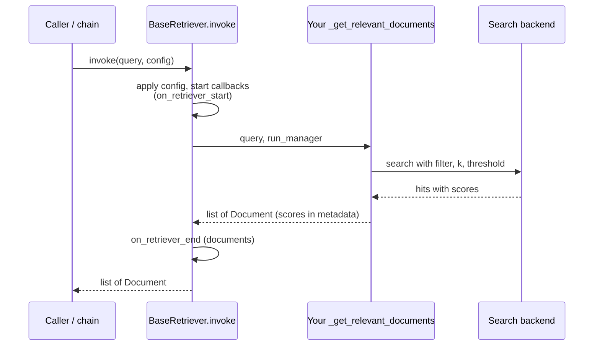

The built-in retrievers in [Retrievers](/learn/langchain-for-rag/retrievers) cover common cases, but real systems soon need something they do not do: search a database through its own client because no LangChain integration exposes the feature you need, enforce permissions inside the query, keep similarity scores in the results, call an internal search API, or combine several sources with logic of your own. The answer is a **custom retriever**: a small class that subclasses `BaseRetriever` and implements one method. This lesson shows how to write one properly, so that it behaves like every other LangChain component (batching, async, events, tracing) and is safe to put in front of a model.

The running example is a permission-aware retriever for AskMeridian that queries Qdrant directly, filters by the caller's groups inside the search, applies a similarity floor and returns scores in metadata. It runs locally against an in-process Qdrant.

## Learning objectives

- Implement a retriever by subclassing `BaseRetriever` and overriding `_get_relevant_documents`, with configuration as typed fields.
- Decide when a custom retriever is worth writing and when a function or a built-in retriever is enough.
- Pass per-request information (such as the caller's groups) into a retriever safely, and explain why unknown keyword arguments are a security risk.
- Return scores and provenance in document metadata, and fail closed when required context is missing.
- Add a native asynchronous implementation and test a retriever without a model or a network.

## Prerequisites

- [Retrievers](/learn/langchain-for-rag/retrievers): the retriever contract and the built-in retrievers.
- [Runnable interfaces](/learn/langchain-for-rag/runnable-interfaces): `ainvoke`, `batch`, `RunnableConfig` and `configurable_fields`.
- [Qdrant](/learn/vector-database-ecosystem/qdrant): collections, payloads and filtered search.
- [Dataclasses and Pydantic](/learn/python-for-rag-engineering/dataclasses-and-pydantic): typed fields and validation.

## Why this matters

A retriever is where your application decides what the model is allowed to read. Built-in wrappers make convenient decisions for the common case and hide the rest. Three situations come up again and again in production:

1. **The integration hides a feature you need.** Perhaps the vector store wrapper does not expose a particular filter type, a hybrid query mode, or the raw similarity score. You can see the feature in the database client's documentation but not through the wrapper.
2. **The retrieval rule is your own.** Permission checks, per-tenant collections, "prefer the current handbook over the superseded one", "drop results below this score", "call the internal search API and then look up full text in a second store". None of these are generic.
3. **The source is not a vector store at all.** An enterprise search service, a SQL table, a ticketing system's search endpoint.

You could write a plain function for each and pipe it into a chain; [LCEL](/learn/langchain-for-rag/lcel) will coerce it. But a function is not a retriever in LangChain's eyes. It does not emit retriever events (so tracing tools show a generic step with no document list), it cannot be passed where a `BaseRetriever` is required, and some helpers treat it differently: `create_retrieval_chain` sends a non-`BaseRetriever` Runnable the whole input dictionary rather than the question string. A small subclass avoids all of that and costs about twenty lines.

## The intuition

Meridian's IT stores has a standard returns hatch: hand an item in through the hatch and a receipt comes back. Behind the hatch, the process can be anything: today it is one technician, tomorrow a scanner and a robot. Staff do not need to know, and the receipt always looks the same.

A custom retriever is you building what is behind the hatch. LangChain supplies the hatch itself (the public `invoke`, `batch`, `ainvoke` methods, the event reporting, the configuration handling). You supply only the part behind it: "given this question, here are the documents." Because you only write the inside, everything that works with the standard hatch works with yours.

## How it works

### The contract you implement

`BaseRetriever` is an abstract Pydantic model and a Runnable. To make a retriever:

1. **Subclass `BaseRetriever`** and declare configuration as class-level typed fields (`k: int = 4`). Pydantic validates them when the retriever is constructed. Arbitrary types such as a database client are allowed.
2. **Override `_get_relevant_documents(self, query: str, *, run_manager: CallbackManagerForRetrieverRun) -> list[Document]`.** Note the leading underscore: you implement the protected method, and callers use the public `invoke`, which wraps your method with callbacks, configuration and error reporting.
3. **Optionally override `_aget_relevant_documents(self, query, *, run_manager)`** with a native `async` implementation. If you do not, the base class runs your synchronous method in a thread executor.
4. **Return `Document` objects** with useful metadata: at least a stable identifier and source; ideally the score and anything a citation needs.

Everything else is inherited: `invoke`, `ainvoke`, `batch`, `abatch`, `stream`, `astream_events`, `with_config`, `with_retry`, `configurable_fields`, the `on_retriever_start` and `on_retriever_end` events that tracing tools display, and the ability to be composed with `|` or nested inside `EnsembleRetriever` and `ContextualCompressionRetriever`.



### Getting per-request context in

A retriever object is usually built once at start-up and shared by every request. But some inputs differ per request: the caller's groups, their tenant, a date filter. There are three ways to supply them, and one way to get it badly wrong.

- **A configurable field.** Declare the field normally (`allowed_groups: list[str]`), then expose it with `.configurable_fields(allowed_groups=ConfigurableField(id="allowed_groups"))`. Each call passes `config={"configurable": {"allowed_groups": [...]}}`. This works inside LCEL chains, because the configuration propagates to every step, and it never mutates the shared object. This lesson uses it.
- **A per-request copy.** Build a new retriever for each request (`base.model_copy(update={"allowed_groups": groups})`) and use it in a chain built for that request. Simple and explicit, at the cost of building the chain per request.
- **Extra keyword arguments to `invoke`.** If `_get_relevant_documents` declares an extra parameter, say `tenant`, then `retriever.invoke(q, tenant="t1")` passes it through. This only works when you call the retriever directly, not from inside a chain.

The trap is in the third option. `BaseRetriever` checks once, when the class is defined, whether your method accepts extra arguments. **If it does not, extra keyword arguments to `invoke` are silently dropped.** A developer who writes `retriever.invoke(q, tenant="acme")` against a retriever that does not declare `tenant` gets no error and no filtering: every tenant's documents are searched. Permission context must never travel through a channel where a typo or a missing parameter fails open.

That leads to the second design rule: **fail closed**. If the permission context is missing or empty, return no documents (or raise), never everything. The model will then say it does not know, which is an inconvenience; the alternative is a data leak.

### Filtering inside the search, not after it

Permission filters belong in the database query. Filtering after retrieval has two defects. It can return too few results: ask for the top 4, discard 3 the user may not see, and the prompt receives one document even though ten permitted documents existed further down. And it leaks through side channels: scores, timing or log lines may reveal that a forbidden document matched. Qdrant applies a payload filter during the vector search itself, so the top `k` are the top `k` *among permitted points*. [Document-level permissions](/learn/access-control-and-privacy/document-level-permissions) covers the wider design.

### Scores and thresholds

The retriever contract has no scores, but your implementation can put them in metadata. Doing so lets later steps log them, threshold them, or show them in evaluation reports. Applying a minimum score inside the retriever (Qdrant's `score_threshold`) means an off-topic question returns nothing rather than the least-bad documents, giving the generator a clean signal to say "I don't know". Because the retriever talks to Qdrant directly, the score is the raw cosine similarity, with none of the distance-to-relevance conversion problems described in [Retrievers](/learn/langchain-for-rag/retrievers). Choosing the value is the subject of [Retrieval thresholding](/learn/advanced-retrieval-optimisation/retrieval-thresholding).

### When not to write one

- If a built-in retriever plus `search_kwargs` does what you need, use it.
- If the logic only reshapes another retriever's output (merging, de-duplicating, reordering) and you do not need retriever events, a function in an LCEL chain is enough.
- If you need a model to decide whether and where to search, you are building an agent; a custom retriever then becomes one of its tools, as in [Tool-based retrieval](/learn/agentic-rag/tool-based-retrieval).

## In code

**The problem.** AskMeridian's index now contains documents that not every employee may read: HR case notes and finance reports alongside the handbook and runbooks. Build a retriever that searches Qdrant directly, restricts results to the caller's groups inside the search, drops weak matches, keeps scores, and works with `ainvoke` and `batch`. Everything runs locally: Qdrant in `:memory:` mode and `all-MiniLM-L6-v2` embeddings.

```bash
pip install langchain-core qdrant-client sentence-transformers
```

```python
import asyncio
from typing import Any
from pydantic import Field
from qdrant_client import QdrantClient, models
from sentence_transformers import SentenceTransformer
from langchain_core.callbacks import CallbackManagerForRetrieverRun
from langchain_core.documents import Document
from langchain_core.retrievers import BaseRetriever
from langchain_core.runnables import ConfigurableField


class PermissionAwareRetriever(BaseRetriever):
    """Dense search in Qdrant, restricted to the caller's groups, with scores kept."""

    client: Any                      # a QdrantClient
    encoder: Any                     # a SentenceTransformer
    collection: str
    k: int = 4
    min_score: float = 0.3           # raw cosine similarity
    allowed_groups: list[str] = Field(default_factory=list)

    def _get_relevant_documents(
        self, query: str, *, run_manager: CallbackManagerForRetrieverRun
    ) -> list[Document]:
        if not self.allowed_groups:              # fail closed: no identity, no documents
            return []
        vector = self.encoder.encode(query, normalize_embeddings=True).tolist()
        hits = self.client.query_points(
            collection_name=self.collection,
            query=vector,
            query_filter=models.Filter(must=[models.FieldCondition(
                key="groups", match=models.MatchAny(any=self.allowed_groups))]),
            limit=self.k,
            score_threshold=self.min_score,
            with_payload=True,
        ).points
        return [
            Document(page_content=h.payload["text"],
                     metadata={"id": h.payload["id"], "score": round(h.score, 3),
                               "groups": h.payload["groups"]})
            for h in hits
        ]


# Index a small Meridian corpus in an in-process Qdrant.
corpus = [
    ("leave",  "Staff receive 25 days of annual leave per year.", ["all-staff"]),
    ("carry",  "Up to 5 unused leave days carry over and must be used by 31 March.", ["all-staff"]),
    ("equip",  "The home-office equipment budget is £400; contractors are not eligible.", ["all-staff"]),
    ("e4021",  "Error E-4021: the VPN client is out of date; update it from the IT portal.", ["all-staff"]),
    ("hr-case", "Case note: an employee's annual leave request was refused during the audit.", ["hr"]),
    ("fin-q3", "Q3 travel spend exceeded the expenses forecast by a wide margin.", ["finance"]),
]
encoder = SentenceTransformer("sentence-transformers/all-MiniLM-L6-v2")
client = QdrantClient(":memory:")
client.create_collection("askmeridian", vectors_config=models.VectorParams(
    size=384, distance=models.Distance.COSINE))
vectors = encoder.encode([t for _, t, _ in corpus], normalize_embeddings=True)
client.upsert("askmeridian", points=[
    models.PointStruct(id=i, vector=v.tolist(), payload={"id": d, "text": t, "groups": g})
    for i, ((d, t, g), v) in enumerate(zip(corpus, vectors))])

base = PermissionAwareRetriever(client=client, encoder=encoder, collection="askmeridian").configurable_fields(
    allowed_groups=ConfigurableField(id="allowed_groups"))

def ask(query, groups):
    docs = base.invoke(query, config={"configurable": {"allowed_groups": groups}})
    return [(d.metadata["id"], d.metadata["score"]) for d in docs]

q = "Was anyone's annual leave refused?"
print("staff   ", ask(q, ["all-staff"]))
print("hr      ", ask(q, ["all-staff", "hr"]))
print("nobody  ", ask(q, []))
print("off-topic", ask("What is on the canteen menu?", ["all-staff"]))

# It is a full Runnable: async and batch come from the base class.
print("async   ", [d.metadata["id"] for d in asyncio.run(base.ainvoke(
    "VPN error E-4021", config={"configurable": {"allowed_groups": ["all-staff"]}}))])
print("batch   ", [[d.metadata["id"] for d in r] for r in base.batch(
    ["holiday entitlement", "travel spend"],
    config={"configurable": {"allowed_groups": ["all-staff", "finance"]}})])
```

```output
staff    [('leave', 0.497), ('carry', 0.388)]
hr       [('hr-case', 0.648), ('leave', 0.497), ('carry', 0.388)]
nobody   []
off-topic []
async    ['e4021']
batch    [['leave'], ['fin-q3']]
```

**The important lines.**

- `client: Any` and `encoder: Any` are Pydantic fields holding live objects. `BaseRetriever` allows arbitrary types, so no extra configuration is needed. Typed scalar fields (`k: int`, `min_score: float`) are validated at construction: `k="four"` fails immediately rather than at query time.
- `if not self.allowed_groups: return []` is the fail-closed guard. It runs before any search, so a request without identity touches nothing.
- `models.MatchAny(any=self.allowed_groups)` matches points whose `groups` payload shares at least one value with the caller's groups. Qdrant evaluates it during the vector search.
- `score_threshold=self.min_score` makes Qdrant drop hits below the floor; with cosine distance the score is the similarity itself.
- `metadata={"id": ..., "score": ..., "groups": ...}` puts provenance in every document, ready for citations and audit logs.
- `.configurable_fields(allowed_groups=ConfigurableField(id="allowed_groups"))` exposes the field to per-call configuration; `base` itself is never mutated.

**What the output means.**

- The same question gives different results for different callers. An ordinary employee sees the two leave-policy documents; a member of HR also sees the case note, which is in fact the best match (0.648). The case note never appeared for the employee, not even as a lower-ranked result.
- With no groups, the retriever returns nothing without searching.
- The off-topic question returns nothing because no permitted document reaches a cosine of 0.3. A chain built on this retriever can pass that empty list to a prompt that says "if the context is empty, say you don't know".
- `ainvoke` and `batch` work although the class implements neither: the base class supplies them. Note that the batch's configuration applies to both questions; per-input configurations can be passed as a list of configs.

**Common errors.**

- `TypeError: Can't instantiate abstract class ... _get_relevant_documents`: the method name is misspelt, or you overrode `get_relevant_documents` (no underscore) or `invoke` instead.
- Pydantic `ValidationError` on construction: a required field such as `collection` is missing, or a value has the wrong type.
- Every caller sees the same results: the per-request field is being set on a shared instance (`base.allowed_groups = ...`) by concurrent requests, or the configurable `id` does not match the key passed in `configurable`.
- Qdrant returns nothing for a filtered query that should match: the payload key or value differs in case or type from the filter (`"HR"` versus `"hr"`, a string versus a list).

**Extending it.** Add a native async path by giving the retriever an `AsyncQdrantClient` field and implementing `async def _aget_relevant_documents(...)` with `await client.query_points(...)`; the base class will then use it for `ainvoke` instead of a thread. Then drop the new retriever into `ContextualCompressionRetriever` with a cross-encoder, exactly as you would a built-in one.

### Testing a retriever

Because the retriever is an ordinary class with injected dependencies, unit tests need no model and no network. Pass a stub encoder (any object with an `encode` method returning a fixed vector) and an in-memory Qdrant, then assert on behaviour: an empty group list returns `[]`; a user in `all-staff` never receives a document whose `groups` lacks `all-staff`; every returned document has `id` and `score` metadata; results are sorted by score. The permission test is the one to keep forever: write it once for each restricted group and run it on every change.

## A real-world example

When the HR team asked for case notes to be searchable by HR staff in AskMeridian, the first proposal was to index them into the existing collection and filter in the prompt-building step: retrieve the top 5, drop anything the user may not see, send the rest to the model. In review, the Platform team rejected it for the two reasons this lesson gives. Post-filtering would starve ordinary employees of results whenever case notes crowded the top 5, and the retriever's trace (visible to the support engineers who debug AskMeridian) would show restricted case-note text for every request that matched one.

They wrote a `PermissionAwareRetriever` like the one above. The user's groups come from the identity provider's token, are validated by the API layer, and are passed through `configurable`; nothing from the request body reaches the filter. A code review checklist item and a test enforce fail-closed behaviour. Six months later a refactor accidentally stopped passing the groups for one internal endpoint; the endpoint started answering "I don't know" to everything, an engineer noticed within the hour, and no restricted text was exposed. A fail-open design would have made the same bug a data incident.

## Common mistakes

- **Passing permission context as an undeclared keyword argument.** `BaseRetriever` silently drops keyword arguments your method does not declare, so the filter is never applied.
- **Failing open.** Treating "no groups" as "no restriction" turns any bug in identity plumbing into a leak.
- **Filtering after retrieval.** Starves results and exposes restricted content in traces and logs.
- **Mutating a shared retriever per request.** Concurrent requests overwrite each other's settings.
- **Returning documents without identifiers or scores.** You cannot cite, de-duplicate, threshold or audit what you cannot identify.
- **Overriding `invoke` instead of `_get_relevant_documents`.** You lose callbacks, events and configuration handling.
- **Doing blocking I/O in a retriever used from async code without an async implementation.** It works, but each call occupies a thread; at high concurrency the thread pool becomes the bottleneck.

## Best practices

- Implement `_get_relevant_documents`, and `_aget_relevant_documents` when the backend client has an async API.
- Inject clients and encoders as fields so that tests can substitute stubs.
- Take per-request context through `configurable_fields` or an explicit per-request instance, sourced from authenticated identity, never from free text.
- Fail closed when required context is absent, and test that behaviour.
- Filter inside the search, and return `id`, `source`, `score` and access labels in metadata.
- Keep the retriever focused on retrieval; put reranking, compression and generation in separate components so that each can be tested and swapped.

## Performance considerations

- **Embedding the query** with MiniLM on a CPU takes on the order of milliseconds to tens of milliseconds, depending on hardware; measure it. If many requests repeat the same questions, a small cache keyed by the normalised query string saves that cost.
- **Filtered vector search** in Qdrant uses payload indexes; on a large collection, create a payload index on `groups` so that the filter does not require scanning payloads. Highly selective filters can change which search strategy the engine uses; [Payload indexes](/learn/advanced-vector-database-engineering/payload-indexes) explains how.
- **Async.** Without `_aget_relevant_documents`, every `ainvoke` runs in a thread from the default executor. With 100 concurrent requests each blocked for 30 ms on the search, that is 100 threads busy at once. A native async implementation lets one event loop wait on all of them.
- **Batching.** `batch` calls your method once per query on threads. If your backend supports a multi-query request (Qdrant has a batch query API), overriding `batch` to send one request can cut round trips; measure before adding the complexity.

## Security considerations

This retriever is a security boundary, so treat it like one. The groups must come from a verified identity (a validated token), never from the request body or from text the model produced. Keep restricted content out of logs and traces unless those systems are themselves access-controlled; log identifiers and scores, not text, if in doubt. Remember that permission filtering protects against retrieval of documents the user may not read, but not against harmful content in documents they may read; retrieved text is still untrusted input to the model, as [Indirect prompt injection](/learn/rag-security-fundamentals/indirect-prompt-injection) explains. Finally, when a document's permissions change, the payload in the index must change too; a permission stored only at ingestion time goes stale.

## Summary

- A custom retriever subclasses `BaseRetriever`, declares configuration as typed fields, and overrides `_get_relevant_documents` (and optionally `_aget_relevant_documents`).
- Everything else (invoke, batch, async, events, configuration, composition) is inherited, which a plain function does not give you.
- Pass per-request context through `configurable_fields` or a per-request instance; undeclared keyword arguments to `invoke` are silently dropped.
- Filter inside the search, fail closed when identity is missing, and return identifiers and scores in metadata.
- Inject dependencies so that retrievers can be unit-tested without models or networks.

## Exercises

**1.** A colleague's retriever declares `def _get_relevant_documents(self, query, *, run_manager)`, and the calling code does `retriever.invoke(q, tenant=user.tenant)`. What happens, and how would you fix it?

<details><summary>Show solution</summary>

The `tenant` argument is silently dropped, because the method does not declare it, so the search is not restricted by tenant. Fix: make tenant a field exposed with `configurable_fields` (or build a per-request instance), make the method return nothing when it is empty, and add a test that a document from tenant A is never returned for tenant B.

</details>

**2.** [Retrievers](/learn/langchain-for-rag/retrievers) showed that `BM25Retriever` pads its results with zero-score documents. Write a custom retriever that wraps `rank_bm25.BM25Okapi` directly, returns at most `k` documents, drops any with a score of zero or less, and puts the score in metadata.

<details><summary>Show solution</summary>

```python
import re
from typing import Any
from rank_bm25 import BM25Okapi
from langchain_core.documents import Document
from langchain_core.retrievers import BaseRetriever

tokenise = lambda t: re.findall(r"[a-z0-9]+(?:-[a-z0-9]+)*", t.lower())

class StrictBM25Retriever(BaseRetriever):
    docs: list[Document]
    index: Any
    k: int = 3

    @classmethod
    def from_documents(cls, docs, k=3):
        return cls(docs=docs, index=BM25Okapi([tokenise(d.page_content) for d in docs]), k=k)

    def _get_relevant_documents(self, query, *, run_manager):
        scores = self.index.get_scores(tokenise(query))
        ranked = sorted(zip(self.docs, scores), key=lambda p: -p[1])[: self.k]
        return [Document(d.page_content, metadata={**d.metadata, "score": float(s)})
                for d, s in ranked if s > 0]
```

For the query "E-4021" on the lesson corpus, it returns only the E-4021 runbook entry instead of three documents. One caution: BM25Okapi's IDF can be zero or negative for a term that appears in more than half of a very small corpus, so on tiny test corpora a genuine match can score zero; test on realistic data.

</details>

**3.** Add a native async method to `PermissionAwareRetriever` using `qdrant_client.AsyncQdrantClient`, and explain what changes for a server handling 200 concurrent requests.

<details><summary>Show solution</summary>

Add a field `aclient: Any = None` holding an `AsyncQdrantClient` pointed at the same collection, and:

```python
async def _aget_relevant_documents(self, query, *, run_manager):
    if not self.allowed_groups:
        return []
    vector = self.encoder.encode(query, normalize_embeddings=True).tolist()
    res = await self.aclient.query_points(
        collection_name=self.collection, query=vector,
        query_filter=models.Filter(must=[models.FieldCondition(
            key="groups", match=models.MatchAny(any=self.allowed_groups))]),
        limit=self.k, score_threshold=self.min_score, with_payload=True)
    return [Document(h.payload["text"], metadata={"id": h.payload["id"], "score": h.score})
            for h in res.points]
```

Without it, 200 concurrent `ainvoke` calls each occupy an executor thread while waiting on the network, so the default thread pool limits throughput. With it, the waits happen on the event loop. The query embedding is still CPU work and still blocks; at that load, move it to a thread (`asyncio.to_thread`) or to a separate embedding service.

</details>

**4.** Design: Meridian acquires a company whose documents live in a separate enterprise search service with its own HTTP API and its own permission model. Sketch how AskMeridian should retrieve from both sources, with retrievers, fusion and permissions.

<details><summary>Show solution</summary>

Write a second custom retriever, `EnterpriseSearchRetriever`, that calls the acquired company's search API with the user's identity (so that service enforces its own permissions), maps each hit to a `Document` with `id`, `source="acquired"` and the service's score, and fails closed without identity. Combine it with `PermissionAwareRetriever` in an `EnsembleRetriever` with `id_key="id"`, because the two scores are on unrelated scales and rank fusion avoids comparing them, and put a cross-encoder reranker on top to order the merged pool. Give each retriever a timeout and wrap the external one with `with_fallbacks` to an empty retriever, so that an outage of the acquired service degrades answers rather than failing them. Test permissions for both sources independently.

</details>

## Check your understanding

```quiz
[
  {"q": "Which method must a custom LangChain retriever override?", "options": ["`invoke`", "`get_relevant_documents`", "`_get_relevant_documents`", "`__call__`"], "answer": 2, "why": "You implement the protected `_get_relevant_documents`; the public `invoke` wraps it with configuration, callbacks and events."},
  {"q": "A custom retriever implements only the synchronous method. What happens when it is called with `ainvoke`?", "options": ["NotImplementedError", "The base class runs the synchronous method in a thread executor", "It returns an empty list", "It blocks the event loop until done"], "answer": 1, "why": "The default `_aget_relevant_documents` runs the sync implementation in an executor, so it works, at the cost of a thread per call."},
  {"q": "Why should a permission filter be applied inside the vector search rather than after retrieving the top k?", "options": ["Post-filtering is slower to code", "Post-filtering can leave too few results and can expose restricted content in traces or logs", "Qdrant cannot return payloads", "LangChain forbids post-filtering"], "answer": 1, "why": "Filtering after top-k can starve the prompt of permitted documents, and restricted text has already passed through the system."},
  {"q": "What should a permission-aware retriever do when the caller's groups are missing?", "options": ["Search everything", "Search only public documents with a warning", "Return no documents (or raise)", "Ask the model for the groups"], "answer": 2, "why": "Fail closed: a bug in identity plumbing should produce unhelpful answers, not a data leak."},
  {"q": "You pipe a plain function `search(question) -> list[Document]` into `create_retrieval_chain` instead of a BaseRetriever. What does the function receive?", "options": ["The question string", "The whole input dictionary", "Nothing", "A list of questions"], "answer": 1, "why": "`create_retrieval_chain` only extracts `input` for BaseRetriever instances; any other Runnable receives the full input dictionary."}
]
```

## Further reading

- LangChain documentation, "How to create a custom retriever", and the `BaseRetriever` API reference: [docs.langchain.com](https://docs.langchain.com/)
- Qdrant documentation, filtering, payload indexes and the Query API: [qdrant.tech/documentation](https://qdrant.tech/documentation/)
- Pydantic documentation, models and validation: [docs.pydantic.dev](https://docs.pydantic.dev/)
- OWASP, "Top 10 for Large Language Model Applications", on sensitive information disclosure and excessive agency: [owasp.org](https://owasp.org/www-project-top-10-for-large-language-model-applications/)
