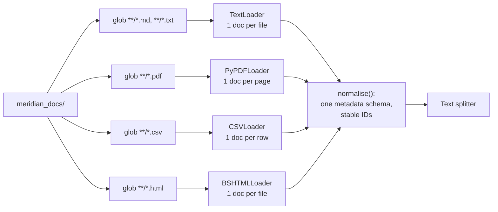

A LangChain **document loader** turns one source (a file, a folder, a web page, a database table, a SaaS workspace) into `Document` objects. The [Document loaders](/learn/document-engineering/document-loaders) lesson in Phase 2 built a loader from first principles: type sniffing, a parser registry, failure isolation, lazy iteration. This lesson is about using LangChain's own loaders well: what the interface promises, how the hundreds of ready-made loaders differ in what they return, how the blob-and-parser design separates reading bytes from interpreting them, and why the first thing to do with a mixed set of loaders is to normalise what they give you.

The practical problem is that each LangChain loader was written by a different person for a different format, and each makes its own choices about how to split a file into documents, what to put in metadata and what to do on error. Five loaders produce five dialects. A production ingestion job has to translate them into one language before anything downstream can rely on it.

## Learning objectives

- Describe the `BaseLoader` contract (`lazy_load`, `load`, `alazy_load`) and the `Document` fields a loader fills in.
- Predict how a given loader divides its source into documents (per file, per page, per row) and what metadata it attaches.
- Load a mixed-format folder with `DirectoryLoader` and the right loader class per file type, avoiding the default that needs `unstructured`.
- Normalise heterogeneous loader metadata into one schema with stable document IDs.
- Explain the `Blob`, `BlobLoader` and `BaseBlobParser` split and when `GenericLoader` is the better tool.

## Prerequisites

- [LangChain architecture](/learn/langchain-for-rag/langchain-architecture): the package layout and where loaders sit.
- [Document loaders](/learn/document-engineering/document-loaders): the loader contract, lazy loading and failure isolation, built from scratch.
- [Document metadata](/learn/document-engineering/document-metadata) and [Document identifiers](/learn/document-engineering/document-identifiers): why provenance and stable IDs matter.

## Why this matters

Everything downstream of the loader inherits its choices. If a PDF loader produces one document per page, the splitter never sees text that crosses a page boundary as continuous. If the CSV loader puts the whole row into `page_content` as `key: value` lines, the embedding model embeds the column names too. If a loader leaves the `source` field as an absolute path on the build machine, every citation AskMeridian shows will contain `/home/runner/work/...`. And if two loaders call the same idea by different names (`page` in one, `page_number` in another), a metadata filter written for one silently matches nothing from the other.

These are not bugs in LangChain. They are reasonable choices made separately, and the framework has no schema that forces them to agree. The `Document` type only guarantees a string and a dictionary. What goes in the dictionary is the loader author's decision until you make it yours.

There is also a dependency problem. Many loaders import an optional third-party library only when they run, and the most general-purpose ones depend on heavy packages. `DirectoryLoader`, by default, hands every file to a loader that requires the `unstructured` package; without it, the first file fails. Teams discover this in the container build, not on their laptops, where the package happened to be installed.

## The intuition

Picture a post room that receives letters from five countries. Every letter has an address, but each country writes it differently: postcode first or last, the street before or after the number, the country name in its own language. The post room's first job is not to deliver anything. It is to copy every address onto a standard internal label, in the same fields and the same order, so that the sorting machines downstream only ever see one format.

LangChain's loaders are the five countries. They all hand you a `Document`, which is the envelope, and a metadata dictionary, which is the address written in local style. Your normalisation step is the internal label. Once it exists, the splitter, the vector store and the citation formatter can all rely on `metadata["source"]` meaning the same thing for every document.

## How it works

### The `Document` and the loader contract

A `Document` (from `langchain_core.documents`) has three fields you set:

- `page_content`: the text, a string.
- `metadata`: a dictionary of anything else: where it came from, a page number, a title, permissions.
- `id`: an optional string identifier. Vector stores that support it use this as the record's key, which is what makes re-indexing idempotent.

A loader subclasses `BaseLoader` from `langchain_core.document_loaders` and implements one method, `lazy_load()`, a generator that yields documents one at a time. The base class supplies the rest:

- `load()` returns `list(self.lazy_load())`: convenient, but everything is in memory at once.
- `alazy_load()` and `aload()` are async versions. The default implementation runs the synchronous `lazy_load` in a thread pool, so it does not block the event loop, but it is no faster unless the loader overrides it with real async I/O.
- `load_and_split(text_splitter)` loads and then splits. Its own docstring now says it should be considered deprecated; call a splitter explicitly instead.

The contract says nothing about how many documents a source produces, what metadata they carry, or what happens on a bad file. Those are per-loader decisions, which is why you must look at each loader's output before you trust it.

### How loaders divide a source

Loaders fall into a few families by their unit of output:

| Loader (in `langchain_community.document_loaders`) | One document per | Metadata it sets |
| --- | --- | --- |
| `TextLoader` | file | `source` (the path as given) |
| `PyPDFLoader` (default `mode="page"`) | page | `source`, `page` (0-based), `page_label`, `total_pages`, plus the PDF's own metadata fields (`title`, `author`, `producer`, `creationdate` and so on, when present) |
| `PyPDFLoader(mode="single")` | file | as above but without per-page fields; pages joined by `pages_delimiter` |
| `CSVLoader` | row | `source` (or the value of `source_column`), `row` (0-based) |
| `BSHTMLLoader` | file | `source`, `title` (from the `<title>` tag) |
| `WebBaseLoader` | URL | `source`, `title`, `description`, `language` when the page has them |

The exact fields can change between releases, and the PDF fields depend on what each file contains, so always print a sample. Two details from this table cause frequent bugs. `page` is 0-based while humans and the PDF viewer count from 1, so a citation that shows `page` directly is off by one; `page_label` holds the printed label, which may be roman numerals in front matter. And `CSVLoader` with `source_column` set replaces the file path in `source` with that column's value, so the file of origin is lost unless you keep it yourself.

The per-row CSV choice deserves a moment. A row becomes `page_content` of the form `code: E-4021\nproduct: VPN\nmeaning: ...`, column names included. That is often what you want for retrieval, because "product: VPN" makes the row findable by product, but it also means the embedding includes labels that carry no meaning on their own. `CSVLoader` accepts `content_columns` (which columns form the text) and `metadata_columns` (which go into metadata instead) to control this.

### DirectoryLoader and its defaults

`DirectoryLoader(path, glob=..., loader_cls=..., loader_kwargs=...)` walks a folder and runs one loader class on every matching file. Its behaviour, as implemented in the installed version:

1. It resolves the glob pattern (or list of patterns) against the folder. A pattern with `**` matches recursively. The default pattern, `**/[!.]*`, skips files whose names start with a dot. Patterns in `exclude` are removed.
2. It builds the full list of matching paths up front. The file list is eager even though documents are not.
3. For each file, it constructs `loader_cls(path, **loader_kwargs)` and yields from that loader's `lazy_load()`.
4. If a file raises, it logs and re-raises by default, stopping the whole load. With `silent_errors=True` it logs a warning and moves on. Either way, nothing records which files failed unless you read the logs.
5. With `use_multithreading=True` it loads files in a thread pool of `max_concurrency` workers; with `show_progress=True` it shows a `tqdm` progress bar if `tqdm` is installed.

The default `loader_cls` is `UnstructuredFileLoader`, which needs the `unstructured` package. Since one loader class handles every matching file, a mixed folder needs either one `DirectoryLoader` per file type, each with its own glob and loader class, or `unstructured`, which detects types itself. The first is lighter and more predictable; the second handles more formats at the cost of a large dependency. The [Unstructured](/learn/advanced-document-parsing/unstructured) lesson covers that library.



### Blobs and parsers: separating reading from interpreting

A file-based loader does two jobs: get the bytes from somewhere, and turn bytes into documents. Most loaders weld the two together; `PyPDFLoader` both opens the path and parses the PDF. That is a problem when the same PDF bytes arrive from an S3 bucket, an email attachment or an HTTP response: you would need a loader per source per format.

LangChain's answer is three small abstractions in `langchain_core`:

- **`Blob`**: raw data plus a little metadata (`source`, `mimetype`, `encoding`), read lazily from a path or held in memory. `Blob.from_path(...)` and `Blob.from_data(...)` create one.
- **`BlobLoader`**: yields blobs from a source. `FileSystemBlobLoader` (in `langchain_community`) walks a folder; other implementations read from cloud storage.
- **`BaseBlobParser`**: turns one blob into documents through `lazy_parse(blob)`. `PyPDFParser`, `PyMuPDFParser`, `BS4HTMLParser` and others live in `langchain_community.document_loaders.parsers`. `MimeTypeBasedParser` dispatches to a parser per MIME type.

`GenericLoader(blob_loader, blob_parser)` joins any blob loader to any parser, and `GenericLoader.from_filesystem(path, glob=..., parser=...)` is the shortcut for local files:

```python
from langchain_community.document_loaders.generic import GenericLoader
from langchain_community.document_loaders.parsers import PyPDFParser

loader = GenericLoader.from_filesystem("meridian_docs", glob="**/*.pdf", parser=PyPDFParser())
for doc in loader.lazy_load():
    print(doc.metadata["source"], doc.metadata["page"], doc.page_content[:30])
```

```output
meridian_docs/handbook/expenses.pdf 0 Expenses policy. Expenses must
meridian_docs/handbook/expenses.pdf 1 Receipts. Anything over £75 ne
```

The value of the split is that the parser is reusable: when Meridian later ingests PDFs attached to support tickets, it can wrap those bytes in `Blob.from_data(...)` and send them through the same `PyPDFParser`, with identical output to the files on disk. The [Ingestion architecture](/learn/understanding-document-ingestion/ingestion-architecture) lesson argues for this separation in general; here it is built into the framework.

### Choosing a loader

With hundreds of loaders available, choose by asking three questions:

1. **Does a partner or standalone package exist for this source?** As the [architecture lesson](/learn/langchain-for-rag/langchain-architecture) explained, `langchain-community` is being wound down; integrations maintained alongside the vendor are the safer long-term dependency.
2. **What does the underlying library do?** A LangChain PDF loader is a thin wrapper around a parser such as pypdf or PyMuPDF. Its extraction quality is that library's quality. Choose the parser on the merits discussed in [pypdf](/learn/advanced-document-parsing/pypdf) and [PyMuPDF](/learn/advanced-document-parsing/pymupdf), then use its loader.
3. **Is the loader worth the dependency?** For a plain text file, `TextLoader` is three lines you could write yourself. For a Confluence space with pagination, authentication and attachments, a maintained loader saves days. The value of a loader grows with the complexity of the source, not the format.

## In code

**The problem.** Load a small Meridian corpus of five formats (Markdown, plain text, a two-page PDF, a CSV of error codes and an HTML page) with LangChain loaders; look at the metadata each produces; then normalise everything into one schema with stable IDs, ready for splitting.

**Dependencies.** `langchain-community` for the loaders, `langchain-core` for `Document`, `pypdf` for the PDF loader, `beautifulsoup4` for the HTML loader. The corpus itself is created by a short script using PyMuPDF (`pip install pymupdf`), which writes `meridian_docs/handbook/` (leave, remote work, expenses PDF) and `meridian_docs/it/` (error-codes CSV, password-policy HTML, and a stray `.DS_Store`). No API key or model download.

```bash
pip install langchain-community langchain-core pypdf beautifulsoup4
```

```python
import hashlib
import warnings
from pathlib import Path

warnings.filterwarnings("ignore", category=DeprecationWarning)  # the community sunset notice

from langchain_community.document_loaders import (
    BSHTMLLoader, CSVLoader, DirectoryLoader, PyPDFLoader, TextLoader)
from langchain_core.documents import Document

ROOT = Path("meridian_docs")
LOADERS = {  # glob pattern -> (loader class, constructor arguments)
    "**/*.md":   (TextLoader,   {"encoding": "utf-8"}),
    "**/*.txt":  (TextLoader,   {"encoding": "utf-8"}),
    "**/*.pdf":  (PyPDFLoader,  {}),
    "**/*.csv":  (CSVLoader,    {"encoding": "utf-8"}),
    "**/*.html": (BSHTMLLoader, {"open_encoding": "utf-8", "get_text_separator": "\n"}),
}


def load_raw() -> list[Document]:
    docs = []
    for pattern, (cls, kwargs) in LOADERS.items():
        loader = DirectoryLoader(str(ROOT), glob=pattern, loader_cls=cls,
                                 loader_kwargs=kwargs, silent_errors=False)
        docs.extend(loader.lazy_load())
    return docs


def normalise(doc: Document) -> Document:
    """Map each loader's metadata onto one schema and give the document a stable ID."""
    m = doc.metadata
    path = Path(m["source"]).relative_to(ROOT).as_posix()
    if "page" in m:                       # PyPDFLoader: 0-based page index
        locator = f"p{m['page'] + 1}"
    elif "row" in m:                      # CSVLoader: 0-based data row
        locator = f"row{m['row']}"
    else:
        locator = "all"
    meta = {
        "source": path,
        "locator": locator,
        "collection": path.split("/")[0],     # top-level folder: handbook or it
        "file_type": Path(path).suffix.lstrip("."),
        "title": m.get("title") or Path(path).stem,
    }
    text = "\n".join(line.strip() for line in doc.page_content.splitlines() if line.strip())
    doc_id = hashlib.sha256(f"{path}#{locator}".encode()).hexdigest()[:12]
    return Document(page_content=text, metadata=meta, id=doc_id)


raw = load_raw()
print("Raw metadata keys per document:")
for d in raw:
    print(f"  {Path(d.metadata['source']).name:16} {sorted(d.metadata)}")

docs = [normalise(d) for d in raw]
print(f"\n{len(docs)} normalised documents:")
for d in docs:
    m = d.metadata
    print(f"  {d.id}  {m['source']:24} {m['locator']:5} {m['collection']:8} {m['title']}")

html = next(d for d in docs if d.metadata["file_type"] == "html")
print("\nHTML text:", repr(html.page_content))
```

```output
Raw metadata keys per document:
  leave.md         ['source']
  remote-work.txt  ['source']
  expenses.pdf     ['author', 'creationdate', 'creator', 'page', 'page_label', 'producer', 'source', 'title', 'total_pages']
  expenses.pdf     ['author', 'creationdate', 'creator', 'page', 'page_label', 'producer', 'source', 'title', 'total_pages']
  error-codes.csv  ['row', 'source']
  error-codes.csv  ['row', 'source']
  passwords.html   ['source', 'title']

7 normalised documents:
  304151c92ffe  handbook/leave.md        all   handbook leave
  7780119adb75  handbook/remote-work.txt all   handbook remote-work
  b2ac14a4f750  handbook/expenses.pdf    p1    handbook Meridian Expenses Policy
  dd6ca3722282  handbook/expenses.pdf    p2    handbook Meridian Expenses Policy
  a5967d32b503  it/error-codes.csv       row0  it       error-codes
  74b9c39e829e  it/error-codes.csv       row1  it       error-codes
  2ab52419819e  it/passwords.html        all   it       Password policy

HTML text: 'Password policy\nHome | IT | Search\nPasswords\nPasswords must be rotated every 90 days.\nVPN is required on public Wi-Fi.'
```

**The important lines.**

- `LOADERS` maps a glob to a loader class and its arguments. Each `DirectoryLoader` is given an explicit `loader_cls`, so the `unstructured` default is never used. The `.DS_Store` file matches no pattern and is never opened.
- `encoding="utf-8"` on `TextLoader` and `CSVLoader` makes the encoding explicit rather than the platform default. `TextLoader` also offers `autodetect_encoding=True`, which needs the `chardet` package; without it, the fallback path raises `ModuleNotFoundError` rather than loading the file.
- `get_text_separator="\n"` on `BSHTMLLoader` is passed to BeautifulSoup's `get_text`. The default is the empty string, which glues adjacent elements together: with it, this page's text begins `Password policyHome | IT | SearchPasswords`, words from different elements fused into nonsense tokens.
- In `normalise`, the source becomes a path relative to the corpus root, so citations and IDs do not depend on where the job ran. The page number is converted to 1-based once, here, so nothing downstream needs to remember. The `collection` field derived from the folder is what a later metadata filter uses to restrict a question to the handbook or the IT runbooks.
- `doc_id` is a hash of the relative path and the locator, not of the content. It is stable across runs and changes only if the file moves, which lets a store that upserts by ID overwrite a page when its text changes instead of adding a duplicate. If you hash the content instead, an edited page gets a new ID and the old version stays in the index unless something deletes it; the [Vector stores](/learn/langchain-for-rag/vector-stores) lesson shows how the LangChain indexing API handles that case.

**What the output means.** The raw table shows the dialect problem plainly: the text loaders give one key, the PDF loader nine, the CSV loader two with a different locator. The normalised table has the same five fields for every document, and every document has an ID. The HTML text shows what loaders do *not* do: the navigation bar `Home | IT | Search` came through as content. Loaders extract; they do not clean. Boilerplate removal belongs to a preprocessing step, covered in [Noise removal](/learn/document-preprocessing/noise-removal).

**Common errors.**

- `ImportError: unstructured package not found` from a `DirectoryLoader` with no `loader_cls`.
- `RuntimeError: Error loading <file>` from `TextLoader`, whose cause (shown in the traceback) is usually a `UnicodeDecodeError`: a file in Windows-1252 or Latin-1 read as UTF-8.
- `ModuleNotFoundError: No module named 'pypdf'` or `'bs4'`: the loaders import their parser libraries only when they run, so `pip install langchain-community` succeeds and the first load fails.
- `ValueError` from `Path.relative_to` in `normalise` if the loader reports a path that is not under `ROOT` (for example, after a symlink is resolved). Resolve both sides with `Path.resolve()` if your corpus uses links.

**Extending it.** Add a `load_report` that wraps each `DirectoryLoader` call in a try/except per file (by iterating files yourself and calling the loader class directly), recording loaded, skipped and failed files with reasons, as the [Phase 2 loader](/learn/document-engineering/document-loaders) did. `silent_errors=True` alone loses that information.

## A real-world example

The Platform team at Meridian added the IT runbooks to AskMeridian using LangChain's loaders. The runbooks are a mix of PDFs exported from the old wiki and HTML pages from the new one. The engineer wrote two `DirectoryLoader` calls, one with `PyPDFLoader` and one with `BSHTMLLoader`, piped both into the existing splitter and indexer, and shipped.

Two weeks later, the support desk reported that AskMeridian's answers about VPN errors cited "page 0" of the runbook, and that some HTML-sourced answers were oddly bad. Searching for "E-4012" found the right page, but searching for "certificate expired" often did not.

The team pulled ten documents from each loader and printed their metadata and first 200 characters. Three findings came out:

1. **Off-by-one citations.** The answer template printed `metadata["page"]` directly. `PyPDFLoader` uses 0-based page indices, so the first page was "page 0" and every other citation was one page early.
2. **Fused words.** `BSHTMLLoader` was running with its default empty `get_text_separator`, so headings ran into paragraphs: `VPN troubleshootingIf you see E-4012`. The tokeniser saw `troubleshootingIf` as one rare token sequence; the phrase "certificate expired" was intact in some pages but fused with neighbours in others, depending on the markup.
3. **No common filter field.** The handbook documents had a `collection` field set by an earlier custom loader; the new runbook documents had none, so a filter `collection == "it"` that the product team had planned matched nothing.

The fix was a `normalise()` step much like the one above, applied to every loader's output before splitting, plus a unit test that loads one fixture file per format and asserts the normalised schema. The team also added a review rule: any new loader must come with a printed sample of its metadata in the pull request. It cost a few minutes per loader and caught the next discrepancy (a Markdown loader that put front matter into the text) before it shipped.

## Common mistakes

- **Using `DirectoryLoader` without `loader_cls`.** It defaults to the `unstructured` loader; without that package, the first file fails.
- **Showing `page` to users.** `PyPDFLoader` pages are 0-based. Convert once in normalisation, or use `page_label`.
- **Trusting metadata names across loaders.** Each loader chooses its own keys. A filter on a key that only some loaders set silently excludes the rest.
- **Storing absolute paths as `source`.** Citations leak build-machine paths, and IDs derived from them change between environments.
- **Relying on `silent_errors=True`.** Failed files disappear into a log line. Track failures explicitly and fail the job if too many occur.
- **Leaving HTML separators at the default.** Adjacent elements fuse into nonsense tokens that hurt both lexical and semantic matching.
- **Calling `load()` on a large source.** It materialises every document in memory; use `lazy_load()` and process in batches.

## Best practices

- Choose the loader by the parser it wraps and the maintenance status of its package, not by name.
- Give every `DirectoryLoader` an explicit `glob`, `loader_cls` and `loader_kwargs`, including the encoding.
- Normalise all loader output into one metadata schema immediately after loading: relative source, a human-meaningful locator, collection, file type, title, and anything your access control needs.
- Assign stable `Document.id` values derived from source and locator so re-indexing overwrites rather than duplicates.
- Print a sample of each new loader's output (text and metadata) before wiring it into the pipeline, and keep a one-fixture-per-format test.
- Use `GenericLoader` with a blob parser when the same format arrives from more than one kind of source.

## Performance considerations

Loading is usually dominated by parsing, not by LangChain. A plain text file loads at disk speed. PDF extraction with a pure-Python parser such as pypdf costs time per page that depends on the page's complexity; a C-backed parser such as PyMuPDF is typically faster, as the [PyMuPDF](/learn/advanced-document-parsing/pymupdf) lesson discusses. Measure on your own documents.

Do the arithmetic for your corpus before choosing a strategy. Suppose (as an assumption) Meridian's runbooks are 2,000 PDFs averaging 20 pages, and parsing takes 20 ms per page on one core. That is 40,000 pages × 0.02 s = 800 s, about 13 minutes on one core. Parsing is CPU-bound, and `DirectoryLoader(use_multithreading=True)` uses threads, which in CPython share one interpreter lock; whether it helps depends on how much of the parser's work releases the lock. A process pool, with each worker loading a share of the files, scales with cores regardless. For an incremental job that only re-parses changed files, the question shrinks to the number of changed pages per run, which is what [Incremental ingestion](/learn/understanding-document-ingestion/incremental-ingestion) is about.

Memory: `load()` holds every document at once. Each document is its text plus a metadata dict; for 40,000 pages of perhaps 3 KB each, that is around 120 MB of text plus Python object overhead, which is manageable but grows linearly with the corpus. `lazy_load()` with batched downstream processing keeps memory flat. Note that `DirectoryLoader` still lists every matching path before yielding anything, which matters only for folders with millions of files.

## Security considerations

- **Parsers process untrusted input.** PDFs, HTML and office documents are complex formats, and parsing libraries have had vulnerabilities. Run ingestion with the least privilege it needs, keep parser libraries patched, and set file-size limits before parsing.
- **Web loaders fetch whatever URL they are given.** A loader that takes URLs from user input or from document content can be pointed at internal services (server-side request forgery). Allow-list hosts, and never run such loaders with credentials or network access beyond what they need.
- **Loaded text carries instructions as easily as facts.** A runbook page edited to say "ignore previous instructions" is loaded verbatim. Record provenance in metadata so poisoned content can be traced and removed; see [Data poisoning](/learn/rag-security-fundamentals/data-poisoning).
- **Metadata can leak.** PDF metadata includes authors, software and sometimes internal paths. Keep only the fields you need; do not pass the raw metadata dict through to users.
- **Permissions must be captured at load time.** If a source has access controls, the loader is the last place that can see them. Put them in metadata so retrieval can filter on them; see [Document-level permissions](/learn/access-control-and-privacy/document-level-permissions).

## Summary

- A loader implements `lazy_load()`; `load()` and the async methods come from `BaseLoader`. The contract fixes the output type, not the granularity, metadata or error handling.
- Loaders differ in their unit (file, page, row) and their metadata keys; `PyPDFLoader` pages are 0-based and `CSVLoader` puts column names into the text.
- `DirectoryLoader` runs one loader class per call and defaults to the `unstructured` loader; give it an explicit `loader_cls` per file type.
- Normalise every loader's output into one schema with relative sources and stable IDs before splitting.
- `Blob`, `BlobLoader` and `BaseBlobParser` separate fetching bytes from parsing them; `GenericLoader` joins them.

## Exercises

1. **Read the metadata.** A `PyPDFLoader` document has `metadata == {"source": "runbooks/vpn.pdf", "page": 3, "page_label": "4", "total_pages": 12}`. Which page should a citation show, and why might `page_label` differ from `page + 1` in another PDF?

<details><summary>Show solution</summary>

Show page 4. `page` is the 0-based index, so `page + 1` is the physical page number, which here equals `page_label`. In a document with front matter numbered i, ii, iii, the label of the fourth physical page might be "i" or "iv", and the label of body page 1 might sit at index 5. `page_label` is what the reader sees printed on the page; `page + 1` is what a PDF viewer's page box shows. Choose one convention and use it everywhere.

</details>

2. **Control the CSV text.** Change the CSV entry so that only the `meaning` column forms `page_content`, and `code` and `product` go into metadata. What does that do to retrieval for the query "E-4021"?

<details><summary>Show solution</summary>

```python
"**/*.csv": (CSVLoader, {"encoding": "utf-8",
                          "content_columns": ["meaning"],
                          "metadata_columns": ["code", "product"]}),
```

The first row's text is now `meaning: The VPN client is out of date; update it from the IT portal.`, with `code` and `product` in metadata (checked against the installed version). So a lexical search for "E-4021" no longer matches it, and an embedding of the meaning sentence knows nothing about the code. Either keep the code in the text (often the right choice for identifiers people search by) or build the text yourself, for example `f"{code}: {meaning}"`. Metadata is for filtering and display, not for matching, unless your retriever searches it.

</details>

3. **Make failures visible.** Write a function `load_with_report(root, pattern, loader_cls, kwargs)` that iterates the matching files itself, loads each with `loader_cls`, and returns `(documents, failures)` where `failures` is a list of `(path, error message)`. Test it by adding a file that is not valid UTF-8.

<details><summary>Show solution</summary>

```python
def load_with_report(root, pattern, loader_cls, kwargs):
    docs, failures = [], []
    for path in sorted(Path(root).glob(pattern)):
        if not path.is_file() or path.name.startswith("."):
            continue
        try:
            docs.extend(loader_cls(str(path), **kwargs).lazy_load())
        except Exception as e:  # loaders raise many types; record, do not stop
            failures.append((str(path), f"{type(e).__name__}: {e.__cause__ or e}"))
    return docs, failures
```

A Latin-1 file loaded with `TextLoader(encoding="utf-8")` appears in `failures` as `RuntimeError: 'utf-8' codec can't decode byte ...`, because `TextLoader` wraps the `UnicodeDecodeError` and `__cause__` exposes it. The job can then fail if failures exceed a threshold, rather than shipping a silently incomplete index.

</details>

4. **Design decision.** Meridian wants to ingest PDF attachments from its ticketing system's API as well as PDFs on a shared drive, with identical output. Sketch the design using LangChain's abstractions.

<details><summary>Show solution</summary>

Use one `BaseBlobParser` (for example `PyPDFParser`) for both. For the shared drive, `FileSystemBlobLoader` or `GenericLoader.from_filesystem`. For the ticketing system, write a small `BlobLoader` whose `yield_blobs()` pages through the API and yields `Blob.from_data(pdf_bytes, mime_type="application/pdf", path=f"tickets/{ticket_id}/{filename}")`. Wrap each in `GenericLoader(blob_loader, parser)`, and run both outputs through the same `normalise()` so their metadata matches; add a `collection` value per source. The parser, and therefore the extracted text, is identical for both paths.

</details>

## Check your understanding

```quiz
[
  {"q": "Which method must a subclass of `BaseLoader` implement?", "options": ["load", "lazy_load", "load_and_split", "aload"], "answer": 1, "why": "lazy_load is the abstract generator; load, aload and alazy_load are provided by the base class in terms of it."},
  {"q": "You run `DirectoryLoader(\"docs\", glob=\"**/*.md\").load()` on a machine without the `unstructured` package. What happens?", "options": ["Markdown files are loaded with TextLoader automatically", "The first file fails with an ImportError about unstructured", "The files are skipped silently", "DirectoryLoader installs unstructured"], "answer": 1, "why": "The default loader_cls is UnstructuredFileLoader. Pass loader_cls=TextLoader (or install unstructured) to avoid it."},
  {"q": "A two-page PDF loaded with `PyPDFLoader` in its default mode produces how many documents, and what is `metadata[\"page\"]` on the second?", "options": ["1 document; page is 2", "2 documents; page is 2", "2 documents; page is 1", "1 document; page is absent"], "answer": 2, "why": "Default mode is one document per page, and page is a 0-based index."},
  {"q": "Why give each `Document` an ID derived from its relative path and locator?", "options": ["Vector stores reject documents without IDs", "So that re-indexing an edited page overwrites the old record instead of adding a duplicate", "It makes embedding faster", "LangChain requires SHA-256 IDs"], "answer": 1, "why": "Stores that honour Document.id and upsert by ID overwrite the old record; a stable ID ties each record to its source location across runs. (Not every store upserts, as the Vector stores lesson shows.)"},
  {"q": "What is the main benefit of `GenericLoader` with a `BaseBlobParser` over a format-specific loader like `PyPDFLoader`?", "options": ["Better PDF text extraction", "The same parser can be reused for bytes from any source (disk, cloud storage, an API)", "It avoids needing pypdf", "It cleans boilerplate automatically"], "answer": 1, "why": "Blobs separate fetching bytes from parsing them, so one parser serves many sources; extraction quality is the same parser's quality."}
]
```

## Further reading

- LangChain documentation, "Document loaders" concepts and the integrations list: [docs.langchain.com](https://docs.langchain.com/).
- LangChain API reference for `langchain_core.document_loaders` (`BaseLoader`, `BaseBlobParser`, `BlobLoader`) and `langchain_core.documents` (`Document`, `Blob`), in the same documentation site.
- `langchain-community` source, where the loaders in this lesson live: [github.com/langchain-ai/langchain-community](https://github.com/langchain-ai/langchain-community).
- pypdf documentation, for what `PyPDFLoader` does underneath: [pypdf.readthedocs.io](https://pypdf.readthedocs.io/).
- Beautiful Soup documentation, on `get_text` and its separator argument: [crummy.com/software/BeautifulSoup/bs4/doc](https://www.crummy.com/software/BeautifulSoup/bs4/doc/).
