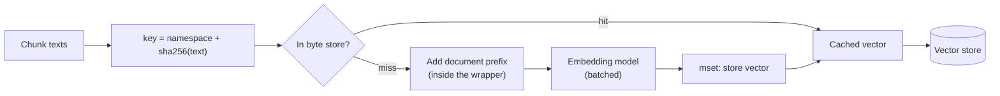

Phase 5 covered embedding models themselves: [Sentence Transformers](/learn/embedding-models/sentence-transformers), [E5](/learn/embedding-models/e5-models), [BGE](/learn/embedding-models/bge-models), [OpenAI embeddings](/learn/embedding-models/openai-embeddings) and the rest, and what distinguishes them. This lesson is about the thin layer LangChain puts in front of any of them: the `Embeddings` interface. It has two methods and looks trivial, but the interface decides where query and document prefixes are applied, how batching and retries happen, whether the same text is embedded twice, and what the vector store can assume about the vectors it receives. Most embedding bugs in LangChain pipelines live in this layer, not in the model.

You will write an adapter that puts a local model behind the interface with the prefixes it was trained with, see how much those prefixes change the vectors, and put a persistent cache in front of it so that re-indexing an unchanged corpus costs nothing.

## Learning objectives

- Explain the `Embeddings` contract (`embed_documents`, `embed_query` and their async versions) and why it has separate methods for queries and documents.
- Configure the main embedding integrations (`langchain-openai`, `langchain-huggingface`) with an explicit model, dimensions and normalisation.
- Implement an `Embeddings` subclass for a local sentence-transformers model that applies asymmetric query and document prefixes.
- Use `CacheBackedEmbeddings` with a namespaced byte store, and say what the cache key must include for the cache to be correct.
- Test pipelines with `DeterministicFakeEmbedding` and know what such a test can and cannot show.

## Prerequisites

- [LangChain architecture](/learn/langchain-for-rag/langchain-architecture): where `Embeddings` sits among the core interfaces.
- [Text splitters](/learn/langchain-for-rag/text-splitters): the chunks that are embedded.
- [Sentence Transformers](/learn/embedding-models/sentence-transformers) and [E5 models](/learn/embedding-models/e5-models): the models used here, including E5's prefixes.
- [Vector normalisation](/learn/embedding-mathematics/vector-normalisation): why unit-length vectors make dot product and cosine the same.

## Why this matters

Every vector in your index and every query vector comes through this interface, and the two must be produced in compatible ways or retrieval quietly degrades. Compatible means: the same model, the same version of its weights, the same normalisation, the same truncation length and the matching pair of prefixes or instructions. Change any of these on one side and not the other, and nothing fails. Searches still return results; the results are just worse, and you only find out from an evaluation run or a user complaint.

Several models make this especially easy to get wrong. E5 models were trained with every query starting `query: ` and every passage starting `passage: `. BGE English models recommend an instruction in front of short retrieval queries and nothing in front of passages. Nomic's models use `search_query: ` and `search_document: `. A generic wrapper that embeds every text the same way ignores all of that, and LangChain's community wrapper for sentence-transformers does exactly that unless you configure it.

Then there is cost. A hosted embedding API charges per token, and a local model costs GPU or CPU time. A naive indexing job re-embeds the whole corpus every run, even when 99% of the chunks are unchanged. A cache keyed on the chunk text removes that waste, but only if the key also captures everything that affects the vector; otherwise, after a model upgrade, the cache happily serves old-model vectors into a new-model index.

## The intuition

Think of an embedding model as a translator who writes every passage as a point on a map. For the map to be useful, every point must be placed by the same translator following the same conventions. If documents were placed by a translator who was told "this is a passage", and queries by one who was told "this is a question", that is fine, as long as it is the arrangement the translator was trained to use. What breaks the map is changing the arrangement for some points and not others, or replacing the translator for new documents while old points stay where the previous one put them.

LangChain's `Embeddings` interface is the instruction sheet handed to the translator. It has two lines: "for passages, do this" and "for questions, do this". Writing those two lines correctly for your model, and stamping every stored point with which translator and conventions produced it, is the whole job.

## How it works

### The interface

`Embeddings` (in `langchain_core.embeddings`) is an abstract class with two required methods:

- `embed_documents(texts: list[str]) -> list[list[float]]`: embed many texts that will be stored and searched.
- `embed_query(text: str) -> list[float]`: embed one search query.

and two async methods, `aembed_documents` and `aembed_query`, whose default implementations run the synchronous methods in a thread pool via `run_in_executor`. An integration with a real async client (such as `OpenAIEmbeddings`) overrides them; a local model wrapper usually does not, and gains nothing from being called asynchronously except that it does not block the event loop.

The return type is plain Python lists of floats, not NumPy arrays. That keeps the interface independent of any numerical library, at a cost: a Python float in a list takes about 32 bytes (an 8-byte value inside a 24-byte object, plus an 8-byte pointer in the list), against 4 bytes in a float32 array. Convert to NumPy as soon as you do arithmetic.

### Why two methods

Two methods exist because retrieval is **asymmetric**: a query is short and phrased as a question; a passage is long and phrased as a statement. Models trained for asymmetric retrieval are told which is which, through a prefix or an instruction, and they place queries and passages so that a question lands near the passages that answer it, not near other questions.

The interface makes the distinction available, but it does not enforce it. Whether `embed_query` does anything different from `embed_documents` is entirely up to the implementation. The rule is simple: read the model card, find out what the model expects for queries and for passages, and make sure your `Embeddings` implementation does exactly that.

| Model family | Query side | Document side |
| --- | --- | --- |
| E5 (e.g. `intfloat/e5-small-v2`) | `query: ` + text | `passage: ` + text |
| BGE English v1.5 (e.g. `BAAI/bge-small-en-v1.5`) | instruction recommended for short queries: `Represent this sentence for searching relevant passages: ` | no prefix |
| Nomic embed models | `search_query: ` + text | `search_document: ` + text |
| all-MiniLM-L6-v2 and other symmetric models | no prefix | no prefix |
| Hosted APIs (OpenAI) | no prefix | no prefix |

Check the current model card before relying on this table: conventions are set by the model's authors and can differ between versions.

Recent versions of sentence-transformers can store such prompts in a model's configuration and apply them through `encode_query` and `encode_document`. Do not assume a model you download has them configured. In the installed version, the cached copies of both `intfloat/e5-small-v2` and `BAAI/bge-small-en-v1.5` report empty query and document prompts, so the prefixes must be added by your own code.

### The integrations

The main ready-made implementations:

- **`OpenAIEmbeddings`** in `langchain-openai`. Set `model` explicitly (for example `"text-embedding-3-small"`): in the installed version the default is still the older `text-embedding-ada-002`. The `dimensions` parameter shortens the output for models that support it. `chunk_size` (default 1000) is how many texts are sent per API request, not a text-splitting size. It retries failed requests (`max_retries`) and, by default, splits texts longer than the model's context into pieces and averages their embeddings (`check_embedding_ctx_length`), so a too-long text produces a blended vector rather than an error.
- **`HuggingFaceEmbeddings`** in `langchain-huggingface`, a wrapper around sentence-transformers with `model_name`, `model_kwargs` (passed to the model constructor, for example `{"device": "cuda"}`) and `encode_kwargs` (passed to `encode`, for example `{"normalize_embeddings": True}`). An older class of the same name exists in `langchain-community`; it is deprecated in favour of the partner package. Check whether your version supports separate query-side settings; if not, wrap the model yourself as below.
- **Other providers** (Cohere, Google, Mistral, Voyage, Ollama and more) have their own partner packages. Anthropic does not offer an embedding endpoint, so a Claude-based RAG system always takes its embeddings from another provider or a local model.

For tests, `langchain_core.embeddings` provides **`DeterministicFakeEmbedding(size=...)`**, which hashes each text to a seed and returns a fixed random vector, and **`FakeEmbeddings`**, which returns a fresh random vector every call. The deterministic one is useful for testing pipeline wiring, IDs and filters: the same text always gives the same vector. It says nothing about retrieval quality, because the vectors encode no meaning.

### Caching embeddings

`CacheBackedEmbeddings` (in `langchain_classic.embeddings`) wraps any `Embeddings` with a key-value store. Its mechanism for `embed_documents(texts)`:

1. Compute a key for each text: the `namespace` string followed by a hash of the text (SHA-1 by default; choose `key_encoder="sha256"` or `"blake2b"`, since the library's own docstring warns that SHA-1 is not collision-resistant).
2. Look up all keys in the store in one `mget`.
3. Send only the texts with no cached vector to the underlying model, in batches of `batch_size` if set.
4. Write the new vectors to the store with `mset`, and return all vectors in the original order.

Queries are not cached by default. Pass `query_embedding_cache=True` to share the document store, or a separate store, if repeated queries are common.

Any `ByteStore` works: `InMemoryByteStore` for tests, `LocalFileStore` (one file per key under a directory) for a single machine, and Redis or other shared stores for a fleet of workers.

The key hashes only the text you pass in. It knows nothing about the model, its version, the prefixes your wrapper adds or whether vectors are normalised. All of that must go into the `namespace`, or two configurations will share cache entries. A namespace such as `"e5-small-v2.query-passage-prefix.norm/"` names the model, the prefix convention and the normalisation; the trailing slash makes `LocalFileStore` put each configuration in its own subdirectory, which also makes old configurations easy to delete.



### Where the vectors go next

The vector store calls `embed_documents` when you add documents and `embed_query` when you search. It does not know or check which model produced the vectors; it stores whatever list of floats it is given and compares vectors with its configured distance. Two consequences, which the [Vector stores](/learn/langchain-for-rag/vector-stores) lesson builds on:

- If your vectors are unit length, dot product, cosine similarity and Euclidean distance all produce the same ranking, so the store's distance choice affects only the score scale, not the order. If they are not unit length, the choice changes results.
- The store cannot detect a model mismatch. Record the embedding configuration with the index (a collection name or manifest that includes the model name and prefix convention), and refuse to query an index with a different configuration.

## In code

**The problem.** Put a local E5 model behind LangChain's `Embeddings` interface with the prefixes it was trained with; measure how much the prefixes change the vectors and how differently two models scale their scores; then add a persistent, correctly namespaced cache and confirm that a second indexing run embeds only the changed text.

**Dependencies.** `sentence-transformers` for the models (`intfloat/e5-small-v2` and `BAAI/bge-small-en-v1.5`, both 384-dimensional and roughly 130 MB each, downloaded on first use), `langchain-core` for the interface and `langchain-classic` for the cache and file store. No API key.

```bash
pip install sentence-transformers langchain-core langchain-classic numpy
```

```python
import numpy as np
from sentence_transformers import SentenceTransformer
from langchain_classic.embeddings import CacheBackedEmbeddings
from langchain_classic.storage import LocalFileStore
from langchain_core.embeddings import Embeddings


class SentenceTransformerEmbeddings(Embeddings):
    """A sentence-transformers model behind LangChain's interface, with asymmetric prefixes."""

    def __init__(self, model_name: str, query_prefix: str = "", document_prefix: str = "",
                 batch_size: int = 32):
        self.model = SentenceTransformer(model_name)
        self.query_prefix, self.document_prefix = query_prefix, document_prefix
        self.batch_size = batch_size
        self.calls = 0          # texts actually sent to the model, for this demo

    def _encode(self, texts: list[str]) -> list[list[float]]:
        self.calls += len(texts)
        vecs = self.model.encode(texts, batch_size=self.batch_size, normalize_embeddings=True)
        return vecs.tolist()

    def embed_documents(self, texts: list[str]) -> list[list[float]]:
        return self._encode([self.document_prefix + t for t in texts])

    def embed_query(self, text: str) -> list[float]:
        return self._encode([self.query_prefix + text])[0]


docs = [
    "Staff receive 25 days of annual leave per year.",
    "Up to 5 unused leave days carry over and must be used by 31 March.",
    "Staff may work remotely up to 3 days a week.",
    "Error E-4021 means the VPN client is out of date; update it from the IT portal.",
    "Laptops are refreshed every 3 years.",
]
query = "how many days of holiday do I get"

# 1. The prefix is part of the model's identity: same text, different vector.
plain = SentenceTransformerEmbeddings("intfloat/e5-small-v2")
e5 = SentenceTransformerEmbeddings("intfloat/e5-small-v2", "query: ", "passage: ")
same_text = np.sum(np.array(plain.embed_documents(docs)) * np.array(e5.embed_documents(docs)), axis=1)
print("cosine(doc, 'passage: ' + doc):", np.round(same_text, 3))
q = np.array(e5.embed_query(query))
print("query vs docs, e5 :", np.round(np.array(e5.embed_documents(docs)) @ q, 3))
bge = SentenceTransformerEmbeddings("BAAI/bge-small-en-v1.5",
                                    "Represent this sentence for searching relevant passages: ")
print("query vs docs, bge:", np.round(np.array(bge.embed_documents(docs)) @ np.array(bge.embed_query(query)), 3))

# 2. A persistent cache in front of the model.
base = SentenceTransformerEmbeddings("intfloat/e5-small-v2", "query: ", "passage: ")
cached = CacheBackedEmbeddings.from_bytes_store(
    base, LocalFileStore("emb_cache"),
    namespace="e5-small-v2.query-passage-prefix.norm/",  # all that changes the vectors
    key_encoder="sha256",
)
cached.embed_documents(docs)
print("\nfirst index run:  model saw", base.calls, "texts")
base.calls = 0
cached.embed_documents(docs[:4] + ["Laptops are refreshed every 3 years; lost laptops go to the support desk."])
print("second index run: model saw", base.calls, "text (only the edited one)")
base.calls = 0
for _ in range(2):
    cached.embed_query(query)
print("two identical queries: model saw", base.calls, "texts (queries are not cached by default)")
```

```output
cosine(doc, 'passage: ' + doc): [0.962 0.987 0.976 0.979 0.968]
query vs docs, e5 : [0.814 0.829 0.795 0.789 0.744]
query vs docs, bge: [0.589 0.617 0.493 0.455 0.44 ]

first index run:  model saw 5 texts
second index run: model saw 1 text (only the edited one)
two identical queries: model saw 2 texts (queries are not cached by default)
```

**The important lines.**

- `class SentenceTransformerEmbeddings(Embeddings)` implements the two required methods. The prefixes are applied inside the wrapper, so every caller (the vector store, a retriever, your evaluation script) gets the same behaviour without having to remember it.
- `normalize_embeddings=True` makes every vector unit length, so the dot products printed are cosine similarities and the vector store's choice of distance does not change the ranking.
- `batch_size=32` is passed to `encode`, which processes the texts in batches of that size. The vector store may call `embed_documents` with hundreds or thousands of texts at once; batching inside the model is what keeps that efficient.
- `CacheBackedEmbeddings.from_bytes_store(...)` builds the cache from any byte store, adding serialisation of the float lists.
- `namespace="e5-small-v2.query-passage-prefix.norm/"` names everything that affects the vectors. `LocalFileStore` allows only letters, digits, `_`, `.`, `-` and `/` in keys; a namespace with any other character (a `|` or a `:`, for instance) raises `InvalidKeyException`.
- `key_encoder="sha256"` replaces the default SHA-1 hashing of the text.

**What the output means.**

The first line shows that the prefix is not a cosmetic detail. The same text with and without `passage: ` gives vectors whose cosine is between 0.962 and 0.987. If an index was built with prefixes and the code that adds new documents forgets them (or the other way round), the index contains vectors from two slightly different spaces, and their scores are not comparable with each other.

The next two lines are the same query against the same five chunks under two models. The orderings agree (the carry-over chunk first, the 25-days chunk second), but the scales do not: E5's scores span 0.744 to 0.829, BGE's 0.440 to 0.617. E5 models are known for packing similarities into a narrow, high band. A relevance threshold of 0.6 would keep everything under E5 and only the top chunk under BGE. Thresholds are a property of a model, never a portable constant.

Note also that both models rank "unused leave days carry over" slightly above "25 days of annual leave" for a question about holiday entitlement. Both chunks are about leave, and both would reach the prompt with `k=2`, but a reranker (see [Cross-encoders](/learn/reranking-fundamentals/cross-encoders)) is the usual fix when the order within the top few matters.

The cache lines show the mechanism working. The first indexing run sent all five texts to the model. The second run passed five texts, four unchanged and one edited, and only the edited one reached the model. The two identical queries both reached it, because query caching is off by default.

**Common errors.**

- `InvalidKeyException: Invalid characters in key` from `LocalFileStore`: the namespace contains a disallowed character.
- Shape errors or silent misranking when a store receives vectors of a different dimension from the ones already in it. Most stores raise on a dimension mismatch; none can detect a same-dimension model swap.
- `ImportError` for `langchain_classic` in older code that imported `CacheBackedEmbeddings` from `langchain.embeddings`; since 1.0 it lives in `langchain-classic`.
- Running out of GPU memory with a large `batch_size` and long texts; lower the batch size, not the chunk size.

**Extending it.** Add a `fingerprint` property to the wrapper that returns the model name, the sentence-transformers revision or the model's configuration hash, the prefixes and the normalisation flag, and build the namespace from it automatically, so nobody can change the configuration without changing the cache namespace.

## A real-world example

The Platform team at Meridian moved AskMeridian from `all-MiniLM-L6-v2` to `e5-small-v2` after an evaluation on their labelled question set showed better recall. The engineer making the change replaced the model name in the community `HuggingFaceEmbeddings` configuration, re-indexed, re-ran the evaluation and saw an improvement. The change shipped.

A month later, a second engineer added a nightly job that indexed newly published IT runbooks. She had read the E5 model card, so her job wrapped the model with `passage: ` prefixes. The main indexing job did not use them, and neither did the query path. Recall on runbook questions dropped slightly, and the evaluation set, which was mostly handbook questions, barely moved. It took a support-desk complaint about a missing runbook answer to start the investigation.

The investigation found two problems. The first was the inconsistency itself: two indexing paths built vectors two different ways, and queries matched one convention and not the other. The second was more embarrassing: the team's embedding cache, keyed on text with an empty namespace, had served MiniLM vectors for every unchanged chunk during the "re-index" after the model switch. Both models produce 384-dimensional vectors, so nothing complained. The evaluation that justified the switch had compared MiniLM vectors for most of the corpus against E5 query vectors for the questions, and the improvement it showed was partly noise.

The fix had three parts. One `Embeddings` class, in one shared module, owns the model and its prefixes, and every job imports it. The cache namespace is built from that class's fingerprint. And the vector store collection name now includes the same fingerprint, so a configuration change creates a new collection that is built in full before traffic moves to it, the pattern described in [Index versioning](/learn/ci-cd-and-mlops/index-versioning).

## Common mistakes

- **Ignoring the model's query and document conventions.** E5, BGE and Nomic models expect prefixes or instructions; embedding everything the same way discards what they were trained for.
- **Applying prefixes in some code paths and not others.** Vectors in one index come from slightly different spaces, and scores stop being comparable.
- **A cache keyed only on text.** After a model or prefix change, the cache serves stale vectors that look valid because the dimension matches.
- **Relying on default model names.** `OpenAIEmbeddings()` with no `model` uses an older model in the installed version; always name the model.
- **Copying a similarity threshold between models.** E5 and BGE score the same pairs on very different scales.
- **Testing retrieval quality with fake embeddings.** `DeterministicFakeEmbedding` tests wiring and IDs; its rankings are meaningless.
- **Confusing `chunk_size` on `OpenAIEmbeddings` with text splitting.** It is the number of texts per API request.

## Best practices

- Wrap each embedding configuration in one `Embeddings` class, in one shared module, that owns the model name, revision, prefixes, normalisation and batch size.
- Normalise vectors unless the model's documentation says otherwise, so the distance metric does not change rankings.
- Put a `CacheBackedEmbeddings` in front of any embedding call in an indexing job, with a namespace built from the full configuration and a strong key encoder.
- Record the embedding configuration with every index (collection name or manifest) and check it before querying.
- Name models explicitly in every integration, and pin the integration package version.
- Use `DeterministicFakeEmbedding` in unit tests of the pipeline, and a real model in retrieval evaluation.

## Performance considerations

**Batching dominates throughput.** A transformer processes a batch of texts in roughly the time it takes for one when the hardware is not yet saturated, so embedding texts one at a time wastes most of the hardware. The vector store passes all the documents of an `add_documents` call to `embed_documents` at once; your wrapper should pass them to the model with a sensible `batch_size`. With a hosted API, `chunk_size` texts go in one request, which saves round trips: 10,000 chunks at 1,000 per request is 10 requests rather than 10,000.

**Caching turns re-indexing into a diff.** Suppose (as an assumption) Meridian's corpus is 50,000 chunks averaging 200 tokens, and 1% of chunks change each night. Without a cache, each nightly run embeds 10 million tokens. With a correct cache it embeds 500 chunks, 100,000 tokens: a hundredfold reduction in model time or API spend. At a hypothetical hosted price of USD 0.02 per million tokens the full run costs about USD 0.20, so the saving matters less for money than for time and rate limits; at larger scale or with a local GPU shared with other work, it matters for both. Check current provider pricing in their documentation.

**Cache storage is not free either.** `LocalFileStore` writes one file per vector. A 384-dimensional vector serialised as JSON is a few kilobytes, and 50,000 files is manageable; 50 million is a file-system problem. Use a database-backed or Redis store at that scale.

**Query embedding is on the latency path.** Each question costs one `embed_query` call before retrieval can start: a few milliseconds for a small local model on a GPU, tens of milliseconds on a CPU (measure yours), or a network round trip to a hosted API. Caching queries helps only if users repeat questions exactly; [Semantic caching](/learn/performance-optimisation/semantic-caching) covers the looser version.

**Memory of the return type.** `embed_documents` returns lists of Python floats. For 10,000 vectors of 384 dimensions that is 3.84 million floats: about 15 MB as a float32 array, but roughly 120 MB as Python lists (about 32 bytes each, counting the float object and the list's pointer). Convert to NumPy immediately when you hold many vectors.

## Security considerations

- **API keys** for hosted embedding providers come from environment variables (`OPENAI_API_KEY` and so on) or a secrets manager, never from code.
- **Embedding a document sends it to the provider.** For a hosted API, every chunk of every confidential document leaves your network. Check the provider's data-retention terms and your organisation's policy; a local model avoids the question.
- **Embeddings are not anonymised data.** Research on embedding inversion has shown that text can be partially reconstructed from some models' embeddings. Treat a vector store and an embedding cache with the same access controls as the documents themselves.
- **A shared cache is a shared trust boundary.** Anyone who can write to the cache can make a chosen text map to a chosen vector. Restrict write access, use a collision-resistant key encoder, and keep separate namespaces (or stores) per tenant if tenants must not influence each other.

## Summary

- `Embeddings` has two required methods, `embed_documents` and `embed_query`; the split exists for asymmetric models, but the interface does not enforce anything.
- Prefixes and instructions (E5's `query: ` and `passage: `, BGE's query instruction) change the vectors; apply them in one wrapper used by every code path.
- Name models explicitly, normalise vectors, and remember that score scales differ between models.
- `CacheBackedEmbeddings` makes re-indexing pay only for changed text, provided its namespace captures everything that affects the vectors.
- Fake embeddings test wiring, not retrieval quality.

## Exercises

1. **Read the contract.** A colleague's wrapper implements `embed_query` as `return self.embed_documents([text])[0]` for an E5 model whose `embed_documents` adds `passage: `. What is wrong, and what is the fix?

<details><summary>Show solution</summary>

Queries are embedded with the passage prefix, so the model treats them as passages and places them near passages that look like them, not near passages that answer them. Implement `embed_query` separately with `query: `. Reusing `embed_documents` in `embed_query` is only correct for symmetric models such as all-MiniLM-L6-v2.

</details>

2. **Cache namespaces.** List everything that should go into the cache namespace for an `OpenAIEmbeddings` configuration, and say why each item matters.

<details><summary>Show solution</summary>

The model name (different models give different vectors); the `dimensions` setting (a shortened vector is a different vector); any text preprocessing your wrapper applies before the call (a prefix, lower-casing, a section-path header); and a version marker of your own for anything else, bumped whenever behaviour changes. Normalisation matters if you normalise in your own code. The provider's model version is part of the model name for pinned models; if you use a moving alias, record the date or treat the cache as short-lived.

</details>

3. **Measure the scale.** Using the lesson's wrapper, embed the five Meridian chunks and these three unrelated texts with both E5 and BGE: "The canteen serves lunch from noon", "Quarterly revenue grew", "The office has a bike shed". For the query in the lesson, what is the lowest score for a relevant chunk and the highest for an unrelated text under each model? What does that say about thresholds?

<details><summary>Show solution</summary>

```python
extra = ["The canteen serves lunch from noon", "Quarterly revenue grew", "The office has a bike shed"]
for emb in (e5, bge):
    s = np.array(emb.embed_documents(docs + extra)) @ np.array(emb.embed_query(query))
    print(np.round(s[:5], 3), np.round(s[5:], 3))
```

```output
[0.814 0.829 0.795 0.789 0.744] [0.693 0.722 0.686]
[0.589 0.617 0.493 0.455 0.44 ] [0.39  0.482 0.37 ]
```

The relevant chunks are the first two (leave). Under E5 the lowest relevant score is 0.814, the unrelated texts reach 0.722, and the other Meridian chunks, which are off-topic for this question, sit between 0.744 and 0.795: a usable gap of only about 0.02. Under BGE the relevant chunks score 0.589 and above, everything else 0.493 or below, a gap of about 0.1. Any threshold must be chosen per model from labelled examples of both kinds, and re-chosen whenever the model changes; with E5 a threshold this close to the relevant scores would be fragile.

</details>

4. **Design decision.** Meridian wants to move to a hosted embedding model while keeping AskMeridian online. Using what you know about `Embeddings`, caches and index metadata, outline the migration.

<details><summary>Show solution</summary>

Write a new `Embeddings` wrapper for the hosted model with an explicit model name and dimensions, and a fingerprint distinct from the old one. Build a new collection named with that fingerprint, using a cache namespaced by it (the old cache cannot be reused). Embed the whole corpus into the new collection while the old one keeps serving. Run the evaluation set against both, using each collection's own wrapper for queries. Switch the query path to the new wrapper and collection together, as one configuration change, and keep the old collection for rollback until the new one has run cleanly for a while. The [Blue-green deployments](/learn/ci-cd-and-mlops/blue-green-deployments) lesson describes the switch.

</details>

## Check your understanding

```quiz
[
  {"q": "What do `aembed_documents` and `aembed_query` do in the base `Embeddings` class?", "options": ["Raise NotImplementedError", "Run the synchronous methods in a thread pool", "Batch requests across concurrent callers", "Call the provider's async API"], "answer": 1, "why": "The defaults wrap the sync methods with run_in_executor; only integrations with real async clients override them."},
  {"q": "`CacheBackedEmbeddings` is created with an empty namespace. The team switches from all-MiniLM-L6-v2 to e5-small-v2 (both 384-dimensional) and re-indexes. What happens to unchanged chunks?", "options": ["They are re-embedded with E5", "The cache serves their old MiniLM vectors, which the store accepts because the dimension matches", "The vector store raises a dimension error", "The cache is cleared automatically when the model changes"], "answer": 1, "why": "The key is namespace plus a hash of the text; with no model in the namespace, the old vectors are hits."},
  {"q": "Which statement about E5 query and passage prefixes is correct?", "options": ["They are optional decorations with no effect on the vector", "They must be added by the Embeddings implementation (or a configured prompt), and queries and passages need different ones", "LangChain adds them automatically for any E5 model", "Only the passage side needs a prefix"], "answer": 1, "why": "E5 was trained with 'query: ' and 'passage: '; nothing in LangChain adds them unless your wrapper or the model's configured prompts do."},
  {"q": "With the same query and chunks, E5 scores range from 0.74 to 0.83 and BGE from 0.44 to 0.62. What follows?", "options": ["BGE is a worse model", "A relevance threshold tuned for one model cannot be reused for the other", "E5 vectors are not normalised", "The rankings must differ"], "answer": 1, "why": "Score scales are model-specific; the orderings here even agree. Thresholds must be set per model on labelled data."},
  {"q": "What is `chunk_size` on `OpenAIEmbeddings`?", "options": ["The maximum characters per chunk of text", "The number of texts sent per API request", "The embedding dimension", "The token limit per text"], "answer": 1, "why": "It controls request batching; text splitting is the splitter's job."}
]
```

## Further reading

- LangChain documentation, "Embedding models" concepts and the caching how-to for `CacheBackedEmbeddings`: [docs.langchain.com](https://docs.langchain.com/).
- Wang, L. et al. (2022). "Text Embeddings by Weakly-Supervised Contrastive Pre-training" (E5). [arXiv:2212.03533](https://arxiv.org/abs/2212.03533).
- Xiao, S. et al. (2023). "C-Pack: Packaged Resources To Advance General Chinese Embedding" (the BGE models). [arXiv:2309.07597](https://arxiv.org/abs/2309.07597).
- Sentence Transformers documentation, on `encode`, normalisation and prompts: [sbert.net](https://www.sbert.net/).
- Morris, J. et al. (2023). "Text Embeddings Reveal (Almost) As Much As Text." [arXiv:2310.06816](https://arxiv.org/abs/2310.06816).
