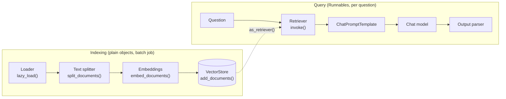
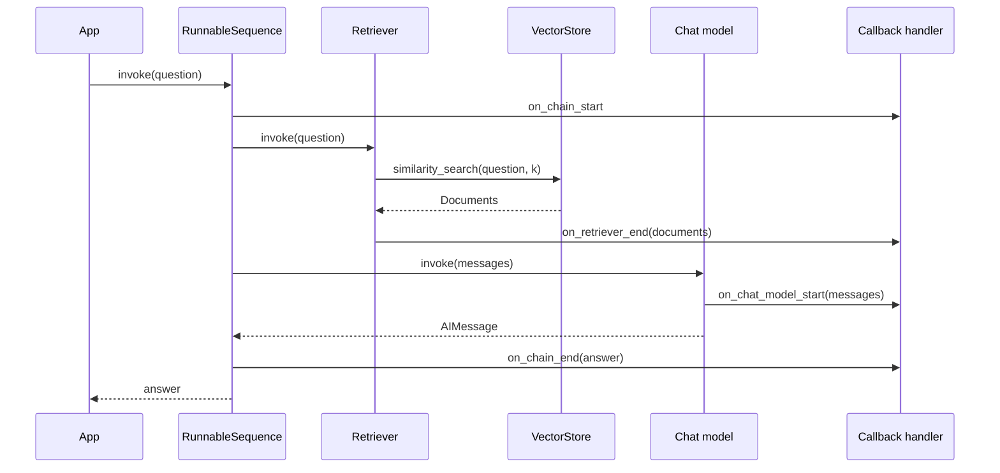

You have already built every stage of a RAG system by hand in this course: loaders, splitters, embedding calls, a vector index, a retriever, a prompt and a call to the model. **LangChain** is an open-source framework that gives each of those stages a standard interface, ships hundreds of ready-made implementations of them, and lets you join the query-time stages into a pipeline with one operator. This lesson is the map of the framework: which packages it is split into, which abstractions live where, how they fit together, and where the seams are that matter when something breaks in production.

The rest of this module walks the map one region at a time. Here the aim is to know the territory well enough that every later lesson has a place to land, and to be able to read any LangChain RAG code and say what each object is and which package it came from.

## Learning objectives

- Name the main LangChain packages (`langchain-core`, `langchain`, `langchain-classic`, `langchain-community`, the partner packages, `langchain-text-splitters`) and say what belongs in each.
- Classify the RAG abstractions into indexing-time objects and query-time Runnables, and explain why the line falls where it does.
- Build a minimal RAG pipeline from `langchain-core` components with a local embedding model and a fake chat model, and trace it with a callback handler.
- Decide, for a given team and system, which parts of a RAG pipeline to take from LangChain and which to write yourself.

## Prerequisites

- [Traditional RAG architecture](/learn/rag-architecture-fundamentals/traditional-rag-architecture): the indexing, retrieval and generation pipelines that LangChain gives names to.
- [Modular RAG](/learn/advanced-rag-patterns/modular-rag): the idea of swappable components behind stable interfaces.
- [Dependency management](/learn/python-for-rag-engineering/dependency-management): pinning versions, which matters more than usual with a framework that moves fast.

## Why this matters

A RAG system built from scratch is a set of functions with your own names and your own data shapes. That is fine until the second embedding model, the third vector database or the fourth team. Then three problems appear.

The first is **glue code**. Each new component brings its own types: one library returns a NumPy array, another a list of dicts, another a client-specific `ScoredPoint`. Every swap means rewriting the code between stages, and the bugs live in that code.

The second is **visibility**. When an answer is wrong, you need to know what each stage received and produced. If every stage is a plain function call, you add logging by hand, stage by stage, and it is never quite complete.

The third is **reinventing integrations**. Reading Confluence pages, calling a hosted embedding API with retries, talking to Qdrant or pgvector: someone has to write that code, and every team writing it separately is waste.

LangChain's answer is a small set of shared interfaces (a `Document`, an `Embeddings`, a `VectorStore`, a retriever, a chat model), a large library of implementations behind them, and a uniform execution protocol called the `Runnable` that gives every query-time component the same methods, the same configuration and the same tracing hooks.

The cost of that answer is a dependency on a framework that has changed shape several times. Code written against LangChain in 2023 often does not import today, because the project split into separate packages and later moved its older chain classes into a legacy package. An engineer who does not understand the package layout cannot tell a deprecated import from a current one, cannot read a stack trace that runs through six layers of wrappers, and cannot judge whether the framework is helping or hiding a bug. That understanding is what this lesson provides.

## The intuition

Think of a set of kitchen appliances that all use the same standard plug and socket. The standard itself is tiny: two or three pins, a voltage, a shape. But because every kettle, toaster and blender honours it, you can move any appliance to any socket, and you can put a meter between socket and appliance to see how much power each draws without opening any of them up.

LangChain has the same three layers:

1. **The standard** is `langchain-core`: a few dozen abstract classes saying what a document, an embedding model, a vector store, a retriever or a chat model must look like. It contains almost no integrations.
2. **The appliances** are integration packages: `langchain-openai`, `langchain-anthropic`, `langchain-qdrant`, `langchain-community` and many more. Each implements a core interface for one product.
3. **The meter** is the callback and tracing system. Because every query-time component runs through the same `Runnable` machinery, a handler you attach once sees every stage start and finish.

When people complain about LangChain, they are usually complaining about a fourth layer: the convenience wrappers, pre-built chains and agents that stack many appliances together. Those are optional. The standard and the meter are the parts worth understanding first.

## How it works

### The packages

LangChain is not one package. Since early 2024 it has been split so that integrations can be versioned and installed separately, and since the 1.0 release in late 2025 the main `langchain` package has been narrowed to agent-building, with older high-level classes moved out. The current layout:

| Package | Import name | What it contains |
| --- | --- | --- |
| `langchain-core` | `langchain_core` | The interfaces and the Runnable protocol: `Document`, `BaseLoader`, `Embeddings`, `VectorStore`, `BaseRetriever`, `BaseChatModel`, prompts, output parsers, callbacks, the indexing API, and in-memory and fake implementations for testing. |
| `langchain-text-splitters` | `langchain_text_splitters` | The text splitters, including `RecursiveCharacterTextSplitter` and `MarkdownHeaderTextSplitter`. |
| `langchain` | `langchain` | In 1.x, the agent layer: `create_agent`, middleware, and helpers such as `init_chat_model`. |
| `langchain-classic` | `langchain_classic` | The pre-1.0 contents of `langchain`: legacy chains such as `RetrievalQA` and `create_retrieval_chain`, and advanced retrievers such as `MultiQueryRetriever`, `EnsembleRetriever` and `ParentDocumentRetriever`. |
| `langchain-community` | `langchain_community` | Community-contributed integrations: hundreds of document loaders, many vector stores (including the FAISS wrapper), and older embedding wrappers. Now being wound down (see below). |
| Partner packages | `langchain_openai`, `langchain_anthropic`, `langchain_qdrant`, `langchain_huggingface`, … | Integrations maintained jointly with the vendor, versioned on their own schedule. Where a partner package exists, prefer it to the community equivalent. |
| `langgraph` | `langgraph` | A separate library for stateful, multi-step workflows and agents, built on the same core. |
| `langsmith` | `langsmith` | The client for LangSmith, LangChain's hosted tracing and evaluation service. Optional. |

One change is under way as this is written: recent releases of `langchain-community` (0.4.x) print a warning on import that the package "is being sunset and is no longer actively maintained", pointing to standalone integration packages instead. It still installs and works, and much tutorial code depends on it, but new code should prefer a standalone or partner package wherever one exists, and treat a community class as something to migrate away from.

The exact contents move between releases (a class can migrate from `langchain-community` to a partner package, or from `langchain` to `langchain-classic`), so treat the table as the shape, and check the official documentation and your installed versions for the details. The import path tells you which package a class lives in: `from langchain_community.vectorstores import FAISS` means you depend on `langchain-community`.

> [!KEY]
> Depend on `langchain-core` for interfaces, on the specific partner or community package for each integration you use, and on `langchain-classic` only for legacy classes you have decided to keep. Pin all of them. Most "LangChain broke my code" stories are an unpinned dependency moving.

### The RAG abstractions

Every component of a RAG pipeline has a core interface. Here they are in pipeline order, each with the lesson in this module that covers it in depth.

1. **`Document`** (`langchain_core.documents`). A Pydantic model with `page_content` (a string), `metadata` (a dict) and an optional `id`. It is the data type that flows through ingestion. Everything from a loader to a retriever speaks `Document`.
2. **Document loaders** (`BaseLoader`). Read a source and yield `Document` objects through `lazy_load()`. See [Document loaders](/learn/langchain-for-rag/document-loaders).
3. **Text splitters** (`TextSplitter`). Turn long documents into chunk-sized documents, copying metadata to each chunk. See [Text splitters](/learn/langchain-for-rag/text-splitters).
4. **Embeddings** (`Embeddings`). Two methods: `embed_documents(texts)` and `embed_query(text)`, both returning plain lists of floats. See [Embeddings](/learn/langchain-for-rag/embeddings).
5. **Vector stores** (`VectorStore`). Store documents with their vectors, and search them: `add_documents`, `similarity_search`, `delete`, and so on. See [Vector stores](/learn/langchain-for-rag/vector-stores).
6. **Retrievers** (`BaseRetriever`). The narrowest possible query interface: a string goes in, a list of `Document` comes out. A vector store becomes one through `as_retriever()`, but a retriever can be anything: BM25, a SQL query, a web search. See [Retrievers](/learn/langchain-for-rag/retrievers) and [Custom retrievers](/learn/langchain-for-rag/custom-retrievers).
7. **Prompt templates** (`ChatPromptTemplate`). Turn a dict of variables into a list of chat messages.
8. **Chat models** (`BaseChatModel`). Take messages, return an `AIMessage`. `ChatAnthropic`, `ChatOpenAI` and the rest implement it.
9. **Output parsers**. Turn the model's message into what your application wants, from a plain string (`StrOutputParser`) to a validated object.

### Two sides of the line: indexing objects and Runnables

The most useful structural fact about LangChain is where the **Runnable** line falls. A Runnable is any object that implements LangChain's standard execution protocol: `invoke` for one input, `batch` for many, `stream` for incremental output, async versions of all three, and a shared `config` argument that carries callbacks, tags and metadata. Runnables can be joined with the `|` operator into a sequence. The protocol has a lesson of its own, [Runnable interfaces](/learn/langchain-for-rag/runnable-interfaces), and the composition language built on it is [LCEL](/learn/langchain-for-rag/lcel); for now you need only the line.

- **Query-time components are Runnables**: retrievers, prompt templates, chat models, output parsers, and anything you compose from them.
- **Indexing-time components mostly are not**: loaders, text splitters, embedding models and vector stores are plain classes you call directly.

That split is deliberate. The query path is a short, latency-sensitive pipeline that runs once per user question and that you want traced end to end, streamed to the user and retried on failure: exactly what the Runnable protocol provides. The indexing path is a batch job that processes thousands of documents, where you care about throughput, idempotency and resumability, and where a uniform `invoke` would add little. The two meet at the vector store, which is written to by the indexing side and read by the query side through a retriever.



### How a query flows through a chain

When you call `chain.invoke("How much holiday do I get?")` on a typical RAG chain, this is what happens:

1. The chain, a `RunnableSequence`, creates a **run** for itself and notifies every attached callback handler that it has started.
2. Its first step is a dict of two Runnables run on the same input: the retriever (followed by a small formatting function) and a passthrough that forwards the question unchanged. LangChain runs the branches of such a dict in parallel threads.
3. The retriever embeds the question with `embed_query`, asks the vector store for the nearest chunks, and returns `Document` objects. Callbacks receive `on_retriever_start` and `on_retriever_end`.
4. The formatting function turns the documents into one context string, and the dict step produces `{"context": ..., "question": ...}`.
5. The prompt template fills its placeholders and produces a list of messages.
6. The chat model sends the messages to the provider (or, in a test, to a fake) and returns an `AIMessage`. Callbacks receive `on_chat_model_start` with the exact messages.
7. The output parser extracts the text. The sequence notifies callbacks that it has ended, with the final output.

Each nested run records its parent, so a tracer can reconstruct the whole tree: which retriever call belonged to which question, what the prompt looked like, how long each step took. That tree is what you see in LangSmith or any other tracing backend that understands LangChain callbacks.



### Callbacks, tracing and configuration

Every Runnable method takes an optional `config` dict. Its common keys are `callbacks` (handler objects that receive events), `tags` and `metadata` (labels that travel with the run and appear in traces), `run_name`, `max_concurrency` (a cap on parallel work inside `batch`) and `configurable` (runtime values for fields you have marked configurable). Config passed to the outer chain propagates to every inner step, so one handler on the outer call sees everything.

A **callback handler** subclasses `BaseCallbackHandler` and overrides the events it cares about: `on_chain_start`, `on_retriever_end`, `on_chat_model_start`, `on_llm_end`, `on_tool_start` and so on. LangSmith tracing is itself built on this mechanism: setting the environment variables `LANGSMITH_TRACING=true` and `LANGSMITH_API_KEY` makes LangChain attach a tracer to every run automatically. Because the trace is sent to a hosted service by default, think about what your prompts contain before switching it on; see the security section below.

### Where the model comes from

A chat model integration wraps a provider's own SDK. `ChatAnthropic` in `langchain-anthropic` calls the Anthropic Python SDK underneath and converts between LangChain message objects and Anthropic's request format. You can construct it directly, or through `init_chat_model("anthropic:claude-opus-5-5")` in the `langchain` package, which picks the integration from the provider prefix. Either way, the provider package must be installed, and the API key comes from the environment (`ANTHROPIC_API_KEY`).

The wrapper adds the Runnable interface, message types shared across providers, and callback events. It also adds a layer between you and the provider: when a provider ships a new request parameter, the wrapper needs a release before you can use it through LangChain, and its default values may not match what you would choose. For model-specific behaviour, read the integration's documentation, not only the provider's.

## In code

**The problem.** Build the smallest complete RAG pipeline that shows the architecture: the indexing objects, the query-time Runnables, the boundary between them, and a callback handler watching the query run. It must run with no API key, so it uses a real local embedding model and a fake chat model that returns a canned answer.

**Dependencies.** `langchain-core` for every LangChain class used here, and `sentence-transformers` for the embedding model (`all-MiniLM-L6-v2`, about 90 MB, downloaded on first use).

```bash
pip install langchain-core sentence-transformers
```

```python
from sentence_transformers import SentenceTransformer
from langchain_core.callbacks import BaseCallbackHandler
from langchain_core.documents import Document
from langchain_core.embeddings import Embeddings
from langchain_core.language_models.fake_chat_models import FakeListChatModel
from langchain_core.output_parsers import StrOutputParser
from langchain_core.prompts import ChatPromptTemplate
from langchain_core.runnables import Runnable, RunnablePassthrough
from langchain_core.vectorstores import InMemoryVectorStore


class MiniLMEmbeddings(Embeddings):
    """Adapter: a local sentence-transformers model behind LangChain's Embeddings interface."""

    def __init__(self, name: str = "sentence-transformers/all-MiniLM-L6-v2"):
        self.model = SentenceTransformer(name)

    def embed_documents(self, texts: list[str]) -> list[list[float]]:
        return self.model.encode(texts, normalize_embeddings=True).tolist()

    def embed_query(self, text: str) -> list[float]:
        return self.embed_documents([text])[0]


docs = [
    Document(page_content="Staff receive 25 days of annual leave per year; up to 5 unused days carry over.",
             metadata={"source": "handbook", "section": "leave"}),
    Document(page_content="Staff may work remotely up to 3 days a week.",
             metadata={"source": "handbook", "section": "remote"}),
    Document(page_content="Error E-4021 means the VPN client is out of date; update it from the IT portal.",
             metadata={"source": "it-runbook", "section": "vpn"}),
    Document(page_content="Expenses must be submitted within 30 days; anything over £75 needs a receipt.",
             metadata={"source": "handbook", "section": "expenses"}),
]

# Indexing side: plain objects, called directly.
store = InMemoryVectorStore(embedding=MiniLMEmbeddings())
ids = store.add_documents(docs)
retriever = store.as_retriever(search_kwargs={"k": 2})

# Query side: Runnables, composed with |.
def format_docs(found: list[Document]) -> str:
    return "\n".join(f"[{d.metadata['source']}/{d.metadata['section']}] {d.page_content}" for d in found)

prompt = ChatPromptTemplate.from_messages([
    ("system", "Answer only from the context. If the answer is not there, say you don't know.\n\nContext:\n{context}"),
    ("human", "{question}"),
])
model = FakeListChatModel(responses=["You get 25 days of annual leave a year [handbook/leave]."])
chain = (
    {"context": retriever | format_docs, "question": RunnablePassthrough()}
    | prompt
    | model
    | StrOutputParser()
)


class StageLogger(BaseCallbackHandler):
    """Prints the events LangChain emits as the chain runs."""

    def on_retriever_end(self, documents, **kwargs):
        print("  retriever returned:", [d.metadata["section"] for d in documents])

    def on_chat_model_start(self, serialized, messages, **kwargs):
        print("  model received", len(messages[0]), "messages; system prompt is",
              len(messages[0][0].content), "characters")


for name, obj in [("store", store), ("retriever", retriever), ("prompt", prompt),
                  ("model", model), ("chain", chain)]:
    print(f"{name:9} {type(obj).__name__:22} Runnable={isinstance(obj, Runnable)}")

print("\nInvoking the chain:")
answer = chain.invoke("How much holiday do I get?", config={"callbacks": [StageLogger()]})
print("answer:", answer)
```

```output
store     InMemoryVectorStore    Runnable=False
retriever VectorStoreRetriever   Runnable=True
prompt    ChatPromptTemplate     Runnable=True
model     FakeListChatModel      Runnable=True
chain     RunnableSequence       Runnable=True

Invoking the chain:
  retriever returned: ['leave', 'expenses']
  model received 2 messages; system prompt is 282 characters
answer: You get 25 days of annual leave a year [handbook/leave].
```

**The important lines.**

- `class MiniLMEmbeddings(Embeddings)` is an **adapter**: twelve lines that put a model LangChain knows nothing about behind its interface. Every other component now accepts it. The [Embeddings](/learn/langchain-for-rag/embeddings) lesson looks at the ready-made integrations and at what this adapter leaves out.
- `InMemoryVectorStore(embedding=...)` lives in `langchain-core` itself, intended for tests and prototypes. Swapping it for Qdrant or FAISS changes this line and nothing else.
- `store.as_retriever(search_kwargs={"k": 2})` is the bridge across the Runnable line. The store is a plain object; the retriever wrapping it is a Runnable.
- The dict `{"context": ..., "question": ...}` at the start of the chain is turned into a parallel step automatically when it meets `|`. The question goes down both branches.
- `FakeListChatModel` returns its canned responses in order. It is a real `BaseChatModel`, so callbacks fire as they would for a hosted model. This is how you test chain wiring without spending tokens.
- `config={"callbacks": [StageLogger()]}` attaches the handler to the outer call; it propagates to the retriever and the model inside.

**What the output means.** The first table is the architecture in five lines: everything except the store is a Runnable. The callback lines show the handler seeing two different stages, the retriever and the model, without either being modified. Note the retriever's second result: the expenses chunk is not about leave at all. With `k=2` the store returns the two nearest chunks whatever their scores, and the framework does nothing to stop an irrelevant chunk reaching the prompt. That is a retrieval-quality decision LangChain leaves to you, discussed in [Retrieval thresholding](/learn/advanced-retrieval-optimisation/retrieval-thresholding).

**Swapping in a real model.** To use Claude, install the partner package and replace one line. This was not executed here, because it needs an API key:

```bash
pip install langchain-anthropic
```

```python
from langchain_anthropic import ChatAnthropic

model = ChatAnthropic(model="claude-opus-5-5", max_tokens=1024)  # reads ANTHROPIC_API_KEY
```

The rest of the chain is unchanged. As with the Anthropic SDK directly, do not set `temperature`, `top_p` or `top_k`; current Claude models reject them.

**Common errors.**

- `ModuleNotFoundError: No module named 'langchain_anthropic'` (or `langchain_qdrant`, `langchain_community`). Each integration is its own package; installing `langchain` does not install them.
- `ImportError` on an old path such as `from langchain.chains import RetrievalQA` or `from langchain.vectorstores import FAISS`. Those paths predate the package split. Legacy chains now import from `langchain_classic`; integrations from their own packages.
- Deprecation warnings naming a replacement package. They are not noise: the class still works today and may be removed in a later release.

**Extending it.** Replace `StageLogger` with a handler that records the run tree (each event carries `run_id` and `parent_run_id`) and writes one JSON line per question with the retrieved chunk IDs, the prompt length and the elapsed time. That is the core of the observability you will build in [Tracing](/learn/rag-observability/tracing).

## A real-world example

The Platform team at Meridian built the first version of AskMeridian in a fortnight with LangChain. They used the then-current `RetrievalQA` chain, the community Qdrant wrapper, the community `HuggingFaceEmbeddings` class, and an unpinned `pip install langchain` in their Dockerfile. It worked well, and nobody looked inside it.

Six months later, a routine rebuild of the container image failed at import time. The new `langchain` release no longer contained `RetrievalQA`, and the community embedding class printed a deprecation warning pointing at a partner package. An engineer pinned the old version to get the build green, which bought time but froze every other dependency with it.

When the team sat down to fix it properly, the package map made the job tractable. They listed every LangChain import in the service and sorted them into three buckets:

- **Core interfaces** (`Document`, `Embeddings`, `VectorStore`, `BaseRetriever`, prompts, parsers). Stable; keep.
- **Integrations** (Qdrant, the embedding model, the chat model). Move each to its partner package (`langchain-qdrant`, `langchain-huggingface`, `langchain-anthropic`) and pin it.
- **Pre-built chains** (`RetrievalQA`). Replace with an explicit five-line chain like the one in this lesson, which the team could read, test with a fake model and trace step by step.

The third bucket turned out to matter most. During the rewrite they found that the old chain had been using a default prompt template they had never read, which did not tell the model to refuse when the context lacked the answer. AskMeridian had been answering out-of-scope questions from the model's general knowledge for six months. The explicit chain made the prompt visible, the team added the refusal instruction, and the out-of-scope answers stopped.

The lesson they wrote into their engineering guide: use LangChain's interfaces and integrations freely, pin every package, and write the query chain explicitly so that nothing important happens in a default you have not read.

## Common mistakes

- **Installing `langchain` and expecting integrations to come with it.** Each provider and database is its own package. The import fails, or worse, an old transitive version is picked up.
- **Leaving LangChain packages unpinned.** The project releases often, and classes move between packages. An unpinned rebuild can fail at import or silently change default behaviour.
- **Copying pre-1.0 tutorial code.** Paths like `langchain.vectorstores` and `langchain.chains.RetrievalQA` no longer exist in the `langchain` package. Translate them to `langchain_community`, the partner package or `langchain_classic`, or rewrite with current interfaces.
- **Using a pre-built chain without reading its prompt.** Convenience chains carry default prompts and defaults for `k`, formatting and output. Whatever they do is now your system's behaviour.
- **Treating the vector store as a Runnable.** It is not; you cannot pipe it into a chain. Use `as_retriever()` or a custom retriever.
- **Debugging by reading LangChain's source first.** Attach a callback handler or turn on tracing and look at what each stage actually received. It is faster and shows the real inputs.

## Best practices

- Depend on `langchain-core` for interfaces, write your own code against those interfaces, and keep integrations at the edges where they can be swapped.
- Prefer partner packages (`langchain-anthropic`, `langchain-qdrant`, `langchain-openai`) over community equivalents when both exist; they are maintained alongside the vendor's API.
- Pin exact versions of every LangChain package in a lock file, and upgrade them deliberately, together, with your tests running.
- Write the query chain explicitly so the prompt, `k` and formatting are visible in your code.
- Test chain wiring with `FakeListChatModel` or `GenericFakeChatModel` and an in-memory vector store; keep paid model calls for evaluation runs.
- Attach tracing from day one, through LangSmith or your own callback handler, so that every production answer can be traced to its retrieved chunks.

## Performance considerations

The framework's own overhead is small compared with the work it orchestrates. A Runnable step adds Python function calls, a config merge and callback dispatch: microseconds to low milliseconds, depending on how many handlers are attached. A query embedding on a CPU costs milliseconds to tens of milliseconds, a vector search on a well-indexed collection milliseconds, and a model call hundreds of milliseconds to several seconds. If a chain has six steps and each adds, say, half a millisecond of framework overhead (an assumption; measure your own), that is 3 ms against a total of perhaps 1,500 ms, well under 1%.

Three places where the architecture does affect performance:

- **Parallel branches.** A dict step runs its branches concurrently, so two retrievers in parallel cost the slower of the two, not the sum. In synchronous code this uses a thread pool; in async code (`ainvoke`) it uses the event loop. Use async in a web server, where a thread per request does not scale as well.
- **Batching.** `chain.batch(questions)` runs inputs concurrently, bounded by `max_concurrency`. It does not merge your questions into one API call; each still makes its own model request. For indexing, call `embed_documents` with many texts at once, which is where real batching happens.
- **Callback cost.** Every handler sees every event. A handler that does slow work synchronously (a network call per event) adds that latency to every step. Tracing backends send events asynchronously or in background threads for this reason; your own handlers should too.

Memory is rarely an issue with the framework itself, but `InMemoryVectorStore` holds every vector in a Python list of floats, several times larger than the equivalent NumPy array. It is for tests and small prototypes, not production.

## Security considerations

- **Credentials.** Integration classes read API keys from environment variables (`ANTHROPIC_API_KEY`, `OPENAI_API_KEY`, `LANGSMITH_API_KEY`). Keep them there or in a secrets manager; never pass keys as literals in code.
- **Tracing sends data out.** With LangSmith tracing on, every prompt, retrieved chunk and answer is sent to a hosted service. If your documents contain personal or confidential data, check your organisation's policy, consider a self-hosted deployment, or filter what the tracer records.
- **Third-party integrations are code you run.** A community loader or tool executes with your process's permissions. Review what it does, especially loaders that fetch URLs or parse complex formats, and pin its version.
- **Serialisation.** LangChain can serialise and load objects (`langchain_core.load`). Loading serialised objects from an untrusted source can instantiate arbitrary classes and leak secrets from the environment; only load what your own system produced.
- **Retrieved text is untrusted input.** The framework passes chunks into the prompt verbatim. Prompt injection hidden in a document reaches the model unless you defend against it; see [Indirect prompt injection](/learn/rag-security-fundamentals/indirect-prompt-injection).

## Summary

- LangChain gives each RAG stage a standard interface in `langchain-core` and ships implementations in separate integration packages: partner packages, `langchain-community` and `langchain-text-splitters`.
- Since 1.0, the `langchain` package focuses on agents; legacy chains and advanced retrievers live in `langchain-classic`.
- Query-time components (retrievers, prompts, models, parsers) are Runnables with a uniform `invoke`, `batch`, `stream` and `config`; indexing components (loaders, splitters, embeddings, vector stores) are plain objects. The vector store's `as_retriever()` crosses the line.
- Callbacks attached to the outer call see every inner step; LangSmith tracing is built on the same mechanism.
- Pin every package, prefer partner integrations, and write the query chain explicitly so its prompt and parameters are visible.

## Exercises

1. **Map the imports.** For each import below, name the package that must be installed: `from langchain_core.prompts import ChatPromptTemplate`, `from langchain_community.vectorstores import FAISS`, `from langchain_classic.retrievers import EnsembleRetriever`, `from langchain_text_splitters import RecursiveCharacterTextSplitter`, `from langchain_anthropic import ChatAnthropic`.

<details><summary>Show solution</summary>

`langchain-core`, `langchain-community` (plus `faiss-cpu` for the index itself), `langchain-classic`, `langchain-text-splitters`, and `langchain-anthropic`. The rule: the import name with underscores is the package name with hyphens.

</details>

2. **Count the runs.** In this lesson's chain, list every run the `StageLogger` could be notified about for one `invoke` call, with its parent. Which of them are chains, which a retriever and which a chat model?

<details><summary>Show solution</summary>

The outer `RunnableSequence` (a chain run) is the root. Its children: the parallel dict step (a chain run), the prompt template (a chain run in callback terms; prompts report through `on_chain_*`), the chat model (a chat model run) and the output parser (a chain run). The parallel step's children are the `retriever | format_docs` sequence and the passthrough; inside the former are the retriever (a retriever run) and `format_docs` (wrapped as a `RunnableLambda`, a chain run). Only two runs are not chain runs: the retriever and the chat model. Each event carries `run_id` and `parent_run_id`, which is how a tracer rebuilds this tree.

</details>

3. **Add a relevance floor.** The chain passed an irrelevant expenses chunk to the prompt. Change only the retriever line so that chunks below a similarity threshold are dropped, and run it with the leave question. What is the risk of setting the threshold too high?

<details><summary>Show solution</summary>

The obvious route, `as_retriever(search_type="similarity_score_threshold", ...)`, raises `NotImplementedError` on `InMemoryVectorStore` in the installed version, because that store does not define how to turn its scores into relevance scores (the [Vector stores](/learn/langchain-for-rag/vector-stores) lesson explains this). Any function can become a Runnable, so wrap the store's scored search instead:

```python
from langchain_core.runnables import RunnableLambda

def retrieve_above_floor(question: str, k: int = 2, floor: float = 0.34) -> list[Document]:
    hits = store.similarity_search_with_score(question, k=k)
    for doc, score in hits:
        print(f"  {doc.metadata['section']:9} {score:.3f}")
    return [doc for doc, score in hits if score >= floor]

retriever = RunnableLambda(retrieve_above_floor)
print([d.metadata["section"] for d in retriever.invoke("How much holiday do I get?")])
```

```output
  leave     0.358
  expenses  0.319
['leave']
```

The margin is only 0.04: MiniLM sees only a weak link between "holiday" and "annual leave". A floor of 0.34 works for this one question and would wrongly empty the context for many paraphrases. That is the risk of a high threshold: relevant chunks fall below it, the context is empty, and the model refuses questions it could have answered. Thresholds are model-specific and must be set on labelled queries, as [Retrieval thresholding](/learn/advanced-retrieval-optimisation/retrieval-thresholding) explains.

</details>

4. **Design decision.** Meridian's Data team is starting a RAG service over 2 million support tickets in PostgreSQL. They need custom access control on every query and want to own the ingestion job. Which parts would you take from LangChain, and which would you write yourself? Justify each choice.

<details><summary>Show solution</summary>

A defensible split: write the **ingestion job** yourself (a batch job reading from PostgreSQL with its own checkpointing and retries; LangChain loaders add little over a SQL cursor, though producing `Document` objects keeps it compatible). Use `langchain-text-splitters` if its splitters fit the ticket format. Use an **embeddings integration** or a small adapter. For the store, use the **partner or community integration** for the chosen database if its filtering supports your access-control model; otherwise write a **custom retriever** (a `BaseRetriever` subclass) that applies the user's permissions inside the database query, because access control must be enforced in retrieval, not after it. Use **LCEL** for the query chain so it gets streaming, tracing and fake-model testing. The principle is to adopt interfaces everywhere and implementations only where they fit; the [When to use custom implementations](/learn/haystack-and-other-frameworks/when-to-use-custom-implementations) lesson develops this further.

</details>

## Check your understanding

```quiz
[
  {"q": "Which package defines the `Embeddings`, `VectorStore` and `BaseRetriever` interfaces?", "options": ["langchain", "langchain-community", "langchain-core", "langchain-classic"], "answer": 2, "why": "langchain-core holds the interfaces and the Runnable protocol; the other packages contain implementations or higher-level classes built on them."},
  {"q": "In this lesson's code, `isinstance(store, Runnable)` printed False but `isinstance(retriever, Runnable)` printed True. Why does LangChain draw the line there?", "options": ["Vector stores are written in C and cannot be Runnables", "Query-time components get the uniform invoke/stream/batch/config protocol; the store is an indexing-side object you call directly and expose to chains through as_retriever()", "Retrievers are always faster than vector stores", "It is a bug that will be fixed in a later release"], "answer": 1, "why": "The Runnable protocol serves the per-question pipeline (tracing, streaming, composition). The vector store is used by both indexing and query code, and as_retriever() wraps it for the query side."},
  {"q": "A tutorial from 2023 contains `from langchain.chains import RetrievalQA`, which fails on a current install. What is the best fix for a production service?", "options": ["Pin langchain to the 2023 version permanently", "Install langchain-community", "Import it from langchain_classic, or better, replace it with an explicit chain whose prompt you can read", "Ignore the error; it is only a warning"], "answer": 2, "why": "Legacy chains moved to langchain-classic. Pinning an old version freezes everything else; an explicit chain also makes the default prompt visible."},
  {"q": "You attach one callback handler through `config` on the outer `chain.invoke(...)`. Which runs does it receive events for?", "options": ["Only the outer chain", "Only the chat model", "The outer chain and every nested step, including the retriever and the chat model", "None, unless LangSmith is enabled"], "answer": 2, "why": "Config, including callbacks, propagates to child runs, and each event carries run_id and parent_run_id so the tree can be reconstructed."},
  {"q": "Where should a team expect most of a LangChain RAG chain's latency to come from?", "options": ["The framework's Runnable dispatch and config merging", "The model call and, to a lesser degree, embedding and vector search", "Python imports at the start of each request", "The `|` operator"], "answer": 1, "why": "Framework overhead is microseconds to low milliseconds per step; model calls take hundreds of milliseconds to seconds."}
]
```

## Further reading

- LangChain documentation, overview and concepts: [docs.langchain.com](https://docs.langchain.com/).
- LangChain source repository, including the package layout and release notes: [github.com/langchain-ai/langchain](https://github.com/langchain-ai/langchain).
- LangChain integrations directory (providers and the package each lives in), in the same documentation site under "Integrations".
- LangSmith documentation, on tracing LangChain applications: [docs.smith.langchain.com](https://docs.smith.langchain.com/).
- Lewis, P. et al. (2020). "Retrieval-Augmented Generation for Knowledge-Intensive NLP Tasks." [arXiv:2005.11401](https://arxiv.org/abs/2005.11401). The pattern every framework in this phase packages.
