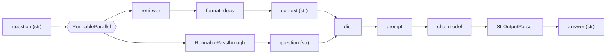

The [previous lesson](/learn/langchain-for-rag/chains) ended with a surprise: `create_retrieval_chain`, a prebuilt RAG chain, is one line of composition. That line was written in the **LangChain Expression Language (LCEL)**, the small set of operators and building blocks LangChain uses to join components into pipelines. This lesson teaches LCEL properly: the `|` operator, the automatic conversion of dictionaries and functions into components, the passthrough and assign patterns that carry data forward, and how data changes shape at each step of a RAG chain. By the end you will write the standard RAG chain from memory, extend it to return its sources, and know which steps keep streaming alive and which silently break it.

This lesson is about *composition*: how pieces are joined and what flows between them. The methods every piece exposes (`invoke`, `batch`, `stream`, configuration, retries, fallbacks) belong to [Runnable interfaces](/learn/langchain-for-rag/runnable-interfaces).

## Learning objectives

- Compose prompts, models, retrievers, parsers and functions with `|`, and state the input and output type of each step.
- Explain how LCEL coerces a dictionary into a `RunnableParallel` and a function into a `RunnableLambda`.
- Use `RunnablePassthrough`, `RunnablePassthrough.assign` and `itemgetter` to carry data through a chain.
- Build a RAG chain that returns the retrieved documents alongside the answer without retrieving twice.
- Predict whether a chain streams token by token, and fix a chain that does not.

## Prerequisites

- [Retrievers](/learn/langchain-for-rag/retrievers): a retriever maps a string to a list of `Document` objects.
- [Chains](/learn/langchain-for-rag/chains): what a RAG chain must do, and the prebuilt constructors.
- [Functions and classes](/learn/python-for-rag-engineering/functions-and-classes): functions as values, and dictionaries.

## Why this matters

A RAG pipeline is a series of transformations: question to documents, documents to text, text and question to prompt, prompt to model reply, reply to string. You could write it as ordinary Python, and for a single synchronous call that is perfectly good code. The trouble starts when you need the same pipeline to stream tokens to a browser, to run fifty evaluation questions concurrently, to run asynchronously inside a web server, and to show each step in a trace. Hand-written code needs four versions of itself for that. A composed pipeline gets all four from the components it is built from.

LCEL is also the language of most LangChain documentation, examples and answers you will find. If you cannot read `{"context": retriever | format_docs, "question": RunnablePassthrough()} | prompt | llm | StrOutputParser()`, you cannot read the ecosystem. And because LCEL has a few rules that are easy to miss (a dictionary becomes a parallel step, a lambda blocks streaming, a passthrough forwards its whole input), LCEL bugs tend to be shape bugs: a step receives a string when it expected a dictionary. Knowing the data shape at every arrow is the core skill.

## The intuition

Picture a production line in Meridian's IT stores where new laptops are prepared. Each station does one job and passes the item along: unbox, install the image, label, pack. That is a **sequence**: the output of one station is the input of the next, and the line is described simply by listing the stations in order. LCEL writes that list with `|`.

Sometimes one item needs several jobs done to it at once: while one technician installs the operating system, another prints the asset label from the same order ticket. Both work from a copy of the same input, and their results are put together in one tray, each in its labelled compartment. That is a **parallel** step, and in LCEL a dictionary describes it: the keys are the compartment labels, the values are the stations.

Finally, some trays need to carry the original order ticket all the way to the end, so the packer can check it. That is a **passthrough**: a compartment that holds the input unchanged.

## How it works

### Everything is a Runnable

Every LCEL building block is a **Runnable**: an object that takes one input and produces one output through `invoke` (and the related methods covered in [Runnable interfaces](/learn/langchain-for-rag/runnable-interfaces)). The components you use in RAG have these shapes:

| Component | Input | Output |
| --- | --- | --- |
| Retriever | `str` | `list[Document]` |
| `ChatPromptTemplate` | `dict` of its variables | `ChatPromptValue` (a list of messages) |
| Chat model | messages (or a prompt value, or a string) | `AIMessage` |
| `StrOutputParser` | `AIMessage` | `str` |
| `RunnableLambda(f)` | whatever `f` accepts | whatever `f` returns |
| `RunnablePassthrough()` | anything | the same thing |

Writing a chain is making these shapes line up.

### The pipe: `RunnableSequence`

`a | b` creates a `RunnableSequence` that calls `a`, then calls `b` on `a`'s output. Chains of pipes flatten into one sequence, so `prompt | llm | parser` is a single sequence with three steps. The sequence's input is the first step's input and its output is the last step's output.

The `|` works because Runnables define Python's `__or__` and `__ror__` operators. That is also why **at least one side of every `|` must be a Runnable**: `format_docs | prompt` works (the prompt's `__ror__` handles it), but two plain functions piped together raise a `TypeError`.

### Coercion: dictionaries and functions become Runnables

When a non-Runnable appears next to `|`, LCEL converts it:

1. **A function** becomes a `RunnableLambda`. `retriever | format_docs` is `retriever | RunnableLambda(format_docs)`.
2. **A dictionary** becomes a `RunnableParallel`. Each value is itself coerced (so values can be Runnables, functions or nested dictionaries). Every value receives **the same input**, and the output is a dictionary with the same keys holding each value's result.

The second rule is the heart of RAG in LCEL. In

```python
{"context": retriever | format_docs, "question": RunnablePassthrough()}
```

both branches receive the user's question string. The `context` branch turns it into documents and then into one formatted string; the `question` branch returns it unchanged. The result, `{"context": "...", "question": "..."}`, is exactly the dictionary the prompt template needs.

The branches of a `RunnableParallel` run **concurrently**: in `invoke`, on a thread pool; in `ainvoke`, as concurrent coroutines. Two retrievers in one parallel step cost roughly the time of the slower one, not the sum.

### Carrying data forward: passthrough, assign and itemgetter

A sequence forgets: each step sees only the previous step's output. Three tools put information back:

- **`RunnablePassthrough()`** returns its input unchanged. Inside a dictionary it says "keep a copy of the input under this key".
- **`RunnablePassthrough.assign(key=runnable, ...)`** expects a dictionary, runs each given runnable on that dictionary, and returns the *original* dictionary with the new keys added. Every Runnable also has a `.assign(...)` method that does the same to its own output. This is how you add an answer to a dictionary that already holds the documents.
- **`operator.itemgetter("key")`** from the standard library is a function that picks one value out of a dictionary. Coerced to a `RunnableLambda`, it is the usual way to route one field of a dictionary input into a component, as in `itemgetter("question") | retriever`.

### The data, step by step

Step through the classic chain and watch the value change shape at each arrow:

```trace
{"title": "Shapes flowing through a LCEL RAG chain", "code": ["question = \"How much holiday do I get?\"", "step1 = {\"context\": retriever | format_docs, \"question\": RunnablePassthrough()}", "x = step1.invoke(question)", "messages = prompt.invoke(x)", "reply = llm.invoke(messages)", "answer = StrOutputParser().invoke(reply)"], "steps": [{"line": 1, "vars": {"question": "str: 'How much holiday do I get?'"}, "note": "The chain's input is a plain string."}, {"line": 2, "vars": {"step1": "RunnableParallel (coerced from a dict)"}, "note": "The dict is coerced: the retriever pipe becomes a sequence, the passthrough stays as is."}, {"line": 3, "vars": {"x": "dict: {'context': '[leave] Staff receive 25 days...\\n\\n[carry] Up to 5 unused...', 'question': 'How much holiday do I get?'}"}, "note": "Both branches received the same string. One produced formatted text, the other returned the string unchanged."}, {"line": 4, "vars": {"messages": "ChatPromptValue: [SystemMessage(... Context: [leave] ...), HumanMessage('How much holiday do I get?')]"}, "note": "The prompt template consumes the dict's keys as its variables."}, {"line": 5, "vars": {"reply": "AIMessage(content='You get 25 days of annual leave a year [leave].')"}, "note": "The model returns a message object, not a string."}, {"line": 6, "vars": {"answer": "str: 'You get 25 days of annual leave a year [leave].'"}, "out": ["You get 25 days of annual leave a year [leave]."], "note": "The parser extracts the text. This is the chain's output."}]}
```



### Returning sources without retrieving twice

The classic chain loses the documents: by the time the answer exists, `context` has been flattened into a string. A tempting fix is a second dictionary branch that calls the retriever again to return documents, but that runs retrieval twice, doubles its cost, and can even return different documents if the index changes in between.

The correct pattern retrieves once into a dictionary and *assigns* the answer:

1. `RunnableParallel(context=retriever, question=RunnablePassthrough())` produces `{"context": [Document, ...], "question": "..."}`.
2. `.assign(answer=answer_chain)` runs `answer_chain` on that dictionary and adds `answer`.
3. Inside `answer_chain`, `RunnablePassthrough.assign(context=lambda x: format_docs(x["context"]))` replaces the list of documents with the formatted string, but only on the copy that goes to the prompt. The outer dictionary still holds the `Document` objects.

This is the same structure `create_retrieval_chain` uses, which is no coincidence.

### Routing with a function

A function used as a step may return a Runnable instead of a value; LCEL then invokes that Runnable with the same input. This gives simple routing without special classes:

```python
def route(question: str):
    return it_chain if "error" in question.lower() or "vpn" in question.lower() else hr_chain

router = RunnableLambda(route)
```

LangChain also has `RunnableBranch`, which takes (condition, runnable) pairs and a default, and is what `create_history_aware_retriever` uses internally. The function form is usually clearer. Routing questions to different indexes is covered in depth in [Query routing](/learn/agentic-rag/query-routing).

### Streaming through a composition

When you call `chain.stream(...)`, each step that knows how to transform a stream processes chunks as they arrive: chat models emit message chunks, `StrOutputParser` turns each into a string chunk, and a retriever or prompt (which have nothing to stream) simply produce their single output early in the run. A plain function wrapped as a `RunnableLambda` does not know how to handle a stream, so it **waits for the complete input**, then emits one output. Put a lambda after the model and token streaming silently stops: the user sees nothing, then the whole answer. If you need a streaming transformation after the model, write a generator function that accepts an iterator of chunks and yields chunks (LCEL wraps it as a `RunnableGenerator`), or do the transformation in the client.

## In code

**The problem.** Write AskMeridian's RAG chain in LCEL; inspect what the composition produces; extend it to return sources; feed it dictionary input; confirm that parallel branches run concurrently; and show the streaming trap. The retriever is real (local `all-MiniLM-L6-v2` embeddings) and the model is `FakeListChatModel`, which returns canned replies and streams them one character at a time, so everything runs without a key.

```bash
pip install langchain-core langchain-community sentence-transformers
```

```python
import time
from operator import itemgetter
from langchain_core.documents import Document
from langchain_core.vectorstores import InMemoryVectorStore
from langchain_core.prompts import ChatPromptTemplate
from langchain_core.output_parsers import StrOutputParser
from langchain_core.runnables import RunnableLambda, RunnableParallel, RunnablePassthrough
from langchain_core.language_models.fake_chat_models import FakeListChatModel
from langchain_community.embeddings import HuggingFaceEmbeddings

docs = [
    Document("Staff receive 25 days of annual leave per year.", metadata={"id": "leave"}),
    Document("Up to 5 unused leave days carry over and must be used by 31 March.", metadata={"id": "carry"}),
    Document("Employees may work remotely up to 3 days a week.", metadata={"id": "remote"}),
    Document("Error E-4021: the VPN client is out of date; update it from the IT portal.", metadata={"id": "e4021"}),
    Document("Passwords must be rotated every 90 days.", metadata={"id": "pwd"}),
]
emb = HuggingFaceEmbeddings(model_name="sentence-transformers/all-MiniLM-L6-v2",
                            encode_kwargs={"normalize_embeddings": True})
retriever = InMemoryVectorStore.from_documents(docs, emb).as_retriever(search_kwargs={"k": 2})
llm = FakeListChatModel(responses=["You get 25 days of annual leave a year [leave]."] * 3)

def format_docs(docs):
    return "\n\n".join(f"[{d.metadata['id']}] {d.page_content}" for d in docs)

prompt = ChatPromptTemplate.from_messages([
    ("system", "Answer only from the context and cite ids in brackets. "
               "If the answer is not there, say you don't know.\n\nContext:\n{context}"),
    ("human", "{question}"),
])

# 1. The classic RAG chain. The dict is coerced to a RunnableParallel.
rag = (
    {"context": retriever | format_docs, "question": RunnablePassthrough()}
    | prompt
    | llm
    | StrOutputParser()
)
print(type(rag).__name__, "with", len(rag.steps), "steps:",
      [type(s).__name__ for s in rag.steps])
print("answer:", rag.invoke("How much holiday do I get?"))

# 2. Keep the documents: retrieve once, then add the answer alongside them.
answer_from_docs = (
    RunnablePassthrough.assign(context=lambda x: format_docs(x["context"]))
    | prompt | llm | StrOutputParser()
)
rag_with_sources = (
    RunnableParallel(context=retriever, question=RunnablePassthrough())
    .assign(answer=answer_from_docs)
)
out = rag_with_sources.invoke("How much holiday do I get?")
print("keys:", list(out), "| sources:", [d.metadata["id"] for d in out["context"]])

# 3. Dict input: pick fields with itemgetter.
rag_dict_in = {"context": itemgetter("question") | retriever | format_docs,
               "question": itemgetter("question")} | prompt
print("prompt messages:", len(rag_dict_in.invoke({"question": "VPN error E-4021"}).to_messages()))

# 4. Branches of a RunnableParallel run concurrently.
def slow(name):
    def step(x):
        time.sleep(0.5)
        return name
    return RunnableLambda(step)
both = RunnableParallel(a=slow("a"), b=slow("b"))
t0 = time.perf_counter()
print(both.invoke("x"), f"in {time.perf_counter() - t0:.1f} s")

# 5. Streaming passes through streaming-aware steps, but a plain function waits.
gen = prompt | llm | StrOutputParser()
q = {"context": "[leave] Staff receive 25 days of annual leave per year.",
     "question": "How much holiday do I get?"}
print("chunks, parser last:  ", len(list(gen.stream(q))))
print("chunks, function last:", len(list((gen | (lambda s: s.strip())).stream(q))))
```

```output
RunnableSequence with 4 steps: ['RunnableParallel', 'ChatPromptTemplate', 'FakeListChatModel', 'StrOutputParser']
answer: You get 25 days of annual leave a year [leave].
keys: ['context', 'question', 'answer'] | sources: ['leave', 'carry']
prompt messages: 2
{'a': 'a', 'b': 'b'} in 0.5 s
chunks, parser last:   47
chunks, function last: 1
```

**The important lines.**

- The `rag` expression never mentions `RunnableParallel`, yet the first printed step is one: the dictionary was coerced. `retriever | format_docs` inside it became a nested sequence.
- `RunnableParallel(context=retriever, question=RunnablePassthrough())` is the explicit form of the same dictionary. Explicit is clearer when, as here, you are about to call a method (`.assign`) on it.
- `RunnablePassthrough.assign(context=lambda x: format_docs(x["context"]))` overwrites `context` for the prompt only. The documents survive in the outer dictionary, which is why `out["context"]` still holds `Document` objects.
- `itemgetter("question") | retriever` takes one field from a dictionary input. Without it, the retriever would receive the whole dictionary and fail, because a retriever expects a string.
- `gen | (lambda s: s.strip())` adds a plain function after the parser. It is perfectly correct for `invoke`, and it collapses streaming to a single chunk.

**What the output means.**

- The classic chain produces a plain string; the sources version produces a dictionary with `context`, `question` and `answer`, from one retrieval.
- The dictionary-input chain produces two messages (system and human), confirming the shapes lined up.
- Two half-second steps in one parallel step took half a second in total, not one second: the branches ran concurrently.
- With the parser last, the 47-character fake reply arrived as 47 chunks, one per character. With a function last, it arrived as one chunk at the end. With a real model the chunks would be tokens rather than characters, but the loss of streaming is the same.

**Common errors.**

- `TypeError: Expected mapping type as input to ChatPromptTemplate`: the prompt received a string, usually because the dictionary step was forgotten. The prompt needs a dictionary of its variables.
- A retriever or embedding error mentioning a `dict`: the retriever received the whole input dictionary. Add `itemgetter("question")` in front of it.
- `KeyError` inside `assign`: the step receiving the dictionary expected a key that an earlier step did not produce. Print the intermediate value by invoking the partial chain, as section 3 does.
- `TypeError: unsupported operand type(s) for |`: neither side of a `|` is a Runnable, for example two plain functions. Wrap one in `RunnableLambda`. Two dictionaries are worse: Python merges them with `|` and no error is raised, so wrap one in `RunnableParallel`.

**Extending it.** Replace `FakeListChatModel` with `ChatAnthropic` from `langchain-anthropic` (as shown, unexecuted, in [Chains](/learn/langchain-for-rag/chains)), stream the sources version and print chunks as they arrive. Notice that streaming a dictionary output yields partial dictionaries; the next lesson shows how to consume them.

## A real-world example

The Platform team rewrote AskMeridian's backend from a legacy chain to LCEL. In review, a newcomer's version of the sources feature looked like this:

```python
chain = {
    "answer": {"context": retriever | format_docs, "question": RunnablePassthrough()} | prompt | llm | StrOutputParser(),
    "sources": retriever,
}
```

It worked, and it passed the unit tests. In staging, the vector database's query rate doubled, because every question now ran retrieval twice (once in each dictionary branch). Worse, the ingestion job updates the index continuously, so the two retrievals occasionally ran either side of an update and returned different lists: the `sources` panel then did not match what the model had read. A user report of "the answer cites a document that is not in the sources panel" led back to it.

The fix was the retrieve-once, assign-the-answer pattern from this lesson. The team added a reviewer checklist item: every retriever should appear exactly once per chain, and the documents shown to the user must be the same objects the prompt was built from.

## Common mistakes

- **Passing the whole input dictionary to a retriever.** Retrievers take strings; use `itemgetter` to pick the question.
- **Retrieving twice to return sources.** Doubles cost and can show sources the model never read. Retrieve once and use `.assign`.
- **Putting a plain function after the model in a streaming chain.** Streaming silently stops; the user waits for the full answer.
- **Forgetting that `RunnablePassthrough` forwards everything.** In a dictionary step with dictionary input, a passthrough branch holds the entire input dictionary, not one field.
- **Writing lambdas with side effects or hidden state.** Concurrent branches and batching run them in parallel threads; shared mutable state races.
- **Building very long single expressions.** A 15-step expression is hard to test. Name sub-chains (`answer_from_docs` above) and test each.

## Best practices

- Write the shape of every arrow in a comment while you learn, and check it by invoking partial chains.
- Name sub-chains and give them a `run_name` (see [Runnable interfaces](/learn/langchain-for-rag/runnable-interfaces)) so traces read clearly.
- Use the retrieve-once, `.assign(answer=...)` pattern whenever the caller needs sources.
- Keep formatting functions pure: same input, same output, no network calls.
- Prefer LCEL for linear and lightly branching pipelines; when the flow needs loops, retries driven by the model, or persistent state, move to LangGraph.
- Unit-test chains with a fake model so that prompt construction is tested without network calls.

## Performance considerations

LCEL itself adds little: each step is a function call plus callback bookkeeping, typically far below a millisecond, which is negligible next to an embedding call (milliseconds) or a model call (hundreds of milliseconds to seconds). Where LCEL changes performance is in what it runs concurrently:

- **Parallel branches.** A dictionary step with a 40 ms vector search and a 15 ms keyword search costs about 40 ms, not 55 ms. In synchronous `invoke`, branches run on a thread pool, which is fine for I/O-bound work; CPU-bound Python functions in parallel branches gain less because of the global interpreter lock.
- **Duplicate work.** Each appearance of a retriever in a chain is a separate call. Two appearances double retrieval cost; count them.
- **Streaming.** Time to first token depends on every step before the model. Retrieval at 50 ms plus prompt formatting plus model first-token latency is what the user waits for, provided nothing after the model blocks the stream.

## Summary

- LCEL composes Runnables with `|` into a `RunnableSequence`; each step's output is the next step's input.
- A dictionary is coerced to a `RunnableParallel` (every value gets the same input, results come back under the keys, branches run concurrently) and a function to a `RunnableLambda`.
- `RunnablePassthrough`, `.assign` and `itemgetter` carry data forward through steps that would otherwise forget it.
- Return sources by retrieving once into a dictionary and assigning the answer; never retrieve twice.
- A plain function after the model blocks streaming; use a generator or move the transformation.

## Exercises

**1.** State the input and output type of each step in `itemgetter("question") | retriever | format_docs`, assuming the chain receives `{"question": "...", "user": "ana"}`.

<details><summary>Show solution</summary>

`itemgetter("question")`: dict in, `str` out. `retriever`: `str` in, `list[Document]` out. `format_docs`: `list[Document]` in, `str` out. The chain maps a dictionary to a formatted string; the `user` field is ignored.

</details>

**2.** What does `{"q": RunnablePassthrough(), "n": lambda x: len(x)}.invoke` return for the input `"VPN"`? (Hint: coerce it first.)

<details><summary>Show solution</summary>

A plain dictionary has no `invoke`, so wrap it: `RunnableParallel({"q": RunnablePassthrough(), "n": lambda x: len(x)}).invoke("VPN")` returns `{'q': 'VPN', 'n': 3}`. Both branches got the same input; the passthrough returned it and the lambda returned its length.

</details>

**3.** Write a hybrid chain: a `RunnableParallel` that runs a dense retriever and a BM25 retriever on the same question, followed by a function that merges the two lists, removing duplicates by metadata `id` while keeping the dense order first. Then feed the merged documents into the sources pattern from this lesson.

<details><summary>Show solution</summary>

```python
def merge(results):
    seen, merged = set(), []
    for d in results["dense"] + results["bm25"]:
        if d.metadata["id"] not in seen:
            seen.add(d.metadata["id"])
            merged.append(d)
    return merged

hybrid = RunnableParallel(dense=retriever, bm25=bm25_retriever) | merge
rag_hybrid = (
    RunnableParallel(context=hybrid, question=RunnablePassthrough())
    .assign(answer=answer_from_docs)
)
```

The two retrievers run concurrently; the merge is a pure function. For score-aware fusion use `EnsembleRetriever` from [Retrievers](/learn/langchain-for-rag/retrievers).

</details>

**4.** A product owner wants the answer streamed and the sources shown before the first token. Using only LCEL, sketch how the client receives both, and explain why the sources can arrive first.

<details><summary>Show solution</summary>

Stream `rag_with_sources`. A `RunnableParallel` followed by `.assign` streams its output as partial dictionaries: the `context` and `question` values are produced by the first step, so they appear in an early chunk; the `answer` key then arrives as a series of string chunks as the model generates. The client renders the source list on the first chunk containing `context` and appends text for each `answer` chunk. The sources can arrive first because retrieval finishes before the model starts.

</details>

## Check your understanding

```quiz
[
  {"q": "What does LCEL turn the dictionary in `{\"context\": retriever, \"question\": RunnablePassthrough()} | prompt` into?", "options": ["A RunnableSequence", "A RunnableParallel whose branches all receive the same input", "A RunnableBranch", "A plain dict passed to the prompt unchanged"], "answer": 1, "why": "A dictionary next to `|` is coerced to a RunnableParallel. Each value receives the same input and its result is stored under its key."},
  {"q": "A chain is invoked with `{\"question\": \"...\"}` and its first step is `retriever | format_docs`. What goes wrong?", "options": ["Nothing; retrievers accept dicts", "The retriever receives a dict instead of a string and fails", "format_docs receives a string", "The prompt is skipped"], "answer": 1, "why": "Retrievers take a string. Put `itemgetter(\"question\")` in front of the retriever."},
  {"q": "Why is `{\"answer\": full_rag_chain, \"sources\": retriever}` a poor way to return sources?", "options": ["It does not run", "It returns sources as strings", "It runs retrieval twice, doubling cost, and the sources may differ from what the model read", "It disables batching"], "answer": 2, "why": "Each branch calls the retriever separately. Retrieve once and attach the answer with `.assign`."},
  {"q": "`chain = prompt | llm | StrOutputParser() | (lambda s: s.upper())`. What happens when you call `chain.stream(...)`?", "options": ["Tokens stream in upper case", "It raises an error", "The output arrives as one chunk after generation finishes", "Only the first token is upper-cased"], "answer": 2, "why": "A plain function is not stream-aware, so it waits for the complete input and emits one output."},
  {"q": "What does `RunnablePassthrough.assign(n=lambda x: len(x[\"q\"]))` return for the input `{\"q\": \"VPN\"}`?", "options": ["`3`", "`{\"n\": 3}`", "`{\"q\": \"VPN\", \"n\": 3}`", "`{\"q\": 3}`"], "answer": 2, "why": "`assign` keeps the original dictionary and adds the new key computed from it."}
]
```

## Further reading

- LangChain documentation, "LangChain Expression Language" and the how-to guides on `RunnableParallel`, `RunnablePassthrough` and streaming: [docs.langchain.com](https://docs.langchain.com/)
- LangChain API reference for `langchain_core.runnables`: [python.langchain.com](https://python.langchain.com/)
- Python documentation, `operator.itemgetter`: [docs.python.org](https://docs.python.org/3/library/operator.html)
- LangGraph documentation, for pipelines that outgrow linear composition: [langchain-ai.github.io/langgraph](https://langchain-ai.github.io/langgraph/)
