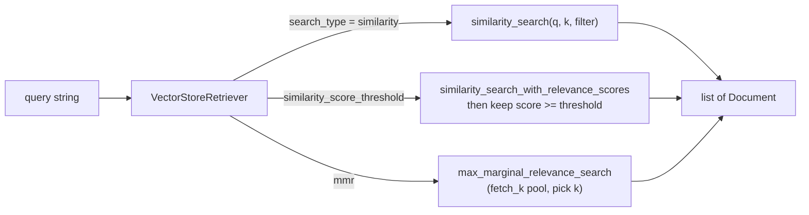
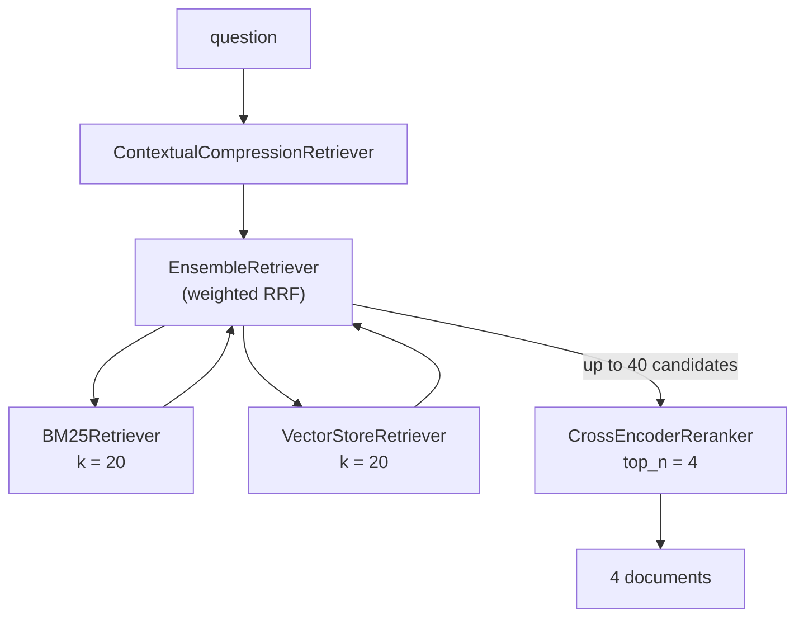

A vector store knows how to store vectors and search them. A RAG chain needs something narrower: a component that takes a question and hands back a short list of documents. In LangChain that component is a **retriever**. This lesson explains what the retriever interface is, how a vector store becomes one, what each of the built-in search modes really does, and how LangChain's composite retrievers (keyword, ensemble, reranking) are assembled from the same small contract. You will run all of them on the Meridian corpus and see two quiet failures that only show up if you look at the numbers.

The previous lesson, [Vector stores](/learn/langchain-for-rag/vector-stores), covered storing and searching. Building your own retriever class is the subject of [Custom retrievers](/learn/langchain-for-rag/custom-retrievers); here you learn to use, configure and combine the ones LangChain ships.

## Learning objectives

- Explain the retriever contract (a string in, a list of `Document` objects out) and why it is separate from the vector store.
- Configure `as_retriever()` with the `similarity`, `similarity_score_threshold` and `mmr` search types and their `search_kwargs`.
- Diagnose a relevance-score threshold that silently filters everything, by checking how the store converts distance to relevance.
- Build a hybrid retriever with `BM25Retriever` and `EnsembleRetriever`, and compute its weighted Reciprocal Rank Fusion scores by hand.
- Add cross-encoder reranking with `ContextualCompressionRetriever`, and choose an over-fetch size for it.

## Prerequisites

- [Vector stores](/learn/langchain-for-rag/vector-stores): `Document`, `from_documents` and `similarity_search` in LangChain.
- [Embeddings](/learn/langchain-for-rag/embeddings): LangChain's `Embeddings` interface.
- [Top-K retrieval](/learn/retrieval-fundamentals/top-k-retrieval) and [Reciprocal Rank Fusion](/learn/hybrid-search/reciprocal-rank-fusion): the retrieval ideas these classes implement.
- [Cross-encoders](/learn/reranking-fundamentals/cross-encoders): why a second, slower model re-scores candidates.

## Why this matters

Everything downstream of retrieval is limited by it. If the chunk stating "25 days of annual leave" is not among the documents passed to the model, no prompt can produce the right answer. In a LangChain application, the retriever is the single place where "which documents does the model see?" is decided, so it is also where most quality problems are either solved or created.

The retriever abstraction exists so that this decision can change without touching the rest of the application. A chain that calls `retriever.invoke(question)` does not care whether the documents came from FAISS, from a BM25 index, from both fused together, or from a hosted search service followed by a reranker. That is powerful, and it is also a trap: because every retriever returns the same shape (a list of documents), a badly configured one looks exactly like a good one. A score threshold that drops every result returns an empty list with, at most, a log warning. A keyword retriever whose tokeniser cannot see your error codes returns three unrelated documents with total confidence. A metadata filter on the wrong field returns documents from the wrong source. None of these raise an exception. You only catch them by inspecting what the retriever returns for real queries, which is what this lesson trains you to do.

## The intuition

Think of Meridian's reception desk. A visitor asks "where do I go for the VPN training?" The receptionist does not need to know how the building's room-booking system works; she only needs a booking system that, given a question, gives her back a short list of rooms. Today the system is a spreadsheet. Next year it might be a proper database, or two databases with a person who merges their answers. The receptionist's job, and the visitor's experience, does not change.

That is the retriever: a promise of **question in, short list of documents out**. The vector store is one way of keeping that promise. A keyword index is another. A committee of two retrievers whose lists are merged is a third. A retriever that asks for twenty candidates and lets an expert pick the best two is a fourth. They are interchangeable because they all keep the same promise, and they can be nested because a committee of retrievers is itself a retriever.

## How it works

### The contract

Every retriever in LangChain is a subclass of `BaseRetriever` from `langchain_core.retrievers`. From the caller's side, the interface is small:

- `retriever.invoke(query)` takes a string and returns `list[Document]`.
- `retriever.ainvoke(query)` is the asynchronous version.
- `retriever.batch([q1, q2, ...])` runs several queries, concurrently by default.

A `Document` carries `page_content` (the text) and `metadata` (a dictionary). Nothing in the contract mentions scores. That is a deliberate simplification with a real cost: a retriever is not required to tell you how confident it is, and most built-in retrievers do not put a score anywhere in the output. When you need scores, you either call the vector store's scoring methods directly or write a retriever that copies them into metadata, as [Custom retrievers](/learn/langchain-for-rag/custom-retrievers) does.

Because `BaseRetriever` is a **Runnable** (LangChain's universal component interface, covered in [Runnable interfaces](/learn/langchain-for-rag/runnable-interfaces)), a retriever slots directly into a chain built with [LCEL](/learn/langchain-for-rag/lcel), gets `batch` and streaming support for free, and reports its runs to tracing tools.

### From vector store to retriever

`VectorStore.as_retriever(search_type=..., search_kwargs=...)` wraps a store in a `VectorStoreRetriever`. The wrapper holds three things: the store, a `search_type` string and a `search_kwargs` dictionary. On every `invoke`, it calls one of the store's search methods and passes `search_kwargs` through:

| `search_type` | Store method called | Useful `search_kwargs` |
| --- | --- | --- |
| `"similarity"` (default) | `similarity_search` | `k`, `filter` |
| `"similarity_score_threshold"` | `similarity_search_with_relevance_scores`, then drops results below the threshold | `k`, `score_threshold`, `filter` |
| `"mmr"` | `max_marginal_relevance_search` | `k`, `fetch_k`, `lambda_mult`, `filter` |

Three details matter in practice:

1. **`k` defaults to 4** in the vector store methods. If you never set it, you get four documents.
2. **`filter` is store-specific.** FAISS in LangChain accepts a dictionary of metadata equalities (or a callable); Qdrant, pgvector, Pinecone and others each have their own filter syntax. The retriever passes your value through untouched, so a filter written for one store does not port to another.
3. **`mmr` re-ranks a pool.** The store fetches `fetch_k` candidates (default 20), then [MMR](/learn/advanced-retrieval-optimisation/mmr) picks `k` of them, trading relevance against redundancy with `lambda_mult` (1 means pure relevance, 0 means maximum diversity). That lesson covers how to choose the values.



### Relevance scores are a conversion, not a measurement

The threshold mode looks simple: keep documents whose relevance is at least `score_threshold`, on a 0-to-1 scale. But vector stores do not natively produce a 0-to-1 relevance. They produce whatever their index produces: a cosine similarity, an inner product, a Euclidean distance or a squared Euclidean distance. LangChain converts that raw number to "relevance" with a function chosen by the store class (`_select_relevance_score_fn`). The conversion is a guess about the metric and the scale of your embeddings, and the source code says so in a comment.

Two consequences follow:

- **Some stores do not implement it at all.** In the version used here (`langchain-core` 1.8), `InMemoryVectorStore` raises `NotImplementedError` if you ask for relevance scores, so the threshold mode fails with it.
- **Some implement it for a different distance than they return.** LangChain's FAISS wrapper defaults to a flat L2 index, which returns *squared* Euclidean distance, but its default conversion, $1 - d/\sqrt{2}$, assumes plain Euclidean distance between unit vectors. The resulting "relevance" is systematically too low. A threshold of 0.3 that looks sensible then drops every document, including the right one. You will see the corrected version in the code below and the arithmetic in the mathematics section.

The rule: **never choose a threshold before printing the scores** your store returns for a dozen real queries, some answerable and some not. [Retrieval thresholding](/learn/advanced-retrieval-optimisation/retrieval-thresholding) covers how to set the value; this lesson is about making sure the number you threshold means what you think.

### Keyword retrieval: `BM25Retriever`

`BM25Retriever` (in `langchain_community.retrievers`, backed by the `rank_bm25` package) keeps an in-memory [BM25](/learn/sparse-retrieval/bm25) index over the documents you give it. It is useful for prototypes and small corpora; it is not a search server, holds everything in memory and must be rebuilt to add documents.

Two behaviours catch people out:

1. **The default tokeniser is `str.split()`**: split on whitespace, nothing else. "E-4021:" in a runbook becomes the token `E-4021:` (with the colon), and the query "E-4021" becomes `E-4021`. They do not match, and neither does "vpn" against "VPN". Pass a `preprocess_func` that lower-cases and splits the way your data needs.
2. **It always returns `k` documents.** BM25 gives a score of zero to a document that shares no terms with the query, but the retriever does not drop such documents; it returns the top `k` by score, zero or not. For a query that matches one document, the other `k - 1` are padding in arbitrary order.

### Hybrid retrieval: `EnsembleRetriever`

`EnsembleRetriever` (in `langchain_classic.retrievers`; it lived in `langchain.retrievers` before LangChain 1.0 moved the older chains and retrievers into the `langchain-classic` package) takes a list of retrievers and a list of weights. It calls each retriever, then merges the lists with **weighted Reciprocal Rank Fusion**: each document earns `weight / (rank + c)` from each list it appears in, with ranks counted from 1 and `c = 60` by default. Documents are de-duplicated by `page_content`, or by a metadata field if you set `id_key`, which you should whenever two chunks can have identical text.

The output contains every distinct document from every list, so an ensemble of two retrievers with `k = 3` can return up to six documents. It has no `k` of its own; trim afterwards if your prompt needs a fixed number.

### Reranking: `ContextualCompressionRetriever`

The name is historical. `ContextualCompressionRetriever` wraps a base retriever and a **document compressor**: any object that takes the retrieved documents plus the query and returns a (usually smaller) list. Compressors include:

- `CrossEncoderReranker`: scores each (query, document) pair with a cross-encoder and keeps the best `top_n`. This is the common use.
- `EmbeddingsFilter`: drops documents below an embedding-similarity threshold.
- `LLMChainExtractor` and `LLMChainFilter`: ask an LLM to extract the relevant sentences or to say yes or no for each document. These cost one model call per document.
- `DocumentCompressorPipeline`: several of the above in sequence.

The pattern is **over-fetch, then cut**: set the base retriever's `k` well above the number you will finally use (say 20 to 50), and let the compressor choose the final few. If the base `k` equals `top_n`, the reranker can only reorder; it cannot rescue a document the first stage missed.

### The rest of the family

LangChain ships other composite retrievers. Each is the subject of a lesson elsewhere in the course, so here is only what each one is:

- `MultiQueryRetriever`: asks an LLM for several rephrasings of the question, retrieves for each and unions the results ([Multi-query retrieval](/learn/advanced-retrieval/multi-query-retrieval)).
- `ParentDocumentRetriever`: searches small child chunks and returns their larger parents from a separate document store ([Parent-child retrieval](/learn/hierarchical-rag/parent-child-retrieval)).
- `MultiVectorRetriever`: several vectors (summaries, hypothetical questions) per document ([Multi-vector retrieval](/learn/advanced-retrieval/multi-vector-retrieval)).
- `SelfQueryRetriever`: an LLM turns the question into a semantic query plus a metadata filter ([Self-query retrieval](/learn/advanced-retrieval/self-query-retrieval)).

All of these are retrievers in the sense above, so they nest: a `ContextualCompressionRetriever` around an `EnsembleRetriever` of a BM25 retriever and an MMR vector retriever is a legitimate, and common, production shape.



## The mathematics

### Weighted Reciprocal Rank Fusion as `EnsembleRetriever` computes it

**Intuition.** A document near the top of any list should end near the top of the fused list, and being in several lists should help. Ranks, not raw scores, are combined, so BM25 scores and cosine similarities never have to share a scale.

$$
\text{score}(d) = \sum_{i=1}^{m} \frac{w_i}{\text{rank}_i(d) + c}
$$

- $m$ is the number of retrievers; $w_i$ is the weight of retriever $i$.
- $\text{rank}_i(d)$ is the position of document $d$ in retriever $i$'s list, starting at 1. A document absent from a list contributes nothing for that list.
- $c$ is a smoothing constant (60 by default) that stops the first place from dominating.

**Worked by hand.** For the query "E-4021" in the code below, BM25 returns `[e4021, pwd, vpn]` and the dense retriever returns `[e4021, e4012, equip]`, with weights 0.5 and 0.5.

- e4021 is first in both: $0.5/61 + 0.5/61 = 0.016393$.
- pwd is second in BM25 only: $0.5/62 = 0.008065$. e4012 is second in the dense list only: also $0.008065$.
- vpn and equip are third in one list each: $0.5/63 = 0.007937$.

The fused order is e4021, then a tie between pwd and e4012, then a tie between vpn and equip. Ties keep the order in which documents were first seen (BM25's list first), so pwd comes before e4012. Notice what that means: pwd ("Passwords must be rotated every 90 days") had a BM25 score of exactly zero, yet the fusion ranks it level with e4012, which the dense model genuinely judged related. RRF does not know a rank was padding.

```python
c, w = 60, 0.5
bm25 = ["e4021", "pwd", "vpn"]
dense = ["e4021", "e4012", "equip"]
scores = {}
for lst in (bm25, dense):
    for rank, doc in enumerate(lst, start=1):
        scores[doc] = scores.get(doc, 0) + w / (rank + c)
for doc, s in sorted(scores.items(), key=lambda x: -x[1]):
    print(f"{doc:6s} {s:.6f}")
```

```output
e4021  0.016393
pwd    0.008065
e4012  0.008065
vpn    0.007937
equip  0.007937
```

### Squared distance and the relevance conversion

**Intuition.** As [Vector stores](/learn/langchain-for-rag/vector-stores) showed, for unit-length vectors distance and cosine are two views of the same angle, so either converts exactly into the other. The bug is converting the wrong one.

$$
\lVert \mathbf{q} - \mathbf{d} \rVert^2 = \lVert \mathbf{q} \rVert^2 + \lVert \mathbf{d} \rVert^2 - 2\,\mathbf{q}\cdot\mathbf{d} = 2 - 2\cos\theta
$$

- $\mathbf{q}, \mathbf{d}$ are the normalised query and document embeddings, so each has length 1.
- $\cos\theta = \mathbf{q}\cdot\mathbf{d}$ is their cosine similarity, between -1 and 1.

So the correct relevance from a squared distance $d^2$ is $\cos\theta = 1 - d^2/2$. **By hand:** the "annual leave" document has cosine 0.37 to "how much holiday do I get?", so FAISS returns $d^2 = 2 - 0.74 = 1.26$. The default conversion computes $1 - 1.26/\sqrt{2} = 1 - 0.891 = 0.109$: the best document in the corpus looks barely relevant, and a 0.3 threshold drops it. The corrected conversion gives $1 - 1.26/2 = 0.37$.

```python
import math
cos = 0.37
d2 = 2 - 2 * cos
print(f"squared distance  {d2:.3f}")
print(f"default relevance {1 - d2 / math.sqrt(2):.3f}")
print(f"correct relevance {1 - d2 / 2:.3f}")
```

```output
squared distance  1.260
default relevance 0.109
correct relevance 0.370
```

## In code

**The problem.** Build every retriever discussed above over an eight-document Meridian corpus, run the queries that expose their behaviour, and compare. Everything runs locally: the embedding model is `all-MiniLM-L6-v2` and the reranker is `cross-encoder/ms-marco-MiniLM-L-6-v2`.

**Install.** The script was run with `langchain-core` 1.8, `langchain-community` 0.4, `langchain-classic` 1.0, `faiss-cpu` 1.16 and `sentence-transformers`.

```bash
pip install langchain-core langchain-community langchain-classic faiss-cpu rank-bm25 sentence-transformers
```

`langchain-community` prints a deprecation notice on import in recent versions; its integrations are moving into standalone packages (for example `langchain-huggingface` provides `HuggingFaceEmbeddings`). The classes used here worked in the versions above; check the import path in the current documentation for your versions.

```python
import re
from langchain_core.documents import Document
from langchain_community.vectorstores import FAISS
from langchain_community.embeddings import HuggingFaceEmbeddings
from langchain_community.retrievers import BM25Retriever
from langchain_community.cross_encoders import HuggingFaceCrossEncoder
from langchain_classic.retrievers import EnsembleRetriever, ContextualCompressionRetriever
from langchain_classic.retrievers.document_compressors import CrossEncoderReranker

docs = [
    Document("Staff receive 25 days of annual leave per year.", metadata={"id": "leave", "source": "handbook"}),
    Document("Up to 5 unused leave days carry over and must be used by 31 March.", metadata={"id": "carry", "source": "handbook"}),
    Document("Employees may work remotely up to 3 days a week.", metadata={"id": "remote", "source": "handbook"}),
    Document("The home-office equipment budget is £400; contractors are not eligible.", metadata={"id": "equip", "source": "handbook"}),
    Document("Error E-4021: the VPN client is out of date; update it from the IT portal.", metadata={"id": "e4021", "source": "runbook"}),
    Document("Error E-4012: the VPN certificate has expired.", metadata={"id": "e4012", "source": "runbook"}),
    Document("VPN is required whenever you use public Wi-Fi.", metadata={"id": "vpn", "source": "runbook"}),
    Document("Passwords must be rotated every 90 days.", metadata={"id": "pwd", "source": "runbook"}),
]
ids = lambda ds: [d.metadata["id"] for d in ds]

emb = HuggingFaceEmbeddings(model_name="sentence-transformers/all-MiniLM-L6-v2",
                            encode_kwargs={"normalize_embeddings": True})
# FAISS's flat L2 index returns SQUARED distance; for unit vectors d2 = 2 - 2cos,
# so cosine = 1 - d2/2. Tell LangChain how to turn distance into relevance.
store = FAISS.from_documents(docs, emb, relevance_score_fn=lambda d2: 1 - d2 / 2)

# 1. Plain similarity retriever
dense = store.as_retriever(search_kwargs={"k": 3})
print("dense     ", ids(dense.invoke("how much holiday do I get?")))
print("dense     ", ids(dense.invoke("E-4021")))

# 2. Similarity with a relevance floor
floor = store.as_retriever(search_type="similarity_score_threshold",
                           search_kwargs={"k": 3, "score_threshold": 0.3})
print("threshold ", ids(floor.invoke("how much holiday do I get?")))
print("threshold ", ids(floor.invoke("what is on the canteen menu?")))

# 3. Metadata filter, applied by the store
runbook = store.as_retriever(search_kwargs={"k": 2, "filter": {"source": "runbook"}})
print("filtered  ", ids(runbook.invoke("how much holiday do I get?")))

# 4. Keyword retriever with a tokeniser that keeps codes like e-4021 whole
tokenise = lambda text: re.findall(r"[a-z0-9]+(?:-[a-z0-9]+)*", text.lower())
bm25 = BM25Retriever.from_documents(docs, k=3, preprocess_func=tokenise)
print("bm25      ", ids(bm25.invoke("E-4021")))
hybrid = EnsembleRetriever(retrievers=[bm25, dense], weights=[0.5, 0.5])
print("ensemble  ", ids(hybrid.invoke("E-4021")))

# 5. Over-fetch, then rerank with a cross-encoder
reranked = ContextualCompressionRetriever(
    base_compressor=CrossEncoderReranker(
        model=HuggingFaceCrossEncoder(model_name="cross-encoder/ms-marco-MiniLM-L-6-v2"), top_n=2),
    base_retriever=store.as_retriever(search_kwargs={"k": 6}))
print("reranked  ", ids(reranked.invoke("my VPN certificate is no longer valid")))

# 6. Every retriever is a Runnable, so batch() comes for free
print("batch     ", [ids(r) for r in dense.batch(["working from home", "changing my password"])])
```

```output
dense      ['leave', 'carry', 'equip']
dense      ['e4021', 'e4012', 'equip']
threshold  ['leave', 'carry']
No relevant docs were retrieved using the relevance score threshold 0.3
threshold  []
filtered   ['pwd', 'e4012']
bm25       ['e4021', 'pwd', 'vpn']
ensemble   ['e4021', 'pwd', 'e4012', 'vpn', 'equip']
reranked   ['e4012', 'e4021']
batch      [['remote', 'equip', 'vpn'], ['pwd', 'e4012', 'e4021']]
```

**The important lines.**

- `relevance_score_fn=lambda d2: 1 - d2 / 2` overrides FAISS's default conversion with the correct one for squared distances between unit vectors. Without it, the first threshold query returns an empty list too (try it).
- `as_retriever(search_kwargs={"k": 3})` creates a `VectorStoreRetriever`; the dictionary is passed to `similarity_search` unchanged.
- `filter={"source": "runbook"}` is FAISS's dictionary filter. LangChain's FAISS wrapper fetches `fetch_k` candidates (default 20), drops those that fail the filter and keeps the best `k`. On a large corpus with a selective filter, that post-filtering can return fewer than `k` documents; stores such as Qdrant apply the filter inside the index search instead.
- `preprocess_func=tokenise` replaces BM25's whitespace tokeniser. The regular expression keeps hyphenated codes such as `e-4021` as single tokens and lower-cases everything.
- `ContextualCompressionRetriever` fetches six candidates from the store and lets the cross-encoder keep two.

**What the output means.**

- The dense retriever handles the paraphrase ("holiday" finds "annual leave") and even finds E-4021 first, though it puts E-4012 right behind it: the embedding sees two VPN error codes as near neighbours.
- The threshold retriever keeps the two leave documents and returns nothing for the canteen question. That empty list is the point of the mode: it lets the chain say "I don't know" instead of answering from the equipment budget. The warning line comes from LangChain, not from the script.
- The filtered retriever is a reminder that **a filter is a hard constraint**. Asked about holiday, it can only return runbook documents, so it returns the two least-bad ones. If the filter came from a wrong guess about which source the user needs, the right answer is unreachable.
- BM25 finds E-4021 exactly, then pads with two zero-score documents. The ensemble ranks one of them (pwd) level with E-4012, exactly as the hand calculation predicted, and returns five documents because there were five distinct ones across the two lists.
- The reranker, given a paraphrase of E-4012's text ("no longer valid" for "expired"), puts E-4012 first and keeps only two.
- `batch` runs two queries through the same retriever with no extra code.

**Common errors.**

- `NotImplementedError` from `similarity_search_with_relevance_scores`: the store does not define a relevance conversion (for example `InMemoryVectorStore`). Use plain similarity, a different store, or a custom retriever that thresholds the raw score.
- `ValueError` about `score_threshold`: the threshold mode requires a float in `search_kwargs`.
- `ImportError` for `EnsembleRetriever` from `langchain.retrievers`: since LangChain 1.0 it lives in `langchain_classic.retrievers`. Older tutorials use the old path.
- An ensemble that returns duplicates: two chunks with slightly different text (a trailing space, a different header) are distinct by `page_content`. Set `id_key` to a stable metadata identifier.

**Extending it.** Replace the dense retriever inside the ensemble with an MMR retriever (`search_type="mmr"`), wrap the ensemble in the compression retriever, and print the final list for ten real Meridian questions. Then remove BM25's padding by writing a small retriever that drops zero-score documents; [Custom retrievers](/learn/langchain-for-rag/custom-retrievers) shows how.

## A real-world example

The Platform team's first version of AskMeridian used `store.as_retriever()` with no arguments. A product manager reported that questions about "Atlas error E-4100" were answered with information about E-4021. The team added `BM25Retriever` in an `EnsembleRetriever`, saw no improvement, and nearly concluded that hybrid search did not help their data.

An engineer printed the BM25 retriever's output on its own and found it returned the same three unrelated documents for every error-code query. The cause was the default whitespace tokeniser: runbook text wrote codes as "E-4100:" and "(E-4100)", queries wrote "E-4100" or "e-4100", and no token ever matched. Because BM25 always returns `k` documents, the fused list looked normal. After adding a tokeniser that lower-cased text and stripped punctuation around hyphenated codes, the BM25 list put the right runbook entry first for the error codes the team tested, and the ensemble followed.

While investigating, they also found that the ensemble returned seven or eight documents per question, inflating prompt size, because it had no `k` of its own. They wrapped it in a `ContextualCompressionRetriever` with a cross-encoder and `top_n=4`, which fixed the prompt size and, for paraphrased questions, moved the right document up. The lesson the team wrote into their runbook: test each retriever in isolation before composing them, because composition hides failures.

## Common mistakes

- **Leaving `k` at the default.** You get four documents whether your prompt can hold two or twenty. Set `k` deliberately.
- **Choosing `score_threshold` without printing scores.** The store's relevance conversion may not match its metric; the threshold then removes everything, or nothing.
- **Using `BM25Retriever` with its default tokeniser on technical text.** Codes, punctuation and capitalisation stop matching, and the retriever returns padding with no error.
- **Assuming an ensemble returns `k` documents.** It returns the union of its retrievers' lists, so prompt size grows with the number of retrievers.
- **Reranking with base `k` equal to `top_n`.** The reranker can only reorder; it cannot bring in a document the first stage ranked below `k`.
- **Treating a metadata filter as a hint.** It is a hard restriction; a wrong filter makes the right document unreachable.
- **Copying filter syntax between stores.** Each store's `filter` format is different, and some silently ignore keys they do not understand.

## Best practices

- Test every retriever on its own with real queries before composing it, and keep a small labelled query set so that you can compute [Recall@K](/learn/retrieval-fundamentals/recall-k) for each configuration.
- Over-fetch for reranking (20 to 50 candidates is common) and let the reranker choose the final handful.
- Set `id_key` on `EnsembleRetriever` to a stable chunk identifier stored in metadata.
- Give `BM25Retriever` a tokeniser that matches the way identifiers appear in your documents and queries.
- Put a stable chunk identifier and the source in every document's metadata, so that you can log and cite exactly what was retrieved.
- Pin your LangChain package versions; retriever classes and import paths have moved between major versions.

## Performance considerations

Each composite retriever adds work you can estimate:

- **Ensemble.** It runs its retrievers one after another inside a synchronous `invoke` (and concurrently in `ainvoke`). If BM25 takes 2 ms and the vector search 30 ms, a synchronous ensemble costs about 32 ms plus fusion, which is negligible.
- **Cross-encoder reranking.** Cost grows linearly with the number of candidates. If one (query, document) pair takes 3 ms on your CPU, 40 candidates add about 120 ms per question; batched on a GPU, far less. Measure on your hardware; halving the candidate count halves this cost but lowers the chance that the right document is in the pool.
- **LLM-based compressors.** `LLMChainExtractor` makes one model call per document. With 10 candidates at 500 ms each, sequential extraction adds 5 seconds. Use them only where the reduction in prompt size pays for that.
- **`BM25Retriever` memory.** The whole corpus and its token lists live in Python memory, and the index is rebuilt on start-up. For more than tens of thousands of chunks, use a search engine or a vector database with sparse vectors.

## Security considerations

A retriever decides what the model may read, so it is where access control is enforced or lost. If Meridian's index holds HR case notes alongside the handbook, the retriever must filter by the user's permissions *inside* the search, not after it: filtering after retrieving `k` documents can leave fewer than `k` (or none), and filtering in the prompt is no filter at all. Never build a `filter` from user-controlled text without validating it, since an attacker who controls the filter controls what is searched. Retrieved documents are untrusted input to the model and may contain injected instructions; that defence belongs to [Indirect prompt injection](/learn/rag-security-fundamentals/indirect-prompt-injection), and permission-aware retrieval to [Document-level permissions](/learn/access-control-and-privacy/document-level-permissions).

## Summary

- A retriever is a Runnable that maps a string to a list of `Document` objects; the contract carries no scores.
- `as_retriever()` wraps a vector store; `search_type` chooses similarity, thresholded similarity or MMR, and `search_kwargs` passes `k`, `filter` and the rest straight to the store.
- Relevance scores are store-specific conversions of a distance; verify them before thresholding.
- `BM25Retriever` needs a suitable tokeniser and always returns `k` documents; `EnsembleRetriever` fuses with weighted RRF and returns the union.
- `ContextualCompressionRetriever` with a cross-encoder implements over-fetch-then-rerank, and composite retrievers nest freely.

## Exercises

**1.** A colleague sets `search_kwargs={"k": 5, "fetch_k": 5}` with `search_type="mmr"` and says MMR "does nothing". Explain why.

<details><summary>Show solution</summary>

MMR selects `k` documents from a pool of `fetch_k`. When the pool has the same size as the output, every candidate is selected; MMR can only change the order, not which documents appear. Set `fetch_k` to several times `k` (for example 20 or more) so that it has redundant candidates to skip.

</details>

**2.** Compute the `EnsembleRetriever` scores for weights 0.7 (BM25) and 0.3 (dense), with BM25 returning `[a, b, c]` and dense returning `[b, d, a]`, `c = 60`. What is the fused order?

<details><summary>Show solution</summary>

- a: 0.7/61 + 0.3/63 = 0.011475 + 0.004762 = 0.016237
- b: 0.7/62 + 0.3/61 = 0.011290 + 0.004918 = 0.016208
- c: 0.7/63 = 0.011111
- d: 0.3/62 = 0.004839

Order: a, b, c, d. a and b are very close; a narrowly wins because the heavier-weighted BM25 ranked it first.

</details>

**3.** Using the lesson's corpus, write code that prints the raw `similarity_search_with_score` values and the relevance values for "how much holiday do I get?" with and without the `relevance_score_fn` override. Check that the corrected relevance equals the cosine similarity computed directly with `numpy`.

<details><summary>Show solution</summary>

```python
import numpy as np
q = "how much holiday do I get?"
raw = FAISS.from_documents(docs, emb)        # default conversion
fixed = store                                 # built with the override
for (d, s2), (_, r_def), (_, r_fix) in zip(
        raw.similarity_search_with_score(q, k=3),
        raw.similarity_search_with_relevance_scores(q, k=3),
        fixed.similarity_search_with_relevance_scores(q, k=3)):
    cos = float(np.dot(emb.embed_query(q), emb.embed_query(d.page_content)))
    print(d.metadata["id"], round(float(s2), 3), round(r_def, 3), round(r_fix, 3), round(cos, 3))
```

The last two columns agree (to rounding); the default column is much lower. For the top document: squared distance 1.26, default 0.109, corrected and direct cosine 0.37.

</details>

**4.** Design: AskMeridian must serve both HR questions (paraphrase-heavy) and IT error-code questions (exact identifiers), and the prompt can hold four chunks. Specify a retriever composition, with `k`, weights and `top_n`, and say how you would check it.

<details><summary>Show solution</summary>

A `ContextualCompressionRetriever(base_retriever=EnsembleRetriever([bm25, dense], weights=[0.5, 0.5], id_key="chunk_id"), base_compressor=CrossEncoderReranker(top_n=4))`, with BM25 (custom tokeniser) and the dense retriever each at `k = 20`. Equal weights are a neutral start; the reranker decides final order, so the weights matter mostly for which documents enter the pool. Check it with a labelled set containing both question types: measure Recall@20 of the ensemble (is the right chunk in the pool?) and Recall@4 after reranking (did the reranker keep it?). If pool recall is low for error codes, look at BM25's tokeniser; if it is low for paraphrases, look at the embedding model.

</details>

## Check your understanding

```quiz
[
  {"q": "What does every LangChain retriever return from `invoke(query)`?", "options": ["A list of (Document, score) tuples", "A list of Document objects", "A single string of concatenated text", "A dictionary with `context` and `answer` keys"], "answer": 1, "why": "The retriever contract is a string in and a list of Document objects out. Scores are not part of it."},
  {"q": "A FAISS-backed retriever with `similarity_score_threshold` and `score_threshold=0.3` returns an empty list for every query, including easy ones. What is the most likely cause?", "options": ["FAISS does not support metadata", "The embedding model is not normalised, so FAISS refuses to search", "The store's distance-to-relevance conversion does not match its metric, so all relevance values are too low", "The threshold mode requires `k` to be at least 10"], "answer": 2, "why": "Relevance is a store-specific conversion. FAISS's flat L2 index returns squared distance while the default conversion assumes plain Euclidean distance, which makes relevance systematically low."},
  {"q": "`BM25Retriever` with the default settings fails to find a runbook entry for the query `E-4021`, even though the text contains `Error E-4021:`. Why?", "options": ["BM25 cannot index numbers", "The default tokeniser splits on whitespace only, so `E-4021:` and `E-4021` are different tokens", "BM25Retriever requires embeddings", "The IDF of E-4021 is zero"], "answer": 1, "why": "The default `preprocess_func` is `str.split()`. Punctuation stays attached and case is preserved, so the tokens do not match. Pass a suitable tokeniser."},
  {"q": "An `EnsembleRetriever` combines two retrievers that each return 5 documents, with 2 documents in common. How many documents does it return?", "options": ["5", "8", "10", "2"], "answer": 1, "why": "It returns the de-duplicated union of both lists: 5 + 5 - 2 = 8. It has no `k` of its own."},
  {"q": "You wrap a vector retriever with `k=4` in a `ContextualCompressionRetriever` using `CrossEncoderReranker(top_n=4)`. What can the reranker achieve?", "options": ["It can find documents the vector search ranked fifth or lower", "Nothing at all; the output is identical", "It can only reorder the same four documents", "It can increase recall at 4"], "answer": 2, "why": "With base k equal to top_n, the candidate pool is exactly the final set, so the reranker can only change order. Over-fetch to give it something to choose from."}
]
```

## Further reading

- LangChain documentation, retrievers and vector stores how-to guides: [docs.langchain.com](https://docs.langchain.com/)
- LangChain API reference for `VectorStoreRetriever`, `BM25Retriever`, `EnsembleRetriever` and `ContextualCompressionRetriever`: [python.langchain.com](https://python.langchain.com/)
- Cormack, G. V., Clarke, C. L. A. and Büttcher, S. (2009). "Reciprocal Rank Fusion outperforms Condorcet and individual rank learning methods". SIGIR 2009.
- Robertson, S. and Zaragoza, H. (2009). "The Probabilistic Relevance Framework: BM25 and Beyond". Foundations and Trends in Information Retrieval.
- Nogueira, R. and Cho, K. (2019). "Passage Re-ranking with BERT". [arXiv:1901.04085](https://arxiv.org/abs/1901.04085)
