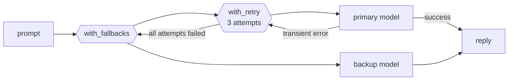

Every component you have used in this module (retrievers, prompts, chat models, output parsers, whole chains) is a **Runnable**. [LCEL](/learn/langchain-for-rag/lcel) showed how Runnables are joined. This lesson is about what each one, and therefore every composition of them, can *do*: the methods for running it one input at a time, in batches, as a stream or asynchronously; the configuration object that carries tags, metadata, callbacks and concurrency limits through a whole run; the wrappers that add retries, fallbacks and runtime configuration; and the event stream that shows you each step as it happens. These are the operational tools that turn a working prototype into a service you can run, observe and keep up.

## Learning objectives

- List the core Runnable methods (`invoke`, `batch`, `stream` and their async forms, plus `astream_events`) and choose the right one for a web request, an evaluation run and a streaming interface.
- Pass a `RunnableConfig` with `tags`, `metadata`, `run_name` and `max_concurrency`, and explain how it propagates to every step.
- Make a chain resilient with `with_retry` and `with_fallbacks`, and calculate the worst-case added latency and the residual failure probability.
- Change a component's parameters at run time with `configurable_fields`, without rebuilding the chain.
- Explain which default implementations a Runnable inherits, and why that matters for performance.

## Prerequisites

- [LCEL](/learn/langchain-for-rag/lcel): composing Runnables with `|`, dictionaries and `.assign`.
- [Async programming](/learn/python-for-rag-engineering/async-programming): coroutines, `await` and event loops.
- [Exception handling](/learn/python-for-rag-engineering/exception-handling): exception types and when to retry.

## Why this matters

A RAG chain that answers one question correctly on a laptop is a long way from a service. In production the same chain must:

- serve many users at once inside an asynchronous web server, without blocking the event loop;
- stream the answer so that users see text within a second instead of waiting for the whole reply;
- run hundreds of evaluation questions overnight without overwhelming the model provider's rate limit;
- survive the model provider timing out or returning a rate-limit error;
- record, for every request, which documents were retrieved and what the model was sent, tagged with the user and the release.

You could build each of these by hand around each component. The Runnable interface gives them to every component and every composition uniformly. A retriever, a prompt and a twelve-step chain all have the same `batch` method, accept the same configuration and emit the same events. Learn the interface once and every component, including the [custom retrievers](/learn/langchain-for-rag/custom-retrievers) you write next, gets these capabilities.

The cost of not knowing the interface is subtle. Code calls `invoke` in a loop instead of `batch` and takes ten times longer than necessary. A synchronous `invoke` inside an async endpoint blocks every other request. A retry wraps the whole chain instead of the model, so a transient model error repeats retrieval as well. A missing `max_concurrency` floods a rate-limited endpoint. Each is a one-line fix once you know the interface exists.

## The intuition

Think of the standard electrical socket in Meridian's office. A kettle, a laptop charger and a power strip with six things plugged into it all present the same plug, so all of them can be switched on the same way, metered by the same meter, and protected by the same circuit breaker. The power strip is itself just another plug.

A Runnable is that plug. `invoke` is switching it on. `batch` is switching on many at once, with a limit on how many draw current together (`max_concurrency`). `stream` is a device that delivers its output as it goes rather than all at the end. The configuration object is the label you tie to the cable (who, why, which test) that travels with it into every socket on the strip. Retries and fallbacks are the breaker and the backup generator: wrappers that look exactly like a plug from outside.

## How it works

### The methods

| Method | Input | Returns | Use it for |
| --- | --- | --- | --- |
| `invoke(x, config)` | one input | one output | Scripts, synchronous services |
| `ainvoke(x, config)` | one input | awaitable output | Async web endpoints |
| `batch(xs, config, return_exceptions=...)` | list of inputs | list of outputs, same order | Evaluation runs, bulk work |
| `abatch(...)` | list | awaitable list | The same, inside async code |
| `batch_as_completed(xs, ...)` | list | iterator of `(index, output)` as each finishes | Progress bars, early results |
| `stream(x, config)` | one input | iterator of output chunks | Showing text as it is generated |
| `astream(x, config)` | one input | async iterator of chunks | Streaming from an async endpoint |
| `astream_events(x, config, version="v2")` | one input | async iterator of event dictionaries | Watching every step: retrieval results, model tokens, timings |

A Runnable only has to implement `invoke`. The base class supplies the rest with **default implementations**:

1. `batch` runs `invoke` for each input on a thread pool, bounded by `max_concurrency` if you set it.
2. `ainvoke` runs `invoke` in a thread executor so that it does not block the event loop.
3. `stream` calls `invoke` and yields the whole result as a single chunk.

Components override these when they can do better. Chat models implement real token streaming and real async network calls; embedding-backed vector stores implement async search. This is why the same `stream` call streams tokens through a model but returns a single chunk from a retriever, and why a custom component that only implements the synchronous method still works in async code, at the cost of a thread per call.

When Runnables are composed, the composition implements each method by calling the same method on its steps. `chain.abatch` calls `abatch` on the steps, `chain.stream` streams through every streaming-aware step, and so on. One method call on the chain selects the execution mode for every component in it.

### The configuration object

The second argument of every method is a `RunnableConfig`, a dictionary with these keys:

- `run_name`: the name shown in traces for this run.
- `tags`: a list of strings, inherited by every child run.
- `metadata`: a dictionary, inherited by every child run (for example user, tenant, release, experiment).
- `callbacks`: handlers that receive start, end and error events for every step; tracing tools such as LangSmith attach here.
- `max_concurrency`: the maximum number of parallel calls in `batch` and in parallel branches.
- `recursion_limit`: a guard for deeply nested or recursive Runnables.
- `configurable`: values for fields declared configurable (below).

You pass it per call (`chain.invoke(q, config={"tags": ["eval"]})`) or fix it on a Runnable with `chain.with_config(run_name="askmeridian_rag")`, which returns a new Runnable with that configuration merged into every call. **Propagation** is the point: tags and metadata set at the top reach the retriever, the prompt and the model, so a single filter in your tracing tool ("all runs tagged `eval`, release `2025.11`") finds every step of every request.

### Resilience: retries and fallbacks

**`with_retry(...)`** returns a wrapper that calls the Runnable again when it raises a matching exception. Its parameters are `stop_after_attempt` (total attempts, default 3), `retry_if_exception_type` (default: any `Exception`), `wait_exponential_jitter` (default `True`) and optional `exponential_jitter_params`. It is built on the `tenacity` library.

**`with_fallbacks([alt1, alt2], exceptions_to_handle=...)`** returns a wrapper that, if the Runnable raises, tries each alternative in order with the same input. A typical use is a second model from a different provider or region.

Two design rules follow from how they work:

1. **Wrap the narrowest thing that fails.** `model.with_retry()` inside the chain retries only the model call. `chain.with_retry()` re-runs retrieval and prompt formatting too, which wastes work and, for a streaming chain, can repeat tokens the user has already seen.
2. **Retry transient errors only.** Timeouts, connection resets and rate-limit errors may succeed on a second try. A bad request, an authentication failure or a context-length error will fail identically every time; retrying them only adds delay. Set `retry_if_exception_type` to the transient exception classes of the SDK you use.

Combine them as retries first, then fallback: `primary.with_retry(stop_after_attempt=3).with_fallbacks([backup])`. The primary gets three chances; only then is the backup called.



### Run-time configuration

Sometimes you want one chain object but different parameters per request: a larger `k` for a power-user mode, a different model for an A/B test. Two methods declare what may vary:

- `runnable.configurable_fields(field=ConfigurableField(id="..."))` exposes one of the Runnable's fields (for a vector store retriever, `search_kwargs`; for a chat model, its model name or token limit).
- `runnable.configurable_alternatives(ConfigurableField(id="..."), default_key="a", b=other_runnable)` lets a whole component be swapped for another by key.

A caller then selects values through `config={"configurable": {"id": value}}`. The chain is built once at start-up and stays immutable; each request's configuration only affects that request. This is safer than mutating a shared retriever's `search_kwargs`, which would leak one user's setting into other users' concurrent requests.

### Events: watching a run

`astream_events(input, config, version="v2")` runs the chain and yields a dictionary for every start, stream chunk and end of every step. Each event has an `event` type (`on_chain_start`, `on_retriever_end`, `on_chat_model_stream` and so on), the step's `name`, its `tags` and `metadata`, a `run_id`, and `data` (inputs, outputs or chunks). It is the most direct way to answer "what did the retriever return for this request?" in code, and to stream not just the final tokens but intermediate results, such as showing sources the moment retrieval finishes. Filter with `include_names`, `include_types` or `include_tags`, because a real chain emits many events. Persistent tracing belongs to a callback-based tool; [Tracing](/learn/rag-observability/tracing) covers it.

### Schemas

Every Runnable can describe its input and output: `get_input_jsonschema()` and `get_output_jsonschema()` return JSON Schema derived from the component (a prompt's schema lists its variables, for example). Tools that serve chains over HTTP or expose them to agents use these. They are also a quick check of what a chain expects.

## The mathematics

### Worst-case added latency from retries

**Intuition.** Each failed attempt is followed by a wait that doubles each time, plus a little randomness so that many clients do not retry in lockstep. The total wait grows quickly with the number of attempts, so the attempt limit is also a latency budget.

With `tenacity`'s default parameters as used by `with_retry` in the installed version (multiplier 1, base 2, jitter up to 1 second), the wait after failed attempt $n$ is

$$
w_n = 2^{\,n-1} + u_n, \qquad u_n \sim \text{Uniform}(0, 1)
$$

With $A$ attempts there are $A - 1$ waits, so the total waiting time is

$$
W = \sum_{n=1}^{A-1} \left(2^{\,n-1} + u_n\right), \qquad \mathbb{E}[W] = (2^{A-1} - 1) + \frac{A-1}{2}
$$

- $A$ is `stop_after_attempt`; $n$ counts failed attempts from 1.
- $u_n$ is the random jitter, averaging 0.5 seconds.
- The attempts themselves also take time: if each times out after $T$ seconds, add $A \cdot T$.

**By hand.** $A = 3$: waits of $1 + u_1$ and $2 + u_2$ seconds, so $W$ lies between 3 and 5 seconds, 4 on average. If each attempt times out after 10 seconds, a request that fails all three takes about $30 + 4 = 34$ seconds before the fallback even starts. That is why a short client timeout matters as much as the retry count.

### Residual failure probability

**Intuition.** If failures were independent, each extra attempt would multiply the chance of total failure by the per-call failure rate.

$$
P(\text{all } A \text{ attempts fail}) = p^{A}
$$

- $p$ is the probability that one call fails transiently.

**By hand.** With $p = 0.05$ and $A = 3$: $0.05^3 = 0.000125$, about one request in 8,000 reaches the fallback. The independence assumption is optimistic: provider outages make consecutive failures strongly correlated, so in practice the fallback is hit more often than this, which is exactly why a fallback to a different provider or region is worth having.

```python
A, p = 3, 0.05
expected_wait = (2 ** (A - 1) - 1) + (A - 1) / 2
min_wait, max_wait = 2 ** (A - 1) - 1, 2 ** (A - 1) - 1 + (A - 1)
print(f"wait: {min_wait}-{max_wait} s, expected {expected_wait} s")
print(f"P(all {A} attempts fail) = {p ** A:.6f}  (1 in {1 / p ** A:,.0f})")
```

```output
wait: 3-5 s, expected 4.0 s
P(all 3 attempts fail) = 0.000125  (1 in 8,000)
```

## In code

**The problem.** Take a small AskMeridian RAG chain and exercise the interface: retry a model that times out twice, fall back from a model that is down, batch three questions with bounded concurrency where one input is bad, change the retriever's `k` per call, watch the run's events with tags attached, and read the prompt's input schema. The models are stand-ins (a function that raises, and `FakeListChatModel`) so that failures happen on demand; the retriever is real.

```bash
pip install langchain-core langchain-community sentence-transformers
```

```python
import asyncio
from langchain_core.documents import Document
from langchain_core.vectorstores import InMemoryVectorStore
from langchain_core.prompts import ChatPromptTemplate
from langchain_core.output_parsers import StrOutputParser
from langchain_core.runnables import RunnableLambda, RunnablePassthrough, ConfigurableField
from langchain_core.language_models.fake_chat_models import FakeListChatModel
from langchain_community.embeddings import HuggingFaceEmbeddings

docs = [
    Document("Staff receive 25 days of annual leave per year.", metadata={"id": "leave"}),
    Document("Up to 5 unused leave days carry over and must be used by 31 March.", metadata={"id": "carry"}),
    Document("Employees may work remotely up to 3 days a week.", metadata={"id": "remote"}),
    Document("Passwords must be rotated every 90 days.", metadata={"id": "pwd"}),
]
emb = HuggingFaceEmbeddings(model_name="sentence-transformers/all-MiniLM-L6-v2",
                            encode_kwargs={"normalize_embeddings": True})
retriever = (InMemoryVectorStore.from_documents(docs, emb).as_retriever(search_kwargs={"k": 1})
             .configurable_fields(search_kwargs=ConfigurableField(id="search_kwargs")))

# A primary "model" that times out on its first two calls, and a backup.
calls = {"n": 0}
def flaky(prompt_value):
    calls["n"] += 1
    if calls["n"] <= 2:
        raise TimeoutError(f"primary timed out (call {calls['n']})")
    return "primary: 25 days [leave]"
primary = RunnableLambda(flaky, name="primary_model")
backup = FakeListChatModel(responses=["backup: 25 days [leave]"] * 10, name="backup_model")

# 1. Retry: transient errors are retried before anyone notices.
resilient = primary.with_retry(stop_after_attempt=3, wait_exponential_jitter=False,
                               retry_if_exception_type=(TimeoutError,))
print("retry    ->", resilient.invoke("q"), f"(after {calls['n']} calls)")

# 2. Fallback: when the primary keeps failing, switch to another runnable.
def always_fail(_): raise TimeoutError("primary down")
model = RunnableLambda(always_fail, name="primary_model").with_fallbacks([backup])
print("fallback ->", model.invoke("q").content)

prompt = ChatPromptTemplate.from_messages([
    ("system", "Answer only from the context.\n\nContext:\n{context}"),
    ("human", "{question}"),
])
format_docs = lambda ds: "\n".join(f"[{d.metadata['id']}] {d.page_content}" for d in ds)
rag = ({"context": retriever | format_docs, "question": RunnablePassthrough()}
       | prompt | model | StrOutputParser()).with_config(run_name="askmeridian_rag")

# 3. Batch with bounded concurrency; one bad input does not sink the rest.
results = rag.batch(["How much holiday?", None, "Remote work?"],
                    config={"max_concurrency": 2}, return_exceptions=True)
print("batch    ->", [r if isinstance(r, str) else type(r).__name__ for r in results])

# 4. Runtime configuration: change k for one call without rebuilding the chain.
k3 = retriever.with_config(configurable={"search_kwargs": {"k": 3}})
print("k default->", [d.metadata["id"] for d in retriever.invoke("leave")])
print("k=3      ->", [d.metadata["id"] for d in k3.invoke("leave")])

# 5. Events: watch every step of one run, with tags and metadata attached.
async def show_events():
    cfg = {"tags": ["eval"], "metadata": {"user": "u-1042"}}
    async for ev in rag.astream_events("How much holiday?", config=cfg, version="v2"):
        if ev["event"] in ("on_chain_start", "on_retriever_end", "on_chat_model_start", "on_chain_end") \
                and ev["name"] in ("askmeridian_rag", "VectorStoreRetriever", "backup_model"):
            extra = [d.metadata["id"] for d in ev["data"]["output"]] if ev["event"] == "on_retriever_end" else ""
            print(f"  {ev['event']:20s} {ev['name']:20s} tags={ev['tags']} {extra}")
asyncio.run(show_events())

# 6. Schemas: what does this chain accept?
print("input schema:", prompt.get_input_jsonschema()["required"])
```

```output
retry    -> primary: 25 days [leave] (after 3 calls)
fallback -> backup: 25 days [leave]
batch    -> ['backup: 25 days [leave]', 'AttributeError', 'backup: 25 days [leave]']
k default-> ['leave']
k=3      -> ['leave', 'carry', 'pwd']
  on_chain_start       askmeridian_rag      tags=['eval'] 
  on_retriever_end     VectorStoreRetriever tags=['seq:step:1', 'eval', 'InMemoryVectorStore', 'HuggingFaceEmbeddings'] ['leave']
  on_chat_model_start  backup_model         tags=['eval'] 
  on_chain_end         askmeridian_rag      tags=['eval'] 
input schema: ['context', 'question']
```

**The important lines.**

- `with_retry(stop_after_attempt=3, wait_exponential_jitter=False, retry_if_exception_type=(TimeoutError,))`: three attempts in total, no waiting (so the demo is instant; keep the backoff on in production), and only `TimeoutError` is retried.
- `with_fallbacks([backup])` wraps a Runnable that always fails; the wrapper's output comes from the backup. From outside, `model` is just a Runnable that returns a message.
- `config={"max_concurrency": 2}` caps parallelism in `batch`; `return_exceptions=True` puts the exception object in the result list instead of raising.
- `configurable_fields(search_kwargs=ConfigurableField(id="search_kwargs"))` declares that `search_kwargs` may vary; `with_config(configurable={...})` selects a value for calls through `k3` only. The original `retriever` still returns one document.
- `astream_events(..., version="v2")` yields every event of the run. The filter keeps four, to show the shape.

**What the output means.**

- The retry line shows three calls: two timeouts were absorbed and the third succeeded. The caller saw only the answer.
- The batch result keeps input order. The `None` input failed inside the embedding step with an `AttributeError`, and the other two questions were still answered, by the backup model, because the chain's model is the fallback wrapper.
- The two retriever lines come from the same underlying object with different run-time configuration: no rebuilding, no shared state changed.
- In the events, the `eval` tag set once at the top appears on the retriever and the model. The retriever's end event carries its output, so the retrieved ids are visible without changing the chain. LangChain also added its own tags (`seq:step:1`, the store and embedding class names).
- The prompt's schema says the chain's prompt requires `context` and `question`.

**Common errors.**

- `RuntimeError: asyncio.run() cannot be called from a running event loop`: you called `asyncio.run` inside an environment that already runs a loop (a notebook, an async web handler). Use `await chain.ainvoke(...)` there instead.
- Retries that never stop failing: the exception is not transient (an invalid request or an authentication error). Narrow `retry_if_exception_type`.
- `KeyError` or no effect from `configurable`: the `id` in `config["configurable"]` does not match the `ConfigurableField(id=...)` you declared, or the field was not declared on the component.
- Events missing from `astream_events`: a component that does not propagate the callbacks it is given (common in hand-written functions that call other Runnables without passing `config`) breaks the event tree below it.

**Extending it.** Replace the stand-ins with a real model wrapped as `ChatAnthropic(...).with_retry(...)` and a second provider as the fallback; then attach a callback handler that logs each step's latency, the start of the work [RAG observability](/learn/rag-observability) builds on.

## A real-world example

AskMeridian's nightly evaluation job sends 600 test questions through the production chain and scores the answers. The first version looped over `chain.invoke` and took the better part of an hour. An engineer switched it to `chain.batch(questions)`. The job finished in minutes on the first night, and on the second night failed halfway with a wall of rate-limit errors: `batch` without a limit had sent requests as fast as the thread pool allowed, and the shared model account's rate limit was also serving the live assistant, whose users saw errors for several minutes.

The Platform team made three changes. The evaluation job now passes `config={"max_concurrency": 8, "tags": ["nightly-eval"], "metadata": {"release": release_id}}`, chosen so that the job stays well inside the account's documented limit. The model inside the chain is wrapped as `model.with_retry(retry_if_exception_type=<the SDK's rate-limit and timeout errors>, stop_after_attempt=4)`, and `return_exceptions=True` ensures one bad question no longer aborts the run. Finally, the live assistant's chain gained `with_fallbacks` to a second model deployment, and the nightly job was moved to its own API key, so evaluation load can never again exhaust the live service's quota. Because of the tags, the team can now filter traces to exactly one night's evaluation run.

## Common mistakes

- **Calling `invoke` in a loop for bulk work.** It runs sequentially; `batch` runs concurrently with one line.
- **Using `batch` without `max_concurrency` against a rate-limited API.** Unbounded parallelism exhausts the quota for everyone sharing it.
- **Calling `invoke` inside an async web handler.** It blocks the event loop and every other request on that worker; use `ainvoke`.
- **Retrying the whole chain.** Retrieval and formatting are repeated, and streamed output may be duplicated. Retry the failing component.
- **Retrying permanent errors.** Invalid requests fail every time; retries only add latency.
- **Mutating a shared component per request.** Changing `retriever.search_kwargs` on a shared object leaks one request's setting into others; use `configurable_fields`.
- **Dropping `config` in hand-written functions that call Runnables.** Tags, callbacks and events stop at that function.

## Best practices

- Pick the method by context: `ainvoke`/`astream` in async servers, `batch` with `max_concurrency` for bulk jobs, `astream_events` when the client needs intermediate results.
- Set `run_name`, `tags` and `metadata` (user, tenant, release) at the top of every request so that every step's trace can be filtered.
- Wrap only the model (or other networked component) with `with_retry`, restricted to transient exception types, and set a client timeout.
- Add `with_fallbacks` to a different deployment, region or provider for user-facing chains.
- Use `configurable_fields` or `configurable_alternatives` for per-request variation and A/B tests; keep built chains immutable.
- When a function inside a chain calls another Runnable, accept and pass on `config` so the event tree stays intact.

## Performance considerations

- **Batch versus loop.** With 600 questions at about 3 seconds each, a sequential loop takes about 1,800 seconds (30 minutes). With `max_concurrency=8` and no rate limiting, roughly 600 / 8 × 3 ≈ 225 seconds. Beyond the provider's limit, more concurrency only produces errors and retries.
- **Default async is a thread.** A component that implements only `invoke` gets `ainvoke` by running in an executor thread. Fine for a few concurrent calls; for hundreds, components with native async (most model clients, many vector store clients) scale better.
- **Retry budget.** As computed above, three attempts with default backoff add 3 to 5 seconds of waiting, plus each attempt's own timeout. Set both with your latency target in mind.
- **Events have a cost.** `astream_events` builds an event for every step and chunk. For high-volume production traffic, a callback-based tracer that samples is cheaper than processing every event in the request path.

## Summary

- Every component and composition is a Runnable with `invoke`, `batch`, `stream`, their async forms and `astream_events`; only `invoke` must be implemented, the rest have defaults.
- `RunnableConfig` carries `run_name`, `tags`, `metadata`, `callbacks`, `max_concurrency` and `configurable`, and propagates to every step.
- `with_retry` absorbs transient failures of the component it wraps; `with_fallbacks` switches to an alternative; retry the narrowest component and only transient errors.
- `configurable_fields` and `configurable_alternatives` vary parameters per request without mutating shared objects.
- Concurrency, retries and backoff can be reasoned about with simple arithmetic; do it before a job meets a rate limit.

## Exercises

**1.** Which method would you call in each case: (a) a FastAPI `async def` endpoint that returns a complete answer; (b) a script that answers 200 questions for an evaluation; (c) a chat interface that must show sources as soon as retrieval finishes and then stream tokens?

<details><summary>Show solution</summary>

(a) `await chain.ainvoke(q)`. (b) `chain.batch(questions, config={"max_concurrency": N}, return_exceptions=True)`, with N chosen against the rate limit. (c) `chain.astream_events(q, version="v2")`, sending the retriever's `on_retriever_end` output as the sources and each `on_chat_model_stream` chunk as text; or `astream` on a chain that returns a dictionary with `context` and `answer`, as in [LCEL](/learn/langchain-for-rag/lcel).

</details>

**2.** A model call fails transiently 10% of the time and times out after 8 seconds. With `stop_after_attempt=4` and default backoff, what is the probability that all attempts fail (assuming independence), and roughly how long does such a request take before the fallback is tried?

<details><summary>Show solution</summary>

$0.1^4 = 0.0001$, one in 10,000. Time: four timeouts of 8 s = 32 s, plus three waits of $1+u$, $2+u$, $4+u$ seconds, 7 to 10 s (8.5 on average). Total about 40 seconds, which is far too long for an interactive request; lower the timeout or the attempt count for user-facing calls.

</details>

**3.** Extend the lesson's code so that the model can be switched per request between `"primary"` and `"backup"` using `configurable_alternatives`, and show both settings in one script.

<details><summary>Show solution</summary>

```python
from langchain_core.runnables import ConfigurableField

fast = FakeListChatModel(responses=["fast model answer"] * 5)
switchable = backup.configurable_alternatives(
    ConfigurableField(id="model"), default_key="backup", fast=fast)
chain = prompt | switchable | StrOutputParser()
inp = {"context": "[leave] 25 days", "question": "Holiday?"}
print(chain.invoke(inp))                                              # backup
print(chain.invoke(inp, config={"configurable": {"model": "fast"}}))  # fast
```

The chain is built once; the `configurable` key picks the component per call.

</details>

**4.** Design decision: AskMeridian's live chain uses a model at one provider. Propose a resilience configuration (what to wrap, which errors, attempts, timeouts, fallback) that keeps the answer within a 15-second worst case, and justify it with arithmetic.

<details><summary>Show solution</summary>

Wrap only the model: `primary.with_retry(retry_if_exception_type=<timeout and rate-limit errors>, stop_after_attempt=2).with_fallbacks([secondary])`, with a client timeout of 5 s on the primary and the secondary. Worst case: primary 5 s, wait about 1 to 2 s, primary 5 s, then secondary up to 5 s, about 16 to 17 s, slightly over budget; so either lower the timeouts to 4 s (about 13 to 14 s worst case) or remove the retry wait for user-facing calls. Choose the secondary at a different provider or region, because correlated outages make same-provider fallbacks fail together. Permanent errors (invalid requests) are not retried and surface immediately.

</details>

## Check your understanding

```quiz
[
  {"q": "A Runnable implements only `invoke`. What does its `stream` method do?", "options": ["Raises NotImplementedError", "Yields the complete result of `invoke` as a single chunk", "Yields one character at a time", "Calls `batch` with one input"], "answer": 1, "why": "The default `stream` calls `invoke` and yields its result once. Only components that override it, such as chat models, stream incrementally."},
  {"q": "You set `config={\"tags\": [\"eval\"]}` when invoking a three-step chain. Which runs carry the tag?", "options": ["Only the outer chain run", "Only the last step", "The chain and every child step", "None; tags must be set on each component"], "answer": 2, "why": "Tags and metadata in RunnableConfig propagate to every child run, which is what makes trace filtering work."},
  {"q": "Why is `rag_chain.with_retry()` usually worse than putting `model.with_retry()` inside the chain?", "options": ["Chains cannot be retried", "It repeats retrieval and formatting on every model failure, and can duplicate streamed output", "It disables fallbacks", "It retries only once"], "answer": 1, "why": "Retrying the whole chain repeats every step. Wrap the component that fails transiently."},
  {"q": "With `stop_after_attempt=3` and a per-call transient failure rate of 0.02, assuming independence, how often does a request exhaust its retries?", "options": ["2 in 100", "6 in 100", "8 in 1,000,000", "4 in 10,000"], "answer": 2, "why": "0.02 cubed is 0.000008, which is 8 in a million. Real outages are correlated, so the true rate is higher."},
  {"q": "Two users call the same retriever concurrently; one wants k = 10. What is the safe way to do it?", "options": ["Set `retriever.search_kwargs[\"k\"] = 10` before the call", "Declare `search_kwargs` configurable and pass `config={\"configurable\": {...}}` on that call", "Create a global variable for k", "Use `batch` with both inputs"], "answer": 1, "why": "Configurable fields change parameters for one call only. Mutating the shared retriever would leak the setting into the other user's request."}
]
```

## Further reading

- LangChain documentation, Runnable interface, streaming and `astream_events`, and the how-to guides on retries, fallbacks and configurable fields: [docs.langchain.com](https://docs.langchain.com/)
- LangChain API reference for `langchain_core.runnables` (`Runnable`, `RunnableConfig`, `RunnableWithFallbacks`, `RunnableRetry`): [python.langchain.com](https://python.langchain.com/)
- Tenacity documentation, retrying and exponential backoff with jitter: [tenacity.readthedocs.io](https://tenacity.readthedocs.io/)
- Brooker, M. (2015). "Exponential Backoff And Jitter". AWS Architecture Blog.
