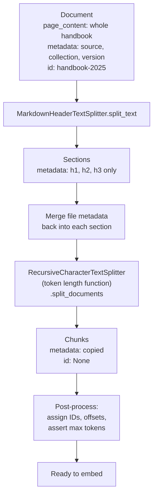

You have studied chunking algorithms in depth already: [recursive character splitting](/learn/advanced-chunking-strategies/recursive-character-splitting) taken apart line by line, [token-based chunking](/learn/chunking-fundamentals/token-based-chunking) and its tokeniser pitfalls, [Markdown chunking](/learn/advanced-chunking-strategies/markdown-chunking) with heading breadcrumbs. This lesson does not repeat them. It is about the **`langchain-text-splitters` package as a piece of engineering you build on**: the shared `TextSplitter` interface, what happens to a document's metadata and identity when it is split, how to make `chunk_size` mean tokens of your embedding model, how to chain a structural splitter with a size-limiting one, and which of the package's behaviours you must check rather than assume.

The theme is that a splitter does more than cut strings. It decides which metadata each chunk inherits, whether chunks can be traced back to their position in the source, and whether a chunk can exceed the size you asked for. LangChain makes specific choices on each of these, and some of them are surprising.

## Learning objectives

- Use the `TextSplitter` interface (`split_text`, `create_documents`, `split_documents`, `transform_documents`) and explain how metadata is copied to each chunk.
- Configure a splitter whose `chunk_size` is measured in the embedding model's own tokens, using `from_huggingface_tokenizer` or `from_tiktoken_encoder`.
- Compose `MarkdownHeaderTextSplitter` with `RecursiveCharacterTextSplitter` into a two-stage pipeline that carries heading paths into chunk metadata.
- Identify and work around three package behaviours: dropped document IDs, unreliable `start_index` with non-character length functions, and chunks larger than `chunk_size`.
- Choose a splitter class from the package for a given document type.

## Prerequisites

- [Document loaders](/learn/langchain-for-rag/document-loaders): the normalised `Document` objects that go into a splitter.
- [Recursive character splitting](/learn/advanced-chunking-strategies/recursive-character-splitting): the algorithm behind LangChain's main splitter.
- [Token-based chunking](/learn/chunking-fundamentals/token-based-chunking): why the counting tokeniser matters.
- [Chunk overlap](/learn/chunking-fundamentals/chunk-overlap): what overlap buys and costs.

## Why this matters

Chunking is the step where a corpus of documents becomes a corpus of retrieval units, and almost every property of a chunk that matters later is decided here. Its size decides whether the embedding model sees all of it or silently truncates the end. Its metadata decides whether a filter or a citation can find its way back to the source. Its identity decides whether re-indexing an edited document replaces the old chunks or leaves them behind as stale duplicates.

A library splitter makes these decisions for you unless you take them back. The defaults are reasonable for a demo: `chunk_size=4000` characters, `chunk_overlap=200`, length measured with Python's `len`. For a production pipeline in front of an embedding model with a 256-token input limit (the limit `all-MiniLM-L6-v2` is configured with in sentence-transformers), 4,000 characters is roughly 800 to 1,000 tokens of English, so most of every chunk would be truncated away at embedding time. Nothing warns you: the embedding comes back, the vector is stored, and retrieval quietly ignores three-quarters of the text.

The other decisions fail just as quietly. Chunks come out of `split_documents` without the IDs their parent documents had. The `start_index` metadata that is supposed to locate a chunk in its source is sometimes wrong. A chunk can be larger than `chunk_size` when a piece of text cannot be cut at any allowed separator. You find out about each of these in production unless you check for them, which is what this lesson teaches you to do.

## The intuition

Imagine cutting a long printed report into index cards for a card catalogue. The cutting itself is the easy part. What makes the catalogue usable is what you write on each card besides the excerpt: which report it came from, which chapter and section, where on the page it started, and a card number so that if the report is reprinted you can find and replace its old cards.

LangChain's splitters are good scissors. They cut at sensible places and they copy the report's label onto every card. But they do not number the cards, they sometimes write the wrong position, and they will hand you an oversized card if a paragraph has no place to cut. A careful librarian checks every card before filing it. In code, that check is a few lines after the splitter, and it is the subject of this lesson.

## How it works

### The interface

Every size-limited splitter in the package subclasses `TextSplitter`, whose constructor takes the parameters you met in the chunking lessons:

| Parameter | Default | Meaning |
| --- | --- | --- |
| `chunk_size` | 4000 | Maximum chunk length, in the units of `length_function`. |
| `chunk_overlap` | 200 | Target overlap between consecutive chunks, same units. Must not exceed `chunk_size`, or the constructor raises `ValueError`. |
| `length_function` | `len` | How a piece of text is measured: characters by default. |
| `keep_separator` | `False` on the base class (`True` on the recursive splitter) | Whether a separator stays attached to a chunk, and at its `"start"` or `"end"`. |
| `add_start_index` | `False` | Whether to record each chunk's character offset in `metadata["start_index"]`. |
| `strip_whitespace` | `True` | Whether leading and trailing whitespace is removed from each chunk. |

It then offers four methods, layered on one another:

1. `split_text(text) -> list[str]` is the algorithm. Each subclass implements it.
2. `create_documents(texts, metadatas=None) -> list[Document]` calls `split_text` on each text and wraps every chunk in a new `Document`, giving it a **deep copy** of that text's metadata dictionary. If `add_start_index` is on, it also computes `start_index` (see below).
3. `split_documents(documents)` takes the `page_content` and `metadata` of each document and calls `create_documents`. Nothing else from the input document is used.
4. `transform_documents(documents)` is the same as `split_documents`, under the name required by `BaseDocumentTransformer`, an interface shared with other document-to-document steps such as HTML-to-text converters.

Two consequences follow from step 3, and both matter.

**Metadata is inherited, by copy.** Every chunk gets its parent's metadata, so the `source`, `collection` and permission fields your [loader normalisation](/learn/langchain-for-rag/document-loaders) set travel with each chunk. Because it is a deep copy, changing one chunk's metadata does not change its siblings'.

**Identity is not inherited.** `split_documents` reads only `page_content` and `metadata`, so the parent document's `id` is lost and every chunk has `id=None`. If you hand these chunks to a vector store, most stores generate random IDs, and running the job again adds a second copy of every chunk. Chunk IDs are your job: derive them from the parent's identity plus something stable about the chunk's position. (If every write goes through LangChain's indexing API, it substitutes content-hash IDs of its own, as the [Vector stores](/learn/langchain-for-rag/vector-stores) lesson shows; deterministic IDs still matter for direct writes, and for tracing a chunk back to where it came from.)

### Measuring in the right units

`length_function` decides what `chunk_size` means. Two class methods on `TextSplitter` set it up for tokens:

- `from_tiktoken_encoder(encoding_name="cl100k_base", ...)` counts with a tiktoken encoding, matching OpenAI-family models.
- `from_huggingface_tokenizer(tokenizer, ...)` counts with any Hugging Face tokeniser, including the one inside your sentence-transformers embedding model.

Both return an instance of whichever class you call them on, so `RecursiveCharacterTextSplitter.from_huggingface_tokenizer(tok, chunk_size=200, chunk_overlap=30)` is a recursive splitter that still cuts at paragraph, line and word boundaries but measures every piece in the model's tokens. That is usually what you want: boundaries chosen for meaning, size measured as the model will see it. The [token-based chunking](/learn/chunking-fundamentals/token-based-chunking) lesson explains why the counting tokeniser must be the embedding model's, not the generator's.

`TokenTextSplitter` and `SentenceTransformersTokenTextSplitter` are different: they cut at token boundaries directly, decoding token windows back into text, with the corruption risks that lesson describes. Prefer the boundary-aware splitter with a token length function unless you specifically need exact token windows.

### `start_index`: useful, but check it

With `add_start_index=True`, `create_documents` records where each chunk begins in its parent text. It does not get this from the splitting algorithm; it searches for the chunk text with `text.find(chunk, offset)`, where `offset` is an estimate built from the previous chunk's start, the previous chunk's length in characters and `chunk_overlap`.

That estimate assumes `chunk_overlap` is in characters. If your `length_function` counts tokens, `chunk_overlap=8` means about 8 tokens, perhaps 30 to 40 characters, but the estimate subtracts only 8 characters. The search then starts past the chunk's real beginning, does not find it, and `find` returns **-1**. You will see this happen in the code below. The safe options are to use `start_index` only with a character length function, or to compute offsets yourself by searching forward from the previous chunk's start.

There is a second caveat even when the number is right: it is an offset into the text that was passed to the splitter. If an earlier stage changed that text (the Markdown header splitter removes heading lines, for instance), the offset does not point into the original file.

### Oversized chunks

The recursive splitter keeps descending through its separator list until pieces fit, and its last separator is the empty string, so it can always cut. Other splitters cannot. `CharacterTextSplitter(separator="\n\n", chunk_size=20)` given a 50-character paragraph returns a 50-character chunk and logs a warning: `Created a chunk of size 50, which is longer than the specified 20`. The warning goes to Python's `logging` system, which many applications never configure, so it is easy to miss. Any splitter whose separators can run out can produce an oversized chunk; assert the maximum after splitting.

### Structural splitters

The package also contains splitters that cut on a document's structure rather than on size. The important ones for RAG:

- **`MarkdownHeaderTextSplitter(headers_to_split_on=[("#", "h1"), ("##", "h2")], strip_headers=True)`** splits at heading lines, knows when it is inside a code fence, and puts the heading text of every enclosing level into metadata under the names you choose. It is **not** a `TextSplitter` subclass: its `split_text` returns `Document` objects, it has no `chunk_size` and no `split_documents`, and its output documents carry only the heading metadata, not the metadata of the document you took the text from.
- **`HTMLHeaderTextSplitter`** and **`HTMLSectionSplitter`** do the same for HTML headings.
- **`RecursiveJsonSplitter`** splits JSON objects into smaller valid JSON objects.
- **`RecursiveCharacterTextSplitter.from_language(Language.PYTHON)`** (and other languages) is the recursive splitter with separators for that language's syntax; the [Code chunking](/learn/advanced-chunking-strategies/code-chunking) lesson discusses its limits.

Structural splitters produce sections of unbounded size, so they are followed by a size-limiting splitter. That two-stage pattern is the most common LangChain chunking pipeline for structured documents:



The step-by-step:

1. Run the structural splitter on the document's text.
2. Merge the original document's metadata into each section's metadata, because the structural splitter dropped it.
3. Run a size-limited splitter, measured in the embedding model's tokens, over the sections with `split_documents`, so each chunk inherits the merged metadata.
4. Post-process: give each chunk a deterministic ID derived from the parent document's ID, its section path and its ordinal; compute reliable offsets if you need them; check that no chunk exceeds the token limit.

## In code

**The problem.** Split a section of Meridian's employee handbook, written in Markdown, into chunks that fit the token budget of `all-MiniLM-L6-v2`, carry both the file's metadata and their heading path, and have stable IDs. Then check every assumption: the IDs, the offsets and the sizes.

**Dependencies.** `langchain-text-splitters` and `langchain-core`, and `transformers` for the tokeniser (it comes with `sentence-transformers`). The tokeniser files for MiniLM are downloaded on first use; no API key.

```bash
pip install langchain-text-splitters langchain-core transformers
```

The chunk size here is a deliberately small 40 tokens so that a short example produces several chunks. A real pipeline for this model would use something like 200 to 250 tokens, below its 256-token input limit.

```python
import hashlib
from transformers import AutoTokenizer
from langchain_core.documents import Document
from langchain_text_splitters import MarkdownHeaderTextSplitter, RecursiveCharacterTextSplitter

HANDBOOK = """# Meridian Employee Handbook

## Leave

### Annual leave
Staff receive 25 days of annual leave per year. Up to 5 unused days carry over into the next year and must be used by 31 March. Leave requests go through the HR portal and need manager approval at least two weeks ahead for periods longer than five days.

### Sick leave
Report sickness to your manager before 10:00 on the first day. From the eighth calendar day of absence a fit note is required.

## Working arrangements

### Remote work
Staff may work remotely up to 3 days a week. Agree your remote days with your manager. The home-office equipment budget is £400 for employees; contractors are not eligible. VPN is required on public Wi-Fi.

## Money

### Expenses
Expenses must be submitted within 30 days. Anything over £75 needs a receipt. Expenses belong to the finance department, which reimburses approved claims in the next monthly payroll run.
"""
source = Document(page_content=HANDBOOK, id="handbook-2025",
                  metadata={"source": "handbook/handbook.md", "collection": "handbook", "version": "2025-01-01"})

# Stage 1: split on headings; heading text becomes metadata.
md_splitter = MarkdownHeaderTextSplitter(
    headers_to_split_on=[("#", "h1"), ("##", "h2"), ("###", "h3")], strip_headers=True)
sections = []
for sec in md_splitter.split_text(source.page_content):
    sec.metadata = {**source.metadata, **sec.metadata}   # keep the file-level metadata
    sections.append(sec)

# Stage 2: cap each section at the embedding model's token budget.
tok = AutoTokenizer.from_pretrained("sentence-transformers/all-MiniLM-L6-v2")
splitter = RecursiveCharacterTextSplitter.from_huggingface_tokenizer(
    tok, chunk_size=40, chunk_overlap=8, add_start_index=True)


def n_tokens(text: str) -> int:
    return len(tok.encode(text, add_special_tokens=False))

chunks = []
for sec in sections:
    path = " > ".join(sec.metadata[h] for h in ("h2", "h3") if h in sec.metadata)
    search_from = 0
    for ordinal, c in enumerate(splitter.split_documents([sec])):
        real_start = sec.page_content.find(c.page_content, search_from)   # our own offset
        search_from = real_start + 1
        c.metadata.update(section_path=path, chunk_ordinal=ordinal, char_start=real_start)
        assert c.id is None                                                # splitters drop ids
        c.id = hashlib.sha256(f"{source.id}|{path}|{ordinal}".encode()).hexdigest()[:10]
        chunks.append(c)

print(f"{len(sections)} sections -> {len(chunks)} chunks (max {max(n_tokens(c.page_content) for c in chunks)} tokens)\n")
for c in chunks:
    m = c.metadata
    print(f"{c.id}  {m['section_path']:35} lc_start={m['start_index']:<3} "
          f"char_start={m['char_start']:<4} tokens={n_tokens(c.page_content)}")

print("\nchunk 2:", repr(chunks[1].page_content))
print("metadata:", chunks[1].metadata)
```

```output
4 sections -> 6 chunks (max 40 tokens)

394fcbb0b7  Leave > Annual leave                lc_start=0   char_start=0    tokens=40
d01b4799cb  Leave > Annual leave                lc_start=-1  char_start=146  tokens=20
f8120ff953  Leave > Sick leave                  lc_start=0   char_start=0    tokens=27
cab92eb9e0  Working arrangements > Remote work  lc_start=0   char_start=0    tokens=40
9922f46b45  Working arrangements > Remote work  lc_start=-1  char_start=155  tokens=14
86c9ddc99d  Money > Expenses                    lc_start=0   char_start=0    tokens=37

chunk 2: 'through the HR portal and need manager approval at least two weeks ahead for periods longer than five days.'
metadata: {'source': 'handbook/handbook.md', 'collection': 'handbook', 'version': '2025-01-01', 'h1': 'Meridian Employee Handbook', 'h2': 'Leave', 'h3': 'Annual leave', 'start_index': -1, 'section_path': 'Leave > Annual leave', 'chunk_ordinal': 1, 'char_start': 146}
```

**The important lines.**

- `headers_to_split_on=[("#", "h1"), ...]` maps each heading level to a metadata key. The H1 line has no body text of its own, so it produces no section, but its text still appears as `h1` in every section beneath it: 4 sections from 4 H3 headings.
- `sec.metadata = {**source.metadata, **sec.metadata}` restores the file-level fields that `MarkdownHeaderTextSplitter` does not carry. Without it, the chunks would have no `source`, `collection` or `version`, and filters on them would match nothing.
- `from_huggingface_tokenizer(tok, chunk_size=40, chunk_overlap=8, ...)` makes both numbers mean MiniLM word-piece tokens. The largest chunk is exactly 40, so the budget holds.
- `splitter.split_documents([sec])` is called one section at a time, so that the ordinal and the offset search restart for each section.
- `sec.page_content.find(c.page_content, search_from)` computes a reliable offset by searching forward from just after the previous chunk's start, which always works because chunks appear in order.
- `assert c.id is None` documents the behaviour rather than assuming it; if a future release starts propagating IDs, the assertion tells you.
- The chunk ID hashes the parent document ID, the section path and the ordinal. Re-running the job on an unchanged handbook produces the same IDs, so a store that upserts by ID overwrites rather than duplicates. (Not every store upserts; the FAISS wrapper rejects an existing ID, as the [Vector stores](/learn/langchain-for-rag/vector-stores) lesson shows.)

**What the output means.** Three things the splitter did not tell you are visible.

First, `lc_start=-1` on the two second-chunks: LangChain's own `start_index` failed, for the reason explained above (an 8-token overlap treated as 8 characters). The `char_start` values computed here are correct.

Second, every chunk has metadata from both stages: the file's `source`, `collection` and `version`, and the heading path. That is what lets AskMeridian cite "Employee handbook, Leave > Annual leave" and filter by collection.

Third, the content of chunk 2. It begins `through the HR portal`, mid-sentence: the subject "Leave requests go" is in the overlap at the end of chunk 1, and the 8-token overlap carried only the tail of it. The default separator list (paragraph, line, space, character) has no sentence boundary, so once a paragraph is too large, the splitter falls back to cutting between words. A chunk that starts with "through the HR portal" embeds poorly and reads poorly in a citation. Exercise 2 fixes it.

**Common errors.**

- `ValueError: Got a larger chunk overlap (...) than chunk size (...)`: the constructor checks this.
- `ImportError` when calling `from_huggingface_tokenizer` without `transformers`, or `from_tiktoken_encoder` without `tiktoken`.
- `AttributeError: 'MarkdownHeaderTextSplitter' object has no attribute 'split_documents'`: it is not a `TextSplitter`. Loop over documents and call `split_text` on each.
- Token-length warnings from the tokeniser (`Token indices sequence length is longer than the specified maximum sequence length`) when measuring a long text: harmless here, because you are only counting, but a sign that the text would be truncated if embedded whole.

**Extending it.** Prepend the section path to each chunk's text before embedding (for example `"Leave > Annual leave: Staff receive..."`), keeping the original text for display. It gives the embedding the context the heading provided; the [Contextual retrieval](/learn/advanced-retrieval/contextual-retrieval) lesson develops the idea. Remember to count the prefix in the token budget.

## A real-world example

The HR team at Meridian maintains the handbook as Markdown in a repository, and AskMeridian re-indexes it nightly. The Platform team's first pipeline used `RecursiveCharacterTextSplitter(chunk_size=1000, chunk_overlap=100)`, measured in characters, with `split_documents` straight into the vector store.

Two complaints arrived in the same month. HR noticed that after they reworded the remote-work section, AskMeridian sometimes quoted the old wording and sometimes the new. And the team's own evaluation set showed that questions about the end of long sections (the carry-over deadline, the receipt threshold) were retrieved less reliably than questions about their beginnings.

The first problem was identity. Chunks had no IDs, so the vector store generated random ones, and the nightly job added a fresh copy of every chunk. Nobody had noticed, because the duplicates of unchanged text were identical and retrieval happily returned them. When a section changed, both versions were in the index. The fix was to stop letting the store invent IDs. Deterministic chunk IDs from document ID, section path and ordinal make an upsert overwrite a changed chunk in stores that upsert by ID, though a section that shrinks still leaves its last chunks behind unless something deletes them. The team went one step further and routed every write through LangChain's indexing API, which assigns its own content-hash IDs and deletes chunks that no longer exist in a re-indexed source (covered in [Vector stores](/learn/langchain-for-rag/vector-stores)).

The second problem was units. A 1,000-character chunk of the handbook was typically 200 to 250 MiniLM tokens, close to the model's 256-token limit, and some chunks with long words, numbers or symbols exceeded it. The tail of those chunks was truncated at embedding time, so their final sentences were invisible to search. Switching to `from_huggingface_tokenizer` with a 200-token budget, and adding an assertion on the maximum, made the limit explicit. The team also added `". "` to the separators so that chunks stopped starting mid-sentence.

Neither failure produced an error. Both were found only because someone compared the index's contents with what they expected to be there.

## Common mistakes

- **Leaving `chunk_size` in characters in front of a token-limited embedding model.** Long chunks are truncated at embedding time without warning, and their endings become unsearchable.
- **Passing split chunks to a vector store without IDs.** Each run adds duplicates; edited text coexists with its old version.
- **Trusting `start_index` with a token length function.** It can be -1. Compute offsets yourself or use a character length function.
- **Calling `MarkdownHeaderTextSplitter` and forgetting the original metadata.** Its output has heading fields only; source, collection and permissions are lost.
- **Assuming `chunk_size` is a hard ceiling.** Splitters with a fixed separator emit oversized chunks with only a log warning.
- **Using the default separators for prose with long paragraphs.** With no sentence separator, cuts fall between words and chunks begin mid-sentence.
- **Choosing `chunk_overlap` without reading what overlap does at chunk starts.** A small overlap in tokens carries a sentence fragment, not a sentence.

## Best practices

- Measure chunk size with the embedding model's tokeniser and leave headroom below its input limit for any prefix you add.
- After splitting, assign deterministic chunk IDs from the parent document's ID plus a stable position (section path and ordinal).
- Assert the maximum token count of every chunk in the ingestion job; fail loudly rather than truncate silently.
- For structured documents, split on structure first (headings), then on size, and merge the file metadata back in between.
- Add sentence boundaries (`". "`, `"? "`, `"! "`) to the separator list for long-paragraph prose, with `keep_separator="end"` so the full stop stays with its sentence.
- Keep the splitter configuration (class, separators, sizes, tokeniser name) in version-controlled config, and record it in chunk metadata or the index manifest so you can tell which configuration built an index.

## Performance considerations

Splitting is cheap compared with embedding, but token-measured splitting is not free. The recursive algorithm calls `length_function` on many candidate pieces, and the merge step measures pieces repeatedly as it packs them. With `len`, each call is a few nanoseconds. With a Hugging Face tokeniser, each call runs the tokeniser over the piece: microseconds to tens of microseconds for short pieces with a fast (Rust-backed) tokeniser, more for long ones.

Reason about the total with arithmetic. Suppose (as an assumption) the splitter measures each token of text around five times on average as it tries separators and packs pieces, and the tokeniser processes on the order of a million tokens per second on one core. A 10-million-token corpus then needs around 50 million tokens of measuring, about 50 seconds: noticeable, not a bottleneck, and small next to embedding the same corpus. If profiling shows tokenisation dominating, measure in characters with a conservative ratio, and verify the maximum token count afterwards.

Overlap has a direct storage and embedding cost. With chunk size $s$ and overlap $o$, consecutive chunks advance by roughly $s - o$ tokens, so the number of chunks, and therefore embeddings, vectors stored and money spent on a hosted embedding API, scales by about $s / (s - o)$. For $s = 200$ and $o = 40$ that is $200 / 160 = 1.25$: 25% more chunks than with no overlap. The [Overlap optimisation](/learn/chunking-optimisation/overlap-optimisation) lesson covers when that is worth paying.

Memory: `split_documents` returns a list, so every chunk of the batch you pass in is held at once, each with its own deep-copied metadata. Pass documents through in batches (from a lazy loader) rather than splitting the whole corpus in one call.

## Security considerations

Splitting itself is not a security boundary, but it moves security-relevant data around.

- **Permission metadata must survive splitting.** If access-control fields are on the source document but lost in a structural split (as with `MarkdownHeaderTextSplitter`), the chunks become unfilterable and may be shown to anyone. Assert that every chunk carries the permission fields before indexing; see [Document-level permissions](/learn/access-control-and-privacy/document-level-permissions).
- **Untrusted Markdown and HTML control the structure.** A document author can add headings to steer how text is grouped, or put text into heading lines so that it ends up in every chunk's metadata. If metadata is shown to the model, it is part of the prompt and needs the same care as content.
- **Overlap duplicates sensitive text.** If a sentence containing personal data is redacted in one chunk but survives in the overlap of the next, it is still indexed. Redact before splitting, not after.

## Summary

- `TextSplitter` subclasses share `split_text`, `create_documents`, `split_documents` and `transform_documents`; each chunk receives a deep copy of its parent's metadata but not its `id`.
- `from_huggingface_tokenizer` and `from_tiktoken_encoder` make `chunk_size` and `chunk_overlap` mean tokens while keeping boundary-aware cutting.
- `start_index` is computed by text search with a character-based estimate and can be -1 with a token length function; compute offsets yourself when you need them.
- `MarkdownHeaderTextSplitter` is a separate kind of splitter: heading paths into metadata, no size limit, original metadata dropped. Follow it with a size-limited splitter and merge metadata back.
- After splitting: assign deterministic IDs, check the maximum token count, and check that required metadata is present.

## Exercises

1. **Units.** Without running code, estimate how many MiniLM tokens a 4,000-character chunk of English prose contains, and say what happens when it is embedded with `all-MiniLM-L6-v2` at its default settings.

<details><summary>Show solution</summary>

English prose averages roughly four to five characters per word-piece token for BERT-style tokenisers (the handbook text in this lesson measures 4.7; measure your own text), so about 800 to 1,000 tokens. The sentence-transformers model is configured with a 256-token maximum sequence length, so the encoder truncates the input and only roughly the first quarter to third of the chunk determines the vector. The remaining text is stored and shown to the model at generation time, but it cannot be found by search.

</details>

2. **Stop cutting mid-sentence.** Change the splitter in this lesson's code so that cuts prefer sentence boundaries, and show the annual-leave section's chunks.

<details><summary>Show solution</summary>

```python
splitter = RecursiveCharacterTextSplitter.from_huggingface_tokenizer(
    tok, chunk_size=40, chunk_overlap=8,
    separators=["\n\n", "\n", ". ", " ", ""], keep_separator="end")
for c in splitter.split_documents(sections[:1]):
    print(repr(c.page_content), n_tokens(c.page_content))
```

```output
'Staff receive 25 days of annual leave per year. Up to 5 unused days carry over into the next year and must be used by 31 March.' 29
'Leave requests go through the HR portal and need manager approval at least two weeks ahead for periods longer than five days.' 23
```

Both chunks are now whole sentences. `keep_separator="end"` keeps each full stop with the sentence it ends. The overlap disappeared because no whole sentence fits in 8 tokens; the splitter only overlaps whole pieces at the current separator level, which is what [Chunk overlap](/learn/chunking-fundamentals/chunk-overlap) describes.

</details>

3. **A chunking test.** Write a function `check_chunks(chunks, max_tokens, required_keys)` that raises with a clear message if any chunk is over budget, lacks a required metadata key, has no ID, or shares an ID with another chunk. Which of these would have caught each problem in the real-world example?

<details><summary>Show solution</summary>

```python
def check_chunks(chunks, max_tokens, required_keys):
    seen = set()
    for c in chunks:
        n = n_tokens(c.page_content)
        if n > max_tokens:
            raise ValueError(f"{c.id}: {n} tokens > {max_tokens}")
        missing = [k for k in required_keys if k not in c.metadata]
        if missing:
            raise ValueError(f"{c.id}: missing metadata {missing}")
        if c.id is None:
            raise ValueError(f"chunk without id: {c.page_content[:40]!r}")
        if c.id in seen:
            raise ValueError(f"duplicate id {c.id}")
        seen.add(c.id)
```

The missing-ID check would have caught the duplicates problem at the first run. The token check would have caught the truncation problem. The duplicate-ID check guards the ID scheme itself, for example two sections with the same heading path.

</details>

4. **Design decision.** Meridian's IT runbooks are Markdown files that mix prose, long shell code blocks and tables. Would you use the two-stage header-then-recursive pipeline from this lesson? What would you check, and when would you replace it?

<details><summary>Show solution</summary>

Header splitting is a good first stage: it gives sections and heading metadata, and it understands fences. The risk is the second stage: a recursive splitter applied to a section containing a long code block or table will cut through it, producing fragments of commands with no fence and table rows with no header. Check by printing every chunk that contains a backtick fence or a `|`-delimited row. If many are cut, replace the second stage with a block-aware chunker such as the one in [Markdown chunking](/learn/advanced-chunking-strategies/markdown-chunking), which treats code blocks and tables as units and splits them only along their own seams. LangChain's interface makes the swap easy: any function that returns `Document` objects with the same metadata fits the pipeline.

</details>

## Check your understanding

```quiz
[
  {"q": "A document with `id=\"doc-7\"` and `metadata={\"source\": \"a.md\"}` is passed to `RecursiveCharacterTextSplitter.split_documents`. What do the resulting chunks have?", "options": ["id \"doc-7\" and the same metadata object", "id None and a deep copy of the metadata", "ids \"doc-7-0\", \"doc-7-1\", ... and copied metadata", "id None and empty metadata"], "answer": 1, "why": "split_documents passes only page_content and metadata to create_documents, which deep-copies the metadata into new Documents with no id."},
  {"q": "Why can `start_index` be -1 for a splitter created with `from_huggingface_tokenizer(tok, chunk_size=40, chunk_overlap=8, add_start_index=True)`?", "options": ["Hugging Face tokenisers do not support offsets", "The search start is estimated by subtracting chunk_overlap (8, in tokens) as if it were characters, so the search can begin after the chunk's real start", "The chunk text was modified by the tokeniser", "start_index is always -1 for the second chunk"], "answer": 1, "why": "create_documents locates chunks with text.find from an estimated offset that assumes overlap is in characters; with token units the estimate overshoots."},
  {"q": "What does `MarkdownHeaderTextSplitter.split_text` return?", "options": ["A list of strings, each at most chunk_size characters", "A list of Documents, one per section, with heading text in metadata and no size limit", "A list of Documents with the original document's metadata", "A dictionary from heading to text"], "answer": 1, "why": "It is not a TextSplitter: it returns sections as Documents carrying only heading metadata, with no size control."},
  {"q": "`CharacterTextSplitter(separator=\"\\n\\n\", chunk_size=500)` meets a 900-character paragraph. What happens?", "options": ["It raises ValueError", "It cuts the paragraph at 500 characters", "It returns the paragraph as one 900-character chunk and logs a warning", "It drops the paragraph"], "answer": 2, "why": "With a single separator there is nowhere else to cut; the splitter emits an oversized chunk and logs 'Created a chunk of size 900, which is longer than the specified 500'."},
  {"q": "With chunk size 200 tokens and overlap 50, roughly how many chunks does a 10,000-token document produce?", "options": ["About 50", "About 67", "About 40", "About 200"], "answer": 1, "why": "Chunks advance by about 200 - 50 = 150 tokens, so about 10,000 / 150, which is roughly 67."}
]
```

## Further reading

- LangChain documentation, "Text splitters" (concepts and how-to guides for the recursive, token, Markdown and HTML splitters): [docs.langchain.com](https://docs.langchain.com/).
- `langchain-text-splitters` source, including `TextSplitter.create_documents`: [github.com/langchain-ai/langchain](https://github.com/langchain-ai/langchain) (under `libs/text-splitters`).
- Hugging Face Transformers documentation, "Tokenizers": [huggingface.co/docs/transformers](https://huggingface.co/docs/transformers/).
- Sentence Transformers documentation, on `max_seq_length` and input truncation: [sbert.net](https://www.sbert.net/).
