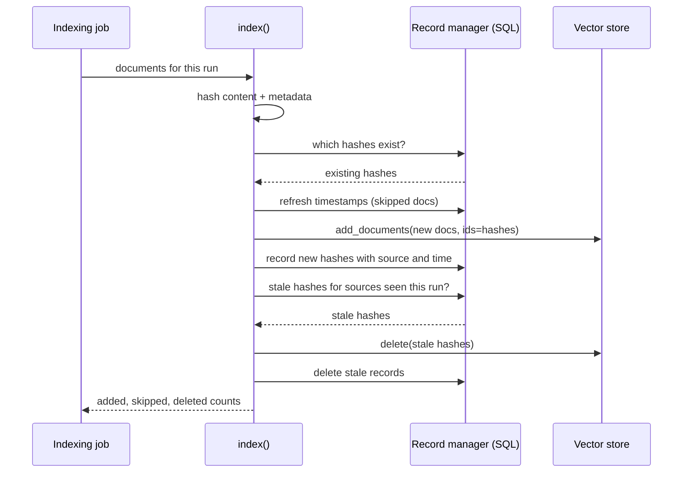

The [Vector database ecosystem](/learn/vector-database-ecosystem) module covered the databases themselves: FAISS, Qdrant, pgvector and the rest, their index types, their filtering and their operations. This lesson is about LangChain's `VectorStore` interface, the common face it puts on all of them, and about what that common face hides. Every store implements `add_documents` and `similarity_search`, so swapping one for another looks like a one-line change. But the stores disagree on what a score means, how a filter is written, whether adding an existing ID overwrites or fails, and when a filter is applied. Code that is portable in syntax is not automatically portable in behaviour.

The second half of the lesson tackles the problem every long-lived index has: keeping it in step with its sources as documents are edited, shortened and deleted. LangChain's **indexing API** solves this with a record manager that remembers what was written, and it is one of the most useful and least known parts of the framework.

## Learning objectives

- Use the `VectorStore` write and read methods (`add_documents`, `delete`, `get_by_ids`, `similarity_search`, `similarity_search_with_score`) and explain how a store connects to an `Embeddings` object.
- Interpret `similarity_search_with_score` output for stores with different score conventions, and convert between cosine similarity and squared Euclidean distance for unit vectors.
- Identify behaviours that differ between stores: ID conflicts, filter syntax and pre- versus post-filtering.
- Keep a vector store synchronised with its sources using `index()`, a record manager and the right cleanup mode.
- Choose between `InMemoryVectorStore`, FAISS and a database-backed store for a given workload.

## Prerequisites

- [Embeddings](/learn/langchain-for-rag/embeddings): the interface the store calls to turn text into vectors.
- [Text splitters](/learn/langchain-for-rag/text-splitters): where the chunks and their IDs come from.
- [FAISS](/learn/vector-database-ecosystem/faiss) and [Qdrant](/learn/vector-database-ecosystem/qdrant): the two engines used here, outside LangChain.
- [Index updates](/learn/advanced-vector-database-engineering/index-updates): why updating an index is harder than building one.

## Why this matters

A vector store is the only stateful component in a RAG pipeline. Loaders, splitters and embedding models are functions: the same input gives the same output. The store accumulates everything that has ever been written to it, and its contents are only correct if every write and every delete was correct. Mistakes do not reset between runs; they pile up.

The interface encourages a false sense of uniformity. A team prototypes with `InMemoryVectorStore`, where adding a document with an existing ID silently replaces it, and moves to FAISS, where the same call raises `ValueError`. Scores that meant "higher is better" start meaning "lower is better", and a threshold that kept the best chunks now keeps the worst. A filter that returned three results returns one, because one store filters before searching and the other after. None of these is a bug in a single store. Each store is behaving as documented. The bug is in assuming they behave the same.

And then there is time. Meridian's handbook is edited every few weeks. A section is reworded, so its chunks change. A section is shortened, so it has fewer chunks than before. A policy page is retired, so all its chunks should go. A pipeline that only ever adds will, within months, hold two or three versions of every policy, and AskMeridian will quote whichever one happens to be nearest the question. The superseded 2023 handbook said laptops were refreshed every 4 years and the equipment budget was £250; if those chunks survive in the index alongside the 2025 ones, the assistant will sometimes give the old answers with full confidence.

## The intuition

A vector store is a library's shelving system, and the `VectorStore` interface is the library's front desk. At every branch the desk accepts the same requests: "shelve these", "find me the five closest to this", "remove that one". Behind the desk, each branch runs things its own way. One gives the distance from your request in metres, another a closeness score out of one. One lets you shelve a new edition on top of the old one; another refuses because the shelf mark is taken. One checks your library card before it searches the stacks; another searches first and then throws away what you are not allowed to see, sometimes leaving you with fewer books than you asked for.

The indexing API is the librarian's ledger. For every source document, it records which shelf marks were filled from it and when. When a new edition of a document arrives, the librarian shelves the changed pages, leaves unchanged pages alone, and pulls every page from the old edition that the new one no longer contains. Without the ledger, nobody knows which books on the shelves are out of date.

## How it works

### The interface

A store is constructed with an `Embeddings` object (each implementation names the argument slightly differently: `embedding` for `InMemoryVectorStore`, `embedding_function` for the FAISS wrapper). From then on, it calls `embed_documents` when you write and `embed_query` when you search with text. Its core methods:

**Writing.**

- `add_documents(documents, ids=None)` embeds and stores documents, returning their IDs. If `ids` is omitted, it uses each `Document.id` when set, and otherwise generates IDs (usually random UUIDs).
- `add_texts(texts, metadatas=None, ids=None)` is the same for bare strings.
- `delete(ids)` removes records by ID.
- `get_by_ids(ids)` fetches stored documents by ID, without searching.
- `from_documents(documents, embedding, ...)` is a class method that builds a store and adds documents in one call; convenient for scripts, but it hides the construction parameters you will want to control in production.

**Reading.**

- `similarity_search(query, k=4, **kwargs)` returns the `k` nearest documents.
- `similarity_search_with_score(query, k=4, **kwargs)` returns `(document, score)` pairs, with the score in the store's own native convention.
- `similarity_search_by_vector(embedding, k)` searches with a vector you computed yourself.
- `similarity_search_with_relevance_scores(...)` converts native scores to a 0-to-1 relevance; the [Retrievers](/learn/langchain-for-rag/retrievers) lesson explains how, and why it can go wrong.
- `max_marginal_relevance_search(...)` re-selects for diversity, as described in [MMR](/learn/advanced-retrieval-optimisation/mmr).
- `as_retriever(...)` wraps the store as a Runnable retriever for use in chains.

Each read and write method has an async twin prefixed with `a` (`aadd_documents`, `asimilarity_search` and so on). Filters and other store-specific options go in `**kwargs`, which is where portability ends.

### What a score means

`similarity_search_with_score` returns whatever the underlying engine computes:

| Store | Native score | Better is |
| --- | --- | --- |
| `InMemoryVectorStore` | cosine similarity | higher |
| FAISS wrapper, default `IndexFlatL2` | squared Euclidean distance | lower |
| FAISS wrapper with `distance_strategy=MAX_INNER_PRODUCT` | inner product | higher |
| Qdrant (`langchain-qdrant`) | the collection's metric: cosine, dot or Euclidean | depends on metric |

For unit-length vectors, which the [Embeddings](/learn/langchain-for-rag/embeddings) lesson recommended, cosine and squared Euclidean distance carry the same information. Write $\mathbf{q}$ and $\mathbf{d}$ for the query and document vectors, each of length 1:

$$
\lVert \mathbf{q} - \mathbf{d} \rVert^2 = \lVert \mathbf{q} \rVert^2 + \lVert \mathbf{d} \rVert^2 - 2\,\mathbf{q}\cdot\mathbf{d} = 2 - 2\cos\theta
$$

because $\lVert \mathbf{q} \rVert = \lVert \mathbf{d} \rVert = 1$ and $\mathbf{q}\cdot\mathbf{d} = \cos\theta$ for unit vectors. So the ranking is the same, and the numbers convert exactly: a cosine of 0.727 is a squared distance of $2 - 2(0.727) = 0.546$. You will see exactly this pair of numbers in the code below. The practical rule: before writing any code that compares a score with a number, print scores from your store and confirm which direction is better.

### Where the stores differ

Three behaviours vary in ways that break code silently when you change stores.

**ID conflicts.** Adding a document whose ID already exists:

- `InMemoryVectorStore` overwrites the old record (an upsert).
- The FAISS wrapper raises `ValueError: Tried to add ids that already exist`. In the installed version it is worse than a refusal: the new vector has already been added to the underlying FAISS index before the check fails, without a mapping to any document, and a later search that reaches that vector raises `KeyError`. After this error, rebuild the store rather than continuing.
- Database-backed stores such as Qdrant upsert by point ID.

So "stable IDs make re-indexing idempotent", true for Qdrant and the in-memory store, is false for FAISS, which needs a `delete` before re-adding.

**Filter syntax.** The `filter` keyword is passed through to the implementation. The FAISS wrapper accepts a dictionary of metadata equalities (with some operators) or a callable; `InMemoryVectorStore` accepts a callable taking a `Document`; `langchain-qdrant` takes a Qdrant `Filter` object over the payload, where metadata lives under a `metadata` key by default. There is no common filter language in the base interface. If you need portable filtering, write a small translation function per store, or use a [self-query retriever](/learn/advanced-retrieval/self-query-retrieval), which has one.

**Pre- and post-filtering.** Qdrant applies a filter during the search, so you get the `k` nearest documents that pass the filter. The FAISS wrapper searches first and filters afterwards: it fetches `fetch_k` candidates (default 20) and discards those that fail the filter. If fewer than `k` of those 20 pass, you get fewer than `k` results, and if none do, you get nothing, even though matching documents exist further away. For a selective filter (one tenant among hundreds, say), post-filtering is wrong, not just slow. The [Filtering](/learn/vector-database-fundamentals/filtering) lesson covers the general trade-off.

### Keeping the index in step: the indexing API

`langchain_core.indexing.index()` sits between your documents and the store, with a **record manager** that remembers what was written. Its mechanism, for each batch of documents:

1. **Hash each document.** The ID is a hash of its `page_content` and its JSON-serialised metadata (with `key_encoder="sha256"` or another algorithm; the default is SHA-1, which the library itself warns is not collision-resistant). Any ID you set on the document is replaced, so that a changed chunk always gets a new ID.
2. **Ask the record manager which hashes already exist.** Those documents are skipped: no embedding, no write. Their timestamps are refreshed.
3. **Write the new ones** to the vector store with `add_documents(..., ids=hashes)`, and record each hash with its **source ID** (the metadata field named by `source_id_key`, usually `source`) and the time.
4. **Clean up**, depending on `cleanup`:
   - `None`: never delete anything.
   - `"incremental"`: for every source seen in this run, delete records from that source whose timestamps were not refreshed, meaning chunks that no longer exist in the new version. This runs as it goes, so stale and fresh versions coexist only briefly. Sources not seen in this run are untouched.
   - `"full"`: after the run, delete every record not seen in this run, from any source. This is the only mode that removes documents whose source has disappeared entirely, and it is dangerous if the run did not include the whole corpus.
   - `"scoped_full"`: like full, but only for sources seen in this run; useful when you cannot feed the whole corpus in one pass.
5. Return counts: `num_added`, `num_updated`, `num_skipped`, `num_deleted`.



The record manager is a separate store. `InMemoryRecordManager` (in `langchain_core.indexing`) is for tests; `SQLRecordManager` (in `langchain_classic.indexes`) persists records in any database SQLAlchemy supports, from a local SQLite file to PostgreSQL. Its `namespace` should identify the vector store and collection it tracks, because the records are only meaningful for that one store.

The store must support `delete` by ID and accept the IDs it is given; most LangChain vector store integrations do.

## In code

**The problem.** Show the same documents in two stores, `InMemoryVectorStore` and FAISS, with their different score conventions and filter styles. Then index Meridian's handbook with the indexing API, and follow it through three runs: the initial load of the 2023 handbook, a run where nothing changed, and the switch to the 2025 handbook, in which one file is reworded and shortened and another is edited. The old figures must disappear from the index.

**Dependencies.** `langchain-core`, `langchain-community` (the FAISS wrapper), `langchain-classic` (`SQLRecordManager`), `faiss-cpu`, `sqlalchemy` and `sentence-transformers` with `all-MiniLM-L6-v2`. The record manager writes a SQLite file, `record_manager.db`, in the working directory. No API key.

```bash
pip install langchain-core langchain-community langchain-classic faiss-cpu sqlalchemy sentence-transformers
```

```python
import warnings
warnings.filterwarnings("ignore", category=DeprecationWarning)  # the community sunset notice

import faiss
from sentence_transformers import SentenceTransformer
from langchain_classic.indexes import SQLRecordManager
from langchain_community.docstore.in_memory import InMemoryDocstore
from langchain_community.vectorstores import FAISS
from langchain_core.documents import Document
from langchain_core.embeddings import Embeddings
from langchain_core.indexing import index
from langchain_core.vectorstores import InMemoryVectorStore


class MiniLM(Embeddings):
    def __init__(self):
        self.model = SentenceTransformer("sentence-transformers/all-MiniLM-L6-v2")
    def embed_documents(self, texts):
        return self.model.encode(texts, normalize_embeddings=True).tolist()
    def embed_query(self, text):
        return self.embed_documents([text])[0]


emb = MiniLM()
handbook = [
    Document("Staff may work remotely up to 3 days a week.",
             metadata={"source": "handbook/remote.md", "collection": "handbook"}),
    Document("The home-office equipment budget is £250.",
             metadata={"source": "handbook/remote.md", "collection": "handbook"}),
    Document("Laptops are refreshed every 4 years.",
             metadata={"source": "handbook/it-equipment.md", "collection": "handbook"}),
    Document("Error E-4021 means the VPN client is out of date; update it from the IT portal.",
             metadata={"source": "it/vpn.md", "collection": "it"}),
]

# Part 1: one interface, two stores, two score conventions.
memory = InMemoryVectorStore(emb)
flat = FAISS(embedding_function=emb, index=faiss.IndexFlatL2(384),
             docstore=InMemoryDocstore(), index_to_docstore_id={})
for store in (memory, flat):
    store.add_documents(handbook, ids=["r1", "r2", "eq1", "vpn1"])
    hits = store.similarity_search_with_score("home office budget", k=2)
    print(f"{type(store).__name__:20}", [(d.id, round(float(s), 3)) for d, s in hits])

print("FAISS, dict filter :", [d.id for d in flat.similarity_search("laptop", k=2, filter={"collection": "it"})])
print("memory, callable   :", [d.id for d in memory.similarity_search(
    "laptop", k=2, filter=lambda d: d.metadata["collection"] == "it")])

# Part 2: the indexing API keeps the store in step with the sources.
store = FAISS(embedding_function=emb, index=faiss.IndexFlatL2(384),
              docstore=InMemoryDocstore(), index_to_docstore_id={})
records = SQLRecordManager("faiss/meridian-handbook", db_url="sqlite:///record_manager.db")
records.create_schema()

def sync(docs, label):
    result = index(docs, records, store, cleanup="incremental",
                   source_id_key="source", key_encoder="sha256")
    print(f"{label:28} {result}  vectors={store.index.ntotal}")

print()
sync(handbook, "run 1 (initial)")
sync(handbook, "run 2 (nothing changed)")
handbook_2025 = [  # remote.md edited and shortened to one chunk; it-equipment.md edited
    Document("Staff may work remotely up to 3 days a week; the equipment budget is £400.",
             metadata={"source": "handbook/remote.md", "collection": "handbook"}),
    Document("Laptops are refreshed every 3 years.",
             metadata={"source": "handbook/it-equipment.md", "collection": "handbook"}),
    handbook[3],
]
sync(handbook_2025, "run 3 (two files edited)")
for d in store.similarity_search("home office budget", k=4):
    print("  ", d.page_content)
```

```output
InMemoryVectorStore  [('r2', 0.727), ('r1', 0.194)]
FAISS                [('r2', 0.545), ('r1', 1.613)]
FAISS, dict filter : ['vpn1']
memory, callable   : ['vpn1']

run 1 (initial)              {'num_added': 4, 'num_updated': 0, 'num_skipped': 0, 'num_deleted': 0}  vectors=4
run 2 (nothing changed)      {'num_added': 0, 'num_updated': 0, 'num_skipped': 4, 'num_deleted': 0}  vectors=4
run 3 (two files edited)     {'num_added': 2, 'num_updated': 0, 'num_skipped': 1, 'num_deleted': 3}  vectors=3
   Staff may work remotely up to 3 days a week; the equipment budget is £400.
   Laptops are refreshed every 3 years.
   Error E-4021 means the VPN client is out of date; update it from the IT portal.
```

**The important lines.**

- `FAISS(embedding_function=emb, index=faiss.IndexFlatL2(384), docstore=InMemoryDocstore(), index_to_docstore_id={})` constructs the wrapper explicitly instead of through `from_documents`, so the index type and dimension are visible. The wrapper is three structures: the FAISS index (vectors by position), a docstore (documents by ID) and a dictionary from position to ID.
- `store.add_documents(handbook, ids=[...])` is identical for both stores; so is `similarity_search_with_score`. The interface is genuinely uniform at this level.
- `filter={"collection": "it"}` for FAISS and `filter=lambda d: ...` for the in-memory store: the same intent in two syntaxes.
- `SQLRecordManager("faiss/meridian-handbook", db_url="sqlite:///record_manager.db")` keeps the ledger in SQLite; `create_schema()` creates its table if needed. In production, point `db_url` at a database that outlives the job, and persist the vector store as well.
- `index(..., cleanup="incremental", source_id_key="source", key_encoder="sha256")` is the whole synchronisation step. `source_id_key` must name a metadata field that every document has; in the installed version a document without it raises `KeyError`.

**What the output means.**

Part 1: the two stores return the same two chunks in the same order, with scores in opposite conventions. The in-memory store's cosine 0.727 and FAISS's squared distance 0.545 are the same measurement, $2 - 2(0.727) = 0.546$, up to rounding; likewise $2 - 2(0.194) = 1.612$. A rule such as "keep scores above 0.5" would keep the best chunk with one store and the worst with the other. The filter lines show both stores returning only the IT document for "laptop", the nearest IT chunk regardless of the question; with `k=2` and only one IT document, each returns one result.

Part 2, run by run:

- **Run 1** embedded and added all four chunks.
- **Run 2** embedded nothing: all four hashes were in the record manager, so all four were skipped. That is what makes a nightly re-index of an unchanged corpus nearly free.
- **Run 3** is the interesting one. `remote.md` went from two chunks to one reworded chunk; `it-equipment.md` changed its text. The VPN chunk is unchanged. Two new chunks were added, one was skipped, and three were deleted: both old `remote.md` chunks (including the one that has no successor, which an ID-based upsert would have left behind) and the old laptop chunk. `num_updated` is 0 because a changed chunk has a different hash, so it is an add plus a delete, never an in-place update.

The final search contains only 2025 facts: £400 and 3 years. The £250 budget and the 4-year cycle are gone.

**Common errors.**

- `KeyError: 'source'` from `index()` when some documents lack the field named by `source_id_key`; give every document that field before indexing.
- `ValueError: Tried to add ids that already exist` from FAISS when calling `add_documents` with existing IDs; delete first, or use the indexing API, which never re-adds an existing hash.
- `ValueError` mentioning `allow_dangerous_deserialization` from `FAISS.load_local`: the wrapper stores its docstore with Python's `pickle`, and loading refuses unless you pass `allow_dangerous_deserialization=True`. Only do that for files your own system wrote (see the security section).
- `ImportError: cannot import name 'Qdrant' from 'langchain_community.vectorstores'`: in the installed version the community Qdrant class is gone; use the `langchain-qdrant` partner package.
- Mismatched record manager and store: running `index()` against a fresh, empty store with an old record manager database makes it skip everything, leaving the store empty. Keep the two together, or rebuild both.

**Extending it: the production store.** For AskMeridian's Qdrant cluster, the store line changes; the indexing code does not. This was not executed here: it needs the `langchain-qdrant` package and a running Qdrant server.

```bash
pip install langchain-qdrant qdrant-client
```

```python
import os
from langchain_qdrant import QdrantVectorStore
from qdrant_client import QdrantClient, models

client = QdrantClient(url=os.environ["QDRANT_URL"], api_key=os.environ.get("QDRANT_API_KEY"))
collection = "askmeridian-minilm-l6-v2"           # embedding configuration in the name
if not client.collection_exists(collection):
    client.create_collection(
        collection, vectors_config=models.VectorParams(size=384, distance=models.Distance.COSINE))

store = QdrantVectorStore(client=client, collection_name=collection, embedding=emb)
it_only = models.Filter(must=[models.FieldCondition(
    key="metadata.collection", match=models.MatchValue(value="it"))])
docs = store.similarity_search("VPN error", k=4, filter=it_only)
```

The record manager's namespace should then name the Qdrant collection, and `db_url` should point at a durable database rather than a local SQLite file.

## A real-world example

When the 2025 handbook took effect on 1 January 2025, the HR team published it and the Platform team re-ran AskMeridian's ingestion job. The job loaded, split and called `add_documents` with no IDs, as it had since the first prototype. In the first week of January, the support desk logged a cluster of complaints: AskMeridian was telling some staff that their laptop refresh was due after four years, and others that the equipment budget was £250. Both were 2023 figures.

The team checked the obvious things first. The new handbook was in the index. The new chunks were being retrieved. But for many questions, the old chunks were retrieved too, sometimes ranked above the new ones, because the old and new wording were nearly identical and the embedding put them side by side. The model, given two contradictory context chunks, sometimes chose the old one.

The root cause was that the job had only ever added. Each re-index since the prototype had added another copy of every chunk under a new random ID; unchanged text appeared as harmless duplicates, and changed text appeared as old and new side by side. The collection held roughly five times as many points as the corpus had chunks.

The fix used the indexing API. The team created a new Qdrant collection with the embedding configuration in its name, a `SQLRecordManager` in the team's PostgreSQL database with a matching namespace, and ran `index()` with `cleanup="incremental"` and `source_id_key="source"` on every nightly run. Once a week, a second job ran with `cleanup="full"` on the complete corpus, to remove documents whose source files had been deleted, which incremental mode never touches. They switched the query path to the new collection after an evaluation run, kept the old collection for a week in case of rollback, and then deleted it.

They also added a monitoring check: the number of points in the collection divided by the number of chunks the last full run produced. It should be exactly 1. Any drift means something is writing to the store outside the indexing API.

## Common mistakes

- **Adding without IDs and without cleanup.** Every run appends; edited and retired content stays retrievable indefinitely.
- **Assuming upsert semantics.** FAISS rejects existing IDs (and, in the installed version, leaves an orphaned vector behind); the in-memory store and Qdrant overwrite.
- **Comparing scores across stores.** Cosine similarity and squared distance run in opposite directions; a threshold copied from one store inverts its meaning in another.
- **Selective filters on a post-filtering store.** FAISS filters after fetching `fetch_k` candidates and can return fewer than `k` results, or none.
- **Relying on `cleanup="incremental"` to remove deleted files.** It only cleans sources seen in the current run; schedule a `"full"` run over the complete corpus.
- **Running `cleanup="full"` on a partial run.** Everything not in the run is deleted.
- **Losing the record manager.** Without its ledger, `index()` cannot tell what is in the store; keep it in a durable database, backed up with the store.
- **Loading pickled FAISS indexes from untrusted sources.** `allow_dangerous_deserialization=True` means exactly that.

## Best practices

- Prototype with `InMemoryVectorStore` or FAISS, but test against the production store before relying on any behaviour beyond `add_documents` and `similarity_search`.
- Put every write to a long-lived store through the indexing API (or an equivalent ledger of your own); never call `add_documents` directly from a recurring job.
- Use `cleanup="incremental"` for routine runs and a periodic `cleanup="full"` over the complete corpus for deletions.
- Name collections after the embedding configuration, and the record manager namespace after the collection.
- Print native scores for real queries before writing any score comparison, and note the direction in a comment.
- Prefer stores that filter during search when filters are selective, as access-control filters usually are.
- Monitor the ratio of stored points to expected chunks.

## Performance considerations

**The indexing API saves embedding work, not bookkeeping.** For every document, it hashes content and metadata (microseconds) and queries the record manager in batches. For 50,000 chunks with `batch_size=100`, that is 500 record-manager round trips; against a local SQLite file each is fast, against a remote PostgreSQL perhaps a few milliseconds, so seconds in total. Compare that with embedding 50,000 chunks: minutes on a CPU, or a measurable API bill. If 1% of chunks change, the API skips 99% of the embedding work. Increase `batch_size` to reduce round trips, keeping in mind the docstring's note that incremental mode does redundant work when one source's chunks are spread across several batches.

**Wrapper overhead and memory.** `InMemoryVectorStore` keeps vectors as Python lists in a dictionary and computes similarities over all of them per query: fine for a few thousand chunks, wasteful beyond. The FAISS wrapper keeps vectors in FAISS's compact float32 arrays (384 dimensions × 4 bytes = 1,536 bytes per vector, so 1 million chunks is about 1.5 GB for the vectors alone), plus documents and metadata as Python objects in its docstore, which for large corpora can exceed the vectors in size. A flat index searches every vector per query: about 1 million × 384 multiply-adds for 1 million chunks, which is tens of milliseconds on one core. An approximate index (see [HNSW](/learn/vector-indexing-algorithms/hnsw)) or a database-backed store is the step up.

**Post-filter cost.** Raising FAISS's `fetch_k` to make selective filters work costs a larger search per query and more Python-side filtering; for a filter that keeps 1% of documents, you would need `fetch_k` around 100 times `k` to expect `k` survivors. That is the point at which a store with real pre-filtering is the right answer.

## Security considerations

- **Pickle deserialisation.** `FAISS.save_local` writes its docstore with `pickle`. Loading a pickle file can execute arbitrary code, which is why `load_local` refuses unless you pass `allow_dangerous_deserialization=True`. Only load files your own pipeline wrote, from storage only it can write to.
- **Filters are not access control unless the store enforces them.** A filter on a `department` field restricts what one query returns, but anyone who can call the store without the filter sees everything. Enforce permissions in the retrieval service, for every query, and prefer stores that apply filters inside the search; see [Document-level permissions](/learn/access-control-and-privacy/document-level-permissions).
- **Deletion must reach every copy.** A document removed for legal reasons must leave the vector store, the record manager, the embedding cache and any backups. The indexing API handles the store; the rest is yours. See [Secure deletion](/learn/enterprise-rag-governance/secure-deletion).
- **Credentials** for hosted stores (`QDRANT_API_KEY` and the like) belong in environment variables or a secrets manager.

## Summary

- `VectorStore` gives every store the same write (`add_documents`, `delete`, `get_by_ids`) and read (`similarity_search`, `similarity_search_with_score`) methods; filters and other options pass through as store-specific keyword arguments.
- Native scores differ in meaning and direction; for unit vectors, squared Euclidean distance is $2 - 2\cos\theta$.
- Stores differ on ID conflicts (upsert or error), filter syntax and pre- versus post-filtering; test the behaviours you rely on in the store you deploy.
- The indexing API assigns content-hash IDs, skips unchanged documents, and with `cleanup="incremental"` removes chunks that disappeared from re-indexed sources; `"full"` cleanup removes deleted sources.
- Keep the record manager durable, namespaced to its collection, and in step with the store.

## Exercises

1. **Convert the score.** A FAISS flat L2 store over unit vectors returns a score of 0.8 for a document. What is the cosine similarity? What score would `InMemoryVectorStore` report?

<details><summary>Show solution</summary>

$0.8 = 2 - 2\cos\theta$, so $\cos\theta = (2 - 0.8)/2 = 0.6$. `InMemoryVectorStore` reports cosine similarity, so it would show 0.6.

</details>

2. **Deleted files.** In this lesson's code, after run 3, run `sync(handbook_2025[:2], ...)` (the VPN runbook has been deleted from the source system). What does `index()` report, and what must you change to remove the VPN chunk?

<details><summary>Show solution</summary>

Incremental mode reports `{'num_added': 0, 'num_updated': 0, 'num_skipped': 2, 'num_deleted': 0}` and the store still holds 3 vectors, because `it/vpn.md` was not among the sources seen in this run. Running the same documents with `cleanup="full"` reports `num_deleted: 1` and leaves 2 vectors. Only use `"full"` with the complete corpus as input.

</details>

3. **Find the post-filter limit.** Build a FAISS store of 100 documents, 95 with `collection="handbook"` and 5 with `collection="it"`, where the IT documents are about a topic far from your query. Search with `filter={"collection": "it"}` and `k=3`, first with the default `fetch_k` and then with `fetch_k=100`. Explain the difference.

<details><summary>Show solution</summary>

With the default `fetch_k=20`, FAISS retrieves the 20 nearest documents, which are all handbook documents, and filters them down to nothing. (In a run with 95 near-identical leave documents, 5 VPN documents and the query "how much annual leave", the default returned 0 results and `fetch_k=100` returned 3.) With `fetch_k=100`, it retrieves every document, so the filter finds all five IT documents and returns the nearest three. The fix in production is either a store that applies filters during search, or a separate index per value of a highly selective field (for example per tenant).

</details>

4. **Design decision.** Meridian wants AskMeridian to index Confluence spaces owned by several departments, where pages are edited daily and deleted often, and each department may only see its own pages. Choose a vector store and an indexing strategy, and justify your choices.

<details><summary>Show solution</summary>

A database-backed store with filtering inside the search, such as the existing Qdrant cluster, with a payload index on the department field so permission filters are efficient and always return `k` results. Index through `index()` with a `SQLRecordManager` in a durable database, `source_id_key` set to the page ID, `cleanup="incremental"` for the frequent sync runs (fed with changed pages from the Confluence API), and a scheduled `cleanup="full"` run over the complete page list to remove deleted pages. Put the department into metadata at load time, and enforce the filter in the retrieval service for every query. Name the collection and record manager namespace after the embedding configuration, so a model change becomes a new collection rather than a mixed one.

</details>

## Check your understanding

```quiz
[
  {"q": "`InMemoryVectorStore` returns a score of 0.9 and a FAISS flat L2 store returns 0.2 for the same unit-vector pair. Which statement is true?", "options": ["They disagree about relevance", "They agree: a squared distance of 0.2 is a cosine of 0.9", "FAISS considers the document less relevant", "Scores from different stores can never be related"], "answer": 1, "why": "For unit vectors, squared distance = 2 - 2cos, so 2 - 2(0.9) = 0.2."},
  {"q": "You call `faiss_store.add_documents(docs, ids=[\"a\"])` when ID \"a\" already exists. What happens in the installed version?", "options": ["The record is overwritten", "A duplicate record is added", "It raises ValueError, and the new vector is left orphaned in the FAISS index", "The call is silently ignored"], "answer": 2, "why": "The wrapper checks for existing ids after adding the vector to the FAISS index, so the error leaves an unmapped vector behind; later searches reaching it raise KeyError."},
  {"q": "A source file shrinks from three chunks to two reworded chunks. With `index(..., cleanup=\"incremental\", source_id_key=\"source\")`, what happens to the three old chunks?", "options": ["They stay until a full cleanup", "They are deleted, because their source was seen in this run and their hashes were not", "Only the one without a successor stays", "They are updated in place"], "answer": 1, "why": "Incremental cleanup deletes records from seen sources whose timestamps were not refreshed; changed chunks get new hashes, so all three old ones are stale."},
  {"q": "Why does the indexing API replace the IDs you set on documents with hashes of content and metadata?", "options": ["Vector stores only accept hex IDs", "So that any change to a chunk produces a new ID, letting it detect unchanged chunks (skip) and stale ones (delete)", "To compress the IDs", "Because Document.id is deprecated"], "answer": 1, "why": "Change detection relies on the ID being a function of the content; a positional ID would make an edited chunk look unchanged."},
  {"q": "With the FAISS wrapper, `similarity_search(q, k=5, filter={\"tenant\": \"t42\"})` returns only two documents, though tenant t42 has hundreds. What is the most likely cause?", "options": ["The embedding model is wrong", "FAISS post-filters the fetch_k nearest candidates, and only two of them belong to t42", "The filter syntax is invalid", "k is capped at 2 when filtering"], "answer": 1, "why": "The wrapper searches fetch_k (default 20) first and filters afterwards; selective filters need pre-filtering or a larger fetch_k."}
]
```

## Further reading

- LangChain documentation, "Vector stores" concepts and "Indexing" how-to (the `index()` function, record managers and cleanup modes): [docs.langchain.com](https://docs.langchain.com/).
- FAISS documentation and wiki, on index types and the `IndexFlatL2` metric: [faiss.ai](https://faiss.ai/).
- Qdrant documentation, on filtering and payload indexes: [qdrant.tech/documentation](https://qdrant.tech/documentation/).
- Johnson, J., Douze, M. and Jégou, H. (2017). "Billion-scale similarity search with GPUs." [arXiv:1702.08734](https://arxiv.org/abs/1702.08734). The FAISS paper.
- Python documentation, the `pickle` module and its security warning: [docs.python.org/3/library/pickle.html](https://docs.python.org/3/library/pickle.html).
