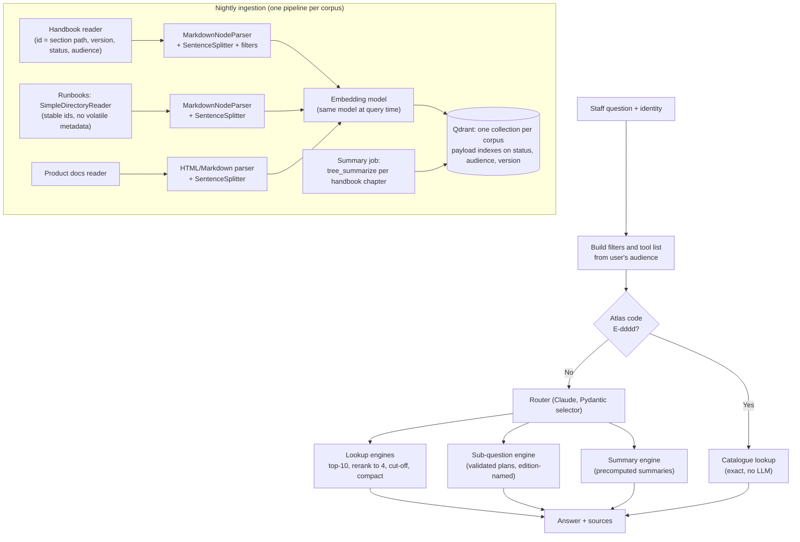

This assessment covers the whole LlamaIndex module: index architecture and storage, document ingestion and incremental updates, node parsing, query engines, vector indexes, router engines, sub-question engines and response synthesis. It has a multiple-choice quiz, open conceptual questions, three coding exercises, an architecture design challenge and three troubleshooting scenarios. Aim for at least 14 of 18 on the quiz (about 75%) before moving on, and attempt every written section before opening its model answer. The coding solutions were run against `llama-index-core` 0.14 with the `MiniLMEmbedding` adapter from [Index architecture](/learn/llamaindex/index-architecture), saved as `common.py`, and stand-in LLMs where generation is needed.

```quiz
[
  {
    "q": "Which object holds the mapping from index ids to index structures when several indexes share one `StorageContext`?",
    "options": [
      "The docstore",
      "The vector store",
      "The index store",
      "`Settings`"
    ],
    "answer": 2,
    "why": "The index store keeps each index's struct under its `index_id`; the docstore holds nodes and the vector store holds embeddings."
  },
  {
    "q": "A team builds an index in a notebook with a local embedding model, persists it, and loads it in a service that never sets `Settings.embed_model`. What is the risk?",
    "options": [
      "The persisted embeddings are re-computed with the original model",
      "Query embeddings come from the framework's default model, which may fail or embed in a different space",
      "The service cannot read `docstore.json`",
      "Nothing; the embedding model is stored with the index"
    ],
    "answer": 1,
    "why": "Models are not persisted. The loaded index embeds queries with whatever model is configured at load time."
  },
  {
    "q": "Which index type makes LLM calls while it is being built?",
    "options": [
      "`DocumentSummaryIndex`",
      "`VectorStoreIndex`",
      "`SummaryIndex`",
      "`SimpleKeywordTableIndex`"
    ],
    "answer": 0,
    "why": "A document summary index asks the LLM for one summary per document at build time."
  },
  {
    "q": "`SimpleDirectoryReader(input_dir=\"docs\")` is run every night, feeding an `IngestionPipeline` with a persisted docstore. Every file is re-embedded every night, although few change. What is the most direct cause?",
    "options": [
      "The vector store does not support upserts",
      "`filename_as_id` is off, so every document gets a new random id",
      "The cache is too small",
      "`SentenceSplitter` is non-deterministic"
    ],
    "answer": 1,
    "why": "Without stable ids, each run's documents look new to the docstore. Volatile metadata in the hash is the other common cause."
  },
  {
    "q": "Which docstore strategy will delete documents that were ingested previously but are absent from the current run?",
    "options": [
      "`UPSERTS`",
      "`DUPLICATES_ONLY`",
      "None of them; deletion is always manual",
      "`UPSERTS_AND_DELETE`"
    ],
    "answer": 3,
    "why": "Only `UPSERTS_AND_DELETE` removes ids not seen in the current input, so it must be given the whole corpus every run."
  },
  {
    "q": "What does this print?\n```python\nfrom llama_index.core import Document\nd = Document(text=\"Annual leave is 25 days.\", metadata={\"title\": \"Leave\", \"owner\": \"HR\"},\n             excluded_embed_metadata_keys=[\"owner\"])\nprint(d.get_content(metadata_mode=\"embed\"))\n```",
    "options": [
      "`Annual leave is 25 days.`",
      "`title: Leave` and `owner: HR` on two lines, a blank line, then the text",
      "`title: Leave`, a blank line, then `Annual leave is 25 days.`",
      "`owner: HR`, a blank line, then the text"
    ],
    "answer": 2,
    "why": "Embed mode renders non-excluded metadata with the `{key}: {value}` template, then a blank line, then the text. `owner` is excluded."
  },
  {
    "q": "`SentenceSplitter(chunk_size=256)` is applied to documents whose embed metadata string is 60 tokens and LLM metadata string is 90 tokens. What is the effective chunk size?",
    "options": [
      "166",
      "196",
      "256",
      "106"
    ],
    "answer": 0,
    "why": "The splitter reserves room for the longer of the two metadata strings: 256 minus 90."
  },
  {
    "q": "Why does running `SentenceSplitter` directly on a Markdown handbook often produce nodes that span two sections?",
    "options": [
      "It removes all newlines before splitting",
      "Its default paragraph separator is three newlines, so ordinary blank-line paragraph breaks are not boundaries",
      "It splits only on Markdown headings",
      "It ignores the chunk size for Markdown"
    ],
    "answer": 1,
    "why": "Text with single blank lines goes straight to sentence splitting and greedy packing, which crosses headings. Parse structure first with `MarkdownNodeParser`."
  },
  {
    "q": "In a `RetrieverQueryEngine`, a `SimilarityPostprocessor` removes every retrieved node. What does the default synthesizer return?",
    "options": [
      "An answer generated from the model's own knowledge",
      "An exception",
      "A response whose text is `Empty Response`, without calling the LLM",
      "The top node regardless of the cut-off"
    ],
    "answer": 2,
    "why": "With no nodes, synthesis is skipped and a sentinel response is returned. Production code should replace it with its own message."
  },
  {
    "q": "You replace `response_synthesizer:text_qa_template` with a prompt that requires citations, but answers from a chat model ignore it. Why?",
    "options": [
      "The synthesizer uses the chat variant of the template for chat models",
      "Prompts can only be set at index build time",
      "Citations require `response_mode=\"accumulate\"`",
      "Chat models cannot follow templates"
    ],
    "answer": 0,
    "why": "Templates are selected by the LLM's `is_chat_model` flag. Replace `chat_content_qa_template` as well, and the refine templates in multi-call modes."
  },
  {
    "q": "A `VectorStoreIndex` is backed by Qdrant with default settings. Which statement is true?",
    "options": [
      "Node text is stored only in LlamaIndex's docstore",
      "Node text and metadata are stored in Qdrant payloads, and the docstore is not used by default",
      "`refresh_ref_docs` works out of the box because Qdrant stores document hashes",
      "Every query re-embeds all nodes"
    ],
    "answer": 1,
    "why": "Stores that keep text receive it in their payloads; the index skips the docstore unless `store_nodes_override=True`, so there are no stored hashes to refresh against."
  },
  {
    "q": "An MMR retriever returns nodes with scores 0.21, 0.05 and 0.18, in that order. What should you conclude?",
    "options": [
      "The results are sorted incorrectly",
      "The second result is the least similar to the query",
      "A cosine cut-off of 0.1 would correctly remove the second result",
      "These are MMR objective values in selection order, not similarities"
    ],
    "answer": 3,
    "why": "MMR returns relevance-minus-redundancy values for each pick; thresholding them as similarities compares the wrong quantity."
  },
  {
    "q": "A metadata filter works locally with `SimpleVectorStore` but returns no results in the production vector database. What is the most likely class of cause?",
    "options": [
      "The production store translates filters differently: unsupported operator, nested filters, or a value stored as a different type",
      "The embedding model is different in production",
      "`similarity_top_k` is too low",
      "The LLM is not configured"
    ],
    "answer": 0,
    "why": "Each integration translates `MetadataFilters` into its own query language; support for operators, nesting and value types varies."
  },
  {
    "q": "What does `LLMSingleSelector` show the model for each `QueryEngineTool`?",
    "options": [
      "The tool's name and a sample of its documents",
      "The tool's name only",
      "The tool's description, in a numbered list",
      "The tool's index type"
    ],
    "answer": 2,
    "why": "The selector prompt lists descriptions numbered from 1 and asks for the choice as JSON; names are not shown."
  },
  {
    "q": "A router's routing accuracy is 0.85. Chosen engines answer correctly 90% of the time; wrong engines never do. What is the end-to-end accuracy?",
    "options": [
      "0.90",
      "0.765",
      "0.85",
      "0.875"
    ],
    "answer": 1,
    "why": "0.85 × 0.9 + 0.15 × 0 = 0.765. End-to-end accuracy cannot exceed routing accuracy when wrong routes fail."
  },
  {
    "q": "`SubQuestionQueryEngine.from_defaults(query_engine_tools=tools)` fails with an `ImportError` in a project that uses Claude. What is the fix?",
    "options": [
      "Install the OpenAI LLM integration and switch models",
      "Set `use_async=False`",
      "Pass `question_gen=LLMQuestionGenerator.from_defaults(llm=...)` explicitly",
      "Give every tool a longer description"
    ],
    "answer": 2,
    "why": "Without `question_gen`, `from_defaults` first imports an OpenAI-specific question-generator package. An explicit `LLMQuestionGenerator` avoids it."
  },
  {
    "q": "A sub-question engine plans 4 sub-questions; one names a tool that does not exist. With default settings, what does the user get?",
    "options": [
      "An answer built from the three successful sub-answers, with no indication that one part failed",
      "An error message naming the missing tool",
      "A retry of the failed sub-question against every tool",
      "No answer at all"
    ],
    "answer": 0,
    "why": "Sub-question failures are caught, logged as warnings and filtered out before synthesis."
  },
  {
    "q": "Six retrieved nodes total about 1,500 tokens. The LLM reports a 1,400-token context window. Which response mode is guaranteed to drop part of the context?",
    "options": [
      "`tree_summarize`",
      "`refine`",
      "`compact`",
      "`simple_summarize`"
    ],
    "answer": 3,
    "why": "`simple_summarize` joins all nodes and truncates them to one call. The other modes split the work across several calls."
  }
]
```

## Conceptual questions

1. Explain the difference between a LlamaIndex index, its index struct and its storage context. Use a `VectorStoreIndex` over the default stores as the example, and say what changes when the vector store is Qdrant.

<details><summary>Show model answer</summary>

The **index** is the Python object (`VectorStoreIndex`) that knows how to build its structure from nodes and how to create retrievers and query engines. The **index struct** is the small serialisable record of how nodes are organised: for a vector index over the default stores, an `IndexDict` mapping node ids to vector ids. The **storage context** bundles the stores the index uses: the docstore (node text, metadata, relationships, document hashes), the index store (index structs by id), the vector store (embeddings) and graph stores. With the default `SimpleVectorStore`, which keeps only vectors, nodes are written to the docstore and the struct records the mapping. With Qdrant, text and metadata live in Qdrant's payloads, the docstore is skipped by default, and the index can be reopened with `VectorStoreIndex.from_vector_store(...)` without any local files. In both cases the embedding model is not stored and must be configured identically wherever the index is used.

</details>

2. A document's hash in an ingestion pipeline covers its text and all of its metadata. Give one advantage and one disadvantage of this design, and describe how you would configure ingestion for a Git-backed corpus of runbooks.

<details><summary>Show model answer</summary>

Advantage: a metadata change that matters (a new owner, a status change from current to superseded, a corrected title) triggers re-processing, so stored nodes and filters stay accurate. Disadvantage: volatile metadata (modification times, download dates, file sizes) makes unchanged documents look changed, so the whole corpus is re-embedded on every run. For a Git-backed corpus: read with `SimpleDirectoryReader` and a custom `file_metadata` function that records the repository-relative path, corpus name and perhaps the last commit touching the file, and nothing volatile; set `id_` to the repository-relative path; run an `IngestionPipeline` with a persistent database-backed docstore, the parsing and embedding transformations and the vector store; use `UPSERTS_AND_DELETE` only if every run reads the whole repository, with a guard against deleting more than a set fraction.

</details>

3. Why is "structure first, then size" the recommended node-parsing pattern for Markdown documents, and what role does metadata play in both the quality and the size of the resulting nodes?

<details><summary>Show model answer</summary>

A size-based splitter packs sentences greedily up to the chunk size and, with LlamaIndex's default three-newline paragraph separator, ignores ordinary paragraph breaks and headings, so nodes mix the end of one section with the start of the next. Parsing structure first (`MarkdownNodeParser`) makes each section a unit and records `header_path`; running `SentenceSplitter` afterwards only cuts sections that are too long. Metadata helps quality because included keys (title, section path) are embedded with the text and give each node context it may otherwise lack. It costs size because the splitter reserves room for the rendered metadata (the longer of the embed and LLM strings) inside the chunk size, so long metadata shrinks every node; keys needed only for filtering or auditing should be excluded from both embed and LLM content.

</details>

4. Compare `RouterQueryEngine`, `SubQuestionQueryEngine` and a single query engine with metadata filters. For each, give a question type it suits and its main failure mode.

<details><summary>Show model answer</summary>

A **single engine with metadata filters** suits questions whose scope can be determined deterministically (current documents only, the user's own department, one product); it has no routing error, but it cannot change answering strategy per question, and a wrong or missing filter silently widens or narrows the search. A **router** suits questions that should go to one of several differently built engines (lookup versus summary, handbook versus runbooks); its failure mode is misrouting, which is silent and caps end-to-end accuracy, and it depends entirely on tool descriptions. A **sub-question engine** suits comparative and multi-part questions across separate sources; its failure modes are bad plans (wrong or invented tools, missing parts), silently dropped sub-questions, lost provenance in sub-answers, and several times the cost and latency. It also cannot handle questions whose steps depend on earlier answers.

</details>

5. Explain why the context window that a custom LLM reports in its `metadata` affects cost and correctness, using `compact`, `refine`, `tree_summarize` and `simple_summarize` as examples.

<details><summary>Show model answer</summary>

The synthesizer's `PromptHelper` computes the room per call as context window minus reserved output, the template and padding, and packs nodes into blocks of that size. If the window is under-reported, blocks shrink: `compact` and `tree_summarize` make more calls than necessary (higher cost and latency, and more stages in which details can be lost), and `refine` may need to split nodes further. If it is over-reported, prompts exceed the model's real limit and requests are rejected. `simple_summarize` truncates to the computed room, so an under-reported window silently discards context that would have fitted. `refine` and `compact` also reserve about 500 tokens of padding for the existing answer, so their blocks are smaller than the window suggests.

</details>

## Coding exercises

### Exercise 1: a safe query engine

Write `build_safe_engine(index, cutoff)` returning a query engine that (a) retrieves the top 5 nodes restricted to metadata `status == "current"`, (b) drops nodes below a similarity cut-off, (c) uses `compact` synthesis, and (d) when no node survives, returns a fixed message instead of `Empty Response`, without calling the LLM. Test it with a current and a superseded support-hours policy, and an off-topic question.

<details><summary>Show solution</summary>

```python
from typing import Any
from llama_index.core import Document, Settings, VectorStoreIndex
from llama_index.core.base.response.schema import Response
from llama_index.core.llms import CompletionResponse, CustomLLM, LLMMetadata
from llama_index.core.llms.callbacks import llm_completion_callback
from llama_index.core.postprocessor import SimilarityPostprocessor
from llama_index.core.query_engine import CustomQueryEngine, RetrieverQueryEngine
from llama_index.core.response_synthesizers import get_response_synthesizer
from llama_index.core.vector_stores import MetadataFilter, MetadataFilters
from common import MiniLMEmbedding

class EchoLLM(CustomLLM):
    @property
    def metadata(self): return LLMMetadata(context_window=8000, num_output=256, model_name="echo")
    @llm_completion_callback()
    def complete(self, prompt: str, formatted: bool = False, **kwargs: Any):
        return CompletionResponse(text="(stub) " + prompt.split("---------------------\n")[1].splitlines()[0])
    @llm_completion_callback()
    def stream_complete(self, prompt: str, formatted: bool = False, **kwargs: Any):
        yield self.complete(prompt)

Settings.embed_model = MiniLMEmbedding(model_name="all-MiniLM-L6-v2")
Settings.llm = EchoLLM()

REFUSAL = "I can't find that in Meridian's documents. The support desk is open 08:00 to 18:00 UK time."

class SafeEngine(CustomQueryEngine):
    inner: RetrieverQueryEngine
    def custom_query(self, query_str: str):
        response = self.inner.query(query_str)
        if not response.source_nodes:
            return Response(response=REFUSAL, source_nodes=[])
        return response

def build_safe_engine(index: VectorStoreIndex, cutoff: float = 0.35) -> SafeEngine:
    current = MetadataFilters(filters=[MetadataFilter(key="status", value="current")])
    inner = RetrieverQueryEngine(
        retriever=index.as_retriever(similarity_top_k=5, filters=current),
        node_postprocessors=[SimilarityPostprocessor(similarity_cutoff=cutoff)],
        response_synthesizer=get_response_synthesizer(response_mode="compact"),
    )
    return SafeEngine(inner=inner)

docs = [Document(text=t, metadata={"status": s}, excluded_embed_metadata_keys=["status"],
                 excluded_llm_metadata_keys=["status"]) for t, s in [
    ("The support desk is open 08:00 to 18:00 UK time.", "current"),
    ("The support desk is open 09:00 to 17:00 UK time.", "superseded"),
    ("Annual leave is 25 days a year.", "current")]]
engine = build_safe_engine(VectorStoreIndex.from_documents(docs))
for q in ["When is the support desk open?", "What is on the canteen menu?"]:
    r = engine.query(q)
    print(f"{q} -> {r} | sources: {[n.node.text[:28] for n in r.source_nodes]}")
```

```output
When is the support desk open? -> (stub) The support desk is open 08:00 to 18:00 UK time. | sources: ['The support desk is open 08:']
What is on the canteen menu? -> I can't find that in Meridian's documents. The support desk is open 08:00 to 18:00 UK time. | sources: []
```

The filter removed the superseded 09:00 to 17:00 policy before ranking; the cut-off removed the leave policy; and the off-topic question produced the fixed refusal with no LLM call, because the inner synthesizer skips the LLM when no nodes remain. In production the cut-off comes from an evaluation set, not from a guess.

</details>

### Exercise 2: a routing report

Write `routing_report(selector, choices, labelled)` that returns routing accuracy and a count of each (expected, chosen) confusion. Run it with an `EmbeddingSingleSelector` over three tools (HR policies, IT runbooks, product documentation) and eight labelled questions, and explain the confusion you find.

<details><summary>Show solution</summary>

```python
from collections import Counter
from llama_index.core import Settings
from llama_index.core.schema import QueryBundle
from llama_index.core.selectors import EmbeddingSingleSelector
from llama_index.core.tools import ToolMetadata
from common import MiniLMEmbedding

Settings.embed_model = MiniLMEmbedding(model_name="all-MiniLM-L6-v2")

def routing_report(selector, choices: list[ToolMetadata], labelled: list[tuple[str, str]]):
    names = [c.name for c in choices]
    confusions = Counter()
    for question, gold in labelled:
        picked = names[selector.select(choices, QueryBundle(question)).ind]
        if picked != gold:
            confusions[(gold, picked)] += 1
    accuracy = 1 - sum(confusions.values()) / len(labelled)
    return accuracy, confusions

choices = [
    ToolMetadata(name="hr_policies", description="HR policies: annual leave, holidays, remote working, "
                 "equipment budgets, expense claims and receipts."),
    ToolMetadata(name="it_runbooks", description="IT problems: VPN errors, Wi-Fi, passwords and logins, "
                 "lost or broken laptops."),
    ToolMetadata(name="product_docs", description="Meridian Sync, Relay and Reports product documentation: "
                 "features, exports, single sign-on and plans."),
]
labelled = [
    ("How many days of holiday do I have left?", "hr_policies"),
    ("Can I expense a train ticket to a client?", "hr_policies"),
    ("The VPN says my certificate expired", "it_runbooks"),
    ("I forgot my password", "it_runbooks"),
    ("Does Meridian Reports export to CSV?", "product_docs"),
    ("Which plan includes SAML single sign-on?", "product_docs"),
    ("Can customers log in with their company accounts?", "product_docs"),
    ("My laptop screen is cracked", "it_runbooks"),
]
accuracy, confusions = routing_report(EmbeddingSingleSelector.from_defaults(), choices, labelled)
print(f"accuracy: {accuracy:.3f}")
for (gold, picked), n in confusions.items():
    print(f"  {gold} -> {picked}: {n}")
```

```output
accuracy: 0.875
  product_docs -> it_runbooks: 1
```

"Can customers log in with their company accounts?" is a product question about single sign-on, but its words match "passwords and logins" in the IT description more than "single sign-on" in the product description. Two fixes are worth testing: add "customer login with company accounts (SSO)" to the product description and "staff" to the IT one, or use an LLM selector, which can reason that "customers" signals a product question. Either way, re-run the report on a larger labelled set, since eight questions cannot distinguish small differences.

</details>

### Exercise 3: a redaction transformation

Write a `TransformComponent` that replaces email addresses in node text with `[email removed]`, records how many were removed in a metadata key that is neither embedded nor shown to the LLM, and runs in an `IngestionPipeline` before `SentenceSplitter`. Explain why it is placed first.

<details><summary>Show solution</summary>

```python
import re
from llama_index.core import Document
from llama_index.core.ingestion import IngestionPipeline
from llama_index.core.node_parser import SentenceSplitter
from llama_index.core.schema import TransformComponent

EMAIL = re.compile(r"\b[\w.+-]+@[\w-]+\.[\w.-]+\b")

class RedactEmails(TransformComponent):
    replacement: str = "[email removed]"
    def __call__(self, nodes, **kwargs):
        for node in nodes:
            text, count = EMAIL.subn(self.replacement, node.text)
            if count:
                node.set_content(text)
            node.metadata["emails_redacted"] = count
            for keys in (node.excluded_embed_metadata_keys, node.excluded_llm_metadata_keys):
                if "emails_redacted" not in keys:
                    keys.append("emails_redacted")
        return nodes

doc = Document(id_="runbook-laptops", text=(
    "Report a lost laptop to the support desk at once. Out of hours, email "
    "oncall.it@meridian.example or the duty manager at j.smith@meridian.example.\n\n"
    "Laptops are refreshed every 3 years."))
pipeline = IngestionPipeline(transformations=[RedactEmails(), SentenceSplitter(chunk_size=256, chunk_overlap=0)])
for node in pipeline.run(documents=[doc]):
    print(node.metadata, "|", repr(node.text))
```

```output
{'emails_redacted': 2} | 'Report a lost laptop to the support desk at once. Out of hours, email [email removed] or the duty manager at [email removed].'
```

Placed first, the transformation operates on whole documents, so nodes inherit both the redacted text and the excluded metadata key, and no later step (splitting, embedding, writing to a vector store) ever sees an address. Placed after the splitter, an address cut across a node boundary could escape the pattern. A regular expression is a minimal example; real PII detection is covered in [PII detection](/learn/access-control-and-privacy/pii-detection). Also check what your docstore stores: an `IngestionPipeline` with a docstore records input documents, so redaction must happen before them or in the reader.

</details>

## Architecture design challenge

Meridian wants **AskMeridian v2** on LlamaIndex. Sources: the employee handbook (HR team, Markdown export, edited a few times a year, with superseded editions kept for reference), the IT runbooks (Git repository, changed weekly), product documentation for Meridian Sync, Relay and Reports (published site, monthly releases) and the Atlas error-code catalogue (JSON export). Staff ask lookup questions ("what does E-4012 mean?"), comparisons ("what changed in the expenses policy since 2023?") and summaries ("give me an overview of leave"). Contractors may not see the HR equipment-budget and investigation sections. Vectors live on Meridian's Qdrant cluster; generation uses Claude. Design the ingestion and query architecture: indexes, parsing, routing, synthesis modes, access control, and how you would measure it.

<details><summary>Show reference design</summary>



**Ingestion.** One `IngestionPipeline` per corpus, each with its own persistent docstore namespace and `UPSERTS_AND_DELETE` (every run reads the full corpus), plus a guard that aborts if more than a set fraction would be deleted. Ids are location-independent (handbook section path plus edition; repository-relative paths; product page ids). Metadata is explicit: `corpus`, `version`, `status` (current or superseded), `audience` (all staff or employees only), excluded from embedding and from the LLM. Parsing is structure first, then `SentenceSplitter` sized for the embedding model, then a filter for heading-only and oversized nodes. The Atlas catalogue is loaded into a dictionary (and optionally a keyword index) by a custom reader, because exact identifiers are best served by exact lookup.

**Indexes.** One Qdrant collection per corpus, opened in the service with `VectorStoreIndex.from_vector_store`, with payload indexes on every filtered key. Handbook chapter summaries are precomputed at ingestion with `tree_summarize` and stored as nodes flagged `summary`, regenerated when a chapter's hash changes.

**Query path.** The service builds filters from the authenticated user (`status == "current"` unless the question explicitly asks about an older edition; `audience IN [...]` for contractors) and builds the router's tool list from the same permissions, so restricted content is neither searchable nor selectable. A rule sends Atlas codes to the catalogue lookup (and, for troubleshooting phrasing, also to the runbooks). Otherwise a selector chooses between lookup engines (one per corpus), a sub-question engine for comparisons (with an explicit `LLMQuestionGenerator`, plan validation, edition-named sub-questions and reporting of unanswered parts) and a summary engine that serves precomputed summaries. Lookup engines retrieve 10, rerank with a cross-encoder to 4, apply a threshold set from evaluation data, and use `compact` with custom QA and refine templates (both completion and chat variants) that require citations and an explicit "I can't find that" refusal. Empty results return a fixed message without an LLM call. Claude is connected through a `CustomLLM` adapter (or the official integration, after checking its defaults) with accurate `context_window` and `num_output`.

**Measurement.** Separate test sets for routing accuracy (labelled real questions per route), retrieval (recall at k per corpus), and answer quality (faithfulness and citation accuracy), plus regression tests for known failures: no superseded hours in any retrieved node, no restricted sections for a contractor identity, no truncated contexts. Every query logs the route, filters, retrieved and kept nodes, prompt sizes and LLM calls.

**Trade-offs.** Per-corpus collections cost more operational work than one collection with a `corpus` filter, but allow different parsing and independent rebuilds. A Pydantic (function-calling) selector is more reliable than text-parsing selectors but needs an integration that supports tool use. Sub-question decomposition multiplies cost, so it is reserved for questions the router classifies as comparative. Precomputed summaries are cheap and fast but can be up to a day stale; acceptable for a handbook that changes a few times a year.

</details>

## Troubleshooting scenarios

### Scenario 1: withdrawn runbooks keep appearing

IT deleted three incorrect VPN runbooks from the repository two weeks ago. AskMeridian still cites them. The nightly job logs show "processed 0 nodes" on most nights, and the vector store's point count has never decreased.

<details><summary>Show diagnosis and fix</summary>

**Diagnosis.** The pipeline uses the default `UPSERTS` strategy, which adds new documents and replaces changed ones but never deletes documents that disappear from the source. "Processed 0 nodes" shows change detection is working (ids and hashes are stable), so the problem is deletion, not identity. A point count that never decreases confirms that nothing is ever removed.

**Fix.** Because the job reads the whole repository each night, switch the runbook pipeline to `DocstoreStrategy.UPSERTS_AND_DELETE`, with its own docstore namespace (so it cannot delete other corpora's documents) and a guard that aborts if more than a set fraction of known documents would be deleted. For the three already-withdrawn runbooks, delete them now with `index.delete_ref_doc(doc_id, delete_from_docstore=True)` or by running the new pipeline once. Add a regression test that ingests a fixture corpus, removes one file, re-runs, and asserts the file's nodes are gone from the vector store.

</details>

### Scenario 2: costs triple after an LLM change

The team replaced a provider integration with a hand-written `CustomLLM` adapter for Claude. Answers look the same, but the number of LLM calls per query tripled for summary-style questions, and some lookup answers now omit details that appeared in the retrieved nodes.

<details><summary>Show diagnosis and fix</summary>

**Diagnosis.** The adapter's `metadata` almost certainly reports the default `LLMMetadata` values (a context window of 3,900 tokens and 256 output tokens) instead of the model's real limits. The synthesizer packs context against the reported window: summary queries using `tree_summarize` or `compact` now split their nodes into many small blocks, multiplying calls, and multi-stage synthesis gives the model more chances to drop details. If any engine uses `simple_summarize`, it now truncates context that used to fit, which explains the missing details directly.

**Fix.** Set `context_window` and `num_output` in the adapter's `metadata` from the model's documentation, leaving a margin for tokeniser differences. Confirm by logging calls per query and prompt sizes before and after. Replace `simple_summarize` with `compact` for lookups, and add a test that fails if any evaluation query's context is truncated or if calls per query exceed an expected budget.

</details>

### Scenario 3: comparisons go wrong after adding a tool

After the product team added a `relay_docs` tool, questions comparing Meridian Sync and Meridian Relay sometimes come back describing only Sync, and some lookup questions about Sync are now answered from Relay's documentation.

<details><summary>Show diagnosis and fix</summary>

**Diagnosis.** Two separate problems. For comparisons, the sub-question engine's plans probably address some sub-questions to a tool name that does not exist (for example `meridian_relay` instead of `relay_docs`); those sub-questions fail, are silently dropped, and the final synthesis answers from Sync alone. For lookups, the new tool's description overlaps the Sync description ("product documentation: features, exports, SSO"), so the router splits Sync questions between the two.

**Fix.** Wrap the question generator to validate tool names (map or drop unknown names, and record any dropped parts so the final prompt can say what is missing), and make sub-questions name their product. Configure logging so `llama_index` warnings are visible. Rewrite each product tool's description to name its product explicitly and say what it does not cover, put a rule before the selector for explicit product names, and re-run the routing report on a labelled set that includes the new tool before deploying. Treat adding a tool as a change that requires the routing and comparison evaluations to pass.

</details>
