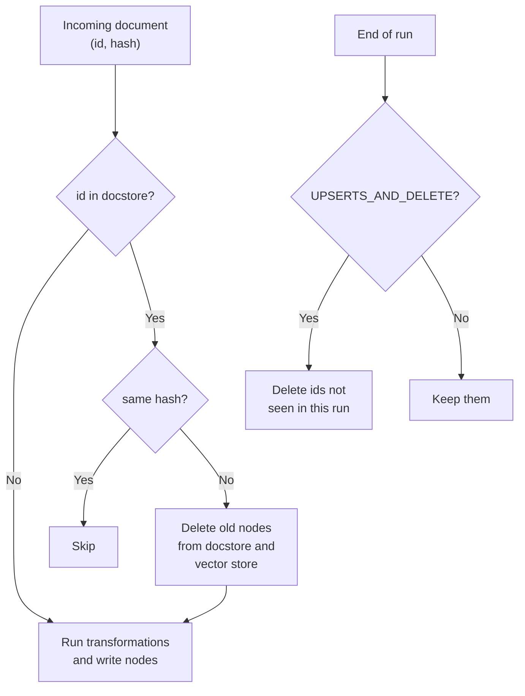

Every LlamaIndex application starts by turning sources into `Document` objects and pushing them through a chain of transformations into storage. LlamaIndex splits this work between **readers**, which produce documents, and the **`IngestionPipeline`**, which transforms them, de-duplicates them against what was ingested before, and writes the results to a vector store. Done carelessly, ingestion is the part of a LlamaIndex system that silently re-embeds the whole corpus every night, keeps deleted policies searchable, or loses the metadata that access control depends on.

This lesson covers readers (`SimpleDirectoryReader` and custom readers), the `Document` fields that decide what gets embedded and what the LLM sees, and the pipeline's caching and document-store strategies for incremental updates. It assumes the general ideas from [Document loaders](/learn/document-engineering/document-loaders) and [Incremental ingestion](/learn/understanding-document-ingestion/incremental-ingestion) and shows how LlamaIndex implements them. How documents are cut into nodes is the next lesson, [Node parsing](/learn/llamaindex/node-parsing).

## Learning objectives

- Load a directory of files with `SimpleDirectoryReader` and control which files are read, how they are identified and what metadata they carry.
- Explain how `excluded_embed_metadata_keys`, `excluded_llm_metadata_keys` and the metadata templates change the text that is embedded and the text the LLM sees.
- Build an `IngestionPipeline` with a docstore and vector store, and choose between the `UPSERTS`, `DUPLICATES_ONLY` and `UPSERTS_AND_DELETE` strategies.
- Predict when a document will be re-processed by reasoning about its identifier and its hash.
- Write a custom reader for a source that has no ready-made integration.

## Prerequisites

- [Index architecture](/learn/llamaindex/index-architecture): documents, nodes, the docstore and the vector store.
- [Document loaders](/learn/document-engineering/document-loaders): the loader contract and lazy loading.
- [Document identifiers](/learn/document-engineering/document-identifiers): why stable identifiers matter.
- [Incremental ingestion](/learn/understanding-document-ingestion/incremental-ingestion): change detection with content hashes.

## Why this matters

A first LlamaIndex script reads a folder and builds an index in memory. A production system re-runs ingestion on a schedule against a corpus that changes: policies are edited, runbooks are retired, new pages appear. Three questions decide whether that works:

1. **Identity.** When the same file is read tomorrow, does it get the same document id? If not, the system cannot tell an update from a new document, and old versions accumulate in the index.
2. **Change detection.** If nothing in the file changed, is it skipped? If not, every run pays to embed the whole corpus again, which is slow, costs money with a hosted embedding model, and churns the vector store.
3. **Deletion.** When a source disappears, do its nodes disappear too? If not, AskMeridian keeps quoting a runbook that was withdrawn because it was wrong.

LlamaIndex answers all three, but only when the pieces are configured together: a stable `id_`, a hash that reflects only meaningful content, and a pipeline with a persistent docstore and the right strategy. The defaults get at least one of these wrong for file-based sources, as the code in this lesson shows.

## The intuition

Picture the post room at Meridian's head office. Every morning a courier brings the full set of policy binders, whether or not anything changed. A sensible clerk does not re-file every page. She keeps a ledger: binder name, and a fingerprint of its contents. For each binder that arrives she looks up its name. New name: file it. Known name, same fingerprint: put it aside. Known name, different fingerprint: remove the old pages from the cabinet and file the new ones. At the end, any name in the ledger that did not arrive today is a withdrawn binder, and its pages come out of the cabinet.

Two things can wreck her system. If binders arrive with a different label each day, every one looks new. And if the fingerprint includes the date stamped on the courier's delivery slip, every binder looks changed. The ledger is the docstore, the label is the document id, the fingerprint is the document hash, and the delivery slip is file-system metadata.

## How it works

### Readers produce documents

A **reader** is any class with a `load_data()` method that returns a list of `Document`s. The base class, `BaseReader`, also defines `lazy_load_data()`, a generator, and async variants. Readers for hundreds of sources (Notion, Confluence, Google Drive, databases, web pages) are published as separate packages named `llama-index-readers-<source>` and catalogued on LlamaHub. Each is a dependency with its own quality, maintenance and permissions model; read its source before trusting it with production data.

**`SimpleDirectoryReader`** in the core package reads a directory or a list of files. Its main parameters:

- `input_dir` or `input_files`: what to read. `recursive=True` descends into subfolders.
- `required_exts` (for example `[".md", ".pdf"]`) and `exclude` (glob patterns): which files qualify. Hidden files are skipped by default (`exclude_hidden=True`).
- `file_extractor`: a mapping from extension to reader. Plain text and Markdown are read as text by the core package. PDF, DOCX, PPTX, CSV and others are handled by readers in the separate `llama-index-readers-file` package; without it, those formats are skipped with a warning or need an extractor you supply.
- `filename_as_id=True`: use the file path as the document id. Without it, ids are random UUIDs and incremental ingestion cannot work. For readers that return several documents per file (for example, one per PDF page), ids become `<path>_part_<i>`.
- `file_metadata`: a function from file path to metadata dictionary, replacing the default.
- `num_workers`: parallel loading in several processes.
- `iter_data()`: yields the documents for one file at a time, for corpora too large to hold in memory.

The default metadata function records `file_path`, `file_name`, `file_type`, `file_size`, `creation_date`, `last_modified_date` and `last_accessed_date` (when the file system reports them). The reader also adds every key except `file_path` to the documents' exclusion lists, so that they are not embedded and not shown to the LLM.

### What a document's metadata does

A `Document` (and every node derived from it) has a `metadata` dictionary and two lists that say where that metadata is hidden:

- `excluded_embed_metadata_keys`: keys left out of the text that is embedded.
- `excluded_llm_metadata_keys`: keys left out of the text placed in the LLM's prompt.

The text for each purpose is built by `get_content(metadata_mode=...)`. With `MetadataMode.EMBED`, LlamaIndex formats each non-excluded key with `metadata_template` (default `"{key}: {value}"`), joins them with `metadata_separator` (a newline), and places the result above the text using `text_template`. `MetadataMode.LLM` does the same with the other exclusion list; `MetadataMode.NONE` returns the bare text; `MetadataMode.ALL` includes everything.

This is a useful lever and a trap. Embedding a title or section name with each chunk often improves retrieval, because the chunk alone may never name its subject (the idea behind [Contextual retrieval](/learn/advanced-retrieval/contextual-retrieval)). Embedding an internal identifier, a file size or an access-control list adds noise to the vector and, in the LLM prompt, can leak information. Decide per key, and remember that whatever you exclude is still stored and still filterable.

### Metadata extractors

LlamaIndex also ships **metadata extractors**, transformations that call the LLM to add metadata to nodes: `TitleExtractor`, `SummaryExtractor`, `QuestionsAnsweredExtractor`, `KeywordExtractor` and `DocumentContextExtractor`. They can help retrieval, and they cost one or more LLM calls per node or document at ingestion time. Treat them like any other enrichment step: measure retrieval with and without them before paying for them on the whole corpus.

### The ingestion pipeline

An **`IngestionPipeline`** runs a list of **transformations** over documents and returns nodes. A transformation is any `TransformComponent`, a callable that takes a list of nodes and returns a list of nodes: node parsers, metadata extractors, embedding models (which fill in `node.embedding`) and your own classes. Order matters: a parser must come before an embedding model, because the parser's output is what gets embedded.

The pipeline takes three optional stores:

- **`cache`**: an `IngestionCache` (in memory by default; Redis, MongoDB and other backends are available as integrations). For each transformation, the pipeline hashes the full content of its input nodes plus the transformation's configuration; if that hash is in the cache, it reuses the cached output instead of running the transformation.
- **`docstore`**: a document store used as the ledger of document ids and hashes. Without one, there is no de-duplication between runs.
- **`vector_store`**: when given, the pipeline writes the final nodes (which must have embeddings) into it. You can then build an index on top with `VectorStoreIndex.from_vector_store(vector_store)`.

`pipeline.persist(persist_dir)` saves the cache and docstore; `pipeline.load(persist_dir)` restores them. The vector store is persisted by itself (or lives in an external database).

### Document-store strategies

With a docstore attached, each run first decides which input documents to process. The decision uses two values per document: its id and its **hash**, a SHA-256 over the document's metadata (all keys, ignoring the exclusion lists) and its text. The strategy is chosen with `docstore_strategy`:

1. **`UPSERTS`** (the default). For each document: if its id is not in the docstore, process it. If the id is there with the same hash, skip it. If the id is there with a different hash, delete its old nodes from the docstore and vector store, then process it.
2. **`UPSERTS_AND_DELETE`**. As above, and then delete from both stores every document id that was in the docstore but not in this run's input. Use it only when each run passes the **complete** current corpus; a partial run would delete everything it did not include.
3. **`DUPLICATES_ONLY`**. Ignore ids; skip any document whose hash has been seen before. Useful for de-duplicating identical content from different sources, but it cannot express an update: an edited document gets a new hash and is added alongside the old one.



Deleting old nodes by document id works because every node keeps a source relationship to its document, which vector stores record as `ref_doc_id` (or an equivalent payload field). This is the reason node parsers must preserve that relationship and why documents need ids before they are parsed.

### The hash trap with file metadata

The hash covers **all** metadata. With `SimpleDirectoryReader`'s default metadata function, that includes `last_modified_date`, which changes whenever a file is re-written, even with identical contents: a sync job that re-downloads files, a `git checkout`, a backup restore. Each such file is then "changed" and re-embedded. The fix is a `file_metadata` function that records only what you want to keep, plus ids that do not depend on where the folder happens to be mounted.

## In code

**The problem.** Ingest Meridian's handbook and runbooks twice. Between runs, a sync job re-writes every file with identical text, HR edits the leave policy, the laptop runbook is withdrawn and a password runbook appears. Run the scenario once with the default file metadata and once with stable metadata and ids, and count how many nodes each run re-processes.

**Dependencies.**

```bash
pip install llama-index-core sentence-transformers
```

```python
import os, shutil
from datetime import datetime, timezone
from pathlib import Path
from sentence_transformers import SentenceTransformer
from llama_index.core import SimpleDirectoryReader
from llama_index.core.embeddings import BaseEmbedding
from llama_index.core.ingestion import DocstoreStrategy, IngestionPipeline
from llama_index.core.node_parser import SentenceSplitter
from llama_index.core.storage.docstore import SimpleDocumentStore
from llama_index.core.vector_stores import SimpleVectorStore

_model = SentenceTransformer("sentence-transformers/all-MiniLM-L6-v2")

class MiniLMEmbedding(BaseEmbedding):
    def _get_text_embedding(self, text): return _model.encode(text, normalize_embeddings=True).tolist()
    def _get_text_embeddings(self, texts): return _model.encode(texts, normalize_embeddings=True).tolist()
    def _get_query_embedding(self, query): return self._get_text_embedding(query)
    async def _aget_query_embedding(self, query): return self._get_query_embedding(query)

ROOT = Path("meridian_docs")
FILES = {
    "handbook/leave.md": "# Annual leave\nAnnual leave is 25 days. Up to 5 unused days carry over and must be used by 31 March.",
    "handbook/remote.md": "# Remote work\nStaff may work remotely up to 3 days a week. The home-office budget is £400.",
    "runbooks/vpn.md": "# VPN\nError E-4021 means the VPN client is out of date; update it from the IT portal.",
    "runbooks/laptops.md": "# Laptops\nThe laptop refresh cycle is 3 years. Report a lost laptop to the support desk at once.",
}

def write(rel, text, day):
    path = ROOT / rel
    path.parent.mkdir(parents=True, exist_ok=True)
    path.write_text(text, encoding="utf-8")
    ts = datetime(2025, 1, day, tzinfo=timezone.utc).timestamp()
    os.utime(path, (ts, ts))                     # fixed access and modification times

def stable_metadata(file_path: str) -> dict:
    rel = Path(file_path).relative_to(ROOT.resolve())
    return {"file_path": str(rel), "corpus": rel.parts[0]}

def ingest_twice(file_metadata, stable_ids=False):
    shutil.rmtree(ROOT, ignore_errors=True)
    for rel, text in FILES.items():
        write(rel, text, day=6)
    pipeline = IngestionPipeline(
        transformations=[SentenceSplitter(chunk_size=128, chunk_overlap=0), MiniLMEmbedding()],
        docstore=SimpleDocumentStore(),
        vector_store=SimpleVectorStore(),
        docstore_strategy=DocstoreStrategy.UPSERTS_AND_DELETE,
    )
    def run(label):
        reader = SimpleDirectoryReader(input_dir=str(ROOT), recursive=True, required_exts=[".md"],
                                       filename_as_id=True, file_metadata=file_metadata)
        docs = reader.load_data()
        if stable_ids:                           # key documents by path inside the corpus
            for d in docs:
                d.id_ = d.metadata["file_path"]
        processed = pipeline.run(documents=docs)
        print(f"  {label}: read {len(docs)} docs, processed {len(processed)} nodes from "
              f"{sorted({Path(n.ref_doc_id).name for n in processed})}, "
              f"vectors stored: {len(pipeline.vector_store.data.embedding_dict)}")
        return docs
    docs = run("run 1")
    # Overnight: a sync job re-downloads every file (new timestamps, same text),
    # HR edits the leave policy, the laptop runbook is deleted and a new one appears.
    for rel, text in FILES.items():
        write(rel, text, day=7)
    write("handbook/leave.md", FILES["handbook/leave.md"].replace("25 days", "25 days (pro rata for part-time staff)"), day=7)
    (ROOT / "runbooks/laptops.md").unlink()
    write("runbooks/passwords.md", "# Passwords\nPasswords must be rotated every 90 days.", day=7)
    run("run 2")
    return docs[0]

print("Default file metadata:")
doc = ingest_twice(file_metadata=None)
print("  id: absolute path ending", "/".join(Path(doc.id_).parts[-3:]))
print("  metadata keys:", sorted(doc.metadata))
print("  hidden from embedding:", sorted(doc.excluded_embed_metadata_keys))
print("Stable file metadata:")
doc = ingest_twice(file_metadata=stable_metadata, stable_ids=True)
print("  metadata:", doc.metadata, "| id:", doc.id_)
```

```output
Default file metadata:
  run 1: read 4 docs, processed 4 nodes from ['laptops.md', 'leave.md', 'remote.md', 'vpn.md'], vectors stored: 4
  run 2: read 4 docs, processed 4 nodes from ['leave.md', 'passwords.md', 'remote.md', 'vpn.md'], vectors stored: 4
  id: absolute path ending meridian_docs/handbook/leave.md
  metadata keys: ['creation_date', 'file_name', 'file_path', 'file_size', 'file_type', 'last_modified_date']
  hidden from embedding: ['creation_date', 'file_name', 'file_size', 'file_type', 'last_accessed_date', 'last_modified_date']
Stable file metadata:
  run 1: read 4 docs, processed 4 nodes from ['laptops.md', 'leave.md', 'remote.md', 'vpn.md'], vectors stored: 4
  run 2: read 4 docs, processed 2 nodes from ['leave.md', 'passwords.md'], vectors stored: 4
  metadata: {'file_path': 'handbook/leave.md', 'corpus': 'handbook'} | id: handbook/leave.md
```

**The important lines.**

- `os.utime` fixes each file's timestamps, so the run is reproducible and the "re-download" on day 7 changes timestamps without changing text.
- `filename_as_id=True` makes ids path-based. The default ids are absolute paths, so the same corpus mounted at a different location gets different ids; the stable variant replaces them with paths relative to the corpus root.
- `stable_metadata` returns only `file_path` (relative) and `corpus`. The `corpus` key is something you will want for [metadata filters](/learn/llamaindex/vector-indexes) and for [routing](/learn/llamaindex/router-engines).
- `DocstoreStrategy.UPSERTS_AND_DELETE` is safe here because each run reads the whole folder.
- The pipeline's final transformation is the embedding model, so the nodes it writes to `SimpleVectorStore` carry vectors.

**What the output means.** Both variants remove the withdrawn laptop runbook and add the password runbook: four vectors before, four after. The difference is what was re-processed. With default metadata, `remote.md` and `vpn.md` were re-split and re-embedded although their text was identical, because `last_modified_date` is part of the hash. With stable metadata, only the edited leave policy and the new file were processed. On four files the waste is two embeddings; on Meridian's real corpus, re-written in full by a nightly sync, it is the entire corpus every night.

The excluded-keys line shows the reader hides its file-system keys from embedding (and from the LLM), so they do not pollute vectors; they still count towards the hash. `last_accessed_date` is in the exclusion list but not in the metadata because this file system did not report it.

**Common errors.**

- *Everything is re-processed every run* even with a docstore: either the docstore was not persisted between runs (`pipeline.persist` and `pipeline.load`, or a database-backed docstore), or ids or hashes are unstable.
- *Old versions remain searchable*: documents lacked stable ids, so an edit looked like a new document. Check `node.ref_doc_id` on a few stored nodes.
- *Everything disappeared after a partial run*: `UPSERTS_AND_DELETE` was used with a subset of the corpus.
- *PDFs are silently skipped*: install `llama-index-readers-file` or pass a `file_extractor` for `.pdf`.

**Extending it.** Add `pipeline.persist("./pipeline_storage")` after each run and `pipeline.load(...)` before the next, in separate processes, to confirm that de-duplication survives a restart. Then put a `TitleExtractor` before the embedding step with a real LLM, and note how many LLM calls one run makes.

### A custom reader

When no reader exists for a source, writing one is a short class. This one reads Meridian's Atlas error-code catalogue from a JSON export, one document per code, with the code as the id and the owning team as metadata:

```python
import json
from llama_index.core import Document
from llama_index.core.readers.base import BaseReader

class AtlasErrorCatalogueReader(BaseReader):
    def __init__(self, path: str):
        self.path = path

    def lazy_load_data(self):
        with open(self.path, encoding="utf-8") as f:
            for entry in json.load(f):
                yield Document(
                    id_=f"atlas-error/{entry['code']}",
                    text=f"Error {entry['code']}: {entry['meaning']}",
                    metadata={"corpus": "runbooks", "code": entry["code"], "owner": entry["owner"]},
                    excluded_embed_metadata_keys=["owner"],
                    excluded_llm_metadata_keys=["owner"],
                )

with open("atlas_errors.json", "w", encoding="utf-8") as f:
    json.dump([{"code": "E-4021", "meaning": "The VPN client is out of date; update it from the IT portal.", "owner": "IT"},
               {"code": "E-4012", "meaning": "VPN certificate expired.", "owner": "IT"}], f)

for doc in AtlasErrorCatalogueReader("atlas_errors.json").load_data():
    print(doc.id_, "|", doc.get_content(metadata_mode="embed").replace("\n", " / "))
```

```output
atlas-error/E-4021 | corpus: runbooks / code: E-4021 /  / Error E-4021: The VPN client is out of date; update it from the IT portal.
atlas-error/E-4012 | corpus: runbooks / code: E-4012 /  / Error E-4012: VPN certificate expired.
```

Implementing only `lazy_load_data` is enough: the base class's `load_data` collects the generator into a list. The printed embedding text shows the metadata block, a blank line (the empty segment between the slashes), then the text; `owner` is stored but neither embedded nor shown to the LLM.

## A real-world example

Meridian's Platform team moved AskMeridian's ingestion into a nightly LlamaIndex job: a reader for the HR team's handbook export, `SimpleDirectoryReader` for the IT runbooks synced from a Git repository, and an `IngestionPipeline` writing to Qdrant with `UPSERTS`. Within a week, two problems appeared.

First, the embedding bill was flat at "the whole corpus" every night, although only a handful of runbooks changed each week. The job's logs showed every runbook processed on every run. The cause was the one demonstrated above: the job cloned the Git repository fresh each night, so every file's modification time was new, and the default metadata put that time into the hash. The fix was a `file_metadata` function recording the repository-relative path, the corpus and the Git commit that last touched the file.

Second, staff reported AskMeridian quoting a VPN runbook that IT had deleted. `UPSERTS` never deletes, so the old nodes stayed in Qdrant. The team considered switching to `UPSERTS_AND_DELETE`, then noticed that the handbook and the runbooks were ingested in two separate pipeline runs sharing one docstore: with that strategy, the runbook run would have deleted the entire handbook. They gave each corpus its own docstore namespace and pipeline, switched both to `UPSERTS_AND_DELETE`, and added a guard that aborts a run if more than a set fraction of known documents would be deleted, so that a failed export cannot empty the index.

## Common mistakes

- **Leaving `filename_as_id` off.** Random ids make every run look like new documents; nothing is updated or deleted, and duplicates pile up.
- **Hashing volatile metadata.** Modification dates, download times or file sizes in metadata cause unchanged documents to be re-embedded.
- **Not persisting the docstore.** An in-memory docstore forgets everything when the process exits, so the next run treats every document as new.
- **Using `UPSERTS_AND_DELETE` on a partial input.** Every document not in the run is deleted from the vector store.
- **Embedding every metadata key.** Identifiers, sizes and permission lists add noise to vectors and can leak into prompts.
- **Running LLM metadata extractors on the full corpus untested.** Ingestion cost multiplies with no evidence of better retrieval.

## Best practices

- Give every document a stable, location-independent id derived from the source system (path within a repository, page id, row key).
- Define metadata explicitly with a `file_metadata` function or in your reader; keep volatile values out of it, or store them where they do not affect the hash.
- Choose the exclusion lists per key: embed titles and section names; hide internal ids and permissions from both embedding and the LLM.
- Use one pipeline and one docstore namespace per corpus, and persist the docstore in a database for anything that runs on a schedule.
- Add a deletion guard (maximum fraction deleted per run) before enabling `UPSERTS_AND_DELETE`.
- Log, for every run, how many documents were new, updated, unchanged and deleted.

## Performance considerations

The docstore check is cheap: one hash lookup per document. The expensive steps are the transformations, so the saving from correct change detection is roughly the fraction of the corpus that did not change. If Meridian's 8,000 runbook and handbook documents average 6 chunks each and about 1% change per day (an assumed rate), a correct pipeline embeds about 480 chunks a night instead of 48,000, a hundredfold reduction.

`SimpleDirectoryReader` with `num_workers` parallelises reading across processes, which helps when parsing (PDF text extraction, for example) is CPU-bound. Embedding throughput is set by the embedding model: raise `embed_batch_size` for hosted APIs up to the provider's limit; for local models, batches of 32 to 128 texts are typical starting points for a GPU, to be tuned by measurement. `pipeline.run(num_workers=...)` can also run transformations in several processes; check that your transformations are picklable before relying on it.

The `IngestionCache` saves repeated work when the same content is transformed with the same settings, for example when you re-run an experiment. Its key covers the input content and the transformation's configuration, so changing `chunk_size` correctly invalidates it.

## Security considerations

Ingestion is where untrusted content enters the system. Documents from wikis, tickets or shared drives can contain text written to manipulate the model (see [Indirect prompt injection](/learn/rag-security-fundamentals/indirect-prompt-injection)); readers do not sanitise it. Keep permission metadata (owning team, audience) on every document from the start, because access filtering at query time can only use metadata that ingestion preserved, and hide it from the LLM with `excluded_llm_metadata_keys`. Third-party readers run with the credentials you give them: grant read-only, narrowly scoped tokens from environment variables, and review the reader's code before use. Finally, when a source deletes a document for legal or privacy reasons, `UPSERTS` will not remove it; deletion must be explicit, as discussed in [Secure deletion](/learn/enterprise-rag-governance/secure-deletion).

## Summary

- Readers turn sources into `Document`s; `SimpleDirectoryReader` handles local files, and many other readers are separate packages.
- Metadata is embedded and shown to the LLM unless excluded per key; the exclusion lists shape both retrieval and prompts.
- An `IngestionPipeline` with a persistent docstore skips unchanged documents by comparing ids and hashes, and replaces changed ones.
- The hash covers all metadata, so volatile file metadata defeats change detection; stable ids and explicit metadata fix it.
- `UPSERTS_AND_DELETE` removes withdrawn documents but is only safe when each run sees the whole corpus.

## Exercises

1. A document's id stays the same but someone adds a metadata key `reviewed_by`. Under `UPSERTS`, what happens on the next run, and why?

<details><summary>Show solution</summary>

The document is re-processed: its old nodes are deleted from the docstore and vector store and new ones written. The hash covers all metadata, so adding a key changes the hash even though the text is identical.

</details>

2. Why can `DUPLICATES_ONLY` not express "this policy was edited"? Give a case where it is still the right choice.

<details><summary>Show solution</summary>

It ignores ids and checks only whether a hash has been seen. An edited policy has a new hash, so it is added, and the old version, whose hash is still in the docstore, stays. It suits sources where content never changes in place but the same content arrives repeatedly, such as an archive of emails forwarded by several people.

</details>

3. Modify the script so the pipeline persists to disk after run 1 and run 2 starts from a freshly loaded pipeline. Which objects must be persisted, and what changes in the output if you forget the docstore?

<details><summary>Show solution</summary>

Call `pipeline.persist("./pipeline_storage")` after run 1 and `pipeline.vector_store.persist("./vectors.json")`; for run 2 build a new `IngestionPipeline` with the same transformations, `vector_store=SimpleVectorStore.from_persist_path("./vectors.json")` and the same strategy, then call `pipeline.load("./pipeline_storage")`. `persist` saves the cache and the docstore; the vector store is separate. If the docstore is not restored, run 2 sees an empty ledger and processes all four documents, and because nothing is known about the old ids, the old vectors are not deleted, so the vector store ends with duplicates.

</details>

4. Design: Meridian's Confluence space is ingested hourly through an API that returns only pages changed since the last run, plus a separate list of deleted page ids. Which strategy would you use, and how would you handle deletions?

<details><summary>Show solution</summary>

Use `UPSERTS` with page ids as document ids, because each run sees only a subset and `UPSERTS_AND_DELETE` would delete every page not in it. Handle the deleted-ids list explicitly: for each id, delete it from the vector store (`vector_store.delete(ref_doc_id)`) and from the docstore (`docstore.delete_ref_doc(ref_doc_id)`), or through the index with `index.delete_ref_doc(ref_doc_id, delete_from_docstore=True)`. Run a periodic full reconciliation (all ids from the API against all ids in the docstore) to catch missed deletion events.

</details>

## Check your understanding

```quiz
[
  {
    "q": "With `SimpleDirectoryReader`'s default settings, what is a document's id?",
    "options": [
      "The file name",
      "The absolute file path",
      "A hash of the file contents",
      "A random UUID"
    ],
    "answer": 3,
    "why": "Without `filename_as_id=True`, documents get random UUIDs, so the same file read twice looks like two different documents."
  },
  {
    "q": "A nightly job re-downloads unchanged files, and the pipeline (with a persisted docstore and `UPSERTS`) re-embeds all of them. What is the most likely cause?",
    "options": [
      "The document hash includes the file's modification date from the default metadata",
      "The embedding model's cache was cleared",
      "`UPSERTS` always re-processes every document",
      "The vector store does not support deletes"
    ],
    "answer": 0,
    "why": "The hash covers all metadata. Re-downloading changes `last_modified_date`, so every document's hash changes although its text does not."
  },
  {
    "q": "Which strategy deletes documents that were ingested before but are absent from the current run?",
    "options": [
      "`UPSERTS`",
      "`DUPLICATES_ONLY`",
      "`UPSERTS_AND_DELETE`",
      "None; deletion is always manual"
    ],
    "answer": 2,
    "why": "Only `UPSERTS_AND_DELETE` removes ids missing from the input, which is why it must receive the complete corpus."
  },
  {
    "q": "A document has `metadata={\"title\": \"VPN\", \"acl\": \"it-staff\"}` and `excluded_llm_metadata_keys=[\"acl\"]`. What does that achieve?",
    "options": [
      "`acl` is deleted from the stored node",
      "`acl` is not placed in the LLM prompt but is still embedded unless also excluded from embedding",
      "`acl` can no longer be used in metadata filters",
      "`acl` is excluded from the document hash"
    ],
    "answer": 1,
    "why": "The two exclusion lists are independent and only affect text rendering. The key is still stored, filterable and hashed."
  },
  {
    "q": "In an `IngestionPipeline`, why must the node parser come before the embedding model in `transformations`?",
    "options": [
      "The embedding model cannot accept `Document` objects",
      "The parser removes metadata that would break embedding",
      "The cache only works in that order",
      "Each transformation receives the previous one's output, and the chunks are what should be embedded"
    ],
    "answer": 3,
    "why": "Transformations run in order. Embedding first would produce one vector per whole document, then the parser would create new nodes without embeddings."
  }
]
```

## Further reading

- [LlamaIndex documentation](https://docs.llamaindex.ai/): "Loading data", "SimpleDirectoryReader", "Ingestion pipeline" and "Document management" guides.
- LlamaIndex documentation, "Defining and customizing documents": metadata templates and the embed and LLM exclusion lists.
- LlamaIndex documentation, "Metadata extraction": the LLM-based extractors and their costs.
- LlamaHub (linked from the LlamaIndex documentation): the catalogue of reader and integration packages.
- [LlamaIndex source code on GitHub](https://github.com/run-llama/llama_index): `llama-index-core/llama_index/core/ingestion/pipeline.py` contains the document-store strategies described here.
