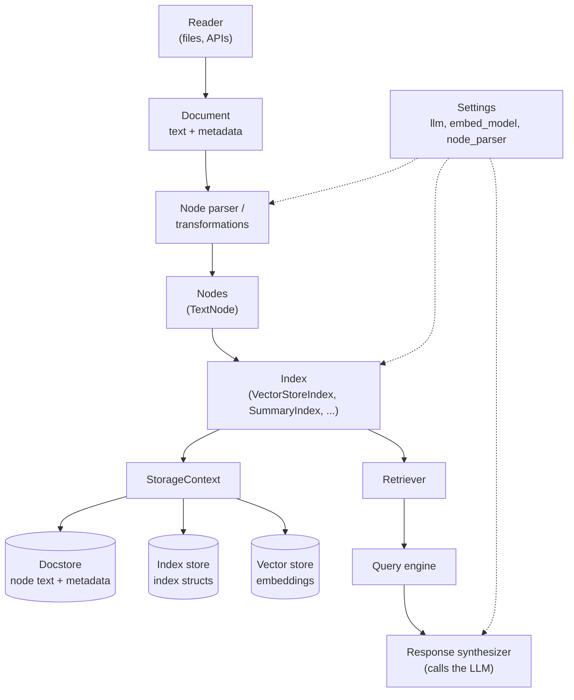

LlamaIndex is a Python framework built around one idea: before a language model can answer from your data, that data has to be turned into a structure that can be searched, and the structure deserves to be a first-class object. The framework calls that structure an **index**. Everything else in LlamaIndex, from readers to routers, either feeds an index or reads from one.

This lesson is the map for the whole module. It names the objects LlamaIndex is built from (documents, nodes, indexes, storage, retrievers, query engines and the global `Settings`), shows which object owns which piece of data, and explains what actually happens in memory and on disk when you build, persist and reload an index. The later lessons zoom in on each part: [Document ingestion](/learn/llamaindex/document-ingestion), [Node parsing](/learn/llamaindex/node-parsing), [Query engines](/learn/llamaindex/query-engines), [Vector indexes](/learn/llamaindex/vector-indexes), [Router engines](/learn/llamaindex/router-engines), [Sub-question engines](/learn/llamaindex/sub-question-engines) and [Response synthesis](/learn/llamaindex/response-synthesis).

## Learning objectives

- Name the core LlamaIndex objects and state, for each, what data it owns.
- Explain what a `StorageContext` contains and which store holds node text, vectors and index structure.
- Compare the main index types by what they compute at build time and what their retrievers do at query time.
- Build, persist and reload an index with a local embedding model, and predict which files appear on disk.
- Configure the global `Settings` object and explain why it is a common source of hidden behaviour.

## Prerequisites

- [Traditional RAG architecture](/learn/rag-architecture-fundamentals/traditional-rag-architecture): the indexing, retrieval and generation stages that LlamaIndex packages.
- [Indexing pipeline](/learn/rag-architecture-fundamentals/indexing-pipeline): what an indexing pipeline must produce.
- [What is a vector database?](/learn/vector-database-fundamentals/what-is-a-vector-database): what a vector store keeps and how it is searched.
- [Classes and object-oriented programming](/learn/python-for-rag-engineering/oop): the framework is a set of classes with contracts; you will subclass one.

## Why this matters

A RAG system written from scratch is a few hundred lines: load files, split them, embed the pieces, store vectors, search, build a prompt, call a model. Frameworks such as LlamaIndex promise to shrink that to five lines, and they do: `VectorStoreIndex.from_documents(docs).as_query_engine().query("...")` really does run an entire pipeline.

The trouble starts when the five lines misbehave. Answers cite the wrong section. A restarted service answers differently from the one that built the index. The bill shows calls to a model you never configured. Each of these has a cause inside the framework's object graph: a default embedding model you did not set, a docstore that was not persisted, an index type that calls the LLM at build time. If you know only the five-line version, you cannot find any of them. If you know which object owns which data and which defaults apply where, each is a short investigation.

There is also a design reason to learn the architecture. LlamaIndex's objects are deliberately swappable: any vector store, any embedding model, any LLM, any retriever behind a query engine. Using the framework well means knowing which seams exist so that you replace a part instead of fighting it.

## The intuition

Think of a reference library.

The **documents** are the books as they arrive from the publisher. Nobody reads a whole book to answer one question, so the librarians cut each book into passages and file each passage on its own card; those cards are **nodes**. Each card records which book it came from and which cards come before and after it.

The cards go into a **filing cabinet** (the **docstore**). But a cabinet by itself is just storage; to find anything you need a catalogue. One library keeps a **subject catalogue**: every card is placed on a map of topics, so you can walk to the area nearest your question (a **vector index**). Another keeps a plain **list** of every card, which is useless for a quick lookup but perfect when someone asks "summarise this whole book" (a **summary index**). A third keeps a **keyword register** that points from words to cards (a **keyword table index**). Several catalogues can describe the same cabinet of cards.

The **storage context** is the building: the cabinet, the catalogues and the map, kept together so the library can close at night and open again in the morning. A **retriever** is the librarian who uses one catalogue to fetch cards, and a **query engine** is the reference desk: it takes a question, asks a librarian for cards, and writes an answer from them.

The key insight: the cards and the catalogues are separate things. A catalogue mostly holds *references* to cards. Lose the cabinet and the catalogue points at nothing.

## How it works

### The object graph



Read the diagram top to bottom: data flows from readers to nodes to an index, the index persists itself through a storage context, and at query time a retriever and a query engine read from it. `Settings` supplies defaults to every stage that needs a model.

### Documents and nodes

A **`Document`** is a container for a whole source: a file, a web page, a database row. It has an identifier (`id_`, also exposed as `doc_id`), the `text`, and a `metadata` dictionary. Documents are what readers produce; [Document ingestion](/learn/llamaindex/document-ingestion) covers them.

A **node** is a chunk of a document and the unit everything downstream works with. The usual class is `TextNode`; `Document` is in fact a subclass of the same base class, which is why an index can be built from either. A node carries:

- `node_id`: its own identifier.
- `text` and `metadata`: the chunk and a copy of the document's metadata.
- `relationships`: links to its source document and to its previous and next siblings (and to parents or children in hierarchical parsing).
- `ref_doc_id`: a convenience property that follows the source relationship back to the document's identifier. Deleting or updating "a document" in an index works through this.
- `embedding`: an optional vector field.

The step from documents to nodes is a **transformation**, most often a node parser such as `SentenceSplitter`. [Node parsing](/learn/llamaindex/node-parsing) owns that topic.

### Indexes are data structures over nodes

An **index** in LlamaIndex is two things at once. It is an **index struct**, a small serialisable record of how nodes are organised (a dictionary from node ids to vector ids, an ordered list of node ids, a keyword table, a tree), and it is a Python object that knows how to build that struct and how to hand out retrievers that read it. Every index type answers two questions differently: what work is done when nodes are inserted, and what a retriever does with a query.

| Index | Build-time work | Default retrieval | Typical use |
| --- | --- | --- | --- |
| `VectorStoreIndex` | Embed every node | Top-k by vector similarity (default k = 2) | Semantic search over many chunks; the default |
| `SummaryIndex` (formerly `ListIndex`) | None: store node ids in order | Return every node | Summarising a small set of documents in full |
| `SimpleKeywordTableIndex` | Extract keywords with a regex | Nodes sharing keywords with the query | Exact-term lookup without embeddings |
| `KeywordTableIndex` | Extract keywords with the LLM | As above | As above, with better keywords at LLM cost |
| `TreeIndex` | LLM writes summaries bottom-up into a tree | Walk down from the root, choosing children | Hierarchical summarisation; rarely the first choice |
| `DocumentSummaryIndex` | LLM writes one summary per document | Choose documents by their summaries, return their nodes | Document-level routing within one index |
| `PropertyGraphIndex` | Extract entities and relations into a graph store | Graph traversal plus optional vectors | Relationship questions (see [Graph RAG](/learn/graph-rag)) |

Two consequences follow from this table, and both bite in production. First, **some indexes call the LLM while they are built**. A `TreeIndex` or `KeywordTableIndex` over 10,000 nodes means thousands of model calls before the first question is asked. Second, **the default retriever of an index is a design decision baked into its type**. A `SummaryIndex` returns every node, which is exactly right for "summarise the leave policy" and ruinous for "what is error E-4021?" over a large corpus. Choosing between index types per question is what [Router engines](/learn/llamaindex/router-engines) automate.

In practice, the vector index carries most production systems; the others are used for specific question types alongside it. [Vector indexes](/learn/llamaindex/vector-indexes) covers it in depth.

### The storage context

A **`StorageContext`** bundles the stores an index needs:

1. **Docstore** (`docstore`): node id to node, including text, metadata and relationships. Also records which nodes came from which document and a hash per document, which incremental ingestion relies on.
2. **Index store** (`index_store`): index id to index struct. Several indexes can share one storage context, and each is found by its `index_id`.
3. **Vector store** (`vector_store`): vector id to embedding, plus whatever the store supports (metadata payloads, filters). The default is the in-memory `SimpleVectorStore`; production systems plug in Qdrant, pgvector, Elasticsearch and others through integration packages.
4. **Graph and property-graph stores**: used only by the graph indexes.

Where node *text* lives depends on the vector store. `SimpleVectorStore` keeps only vectors, so `VectorStoreIndex` also writes each node to the docstore and the index struct maps node ids to vector ids. Most external vector databases store the node's text and metadata in the record's payload; then, by default, LlamaIndex skips the docstore for that index and the vector database alone is the source of truth. The constructor flag `store_nodes_override=True` forces nodes into the docstore anyway, which matters when another index or a document-management step needs them. This difference explains a common surprise: an index built on an external store "persists" a nearly empty `docstore.json`.

### Persisting and loading

With the default in-memory stores, `storage_context.persist(persist_dir=...)` writes one JSON file per store, and loading reverses it:

```python
storage_context = StorageContext.from_defaults(persist_dir="./storage")
index = load_index_from_storage(storage_context, index_id="vector")
```

Step by step, a load does the following:

1. Each store is read back from its JSON file.
2. The index store is asked for the struct with the given `index_id` (if there is only one, the id may be omitted).
3. The struct's type tells LlamaIndex which index class to construct.
4. The index object is built around the struct and the storage context without re-embedding or re-parsing anything.

What is **not** persisted is just as important: the embedding model, the LLM and the node parser. The loaded index embeds queries with whatever embedding model is configured at load time. If that is a different model from the one used at build time, query vectors and stored vectors come from different spaces, scores become meaningless, and nothing raises an error. If the dimensions differ you get an error; if they match by coincidence you get silent nonsense. [Offline and online processing](/learn/rag-architecture-fundamentals/offline-and-online-processing) explained why both sides must use the same model; in LlamaIndex, enforcing that is your job.

> [!WARNING]
> The JSON-backed default stores load entirely into memory and rewrite whole files on persist. They are ideal for learning, tests and a few thousand nodes. For a growing corpus, use an external vector store and, if you need one, a database-backed docstore and index store (integration packages exist for Redis, MongoDB, PostgreSQL and others).

### Retrievers and query engines

An index produces a **retriever** with `index.as_retriever(**kwargs)`. A retriever has one job: `retrieve(query)` returns a list of `NodeWithScore`, a node plus an optional score. A `SummaryIndex` retriever returns scores of `None`, since nothing was compared.

A **query engine**, from `index.as_query_engine(**kwargs)`, wraps a retriever, optional post-processors and a **response synthesizer** that turns nodes into an answer with the LLM. `query(...)` returns a `Response` whose `source_nodes` show what was used. Retrievers are the place to test search quality without paying for generation; query engines are the end-to-end path. [Query engines](/learn/llamaindex/query-engines) covers their anatomy.

### Settings: the global defaults

Since version 0.10 (early 2024), configuration lives in a module-level singleton, `llama_index.core.Settings`, which replaced the older `ServiceContext`. Its main attributes are `llm`, `embed_model`, `node_parser` (or `text_splitter`), `transformations`, `chunk_size`, `chunk_overlap`, `context_window`, `num_output`, `tokenizer` and `callback_manager`.

Any component that needs a model and was not given one explicitly reads it from `Settings`. If `Settings.embed_model` was never set, LlamaIndex tries to create its OpenAI default, which fails without the OpenAI integration package and an API key, or quietly succeeds if both happen to be present. Setting `Settings.llm = None` replaces the LLM with a `MockLLM` and prints a notice; that is useful for retrieval-only scripts.

`Settings` is convenient and global, which is the same thing as dangerous. Two indexes in one process that need different embedding models must each be given their model explicitly (`VectorStoreIndex(nodes, embed_model=...)`), and tests that change `Settings` leak into other tests. A defensible rule for production code: set `Settings` once at start-up, and pass models explicitly wherever more than one is in play.

### Where the LLM is called

It helps to know exactly which steps cost model calls:

1. **Parsing:** never, unless you add an LLM-based metadata extractor.
2. **Building:** never for `VectorStoreIndex` (embedding calls only) and `SummaryIndex`; one or more calls per node or document for keyword, tree, document-summary and property-graph indexes.
3. **Retrieving:** never for vector retrieval; LLM-based retrievers and selectors call it.
4. **Synthesising:** one or more calls per query, depending on the response mode ([Response synthesis](/learn/llamaindex/response-synthesis)).

## In code

**The problem.** Build two indexes, a vector index and a summary index, over the same Meridian nodes in a shared storage context; inspect which store holds what; compare their retrievers; then persist and reload. The script uses a local embedding model, so it needs no API key.

**Dependencies.** LlamaIndex's core package and sentence-transformers. LlamaIndex has a Hugging Face embedding integration (`llama-index-embeddings-huggingface`), but writing the adapter yourself takes ten lines and shows the embedding contract.

```bash
pip install llama-index-core sentence-transformers
```

```python
import os, shutil
from sentence_transformers import SentenceTransformer
from llama_index.core import (Document, Settings, StorageContext, SummaryIndex,
                              VectorStoreIndex, load_index_from_storage)
from llama_index.core.embeddings import BaseEmbedding
from llama_index.core.node_parser import SentenceSplitter

_model = SentenceTransformer("sentence-transformers/all-MiniLM-L6-v2")

class MiniLMEmbedding(BaseEmbedding):
    """Adapts a local sentence-transformers model to LlamaIndex's embedding interface."""
    def _get_text_embedding(self, text: str) -> list[float]:
        return _model.encode(text, normalize_embeddings=True).tolist()
    def _get_text_embeddings(self, texts: list[str]) -> list[list[float]]:
        return _model.encode(texts, normalize_embeddings=True).tolist()
    def _get_query_embedding(self, query: str) -> list[float]:
        return self._get_text_embedding(query)
    async def _aget_query_embedding(self, query: str) -> list[float]:
        return self._get_query_embedding(query)

Settings.embed_model = MiniLMEmbedding(model_name="all-MiniLM-L6-v2")
Settings.llm = None
Settings.node_parser = SentenceSplitter(chunk_size=64, chunk_overlap=0,
                                       id_func=lambda i, doc: f"{doc.id_}#{i}")

docs = [
    Document(text="Annual leave is 25 days a year. Up to 5 unused days carry over and must be used by 31 March.",
             metadata={"source": "handbook", "section": "Leave"}, id_="handbook-leave"),
    Document(text="Staff may work remotely up to 3 days a week. The home-office equipment budget is £400; contractors are not eligible.",
             metadata={"source": "handbook", "section": "Remote work"}, id_="handbook-remote"),
    Document(text="Error E-4021 means the VPN client is out of date. Update it from the IT portal. VPN is required on public Wi-Fi.",
             metadata={"source": "runbooks", "section": "VPN"}, id_="runbook-vpn"),
]

nodes = Settings.node_parser.get_nodes_from_documents(docs)
sc = StorageContext.from_defaults()
vector_index = VectorStoreIndex(nodes, storage_context=sc)
summary_index = SummaryIndex(nodes, storage_context=sc)
vector_index.set_index_id("vector")
summary_index.set_index_id("summary")

print("nodes in docstore:     ", len(sc.docstore.docs))
print("index structs:         ", [(s.index_id, type(s).__name__) for s in sc.index_store.index_structs()])
print("vectors in vector store:", len(sc.vector_store.data.embedding_dict))
node = next(iter(sc.docstore.docs.values()))
print("one node:", node.node_id, "| ref_doc_id:", node.ref_doc_id, "| embedding held on node:", node.embedding is not None)

for name, idx in [("vector", vector_index), ("summary", summary_index)]:
    hits = idx.as_retriever().retrieve("How many holiday days do I get?")
    print(f"{name:>7} retriever ->", [(n.node.ref_doc_id, None if n.score is None else round(n.score, 3)) for n in hits])

persist_dir = "./meridian_storage"
shutil.rmtree(persist_dir, ignore_errors=True)
sc.persist(persist_dir=persist_dir)
print(sorted(os.listdir(persist_dir)))

restored = load_index_from_storage(StorageContext.from_defaults(persist_dir=persist_dir), index_id="vector")
print("restored:", type(restored).__name__, "->",
      restored.as_retriever(similarity_top_k=1).retrieve("VPN error E-4021")[0].node.ref_doc_id)
```

```output
LLM is explicitly disabled. Using MockLLM.
nodes in docstore:      3
index structs:          [('vector', 'IndexDict'), ('summary', 'IndexList')]
vectors in vector store: 3
one node: handbook-leave#0 | ref_doc_id: handbook-leave | embedding held on node: False
 vector retriever -> [('handbook-leave', 0.387), ('handbook-remote', 0.245)]
summary retriever -> [('handbook-leave', None), ('handbook-remote', None), ('runbook-vpn', None)]
['default__vector_store.json', 'docstore.json', 'graph_store.json', 'image__vector_store.json', 'index_store.json']
restored: VectorStoreIndex -> runbook-vpn
```

**The important lines.**

- `MiniLMEmbedding` subclasses `BaseEmbedding`, whose abstract methods are `_get_text_embedding`, `_get_query_embedding` and `_aget_query_embedding`. Overriding `_get_text_embeddings` as well lets the model encode a batch in one call instead of one text at a time. The base class supplies batching (`embed_batch_size`, default 10), async wrappers and instrumentation.
- `id_func` gives nodes predictable identifiers (`handbook-leave#0`). By default node ids are random UUIDs, which makes runs hard to compare and logs hard to read.
- Both indexes are built from the **same nodes** in the **same storage context**, so the docstore holds three nodes once, while the index store holds two structs: an `IndexDict` (node id to vector id) for the vector index and an `IndexList` (ordered node ids) for the summary index.
- `node.embedding is not None` is `False`: the vector went to the vector store, and the node in the docstore does not carry it. Vectors and text live in different stores.

**What the output means.** The vector retriever returned two nodes because the default `similarity_top_k` is 2; it found the leave policy from the word "holiday", which never appears in it. The summary retriever returned all three nodes, including the VPN runbook, with no scores: it is a list, not a search. Persisting wrote one file per store, including empty graph and image stores. The reloaded index answered a different query without re-embedding the corpus; only the query was embedded, using `Settings.embed_model`.

The vector scores look modest (0.387 for a clearly relevant chunk) partly because, by default, the text embedded for each node includes its metadata (`source: handbook`, `section: Leave`) as well as the chunk. [Node parsing](/learn/llamaindex/node-parsing) shows how to control that.

**Common errors.**

- *An error about OpenAI or a missing `llama_index.embeddings.openai` module* means some component fell back to the default embedding model. Set `Settings.embed_model` before building or loading, or pass `embed_model=` explicitly.
- *`ValueError` when calling `load_index_from_storage` with several indexes and no `index_id`*: when a storage context holds more than one index, you must say which.
- *Reloaded index returns odd results*: check that the embedding model at load time is the one used at build time.

**Extending it.** Add a `SimpleKeywordTableIndex` over the same nodes and the same storage context, and compare its retriever on "E-4021" and on "holiday". Then try `summary_index.as_retriever(retriever_mode="embedding")`, which ranks the list by similarity instead of returning all of it.

## A real-world example

Meridian's Platform team prototyped AskMeridian's next version in a notebook: `VectorStoreIndex.from_documents(...)`, persisted to a local folder and copied into the container image. It worked in the notebook and gave poorer answers in staging.

The investigation took one afternoon once someone drew the object graph. The notebook had a `Settings.embed_model` cell that set a Hugging Face model; the service's start-up code loaded the index with `load_index_from_storage` and never set an embedding model. In staging an OpenAI key happened to be present (another feature used it), so the default OpenAI embedding model was created silently, its dimension differed, and the first queries failed. A developer "fixed" it by re-running the build inside the service, which re-embedded everything with the OpenAI model at start-up and doubled the deployment time.

The team made three changes. First, a single `configure_models()` function, called by both the build job and the service, sets `Settings.embed_model` and `Settings.llm`, and the build job writes the embedding model's name and dimension into a small manifest next to the index; the service refuses to start if they differ. Second, the vector data moved to Meridian's Qdrant cluster through the Qdrant integration, so nothing large ships inside the image and the service no longer needs a local `persist_dir`. Third, the team listed which index types call the LLM at build time and banned them from the nightly job, keeping a `SummaryIndex` only for the small set of policy documents that staff ask to have summarised.

## Common mistakes

- **Leaving `Settings.embed_model` unset.** The framework falls back to a hosted default; you either crash or, worse, embed with a model you did not choose.
- **Loading an index with a different embedding model from the one that built it.** Scores become meaningless without an error when dimensions match.
- **Persisting only some stores.** Copying `default__vector_store.json` without `docstore.json` leaves vectors that point to missing text.
- **Choosing an index type without checking its build cost.** A `TreeIndex` or `KeywordTableIndex` over a large corpus makes an LLM call per node or group of nodes before any user query.
- **Using a `SummaryIndex` for lookup questions.** Its default retriever returns every node, so the context grows with the corpus.
- **Relying on random node ids.** Debugging, evaluation and incremental updates are all harder when ids change on every run.

## Best practices

- Set `Settings` in one function used by every entry point, and pass models explicitly when more than one is in use.
- Record the embedding model and dimension alongside every persisted index and check them at load.
- Give every index an explicit `index_id` when several share a storage context.
- Use an external vector store for anything beyond prototypes, and decide deliberately whether you also need the docstore (`store_nodes_override`).
- Test retrievers on their own before wiring a query engine, so search problems are not hidden behind generation.
- Pin the LlamaIndex version: the framework moves quickly and defaults have changed between releases.

## Performance considerations

Build time for a vector index is dominated by embedding. With a local model that embeds, say, 200 chunks a second on a CPU (an assumption; measure your own), 50,000 chunks take about 250 seconds. A hosted embedding API is limited by request size and rate limits instead; the base class's `embed_batch_size` (10 by default) sets how many texts go in each call, so raising it to the provider's limit cuts the number of round trips.

Memory for the default `SimpleVectorStore` is easy to estimate. Each 384-dimensional vector is 384 floats; held as Python floats in lists and serialised as JSON text, each takes far more than the 4 bytes of a `float32`. The file in this lesson was about 26 KB for three vectors, roughly 8.7 KB per vector. At that rate 100,000 vectors is close to 900 MB of JSON, read entirely into memory at load. A dedicated vector store holds the same vectors as `float32` in about 154 MB (100,000 times 384 times 4 bytes) and searches them with an approximate index instead of comparing against every vector.

At query time, a vector retriever costs one query embedding plus a search; the synthesizer then costs one or more LLM calls, which dominate latency.

## Security considerations

Persisted stores contain your documents' full text and metadata in plain JSON. Treat a `persist_dir` like a database dump: do not bake it into images that are widely distributed, and apply the same access controls as to the sources. Because the docstore and vector store are shared by all indexes in a storage context, an index over restricted HR documents should not share a storage context with an index exposed to everyone; access control at retrieval time, covered in [Document-level permissions](/learn/access-control-and-privacy/document-level-permissions), needs the permission metadata to survive into every node.

## Summary

- LlamaIndex's core objects are documents, nodes, indexes, a storage context, retrievers, query engines and the global `Settings`.
- An index is a small structure over nodes plus the logic to build and query it; index types differ in build-time work and default retrieval.
- The storage context separates node text (docstore), index structures (index store) and vectors (vector store); external vector stores usually hold the text themselves.
- Persisting saves data, not models: the same embedding model must be configured whenever an index is loaded.
- `Settings` supplies defaults everywhere, which makes unset values a frequent cause of hidden behaviour.

## Exercises

1. Without running code, list the files that would appear in `persist_dir` if the script above built only a `SummaryIndex`, and say which would be empty.

<details><summary>Show solution</summary>

The same five files appear, because `StorageContext.from_defaults()` creates all the default stores and `persist` writes each one. `docstore.json` and `index_store.json` hold the nodes and the `IndexList`; `default__vector_store.json` holds an empty embedding dictionary because a summary index embeds nothing; the graph and image stores are empty as before.

</details>

2. A colleague says "the vector index stores our documents". Correct the statement for (a) the default stores and (b) a Qdrant-backed index with default settings.

<details><summary>Show solution</summary>

(a) With `SimpleVectorStore`, the vector store holds only vectors; node text and metadata are in the docstore, and the index struct maps node ids to vector ids. (b) With Qdrant, each point's payload holds the node's text and metadata as well as the vector, and by default LlamaIndex does not write nodes to the docstore for that index. In neither case is the original document stored as a whole; nodes are.

</details>

3. Add a `SimpleKeywordTableIndex` over the same nodes and storage context and retrieve with "E-4021" and with "holiday". Explain the two results.

<details><summary>Show solution</summary>

```python
from llama_index.core import SimpleKeywordTableIndex
kw_index = SimpleKeywordTableIndex(nodes, storage_context=sc)
for q in ["E-4021", "holiday"]:
    print(q, [n.node.ref_doc_id for n in kw_index.as_retriever().retrieve(q)])
```

"E-4021" returns `['runbook-vpn']` and "holiday" returns `[]`. The keyword table is built with a regex extractor that lower-cases words and drops stop words; inspecting `kw_index.index_struct.table` shows it split the code into `e` and `4021`, and `4021` occurs only in the runbook. "holiday" appears in no node, so the result is empty: the keyword index has the lexical matcher's vocabulary-mismatch weakness that the vector index does not. The table also contains `source`, `section` and `handbook`, because metadata is part of the text the extractor sees.

</details>

4. Design: Meridian wants one storage location for three indexes (handbook vectors, runbook vectors, and a summary index over policy documents) and must be able to rebuild any one without touching the others. Propose a storage layout and say what `index_id`s and stores you would use.

<details><summary>Show solution</summary>

One reasonable design: keep vectors in Qdrant with one collection per corpus (`handbook`, `runbooks`), each wrapped in its own `QdrantVectorStore` and its own `StorageContext`, so rebuilding one collection cannot touch the other. Put the small summary index in a separate storage context with a database-backed or JSON docstore and an explicit `index_id="policy-summary"`. Rebuilding one corpus is then "drop and recreate that collection" or, better, an incremental pipeline run. Sharing one docstore between all three would couple their lifecycles, and deleting by `ref_doc_id` in one index would not clean the others.

</details>

## Check your understanding

```quiz
[
  {
    "q": "A `VectorStoreIndex` is built with the default stores and persisted. Where is the text of each node stored?",
    "options": [
      "In the vector store, next to each embedding",
      "In the index store, inside the index struct",
      "In the docstore",
      "Nowhere; only embeddings are persisted"
    ],
    "answer": 2,
    "why": "`SimpleVectorStore` keeps only vectors, so the index writes nodes to the docstore and the index struct maps node ids to vector ids."
  },
  {
    "q": "Which index type calls the LLM while it is being built?",
    "options": [
      "`VectorStoreIndex`",
      "`TreeIndex`",
      "`SummaryIndex`",
      "`SimpleKeywordTableIndex`"
    ],
    "answer": 1,
    "why": "A tree index asks the LLM to summarise groups of nodes to build parent levels. The other three need no LLM to build."
  },
  {
    "q": "A service loads a persisted vector index without setting `Settings.embed_model`. What is the most likely outcome?",
    "options": [
      "The embedding model is restored from `index_store.json`",
      "Queries are answered by keyword matching instead",
      "LlamaIndex re-embeds every node at load time",
      "LlamaIndex tries to create its default hosted embedding model, failing or embedding queries in the wrong space"
    ],
    "answer": 3,
    "why": "Models are not persisted. An unset embed model falls back to the framework default, which may be missing or may differ from the build model."
  },
  {
    "q": "Why does a `SummaryIndex` retriever return nodes with a score of `None`?",
    "options": [
      "Its default retriever returns every node in order without comparing them to the query",
      "The scores are stored in the vector store instead",
      "Scores are only computed when an LLM is configured",
      "It sorts nodes by length, which has no score"
    ],
    "answer": 0,
    "why": "The summary index is an ordered list of node ids. Its default retriever simply returns all of them; nothing is scored."
  },
  {
    "q": "Two indexes in one process need different embedding models. What is the safest configuration?",
    "options": [
      "Set `Settings.embed_model` before building each index",
      "Set one global model and rely on the index store to remember the other",
      "Pass `embed_model=` explicitly to each index at build and load time",
      "Use a `SummaryIndex` for one of them so it needs no embeddings"
    ],
    "answer": 2,
    "why": "`Settings` is global; changing it between builds is fragile and affects later queries. An explicit model per index removes the ambiguity."
  }
]
```

## Further reading

- [LlamaIndex documentation](https://docs.llamaindex.ai/): the "Indexing", "Storing" and "Settings" guides, and the module guide for each index type.
- LlamaIndex documentation, "Customizing storage": persisting, loading and plugging in external docstores, index stores and vector stores.
- LlamaIndex documentation, "Custom embeddings": the `BaseEmbedding` interface used in this lesson.
- [LlamaIndex source code on GitHub](https://github.com/run-llama/llama_index): `llama-index-core/llama_index/core/indices/` shows each index type's build and retrieval logic in a few hundred lines.
- Lewis et al. (2020), "Retrieval-Augmented Generation for Knowledge-Intensive NLP Tasks", [arXiv:2005.11401](https://arxiv.org/abs/2005.11401): the pattern every LlamaIndex pipeline implements.
