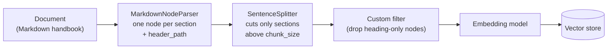

In LlamaIndex, chunking is called **node parsing**: a node parser takes documents and returns nodes, the chunks that are embedded, stored, retrieved and placed in prompts. The chunking strategies themselves (sizes, overlap, recursive, semantic, structure-aware, parent-child) were covered in Phase 4, from [Chunk size](/learn/chunking-fundamentals/chunk-size) to [Parent-child chunking](/learn/chunking-optimisation/parent-child-chunking). This lesson is about how LlamaIndex implements them, and about three behaviours that are specific to the framework and regularly surprise people: metadata counts against the chunk size, every node carries relationships that later components depend on, and parsers can be chained so that structure is respected before size is enforced.

You will take apart a node, trace how `SentenceSplitter` decides where to cut, see a Markdown handbook split badly and then well, and write a custom transformation.

## Learning objectives

- Describe the fields of a `TextNode` (text, metadata, relationships, character offsets) and say which later components depend on each.
- Explain the order in which `SentenceSplitter` tries separators and how it merges pieces with overlap.
- Calculate the effective chunk size when metadata is included, and predict when LlamaIndex warns or fails.
- Chain a structure-aware parser with a size-bounded splitter, and write a custom `TransformComponent`.
- Choose a node parser for a given corpus from LlamaIndex's catalogue.

## Prerequisites

- [Index architecture](/learn/llamaindex/index-architecture): documents, nodes and the docstore.
- [Document ingestion](/learn/llamaindex/document-ingestion): metadata, exclusion lists and the ingestion pipeline.
- [Recursive character splitting](/learn/advanced-chunking-strategies/recursive-character-splitting) and [Markdown chunking](/learn/advanced-chunking-strategies/markdown-chunking): the strategies this lesson configures.
- [Tokens and tokenisation](/learn/understanding-large-language-models/tokens-and-tokenisation): chunk sizes here are counted in tokens.

## Why this matters

A node parser's output is the unit of everything downstream. A retriever can only return whole nodes; a reranker can only score whole nodes; the synthesizer can only quote whole nodes. If a node mixes the end of the annual-leave section with the start of the equipment section, every later stage inherits that confusion.

The framework adds its own failure modes on top of the general chunking ones. Long metadata quietly shrinks every chunk, sometimes to a few dozen tokens. A splitter run directly on Markdown ignores the headings and cuts across sections. Nodes built without relationships break sentence-window and auto-merging retrieval, and nodes without a source link cannot be updated or deleted by document. Knowing the parser's mechanics turns each of these from a mysterious retrieval problem into a configuration fix.

## The intuition

Think of cutting a long printed handbook into index cards that must each fit in a card holder of fixed size.

A careless clerk cuts every 20 centimetres, through the middle of sentences and across chapter breaks. A careful one first separates the chapters, then within each chapter cuts at paragraph ends, and only cuts inside a paragraph, at a sentence end, when a paragraph is too long for one card. When she does cut, she copies the last sentence of one card onto the top of the next, so a reader of either card has the joining thought.

Two more details make the cards useful. Each card has a header strip printed with the book title and chapter; that strip takes up room, so the more you print on it, the less text fits below. And on the back of each card she writes which book it came from and which cards come immediately before and after it, so anyone holding one card can fetch its neighbours or put the book back together.

That is node parsing: structure first, then sentences, then overlap; a header strip of metadata that eats into the size; and relationships on the back.

## How it works

### Anatomy of a node

A `TextNode` produced by a parser has:

- `id_` (also `node_id`): random by default; the `id_func` parameter on any parser, a function of the chunk index and the source document, makes it deterministic.
- `text`: the chunk.
- `metadata`: a copy of the parent document's metadata, plus anything the parser adds (`MarkdownNodeParser` adds `header_path`; `SentenceWindowNodeParser` adds the window text).
- `excluded_embed_metadata_keys`, `excluded_llm_metadata_keys` and the templates: inherited from the document, so the exclusion choices from [Document ingestion](/learn/llamaindex/document-ingestion) carry through.
- `start_char_idx` and `end_char_idx`: where the chunk sits in the parent's text, when the parser can work it out. Citations that highlight a passage in the original use these.
- `relationships`: a dictionary keyed by `NodeRelationship`.

The relationships are what make nodes more than strings:

| Relationship | Points to | Used by |
| --- | --- | --- |
| `SOURCE` | The document (or node) this node was parsed from | `ref_doc_id`, document-level updates and deletes |
| `PREVIOUS`, `NEXT` | Adjacent nodes from the same source | Neighbour expansion post-processors |
| `PARENT`, `CHILD` | Larger and smaller nodes in a hierarchy | `AutoMergingRetriever`, recursive retrieval |

`PREVIOUS` and `NEXT` are added by default (`include_prev_next_rel=True`); `PARENT` and `CHILD` come from `HierarchicalNodeParser`, covered in [Parent-child chunking](/learn/chunking-optimisation/parent-child-chunking).

### How SentenceSplitter cuts

`SentenceSplitter` is the default parser (`Settings.node_parser`) with `chunk_size=1024` and `chunk_overlap=200`, both counted in tokens by the global tokeniser, which is a `tiktoken` encoding unless you set another. Its algorithm has two phases.

**Split phase.** If the text fits in the chunk size, it is one piece. Otherwise the splitter tries a sequence of separators and uses the first that produces more than one piece:

1. `paragraph_separator`, which defaults to `"\n\n\n"`: three newlines, not the usual blank line.
2. The sentence tokeniser (NLTK's Punkt by default, via `chunking_tokenizer_fn`).
3. `secondary_chunking_regex`, which splits at commas, full stops, semicolons and similar punctuation.
4. `separator`, a space by default; and finally single characters.

Any piece still too large is split again recursively with the same sequence. Pieces from steps 1 and 2 are marked as whole sentences; smaller fragments are not.

**Merge phase.** The pieces are then packed greedily, in order, into chunks of at most `chunk_size` tokens. When a chunk is closed, the next one starts with as many whole pieces from the end of the previous chunk as fit within `chunk_overlap` tokens. Overlap is therefore made of whole sentences where possible, and can be smaller than `chunk_overlap` (or empty) when the last sentence is longer than the overlap budget. A single unsplittable piece larger than the chunk size raises `ValueError("Single token exceeded chunk size")`.

The default paragraph separator has a practical consequence: ordinary Markdown or prose with single blank lines between paragraphs is not split at paragraphs at all. It goes straight to sentences, and sentences from adjacent sections are packed together. That is the main reason to run a structure-aware parser first.

### Metadata-aware splitting

Because metadata is, by default, prepended to the node text for both embedding and the LLM, `SentenceSplitter` (and the other `MetadataAwareTextSplitter`s, such as `TokenTextSplitter`) reserves room for it. For each source node it renders the metadata string for embedding and for the LLM, takes the longer of the two, counts its tokens, and splits the text with an **effective chunk size** of `chunk_size` minus that count. If the result is under 50 tokens it prints a warning; if it is zero or negative it raises a `ValueError`. The excluded keys from the previous lesson matter twice here: they keep noise out of vectors and they give space back to text.

### Structure first, then size

Parsers are transformations: they accept nodes as well as documents. So you can chain them, either by passing one's output to the next or by listing both in an `IngestionPipeline`. The usual pattern is a **structure-aware parser** that cuts at the document's own boundaries, followed by a **size-bounded splitter** that only cuts further where a section is too long:



Each node from the second step keeps a `SOURCE` relationship to the section node it came from, and inherits its metadata, including `header_path`.

### The parser catalogue

The core package includes these, among others:

- **Text splitters**: `SentenceSplitter` (default), `TokenTextSplitter` (cuts on a separator to an exact token budget, ignoring sentences), `CodeSplitter` (uses a tree-sitter grammar, which must be installed separately; see [Code chunking](/learn/advanced-chunking-strategies/code-chunking)).
- **File-structure parsers**: `MarkdownNodeParser`, `HTMLNodeParser` (splits on chosen tags), `JSONNodeParser`, and `SimpleFileNodeParser`, which picks one of these from the file type in metadata.
- **Relationship-building parsers**: `HierarchicalNodeParser` (several chunk sizes linked as parents and children) and `SentenceWindowNodeParser` (one node per sentence with its neighbours in metadata; see [Small-to-big retrieval](/learn/chunking-optimisation/small-to-big-retrieval)).
- **Embedding-based parsers**: `SemanticSplitterNodeParser` and `SemanticDoubleMergingSplitterNodeParser`, which place boundaries where adjacent sentences' embeddings diverge; [Semantic chunking](/learn/advanced-chunking-strategies/semantic-chunking) explains why they need careful evaluation.
- **Element parsers**: `MarkdownElementNodeParser` and `UnstructuredElementNodeParser` separate tables from text and can summarise tables with the LLM, at ingestion cost.

Choosing among them follows the Phase 4 advice: use the document's own structure when it has one, bound the size with a sentence-respecting splitter, and only add embedding- or LLM-based parsing when an evaluation shows it helps.

## The mathematics

### Effective chunk size and the number of nodes

**Intuition.** Metadata and overlap both eat into the room each node has for new text, so they both increase the number of nodes a document becomes.

Let $T$ be the document's text length in tokens, $c$ the configured `chunk_size`, $m$ the metadata length in tokens and $o$ the overlap. The effective chunk size is

$$
c_{\text{eff}} = c - m
$$

Each node after the first adds about $c_{\text{eff}} - o$ new tokens, so the number of nodes is approximately

$$
n \approx \left\lceil \frac{T - o}{c_{\text{eff}} - o} \right\rceil \quad \text{for } T > c_{\text{eff}}
$$

It is approximate because the splitter packs whole sentences, so chunks usually stop short of $c_{\text{eff}}$ and overlap is rounded down to whole sentences.

**By hand.** A 1,000-token policy, $c = 256$, $o = 20$. With 16 tokens of metadata, $c_{\text{eff}} = 240$ and $n \approx \lceil 980 / 220 \rceil = \lceil 4.45 \rceil = 5$. With 120 tokens of metadata (a long summary field), $c_{\text{eff}} = 136$ and $n \approx \lceil 980 / 116 \rceil = \lceil 8.45 \rceil = 9$: almost twice as many nodes, each with barely half the text.

```python
import math

def approx_nodes(T, c, m, o):
    c_eff = c - m
    return c_eff, math.ceil((T - o) / (c_eff - o))

for m in (16, 120):
    print(m, approx_nodes(T=1000, c=256, m=m, o=20))
```

```output
16 (240, 5)
120 (136, 9)
```

## In code

**The problem.** Parse a short Meridian handbook in Markdown three ways: with `SentenceSplitter` alone under small and large metadata; inspecting one node's offsets and relationships; and with `MarkdownNodeParser` followed by `SentenceSplitter`. Counting tokens with the same encoding LlamaIndex uses makes the effective chunk size visible.

**Dependencies.** `tiktoken` is already a dependency of `llama-index-core`.

```bash
pip install llama-index-core
```

```python
import tiktoken
from llama_index.core import Document
from llama_index.core.node_parser import MarkdownNodeParser, SentenceSplitter
from llama_index.core.schema import MetadataMode, NodeRelationship

enc = tiktoken.get_encoding("cl100k_base")       # the tokeniser LlamaIndex counts with by default
ntok = lambda s: len(enc.encode(s))

HANDBOOK = """# Leave

## Annual leave
Annual leave is 25 days a year for full-time staff. Up to 5 unused days carry over into the next year. Carried-over days must be used by 31 March, or they are lost. Requests go through the HR portal at least two weeks in advance.

## Sick leave
Tell your manager before 10:00 on the first day of absence. A fit note is needed after seven calendar days.

# Equipment

## Home office
Staff who work remotely may claim a home-office equipment budget of £400. Contractors are not eligible. Claims are expenses, so they must be submitted within 30 days, and anything over £75 needs a receipt.
"""

doc = Document(text=HANDBOOK, id_="handbook-2025",
               metadata={"title": "Meridian Employee Handbook", "effective": "2025-01-01"})
print("document tokens:", ntok(HANDBOOK))

# 1. Plain sentence splitting: how metadata shrinks the room for text.
for meta in [doc.metadata,
             {**doc.metadata, "summary": "Policies on annual leave, sick leave, carry-over, absence reporting, "
                                         "fit notes, remote work, home-office equipment, contractor eligibility, "
                                         "expense deadlines and receipt thresholds for all Meridian staff."}]:
    d = Document(text=HANDBOOK, id_="handbook-2025", metadata=meta)
    m = ntok(d.get_metadata_str(MetadataMode.EMBED))
    nodes = SentenceSplitter(chunk_size=96, chunk_overlap=16).get_nodes_from_documents([d])
    print(f"metadata {m:>2} tokens -> {len(nodes)} nodes, text tokens per node {[ntok(n.text) for n in nodes]}")

# 2. Anatomy of one node (readable ids instead of random UUIDs).
splitter = SentenceSplitter(chunk_size=96, chunk_overlap=16, id_func=lambda i, d: f"{d.id_}#{i}")
nodes = splitter.get_nodes_from_documents([doc])
n = nodes[1]
print("\nnode 1 text starts:", repr(n.text[:60]))
print("chars", n.start_char_idx, "to", n.end_char_idx, "| matches source slice:",
      HANDBOOK[n.start_char_idx:n.end_char_idx] == n.text)
for rel in (NodeRelationship.SOURCE, NodeRelationship.PREVIOUS, NodeRelationship.NEXT):
    print(f"  {rel.name:<8} -> {n.relationships[rel].node_id}")
print("headings inside node 1:", [l for l in n.text.splitlines() if l.startswith("#")])
print("overlap with node 0:", repr(n.text[:40]) if n.text[:40] in nodes[0].text else "none")

# 3. Structure first, then size: Markdown sections, then sentences.
md_nodes = MarkdownNodeParser().get_nodes_from_documents([doc])
final = SentenceSplitter(chunk_size=96, chunk_overlap=16).get_nodes_from_documents(md_nodes)
print()
for x in final:
    print(f"{x.metadata['header_path']:<12} {ntok(x.text):>3} tok | {x.text.splitlines()[0][:40]}")
print("\nwhat gets embedded for the last node:")
print(final[-1].get_content(MetadataMode.EMBED)[:160])
```

```output
document tokens: 142
metadata 16 tokens -> 3 nodes, text tokens per node [63, 69, 29]
Metadata length (57) is close to chunk size (96). Resulting chunks are less than 50 tokens. Consider increasing the chunk size or decreasing the size of your metadata to avoid this.
metadata 57 tokens -> 5 nodes, text tokens per node [33, 30, 32, 32, 29]

node 1 text starts: 'Requests go through the HR portal at least two weeks in adva'
chars 190 to 510 | matches source slice: True
  SOURCE   -> handbook-2025
  PREVIOUS -> handbook-2025#0
  NEXT     -> handbook-2025#2
headings inside node 1: ['## Sick leave', '# Equipment', '## Home office']
overlap with node 0: 'Requests go through the HR portal at lea'

/              2 tok | # Leave
/Leave/       60 tok | ## Annual leave
/Leave/       29 tok | ## Sick leave
/              2 tok | # Equipment
/Equipment/   47 tok | ## Home office

what gets embedded for the last node:
title: Meridian Employee Handbook
effective: 2025-01-01
header_path: /Equipment/

## Home office
Staff who work remotely may claim a home-office equipment budget
```

**The important lines.**

- `get_metadata_str(MetadataMode.EMBED)` renders exactly the block the splitter reserves room for. With two keys it is 16 tokens; adding a one-sentence `summary` makes it 57.
- `id_func=lambda i, d: f"{d.id_}#{i}"` gives nodes ids derived from the document id and position, so the relationships print readably.
- `MarkdownNodeParser().get_nodes_from_documents([doc])` returns one node per heading section; passing those nodes to `SentenceSplitter` makes it cut only where a section exceeds the limit.

**What the output means.**

- *Metadata.* With 16 tokens of metadata the effective size is 80 and the 142-token handbook became 3 nodes. With 57 tokens of metadata the effective size fell to 39, LlamaIndex printed its warning, and the same text became 5 nodes of about 30 tokens each: fragments too short to carry a complete policy.
- *Node anatomy.* Node 1's offsets reproduce its text exactly from the source. Its relationships point to the document and its neighbours. It begins with the last sentence of node 0: the 16-token overlap was filled with one whole sentence.
- *The problem with splitting by size alone.* Node 1 contains three headings, from "Sick leave" through "Home office". A question about sick leave retrieves a node that is half about equipment budgets. This happened because the handbook's paragraphs are separated by single blank lines, which the default three-newline paragraph separator does not treat as boundaries.
- *Structure first.* After `MarkdownNodeParser`, every node is one section and none crosses a heading. `header_path` records the section's ancestors (not its own heading, which is the node's first line), and it is part of the embedded text. Two nodes contain only a top-level heading (2 tokens): sections with no body text of their own. They are useless for retrieval and should be dropped or merged, which exercise 3 does.

**Common errors.**

- *`ValueError: Metadata length (...) is longer than chunk size`*: exclude long keys from embedding and the LLM, or raise `chunk_size`.
- *`ValueError: Single token exceeded chunk size`*: a piece of text that cannot be split further (for example a very long URL or base64 string with a tiny chunk size). Clean such content during [preprocessing](/learn/document-preprocessing/noise-removal) or raise the limit.
- *Chunk sizes do not match your embedding model's limit*: LlamaIndex counts with its own tokeniser, not the embedding model's. MiniLM, for example, truncates input at 256 of its own word-piece tokens; check the effective token count with the model's tokeniser when you are near the limit.

**Extending it.** Pass `paragraph_separator="\n\n"` to `SentenceSplitter` and compare the plain-split output: the paragraph boundaries now count, though headings still do not attach to their sections the way `MarkdownNodeParser` makes them.

## A real-world example

The HR team at Meridian exports the handbook from its wiki as Markdown. The first AskMeridian prototype parsed it with `SentenceSplitter(chunk_size=512)` and attached a 90-token metadata block to every document: title, owner, audience, review date, a list of related policies and a two-sentence summary.

Two complaints arrived in the first week. Answers about sick leave sometimes included equipment-budget details, and answers about long policies were cut short. The Platform team inspected nodes rather than answers. They found the cross-section packing shown above, and found that each node had about 420 tokens of room, not 512, because of the metadata; for the 60 documents whose summary was longer, under 300.

They restructured parsing in three steps. `MarkdownNodeParser` runs first, so no node spans two sections, and `header_path` carries the section path into the embedding text. The related-policies list, owner and review date were added to `excluded_embed_metadata_keys` and `excluded_llm_metadata_keys`; they stay on the nodes for filtering and auditing, and no longer consume chunk space or appear in prompts. A custom transformation drops heading-only nodes and logs any section longer than 1,500 tokens for the HR team to review, since a section that long usually means a missing subheading. They then re-ran their retrieval evaluation set before and after, as [Chunk quality evaluation](/learn/chunking-optimisation/chunk-quality-evaluation) recommends, rather than judging the change by a few hand-picked questions.

## Common mistakes

- **Running a size-based splitter directly on structured documents.** Chunks cross headings, mixing topics, because the default paragraph separator is three newlines.
- **Ignoring metadata length.** Every included key reduces the room for text; long summaries can shrink chunks to fragments.
- **Leaving node ids random.** Logs, evaluations and regression comparisons cannot refer to the same node across runs.
- **Dropping relationships.** Building nodes by hand without a `SOURCE` relationship breaks `ref_doc_id`, so document-level updates and deletes cannot find them; disabling `include_prev_next_rel` breaks neighbour expansion.
- **Assuming LlamaIndex's token counts are the embedding model's.** Nodes near the embedding model's input limit are silently truncated.
- **Keeping heading-only nodes.** They waste retrieval slots and prompt space.

## Best practices

- Parse structure first (`MarkdownNodeParser`, `HTMLNodeParser`, or your own section splitter), then bound size with `SentenceSplitter`.
- Set `id_func` so node ids are deterministic and traceable to their document and position.
- Decide which metadata to embed and show to the LLM, and keep the rest excluded so it neither dilutes vectors nor eats chunk space.
- Inspect a sample of nodes (text, token count, `header_path`, relationships) whenever parsing changes, before looking at answers.
- Write small custom `TransformComponent`s for filtering and validation, and put them in the same pipeline so they run on every ingestion.
- Measure retrieval quality when changing parsers; do not adopt semantic or LLM-based parsing on intuition.

## Performance considerations

Rule-based parsing is cheap: tokenising and splitting thousands of pages takes seconds on one CPU, so it is rarely the bottleneck. Its effects on later stages are what cost money. The number of nodes sets the number of embedding calls and the size of the vector store. With the arithmetic above, a 120-token metadata block nearly doubled the node count for a 1,000-token document; across a corpus that is nearly double the embedding cost, vector storage and index build time, for worse chunks.

Overlap has a similar multiplier: with chunks of 256 and overlap of 64, each node adds about 192 new tokens, so the corpus is embedded about 256 / 192, or 1.33, times over. Semantic splitters add an embedding call per sentence (or sentence group) at ingestion, on top of the embedding of the final nodes. Element parsers that summarise tables add an LLM call per table.

## Security considerations

Metadata rendered into node text reaches the LLM unless excluded. Document owners, access lists or internal system identifiers in metadata can therefore appear in answers. Exclude them from LLM content while keeping them on the node for [access filtering](/learn/access-control-and-privacy/document-level-permissions). Conversely, text from untrusted documents ends up in node text and therefore in prompts; parsing does not sanitise it.

## Summary

- Node parsing is LlamaIndex's chunking step; parsers return `TextNode`s with text, metadata, character offsets and relationships.
- `SentenceSplitter` splits by a three-newline paragraph separator, then sentences, then punctuation and words, and merges greedily with whole-sentence overlap.
- Metadata is reserved inside the chunk size: the effective size is the chunk size minus the longer of the embed and LLM metadata strings.
- Chaining a structure-aware parser before a size-bounded splitter keeps nodes inside section boundaries and records the section path.
- Relationships (`SOURCE`, `PREVIOUS`, `NEXT`, `PARENT`, `CHILD`) are what document updates and small-to-big retrieval depend on.

## Exercises

1. A document has 2,000 tokens of text and 40 tokens of metadata. With `chunk_size=512` and `chunk_overlap=50`, estimate the number of nodes. What happens if the metadata grows to 470 tokens?

<details><summary>Show solution</summary>

$c_{\text{eff}} = 472$, so $n \approx \lceil 1950 / 422 \rceil = \lceil 4.62 \rceil = 5$. With 470 tokens of metadata, $c_{\text{eff}} = 42$, below 50, so LlamaIndex prints its warning; since 42 is also smaller than the overlap of 50, each new chunk can add almost no new text, and the splitter makes room by dropping overlap pieces. In practice the document shatters into dozens of tiny nodes. The fix is to exclude most of that metadata from embed and LLM content.

</details>

2. Why does `header_path` for the "Annual leave" section read `/Leave/` and not `/Leave/Annual leave/`? Is that a problem for retrieval?

<details><summary>Show solution</summary>

`MarkdownNodeParser` records the path of the section's ancestors; the section's own heading is kept as the first line of the node's text. Both are in the embedded text (metadata block plus text), so the embedding sees the whole path. It matters only if you filter or display by `header_path` and expect it to include the node's own heading.

</details>

3. Write a `TransformComponent` that drops nodes with fewer than 5 tokens, and run it in an `IngestionPipeline` after `MarkdownNodeParser` and `SentenceSplitter` on the handbook above.

<details><summary>Show solution</summary>

```python
from llama_index.core.ingestion import IngestionPipeline
from llama_index.core.schema import TransformComponent

class DropHeadingOnlyNodes(TransformComponent):
    min_tokens: int = 5
    def __call__(self, nodes, **kwargs):
        return [n for n in nodes if ntok(n.text) >= self.min_tokens]

pipeline = IngestionPipeline(transformations=[
    MarkdownNodeParser(), SentenceSplitter(chunk_size=96, chunk_overlap=16), DropHeadingOnlyNodes()])
for n in pipeline.run(documents=[doc]):
    print(n.metadata["header_path"], "|", n.text.splitlines()[0])
```

```output
/Leave/ | ## Annual leave
/Leave/ | ## Sick leave
/Equipment/ | ## Home office
```

`TransformComponent` is a Pydantic model, so configuration such as `min_tokens` is declared as a typed field. Nothing is lost by dropping the heading-only nodes, because each heading survives in its children's `header_path`.

</details>

4. Design: Meridian's Atlas runbooks are Markdown with long fenced shell scripts and tables of error codes. Propose a parsing chain and say what each step protects against.

<details><summary>Show solution</summary>

One reasonable chain: (1) `MarkdownNodeParser`, so each runbook section is a unit and `header_path` names it; (2) a custom transformation that keeps each fenced code block and each table whole, splitting a table into row groups with the header row repeated if it is too long (see [Table chunking](/learn/advanced-chunking-strategies/table-chunking)); (3) `SentenceSplitter` with a chunk size that suits the embedding model, applied only to prose nodes; (4) a filter that drops heading-only nodes and flags oversized ones. Step 1 prevents cross-section mixing, step 2 prevents scripts and tables being cut mid-line, step 3 bounds size, and step 4 keeps junk out of the index. Error codes in tables also argue for hybrid search, because exact codes are where dense retrieval is weakest.

</details>

## Check your understanding

```quiz
[
  {
    "q": "What is `SentenceSplitter`'s default `paragraph_separator`, and what does that imply for Markdown with single blank lines between paragraphs?",
    "options": [
      "`\"\\n\\n\"`, so every paragraph becomes its own node",
      "`\"\\n\\n\\n\"`, so ordinary paragraph breaks are not treated as boundaries and sentences from adjacent sections are packed together",
      "`\"\\n\"`, so every line becomes its own split",
      "There is none; it only splits on tokens"
    ],
    "answer": 1,
    "why": "The default is three newlines. Text with ordinary blank lines goes straight to sentence splitting and greedy packing, which crosses headings."
  },
  {
    "q": "`chunk_size=256`, and the embed metadata string is 40 tokens while the LLM metadata string is 70 tokens. What effective chunk size does `SentenceSplitter` use?",
    "options": [
      "216",
      "256",
      "186",
      "146"
    ],
    "answer": 2,
    "why": "It reserves room for the longer of the two metadata strings: 256 minus 70 is 186."
  },
  {
    "q": "Which relationship lets `index.delete_ref_doc(\"handbook-2025\")` find every node parsed from that document?",
    "options": [
      "`SOURCE`",
      "`PARENT`",
      "`NEXT`",
      "`CHILD`"
    ],
    "answer": 0,
    "why": "Each node's `SOURCE` relationship points to its document; `ref_doc_id` reads it, and deletion by document id relies on it."
  },
  {
    "q": "Why chain `MarkdownNodeParser` before `SentenceSplitter` instead of using `SentenceSplitter` alone?",
    "options": [
      "`SentenceSplitter` cannot read Markdown files",
      "It makes chunks larger, which always improves recall",
      "`MarkdownNodeParser` embeds the nodes",
      "Sections become the units, so no node crosses a heading, and `SentenceSplitter` only cuts sections that are too long"
    ],
    "answer": 3,
    "why": "Structure first keeps topics apart and records `header_path`; size bounding second keeps every node within the limit."
  },
  {
    "q": "A colleague sets `chunk_size=1024` because the embedding model accepts 512 tokens and wants 'room to spare'. What is wrong?",
    "options": [
      "Nothing; LlamaIndex truncates nodes to the model limit before storing them",
      "`chunk_size` above 512 raises an error",
      "Nodes longer than the embedding model's input limit are silently truncated when embedded, so their tails are never searchable",
      "Larger chunks always reduce the number of embedding calls to one"
    ],
    "answer": 2,
    "why": "Embedding models truncate input beyond their limit. The node is stored in full but only its beginning is represented in the vector."
  }
]
```

## Further reading

- [LlamaIndex documentation](https://docs.llamaindex.ai/): "Node parser usage pattern" and the "Node parser modules" reference listing every parser and its parameters.
- LlamaIndex documentation, "Defining and customizing nodes": relationships, ids and metadata on nodes.
- [LlamaIndex source code on GitHub](https://github.com/run-llama/llama_index): `llama-index-core/llama_index/core/node_parser/text/sentence.py` for the split-and-merge algorithm described here.
- Kiss, Strunk (2006), "Unsupervised Multilingual Sentence Boundary Detection", *Computational Linguistics* 32(4): the Punkt algorithm behind the default sentence tokeniser.
- [NLTK documentation](https://www.nltk.org/): the `punkt` sentence tokeniser.
