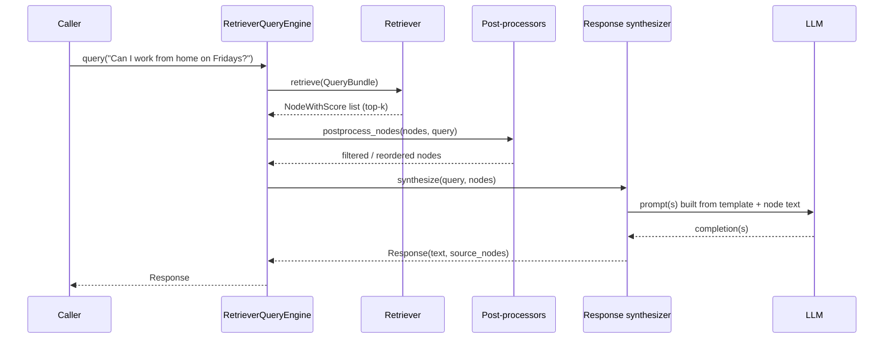

A **query engine** is LlamaIndex's name for the online half of a RAG system: an object with a `query()` method that takes a question and returns an answer together with the nodes it was based on. `index.as_query_engine()` builds one in a line, which is why most tutorials never open it up. Inside, it is a short, fixed pipeline of three replaceable parts: a **retriever**, a list of **node post-processors** and a **response synthesizer**. Every quality problem at query time lives in one of those three, and every customisation is a matter of replacing one.

This lesson takes the engine apart, assembles it explicitly, shows the exact prompt it sends to the model, wires in Claude through a small custom LLM class, and covers the behaviours that matter in production: what happens when nothing relevant is found, how to change prompts, streaming and async queries, and when to write your own engine. Retrievers over vector indexes get their own lesson ([Vector indexes](/learn/llamaindex/vector-indexes)), as do the synthesizer's response modes ([Response synthesis](/learn/llamaindex/response-synthesis)).

## Learning objectives

- Describe the three stages of a `RetrieverQueryEngine` and what each receives and returns.
- Assemble a query engine explicitly from a retriever, post-processors and a synthesizer, and explain each `as_query_engine` keyword in those terms.
- Inspect and replace the prompts a query engine uses.
- Connect Claude to LlamaIndex with a `CustomLLM` subclass using the Anthropic SDK.
- Decide when a query engine, a retriever, a chat engine or a custom query engine is the right interface.

## Prerequisites

- [Index architecture](/learn/llamaindex/index-architecture): indexes, retrievers and `Settings`.
- [Retrieval pipeline](/learn/rag-architecture-fundamentals/retrieval-pipeline) and [Generation pipeline](/learn/rag-architecture-fundamentals/generation-pipeline): the general shape a query engine implements.
- [Retrieval thresholding](/learn/advanced-retrieval-optimisation/retrieval-thresholding): why a similarity cut-off is useful and how hard it is to set.
- [Grounded generation](/learn/prompt-engineering-for-rag/grounded-generation): what a good answer prompt asks of the model.

## Why this matters

"The answer was wrong" is not a diagnosis. A query engine can fail in three distinct places: the retriever did not find the right node; a post-processor removed it or let junk through; or the synthesizer, given the right node, produced a poor answer. Each has a different fix (retriever settings, thresholds, prompts). If you only ever call `as_query_engine().query()`, you see the final answer and cannot tell which stage failed.

Defaults matter as well. The default retriever returns 2 nodes. The default prompt tells the model to use the context "and not prior knowledge" but does not tell it what to do when the context lacks the answer. With no post-processor, the engine always passes its top nodes to the model, however irrelevant. Production systems need explicit choices at each of these points, and the explicit assembly in this lesson is where you make them.

## The intuition

Think of the reference desk at Meridian's library again. A question arrives. A **runner** goes to the catalogue and brings back the three most promising cards (the retriever). A **checker** at the desk looks at the cards and discards the ones that are clearly off-topic, reorders them, or swaps a card for a fuller version (the post-processors). Then a **writer** reads the remaining cards and drafts the answer, following the desk's house style (the synthesizer and its prompt). The desk hands back the answer with the cards clipped to it.

If the checker throws away every card, a good desk says "we have nothing on that" instead of letting the writer improvise. And if you want a different house style, you change the writer's instructions, not the runner.

## How it works

### The pipeline



Step by step:

1. **Query bundle.** The string is wrapped in a `QueryBundle`, which holds the query text and, optionally, separate strings to embed (query transformations such as [HyDE](/learn/advanced-retrieval/hyde) use this to embed something other than the question).
2. **Retrieve.** The retriever returns a list of `NodeWithScore`. For a vector index this is the top `similarity_top_k` nodes by similarity.
3. **Post-process.** Each node post-processor in turn receives the list and the query bundle and returns a new list. Post-processors filter (`SimilarityPostprocessor`, `KeywordNodePostprocessor`), rerank (`SentenceTransformerRerank`, `LLMRerank`), reorder (`LongContextReorder`), expand (`PrevNextNodePostprocessor`, `MetadataReplacementPostProcessor`) or redact (`PIINodePostprocessor`).
4. **Synthesize.** The synthesizer renders the nodes' text (with metadata, according to `MetadataMode.LLM`) into the prompt template, calls the LLM one or more times according to its response mode, and returns a `Response`.
5. **Return.** The `Response` has `response` (the text; `str(response)` gives it), `source_nodes` (the nodes after post-processing, with scores) and `metadata` (per-node metadata).

If post-processing leaves no nodes, the default synthesizer does not call the LLM at all; it returns a response whose text is `"Empty Response"`. That is a sensible default (no context, no generation) but not a user-facing message: check `response.source_nodes` and substitute your own reply.

### What `as_query_engine` does

`index.as_query_engine(**kwargs)` builds a retriever with `index.as_retriever(**kwargs)` and passes everything to `RetrieverQueryEngine.from_args`. So its keyword arguments are a mixture:

- **Retriever arguments**, such as `similarity_top_k`, `filters` and `vector_store_query_mode`.
- **Post-processors**: `node_postprocessors=[...]`.
- **Synthesizer arguments**: `response_mode`, `text_qa_template`, `refine_template`, `streaming`, `use_async`, `output_cls`, `llm`.

Writing the three parts explicitly with `RetrieverQueryEngine(retriever=..., node_postprocessors=..., response_synthesizer=...)` is equivalent and much easier to read, test and change. It also lets you reuse any retriever, including ones that are not backed by an index at all.

### Prompts

Every component that prompts an LLM exposes `get_prompts()` and `update_prompts({...})`. Keys are namespaced by component, for example `response_synthesizer:text_qa_template`. The synthesizer picks a template according to the LLM: for completion models it uses the plain `text_qa_template`; for models that report `is_chat_model=True` it uses a chat version with a system message that tells the model, among other things, never to mention the context. That instruction makes answers read smoothly and also discourages the model from saying "the documents do not cover this", which is often exactly what you want it to say. Most production systems replace the defaults with prompts that state the refusal behaviour and the citation format explicitly; [Refusal behaviour](/learn/prompt-engineering-for-rag/refusal-behaviour) and [Citation instructions](/learn/prompt-engineering-for-rag/citation-instructions) cover what to put in them.

### Plugging in an LLM

LlamaIndex talks to models through its `LLM` interface. Integration packages exist for most providers, including one for Anthropic (`llama-index-llms-anthropic`). You can also write a thin adapter by subclassing `CustomLLM`, which needs three members: a `metadata` property (context window, output budget, model name, whether it is a chat model), `complete()` and `stream_complete()`. Writing your own adapter is a reasonable choice when you want the request shape under your control, for example to match your organisation's standard client settings, or to avoid parameters an integration sends by default that a newer model no longer accepts. The `metadata` values are not decorative: the synthesizer uses `context_window` and `num_output` to decide how much context fits in each call.

### Other interfaces

- **Retriever only.** When another system generates the answer, or for evaluating search on its own, use `index.as_retriever()` and skip synthesis.
- **Chat engine.** `index.as_chat_engine(chat_mode=...)` keeps conversation memory and rewrites follow-up questions (modes such as `condense_question` and `condense_plus_context`). Use it for multi-turn assistants; [Multi-turn RAG](/learn/generation-strategies/multi-turn-rag) explains the underlying problem.
- **Specialised engines.** The core package includes `CitationQueryEngine` (splits sources into numbered chunks and asks for citations), `RouterQueryEngine` and `SubQuestionQueryEngine` (later lessons), `TransformQueryEngine` (applies a query transformation before retrieval) and `RetryQueryEngine`, among others.
- **Custom query engine.** Subclass `CustomQueryEngine` and implement `custom_query(self, query_str)`, returning a string or a `Response`. Use it when your flow does not fit retrieve, post-process, synthesize: for example, answering error-code questions by direct lookup and everything else by retrieval.

## In code

**The problem.** Build Meridian's query engine explicitly: a vector retriever with `top_k=3`, a similarity cut-off, and a compact synthesizer. Use a stand-in LLM that records every prompt so you can see exactly what the model receives, and test three questions: one with a clear answer, one with none, and one after replacing the answer prompt. A stand-in keeps the example runnable without an API key; the Claude adapter follows.

**Dependencies.** `common.py` holds the `MiniLMEmbedding` adapter from [Index architecture](/learn/llamaindex/index-architecture), unchanged.

```bash
pip install llama-index-core sentence-transformers
```

```python
from typing import Any
from llama_index.core import Document, PromptTemplate, Settings, VectorStoreIndex
from llama_index.core.llms import CompletionResponse, CustomLLM, LLMMetadata
from llama_index.core.llms.callbacks import llm_completion_callback
from llama_index.core.postprocessor import SimilarityPostprocessor
from llama_index.core.query_engine import RetrieverQueryEngine
from llama_index.core.response_synthesizers import get_response_synthesizer
from common import MiniLMEmbedding   # the 10-line adapter from "Index architecture"

class RecordingLLM(CustomLLM):
    """Stand-in LLM: records every prompt and answers with the first line of context."""
    prompts: list[str] = []

    @property
    def metadata(self) -> LLMMetadata:
        return LLMMetadata(context_window=8000, num_output=256, model_name="recording-llm")

    @llm_completion_callback()
    def complete(self, prompt: str, formatted: bool = False, **kwargs: Any) -> CompletionResponse:
        self.prompts.append(prompt)
        context = prompt.split("---------------------\n")[1]
        return CompletionResponse(text="(stub) " + context.splitlines()[0])

    @llm_completion_callback()
    def stream_complete(self, prompt: str, formatted: bool = False, **kwargs: Any):
        yield self.complete(prompt, formatted, **kwargs)

Settings.embed_model = MiniLMEmbedding(model_name="all-MiniLM-L6-v2")
Settings.llm = llm = RecordingLLM()

docs = [
    Document(text="Annual leave is 25 days a year. Up to 5 unused days carry over and must be used by 31 March.", metadata={"corpus": "handbook"}),
    Document(text="Staff may work remotely up to 3 days a week.", metadata={"corpus": "handbook"}),
    Document(text="The home-office equipment budget is £400. Contractors are not eligible.", metadata={"corpus": "handbook"}),
    Document(text="Expenses must be submitted within 30 days; anything over £75 needs a receipt.", metadata={"corpus": "handbook"}),
    Document(text="Error E-4021 means the VPN client is out of date. Update it from the IT portal.", metadata={"corpus": "runbooks"}),
]
for d in docs:
    d.excluded_llm_metadata_keys = ["corpus"]          # stored and embedded, not shown to the LLM
index = VectorStoreIndex.from_documents(docs)

engine = RetrieverQueryEngine(
    retriever=index.as_retriever(similarity_top_k=3),
    node_postprocessors=[SimilarityPostprocessor(similarity_cutoff=0.35)],
    response_synthesizer=get_response_synthesizer(response_mode="compact"),
)

def ask(q: str):
    llm.prompts.clear()
    raw = engine.retriever.retrieve(q)
    response = engine.query(q)
    print(f"Q: {q}")
    print("  retrieved:", [(n.node.text[:24], round(n.score, 2)) for n in raw])
    print("  kept     :", [(n.node.text[:24], round(n.score, 2)) for n in response.source_nodes])
    print("  LLM calls:", len(llm.prompts), "| answer:", repr(str(response)))

ask("Can I work from home on Fridays?")
print("\nPrompt sent to the LLM:\n" + llm.prompts[0])
ask("What is on the canteen menu today?")

print("\nPrompt keys:", list(engine.get_prompts()))
engine.update_prompts({"response_synthesizer:text_qa_template": PromptTemplate(
    "Answer from the Meridian context only. If it is not there, reply exactly: I don't know.\n"
    "Context:\n---------------------\n{context_str}\n---------------------\nQuestion: {query_str}\nAnswer: ")})
ask("How long do I have to submit an expense claim?")
```

```output
Q: Can I work from home on Fridays?
  retrieved: [('Staff may work remotely ', 0.42), ('Annual leave is 25 days ', 0.19), ('The home-office equipmen', 0.16)]
  kept     : [('Staff may work remotely ', 0.42)]
  LLM calls: 1 | answer: '(stub) Staff may work remotely up to 3 days a week.'

Prompt sent to the LLM:
Context information is below.
---------------------
Staff may work remotely up to 3 days a week.
---------------------
Given the context information and not prior knowledge, answer the query.
Query: Can I work from home on Fridays?
Answer: 
Q: What is on the canteen menu today?
  retrieved: [('Staff may work remotely ', 0.16), ('Expenses must be submitt', 0.1), ('The home-office equipmen', 0.08)]
  kept     : []
  LLM calls: 0 | answer: 'Empty Response'

Prompt keys: ['response_synthesizer:text_qa_template', 'response_synthesizer:refine_template', 'response_synthesizer:chat_content_qa_template', 'response_synthesizer:chat_content_refine_template']
Q: How long do I have to submit an expense claim?
  retrieved: [('Expenses must be submitt', 0.6), ('Annual leave is 25 days ', 0.33), ('The home-office equipmen', 0.23)]
  kept     : [('Expenses must be submitt', 0.6)]
  LLM calls: 1 | answer: '(stub) Expenses must be submitted within 30 days; anything over £75 needs a receipt.'
```

**The important lines.**

- `RecordingLLM` subclasses `CustomLLM`. The `@llm_completion_callback()` decorator connects the method to LlamaIndex's instrumentation, so traces and token counting see the call. `metadata` reports an 8,000-token context window; the synthesizer uses it to decide how many nodes fit in one prompt.
- `excluded_llm_metadata_keys = ["corpus"]` keeps the metadata out of the prompt, which is why the prompt shows only the node text.
- `RetrieverQueryEngine(...)` is the explicit form of `index.as_query_engine(similarity_top_k=3, node_postprocessors=[...], response_mode="compact")`.
- `ask` calls the retriever separately only to display what was retrieved before post-processing; in production you would read `response.source_nodes` and, for the pre-filter list, use tracing (see Performance considerations).

**What the output means.**

- *Question 1.* The retriever returned three nodes; the cut-off of 0.35 kept only the remote-work policy. The prompt shows the default completion template: context between dashed lines, an instruction to use it "and not prior knowledge", the query, and `Answer:`. It says nothing about what to do when the context is insufficient. Note also that the retrieved node says "up to 3 days a week" and does not mention Fridays; a real model should answer that the policy allows up to three remote days without naming specific days.
- *Question 2.* All three nodes scored below the cut-off, so nothing reached the synthesizer, the LLM was not called, and the response text is the literal string `Empty Response`. Without the cut-off, the model would have been handed three irrelevant policies and asked about the canteen.
- *Prompt keys.* The synthesizer exposes completion and chat versions of the answer and refine templates. Replacing only `text_qa_template` changes behaviour for completion models like this stand-in; for a chat model you would replace `chat_content_qa_template` as well, or pass a template that suits both.
- *Question 3.* The new template took effect (the stand-in's answer is unchanged by design, but the recorded prompt now begins "Answer from the Meridian context only").

The cut-off value 0.35 was chosen by looking at these scores, which is exactly the trap [Retrieval thresholding](/learn/advanced-retrieval-optimisation/retrieval-thresholding) warns about: cosine scores depend on the embedding model and the corpus, so a threshold has to be set from a labelled set of questions and re-checked whenever either changes.

**Common errors.**

- *`ValueError` about a missing OpenAI key or package* at the first query: `Settings.llm` was never set, so the synthesizer tried to create the default LLM.
- *Answers ignore your new prompt*: you replaced the completion template but the LLM is a chat model, or the reverse. Print `engine.get_prompts()` and check which template the LLM's `is_chat_model` selects.
- *`Empty Response` shown to users*: check `if not response.source_nodes:` and return your own message.

### Claude as the LLM

The adapter below uses the Anthropic Python SDK directly. It was not executed here, because it needs an API key; its structure was checked against `CustomLLM` with a fake client. The `context_window` default is an assumption to replace with the value from Anthropic's model documentation.

```bash
pip install llama-index-core anthropic
export ANTHROPIC_API_KEY=...   # set in your shell or secret manager, never in code
```

```python
from typing import Any
import anthropic
from llama_index.core.bridge.pydantic import PrivateAttr
from llama_index.core.llms import CompletionResponse, CustomLLM, LLMMetadata
from llama_index.core.llms.callbacks import llm_completion_callback

class ClaudeLLM(CustomLLM):
    model: str = "claude-opus-5-5"
    max_tokens: int = 1024
    context_window: int = 200_000          # an assumption: check the model's documentation
    system: str = "Answer only from the provided context. If the answer is not there, say you don't know."
    _client: anthropic.Anthropic = PrivateAttr()

    def __init__(self, **kwargs: Any):
        super().__init__(**kwargs)
        self._client = anthropic.Anthropic()   # reads ANTHROPIC_API_KEY from the environment

    @property
    def metadata(self) -> LLMMetadata:
        return LLMMetadata(context_window=self.context_window, num_output=self.max_tokens,
                           model_name=self.model)

    @llm_completion_callback()
    def complete(self, prompt: str, formatted: bool = False, **kwargs: Any) -> CompletionResponse:
        response = self._client.messages.create(
            model=self.model,
            max_tokens=self.max_tokens,
            system=self.system,
            messages=[{"role": "user", "content": prompt}],
        )
        text = "".join(block.text for block in response.content if block.type == "text")
        return CompletionResponse(text=text, raw=response)

    @llm_completion_callback()
    def stream_complete(self, prompt: str, formatted: bool = False, **kwargs: Any):
        text = ""
        with self._client.messages.stream(
            model=self.model,
            max_tokens=self.max_tokens,
            system=self.system,
            messages=[{"role": "user", "content": prompt}],
        ) as stream:
            for delta in stream.text_stream:
                text += delta
                yield CompletionResponse(text=text, delta=delta)

Settings.llm = ClaudeLLM()
engine = index.as_query_engine(similarity_top_k=3, streaming=True,
                               node_postprocessors=[SimilarityPostprocessor(similarity_cutoff=0.35)])
engine.query("Can I work from home on Fridays?").print_response_stream()
```

The system prompt carries the grounding and refusal instruction, and the synthesizer's template supplies the context and question as the user message. `raw=response` keeps the SDK response on the `CompletionResponse`, so `response.usage.input_tokens` and `output_tokens` are available for cost tracking. With `streaming=True`, `query()` returns a `StreamingResponse` whose `response_gen` yields text as it arrives and whose `print_response_stream()` prints it; `source_nodes` are available immediately, before generation finishes. Async callers use `await engine.aquery(...)`; this adapter inherits `CustomLLM`'s async methods, which simply call the synchronous ones, so for a high-concurrency service you would also implement `acomplete` with `anthropic.AsyncAnthropic`.

**Extending it.** Add a `SentenceTransformerRerank` post-processor (`model="cross-encoder/ms-marco-MiniLM-L-6-v2"`, `top_n=2`) after a `similarity_top_k=10` retriever, and compare `source_nodes` with and without it. That is the [two-stage retrieval](/learn/advanced-retrieval-optimisation/two-stage-retrieval) pattern expressed as query-engine configuration.

## A real-world example

AskMeridian's first LlamaIndex version used `index.as_query_engine()` with defaults. The Platform team's weekly review of low-rated answers found two patterns. Questions outside the handbook's scope ("what's the Wi-Fi password in the London office?") received confident, invented answers. And policy answers sometimes missed a crucial second clause, such as the carry-over deadline.

Rebuilding the engine explicitly made both visible. The first pattern came from the absence of any post-processor: the top 2 nodes always reached the model, and the default chat prompt's instruction never to refer to the context discouraged the model from saying that the documents did not cover the question. The second came from `similarity_top_k=2`: the carry-over clause sometimes sat in the third node.

The new engine retrieves 10 candidates, reranks with a cross-encoder to the best 4, drops anything below a reranker-score threshold set from the team's evaluation set, and uses a custom prompt (both completion and chat variants) that tells the model to answer only from the sources, cite them by number, and say "I can't find that in Meridian's documents" otherwise. Where post-processing leaves nothing, the service does not call the model at all and returns that same sentence with a link to the support desk. Error-code questions bypass the engine entirely through a `CustomQueryEngine` that looks codes up in the Atlas catalogue, since an exact lookup beats similarity search for identifiers.

## Common mistakes

- **Using `as_query_engine()` defaults in production.** Top-k of 2, no filtering and a prompt with no refusal instruction is a demo configuration.
- **Diagnosing from the final answer only.** Without looking at retrieved and post-processed nodes, you cannot tell retrieval failures from generation failures.
- **Showing `Empty Response` to users.** It is a sentinel value, not a message.
- **Replacing the wrong template.** Chat models use the chat variants; a changed completion template has no effect on them.
- **Wrong `metadata` in a custom LLM.** An understated context window makes the synthesizer split context into more calls than needed; an overstated one causes requests the model rejects.
- **Copying a similarity threshold between embedding models.** Score scales differ between models and corpora.

## Best practices

- Assemble `RetrieverQueryEngine` explicitly and keep retriever, post-processors and synthesizer as separately testable parts.
- Retrieve more candidates than you will use, then rerank and filter.
- Write your own answer prompts covering grounding, citations and refusal, for both completion and chat variants.
- Treat "no nodes after post-processing" as a first-class outcome with its own response.
- Log, for each query, the retrieved nodes and scores, the kept nodes, the prompt size and the answer.
- Use a retriever directly for search evaluation, and the full engine for end-to-end evaluation.

## Performance considerations

A single query costs one query embedding, one vector search, the post-processors, and one or more LLM calls. The LLM dominates. As an illustration with assumed figures: query embedding with a local model, about 10 ms; vector search over 100,000 nodes in an approximate index, about 10 ms; cross-encoder reranking of 10 candidates on CPU, perhaps 100 to 200 ms; the LLM call, often a second or more to the first token and several seconds to the last. Streaming does not reduce total time, but it moves the first visible output from the end of generation to the first token.

Prompt size drives LLM cost and latency. With `top_k=4` nodes of about 400 tokens plus a 150-token template and question, each call carries about 1,750 input tokens. Raising `top_k` to 10 without reranking raises that to about 4,150, more than double, for context that is often less relevant.

For tracing, LlamaIndex's instrumentation module emits events and spans for every retrieve, post-process, synthesize and LLM call, and integrates with observability tools; that is the production replacement for the extra `retrieve()` call in `ask()`.

## Security considerations

The query engine places node text, which may come from documents written by anyone with access to a source system, into the prompt, so it is the point where [indirect prompt injection](/learn/rag-security-fundamentals/indirect-prompt-injection) takes effect. Keep instructions in the system prompt, delimit context clearly in the template, and treat model output as untrusted when it drives any action. Access control must be applied in the retriever (metadata filters per user) or a post-processor before synthesis; filtering the answer afterwards is too late, because the model has already seen the restricted text. The API key for the LLM comes from the environment, never from code or configuration files committed to a repository.

## Summary

- A `RetrieverQueryEngine` is retriever, then node post-processors, then response synthesizer; `as_query_engine` is shorthand for assembling one.
- The `Response` carries the answer and the `source_nodes` actually used; inspect both.
- If post-processing leaves no nodes, the default synthesizer skips the LLM and returns `Empty Response`, which you should replace with your own message.
- Prompts are inspected with `get_prompts()` and replaced with `update_prompts()`; chat and completion models use different templates.
- A `CustomLLM` subclass of about 40 lines connects any model, including Claude through the Anthropic SDK, and its `metadata` drives how context is packed.

## Exercises

1. Map each keyword in `index.as_query_engine(similarity_top_k=5, node_postprocessors=[LongContextReorder()], response_mode="tree_summarize", streaming=True)` to the stage it configures.

<details><summary>Show solution</summary>

`similarity_top_k=5` configures the retriever. `node_postprocessors=[LongContextReorder()]` configures the post-processing stage. `response_mode="tree_summarize"` and `streaming=True` configure the response synthesizer.

</details>

2. In the output above, the canteen question produced `Empty Response` with zero LLM calls. What would have happened without the `SimilarityPostprocessor`, and why is that worse?

<details><summary>Show solution</summary>

The three retrieved nodes (remote work, expenses, equipment budget) would have been put into the prompt and the LLM called. With the default prompt, which does not say what to do when the context lacks the answer, the model may answer from general knowledge or stretch an unrelated policy to fit. It also costs an LLM call for a question the corpus cannot answer.

</details>

3. Write a `CustomQueryEngine` that answers questions mentioning an Atlas error code (pattern `E-\d{4}`) by exact lookup in a dictionary, and passes every other question to an inner query engine.

<details><summary>Show solution</summary>

```python
import re
from llama_index.core.query_engine import BaseQueryEngine, CustomQueryEngine

ATLAS = {"E-4021": "The VPN client is out of date; update it from the IT portal.",
         "E-4012": "VPN certificate expired."}

class ErrorCodeFirstEngine(CustomQueryEngine):
    inner: BaseQueryEngine

    def custom_query(self, query_str: str):
        match = re.search(r"E-\d{4}", query_str)
        if match and match.group() in ATLAS:
            return f"{match.group()}: {ATLAS[match.group()]}"
        return self.inner.query(query_str)

routed = ErrorCodeFirstEngine(inner=engine)
print(routed.query("What does E-4012 mean?"))
print(routed.query("How long do I have to submit an expense claim?"))
```

```output
E-4012: VPN certificate expired.
(stub) Expenses must be submitted within 30 days; anything over £75 needs a receipt.
```

`CustomQueryEngine` is a Pydantic model, so the inner engine is declared as a typed field. `custom_query` may return a string or a `Response`; returning the inner engine's `Response` keeps its `source_nodes`. Run with the stand-in LLM from the lesson.

</details>

4. Design: AskMeridian must show staff the source passages while the answer is still being generated. Which query-engine features make that possible, and what must the front end handle?

<details><summary>Show solution</summary>

Use `streaming=True`. `query()` then returns a `StreamingResponse` whose `source_nodes` are available as soon as retrieval and post-processing finish, before any tokens arrive, and whose `response_gen` yields text deltas. The service can send the sources first (for example as the first server-sent event) and then stream tokens. The front end must handle the case of no sources (send the fallback message and no stream), errors part-way through the stream, and must not present a partial answer as final until the stream completes.

</details>

## Check your understanding

```quiz
[
  {
    "q": "In what order does a `RetrieverQueryEngine` run its stages?",
    "options": [
      "Synthesizer, retriever, post-processors",
      "Retriever, post-processors, synthesizer",
      "Post-processors, retriever, synthesizer",
      "Retriever, synthesizer, post-processors"
    ],
    "answer": 1,
    "why": "Nodes are retrieved, then filtered, reranked or expanded by post-processors, and only the survivors are given to the synthesizer."
  },
  {
    "q": "A `SimilarityPostprocessor` removes every retrieved node. What does the default synthesizer do?",
    "options": [
      "Calls the LLM with an empty context",
      "Raises an exception",
      "Retries retrieval with a lower threshold",
      "Returns a response with the text `Empty Response` without calling the LLM"
    ],
    "answer": 3,
    "why": "With no nodes there is nothing to synthesize from, so no LLM call is made and a sentinel response is returned."
  },
  {
    "q": "You replace `response_synthesizer:text_qa_template`, but answers from your chat model are unchanged. Why?",
    "options": [
      "Chat models use the chat variant of the template, which you did not replace",
      "Prompts can only be changed before the index is built",
      "`update_prompts` only affects the retriever",
      "Chat models ignore all templates"
    ],
    "answer": 0,
    "why": "The synthesizer selects a chat template for LLMs with `is_chat_model=True`; replace `chat_content_qa_template` too."
  },
  {
    "q": "Which members must a `CustomLLM` subclass provide?",
    "options": [
      "`chat`, `achat` and `tokenizer`",
      "`embed`, `complete` and `metadata`",
      "`metadata`, `complete` and `stream_complete`",
      "Only `complete`"
    ],
    "answer": 2,
    "why": "Those three are the abstract members. Chat and async methods have default implementations built on them."
  },
  {
    "q": "Why does the `context_window` value in a custom LLM's `metadata` matter?",
    "options": [
      "It sets the maximum length of the user's question",
      "The synthesizer uses it, with `num_output`, to decide how much node text fits into each LLM call",
      "It controls the embedding model's input limit",
      "It is only displayed in logs"
    ],
    "answer": 1,
    "why": "Context packing depends on the available window minus the reserved output tokens; wrong values cause extra calls or rejected requests."
  }
]
```

## Further reading

- [LlamaIndex documentation](https://docs.llamaindex.ai/): "Query engine" usage pattern and module guides, "Node postprocessors" and "Prompts" (accessing and customising prompts).
- LlamaIndex documentation, "Customizing LLMs": the `CustomLLM` interface and the Anthropic integration.
- [Anthropic API documentation](https://docs.anthropic.com/): the Messages API, streaming and model context windows.
- LlamaIndex documentation, "Instrumentation": events and spans for tracing query engines.
- Liu et al. (2023), "Lost in the Middle: How Language Models Use Long Contexts", [arXiv:2307.03172](https://arxiv.org/abs/2307.03172): background for the `LongContextReorder` post-processor.
