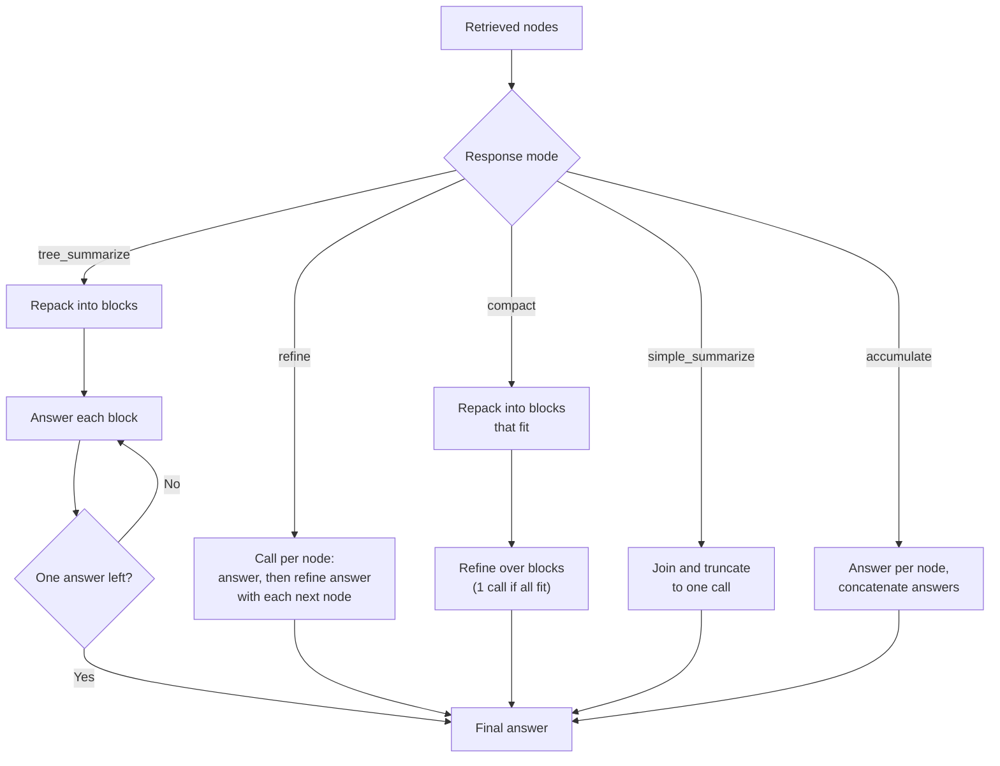

The last stage of every LlamaIndex query engine is the **response synthesizer**: the component that takes the question and the retrieved nodes and produces the answer by calling the LLM. When the nodes fit comfortably in one prompt, synthesis is a single call and there is little to decide. When they do not (many nodes, long nodes, a small context window, or a summarisation request over a whole document set), the synthesizer must choose how to split the work across calls, and that choice decides the cost, the latency and whether every retrieved fact actually reaches the model.

LlamaIndex expresses those choices as **response modes**: `refine`, `compact` (the default), `tree_summarize`, `simple_summarize`, `accumulate`, `compact_accumulate`, `generation`, `no_text` and `context_only`. The general strategies behind them (stuffing, refine, map-reduce) were introduced in [Multi-document synthesis](/learn/generation-strategies/multi-document-synthesis). This lesson shows exactly how LlamaIndex implements each mode, how it decides what fits in a call, and how to choose; you will run all the modes on the same input and count the calls.

## Learning objectives

- Describe what each response mode does and how many LLM calls it makes for a given input.
- Explain how the `PromptHelper` uses the LLM's context window, the reserved output tokens, the template size and padding to pack text into calls.
- Predict which modes can silently lose content and why.
- Choose a response mode for a question type (fact lookup, summary, per-source answers) and justify the choice by cost and fidelity.
- Customise synthesis: templates, streaming, structured output and answer filtering.

## Prerequisites

- [Query engines](/learn/llamaindex/query-engines): where the synthesizer sits and how prompts are replaced.
- [Multi-document synthesis](/learn/generation-strategies/multi-document-synthesis): stuffing, refine and map-reduce in general.
- [Context windows](/learn/context-engineering/context-windows): what limits a single call.
- [Tokens and tokenisation](/learn/understanding-large-language-models/tokens-and-tokenisation): sizes here are counted in tokens.

## Why this matters

Synthesis is where most of a RAG system's money is spent, and where its last mistakes are made. Two engines with identical retrieval can differ several-fold in cost and latency because one refines chunk by chunk and the other packs everything into one call. They can also differ in correctness: a mode that truncates to fit will drop the end of the context without an error, and a mode that summarises in stages can lose a detail in the first stage that the final answer needed.

Defaults hide all of this. The default `compact` mode is a good choice for most lookups, but LlamaIndex's packing decisions depend on the context window and output budget that the LLM object reports. A custom LLM that under-reports its window turns one call into several; one that over-reports it produces requests the provider rejects. Summaries over a whole index call for a different mode altogether. Knowing what each mode does lets you pick deliberately and explain the bill.

## The intuition

Imagine an editor asked to answer a question from a stack of reports, with a desk that holds only so many pages at once.

- **Refine**: read the first report, write a draft answer, then take each further report in turn and revise the draft. Careful and sequential; as many sittings as reports.
- **Compact**: before starting, staple reports together into as few bundles as fit on the desk, then refine bundle by bundle. Same idea, fewer sittings.
- **Tree summarise**: give each bundle to an assistant to summarise, then summarise the summaries, until one sheet remains. Good for "what is in all of this?"
- **Simple summarise**: stack everything on the desk and trim off whatever does not fit. One sitting; the bottom pages may be lost.
- **Accumulate**: answer the question separately from each report and hand back all the answers, one per report.

The desk size is the context window minus room for the answer. Every mode is a strategy for a desk that is too small.

## How it works

### Packing: how much fits in one call

Every mode that packs text uses a **`PromptHelper`** built from the LLM's metadata. For a given template, the room left for context in one call is

1. the LLM's `context_window`,
2. minus `num_output`, the tokens reserved for the answer,
3. minus the tokens of the template itself with the query filled in and the context empty,
4. minus a padding margin.

The padding differs by mode. Modes built on refining (`refine`, `compact`) reserve a large padding, 500 tokens by default, so that the growing "existing answer" in the refine prompt still fits; tree summarisation and simple summarisation use a small padding of a few tokens. Tokens are counted with LlamaIndex's tokeniser (a `tiktoken` encoding by default), which is an estimate for other providers' models.

Packing (`repack`) joins the chunks' text with blank lines and re-splits it with a sentence splitter whose chunk size is that room. Truncation (`truncate`) cuts text to the room and discards the rest.

### The modes

1. **`refine`**: for each node (split further if a node alone does not fit), make one call. The first uses `text_qa_template` with the node as context; each later call uses `refine_template` with the original question, the existing answer and the next node, and asks the model to improve the answer only if the new context helps. Calls: at least one per node. Every node is read in full; later nodes can be under-weighted because the model is often reluctant to change an existing answer, and an early wrong answer can persist.
2. **`compact`** (default): repack all nodes into as few context-sized blocks as fit, then refine over the blocks. With few nodes this is one call, identical to "stuff everything into the prompt". It is the right default for lookups.
3. **`tree_summarize`**: repack the nodes into blocks; if there is one block, answer from it in one call with `summary_template`. Otherwise answer from each block separately (concurrently when `use_async=True`), then treat those answers as the new chunks and repeat until one call produces the final answer. This is map-reduce. Use it for summaries and for questions whose answer is spread across many nodes.
4. **`simple_summarize`**: join all nodes, truncate to fit one call, answer once. Cheapest; silently drops whatever does not fit.
5. **`accumulate`**: answer the question separately from each node and concatenate the answers with a separator. Use it when you want one answer per source, for example "what does each regional policy say about X?".
6. **`compact_accumulate`**: as `accumulate`, but over packed blocks instead of single nodes.
7. **`generation`**: ignore the nodes and answer from the model alone. Useful for comparisons in evaluation; dangerous in a RAG system.
8. **`no_text`**: retrieve and return the nodes without calling the LLM; the response text is empty. Useful for testing retrieval through the query engine interface, as the [Router engines](/learn/llamaindex/router-engines) lesson did.
9. **`context_only`**: return the joined text of the nodes as the response, without calling the LLM. Useful when another system does the generation.



### Customising synthesis

- **Templates.** `text_qa_template`, `refine_template` and `summary_template` (plus chat variants) can be passed to `get_response_synthesizer` or replaced later with `update_prompts`, as in [Query engines](/learn/llamaindex/query-engines). If you rewrite the QA template to require citations, rewrite the refine template too, or refinement will drop them.
- **Streaming.** `streaming=True` streams the final call's output. In multi-call modes, the earlier calls complete before the first token appears, so time to first token still includes them.
- **Structured output.** `output_cls=MyPydanticModel` asks the synthesizer to return an instance of the model instead of free text, using the LLM's structured-output or function-calling support.
- **Answer filtering.** `structured_answer_filtering=True` (for `refine` and `compact`) asks the model, through structured output, whether each block actually answers the question and ignores blocks that do not, which reduces the "refine made it worse" failure. It needs an LLM with function-calling or structured-output support.
- **Concurrency.** `use_async=True` lets `tree_summarize` and `accumulate` make their independent calls concurrently.

## The mathematics

### Counting calls

**Intuition.** Each mode's cost is a function of how many context-sized blocks the nodes make.

Let the nodes total $T$ tokens, let $W$ be the context window, $o$ the reserved output, $t$ the template size and $p$ the padding. The room per call is

$$
R = W - o - t - p
$$

and the number of packed blocks is at least

$$
b = \left\lceil \frac{T}{R} \right\rceil
$$

(at least, because blocks are filled with whole sentences and the refine prompt also carries the existing answer). Then, with $n$ nodes that each fit alone:

- `refine` makes $n$ calls; `accumulate` makes $n$ calls.
- `compact` makes $b$ calls with $p \approx 500$; `compact_accumulate` makes about $b$ calls.
- `simple_summarize` makes 1 call and keeps at most $R$ tokens of the $T$.
- `tree_summarize` makes $b$ calls at the first level, then repeats on the $b$ answers: if those fit in one block, one more call, so $b + 1$ in total (or 1 if $b = 1$).

**By hand.** In the code below, $W = 1500$, $o = 120$, and six nodes of about 257 tokens each give $T \approx 1{,}540$. For tree summarisation, the template is about 40 tokens and padding about 5, so $R \approx 1500 - 120 - 40 - 5 = 1335$, $b = \lceil 1540 / 1335 \rceil = 2$, and the mode makes $2 + 1 = 3$ calls. For compact, the refine-based padding of 500 and a template of about 80 tokens give $R \approx 800$, so $b \ge \lceil 1540 / 800 \rceil = 2$; the run makes 3, because sentence packing and the growing existing answer leave each block short of $R$. `simple_summarize` keeps at most about 1,335 of 1,540 tokens, so roughly the last 200 tokens are dropped.

```python
import math
W, o, T = 1500, 120, 1540
R_tree = W - o - 40 - 5
R_compact = W - o - 80 - 500
print("tree blocks:", math.ceil(T / R_tree), "-> calls:", math.ceil(T / R_tree) + 1)
print("compact blocks (lower bound):", math.ceil(T / R_compact))
print("simple_summarize drops about", T - R_tree, "tokens")
```

```output
tree blocks: 2 -> calls: 3
compact blocks (lower bound): 2
simple_summarize drops about 205 tokens
```

## In code

**The problem.** Run every response mode on the same six handbook nodes, each about 257 tokens with one key fact at the end, against an LLM that reports a deliberately small 1,500-token context window. Count the calls, record each prompt's size and check how many of the six facts survive into the answer. The stand-in LLM "answers" by listing the facts it can see, as a perfect summariser would, so that what is lost is lost to packing and truncation, not to the model.

**Dependencies.**

```bash
pip install llama-index-core
```

```python
from typing import Any
import tiktoken
from llama_index.core import Settings
from llama_index.core.llms import CompletionResponse, CustomLLM, LLMMetadata
from llama_index.core.llms.callbacks import llm_completion_callback
from llama_index.core.response_synthesizers import get_response_synthesizer
from llama_index.core.schema import NodeWithScore, TextNode

enc = tiktoken.get_encoding("cl100k_base")
FACTS = ["25 days", "31 March", "3 days a week", "£400", "30 days", "£75"]
FILLER = ("This section of the Meridian handbook was reviewed by the HR team and applies to all "
          "permanent staff in every office unless a local addendum says otherwise. Questions about "
          "how it applies to you should go to your line manager first and then to HR. ") * 5
CHUNKS = [
    FILLER + "Annual leave is 25 days a year.",
    FILLER + "Up to 5 unused days carry over and must be used by 31 March.",
    FILLER + "Staff may work remotely up to 3 days a week.",
    FILLER + "The home-office equipment budget is £400; contractors are not eligible.",
    FILLER + "Expenses must be submitted within 30 days.",
    FILLER + "Any expense over £75 needs a receipt.",
]

class CountingLLM(CustomLLM):
    """Stand-in LLM with a small context window. Records each prompt's size and
    'answers' by listing the Meridian facts it can see, like a perfect summariser."""
    log: list[int] = []

    @property
    def metadata(self) -> LLMMetadata:
        return LLMMetadata(context_window=1500, num_output=120, model_name="counting-llm")

    @llm_completion_callback()
    def complete(self, prompt: str, formatted: bool = False, **kwargs: Any) -> CompletionResponse:
        seen = [f for f in FACTS if f in prompt]
        self.log.append(len(enc.encode(prompt)))
        return CompletionResponse(text="Facts: " + ", ".join(seen) + ".")

    @llm_completion_callback()
    def stream_complete(self, prompt: str, formatted: bool = False, **kwargs: Any):
        yield self.complete(prompt, formatted, **kwargs)

Settings.llm = llm = CountingLLM()
nodes = [NodeWithScore(node=TextNode(text=t), score=1.0) for t in CHUNKS]
print("tokens per chunk:", [len(enc.encode(c)) for c in CHUNKS])
query = "Summarise the leave, remote-work and expense rules."

print(f"\n{'mode':<19}{'calls':>5}  {'prompt tokens per call':<32}{'facts in answer':>15}")
for mode in ["refine", "compact", "tree_summarize", "simple_summarize", "accumulate", "compact_accumulate"]:
    llm.log.clear()
    answer = str(get_response_synthesizer(response_mode=mode).synthesize(query, nodes))
    in_answer = sum(f in answer for f in FACTS)
    print(f"{mode:<19}{len(llm.log):>5}  {str(llm.log):<32}{in_answer:>12} / 6")

for mode in ["no_text", "context_only"]:
    llm.log.clear()
    r = get_response_synthesizer(response_mode=mode).synthesize(query, nodes)
    print(f"{mode:<19}{len(llm.log):>5}  response text: {len(r.response or '')} characters; "
          f"{len(r.source_nodes)} source nodes")
```

```output
tokens per chunk: [254, 262, 257, 259, 254, 254]

mode               calls  prompt tokens per call          facts in answer
refine                 6  [293, 348, 347, 355, 353, 357]             6 / 6
compact                3  [838, 895, 205]                            6 / 6
tree_summarize         3  [1376, 386, 78]                            6 / 6
simple_summarize       1  [1382]                                     5 / 6
accumulate             6  [293, 301, 296, 298, 293, 293]             6 / 6
compact_accumulate     2  [1376, 376]                                6 / 6
no_text                0  response text: 0 characters; 6 source nodes
context_only           0  response text: 7735 characters; 6 source nodes
```

**The important lines.**

- `LLMMetadata(context_window=1500, num_output=120)` is what the synthesizer packs against. A real model's window is much larger; the small value makes the packing visible with short text.
- `get_response_synthesizer(response_mode=mode)` builds the synthesizer with `Settings.llm`; `.synthesize(query, nodes)` is what a query engine calls after retrieval and post-processing.
- Placing each fact at the end of its chunk makes truncation visible: anything cut from the end of the context takes the last fact with it.

**What the output means.**

- *refine* made one call per node (6). The first prompt (293 tokens) is the QA template plus one node; the later ones (about 350) are the refine template plus the existing answer plus the next node. Every node was read in full, at six sequential calls.
- *compact* packed the six nodes into three blocks and refined over them: three calls, about half of refine's. It used only about 840 to 900 tokens per call, well under the 1,500-token window, because of the 500-token padding reserved for the growing answer.
- *tree_summarize* packed the nodes into two blocks with small padding: the first call used 1,376 tokens (nearly the whole window), the second took the remaining node (386), and a third call (78 tokens) combined the two partial answers. Three calls, of which the first two are independent and could run concurrently with `use_async=True`.
- *simple_summarize* made one call of 1,382 tokens and lost a fact. The joined text did not fit, so it was truncated, and the last node's fact ("£75") was cut off. No warning, no error: the answer is simply missing a rule.
- *accumulate* made one call per node and returned six separate answers; *compact_accumulate* did the same over two packed blocks.
- *no_text* and *context_only* made no calls: the first returns an empty response text with the nodes attached, the second returns the nodes' text (7,735 characters) as the response.

With a perfect stand-in, every multi-call mode preserved all six facts. With a real model, multi-stage modes can lose details at each stage (a block summary that omits a number, a refine step that keeps the old answer), so the fact count here is an upper bound on what a real model would achieve.

**Common errors.**

- *`ValueError: Chunk size ... is not positive`*: the LLM's reported context window, minus `num_output`, the template and padding, leaves no room. Check the `metadata` of a custom LLM; for `refine` and `compact`, remember the 500-token padding.
- *Requests rejected for exceeding the context length*: the LLM object over-reports its window, or LlamaIndex's token estimate undercounts for your model's tokeniser; leave a margin.
- *Citations disappear after refinement*: the refine template was not updated to preserve them.

**Extending it.** Set `use_async=True` for `tree_summarize` with a real async-capable LLM and time it against `compact`. Then raise `context_window` to 8,000 and rerun: every packing mode collapses to a single call, which is the normal situation with modern context windows and a handful of retrieved nodes.

## A real-world example

The HR team asked AskMeridian for a feature: "Summarise everything about leave for a new starter." The Platform team's first version used the default query engine, with `similarity_top_k=4` and `compact` mode. Summaries were fluent but incomplete: they covered annual leave and carry-over and left out parental and sick leave, which were in nodes the top-4 retrieval did not return. The synthesis mode was not the problem; the engine never saw the other nodes.

The second version routed summary requests to a `SummaryIndex` over the leave section, whose retriever returns every node, with `tree_summarize`. Now all 38 leave nodes reached synthesis, packed into a handful of blocks, summarised concurrently, then combined. The output was complete, but cost several calls per request. Because the leave policy changes perhaps twice a year, the team precomputed the summary when the handbook is ingested, stored it as its own node with a `summary` flag, and served it directly, regenerating it when the leave section's hash changes.

A month later a developer, chasing latency, switched the lookup engine from `compact` to `simple_summarize` "because it is one call". The evaluation suite caught the regression: on questions whose retrieved nodes exceeded the window, the last node was truncated, and answers about receipt thresholds, which happened to rank fourth, lost their key number. The change was reverted, and a test now asserts that no lookup query's context is truncated.

## Common mistakes

- **Using `simple_summarize` for speed on large contexts.** It truncates silently and loses whatever ranked last.
- **Using `refine` with many nodes.** Calls grow linearly and run sequentially; latency balloons and early answers resist later evidence.
- **Expecting a mode to fix retrieval.** A summary is only as complete as the nodes retrieved; a top-k retriever cannot feed a whole-document summary.
- **Misreporting the context window in a custom LLM.** Under-reporting multiplies calls; over-reporting causes rejected requests.
- **Updating only the QA template.** Refine and summary templates also shape the answer in multi-call modes.
- **Using `generation` mode by accident.** It ignores retrieved context entirely.

## Best practices

- Keep `compact` for lookups; with sensible top-k and modern context windows it is a single call.
- Use `tree_summarize` (with `use_async=True`) for summaries, together with a retriever that returns all relevant nodes, such as a `SummaryIndex`.
- Use `accumulate` when users need per-source answers they can compare.
- Report accurate `context_window` and `num_output` in custom LLMs, and leave a margin for tokeniser differences.
- Customise the QA, refine and summary templates together so citation and refusal rules survive every stage.
- Precompute summaries of slowly changing content at ingestion time instead of synthesising them per request.
- Test that context is not truncated for your longest realistic queries.

## Performance considerations

For lookups with modern context windows, synthesis is usually one call and its cost is dominated by input tokens: with 5 nodes of 400 tokens plus a 200-token template, about 2,200 input tokens per query. Doubling top-k roughly doubles that.

Multi-call modes add latency in two different ways. `refine` and `compact` are inherently sequential, since each call needs the previous answer: with $b$ blocks and about 2 s per call (an assumed figure), $2b$ seconds. `tree_summarize` and `accumulate` make independent calls at each level, so with `use_async=True` the latency is roughly the number of levels times the per-call time: for 20 blocks and a second level, about two call-times instead of 21, subject to rate limits. Token cost is similar either way: every node's text is sent once at the first level, plus the intermediate answers.

Streaming improves perceived latency only for the final call. For `tree_summarize` over many blocks, the user waits for the whole first level before the first token; a progress message or a precomputed summary serves users better.

## Security considerations

Every synthesis mode places retrieved text into prompts, and multi-stage modes also place model-generated intermediate answers into later prompts. An instruction injected into one document can survive into an intermediate summary and influence the final answer while no longer being visible as document text, which makes it harder to trace. Keep system-level instructions out of the templates' context section, log intermediate answers in multi-stage modes for audit, and apply the same output validation to synthesised answers as to any model output (see [Output validation](/learn/rag-security-fundamentals/output-validation)). `context_only` and `no_text` return raw document text; if their results are shown to users, the same access controls must have been applied at retrieval.

## Summary

- The response synthesizer turns nodes into an answer; response modes decide how the work is split across LLM calls.
- Packing room per call is the context window minus reserved output, the template and padding (about 500 tokens for refine-based modes).
- `compact` (default) is one call when everything fits; `refine` is one call per node; `tree_summarize` is map-reduce; `accumulate` answers per node; `simple_summarize` truncates.
- Truncation and multi-stage summarisation can lose content silently; choose modes by question type and test for truncation.
- Accurate LLM metadata, coordinated templates and precomputed summaries keep synthesis correct and affordable.

## Exercises

1. An engine retrieves 12 nodes of 300 tokens each. The LLM reports a context window of 8,000 tokens and `num_output` of 500. How many calls do `refine`, `compact` and `tree_summarize` make?

<details><summary>Show solution</summary>

$T = 3{,}600$. `refine`: 12 calls, one per node. `compact`: room is about $8000 - 500 - 80 - 500 = 6{,}920$, which exceeds 3,600, so one call. `tree_summarize`: room about $8000 - 500 - 40 - 5 = 7{,}455$, so one block and one call.

</details>

2. Why did `compact` use only about 840 to 900 tokens per call in the lesson's run, when the window was 1,500?

<details><summary>Show solution</summary>

`compact` is built on refine, which reserves a padding of 500 tokens for the existing answer that later refine prompts must carry, on top of `num_output` (120) and the larger of the QA and refine templates. That leaves about 800 tokens for context per block; whole-sentence packing and the existing answer explain the exact sizes.

</details>

3. Modify the lesson's script to find the smallest `context_window` at which `simple_summarize` keeps all six facts, by trying windows from 1,500 upwards in steps of 50.

<details><summary>Show solution</summary>

```python
class SizedLLM(CountingLLM):
    window: int = 1500
    @property
    def metadata(self) -> LLMMetadata:
        return LLMMetadata(context_window=self.window, num_output=120, model_name="sized")

for window in range(1500, 2001, 50):
    sized = SizedLLM(window=window)
    answer = str(get_response_synthesizer(llm=sized, response_mode="simple_summarize").synthesize(query, nodes))
    kept = sum(f in answer for f in FACTS)
    if kept == 6:
        print("all facts kept from context_window =", window, "| prompt tokens:", sized.log[-1])
        break
```

```output
all facts kept from context_window = 1700 | prompt tokens: 1582
```

The combined context is about 1,540 tokens, the template about 40 and the output reservation 120, so a window of roughly 1,700 is needed; at 1,700 the single prompt is 1,582 tokens. The general lesson: `simple_summarize` is safe only when you can guarantee the context fits, and then `compact` would also have made exactly one call.

</details>

4. Design: Meridian Reports' release notes (hundreds of pages, updated monthly) must support both "What changed in the March release?" and "Summarise all export-related changes this year." Choose index types and response modes for each question type and explain the cost profile.

<details><summary>Show solution</summary>

For "what changed in the March release?", filter a vector index by `release = March` (metadata filter) and use `compact`: the relevant nodes are few, so one call. For year-wide thematic summaries, retrieve broadly (a vector retriever with a large top-k filtered to this year, or a `SummaryIndex` per release combined by a router) and use `tree_summarize` with `use_async=True`, which costs several calls per request. Since the year's notes change monthly, precompute per-release summaries at ingestion (one `tree_summarize` per release, stored as summary nodes) and answer thematic questions from those summaries plus targeted lookups: a two-level hierarchy, as in [Summary indexes](/learn/hierarchical-rag/summary-indexes). That moves the expensive synthesis from every request to once per release.

</details>

## Check your understanding

```quiz
[
  {
    "q": "What does the default `compact` mode do when all retrieved nodes fit in one prompt?",
    "options": [
      "Makes one LLM call with all nodes as context",
      "Makes one call per node",
      "Summarises each node separately, then combines",
      "Truncates the nodes to a fixed length"
    ],
    "answer": 0,
    "why": "Compact repacks nodes into as few blocks as fit; when one block suffices, it is a single call, equivalent to stuffing the prompt."
  },
  {
    "q": "Which mode can silently drop content that does not fit in one call?",
    "options": [
      "`tree_summarize`",
      "`refine`",
      "`simple_summarize`",
      "`accumulate`"
    ],
    "answer": 2,
    "why": "`simple_summarize` joins all nodes and truncates to fit one call; the rest is discarded without warning."
  },
  {
    "q": "With 20 packed blocks and `use_async=True`, why is `tree_summarize` usually faster than `compact`?",
    "options": [
      "It makes fewer LLM calls",
      "It uses a smaller model",
      "It skips the nodes with low scores",
      "Its first-level calls are independent and run concurrently, while compact's refine calls are sequential"
    ],
    "answer": 3,
    "why": "Each refine step needs the previous answer; tree summarisation's blocks can be summarised in parallel, then combined."
  },
  {
    "q": "A custom LLM reports `context_window=4000` for a model that accepts far more. What is the effect?",
    "options": [
      "Requests are rejected by the provider",
      "The synthesizer packs less context per call, so multi-node queries make more calls than necessary",
      "Retrieval returns fewer nodes",
      "Nothing; the value is informational"
    ],
    "answer": 1,
    "why": "Packing uses the reported window. Under-reporting shrinks every block and multiplies calls."
  },
  {
    "q": "Users ask \"What does each regional office's policy say about remote work?\" and want one answer per office. Which mode fits best?",
    "options": [
      "`accumulate`",
      "`simple_summarize`",
      "`generation`",
      "`no_text`"
    ],
    "answer": 0,
    "why": "`accumulate` answers the question separately for each node (or block, with `compact_accumulate`) and returns all the answers."
  }
]
```

## Further reading

- [LlamaIndex documentation](https://docs.llamaindex.ai/): "Response synthesizer" module guide and the list of response modes.
- LlamaIndex documentation, "Structured outputs": `output_cls` and structured answer filtering.
- [LlamaIndex source code on GitHub](https://github.com/run-llama/llama_index): `llama-index-core/llama_index/core/response_synthesizers/` and `indices/prompt_helper.py` for the packing logic described here.
- Dean and Ghemawat (2004), "MapReduce: Simplified Data Processing on Large Clusters", *OSDI 2004*: the pattern behind tree summarisation.
- Wu et al. (2021), "Recursively Summarizing Books with Human Feedback", [arXiv:2109.10862](https://arxiv.org/abs/2109.10862): hierarchical summarisation with language models.
