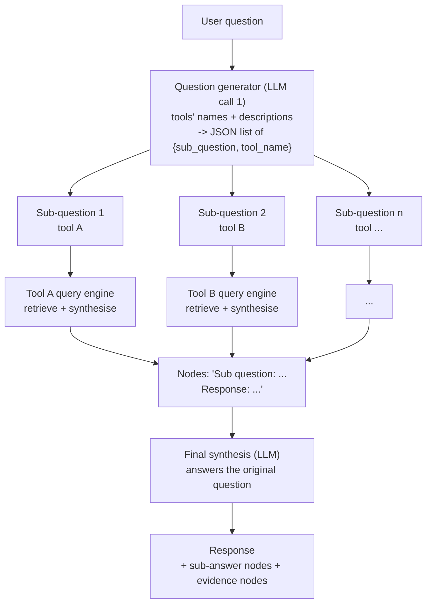

Some questions cannot be answered by any single retrieval. "How did the laptop refresh cycle and the home-office budget change between the 2023 and 2025 handbooks?" needs four facts from two sources, and no one chunk contains them all. A router, from the [previous lesson](/learn/llamaindex/router-engines), would pick one source and miss half the answer. LlamaIndex's **`SubQuestionQueryEngine`** takes the other approach: an LLM breaks the question into simpler sub-questions, each addressed to a named tool; each sub-question is answered by its tool's query engine; and a final synthesis step composes the answers.

The idea of decomposition was covered in [Query decomposition](/learn/advanced-retrieval/query-decomposition). This lesson is about LlamaIndex's implementation: the question generator and its prompt, how sub-questions are executed, what the final synthesis actually sees, and three behaviours that matter in production: a construction-time dependency that surprises people, sub-questions that fail silently, and sub-answers that lose track of which source they came from.

## Learning objectives

- Trace a query through `SubQuestionQueryEngine`: plan, execute, synthesise, with the LLM calls each stage makes.
- Configure the engine with an explicit question generator and explain why `from_defaults` may need one.
- Identify, from the engine's output, sub-questions that were dropped and sub-answers that lost their source context, and fix both.
- Estimate the cost and latency of a decomposed query, sequentially and concurrently.
- Decide when sub-question decomposition is worth its cost compared with routing or a single retrieval.

## Prerequisites

- [Router engines](/learn/llamaindex/router-engines): `QueryEngineTool`, `ToolMetadata` and selectors.
- [Query engines](/learn/llamaindex/query-engines): query engine anatomy and the stand-in LLM pattern.
- [Query decomposition](/learn/advanced-retrieval/query-decomposition): why and when to decompose questions.
- [Async programming](/learn/python-for-rag-engineering/async-programming): running independent calls concurrently.

## Why this matters

Comparative and multi-part questions are common in internal assistants: "What changed between versions?", "How do the UK and Ireland policies differ?", "Which of Meridian Sync and Meridian Relay supports SAML, and on which plans?" A single top-k retrieval for such a question tends to return chunks about whichever part of the question dominates the embedding, and the generator then answers half the question confidently and ignores the rest, or worse, fills the gap from its own knowledge.

Decomposition fixes that by giving each part its own retrieval. It also multiplies cost and latency, and adds two new things that can go wrong: the plan (wrong sub-questions, wrong tools) and the composition (sub-answers combined incorrectly). LlamaIndex's implementation makes the happy path a few lines, but its defaults hide failures: a sub-question addressed to a tool that does not exist is silently dropped, and sub-answers reach the final prompt without the name of the source that produced them. Knowing this is the difference between a demo and a system you can trust with "what changed?" questions.

## The intuition

A manager at Meridian is asked by the board: "How do our London and Dublin offices compare on leave and remote-work policy?" She does not search one filing cabinet for a page that compares them; no such page exists. She writes four notes ("London: annual leave?", "Dublin: annual leave?", "London: remote work?", "Dublin: remote work?"), sends each to the right office, collects the four replies, and writes the comparison herself.

Three things can go wrong. She can write the wrong notes (forget remote work, or send the Dublin question to London). A note can get lost in the post, and if nobody notices, her comparison silently omits Dublin's remote-work policy. And if the replies come back without saying which office they are from, she has two answers to "annual leave?" and no way to tell which is which. The sub-question engine is this manager, and those are its three failure modes.

## How it works

### The three stages



1. **Plan.** A **question generator** receives the tools' metadata and the user question and returns a list of `SubQuestion` objects, each with `sub_question` text and a `tool_name`. `LLMQuestionGenerator` does this with a prompt that shows the tools as a JSON object mapping names to descriptions, gives a worked example (comparing two companies' financial reports), and asks for JSON in a Markdown code block; an output parser extracts the list. Unlike the router's selectors, the question generator does see tool **names**, because each sub-question must name its tool.
2. **Execute.** For each sub-question, the engine looks up the query engine by `tool_name` and calls `query(sub_question)`. Each tool's engine runs its own retrieval and synthesis, so each sub-question costs at least one LLM call. With `use_async=True`, sub-questions run concurrently; otherwise one after another. The result of each is a `SubQuestionAnswerPair` with the sub-question, the answer text and the source nodes.
3. **Synthesise.** Each pair becomes a new text node reading `Sub question: <text>\nResponse: <answer>`. The engine's response synthesizer answers the original question from these nodes, and the evidence nodes from all sub-queries are attached to the response as additional source nodes.

### Three behaviours to know

**Construction.** `SubQuestionQueryEngine.from_defaults(query_engine_tools=...)` first tries to create an OpenAI function-calling question generator from the separate `llama-index-question-gen-openai` package. If that package is not installed, it raises an `ImportError`, whichever LLM you configured. If the package is installed but the LLM is not an OpenAI function-calling model, it falls back to `LLMQuestionGenerator`. Passing `question_gen=LLMQuestionGenerator.from_defaults(llm=...)` explicitly avoids the dependency and makes the behaviour obvious. `from_defaults` also sets `verbose=True` and `use_async=True` by default.

**Silent failures.** If executing a sub-question raises any exception (a tool name the generator invented, a timeout, a rate limit), the engine logs a warning on the `llama_index` logger and drops that sub-question. The final synthesis proceeds with whatever succeeded and does not know anything is missing. Unless your logging configuration shows that logger's warnings, nothing visible tells you the answer is incomplete.

**Lost provenance.** The node built from each pair contains the sub-question and the answer, not the tool name. If two sub-questions have the same text for different tools ("What is the laptop refresh cycle?" for the 2023 and the 2025 handbook), the final synthesizer receives two different answers to the same question with nothing saying which edition each describes. Good plans name the entity in each sub-question, as the generator's built-in example does ("What is the revenue growth of Uber"), but nothing enforces it.

### When to decompose

Decomposition earns its cost for questions that are explicitly multi-part or comparative across sources the system keeps separate. It is wasteful for single-fact questions, where it adds a planning call and a final synthesis to what one retrieval could answer, and risky for questions whose parts depend on each other ("Who owns the system that raised E-4100, and what is their escalation path?"), because the sub-questions are planned all at once and cannot use one another's answers. Dependent multi-step questions need iterative approaches, such as the agents covered in [Iterative search](/learn/agentic-rag/iterative-search). A common production pattern puts a cheap classifier or router in front: single-fact questions go straight to a query engine, and only comparative ones go to the sub-question engine.

## The mathematics

### Calls, tokens and latency

**Intuition.** A decomposed query is a small tree of LLM calls. Counting them gives its cost; the longest path through them gives its latency.

With $n$ sub-questions, each answered by an engine making $c_i$ LLM calls (usually 1 with the compact mode), the total number of LLM calls is

$$
C = 1 + \sum_{i=1}^{n} c_i + c_{\text{final}}
$$

where the 1 is the planning call and $c_{\text{final}}$ (usually 1) is the final synthesis. Latency depends on execution. Sequentially,

$$
T_{\text{seq}} = T_{\text{plan}} + \sum_{i=1}^{n} T_i + T_{\text{final}}
$$

and concurrently (with `use_async=True` and no rate limiting),

$$
T_{\text{par}} = T_{\text{plan}} + \max_{i} T_i + T_{\text{final}}
$$

where $T_i$ is the time to answer sub-question $i$ (retrieval plus its LLM calls).

**By hand.** Four sub-questions, one LLM call each, so $C = 1 + 4 + 1 = 6$ calls, against 1 for a plain query engine. Assume (illustratively) planning takes 1.2 s, each sub-answer 1.5 s and final synthesis 2.0 s. Sequentially, $T_{\text{seq}} = 1.2 + 4 \times 1.5 + 2.0 = 9.2$ s. Concurrently, $T_{\text{par}} = 1.2 + 1.5 + 2.0 = 4.7$ s. Concurrency halves the wait here, but not the cost: six calls are made either way.

```python
plan, sub, final, n = 1.2, 1.5, 2.0, 4
print("LLM calls:", 1 + n + 1)
print("sequential:", round(plan + n * sub + final, 1), "s")
print("concurrent:", round(plan + sub + final, 1), "s")
```

```output
LLM calls: 6
sequential: 9.2 s
concurrent: 4.7 s
```

## In code

**The problem.** Answer "How did the laptop refresh cycle and home-office budget change between the 2023 and 2025 handbooks, and what are the support hours?" from two tools, one per handbook edition. A scripted stand-in LLM plays both roles: it returns a fixed plan to the question generator and answers every other prompt with the context it was given, so the run is deterministic, needs no API key, and shows exactly what reaches each stage. The fixed plan contains two realistic flaws: identical sub-question texts for the two editions, and a fifth sub-question addressed to a tool that does not exist.

**Dependencies.** `common.py` holds the `MiniLMEmbedding` adapter from [Index architecture](/learn/llamaindex/index-architecture).

```bash
pip install llama-index-core sentence-transformers
```

```python
import json
from typing import Any
from llama_index.core import Document, Settings, VectorStoreIndex
from llama_index.core.llms import CompletionResponse, CustomLLM, LLMMetadata
from llama_index.core.llms.callbacks import llm_completion_callback
from llama_index.core.query_engine import SubQuestionQueryEngine
from llama_index.core.question_gen import LLMQuestionGenerator
from llama_index.core.tools import QueryEngineTool, ToolMetadata
from common import MiniLMEmbedding   # the adapter from "Index architecture"

PLAN = {"items": [
    {"sub_question": "What is the laptop refresh cycle?", "tool_name": "handbook_2023"},
    {"sub_question": "What is the laptop refresh cycle?", "tool_name": "handbook_2025"},
    {"sub_question": "What is the home-office equipment budget?", "tool_name": "handbook_2023"},
    {"sub_question": "What is the home-office equipment budget?", "tool_name": "handbook_2025"},
    {"sub_question": "What are the support desk hours?", "tool_name": "handbook_2024"},   # no such tool
]}

class ScriptedLLM(CustomLLM):
    """Stand-in LLM. Returns a fixed plan to the question generator; otherwise
    answers with the first line of context, as in the Query engines lesson."""
    calls: list[str] = []

    @property
    def metadata(self) -> LLMMetadata:
        return LLMMetadata(context_window=8000, num_output=256, model_name="scripted")

    @llm_completion_callback()
    def complete(self, prompt: str, formatted: bool = False, **kwargs: Any) -> CompletionResponse:
        if "<User Question>" in prompt:
            self.calls.append("plan")
            return CompletionResponse(text="```json\n" + json.dumps(PLAN) + "\n```")
        self.calls.append("answer")
        context = prompt.split("---------------------\n")[1]
        return CompletionResponse(text=" / ".join(context.strip().splitlines()))

    @llm_completion_callback()
    def stream_complete(self, prompt: str, formatted: bool = False, **kwargs: Any):
        yield self.complete(prompt, formatted, **kwargs)

Settings.embed_model = MiniLMEmbedding(model_name="all-MiniLM-L6-v2")
Settings.llm = llm = ScriptedLLM()

editions = {
    "handbook_2023": ["The laptop refresh cycle is 4 years.", "The home-office equipment budget is £250.",
                      "The support desk is open 09:00 to 17:00 UK time."],
    "handbook_2025": ["The laptop refresh cycle is 3 years.", "The home-office equipment budget is £400.",
                      "The support desk is open 08:00 to 18:00 UK time."],
}
tools = [QueryEngineTool(
            query_engine=VectorStoreIndex.from_documents([Document(text=t) for t in texts])
                                         .as_query_engine(similarity_top_k=1),
            metadata=ToolMetadata(name=name, description=f"Meridian employee handbook, {name[-4:]} edition"))
         for name, texts in editions.items()]

engine = SubQuestionQueryEngine.from_defaults(
    query_engine_tools=tools,
    question_gen=LLMQuestionGenerator.from_defaults(),   # required unless the OpenAI generator is installed
    use_async=False,
    verbose=False,
)
response = engine.query("How did the laptop refresh cycle and home-office budget change between "
                        "the 2023 and 2025 handbooks, and what are the support hours?")
print("LLM calls:", llm.calls)
print("context of the final synthesis call:")
for line in str(response).split(" / "):
    if line.strip():
        print("  ", line)
pairs = [n for n in response.source_nodes if n.node.text.startswith("Sub question:")]
print(f"sub-questions answered: {len(pairs)} of {len(PLAN['items'])}")
print("evidence nodes:", [n.node.text for n in response.source_nodes if n not in pairs])
```

```output
LLM calls: ['plan', 'answer', 'answer', 'answer', 'answer', 'answer']
context of the final synthesis call:
   Sub question: What is the laptop refresh cycle?
   Response: The laptop refresh cycle is 4 years.
   Sub question: What is the laptop refresh cycle?
   Response: The laptop refresh cycle is 3 years.
   Sub question: What is the home-office equipment budget?
   Response: The home-office equipment budget is £250.
   Sub question: What is the home-office equipment budget?
   Response: The home-office equipment budget is £400.
sub-questions answered: 4 of 5
evidence nodes: ['The laptop refresh cycle is 4 years.', 'The laptop refresh cycle is 3 years.', 'The home-office equipment budget is £250.', 'The home-office equipment budget is £400.']
```

**The important lines.**

- `question_gen=LLMQuestionGenerator.from_defaults()` avoids the `ImportError` that `from_defaults` raises when the OpenAI question-generator package is absent. It uses `Settings.llm`.
- The stand-in recognises the planning prompt by its `<User Question>` marker and returns the plan as JSON in a Markdown code block, the format the generator's output parser expects.
- `use_async=False` runs sub-questions in order so the output is reproducible; production code would normally keep the default `True`.
- Because the stand-in "answers" by echoing its context, the final response text is the final synthesis prompt's context: exactly what a real model would have to work with.

**What the output means.**

- *Calls.* Six LLM calls were made: one plan, four sub-answers and one final synthesis, matching $C = 1 + 4 + 1$. The fifth sub-question made no call.
- *The dropped sub-question.* "What are the support desk hours?" was addressed to `handbook_2024`, which does not exist. Looking it up raised an exception, the engine caught it, logged a warning, and continued. Nothing in the response says that the user's third question ("what are the support hours?") was not answered. A real model, given this context, would most likely answer the two comparisons and either ignore the support-hours part or answer it from general knowledge.
- *Lost provenance.* The final synthesis sees "What is the laptop refresh cycle?" answered twice, once "4 years" and once "3 years", with no edition named. The evidence nodes in `source_nodes` are equally unlabelled. A model asked "how did it change between 2023 and 2025?" has to guess the direction of the change; here it would probably guess right from the order, which is luck, not design.

**Common errors.**

- *`ImportError: llama-index-question-gen-openai package cannot be found`* at construction: pass `question_gen` explicitly.
- *`ValueError` from the output parser*: the model's plan was not valid JSON in the expected shape. Catch it and fall back to a plain query engine.
- *Answers silently incomplete*: configure logging for the `llama_index` logger at `WARNING`, and compare the number of answered pairs with the plan.

### Fixing the three problems

The fixes are small and belong in any production deployment:

1. **Validate the plan.** Wrap the question generator: drop or repair sub-questions whose `tool_name` is not a known tool, cap the number of sub-questions, and fall back to a plain query engine when the plan is empty or unparseable.
2. **Keep provenance.** Rewrite each sub-question to name its source before execution (for example, prefix "In the 2025 handbook:"), or customise the planning prompt to require it, so both the sub-answer node and the final prompt carry the source.
3. **Surface failures.** After the query, compare the answered pairs with the plan. If any are missing, either retry them, or tell the final synthesizer explicitly which parts could not be answered, so that it says so instead of improvising.

Exercise 3 implements the first two as a wrapper around `LLMQuestionGenerator`.

### With Claude

With a real model, the question generator writes the plan itself. Using the `ClaudeLLM` adapter from [Query engines](/learn/llamaindex/query-engines) (not executed here; it needs an API key):

```python
Settings.llm = ClaudeLLM()
engine = SubQuestionQueryEngine.from_defaults(
    query_engine_tools=tools,
    question_gen=LLMQuestionGenerator.from_defaults(),
    use_async=True,
)
response = await engine.aquery("How did the laptop refresh cycle and home-office budget change "
                               "between the 2023 and 2025 handbooks?")
```

Because the adapter's async methods fall back to synchronous calls, true concurrency requires implementing `acomplete` with `anthropic.AsyncAnthropic`, as noted in that lesson.

## A real-world example

Meridian's finance department asked AskMeridian to answer questions like "What changed in the expenses policy between last year's handbook and this year's, and does it affect contractors?" The Platform team set up a `SubQuestionQueryEngine` over three tools: the 2023 handbook, the 2025 handbook and the contractor agreement template.

In testing, answers read well, but the evaluation set exposed two problems. About one comparison in ten described the change backwards. Tracing showed that the model's plans often used identical sub-question texts for the two editions, so the final synthesis could not tell which answer was which; the backwards answers were the cases where the sub-answers arrived in an unhelpful order. And contractor questions were sometimes answered without any contractor information: the plan had addressed the contractor sub-question to a tool called `contractor_policy`, which did not exist (the tool was `contractor_agreement`), and the failure was swallowed.

The team wrapped the question generator to rewrite every sub-question as "[tool description]: [sub-question]" and to map unknown tool names to the closest known one by embedding similarity, or drop them and record the gap. The final prompt now ends with a list of any sub-questions that could not be answered and an instruction to say so explicitly. They also put an LLM router in front so that single-fact expense questions bypass decomposition entirely, which removed most of the extra cost.

## Common mistakes

- **Using `from_defaults` without `question_gen`.** It fails with an `ImportError` unless an OpenAI-specific package is installed.
- **Decomposing every question.** Single-fact questions pay for a plan and a final synthesis they do not need.
- **Trusting the plan.** Invented tool names and duplicate or missing sub-questions are common; validate before executing.
- **Ignoring dropped sub-questions.** The engine swallows failures, so answers can be silently incomplete.
- **Losing provenance.** Sub-question nodes do not record the tool, so identical sub-question texts produce ambiguous context.
- **Using it for dependent multi-step questions.** All sub-questions are planned up front and cannot use each other's answers.

## Best practices

- Pass an explicit question generator, and wrap it to validate tool names and cap the number of sub-questions.
- Make every sub-question name its source, by prompt or by rewriting.
- Detect and report unanswered sub-questions in the final prompt rather than letting the model improvise.
- Keep `use_async=True` and an async-capable LLM for interactive use; respect provider rate limits when sub-questions fan out.
- Route only multi-part or comparative questions to the sub-question engine.
- Evaluate decomposition separately: plan quality, sub-answer correctness and final composition.

## Performance considerations

Cost scales with the number of sub-questions. Each sub-answer prompt carries its own retrieved context, say 3 nodes of 300 tokens plus the template, about 1,000 input tokens, and the final synthesis carries all sub-answers. With four sub-questions, the input tokens are roughly the planning prompt (the default prompt with its worked example is several hundred tokens) plus 4,000 for the sub-answers plus the final prompt: several times a single query's 1,000 or so. Output tokens grow likewise.

Latency depends on concurrency, as the formulas show, and concurrency is limited by the provider's rate limits: firing 8 sub-questions at once from each of 20 concurrent users is 160 simultaneous requests. A semaphore around the LLM calls, or a lower cap on sub-questions, keeps the service inside its limits. The plan call is on the critical path and cannot be parallelised with anything, so a faster, smaller model for planning is a common optimisation, provided plan quality is checked on the evaluation set.

## Security considerations

The plan is generated from the user's question, so a crafted question can steer which tools are queried and with what text. Every tool must therefore be one the user is allowed to use: build the tool list from the user's permissions before constructing the engine, exactly as for routers. Sub-answers are generated text derived from retrieved documents; if those documents contain injected instructions, they can propagate into sub-answers and from there into the final prompt, one step removed from the original document and harder to spot. Keep the final synthesis prompt's instructions in the system prompt and treat sub-answers as untrusted content, as described in [Indirect prompt injection](/learn/rag-security-fundamentals/indirect-prompt-injection).

## Summary

- `SubQuestionQueryEngine` plans sub-questions with an LLM, answers each with a named tool's query engine, and synthesises the answers into one response.
- Construct it with an explicit `LLMQuestionGenerator` to avoid a hidden dependency on an OpenAI-specific package.
- Failed sub-questions are dropped silently, and sub-answer nodes do not record their tool; both need explicit handling.
- A decomposed query makes $1 + n + 1$ or more LLM calls; concurrency reduces latency, not cost.
- Use decomposition for comparative and multi-part questions over separate sources; route simple questions past it, and use iterative agents for dependent steps.

## Exercises

1. A question is decomposed into 6 sub-questions; each tool's engine uses `refine` mode and retrieves 3 nodes that do not fit in one prompt together, so each sub-answer takes 3 LLM calls. How many LLM calls does the query make?

<details><summary>Show solution</summary>

$C = 1 + 6 \times 3 + 1 = 20$ calls, assuming the final synthesis fits in one call. With the default compact mode and nodes that fit in one prompt, it would be $1 + 6 + 1 = 8$.

</details>

2. Why does the router from the previous lesson fail on "How did the laptop refresh cycle change between 2023 and 2025?" while the sub-question engine can succeed?

<details><summary>Show solution</summary>

A single-selection router sends the whole question to one tool, so only one edition is searched and the comparison cannot be made. A multi-selection router could query both editions, but each would receive the whole comparative question and return a partial answer for its own edition. The sub-question engine asks each edition a targeted question and composes the answers, which matches the structure of a comparison.

</details>

3. Write a question generator wrapper that drops sub-questions with unknown tool names and prefixes each remaining sub-question with its tool's description. Run it in place of `LLMQuestionGenerator` in the lesson's script.

<details><summary>Show solution</summary>

```python
from llama_index.core.question_gen.types import BaseQuestionGenerator, SubQuestion

class ValidatedQuestionGenerator(BaseQuestionGenerator):
    def __init__(self, inner: BaseQuestionGenerator):
        self._inner = inner
    def _get_prompts(self): return self._inner.get_prompts()
    def _update_prompts(self, prompts): self._inner.update_prompts(prompts)
    def _fix(self, tools, sub_questions):
        known = {t.name: t.description for t in tools}
        kept = [SubQuestion(sub_question=f"{known[s.tool_name]}: {s.sub_question}", tool_name=s.tool_name)
                for s in sub_questions if s.tool_name in known]
        print(f"plan: kept {len(kept)} of {len(sub_questions)} sub-questions")
        return kept
    def generate(self, tools, query):
        return self._fix(tools, self._inner.generate(tools, query))
    async def agenerate(self, tools, query):
        return self._fix(tools, await self._inner.agenerate(tools, query))

engine = SubQuestionQueryEngine.from_defaults(
    query_engine_tools=tools,
    question_gen=ValidatedQuestionGenerator(LLMQuestionGenerator.from_defaults()),
    use_async=False, verbose=False)
response = engine.query("How did the laptop refresh cycle and home-office budget change between "
                        "the 2023 and 2025 handbooks, and what are the support hours?")
for line in str(response).split(" / "):
    if line.startswith("Sub question"):
        print(line)
```

```output
plan: kept 4 of 5 sub-questions
Sub question: Meridian employee handbook, 2023 edition: What is the laptop refresh cycle?
Sub question: Meridian employee handbook, 2025 edition: What is the laptop refresh cycle?
Sub question: Meridian employee handbook, 2023 edition: What is the home-office equipment budget?
Sub question: Meridian employee handbook, 2025 edition: What is the home-office equipment budget?
```

The drop is now visible and counted, and every sub-answer node names its edition, so the final synthesis can tell the answers apart. A fuller version would also tell the final synthesizer which parts of the question were dropped.

</details>

4. Design: Meridian wants "Compare Meridian Sync, Meridian Relay and Meridian Reports on SSO support, export formats and plan availability." Sketch the tools, the expected plan size and a latency budget, and say what you would do if the plan exceeds it.

<details><summary>Show solution</summary>

One tool per product's documentation (three tools). A complete plan is 3 products × 3 attributes = 9 sub-questions, so about 11 LLM calls. With concurrent execution and illustrative timings of 1.2 s planning, 1.5 s per sub-answer and 2.5 s for a larger final synthesis, latency is about 5.2 s if all 9 run at once within rate limits. If the budget is, say, 4 s, options are: ask each tool one combined sub-question covering all three attributes (3 sub-questions instead of 9, each with more context), use a faster model for planning and sub-answers, or cap the plan at a set size and tell the user which parts were not covered. A product comparison table maintained as structured data and queried directly would beat all of these if such questions are frequent.

</details>

## Check your understanding

```quiz
[
  {
    "q": "What does the final synthesis step of a `SubQuestionQueryEngine` receive as its context nodes?",
    "options": [
      "All nodes retrieved by every sub-query, concatenated",
      "Only the nodes from the first tool",
      "One node per answered sub-question, containing the sub-question text and its answer",
      "The tool descriptions"
    ],
    "answer": 2,
    "why": "Each answered pair becomes a text node 'Sub question: ... Response: ...'; the retrieved evidence is attached as additional source nodes."
  },
  {
    "q": "`SubQuestionQueryEngine.from_defaults(query_engine_tools=tools)` raises an `ImportError`. Why?",
    "options": [
      "It tries to create an OpenAI function-calling question generator from a package that is not installed",
      "The tools have no descriptions",
      "`Settings.llm` is not an OpenAI model",
      "Async support is missing"
    ],
    "answer": 0,
    "why": "Without `question_gen`, `from_defaults` first imports `llama-index-question-gen-openai`; passing an `LLMQuestionGenerator` avoids it."
  },
  {
    "q": "The plan contains a sub-question addressed to a tool name that does not exist. What happens by default?",
    "options": [
      "The whole query fails with an exception",
      "The sub-question is sent to the first tool",
      "The user is asked to choose a tool",
      "The sub-question is dropped with a logged warning and the final answer is built from the rest"
    ],
    "answer": 3,
    "why": "Exceptions in sub-question execution are caught and logged, and the failed pair is filtered out before synthesis."
  },
  {
    "q": "With 5 sub-questions, each taking 2 s, planning 1 s and final synthesis 2 s, what are the sequential and concurrent latencies?",
    "options": [
      "13 s and 13 s",
      "13 s and 5 s",
      "10 s and 2 s",
      "15 s and 5 s"
    ],
    "answer": 1,
    "why": "Sequential: 1 + 5 × 2 + 2 = 13 s. Concurrent: 1 + max(2) + 2 = 5 s. The number of calls is the same either way."
  },
  {
    "q": "Which question is a poor fit for a sub-question engine?",
    "options": [
      "Compare the 2023 and 2025 laptop policies",
      "Which of Meridian Sync and Meridian Relay supports SAML?",
      "Find the owner of the system that raised E-4100, then give that owner's escalation path",
      "How do leave and remote-work policies differ between two offices?"
    ],
    "answer": 2,
    "why": "The second step depends on the first step's answer, but all sub-questions are planned at once. Dependent steps need iterative retrieval."
  }
]
```

## Further reading

- [LlamaIndex documentation](https://docs.llamaindex.ai/): "Sub Question Query Engine" example and the "Query engine" module guides.
- [LlamaIndex source code on GitHub](https://github.com/run-llama/llama_index): `llama-index-core/llama_index/core/query_engine/sub_question_query_engine.py` and `question_gen/` for the behaviours described here.
- Zhou et al. (2022), "Least-to-Most Prompting Enables Complex Reasoning in Large Language Models", [arXiv:2205.10625](https://arxiv.org/abs/2205.10625).
- Press et al. (2022), "Measuring and Narrowing the Compositionality Gap in Language Models", [arXiv:2210.03350](https://arxiv.org/abs/2210.03350): self-ask, a sequential alternative to planning all sub-questions at once.
- Khattab et al. (2022), "Demonstrate-Search-Predict: Composing retrieval and language models for knowledge-intensive NLP", [arXiv:2212.14024](https://arxiv.org/abs/2212.14024).
