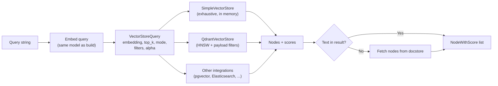

`VectorStoreIndex` is the index almost every LlamaIndex application uses. It embeds nodes, hands the vectors to a **vector store**, and gives back a retriever that embeds the query and asks the store for the nearest neighbours. The class itself is thin; most of what matters happens at its two boundaries: what is sent to the vector store when nodes are inserted, and what query the retriever sends back when a question arrives.

This lesson opens both boundaries. It covers how the index builds and stores, the vector-store interface that lets the same code run on the in-memory `SimpleVectorStore`, Qdrant, pgvector or a dozen other databases, the retriever's options (top-k, metadata filters, query modes such as MMR and hybrid), and document-level maintenance with `insert`, `delete_ref_doc` and `refresh_ref_docs`. The vector databases themselves are covered in [Vector Database Ecosystem](/learn/vector-database-ecosystem), and the search algorithms in [Vector Indexing Algorithms](/learn/vector-indexing-algorithms); here the subject is LlamaIndex's layer on top of them.

## Learning objectives

- Trace what `VectorStoreIndex` does when it inserts nodes, including which store receives text and which receives vectors.
- Write metadata filters with `MetadataFilters`, `MetadataFilter` and `FilterOperator`, and explain where filtering happens.
- Choose between the default, MMR and hybrid query modes and interpret the scores each returns.
- Keep an index in step with its sources using `insert`, `delete_ref_doc` and `refresh_ref_docs`.
- Move an index from the in-memory store to an external vector database without changing query code.

## Prerequisites

- [Index architecture](/learn/llamaindex/index-architecture): the storage context and its stores.
- [Node parsing](/learn/llamaindex/node-parsing): nodes, metadata and `ref_doc_id`.
- [Metadata filtering](/learn/advanced-vector-database-engineering/metadata-filtering): pre-filtering and post-filtering in vector databases.
- [MMR](/learn/advanced-retrieval-optimisation/mmr): the maximal marginal relevance algorithm.

## Why this matters

Vector search answers "which nodes are closest to this query?" Production questions are rarely that simple. AskMeridian must answer from the current handbook, not the superseded 2023 edition; it must show contractors only what contractors may read; it must not fill all five context slots with near-copies of the same VPN paragraph; and when HR edits a policy, the old wording must stop being retrievable that night, not at the next full rebuild.

Each of those needs a specific feature of the vector index: metadata filters, diversity-aware query modes, and document-level updates. Each also has a framework-specific trap. Filters that the in-memory store supports may not be supported, or may behave differently, in your production database. MMR scores are not similarities, so a similarity threshold applied after MMR is meaningless. And updates only work if documents have stable ids and nodes keep their source relationship. This lesson is about using those features without falling into the traps.

## The intuition

Imagine a warehouse with a smart catalogue. Every item has a position on a map according to what it is (its embedding), and a label with facts about it: which department, which year's stock (its metadata). A customer describes what they want; the catalogue finds the closest positions on the map.

Three refinements make the catalogue useful. A **filter** says "only this year's stock" or "only the IT department" before the search starts, so out-of-date items never appear however close they are. A **diversity rule** says "after you have picked one VPN cable, prefer something different over a second identical cable", which helps when the shelf is full of near-duplicates. And **stock management** means that when a supplier sends a revised item, the old one is taken off the shelf and the new one put on, by product code, without re-cataloguing the whole warehouse.

LlamaIndex's vector index is the catalogue clerk; the vector store is the warehouse. The clerk speaks one language to every warehouse, and each warehouse translates it into its own.

## How it works

### Building: what goes where

`VectorStoreIndex(nodes, storage_context=..., embed_model=...)`, or `VectorStoreIndex.from_documents(docs)`, which first runs the transformations (by default `Settings.node_parser`), does this:

1. Split the nodes into batches of `insert_batch_size` (2,048 by default).
2. For each batch, embed every node that does not already have an embedding. The text embedded is `node.get_content(metadata_mode=MetadataMode.EMBED)`, so non-excluded metadata is part of the vector. The embedding model batches its own calls (`embed_batch_size`).
3. Call `vector_store.add(nodes)`. The store returns the ids it stored the vectors under.
4. If the store does **not** keep text (`stores_text` is false, as for `SimpleVectorStore`) or `store_nodes_override=True`, write the nodes to the docstore and record node id to vector id in the index struct. If it does keep text (most external databases), skip both; the store's payload is the source of truth.
5. Record, in the docstore, which nodes belong to which document (`ref_doc_info`), when the docstore is used.

Nodes that already carry embeddings, for example from an `IngestionPipeline` that ended with an embedding model, are not embedded again. That is how ingestion and indexing are usually split in production: the pipeline embeds and writes to the vector store, and the service opens the index with `VectorStoreIndex.from_vector_store(vector_store)`, which builds nothing.

### The vector-store interface

Every vector store integration implements the same small interface, `BasePydanticVectorStore`: `add(nodes)`, `delete(ref_doc_id)`, `query(VectorStoreQuery)` and a `client` property, plus async variants and, in many stores, `get_nodes` and `delete_nodes`. A `VectorStoreQuery` carries the query embedding, `similarity_top_k`, a `mode`, optional `filters`, `alpha` for hybrid weighting, optional `doc_ids` and `node_ids` restrictions, and the original query text for stores that need it. The store returns nodes (or ids), similarities and ids.

Two consequences matter. First, query code (`as_retriever`, `as_query_engine`) is identical whichever store you use, so you can develop on the in-memory store and deploy on Qdrant. Second, **each store translates the query into its own language**, and not every store supports every mode or filter operator. The in-memory store supports flat filters with the common operators and the MMR mode, but not nested filters or hybrid search; Qdrant, Weaviate, Elasticsearch and others support hybrid search through their own mechanisms, configured in their integration. Always check the integration's documentation for the store you will run in production, and test filters there, not only locally.



### The retriever's options

`index.as_retriever(**kwargs)` creates a `VectorIndexRetriever`. Its main parameters:

- `similarity_top_k` (default 2): how many results to request.
- `filters`: a `MetadataFilters` object. Each `MetadataFilter` has a `key`, a `value` and an `operator` from `FilterOperator` (`EQ`, `NE`, `GT`, `GTE`, `LT`, `LTE`, `IN`, `NIN`, `CONTAINS`, `TEXT_MATCH` and others); filters are combined with `condition` set to `AND` (the default) or `OR`. `MetadataFilters` objects can be nested for more complex logic in stores whose integration supports it; the in-memory store raises an error on nesting.
- `vector_store_query_mode`: `default` (similarity), `mmr`, `hybrid`, `sparse`, `text_search` and a few learner-based modes; what is valid depends on the store.
- `alpha`: in hybrid mode, the weight between dense and sparse scores (by convention 1 is all dense, 0 all sparse; check your store's integration).
- `doc_ids` and `node_ids`: restrict the search to listed documents or nodes.
- `vector_store_kwargs`: extra arguments passed to the store's `query`, such as `mmr_threshold` for the in-memory MMR.

Filtering in `SimpleVectorStore` is **pre-filtering**: it discards non-matching vectors and then searches exhaustively among the rest, so you always get the best matches that satisfy the filter. External stores generally filter inside their approximate index; how well that works with very selective filters depends on the store and on whether the filtered field has a payload index, as [Payload indexes](/learn/advanced-vector-database-engineering/payload-indexes) explains.

### Query modes and what their scores mean

In **default** mode, scores are similarities (cosine for normalised vectors in the in-memory store; other stores may return distances or their own scales).

In **MMR** mode, the in-memory implementation selects results one at a time, each maximising $\lambda \cdot \text{sim}(q, d) - (1 - \lambda) \cdot \max_{s \in S} \text{sim}(d, s)$, where `mmr_threshold` plays the role of $\lambda$ (0.5 by default). The scores returned are those MMR values, not similarities, and the list is in selection order. A `SimilarityPostprocessor` cut-off applied to MMR results therefore compares the wrong number. [MMR](/learn/advanced-retrieval-optimisation/mmr) covers the algorithm itself.

In **hybrid** mode, a store that supports it runs dense and sparse (keyword) retrieval and fuses them, as described in [Hybrid retrieval architecture](/learn/hybrid-search/hybrid-retrieval-architecture). In LlamaIndex this is configured on the vector store integration (for example, enabling hybrid search when creating the store and providing a sparse encoder) and then requested with `vector_store_query_mode="hybrid"`.

### Keeping the index current

Document-level maintenance works through `ref_doc_id`:

1. `index.insert(document)` parses, embeds and adds one document's nodes; `insert_nodes(nodes)` skips parsing.
2. `index.delete_ref_doc(doc_id, delete_from_docstore=True)` calls `vector_store.delete(doc_id)` and removes the nodes and the document's bookkeeping from the docstore.
3. `index.update_ref_doc(document)` is delete followed by insert.
4. `index.refresh_ref_docs(documents)` compares each document's hash with the one recorded in the docstore: new documents are inserted, changed ones updated, unchanged ones skipped. It returns a list of booleans saying which were refreshed. It needs a docstore that records document hashes, so with an external store that keeps text you must keep a docstore (or use `store_nodes_override=True`), or use an `IngestionPipeline`'s docstore strategy from [Document ingestion](/learn/llamaindex/document-ingestion) instead.

None of this deletes documents that disappeared from the source; that remains your reconciliation job.

## In code

**The problem.** Index eight short Meridian documents, including a superseded 2023 support-hours policy. Retrieve with and without metadata filters, compare default and MMR retrieval on a VPN question with near-duplicate runbooks, then delete the old policy and refresh an edited one.

**Dependencies.** `common.py` holds the `MiniLMEmbedding` adapter from [Index architecture](/learn/llamaindex/index-architecture).

```bash
pip install llama-index-core sentence-transformers
```

```python
from llama_index.core import Document, Settings, StorageContext, VectorStoreIndex
from llama_index.core.vector_stores import FilterOperator, MetadataFilter, MetadataFilters
from common import MiniLMEmbedding   # the adapter from "Index architecture"

Settings.embed_model = MiniLMEmbedding(model_name="all-MiniLM-L6-v2")
Settings.llm = None

def doc(id_, text, corpus, version):
    return Document(id_=id_, text=text, metadata={"corpus": corpus, "version": version},
                    excluded_embed_metadata_keys=["corpus", "version"])

docs = [
    doc("hb-2025-leave", "Annual leave is 25 days. Up to 5 unused days carry over until 31 March.", "handbook", 2025),
    doc("hb-2025-support", "The support desk is open 08:00 to 18:00 UK time.", "handbook", 2025),
    doc("hb-2025-remote", "Staff may work remotely up to 3 days a week; the home-office budget is £400.", "handbook", 2025),
    doc("hb-2023-support", "The support desk is open 09:00 to 17:00 UK time.", "handbook", 2023),
    doc("rb-vpn-4021", "VPN error E-4021: the VPN client is out of date. Update it from the IT portal.", "runbooks", 2025),
    doc("rb-vpn-4012", "VPN error E-4012: the VPN certificate expired. Request a new certificate.", "runbooks", 2025),
    doc("rb-vpn-wifi", "VPN is required whenever you connect from public Wi-Fi.", "runbooks", 2025),
    doc("rb-laptops", "Laptops are refreshed every 3 years. Report a lost laptop to the support desk at once.", "runbooks", 2025),
]
storage = StorageContext.from_defaults()
index = VectorStoreIndex.from_documents(docs, storage_context=storage)
print("vectors:", len(storage.vector_store.data.embedding_dict), "| documents tracked:", len(index.ref_doc_info))

def show(label, retriever, q):
    print(f"{label:<22}", [(n.node.ref_doc_id, round(n.score, 3)) for n in retriever.retrieve(q)])

q = "When can I phone the support desk?"
show("no filter", index.as_retriever(similarity_top_k=2), q)
current = MetadataFilters(filters=[MetadataFilter(key="version", value=2025)])
show("version == 2025", index.as_retriever(similarity_top_k=2, filters=current), q)
runbooks_2025 = MetadataFilters(filters=[
    MetadataFilter(key="corpus", value="runbooks"),
    MetadataFilter(key="version", value=2024, operator=FilterOperator.GTE)])
show("runbooks, >= 2024", index.as_retriever(similarity_top_k=2, filters=runbooks_2025), q)

q = "I can't connect to the VPN"
show("top-3 similarity", index.as_retriever(similarity_top_k=3), q)
show("top-3 MMR (0.3)", index.as_retriever(similarity_top_k=3, vector_store_query_mode="mmr",
                                           vector_store_kwargs={"mmr_threshold": 0.3}), q)

# Document-level maintenance through ref_doc_id.
index.delete_ref_doc("hb-2023-support", delete_from_docstore=True)
edited = doc("hb-2025-support", "The support desk is open 08:00 to 18:00 UK time, Monday to Friday.", "handbook", 2025)
changed = index.refresh_ref_docs([edited, docs[0]])
print("refreshed (support, leave):", changed,
      "| vectors:", len(storage.vector_store.data.embedding_dict))
show("after maintenance", index.as_retriever(similarity_top_k=2), "When can I phone the support desk?")
```

```output
LLM is explicitly disabled. Using MockLLM.
vectors: 8 | documents tracked: 8
no filter              [('hb-2025-support', 0.641), ('hb-2023-support', 0.633)]
version == 2025        [('hb-2025-support', 0.641), ('rb-laptops', 0.3)]
runbooks, >= 2024      [('rb-laptops', 0.3), ('rb-vpn-wifi', 0.203)]
top-3 similarity       [('rb-vpn-4021', 0.642), ('rb-vpn-4012', 0.631), ('rb-vpn-wifi', 0.525)]
top-3 MMR (0.3)        [('rb-vpn-4021', 0.193), ('hb-2025-leave', -0.02), ('rb-vpn-4012', 0.171)]
refreshed (support, leave): [True, False] | vectors: 7
after maintenance      [('hb-2025-support', 0.642), ('rb-laptops', 0.3)]
```

**The important lines.**

- `excluded_embed_metadata_keys=["corpus", "version"]` keeps the labels out of the vectors: they exist for filtering, not for meaning. Without it, the word "2023" would be part of the embedded text.
- `MetadataFilter(key="version", value=2025)` uses the default operator, `EQ`. The second filter set combines two conditions with the default `AND`, one using `FilterOperator.GTE`.
- `vector_store_kwargs={"mmr_threshold": 0.3}` passes the store-specific MMR parameter through the retriever to `SimpleVectorStore.query`.
- `refresh_ref_docs` receives an edited support policy and an unchanged leave policy.

**What the output means.**

- *Versions.* Without a filter, the current and superseded support-hours policies scored 0.641 and 0.633: semantically they are the same sentence, and nothing in the vectors says which is current. The generator would receive contradictory hours. With `version == 2025`, the old policy is gone. The second slot was filled by the laptop runbook at 0.3, because the retriever always returns `top_k` results if enough nodes pass the filter; that is why a cut-off or reranker is still needed.
- *Combined filters.* Restricting to runbooks from 2024 onwards excludes both support-hours policies; the results are the best runbook matches, weak as they are. Filters change the candidate set, not the ranking within it.
- *MMR.* Plain similarity returned three VPN runbooks, which is what this question needs. MMR with a low threshold (0.3, weighting diversity heavily) kept the top VPN result, then chose the unrelated leave policy because it is unlike the first pick, and only then the E-4012 runbook. Its scores are MMR values (0.193 is 0.3 times 0.642), one is negative, and the list is in selection order, not sorted. MMR helps when results are near-duplicates of each other; here the three runbooks were distinct and relevant, so diversity cost relevance.
- *Maintenance.* Deleting the 2023 policy removed its vector (8 to 7). `refresh_ref_docs` returned `[True, False]`: the edited support policy was re-embedded, the unchanged leave policy skipped. The final query finds the edited policy at 0.642, with no older version left to contradict it.

**Common errors.**

- *`ValueError: Cannot filter stores that were persisted without metadata`*: an old persisted `SimpleVectorStore` lacked the metadata dictionary; rebuild it.
- *A filter returns nothing in production but works locally*: the external store may need the key indexed, may type values differently (string `"2025"` against integer `2025`), or may not support the operator.
- *`refresh_ref_docs` re-embeds everything*: document ids are not stable, or the docstore is not persisted between runs.

**Extending it.** Raise `mmr_threshold` to 0.7 and rerun the VPN query to see MMR approach plain similarity. Then add `MetadataFilters(filters=[...], condition=FilterCondition.OR)` to search both corpora for one version.

### The same index on Qdrant

Moving to an external store changes only the construction. This code needs a running Qdrant server and the `llama-index-vector-stores-qdrant` package, so it was not executed here; write and test it against your own cluster. [Qdrant](/learn/vector-database-ecosystem/qdrant) covers the database itself.

```bash
pip install llama-index-core llama-index-vector-stores-qdrant qdrant-client
```

```python
import os
import qdrant_client
from llama_index.core import StorageContext, VectorStoreIndex
from llama_index.vector_stores.qdrant import QdrantVectorStore

client = qdrant_client.QdrantClient(url=os.environ["QDRANT_URL"],
                                    api_key=os.environ.get("QDRANT_API_KEY"))
vector_store = QdrantVectorStore(client=client, collection_name="askmeridian_handbook")

# Build job: embeds and writes nodes (text and metadata go into Qdrant payloads).
storage = StorageContext.from_defaults(vector_store=vector_store)
index = VectorStoreIndex.from_documents(docs, storage_context=storage)

# Service: opens the existing collection; nothing is re-embedded.
index = VectorStoreIndex.from_vector_store(vector_store)
retriever = index.as_retriever(similarity_top_k=5, filters=current)
```

Because Qdrant keeps text in its payloads, the docstore stays empty, and `refresh_ref_docs` has no hashes to compare. Either keep a separate persistent docstore (`store_nodes_override=True` with a database-backed docstore), or, more commonly, do change detection in an `IngestionPipeline` with its own docstore and `vector_store=vector_store`, and keep the index purely for querying. Create a payload index in Qdrant for every metadata key you filter on.

## A real-world example

AskMeridian's support-hours answers were inconsistent: some staff were told 08:00 to 18:00, others 09:00 to 17:00. The Platform team traced it with the retriever alone, as in the code above. Both the 2025 handbook and the superseded 2023 edition were in the index, their support-hours chunks scored within a hundredth of each other, and which came first varied with the wording of the question.

The team's first fix, adding "Only use the current handbook" to the prompt, did not work, because nothing in the chunks told the model which was current. The real fix had three parts. Every document now carries `version` and `status` metadata set by the reader, excluded from embedding and from the LLM. The query engine's retriever always applies `status == "current"`, built from the user's context in the same place as the access-control filters. And the nightly job deletes superseded documents with `delete_ref_doc` once HR marks a new edition as effective, keeping the old edition in a separate archive collection that only the HR team's tools can query. A test in the evaluation set asks for the support hours and fails if the 2023 hours appear in any retrieved node.

## Common mistakes

- **Embedding filter labels.** Version numbers, corpus names and permission groups in the embedded text distort similarity and do nothing for filtering.
- **Assuming filters behave identically across stores.** Operators, value types and performance differ; test in the production store.
- **Applying a similarity cut-off to MMR or hybrid scores.** Those scores are on different scales.
- **Expecting `refresh_ref_docs` to work with a text-storing external store and no docstore.** There are no stored hashes to compare.
- **Re-embedding at service start-up.** Use `from_vector_store` in the service; build in a separate job.
- **Treating top-k as "the relevant results".** The retriever fills `top_k` slots whenever enough nodes pass the filter, however weak they are.

## Best practices

- Separate building (ingestion job writing to the vector store) from serving (`VectorStoreIndex.from_vector_store`).
- Put lifecycle and access attributes (version, status, audience, owner) in metadata, exclude them from embedding and the LLM, and filter on them in every retriever.
- Build filters in one place from the user's context, so no code path can skip them.
- Create payload or metadata indexes in the external store for every filtered key.
- Use MMR only when you observe near-duplicate results, and tune its threshold on an evaluation set.
- Keep `top_k` generous and narrow with a reranker and cut-off rather than relying on raw top-k.

## Performance considerations

`SimpleVectorStore` compares the query with every stored vector in Python. Per query that is $N \times d$ multiply-adds: for 100,000 nodes of 384 dimensions, 38.4 million, plus Python overhead per vector that dominates in practice. That is acceptable for thousands of nodes and tests, not for a service with a large corpus. External stores use approximate indexes such as HNSW, whose query cost grows roughly logarithmically with $N$, as covered in [HNSW](/learn/vector-indexing-algorithms/hnsw).

Build cost is embedding cost. Inserting 50,000 nodes with a hosted embedding API at `embed_batch_size=100` is 500 requests; at the default of 10 it is 5,000 requests, each with its own network round trip. `insert_batch_size` controls how many nodes are embedded and written per batch and therefore peak memory during a build.

Filters cost little in a well-indexed store and can be very expensive without a payload index, because the store may have to scan or over-fetch candidates. MMR adds pairwise similarity computations among candidates: selecting $k$ results from $n$ candidates is on the order of $n \times k$ extra comparisons, negligible for $n$ in the tens, significant if you run MMR over thousands of candidates.

## Security considerations

Metadata filters are the main tool for [document-level permissions](/learn/access-control-and-privacy/document-level-permissions) in a LlamaIndex retriever. They are only as strong as the code path that builds them: construct them on the server from the authenticated user, never from request parameters, and make the unfiltered retriever impossible to reach from user-facing code. Prefer one collection per tenant when isolation requirements are strict, since a single missing filter in a shared collection exposes everything. Deleting a document from the index with `delete_ref_doc` removes it from search, but backups and snapshots of the vector store keep it; see [Secure deletion](/learn/enterprise-rag-governance/secure-deletion).

## Summary

- `VectorStoreIndex` embeds nodes and writes them to a vector store; text goes to the docstore only when the store does not keep it.
- Every store implements the same `add`, `delete` and `query` interface, so query code is portable, but filter and mode support differ per store.
- Metadata filters (`MetadataFilters`, `MetadataFilter`, `FilterOperator`) restrict candidates before ranking and are how versions and permissions are enforced.
- MMR and hybrid modes return scores on their own scales; do not threshold them as similarities.
- `insert`, `delete_ref_doc` and `refresh_ref_docs` maintain the index by document id, provided ids are stable and hashes are stored.

## Exercises

1. In the output, why did the `version == 2025` query return the laptop runbook at all, and what would you add so that it does not reach the LLM?

<details><summary>Show solution</summary>

The retriever asked for `similarity_top_k=2`, and seven nodes passed the filter, so it returned the two best even though the second scored only 0.3. Add a post-processor in the query engine: a `SimilarityPostprocessor` with a cut-off set from an evaluation set, or a cross-encoder reranker with a score threshold.

</details>

2. Write two filters: one that matches 2025 documents from either corpus using `FilterOperator.IN`, and one that matches the 2023 edition **or** any runbook. Then try combining them by nesting one `MetadataFilters` inside another and report what the in-memory store does.

<details><summary>Show solution</summary>

```python
from llama_index.core.vector_stores import FilterCondition

cross_corpus_current = MetadataFilters(filters=[
    MetadataFilter(key="corpus", value=["handbook", "runbooks"], operator=FilterOperator.IN),
    MetadataFilter(key="version", value=2025)])
show("IN + AND", index.as_retriever(similarity_top_k=3, filters=cross_corpus_current),
     "When can I phone the support desk?")
old_or_runbook = MetadataFilters(filters=[
    MetadataFilter(key="version", value=2023),
    MetadataFilter(key="corpus", value="runbooks")], condition=FilterCondition.OR)
show("2023 OR runbooks", index.as_retriever(similarity_top_k=3, filters=old_or_runbook),
     "When can I phone the support desk?")
try:
    nested = MetadataFilters(filters=[cross_corpus_current, old_or_runbook], condition=FilterCondition.OR)
    index.as_retriever(filters=nested).retrieve("support desk")
except ValueError as e:
    print("nested:", e)
```

```output
IN + AND               [('hb-2025-support', 0.641), ('rb-laptops', 0.3), ('hb-2025-remote', 0.241)]
2023 OR runbooks       [('hb-2023-support', 0.633), ('rb-laptops', 0.3), ('rb-vpn-wifi', 0.203)]
nested: Nested MetadataFilters are not supported.
```

Run this before the maintenance step. `IN` takes a list value. `condition=FilterCondition.OR` applies to the filters at one level. The in-memory store rejects nested filter groups with a `ValueError`; some external integrations translate nesting into their native boolean filters, so check the one you deploy on. This is a concrete case of "works on one store, not on another".

</details>

3. Explain why `refresh_ref_docs` returned `[True, False]` and what it would return if every document had been given a random id on each run.

<details><summary>Show solution</summary>

The edited support policy had the same id as a stored document but a different hash, so it was updated (True); the leave policy's id and hash matched, so it was skipped (False). With random ids, no id would match the docstore, so every document would be treated as new and inserted (all True), and the old nodes would never be deleted, leaving duplicates.

</details>

4. Design: Meridian wants one LlamaIndex service to answer for 30 customer tenants of Meridian Sync, each with its own documents. Compare one Qdrant collection with a `tenant_id` filter against one collection per tenant, in LlamaIndex terms.

<details><summary>Show solution</summary>

One collection: one `QdrantVectorStore` and index; every retriever must carry `MetadataFilter(key="tenant_id", value=...)`, built server-side; Qdrant needs a payload index on `tenant_id`. It is simpler to operate, but one missed filter leaks across tenants. One collection per tenant: a `QdrantVectorStore` and `VectorStoreIndex.from_vector_store` per tenant, chosen by the authenticated tenant, so isolation does not depend on a filter; the cost is more collections to create, migrate and monitor, and per-collection overhead in Qdrant. For 30 tenants with contractual isolation requirements, per-tenant collections are a defensible choice; for thousands of small tenants, a shared collection with enforced filters (and Qdrant's multitenancy features) usually scales better. [Multi-tenancy](/learn/advanced-vector-database-engineering/multi-tenancy) discusses the trade-off in depth.

</details>

## Check your understanding

```quiz
[
  {
    "q": "A `VectorStoreIndex` uses `QdrantVectorStore` with default settings. Where is each node's text stored?",
    "options": [
      "In the Qdrant point's payload; the docstore is not used",
      "In the LlamaIndex docstore only",
      "In both, always",
      "Nowhere; only embeddings are stored"
    ],
    "answer": 0,
    "why": "Stores that keep text receive it in the payload, and the index skips the docstore unless `store_nodes_override=True`."
  },
  {
    "q": "An MMR retriever returns scores of 0.19, -0.02 and 0.17. What are these numbers?",
    "options": [
      "Cosine similarities, sorted",
      "Distances, so lower is better",
      "MMR objective values in selection order, not similarities",
      "Reranker probabilities"
    ],
    "answer": 2,
    "why": "MMR returns the value of its relevance-minus-redundancy objective for each pick, in the order picked."
  },
  {
    "q": "Why exclude `version` and `corpus` from embedding when they are used for filtering?",
    "options": [
      "Filters cannot read keys that are embedded",
      "They add noise to the vector without helping similarity; filtering reads metadata directly",
      "Excluding them deletes them from the store",
      "Embedding them makes the index larger on disk"
    ],
    "answer": 1,
    "why": "Exclusion only affects the rendered text. The keys remain stored and filterable while vectors stay focused on meaning."
  },
  {
    "q": "`index.refresh_ref_docs(docs)` re-embeds every document on every run. Which is the most likely cause?",
    "options": [
      "The embedding model is not batched",
      "MMR mode is enabled",
      "`similarity_top_k` is too high",
      "Document ids change between runs or the docstore with stored hashes was not persisted"
    ],
    "answer": 3,
    "why": "Refreshing compares ids and hashes stored in the docstore. Unstable ids or a lost docstore make every document look new."
  },
  {
    "q": "Your filter works with `SimpleVectorStore` but returns nothing on the production store. What should you check first?",
    "options": [
      "Whether the store supports the operator and stores the value with the same type (for example integer versus string)",
      "Whether `Settings.llm` is set",
      "Whether the query is long enough",
      "Whether MMR is enabled"
    ],
    "answer": 0,
    "why": "Each integration translates filters into the store's own language; operator support and value types are the usual differences."
  }
]
```

## Further reading

- [LlamaIndex documentation](https://docs.llamaindex.ai/): "VectorStoreIndex" guide, "Vector stores" (the list of integrations and the features each supports) and "Document management".
- LlamaIndex documentation, "Metadata filters": `MetadataFilters`, operators and nested conditions.
- [Qdrant documentation](https://qdrant.tech/documentation/): payload indexes, filtering and hybrid queries.
- Carbonell and Goldstein (1998), "The Use of MMR, Diversity-Based Reranking for Reordering Documents and Producing Summaries", *Proceedings of SIGIR 1998*.
- Malkov and Yashunin (2016), "Efficient and robust approximate nearest neighbor search using Hierarchical Navigable Small World graphs", [arXiv:1603.09320](https://arxiv.org/abs/1603.09320).
