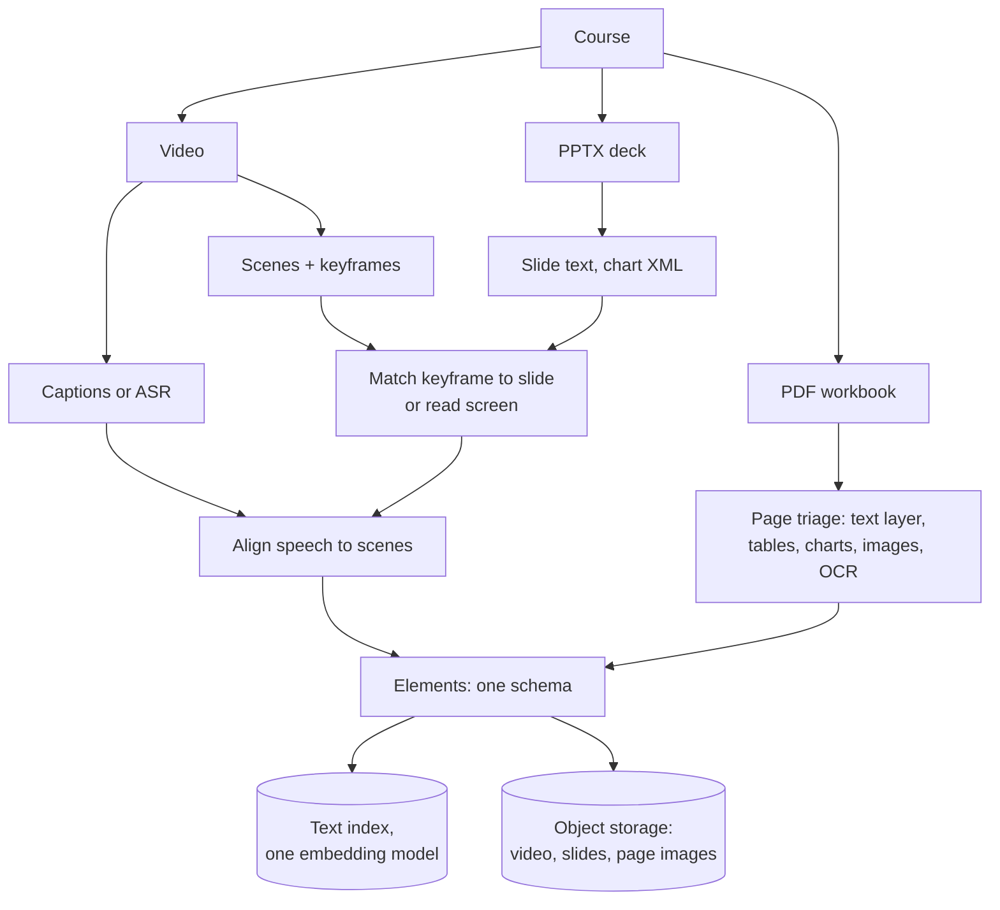

This assessment covers all eight lessons of *Multimodal Ingestion*: images, tables, charts, diagrams, audio transcripts, video transcripts, OCR pipelines and multimodal document representation. The multiple-choice section has 18 questions; the pass mark is 14 correct (about 75%). The open questions, coding exercises, design challenge and troubleshooting scenarios are not scored automatically: attempt each one before opening its solution, and treat any you could not answer as a pointer back to the relevant lesson. Where token counts, timings or prices appear they are assumptions for arithmetic practice, not quotes from any provider.

```quiz
[
  {"q": "A 200-page PDF manual has the company logo in the header of every page. What should an image ingestion pipeline do with it?", "options": ["Describe it once per page so every page has an image record", "Drop it as a decoration, because it repeats across pages and carries no content", "Send it to OCR", "Embed it with CLIP and keep 200 vectors"], "answer": 1, "why": "Images that repeat on many pages are decorations. Describing them costs money and floods the index with near-identical chunks that crowd out real content."},
  {"q": "Why should a vision model's image description include on-screen text in a separate, verbatim field?", "options": ["Because codes, labels and error messages are the exact strings users search for, and a verbatim field can be keyword-indexed", "Because the API requires it", "Because it reduces image tokens", "Because embedding models cannot process quotation marks"], "answer": 0, "why": "Exact identifiers are where semantic matching is weakest. Keeping them verbatim lets keyword search match them exactly."},
  {"q": "What does this code print?\n```python\nimport numpy as np\npx = np.array([[200, 40], [180, 60]], dtype=float)\nprint((px > px.mean()).flatten().astype(int))\n```", "options": ["[0 1 0 1]", "[1 1 0 0]", "[1 0 1 0]", "[1 0 0 1]"], "answer": 2, "why": "The mean is 120. Pixels 200 and 180 are above it (1); 40 and 60 are below (0). Flattened row by row: 1 0 1 0. This is the average hash of a 2x2 image."},
  {"q": "A 300-row table is ingested through the general text splitter at 500 tokens per chunk. What is the main consequence?", "options": ["The table is dropped", "Every chunk contains the whole table", "Numbers are converted to words", "Only the first chunk carries the header row, so most chunks hold unlabelled values"], "answer": 3, "why": "A length-based splitter cuts the table into pieces; the header row lands in one of them, and the rest lose the column labels that give values meaning."},
  {"q": "Which question about a table can top-k row retrieval NOT guarantee to answer correctly?", "options": ["Which error codes come from the VPN client?", "What is the remedy for E-4021?", "How many users does the Team plan allow?", "Does Enterprise include SAML single sign-on?"], "answer": 0, "why": "It needs every matching row. If more rows match than are retrieved, the answer is silently incomplete; a structured copy queried with a filter answers it exactly."},
  {"q": "A table has a 20-token header and rows whose values average 5 tokens. For a large table, roughly how many times larger are self-contained row records than the bare CSV?", "options": ["2 times", "4 times", "5 times", "25 times"], "answer": 2, "why": "The ratio tends to (h + v) / v = (20 + 5) / 5 = 5."},
  {"q": "A Word report contains a native chart. Where are the exact plotted values most reliably found?", "options": ["By OCR of the rendered page", "In the cached series values inside the chart's XML part in the document archive", "In the document's core properties", "By asking a vision model to estimate bar heights"], "answer": 1, "why": "Office charts store their categories and values in the chart XML part (for example word/charts/chart1.xml), so they can be read exactly without image processing."},
  {"q": "On a linear axis, the 0 tick is at pixel y = 300 and the 100 tick at y = 100. What value does a point at y = 150 have?", "options": ["50", "150", "75", "25"], "answer": 2, "why": "v = 0 + (150 - 300) x (100 - 0) / (100 - 300) = (-150)(100)/(-200) = 75."},
  {"q": "Why compute a chart's percentage change in code instead of asking the vision model for it?", "options": ["Code over validated values is exact; model arithmetic is a separate source of error", "Vision models cannot produce numbers", "Percentages cannot be embedded", "Pydantic requires it"], "answer": 0, "why": "Extraction and arithmetic are independent risks. Once values are validated, computing derived figures in code removes the second risk."},
  {"q": "In a draw.io file, which attributes identify a connector and the boxes it joins?", "options": ["vertex=\"1\" and parent", "style and value", "edge=\"1\" with source and target holding the box ids", "id and geometry"], "answer": 2, "why": "Every element is an mxCell; connectors have edge=\"1\" and reference the ids of the shapes they connect through source and target."},
  {"q": "Which question about an architecture diagram should be answered by traversing the stored graph rather than retrieving text records?", "options": ["Is there a diagram of the AskMeridian architecture?", "What directly uses the Qdrant cluster?", "What is the label on the arrow from the API to the retriever?", "Which components are affected, directly or indirectly, if the embedding service fails?"], "answer": 3, "why": "Indirect dependencies require following chains of edges, which no single text record states."},
  {"q": "A reference transcript has 25 words. The ASR output has 3 substitutions, 1 deletion and 1 insertion. What is the word error rate?", "options": ["0.16", "0.20", "0.24", "0.12"], "answer": 1, "why": "WER = (S + D + I) / N = (3 + 1 + 1) / 25 = 0.20."},
  {"q": "Why include the neighbouring word in a glossary pattern such as \"meridian really\" -> \"Meridian Relay\"?", "options": ["Regular expressions need at least two words", "It runs faster", "It makes the pattern case-sensitive", "So that ordinary uses of 'really' are not changed into the product name"], "answer": 3, "why": "A broad pattern fixes the error but corrupts correct text elsewhere; extra context makes the correction safe."},
  {"q": "Two consecutive slides share a white template and differ only in bullet text. Which scene-change measure is most likely to miss the change?", "options": ["Brightness histogram difference", "Pixel-wise mean absolute difference", "Comparing OCR text of both frames", "Comparing the frames' perceptual hashes"], "answer": 0, "why": "Histograms ignore pixel positions; two text slides on one template have almost the same mix of light and dark pixels."},
  {"q": "A transcript cue runs from 8.5 s to 10.0 s. Scene A spans 5 to 9 s and scene B 9 to 15 s. Where does assignment by largest overlap put it?", "options": ["Scene A, overlap 0.5 s", "Scene B, overlap 1.0 s", "Both equally", "Neither"], "answer": 1, "why": "Overlap with A is 9 - 8.5 = 0.5 s; with B, 10 - 9 = 1.0 s."},
  {"q": "A scanned page carries a digital \"Page 3 of 3\" stamp. Why does a check of \"has any text layer?\" mis-triage it?", "options": ["Stamps are images", "PyMuPDF cannot read stamps", "The stamp gives the page a text layer, so OCR is skipped and the body is never read", "Scans always have a text layer"], "answer": 2, "why": "A few digital characters make a scan look born-digital. Triage needs a character threshold and an image-coverage test."},
  {"q": "In Otsu's method, which quantity is maximised to choose the threshold?", "options": ["The number of ink pixels", "The between-class variance w0 x w1 x (mu0 - mu1) squared", "The within-class variance", "The image contrast"], "answer": 1, "why": "Otsu picks the threshold that makes the two classes as different as possible, weighted by their sizes; this is equivalent to minimising within-class variance."},
  {"q": "In a multimodal element schema, why are the surrogate and the payload separate fields?", "options": ["Because the text that best finds an element is often not what best answers a question about it", "To save storage", "Because payloads are always images", "Because embedding models cannot read payloads"], "answer": 0, "why": "A table summary finds the table; the table itself is needed to read a cell. Retrieval uses the surrogate, generation the payload."}
]
```

## Conceptual questions

1. Explain the "ladder of data sources" for charts and diagrams. Why is it better to climb down it from the top rather than send every figure to a vision model?

<details><summary>Show model answer</summary>

For charts the rungs are: the original dataset, the chart object in an Office file (whose XML caches the plotted values), a vector drawing (SVG or PDF paths, read and calibrated against the axis ticks), and finally the raster image read by a vision model. For diagrams the equivalents are diagram-as-code (Mermaid, PlantUML, DOT), diagram-tool files (draw.io, Visio XML), vector drawings, and images. Each rung down loses precision and adds risk: the top rungs give exact values and exact graphs; the bottom gives estimates and readings that can be wrong in ways that look right (a misread log axis, a reversed arrow). The top rungs are also cheaper, since parsing XML costs milliseconds while a vision-model call costs tokens. Climbing down only when a rung is unavailable gets exact data where it exists and spends model calls, and validation effort, only where they are needed. Recording the rung as provenance lets the generator present estimates as estimates.

</details>

2. A colleague proposes indexing all images with a CLIP-style image embedding model only, with no text descriptions. For a corpus of IT runbook screenshots, what would you expect to go wrong, and what would you recommend?

<details><summary>Show model answer</summary>

Runbook screenshots carry their meaning in text: error messages, button labels, field names, codes. General-purpose CLIP-style models are trained on web photos with short captions; they capture overall visual content well but read small text in images poorly. Queries such as "the dialog that shows E-4021" would match screenshots that look similar (the same application) rather than the one with that code. A second index also means a second embedding model whose scores cannot be merged directly with the text index. I would recommend text surrogates (caption, introducing paragraph and a description with a verbatim visible-text field) embedded with the same text model as the rest of the corpus, the visible text also keyword-indexed, and the original images stored so that image embeddings can be added later if a genuine visual-similarity need appears.

</details>

3. Why is word error rate an incomplete measure of transcript quality for a RAG system, and what would you measure alongside it?

<details><summary>Show model answer</summary>

WER weights every word equally, so mishearing "the" costs as much as mishearing "Relay", although only the second breaks retrieval. It also counts formatting differences ("ninety" against "90") as errors unless both texts are normalised the same way first, so it partly measures conventions rather than recognition. Alongside a normalised WER, measure the recognition rate of key terms: product names, codes, system and people's names, the vocabulary users search with. That number predicts retrieval failures directly, and it is the one most improved by vocabulary hints and glossaries. A retrieval-level check (do known questions still find the right transcript chunk?) closes the loop.

</details>

4. Explain why denoising must come before binarisation in an OCR pipeline, referring to how Otsu's method chooses its threshold.

<details><summary>Show model answer</summary>

Otsu chooses the threshold that maximises the between-class variance $w_0 w_1 (\mu_0 - \mu_1)^2$ of the grey-level histogram, assuming two reasonably separated populations, ink and paper. On a text page ink is only a few percent of pixels, so $w_0$ is small at the right threshold. Scanner noise spreads the paper's grey levels into a wide hump; splitting that wide hump in two can then score higher than separating ink from paper, and the threshold lands inside the paper, marking a large share of the page as ink. A median filter first removes isolated noise while keeping letter edges, narrowing the paper hump so that the ink-paper split wins. In the lesson's example, the threshold moved from 229 (37% "ink") to 155 (0.42% ink) purely by filtering first.

</details>

5. Describe the difference between a single-vector page embedding and late interaction (MaxSim). When is the extra cost worth paying?

<details><summary>Show model answer</summary>

A single-vector embedding compresses a whole page (or chunk) into one point, so a query about one small detail competes with everything else on the page. Late interaction keeps a vector per patch (or token) and per query token; each query token takes its best-matching patch anywhere on the page, and the page's score is the sum of those maxima. A page scores well if every part of the query is matched somewhere on it, regardless of what else the page contains. The cost is storage and computation: on the order of a thousand vectors per page instead of one, roughly two orders of magnitude more storage, and many more dot products per candidate. It is worth paying for visually rich, busy pages (slides, brochures, forms, infographics) where parsing into text loses layout and the answer is a small region of the page, provided evaluation on your own questions shows a gain and the generator can read page images.

</details>

## Coding exercises

### 1. Markdown table to row records

Write `markdown_table_to_records(md, title, key_col=0)` that turns a Markdown pipe table into self-contained row records of the form "Title. Key: value. Other: value; Other: value." It must raise `ValueError` for a row whose cell count differs from the header's.

<details><summary>Show solution</summary>

```python
def markdown_table_to_records(md: str, title: str, key_col: int = 0) -> list[str]:
    lines = [l.strip() for l in md.strip().splitlines() if l.strip()]
    cells = lambda line: [c.strip() for c in line.strip("|").split("|")]
    header = cells(lines[0])
    records = []
    for line in lines[2:]:                       # skip header and the |---| separator
        row = cells(line)
        if len(row) != len(header):
            raise ValueError(f"row has {len(row)} cells, header has {len(header)}: {line}")
        key = f"{header[key_col]}: {row[key_col]}"
        rest = "; ".join(f"{h}: {v}" for i, (h, v) in enumerate(zip(header, row)) if i != key_col)
        records.append(f"{title}. {key}. {rest}.")
    return records

md = """
| Channel | Weekdays | Weekends |
|---|---|---|
| Phone | 08:00 to 18:00 | Closed |
| Chat | 08:00 to 18:00 | Closed |
"""
for r in markdown_table_to_records(md, "Support desk hours (UK time)"):
    print(r)
try:
    markdown_table_to_records("| A | B |\n|---|---|\n| 1 |", "Broken")
except ValueError as e:
    print("error:", e)
```

```output
Support desk hours (UK time). Channel: Phone. Weekdays: 08:00 to 18:00; Weekends: Closed.
Support desk hours (UK time). Channel: Chat. Weekdays: 08:00 to 18:00; Weekends: Closed.
error: row has 1 cells, header has 2: | 1 |
```

Raising on a ragged row, rather than padding it, is deliberate: a mismatched row usually means a mis-extracted table, and silently filling it in would produce records with values under the wrong headers. A production version would also handle escaped pipes (`\|`) inside cells.

</details>

### 2. Question-and-answer chunks from a transcript

Given cues as `(start, end, speaker, text)`, write `turns(cues)`, which merges consecutive cues by the same speaker, and `qa_pairs(turns)`, which pairs every turn ending in a question mark with the next turn by a different speaker, returning start, end and speaker-labelled text.

<details><summary>Show solution</summary>

```python
cues = [
    (0.0, 4.0, "Priya", "Laptops are refreshed on a three-year cycle."),
    (4.0, 6.5, "Priya", "Report a lost laptop to the support desk at once."),
    (6.5, 9.0, "Sam", "What are the support desk hours?"),
    (9.0, 13.0, "Priya", "08:00 to 18:00 UK time, Monday to Friday."),
    (13.0, 15.0, "Sam", "Thanks."),
]

def turns(cues):
    """Merge consecutive cues by the same speaker into (start, end, speaker, text) turns."""
    out = []
    for start, end, spk, text in cues:
        if out and out[-1][2] == spk:
            s, _, _, t = out[-1]
            out[-1] = (s, end, spk, t + " " + text)
        else:
            out.append((start, end, spk, text))
    return out

def qa_pairs(ts):
    """Pair every turn ending in '?' with the following turn by a different speaker."""
    pairs = []
    for (q, a) in zip(ts, ts[1:]):
        if q[3].rstrip().endswith("?") and a[2] != q[2]:
            pairs.append({"start": q[0], "end": a[1], "text": f"{q[2]}: {q[3]}\n{a[2]}: {a[3]}"})
    return pairs

ts = turns(cues)
print(len(cues), "cues ->", len(ts), "turns")
for p in qa_pairs(ts):
    print(f"[{p['start']:.1f}-{p['end']:.1f}s]\n{p['text']}")
```

```output
5 cues -> 4 turns
[6.5-13.0s]
Sam: What are the support desk hours?
Priya: 08:00 to 18:00 UK time, Monday to Friday.
```

Priya's first two cues merge into one turn. The question-and-answer pair spans 6.5 to 13.0 seconds, so its deep link starts at the question. Index these pairs in addition to the time-based chunks, not instead of them: a question mark is a weak signal (rhetorical questions, ASR punctuation errors), and statements outside Q&A still need chunks.

</details>

### 3. Selecting images worth describing

Given image records with `id`, `page`, `w`, `h` and a content hash `sha`, write `select_images` that keeps images worth describing and returns a reason for each skipped one: divider shapes (aspect ratio over 8), images under 64 pixels on their short side, images whose hash appears on more than two pages, and duplicates of an image already kept.

<details><summary>Show solution</summary>

```python
from collections import defaultdict

images = [
    {"id": "a", "page": 1, "w": 120, "h": 120, "sha": "logo"},
    {"id": "b", "page": 2, "w": 120, "h": 120, "sha": "logo"},
    {"id": "c", "page": 3, "w": 120, "h": 120, "sha": "logo"},
    {"id": "d", "page": 1, "w": 900, "h": 3,   "sha": "rule"},
    {"id": "e", "page": 2, "w": 800, "h": 500, "sha": "vpn-shot"},
    {"id": "f", "page": 5, "w": 800, "h": 500, "sha": "vpn-shot"},
    {"id": "g", "page": 4, "w": 32,  "h": 32,  "sha": "icon"},
    {"id": "h", "page": 6, "w": 640, "h": 480, "sha": "floor-plan"},
]

def select_images(images, min_side=64, max_aspect=8.0, max_pages=2):
    pages = defaultdict(set)
    for im in images:
        pages[im["sha"]].add(im["page"])
    kept, skipped, seen = [], [], set()
    for im in images:
        w, h = im["w"], im["h"]
        if max(w, h) / min(w, h) > max_aspect:
            reason = "divider shape"
        elif min(w, h) < min_side:
            reason = "too small"
        elif len(pages[im["sha"]]) > max_pages:
            reason = f"repeats on {len(pages[im['sha']])} pages"
        elif im["sha"] in seen:
            reason = "duplicate"
        else:
            seen.add(im["sha"])
            kept.append(im["id"])
            continue
        skipped.append((im["id"], reason))
    return kept, skipped

kept, skipped = select_images(images)
print("kept:", kept)
for s in skipped:
    print("skipped:", s)
```

```output
kept: ['e', 'h']
skipped: ('a', 'repeats on 3 pages')
skipped: ('b', 'repeats on 3 pages')
skipped: ('c', 'repeats on 3 pages')
skipped: ('d', 'divider shape')
skipped: ('f', 'duplicate')
skipped: ('g', 'too small')
```

The VPN screenshot appears on two pages, which is within `max_pages`, so it is kept once and its second occurrence is a duplicate; the logo on three pages is a decoration. The repetition threshold is a judgement: a screenshot legitimately reused on many pages would be lost with a low threshold, so check what the rule removes on your own documents. With real data, replace the exact hash with a perceptual hash and a Hamming-distance threshold to catch resized copies.

</details>

## Architecture design challenge

Meridian's Learning and Development team wants AskMeridian to answer questions from its training library: 120 recorded courses (screen recordings and slide presentations with narration, 30 to 90 minutes each, human captions available for about half), the PowerPoint decks used in the slide courses, and a PDF workbook per course containing prose, tables, charts and some scanned handwritten exercise sheets. Answers must link to the exact moment in a video or the page in a workbook. Design the ingestion and representation. State what you would index, what you would store, how you would handle each content type, and the main trade-offs.

<details><summary>Show reference design</summary>

**Sources first.** For each course: use human captions where they exist, and run speech recognition (with voice activity detection and a vocabulary hint of product and course terms) only for the rest. For slide courses, parse the PPTX decks directly: exact slide text, native chart data from chart XML, and images. Frame analysis is needed only to find *when* each slide was shown (and, for screen recordings, to read the screens).

**Video.** Sample one frame per second, detect scenes by pixel difference with a minimum scene length, de-duplicate keyframes by perceptual hash. For slide courses, match each keyframe to a deck slide (by comparing the keyframe with rendered slides), which gives exact slide text and timing. For screen recordings, read keyframes with a vision model for verbatim visible text and a one-sentence screen state. Align caption cues to scenes by overlap and chunk by scene, merging short scenes and splitting long ones with the slide text repeated.

**Workbooks.** Triage pages: born-digital pages use the text layer; tables become row records plus Markdown payloads and a structured copy; charts are rendered from source data if available, otherwise vector or vision extraction with validation and provenance; images go through the filter and description pipeline. Scanned handwritten sheets go through the OCR pipeline with a handwriting-capable engine; low-confidence lines are flagged, and pages below a threshold are indexed by title and caption only.

**Representation.** Everything becomes an element in one schema: modality, course and section path, location (time range or page and box), surrogate, payload reference, provenance, confidence, access control. One text embedding model for all surrogates, with a contextual header (course, module, slide title or workbook section). Payload resolution at answer time: scene chunks with deep links, tables as Markdown, chart summaries with values and provenance, slide or page images attached when the question is visual.



**Trade-offs.** Matching keyframes to deck slides gives exact text at the cost of a matching step that can fail when decks and recordings differ (versions); fall back to reading the keyframe. Scene-based chunks follow the content but vary in length; merging and splitting rules bound them. Vision-model reads of screen recordings are the main ingestion cost; scene detection and de-duplication keep the count to keyframes. A page-image retriever could replace workbook parsing for the most visual pages, at a large storage cost; evaluate it on a sample of real questions before adopting it. Handwritten exercise sheets are the least reliable content; marking them by confidence and provenance is better than leaving them out silently or indexing them as if they were certain.

</details>

## Troubleshooting scenarios

### 1. Every answer about plans says "the table lists the plans"

After a refactor, AskMeridian answers "Does the Team plan include SAML single sign-on?" with "The plan comparison table lists the Starter, Team and Enterprise plans and their features", without saying yes or no. Retrieval logs show the Reports plan table element ranked first.

<details><summary>Show diagnosis and fix</summary>

Retrieval is working; resolution is not. The generator is receiving the table's **surrogate** (its summary, "plan comparison: plans Starter, Team, Enterprise; columns...") instead of its **payload** (the Markdown table or the relevant rows). The summary tells the model what the table is about and nothing about its cells, so the model can only describe it. The refactor most likely changed the answer service to send `surrogate` for every element, or dropped `payload_text` from the stored records. Fix the resolution step so table elements resolve to their payload (whole table if small, matching rows with header if large), add a test that asks a cell-level question against a known table, and check the stored records still carry the payload.

</details>

### 2. Transcript chunks never appear in results

The onboarding videos were ingested three months ago. Users report that AskMeridian never cites them, even for questions answered almost word for word in the recordings. The transcript chunks are present in the index, and running the same text through the embedding service by hand gives sensible similarities to the questions.

<details><summary>Show diagnosis and fix</summary>

The chunks exist and the current model scores them well, so the likeliest cause is that the stored vectors were produced by a **different embedding model** (or model version, or without the same normalisation or prefixes) from the one now embedding queries. Since then the main corpus was re-embedded, or the query side was upgraded, and the transcript vectors were not. Vectors from different models live in different spaces; query-to-transcript similarities are then essentially noise and rank below everything else. Confirm by comparing the stored vector of one transcript chunk with a fresh embedding of its text: the cosine between them will be far from 1. Fix by re-embedding all transcript chunks with the current model, and prevent recurrence by storing the embedding model name and version on every element and refusing mixed versions in one index (or alerting on them).

</details>

### 3. Budget figure answered wrongly from an old scanned policy

A user asks about the home-office equipment budget. AskMeridian answers "£4OO" from a scanned 2024 policy, and in another conversation says the budget is "£250", citing the same scan.

<details><summary>Show diagnosis and fix</summary>

Two separate problems. First, the OCR output was indexed without post-correction: "4OO" (letter O for zero) is a characteristic OCR confusion that a digits-in-numeric-context rule would have fixed, and its low confidence should have been carried into the element and flagged. Second, the "£250" answer suggests the retrieved context mixed the scan with something else, most likely the superseded 2023 handbook (which had a £250 budget), or that the scan itself is an older version. Check which chunks were in context. Fixes: apply context-limited digit correction and line-level confidence flagging in the OCR pipeline; carry provenance and confidence into the answer prompt so OCR-derived figures are hedged and cross-checked against born-digital sources; and make sure document versioning marks superseded policies so they are filtered out (or clearly labelled as superseded) at retrieval time. The current figure is £400.

</details>
