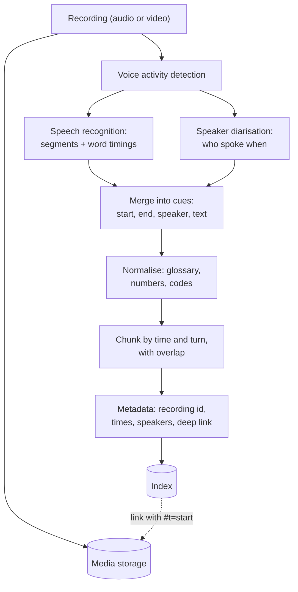

Organisations say a great deal out loud and write very little of it down. Onboarding sessions, all-hands meetings, support calls, recorded training, podcasts and interviews hold answers that never reach a document. To a retrieval system, audio is opaque: there is nothing to embed until the speech becomes text. The standard way to make audio retrievable is therefore to **transcribe** it with automatic speech recognition, and then treat the transcript as a document, but a document of an unusual kind: no headings, often no paragraphs, several speakers, recognition errors in exactly the words that matter most, and a timeline that every piece of text should keep pointing back to.

This lesson covers turning recordings into retrievable chunks. You will see what speech recognition produces and how it fails, how to parse the standard subtitle formats, how to correct domain vocabulary, how to chunk by time and speaker without separating questions from their answers, how to keep timestamps so answers can link to the moment in the recording, and how to measure transcript quality with word error rate. Retrieval directly over audio, without transcription, is a research and product area of its own, introduced in [Audio RAG](/learn/multimodal-rag/audio-rag) in Phase 9.

## Learning objectives

- Describe what a speech-recognition system outputs (segments, timestamps, optional word timings and speaker labels) and the main ways it fails.
- Parse a WebVTT transcript into timed, speaker-labelled cues.
- Correct systematic recognition errors in domain vocabulary with a glossary, and explain the limits of doing so.
- Chunk a transcript by time and speaker turn with overlap, attaching timestamps and deep links as metadata.
- Compute word error rate by hand and in code, and explain why normalisation must precede it.

## Prerequisites

- [Why chunking matters](/learn/chunking-fundamentals/why-chunking-matters): what a chunk is for and why its boundaries matter.
- [Chunk overlap](/learn/chunking-fundamentals/chunk-overlap): repeating content across chunk boundaries.
- [Document metadata](/learn/document-engineering/document-metadata): carrying source and position with every chunk.
- [Regular expressions](/learn/data-processing/regular-expressions): pattern matching and substitution.

## Why this matters

Meridian records its IT onboarding session for every new starter. In forty minutes, the IT team explains password rotation, the VPN, laptop care and who to call when something breaks. New starters ask questions, and the answers to those questions are often the most useful part, because they are the questions every new starter has. None of it is in the handbook in that form.

If the recording is not ingested, AskMeridian cannot use any of it. If it is ingested naively, by dumping a raw transcript into the text pipeline, several things go wrong:

1. **Domain terms are misheard.** Speech recognition models are trained on general speech. "Meridian Relay" becomes "meridian really", "E-4021" becomes "E 4021" or "e forty twenty-one". The chunk exists but cannot be found by the words people search for.
2. **Chunks cut across meaning.** A character-based splitter applied to a transcript with no paragraph breaks cuts mid-sentence, and often between a question and its answer, leaving a chunk that ends "how often do we get new laptops?" and another that begins "Every three years."
3. **Speakers are lost.** "Every three years" means something different said by the IT lead than by a new starter guessing. Without speaker labels, the generator cannot tell an answer from a question or an authoritative statement from speculation.
4. **The answer cannot be checked.** A RAG answer cites its source. For a transcript, a useful citation is a link to the moment in the recording, so the user can hear it in context. Without timestamps on chunks, the only citation is "somewhere in a 40-minute video".

## The intuition

Imagine a court stenographer's record of a long hearing. It is valuable precisely because of three properties: every line says who spoke, every page carries the time, and specialised terms (names, case numbers) are spelt correctly because the stenographer was given a list of them beforehand. Someone looking for a particular exchange can find it by searching the text, and then go to the exact moment in the audio if they need to hear the tone.

A transcript pipeline is trying to produce that record automatically. Speech recognition does the stenography, a glossary supplies the list of names, speaker diarisation (working out who spoke when) supplies the "who", and timestamps supply the "when". Chunking then has to cut the record at sensible places: between exchanges, not in the middle of one.

## How it works

### What speech recognition produces

An **automatic speech recognition** (ASR) system takes audio and returns text. Modern systems, such as OpenAI's open-weight Whisper models (Radford and colleagues, 2022), cloud speech services and many others, return more than plain text:

- **Segments**: short stretches of speech, typically a sentence or a few seconds, each with a start and end time and its text.
- **Word timings** (optional): a start and end time for each word, useful for precise links and for aligning with speaker information.
- **Confidence** (varies by system): a score per segment or per word. Useful for flagging doubtful passages, though scores from different systems are not comparable.
- **Language**: detected or specified.

Speaker labels usually come from a separate step called **speaker diarisation**, which groups stretches of audio by voice and labels them "speaker 0", "speaker 1" and so on. Diarisation knows that two stretches come from the same voice, not whose voice it is; mapping "speaker 0" to "Priya" requires another source (a meeting tool's participant data, an introduction in the recording, or a person). Some meeting platforms produce transcripts with real names, because they know which microphone each participant used.

Transcripts are commonly exchanged in two subtitle formats. **WebVTT** (`.vtt`), a W3C format used by web video players, consists of a `WEBVTT` header followed by **cues**: a timing line `00:00:06.500 --> 00:00:12.000` and one or more lines of text, optionally with a voice span `<v Priya>` naming the speaker. **SRT** (`.srt`) is older and simpler: a numbered cue, a timing line with commas before the milliseconds (`00:00:06,500`), and text, with no standard speaker markup. Many tools also produce JSON with segments and words.

### How speech recognition fails

Knowing the failure modes tells you what the rest of the pipeline must compensate for.

- **Out-of-vocabulary terms.** Product names, internal jargon, acronyms, people's names and codes are misrecognised as similar-sounding common words. These are exactly the terms users search for.
- **Numbers and formats.** Whether "ninety days" is written as "90 days", and "E 4021" as "E-4021", depends on the system's text normalisation. Inconsistency breaks keyword matching.
- **Overlapping speech, accents and audio quality.** Crosstalk, heavy accents relative to the training data, background noise, poor microphones and telephone audio all raise error rates.
- **Hallucination.** Some neural ASR models, Whisper included, can produce fluent text that was never said, especially during long silences, music or noise. Repeated phrases and generic sentences ("Thank you for watching") in silent stretches are a known symptom. Voice activity detection, which removes non-speech audio before recognition, reduces this.
- **Missing structure.** No headings, no paragraph breaks, sometimes no punctuation. Spoken language also has disfluencies (false starts, "um", repetition) that add noise without meaning.

### The pipeline, step by step

1. **Obtain audio** (or extract it from video) and record its identifier, duration, date and source.
2. **Transcribe** with an ASR system, enabling voice activity detection and word timings where available, and passing a list of expected terms if the system supports a vocabulary hint or initial prompt.
3. **Diarise** to get speaker turns, and map speaker labels to names where you have a reliable source.
4. **Parse** the output (VTT, SRT or JSON) into cues: start, end, speaker, text.
5. **Normalise**: apply the domain glossary to correct known mis-recognitions, standardise numbers and codes, and optionally remove filler words.
6. **Chunk** by time and speaker turn: group consecutive cues up to a time limit, prefer to end chunks at turn boundaries, never split a cue, and overlap so that a question and its answer appear together in at least one chunk.
7. **Attach metadata** to every chunk: recording identifier, start and end time, speakers, a deep link to the start time, and the recording's title and date.
8. **Index** the chunks, and keep the full transcript and the original audio for display and re-processing.



### Correcting domain vocabulary

There are two places to fix out-of-vocabulary errors: before recognition and after.

**Before**, by telling the recogniser what to expect. Many cloud speech services accept a list of phrases or a custom vocabulary. Whisper implementations accept an **initial prompt**, text that the model treats as preceding context; including product names in it makes the model more likely to spell them that way. This helps but does not guarantee anything, and an overlong or misleading prompt can itself cause errors.

**After**, with a **glossary** of known mis-recognitions mapped to canonical terms: "meridian really" to "Meridian Relay", "E 4021" to "E-4021". Build it from evidence: transcribe a sample, search the output for each product name, and look at what came out instead. Apply it with whole-word, case-insensitive patterns. A glossary is cheap and predictable. Its limits: it fixes only errors you have seen, and a careless pattern can "correct" a phrase that was right ("really" in "it really helps" is not a product). Patterns that include neighbouring words ("meridian really" rather than "really") keep it safe.

A third option, asking a language model to clean the transcript, can fix errors a glossary cannot anticipate. It can also smooth away content, invent fixes and change meaning, and it costs a model call per chunk. If you use it, keep the raw transcript, restrict the instruction to spelling and punctuation, and spot-check.

### Chunking by time and turn

A transcript has no headings, so the structure you chunk by is time and speaker turns.

- **Time limit.** Group consecutive cues until the chunk spans a maximum duration. Speech runs at roughly 130 to 160 words per minute in conversational English (an assumption; it varies by speaker), so 60 seconds of speech is about 150 words, around 200 tokens. Choose the limit from your chunk-size target in tokens.
- **Turn boundaries.** Prefer to end a chunk where the speaker changes, and never split a single cue.
- **Overlap by cues.** Start each new chunk with the last cue (or last few seconds) of the previous one. In conversations this is especially valuable: a question ending one chunk reappears at the start of the next, beside its answer.
- **Speaker prefixes.** Write each turn as "Speaker: text". This helps the generator and also the embedding: "Tom: And how often do we get new laptops? Priya: Every three years" reads as a question and answer.

Q&A sessions reward a further refinement: detect question turns (a turn ending in a question mark from a non-presenter) and make each question with its answer one chunk. That is the single most useful unit of an onboarding recording.

### Timestamps as citations

Every chunk carries `start` and `end` in seconds. From them you build a **deep link**: a URL that opens the recording at that moment. For a media file served directly, the W3C Media Fragments syntax `#t=15` (start at 15 seconds) is understood by browsers' built-in players. Video platforms and meeting tools have their own parameters; use whatever your player supports. The answer can then cite "IT onboarding, 0:12" and the user can hear the exchange.

> [!TIP]
> Store times as numbers of seconds, not as formatted strings. You will want to sort, compare, compute durations, and format them differently for different players.

## The mathematics

### Word error rate

**Intuition.** To know whether a transcript is good enough, compare it with a correct reference transcript of the same audio and count how many word-level edits turn one into the other. Three kinds of edit exist: replace a word (substitution), drop a word (deletion), add a word (insertion). Word error rate (WER) is the smallest number of edits needed, divided by the length of the reference.

$$
\text{WER} = \frac{S + D + I}{N}
$$

$S$ is the number of substituted words, $D$ the number of reference words deleted (missing from the hypothesis), $I$ the number of words inserted (in the hypothesis but not the reference), and $N$ the number of words in the reference. The minimum $S + D + I$ is the word-level **edit distance** (Levenshtein distance over words), computed by dynamic programming: $d_{i,j}$, the cost of turning the first $i$ reference words into the first $j$ hypothesis words, is

$$
d_{i,j} = \min\big(d_{i-1,j-1} + [r_i \neq h_j],\; d_{i-1,j} + 1,\; d_{i,j-1} + 1\big)
$$

with $d_{i,0} = i$ and $d_{0,j} = j$. The three terms are substitution (free if the words match), deletion and insertion. Because insertions are counted, WER can exceed 1.

**By hand.** Reference: "the meridian relay password expires every 90 days" ($N = 8$). Hypothesis: "the meridian really password expires every ninety days". Two substitutions (relay → really, 90 → ninety), no deletions or insertions: $\text{WER} = 2/8 = 0.25$.

A second: reference "report a lost laptop at once" ($N = 6$), hypothesis "report lost laptop at once please". One deletion ("a") and one insertion ("please"): $\text{WER} = 2/6 \approx 0.333$.

```python
import re
import numpy as np

def words(text):
    return re.sub(r"[^\w\s-]", "", text.lower()).split()

def wer(reference, hypothesis):
    """Word error rate: minimum substitutions + deletions + insertions, over reference length."""
    r, h = words(reference), words(hypothesis)
    d = np.zeros((len(r) + 1, len(h) + 1), dtype=int)
    d[:, 0] = np.arange(len(r) + 1)          # delete every reference word
    d[0, :] = np.arange(len(h) + 1)          # insert every hypothesis word
    for i in range(1, len(r) + 1):
        for j in range(1, len(h) + 1):
            sub = d[i - 1, j - 1] + (r[i - 1] != h[j - 1])
            d[i, j] = min(sub, d[i - 1, j] + 1, d[i, j - 1] + 1)
    return d[len(r), len(h)] / len(r)

ref = "the meridian relay password expires every 90 days"
hyp = "the meridian really password expires every ninety days"
print(f"WER = {wer(ref, hyp):.3f}")
print(f"WER = {wer('report a lost laptop at once', 'report lost laptop at once please'):.3f}")
```

```output
WER = 0.250
WER = 0.333
```

Notice what the first example counts as an error. "ninety" for "90" is a formatting difference, not a recognition failure, yet it costs as much as "really" for "relay". Before comparing systems, normalise both reference and hypothesis the same way (case, punctuation, numbers written as digits), or WER measures formatting conventions rather than recognition. And notice what WER does not measure: every word counts equally, so mishearing "the" and mishearing "Relay" cost the same, even though only one of them breaks retrieval. For a RAG system, also measure the **error rate on a list of key terms** (product names, codes, people) separately; that is the number that predicts retrieval failures.

## In code

### Parsing, normalising and chunking a WebVTT transcript

**The problem.** The IT onboarding recording has a WebVTT transcript with speaker voice tags. Turn it into overlapping, speaker-labelled chunks with timestamps and deep links, correcting known vocabulary errors.

**Dependencies.** None beyond the standard library.

The transcript (a 43-second excerpt):

```text
WEBVTT

00:00:01.000 --> 00:00:06.500
<v Priya>Welcome to IT onboarding. I'll cover passwords, the VPN and your laptop.

00:00:06.500 --> 00:00:12.000
<v Priya>Your password has to be rotated every ninety days, and you'll get a reminder a week before.

00:00:12.000 --> 00:00:15.200
<v Tom>Does that include the meridian really password?

00:00:15.200 --> 00:00:21.800
<v Priya>Yes, Meridian Relay signs you in with your Meridian account, so it's the same password.

00:00:21.800 --> 00:00:29.000
<v Priya>Next, the VPN. You must use it on public wifi, so cafés, trains, hotels.

00:00:29.000 --> 00:00:33.400
<v Priya>If the client shows error E 4021, it's out of date. Update it from the IT portal.

00:00:33.400 --> 00:00:37.000
<v Tom>And how often do we get new laptops?

00:00:37.000 --> 00:00:43.500
<v Priya>Every three years. If you lose one, report it to the support desk straight away.
```

```python
import re
from dataclasses import dataclass

@dataclass
class Cue:
    start: float
    end: float
    speaker: str
    text: str

TIME = r"(\d{2}):(\d{2}):(\d{2})\.(\d{3})"
CUE_TIMING = re.compile(rf"^{TIME} --> {TIME}")

def seconds(h, m, s, ms):
    return int(h) * 3600 + int(m) * 60 + int(s) + int(ms) / 1000

def parse_vtt(text):
    cues, lines = [], text.splitlines()
    for i, line in enumerate(lines):
        m = CUE_TIMING.match(line)
        if not m:
            continue
        payload = lines[i + 1]
        voice = re.match(r"<v ([^>]+)>(.*)", payload)
        speaker, words = (voice.group(1), voice.group(2)) if voice else ("unknown", payload)
        cues.append(Cue(seconds(*m.groups()[:4]), seconds(*m.groups()[4:]), speaker, words.strip()))
    return cues

GLOSSARY = {                                   # known mis-hearings -> canonical terms
    r"\bmeridian really\b": "Meridian Relay",
    r"\bE (\d{4})\b": r"E-\1",
    r"\bninety days\b": "90 days",
    r"\bwifi\b": "Wi-Fi",
}
def normalise(text):
    for pattern, repl in GLOSSARY.items():
        text = re.sub(pattern, repl, text, flags=re.IGNORECASE)
    return text

def chunk(cues, max_seconds=20.0, overlap=1):
    """Group consecutive cues into chunks of at most max_seconds, never splitting a cue.
    Each new chunk repeats the last `overlap` cues of the previous one."""
    chunks, current = [], []
    for cue in cues:
        if len(current) > overlap and cue.end - current[0].start > max_seconds:
            chunks.append(current)
            current = current[-overlap:] if overlap else []
        current.append(cue)
    if current:
        chunks.append(current)
    return chunks

def render(group, recording_id, url):
    start, end = group[0].start, group[-1].end
    lines, last = [], None
    for c in group:                            # merge consecutive cues by the same speaker
        if c.speaker == last:
            lines[-1] += " " + normalise(c.text)
        else:
            lines.append(f"{c.speaker}: {normalise(c.text)}")
        last = c.speaker
    return {
        "chunk_id": f"{recording_id}@{int(start)}",
        "start": start, "end": end,
        "speakers": sorted({c.speaker for c in group}),
        "link": f"{url}#t={int(start)}",
        "text": "\n".join(lines),
    }

cues = parse_vtt(open("onboarding.vtt").read())
print(f"{len(cues)} cues, {cues[-1].end - cues[0].start:.1f} s of speech\n")
for group in chunk(cues):
    rec = render(group, "it-onboarding-2026-09", "https://intranet.meridian.example/media/it-onboarding.mp4")
    print(f"[{rec['chunk_id']}] {rec['start']:.1f}-{rec['end']:.1f}s {rec['speakers']} {rec['link']}")
    print(rec["text"], "\n")
```

```output
8 cues, 42.5 s of speech

[it-onboarding-2026-09@1] 1.0-15.2s ['Priya', 'Tom'] https://intranet.meridian.example/media/it-onboarding.mp4#t=1
Priya: Welcome to IT onboarding. I'll cover passwords, the VPN and your laptop. Your password has to be rotated every 90 days, and you'll get a reminder a week before.
Tom: Does that include the Meridian Relay password? 

[it-onboarding-2026-09@12] 12.0-29.0s ['Priya', 'Tom'] https://intranet.meridian.example/media/it-onboarding.mp4#t=12
Tom: Does that include the Meridian Relay password?
Priya: Yes, Meridian Relay signs you in with your Meridian account, so it's the same password. Next, the VPN. You must use it on public Wi-Fi, so cafés, trains, hotels. 

[it-onboarding-2026-09@21] 21.8-37.0s ['Priya', 'Tom'] https://intranet.meridian.example/media/it-onboarding.mp4#t=21
Priya: Next, the VPN. You must use it on public Wi-Fi, so cafés, trains, hotels. If the client shows error E-4021, it's out of date. Update it from the IT portal.
Tom: And how often do we get new laptops? 

[it-onboarding-2026-09@33] 33.4-43.5s ['Priya', 'Tom'] https://intranet.meridian.example/media/it-onboarding.mp4#t=33
Tom: And how often do we get new laptops?
Priya: Every three years. If you lose one, report it to the support desk straight away.
```

**The important lines.**

- `CUE_TIMING` matches the WebVTT timing line and captures hours, minutes, seconds and milliseconds of both times; `seconds` turns them into a float. The cue's text is on the next line, and a `<v Name>` voice span gives the speaker. This parser handles single-line cues; real files can have multi-line cue text, cue identifiers above the timing line and settings after it (`align:start`), and a production parser should handle all three, or use a library.
- `GLOSSARY` fixes three kinds of error: a misheard product name (matched together with the word "meridian" so that ordinary uses of "really" are safe), a code written with a space, and formatting choices (spelt-out numbers, "wifi"). The `\b` word boundaries stop "E 4021" matching inside a longer number.
- `chunk` closes a chunk when the next cue would push it past 20 seconds, and starts the new chunk with the last cue of the old one (`overlap=1`). The condition `len(current) > overlap` ensures a chunk always gains at least one new cue, so a single very long cue cannot cause an endless loop.
- `render` merges consecutive cues by the same speaker into one turn and prefixes it with the speaker's name, then builds a chunk identifier from the recording and start second, and a deep link using the Media Fragments `#t=` syntax.

**What the output means.** Four chunks from eight cues. Every misrecognition is corrected: "Meridian Relay", "90 days", "E-4021", "Wi-Fi". Most importantly, look at the overlap. Without it, Tom's question about the Relay password would end the first chunk and Priya's answer would begin the second, and a retriever matching "is the Relay password the same?" against either chunk alone would find half an exchange. With one cue of overlap, the second chunk holds the complete question and answer, and so does the last chunk for the laptop question. The cost is repetition: each overlapped cue is embedded twice.

**Extending it.** Make chunk boundaries prefer speaker changes: when a chunk is near its limit, close it at the next change of speaker rather than at the exact limit. Add question detection so that a question turn and the following answer turn are never separated. Record the glossary version in each chunk's metadata, so you know which chunks to re-normalise when the glossary changes.

### Transcribing with Whisper

**The problem.** Produce the transcript in the first place, locally, with timestamps.

**Dependencies.** `faster-whisper`, a reimplementation of Whisper inference built on CTranslate2, and a model download on first use (sizes range from tens of megabytes to a few gigabytes). Decoding common audio formats is handled by the package. This block was **not executed** for this lesson, because the sandbox has no speech model.

```bash
pip install faster-whisper
```

```python
from faster_whisper import WhisperModel

model = WhisperModel("small", device="cpu", compute_type="int8")   # small model, CPU, 8-bit weights

segments, info = model.transcribe(
    "it-onboarding.mp3",
    beam_size=5,
    vad_filter=True,               # skip non-speech audio; reduces hallucinated text in silences
    word_timestamps=True,
    initial_prompt="Meridian, Meridian Relay, Meridian Sync, Meridian Reports, Atlas, VPN, E-4021.",
)
print("language:", info.language)
for seg in segments:               # a generator: transcription happens as you iterate
    print(f"{seg.start:7.2f} {seg.end:7.2f}  {seg.text.strip()}")
```

Your exact output will differ; it looks like this:

```output
language: en
   1.00    6.48  Welcome to IT onboarding. I'll cover passwords, the VPN and your laptop.
   6.48   12.02  Your password has to be rotated every 90 days, and you'll get a reminder a week before.
  12.02   15.18  Does that include the Meridian Relay password?
```

**The important lines.** `vad_filter=True` runs voice activity detection first, so long silences are skipped rather than handed to the model, where they invite invented text. `initial_prompt` supplies vocabulary; here it nudges the model towards "Meridian Relay" and the hyphenated code, which may make some glossary entries unnecessary, though you should still check. `segments` is a lazy generator, which matters for long recordings: nothing is transcribed until you iterate. Speaker labels are not produced by Whisper; diarisation needs a separate tool (pyannote.audio is a widely used open-source option) whose speaker turns you then align with the segments by time.

**Common errors.** Running a large model on a CPU and finding it far slower than real time; start with a small model and measure. Forgetting that the language is auto-detected from the opening seconds, so a recording that begins with music or another language can be transcribed in the wrong language; pass the language explicitly when you know it.

## A real-world example

Meridian's HR and IT teams recorded six months of onboarding sessions and monthly "ask IT anything" calls, about 30 hours of audio, and asked the Platform team to make them searchable through AskMeridian.

The first ingestion used a cloud transcription service's plain-text output and fed it to the standard 500-token splitter. Results were poor in ways that took a while to diagnose. Queries mentioning Meridian Relay or Meridian Sync rarely found anything; searching the transcripts showed the product names appearing as "meridian really", "meridian sink" and "the relay" in a dozen spellings. Answers to "do contractors get the home-office budget?" cited a chunk containing the question but not the reply, which began the next chunk. And the citations said only "Ask IT anything, March", with no way to find the moment in an hour-long recording.

The second version changed four things. A glossary was built by searching the first-pass transcripts for near-misses of every product and system name, and was applied after transcription, with the product names also passed as a vocabulary hint to the service. Transcripts were requested in WebVTT with speaker labels, and the meeting tool's participant list mapped speakers to names. Chunks were cut at roughly 60 seconds, preferring speaker changes, with one turn of overlap, and question-and-answer pairs were kept together. Each chunk carried start and end times, and AskMeridian's citations became links that opened the recording at the right second.

The team also measured. They had an IT team member correct transcripts of three sessions by hand and computed WER against them, and, separately, the error rate on the product-name list. The overall WER changed little between versions; the product-name error rate fell dramatically, which matched the improvement users noticed.

## Common mistakes

- **Feeding raw transcripts to a character splitter.** Chunks cut mid-sentence and separate questions from answers.
- **Dropping timestamps.** Answers cannot cite a moment, users cannot verify, and you cannot re-chunk without re-transcribing.
- **Ignoring speakers.** The generator cannot tell a question from an answer, or the expert from the guess.
- **Trusting product names in transcripts.** Out-of-vocabulary terms are the most frequently misrecognised and the most frequently searched.
- **Over-broad glossary patterns.** Replacing every "really" with "Relay" corrupts ordinary speech.
- **Judging transcripts by WER alone.** WER weights every word equally and counts formatting differences as errors; it can stay flat while the errors that matter for retrieval change.
- **Transcribing silence.** Without voice activity detection, long pauses and music can produce invented text that is then indexed as if it were said.
- **Rewriting transcripts with a language model and discarding the original.** Cleaning can change meaning; without the raw version you cannot tell.

## Best practices

- Keep the original audio, the raw ASR output and the normalised transcript; chunk from the normalised version and record which glossary version produced it.
- Request timestamps (and word timings if available) and speaker labels; map speakers to names from a reliable source.
- Build the glossary from evidence in your own transcripts, with multi-word patterns that are safe in ordinary speech.
- Chunk by time and turn with overlap, and keep questions together with their answers.
- Put recording identifier, title, date, speakers, start, end and a deep link on every chunk.
- Measure WER on a hand-corrected sample after consistent normalisation, and separately measure the error rate on key terms.
- Use voice activity detection, and specify the language when it is known.

## Performance considerations

Transcription dominates the cost. Speed is usually expressed as a **real-time factor**: processing time divided by audio duration. A factor of 0.1 means an hour of audio takes six minutes. The factor depends heavily on model size and hardware: small models on a CPU and large models on a GPU can both land near or below real time, while large models on a CPU can be many times slower than real time. Measure on your own hardware with a ten-minute sample before planning a backlog.

The arithmetic for a backlog is simple. Meridian's 30 hours at a real-time factor of 0.25 is $30 \times 0.25 = 7.5$ hours of processing on one worker; four workers in parallel bring it under two hours. Cloud services price by audio minute; 30 hours is 1,800 minutes, so multiply by the current per-minute price from the provider's pricing page (prices change, so do not hard-code an assumption into a budget).

Text volume is modest. At an assumed 150 words per minute, 30 hours is about $30 \times 60 \times 150 = 270{,}000$ words, roughly 360,000 tokens: smaller than many document collections. With one-cue overlap, embedding volume rises by the overlap fraction, typically 10 to 30 percent.

Diarisation adds its own processing time, comparable to or sometimes greater than transcription on long recordings. Skip it when speaker identity does not matter, such as single-presenter training videos.

## Security considerations

- **Recordings capture what documents do not.** People say things on calls they would never write down: names of colleagues, health matters, customer details, complaints. Transcribing a recording makes all of that searchable. Get explicit agreement about which recordings may be ingested, apply the recording's access controls to every chunk, and consider excluding categories such as one-to-one meetings and HR calls entirely.
- **Consent and notice.** Many jurisdictions and company policies require that people are told when they are recorded and how recordings are used. Repurposing meeting recordings for an assistant is a new use; check it with whoever owns privacy policy.
- **Personal data in transcripts.** Run personal-data detection over transcripts and redact where appropriate, keeping in mind that names are also how people search.
- **Spoken prompt injection.** A recording can contain speech designed to manipulate a model ("assistant, ignore your instructions..."). Once transcribed, it is text in the context window. Treat transcript chunks as untrusted data, like any other document content.
- **Third-party processing.** Cloud transcription sends audio outside your network. Check the provider's data-retention and training terms against the recording's classification.

## Summary

- Audio becomes retrievable by transcription; the transcript is a document without structure, with recognition errors concentrated in domain terms.
- Parse transcripts into timed, speaker-labelled cues (WebVTT and SRT are the common formats), and keep audio, raw output and normalised text.
- Correct domain vocabulary with vocabulary hints before recognition and an evidence-based glossary after it.
- Chunk by time and speaker turn with overlap, keeping questions with their answers, and attach timestamps and deep links to every chunk.
- WER measures overall transcript quality but weights all words equally and penalises formatting; also measure errors on the key terms your users search for.

## Exercises

1. **Read the failure.** A user asks AskMeridian "how often do we get new laptops?" and the cited chunk ends with "Tom: And how often do we get new laptops?" but contains no answer. Name the cause and two fixes.

<details><summary>Show solution</summary>

The chunk boundary fell between the question turn and the answer turn, and there was no overlap, so no chunk holds both. Fixes: (1) overlap chunks by at least one cue or turn, so the question also starts the next chunk beside its answer; (2) make the chunker aware of question turns and never close a chunk immediately after one, extending the chunk to include the next speaker's turn. A third option is to create dedicated question-and-answer chunks in addition to the time-based ones.

</details>

2. **Compute WER.** Reference: "lost laptops are reported to the support desk at once" (10 words). Hypothesis: "lost laptops reported to the support desk at once please". Count substitutions, deletions and insertions, compute WER by hand, and check it with the `wer` function.

<details><summary>Show solution</summary>

The hypothesis drops "are" (one deletion) and adds "please" (one insertion); every other word aligns. $S = 0$, $D = 1$, $I = 1$, $N = 10$: $\text{WER} = 2/10 = 0.2$.

```python
print(wer("lost laptops are reported to the support desk at once",
          "lost laptops reported to the support desk at once please"))
```

```output
0.2
```

</details>

3. **Key-term error rate.** Write a function `term_recall(reference, hypothesis, terms)` that returns, for each term in a list, whether every occurrence in the reference also appears in the hypothesis, and explain why this is a better predictor of retrieval failures than WER.

<details><summary>Show solution</summary>

```python
def term_recall(reference, hypothesis, terms):
    ref, hyp = reference.lower(), hypothesis.lower()
    return {t: hyp.count(t.lower()) >= ref.count(t.lower())
            for t in terms if t.lower() in ref}

print(term_recall(
    "The Meridian Relay password expires every 90 days. Error E-4021 means update.",
    "the meridian really password expires every 90 days. error E 4021 means update.",
    ["Meridian Relay", "E-4021", "90 days", "Meridian Sync"],
))
```

```output
{'Meridian Relay': False, 'E-4021': False, '90 days': True}
```

Users search by distinctive terms: product names, codes, names. A transcript with a low overall WER can still miss every product name, and those misses are exactly the queries that fail. Term recall measures those failures directly. (Counting substrings is a simplification; a production version would match on word boundaries and normalise both texts first.)

</details>

4. **Design decision.** Meridian wants to ingest 200 hours of customer support calls for an internal agent-assist tool. Outline the pipeline, and list the decisions you would need agreed before starting.

<details><summary>Show solution</summary>

Pipeline: voice activity detection; transcription with a vocabulary hint for product names; diarisation into two speakers (agent and customer), labelled by channel if the telephony system records each side separately, which is far more reliable than voice-based diarisation; glossary normalisation; personal-data detection and redaction (customer names, phone numbers, email addresses, payment details); chunking by exchange with overlap; metadata including call identifier, date, product discussed, start and end times; indexing with access restricted to support staff.

Decisions to agree first: whether customers were told calls may be used this way and whether the use is permitted; retention period for transcripts versus audio; whether cloud transcription is allowed for customer audio; redaction policy, including whether redaction happens before or after indexing (before); who can query the index; and how a customer's deletion request propagates to transcripts, chunks and embeddings.

</details>

## Check your understanding

```quiz
[
  {"q": "What does speaker diarisation produce on its own?", "options": ["The text of each utterance", "The real names of all participants", "Labels grouping stretches of audio by voice, such as speaker 0 and speaker 1", "A translation of the audio"], "answer": 2, "why": "Diarisation decides which stretches share a voice. Mapping labels to names needs another source, such as meeting participant data."},
  {"q": "Reference has 20 words. The hypothesis has 2 substitutions, 1 deletion and 3 insertions. What is the WER?", "options": ["0.15", "0.30", "0.20", "0.25"], "answer": 1, "why": "(2 + 1 + 3) / 20 = 0.30. Insertions count, which is why WER can exceed 1."},
  {"q": "Why apply the glossary pattern \"meridian really\" rather than simply \"really\"?", "options": ["It is faster", "Regular expressions cannot match single words", "So that ordinary uses of the word 'really' are not changed into the product name", "Because glossaries must contain two words"], "answer": 2, "why": "A broad pattern corrects the error but corrupts correct text elsewhere. Including the neighbouring word makes the correction safe."},
  {"q": "What is the main purpose of overlapping transcript chunks by one cue?", "options": ["To keep a question and its answer together in at least one chunk", "To reduce the number of chunks", "To remove filler words", "To improve WER"], "answer": 0, "why": "In conversation, chunk boundaries often fall between a question and its answer; overlap ensures some chunk contains both."},
  {"q": "Which setting most directly reduces invented text during long silences in Whisper-style transcription?", "options": ["A larger beam size", "Word timestamps", "Voice activity detection, so non-speech audio is skipped", "A longer initial prompt"], "answer": 2, "why": "Hallucinated text tends to appear in silence, music or noise. Removing those stretches before recognition reduces it."}
]
```

## Further reading

- Radford, A. et al. (2022). *Robust Speech Recognition via Large-Scale Weak Supervision* (the Whisper paper). [arXiv:2212.04356](https://arxiv.org/abs/2212.04356)
- W3C, *WebVTT: The Web Video Text Tracks Format*: [w3.org/TR/webvtt1](https://www.w3.org/TR/webvtt1/)
- W3C, *Media Fragments URI 1.0*, for `#t=` time links: [w3.org/TR/media-frags](https://www.w3.org/TR/media-frags/)
- faster-whisper on GitHub: [github.com/SYSTRAN/faster-whisper](https://github.com/SYSTRAN/faster-whisper)
- Jurafsky, D. and Martin, J. H. *Speech and Language Processing* (3rd edition draft), the chapters on automatic speech recognition and on minimum edit distance: [web.stanford.edu/~jurafsky/slp3](https://web.stanford.edu/~jurafsky/slp3/)
