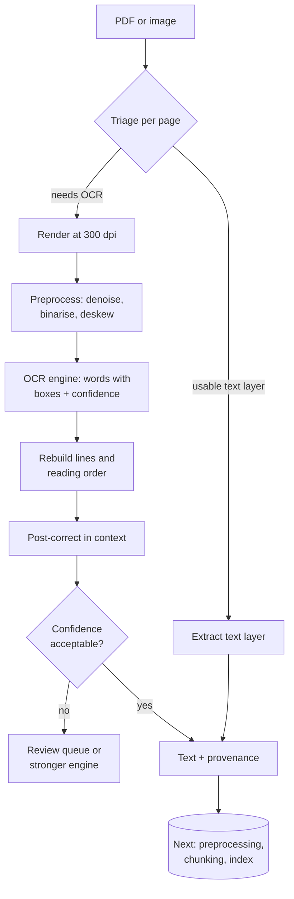

Optical character recognition (OCR) turns pictures of text into text. The [OCR lesson](/learn/advanced-document-parsing/ocr) in Phase 3's parsing module explains what OCR engines do and how they differ; [Scanned documents](/learn/advanced-document-parsing/scanned-documents) covers the particular problems of scans. This lesson is about the **pipeline around the engine**: the engineering that decides which pages need OCR, prepares those pages so the engine can read them, runs it with output that keeps positions and confidence, turns word boxes back into readable text in the right order, repairs predictable errors, and marks what it could not read so that nothing doubtful enters the index looking certain.

Running an OCR engine is one line of code. Getting reliable text out of ten thousand mixed documents, some born-digital, some scanned, some photographed on a phone, some with a text layer that is itself garbage, is a pipeline. Every lesson in this module has leaned on it: [Images](/learn/multimodal-ingestion/images) routes scanned text here, [Video transcripts](/learn/multimodal-ingestion/video-transcripts) reads slides with it, and [Tables](/learn/multimodal-ingestion/tables) needs it for tables that arrive as pictures.

## Learning objectives

- Triage PDF pages into "use the text layer" and "needs OCR" using character counts and image coverage, and explain the traps in each signal.
- Denoise, binarise (with Otsu's method) and deskew a scanned page, and explain why the order of those steps matters.
- Parse word-level OCR output with boxes and confidence, rebuild lines in reading order, and flag low-confidence regions for review.
- Apply safe, context-limited post-corrections for characteristic OCR confusions.
- Measure OCR quality with character error rate and choose between engine families for a given corpus.

## Prerequisites

- [OCR](/learn/advanced-document-parsing/ocr): what an OCR engine does and the main engines.
- [Scanned documents](/learn/advanced-document-parsing/scanned-documents): how scans differ from born-digital files.
- [PDF extraction](/learn/data-processing/pdf-extraction): text layers, and getting text out of born-digital PDFs.
- [Images](/learn/multimodal-ingestion/images): extracting images from documents and rendering page regions.

## Why this matters

Meridian's HR team keeps signed copies of policies, scanned forms and old handbooks in its document store. Some are PDFs exported from a word processor; some are scans; some are scans that a copier helpfully ran through its own OCR, producing a text layer full of errors. A pipeline that handles only born-digital text silently gets nothing from the scans. One that OCRs everything wastes hours re-reading pages that already had perfect text, and may replace good text with worse.

Without a proper pipeline around the engine:

1. **Pages are missed.** A scanned page with a short digital stamp ("Page 3 of 3") has a text layer, so a naive "has text?" check skips OCR, and the page body is never read.
2. **Good text is replaced by bad.** Re-OCRing a born-digital page turns exact text into approximate text, at a cost.
3. **The engine reads noise.** Skewed, speckled, low-contrast scans produce garbled output: letters merge, lines interleave, a speck becomes a full stop.
4. **Reading order is scrambled.** Two-column pages, sidebars and headers come out as interleaved lines from different columns.
5. **Errors look like facts.** "4OO GBP" for "400 GBP" is a small error with a large effect: a query for the budget fails, or worse, a model reads the wrong number. Without confidence scores carried through, there is no way to tell certain text from guessed text.

## The intuition

Imagine an archive digitising its records with a team of typists. A good archive does not give the typists every page. A clerk first sorts the pile: printed reports already on disk go straight through; only paper goes to the typists. Before typing, someone straightens crooked pages and cleans smudges. The typists type, and where they cannot make a word out, they write it with a question mark rather than guessing silently. Afterwards, a checker fixes the predictable slips (a capital O typed for a zero in a sum of money) and sends pages with too many question marks back for a second look.

That is the OCR pipeline: triage, preprocess, recognise, reconstruct, correct, and flag.

## How it works

### The pipeline, step by step

1. **Triage each page.** Decide whether the page's existing text layer is usable or whether it needs OCR. Born-digital pages go straight to text extraction.
2. **Render.** Convert pages that need OCR to images at a resolution suited to the engine; 300 dots per inch is the conventional choice for printed text, and lower resolutions lose small fonts.
3. **Preprocess.** Convert to greyscale, remove noise, binarise (turn every pixel black or white), correct skew and rotation, and optionally remove borders and ruling lines.
4. **Recognise** with an engine configured for the language and layout, requesting **word-level output with bounding boxes and confidence** rather than plain text.
5. **Reconstruct reading order**: group words into lines and blocks, and order blocks for multi-column layouts.
6. **Post-correct**: fix characteristic confusions in limited contexts (letters inside numbers, known vocabulary).
7. **Score and flag**: compute page and line confidence, mark low-confidence text, and route pages below a threshold to review or to a stronger engine.
8. **Emit** text with provenance (engine, version, page, confidence), and optionally write a searchable PDF that combines the original image with an invisible text layer.



### Triage: does this page need OCR?

Two signals, read from the PDF without rendering anything, settle most pages:

- **Characters in the text layer.** A born-digital page of prose has hundreds or thousands of characters. A scanned page has none, or a few from a stamp, header or page number added digitally.
- **Image coverage.** The fraction of the page covered by images. A scan is one image covering the whole page.

The rule that follows: plenty of text means use the text layer; little text and mostly image means OCR; little text and little image is a genuinely short page (a cover, a divider) and the text layer is fine.

Two traps need extra checks. A page can have **plenty of text that is wrong**: a copier's OCR layer, or a PDF whose fonts map characters to the wrong code points, so extraction returns gibberish. Detect it by checking the extracted text's quality: the fraction of characters that are letters, the fraction of words found in a dictionary, or the presence of the replacement character `�`. And a page can be **born-digital text plus a large image** (a page with a big photograph), which coverage alone would send to OCR; the character count protects it.

### Preprocessing

OCR engines are trained on reasonably clean, upright, high-contrast text. Preprocessing moves real scans towards that.

- **Greyscale.** Colour rarely helps recognition and triples the data.
- **Denoising.** Scanner noise, paper texture and specks. A small **median filter** (replace each pixel with the median of its 3 by 3 neighbourhood) removes isolated specks while keeping the edges of letters sharp, which a blur would soften.
- **Binarisation.** Choose a threshold and make every pixel darker than it black and every other pixel white. **Otsu's method** chooses the threshold automatically from the histogram (see the mathematics). It assumes the page has two populations, ink and paper, that are reasonably separated. Uneven lighting (a phone photo darker at one corner) breaks that assumption; **adaptive thresholding**, which computes a threshold for each neighbourhood, handles it.
- **Deskewing.** A page scanned a few degrees off straight makes lines of text slant, and engines that look for horizontal lines mis-segment them. One classic estimate: try a range of small rotations and pick the one at which the row sums of ink are most uneven, because when the text is level, rows of text and the gaps between them separate cleanly.
- **Orientation.** Pages scanned upside down or sideways need a 90 or 180 degree rotation, which many engines can detect themselves (Tesseract's orientation and script detection mode is one).

Order matters. Denoise before binarising, because noise distorts the histogram that the threshold is chosen from: you will see this happen in the code. Deskew after binarising, because projection profiles are cleanest on black and white.

Not every engine wants this. Modern neural OCR engines and vision-language models often do their own normalisation and can be harmed by aggressive binarisation, which throws away the grey-level detail they use. Treat preprocessing as something to test per engine, not a fixed recipe.

### Choosing an engine

| Family | Examples | Strengths | Weaknesses |
| --- | --- | --- | --- |
| Classic open source | Tesseract | Free, local, mature, many languages, word boxes and confidence | Sensitive to image quality; weak on complex layouts, handwriting |
| Deep-learning open source | PaddleOCR, docTR, EasyOCR | Better on difficult images and scene text; local | Heavier dependencies; often wants a GPU for speed |
| Cloud document services | AWS Textract, Google Document AI, Azure AI Document Intelligence | Strong accuracy, layout, tables and forms, handwriting support | Per-page cost; documents leave your network |
| Vision-language models | General multimodal LLMs asked to transcribe | Handle layout, tables and messy images; can output Markdown | Can paraphrase or invent text; costly per page; often no word boxes or calibrated confidence |

A useful production pattern is **tiered routing**: run a cheap local engine first, and send only pages it reads with low confidence to a more capable (and more expensive) one. That requires the first engine to produce trustworthy confidence, which is another reason to ask for word-level output.

> [!WARNING]
> A vision-language model used as an OCR engine fails differently from a classic engine. A classic engine produces garbled characters when it cannot read something; a language model can produce **fluent, plausible text that is not on the page**, which no character-level check will flag. If you use one, ask for verbatim transcription, compare against a classic engine's output on a sample, and keep page images for verification.

### Word boxes, confidence and reading order

Ask the engine for structured output. Tesseract's TSV output, for example, has one row per element with its **level** (page, block, paragraph, line, word), the block, paragraph, line and word numbers, the bounding box (`left`, `top`, `width`, `height`), a **confidence** from 0 to 100 for words (and -1 for the structural rows), and the text. hOCR (an HTML-based format) and ALTO (an XML format used by libraries and archives) carry the same kind of information.

Boxes let you rebuild layout: group words into lines by their line number (or, for engines that do not group, by vertical overlap), sort words in a line by their left edge, and order blocks. For two-column pages, sort blocks by column (cluster blocks by their left edge) and then top to bottom within each column. Boxes also let you drop headers and footers by position, and map text back to the region of the page image it came from, for display or review.

Confidence lets you be honest about uncertainty. Word confidence is the engine's own estimate, not a calibrated probability, and it varies between engines and versions; but within one engine, low-confidence words are much more likely to be wrong. Use it to flag words, to score lines and pages, and to route pages for review or re-processing.

### Post-correction

Some OCR errors are characteristic and safely fixable *in context*:

- Letters confused with digits inside numbers: `O`/`0`, `l`/`1`, `I`/`1`, `S`/`5`, `B`/`8`. In a token that is mostly digits, the letters are almost certainly digits. Outside numbers, the same replacement corrupts words ("SOLD" must not become "5010").
- Known vocabulary: product names, codes and names in a glossary, matched with a small edit-distance tolerance. "Merid1an Re1ay" to "Meridian Relay".
- Line-break hyphenation: "equip-" at the end of a line and "ment" at the start of the next become "equipment", unless the hyphen is real ("home-office").

Restrict every rule to the narrowest context where it is safe, and keep the raw OCR output so corrections can be audited and reversed. Language-model correction can fix errors no rule anticipates, but it shares the failure mode of the warning above: it can change content. If you use it, constrain it to spelling and keep the original.

## The mathematics

### Otsu's threshold

**Intuition.** A scanned page's grey-level histogram ideally has two humps: a small one for ink near black, a large one for paper near white. A good threshold falls in the valley between them. Otsu's method makes "good" precise: choose the threshold that makes the two resulting groups of pixels as different from each other as possible, measured by how far apart their mean grey levels are, weighted by how many pixels each group has.

For a threshold $t$, pixels below $t$ form class 0 (ink) and the rest class 1 (paper). Let $w_0(t)$ and $w_1(t) = 1 - w_0(t)$ be the fractions of pixels in each class, and $\mu_0(t)$ and $\mu_1(t)$ their mean grey levels. The **between-class variance** is

$$
\sigma_B^2(t) = w_0(t)\, w_1(t)\, \big(\mu_0(t) - \mu_1(t)\big)^2
$$

and Otsu's threshold is $t^{*} = \arg\max_t \sigma_B^2(t)$. Maximising the between-class variance is equivalent to minimising the variance *within* each class, because the two always add up to the total variance of the image, which does not depend on $t$. The product $w_0 w_1$ penalises splits that leave one class nearly empty; the squared difference rewards splits whose classes have very different means.

**By hand.** Ten pixels with grey levels 50, 50, 60, 200, 200, 200, 200, 220, 220, 220. Three candidate thresholds:

- $t = 51$ (class 0 is the two 50s): $w_0 = 0.2$, $\mu_0 = 50$; $w_1 = 0.8$, $\mu_1 = (60 + 4 \times 200 + 3 \times 220)/8 = 1520/8 = 190$. $\sigma_B^2 = 0.2 \times 0.8 \times 140^2 = 0.16 \times 19600 = 3136$.
- $t = 61$ (class 0 is 50, 50, 60): $w_0 = 0.3$, $\mu_0 = 160/3 \approx 53.33$; $w_1 = 0.7$, $\mu_1 = 1460/7 \approx 208.57$. $\sigma_B^2 = 0.21 \times 155.24^2 \approx 5060.76$.
- $t = 201$ (class 0 adds the four 200s): $w_0 = 0.7$, $\mu_0 = 960/7 \approx 137.14$; $w_1 = 0.3$, $\mu_1 = 220$. $\sigma_B^2 = 0.21 \times 82.86^2 \approx 1441.71$.

The maximum is at $t = 61$: dark pixels {50, 50, 60} against light pixels {200, 220}, the split a person would choose.

```python
import numpy as np

pixels = np.array([50, 50, 60, 200, 200, 200, 200, 220, 220, 220])
for t in (51, 61, 201):                    # class 0 = values below t
    dark, light = pixels[pixels < t], pixels[pixels >= t]
    w0, w1 = len(dark) / len(pixels), len(light) / len(pixels)
    between = w0 * w1 * (dark.mean() - light.mean()) ** 2
    print(f"t={t:<3}  w0={w0:.1f}  mu0={dark.mean():6.2f}  w1={w1:.1f}  mu1={light.mean():6.2f}  between={between:8.2f}")
```

```output
t=51   w0=0.2  mu0= 50.00  w1=0.8  mu1=190.00  between= 3136.00
t=61   w0=0.3  mu0= 53.33  w1=0.7  mu1=208.57  between= 5060.76
t=201  w0=0.7  mu0=137.14  w1=0.3  mu1=220.00  between= 1441.71
```

The weakness is visible in the formula. On a text page, ink is perhaps 1 to 5 percent of pixels, so $w_0$ is small for the "right" threshold. If noise spreads the paper's grey levels widely, splitting the paper hump in two can score higher than separating ink from paper. The next section shows exactly that, and the fix.

## In code

### Triage: which pages need OCR?

**The problem.** `mixed.pdf` has three pages: a born-digital expenses policy, a scanned remote-work policy with no text layer, and a scanned laptop form with a small digital "Page 3 of 3" stamp. Decide per page.

**Dependencies.** PyMuPDF.

```bash
pip install pymupdf
```

```python
import pymupdf

def triage(page, min_chars=100, max_image_cover=0.5):
    text = page.get_text("text").strip()
    area = abs(page.rect)
    covered = sum(abs(r & page.rect) for img in page.get_images(full=True)
                  for r in page.get_image_rects(img[0]))
    cover = min(covered / area, 1.0)
    if len(text) >= min_chars:
        decision = "text layer"
    elif cover > max_image_cover:
        decision = "OCR"
    else:
        decision = "text layer (short page)"
    return len(text), cover, decision

doc = pymupdf.open("mixed.pdf")
print("page  chars  image cover  decision")
for page in doc:
    chars, cover, decision = triage(page)
    print(f"{page.number + 1:>4}  {chars:>5}  {cover:>11.0%}  {decision}")
```

```output
page  chars  image cover  decision
   1    134           0%  text layer
   2      0         100%  OCR
   3     11         100%  OCR
```

**The important lines.** `abs(rect)` is a rectangle's area in PyMuPDF, and `r & page.rect` clips an image's rectangle to the page, so images bleeding off the edge do not count more than the page. Page 3 is the trap: it *has* a text layer, 11 characters long ("Page 3 of 3"). A check of "is there any text?" would skip OCR and lose the form. The threshold on characters plus the coverage test sends it to OCR correctly.

**Extending it.** Add a quality check for pages that pass on character count: the share of alphabetic characters, the share of words in a dictionary, and the count of `�` replacement characters. A page with 2,000 characters of which 40 percent are symbols has a broken text layer and should be OCRed too. Thresholds such as 100 characters and 50 percent coverage are starting points; check them on a sample of your own documents.

### Preprocessing a scan: denoise, binarise, deskew

**The problem.** Page 2's scan is noisy and rotated by 2 degrees. Produce a clean, level, black-and-white image.

**Dependencies.** NumPy and Pillow.

```bash
pip install numpy pillow
```

```python
import numpy as np
from PIL import Image, ImageFilter

def otsu_threshold(grey):
    """Threshold that maximises the between-class variance of the grey-level histogram."""
    hist = np.bincount(grey.ravel(), minlength=256).astype(float)
    p = hist / hist.sum()
    levels = np.arange(256)
    w0 = np.cumsum(p)                       # weight of the dark class for threshold t
    mu_cum = np.cumsum(p * levels)
    mu_total = mu_cum[-1]
    w1 = 1 - w0
    with np.errstate(divide="ignore", invalid="ignore"):
        mu0 = mu_cum / w0
        mu1 = (mu_total - mu_cum) / w1
        between = w0 * w1 * (mu0 - mu1) ** 2
    return int(np.nanargmax(between))

def skew_angle(binary, angles=np.arange(-5, 5.25, 0.25)):
    """Angle whose de-rotation makes text rows sharpest (highest variance of row sums)."""
    ink = Image.fromarray((binary * 255).astype(np.uint8))
    scores = []
    for a in angles:
        rows = np.asarray(ink.rotate(-a, fillcolor=0)).sum(axis=1)
        scores.append(rows.var())
    return float(angles[int(np.argmax(scores))])

page = Image.open("scan_page.png").convert("L")
for label, img in [("raw scan", page), ("after 3x3 median filter", page.filter(ImageFilter.MedianFilter(3)))]:
    grey = np.asarray(img)
    t = otsu_threshold(grey)
    binary = grey < t                       # True where there is ink
    print(f"{label:<24} Otsu threshold: {t:>3}  ink pixels: {binary.mean():.2%}")

small = Image.fromarray((binary * 255).astype(np.uint8)).resize((620, 877))
angle = skew_angle(np.asarray(small) > 127)
print(f"estimated skew: {angle:+.2f} degrees")
clean = Image.fromarray(np.where(binary, 0, 255).astype(np.uint8)).rotate(-angle, fillcolor=255)
clean.save("scan_clean.png")
print("saved scan_clean.png", clean.size)
```

```output
raw scan                 Otsu threshold: 229  ink pixels: 37.23%
after 3x3 median filter  Otsu threshold: 155  ink pixels: 0.42%
estimated skew: +2.00 degrees
saved scan_clean.png (1240, 1754)
```

**What the output means.** On the raw scan, Otsu chooses 229 and calls 37 percent of the page ink. That is absurd for three lines of text, and it is the weakness predicted in the mathematics: the paper's grey levels are spread widely by noise, and with ink so rare, splitting the noisy paper in two scores higher than separating ink from paper. After a 3 by 3 median filter removes the speckle, the paper hump narrows, and Otsu picks 155, labelling 0.42 percent of pixels as ink, which is plausible for three short lines on an A4 page. Same algorithm, same page; the order of operations decided the outcome.

The skew estimate of +2.00 degrees matches the rotation applied when the scan was simulated. Rotating the binary image by the opposite angle levels the text.

**The important lines.** `otsu_threshold` evaluates every threshold at once with cumulative sums: `w0[t]` is the fraction of pixels at or below level `t` and `mu_cum[t] / w0[t]` their mean. `np.errstate` silences the division by zero at the extremes, where one class is empty, and `nanargmax` skips those. `skew_angle` works on a half-size copy for speed: projection profiles do not need full resolution to find an angle. `rotate(-a)` undoes a counter-clockwise skew of `a` degrees, because Pillow rotates counter-clockwise for positive angles.

**Common errors.** Binarising photos of pages with uneven lighting (use adaptive thresholding instead); deskewing pages that contain large images or tables at an angle on purpose; and applying this preprocessing before an engine that prefers greyscale input. Measure recognition quality with and without each step.

### Running Tesseract

**The problem.** Recognise the cleaned page and get word boxes with confidence.

**Dependencies.** The Tesseract engine (installed through your operating system's package manager) and the `pytesseract` wrapper. This block was **not executed** for this lesson, because Tesseract is not installed in the sandbox.

```bash
pip install pytesseract pillow
```

```python
import pytesseract
from PIL import Image

image = Image.open("scan_clean.png")
tsv = pytesseract.image_to_data(image, lang="eng", config="--psm 3")   # TSV text, one row per element
open("ocr.tsv", "w").write(tsv)
```

`image_to_data` returns Tesseract's TSV output as a string; passing `output_type=pytesseract.Output.DICT` returns a dictionary of columns instead. `--psm 3` is Tesseract's default fully automatic page segmentation; other page segmentation modes suit single columns, single lines or sparse text. For whole PDFs, the `ocrmypdf` command-line tool wraps the steps of this lesson (rendering, deskewing, Tesseract and writing a searchable PDF), and its `--skip-text` option leaves pages that already have text alone, which is the triage step in one flag.

### From word boxes to reviewed text

**The problem.** Turn word-level OCR output into lines, correct digit confusions safely, and flag what needs review.

**Dependencies.** Standard library only. The input is a TSV in Tesseract's format, written by hand for this example (Tesseract is not installed in the sandbox) to include the kinds of errors real scans produce. Its first rows:

```text
level	page_num	block_num	par_num	line_num	word_num	left	top	width	height	conf	text
4	1	1	1	1	0	120	200	800	30	-1	
5	1	1	1	1	1	120	200	96	30	96	Remote
5	1	1	1	1	2	228	200	64	30	96	work
```

```python
import csv
import re
from collections import defaultdict

LOW_CONF = 60

def read_tsv(path):
    with open(path, newline="") as f:
        rows = list(csv.DictReader(f, delimiter="\t", quoting=csv.QUOTE_NONE))
    return [r for r in rows if r["level"] == "5" and r["text"].strip()]   # level 5 = word

def fix_digits(token):
    """Inside a token that is mostly digits, letters that look like digits are digits."""
    if sum(ch.isdigit() for ch in token) >= len(token) / 3:
        return token.translate(str.maketrans({"O": "0", "o": "0", "l": "1", "I": "1", "S": "5"}))
    return token

words = read_tsv("ocr.tsv")
lines = defaultdict(list)
for w in words:
    key = (int(w["page_num"]), int(w["block_num"]), int(w["par_num"]), int(w["line_num"]))
    lines[key].append(w)

page_confs = [float(w["conf"]) for w in words]
print(f"words: {len(words)}  mean confidence: {sum(page_confs) / len(page_confs):.1f}\n")
for key in sorted(lines):
    ws = sorted(lines[key], key=lambda w: int(w["left"]))
    confs = [float(w["conf"]) for w in ws]
    text = " ".join(fix_digits(w["text"]) for w in ws)
    low = [w["text"] for w in ws if float(w["conf"]) < LOW_CONF]
    status = "REVIEW" if sum(c < LOW_CONF for c in confs) / len(confs) > 0.5 else "ok"
    print(f"{status:<6} min={min(confs):>4.0f}  {text}" + (f"   low: {low}" if low else ""))
```

```output
words: 24  mean confidence: 82.6

ok     min=  91  Remote work policy (signed copy)
ok     min=  89  Staff may work remotely up to 3 days a week.
ok     min=  41  Home-office equipment budget: 400 GBP.   low: ['4OO']
REVIEW min=  12  Approved: J. Okafor ~~   low: ['J.', 'Okafor', '~~']
```

**The important lines.**

- `quoting=csv.QUOTE_NONE` matters: OCR text can contain quotation marks, which the default CSV dialect would treat as field delimiters and mangle.
- Level 5 rows are words; levels 1 to 4 (page, block, paragraph, line) carry layout boxes and a confidence of -1.
- The line key `(page, block, paragraph, line)` uses the engine's own grouping; within a line, words are sorted by their left edge. For engines without grouping, cluster words by vertical overlap of their boxes instead.
- `fix_digits` applies the letter-to-digit mapping only when at least a third of the token's characters are already digits. "4OO" qualifies (one digit in three) and becomes "400"; "Okafor" and "SOLD" do not, and are left alone.
- A line is marked `REVIEW` when more than half its words are below the confidence threshold.

**What the output means.** The policy text is recovered, and the misread budget, "4OO", is corrected to "400" by the context rule, which matters because "400" is what someone searching for the equipment budget will match on. The word stays listed under `low` so a reviewer can see a correction happened. The signature line, a handwritten name and a scribble, is flagged for review rather than indexed as if it were reliable. The page's mean confidence (82.6) on its own would hide that; per-line scoring finds it.

**Extending it.** Carry the boxes through to the chunk metadata so a citation can highlight the region on the page image. Route `REVIEW` lines (or whole pages whose share of low-confidence words exceeds a threshold) to a stronger engine before falling back to human review.

## A real-world example

Meridian's HR document store holds about 6,000 PDFs accumulated over a decade. When the Platform team added it to AskMeridian, it initially used plain text extraction, and staff began reporting that questions about older policies returned nothing. A sample showed that about a fifth of the files were scans with no text layer, and a further handful had copier-generated text layers that read like "Rem0te w0rk p0licy (sigried c0py)".

The team's first instinct was to OCR everything with a cloud document service. A cost estimate and a test run changed their minds: re-OCRing born-digital pages made their text slightly worse and multiplied the bill several-fold. They built the pipeline from this lesson instead. Triage by character count and image coverage, plus a text-quality check (share of dictionary words) to catch the copier layers. Pages needing OCR were rendered at 300 dpi, median-filtered, binarised and deskewed, and read with Tesseract locally. Pages whose share of low-confidence words exceeded a threshold were sent to the cloud service, a small fraction of the total. Digit-confusion rules ran only inside numeric tokens, and a glossary corrected the product and policy names. Signature blocks and handwritten annotations, which consistently scored low, were excluded from the index but kept in the page images.

To check the result, an HR administrator transcribed 30 sampled pages by hand, and the team computed character error rate per tier, which showed the cloud tier earning its cost on the worst scans and adding little on the rest. AskMeridian's citations for OCRed pages linked to the page image, so a reader could always check the original wording, which HR insisted on for anything policy-related.

## Common mistakes

- **OCRing every page.** Born-digital text is replaced with approximate text, at many times the cost.
- **Trusting "has a text layer".** A digital stamp or a copier's OCR layer makes a scan look born-digital.
- **Binarising before denoising.** Noise distorts the histogram, and the threshold lands in the paper rather than between paper and ink.
- **Asking for plain text output.** Without boxes and confidence you cannot rebuild layout, drop headers by position, or flag doubtful words.
- **Global character replacements.** Turning every "O" into "0" corrupts ordinary words; restrict corrections to numeric context.
- **Averaging confidence over a page.** A page mean hides a line that is entirely wrong; score lines.
- **Using a vision-language model as OCR without checks.** Its errors are fluent and plausible, not garbled, and slip past character-level checks.
- **Discarding page images.** Without them nobody can verify OCR text, and nothing can be re-processed when engines improve.

## Best practices

- Triage per page with character count, image coverage and a text-quality check; OCR only what needs it.
- Render at around 300 dpi for printed text, and test preprocessing steps per engine rather than applying a fixed recipe.
- Denoise before binarising; deskew and fix orientation before recognition.
- Request word-level output with boxes and confidence, and carry confidence and provenance (engine, version) into chunk metadata.
- Route low-confidence pages to a stronger engine or to review, rather than accepting or discarding them wholesale.
- Apply post-corrections only in narrow, safe contexts, and keep the raw output.
- Measure character error rate on a hand-transcribed sample per document type and per tier.

## Performance considerations

The pipeline's costs differ by orders of magnitude between stages, so triage pays for itself immediately.

Triage reads the PDF's structure, not its pixels: milliseconds per page. Rendering at 300 dpi produces an A4 page of about $2480 \times 3508 \approx 8.7$ million pixels; in greyscale that is about 8.7 MB in memory per page, which bounds how many pages a worker can hold at once. Preprocessing is a few array passes over that image, typically well under a second.

Recognition dominates for local engines. As an assumption to check on your hardware, take one to a few seconds per page for a classic engine on one CPU core. For Meridian's 6,000 PDFs averaging 8 pages (48,000 pages), if a fifth need OCR, that is 9,600 pages; at 2 seconds per page, 19,200 seconds, about 5.3 hours on one core, or under an hour on eight cores in parallel. OCRing all 48,000 pages would take five times as long and degrade the born-digital pages.

Cloud services charge per page; multiply the number of pages you route to them by the current price from the provider's pricing page. Routing only low-confidence pages (say 10 percent of the 9,600, about 960 pages) instead of every page changes the bill by a factor of 50.

Vision-language models as OCR cost image tokens per page (see [Images](/learn/multimodal-ingestion/images)) plus output tokens for the full transcription, which for a dense page can be a thousand tokens or more. They are usually the most expensive option per page, best reserved for pages that defeat the others.

## Security considerations

- **Scanned documents are often the sensitive ones.** Signed contracts, ID documents, medical forms and payslips are typically scanned. OCR makes their contents searchable. Classify documents before OCR, apply access controls to the extracted text, and exclude or redact categories that should not be in a general assistant.
- **Untrusted images and PDFs.** Malformed files and decompression bombs target image and PDF libraries. Render and OCR in an isolated worker with resource limits, and keep Pillow's `MAX_IMAGE_PIXELS` guard enabled.
- **Hidden text.** A PDF can contain a text layer that does not match its visible image, intentionally (white text, text behind an image) or by accident. Text extraction reads the hidden layer; OCR reads what humans see. For untrusted documents, a mismatch between the two is worth flagging: hidden text is a known vehicle for prompt injection.
- **Sending pages to cloud services.** Tiered routing sends exactly the hardest, often most sensitive pages to a third party. Check that the service's data handling terms suit the documents.

## Summary

- The OCR pipeline around the engine (triage, preprocessing, structured recognition, reading order, correction and flagging) decides quality more than the engine choice alone.
- Triage per page by character count, image coverage and text quality; never re-OCR good born-digital text.
- Denoise before binarising; Otsu's threshold maximises between-class variance but fails when noise spreads the paper's grey levels and ink is rare.
- Request words with boxes and confidence; rebuild lines in reading order and score lines, not just pages.
- Correct characteristic errors only in narrow contexts, keep raw output and page images, and measure character error rate on hand-transcribed samples.

## Exercises

1. **Triage edge cases.** For each page, say what `triage` decides and whether that is right: (a) a born-digital page with a full-page background image and 1,500 characters of text; (b) a scanned page whose copier added an OCR layer of 1,800 characters, mostly garbled; (c) a blank divider page.

<details><summary>Show solution</summary>

(a) "text layer", correctly: the character count wins before coverage is considered. (b) "text layer", wrongly: the garbled layer passes the character threshold. A text-quality check is needed, such as the fraction of tokens found in a dictionary or the share of alphabetic characters; failing it should send the page to OCR. (c) "text layer (short page)", correctly: there is little text and little image, so there is nothing to OCR. A page that is a full-page image of a blank sheet would go to OCR and return nothing, which is harmless but wasteful; a check for very low ink after binarisation can skip it.

</details>

2. **Otsu by hand.** For the pixel values 30, 30, 40, 180, 190, 200, compute the between-class variance for thresholds 31 and 41, and say which Otsu prefers.

<details><summary>Show solution</summary>

$t = 31$: class 0 = {30, 30}, $w_0 = 1/3$, $\mu_0 = 30$; class 1 = {40, 180, 190, 200}, $w_1 = 2/3$, $\mu_1 = 610/4 = 152.5$. $\sigma_B^2 = (1/3)(2/3)(122.5)^2 = 0.2222 \times 15006.25 \approx 3334.7$.

$t = 41$: class 0 = {30, 30, 40}, $w_0 = 0.5$, $\mu_0 = 33.33$; class 1 = {180, 190, 200}, $w_1 = 0.5$, $\mu_1 = 190$. $\sigma_B^2 = 0.25 \times 156.67^2 \approx 0.25 \times 24544.4 \approx 6136.1$.

Otsu prefers 41, which separates the three dark pixels from the three light ones.

</details>

3. **Character error rate.** Write `cer(reference, hypothesis)`, the character-level edit distance divided by the reference length, and compute it for "Home-office equipment budget: 400 GBP." against the raw OCR "Home-office equipment budget: 4OO GBP.". Why is CER often preferred to word error rate for OCR?

<details><summary>Show solution</summary>

```python
def cer(reference, hypothesis):
    """Character error rate: edit distance between strings over reference length."""
    prev = list(range(len(hypothesis) + 1))
    for i, rc in enumerate(reference, 1):
        cur = [i]
        for j, hc in enumerate(hypothesis, 1):
            cur.append(min(prev[j - 1] + (rc != hc), prev[j] + 1, cur[j - 1] + 1))
        prev = cur
    return prev[-1] / len(reference)

print(f"{cer('Home-office equipment budget: 400 GBP.', 'Home-office equipment budget: 4OO GBP.'):.3f}")
print(f"{cer('Home-office equipment budget: 400 GBP.', 'Home-office equipment budget: 400 GBP.'):.3f}")
```

```output
0.053
0.000
```

Two substitutions in 38 characters gives 0.053; after the digit correction, 0. OCR errors are mostly at the character level (one wrong letter in an otherwise correct word), and WER would count each such word as entirely wrong, overstating how far the text is from correct and hiding the difference between one wrong character and a fully garbled word. That said, both matter for RAG: one wrong digit in a number can break retrieval, so also check key terms and numbers specifically.

</details>

4. **Design decision.** Meridian's finance department wants 15 years of scanned supplier invoices (mixed quality, some handwritten notes, tables of line items) made queryable. Outline the OCR pipeline and say where you would spend the most effort.

<details><summary>Show solution</summary>

Triage is simple here: almost everything needs OCR, so check for born-digital invoices (newer ones may be) and skip OCR for them. Render at 300 dpi; test preprocessing per engine on a sample, with adaptive thresholding for uneven scans. Because invoices are dominated by tables and key fields (supplier, date, invoice number, totals), use an engine with table and key-value extraction for most pages, likely a cloud document service or a strong local deep-learning engine, and keep word confidence. Represent line items as tables (see [Tables](/learn/multimodal-ingestion/tables)) and key fields as structured metadata; validate them (line items sum to the subtotal, dates parse, invoice numbers match a pattern). Handwritten notes go to a handwriting-capable engine or are flagged as unreadable rather than guessed.

Most effort belongs in **validation of numbers**: an amount misread by one digit is the costliest error in a finance context and the hardest to notice. Arithmetic cross-checks (line items against totals, tax against rates) catch most of them automatically. Access control is the other priority: invoices contain bank details and supplier personal data.

</details>

## Check your understanding

```quiz
[
  {"q": "A scanned page carries a digital stamp \"Page 3 of 3\". Why does a check of \"does the page have any text?\" fail on it?", "options": ["Stamps are stored as images", "The stamp gives the page a text layer, so the check skips OCR and the scanned body is never read", "PyMuPDF cannot read stamps", "The page has no images"], "answer": 1, "why": "A few characters of digital text make a scan look born-digital. Triage needs a character threshold and an image-coverage test."},
  {"q": "On a noisy scan, Otsu's method labels 37% of pixels as ink. What is the most likely fix?", "options": ["Lower the rendering resolution", "Increase the number of histogram bins", "Denoise (for example with a median filter) before computing the threshold", "Deskew before binarising"], "answer": 2, "why": "Noise spreads the paper's grey levels; with ink rare, splitting the paper scores higher than separating ink. Denoising narrows the paper peak."},
  {"q": "Why should a letter-to-digit correction (O to 0) be applied only inside tokens that are mostly digits?", "options": ["Because it is faster", "Because OCR engines never confuse letters in words", "Because outside numbers the replacement corrupts ordinary words", "Because confidence scores are only available for numbers"], "answer": 2, "why": "The same characters are legitimate letters in words. Context restricts the rule to places where it is almost certainly right."},
  {"q": "Which failure is characteristic of using a vision-language model as an OCR engine?", "options": ["Fluent, plausible text that is not on the page", "Garbled characters in low-quality regions", "Inability to read printed text", "Output without any line breaks"], "answer": 0, "why": "Language models generate likely text; when unsure they can produce convincing content rather than visible garbage, which character-level checks do not flag."},
  {"q": "Why score OCR confidence per line rather than only per page?", "options": ["Page scores cannot be computed", "A good page average can hide a line that is entirely wrong, such as a signature block", "Lines have higher confidence than pages", "Engines report only line confidence"], "answer": 1, "why": "Averages dilute local failures. Per-line scoring finds the specific regions that need review."}
]
```

## Further reading

- Tesseract documentation, including page segmentation modes, output formats and the guide to improving output quality: [tesseract-ocr.github.io](https://tesseract-ocr.github.io/)
- OCRmyPDF documentation, a production tool that adds an OCR text layer to PDFs: [ocrmypdf.readthedocs.io](https://ocrmypdf.readthedocs.io/)
- Otsu, N. (1979). *A Threshold Selection Method from Gray-Level Histograms*. IEEE Transactions on Systems, Man, and Cybernetics, 9(1), 62 to 66.
- Smith, R. (2007). *An Overview of the Tesseract OCR Engine*. Proceedings of the Ninth International Conference on Document Analysis and Recognition (ICDAR).
- PyMuPDF documentation, text extraction and OCR support: [pymupdf.readthedocs.io](https://pymupdf.readthedocs.io/)
