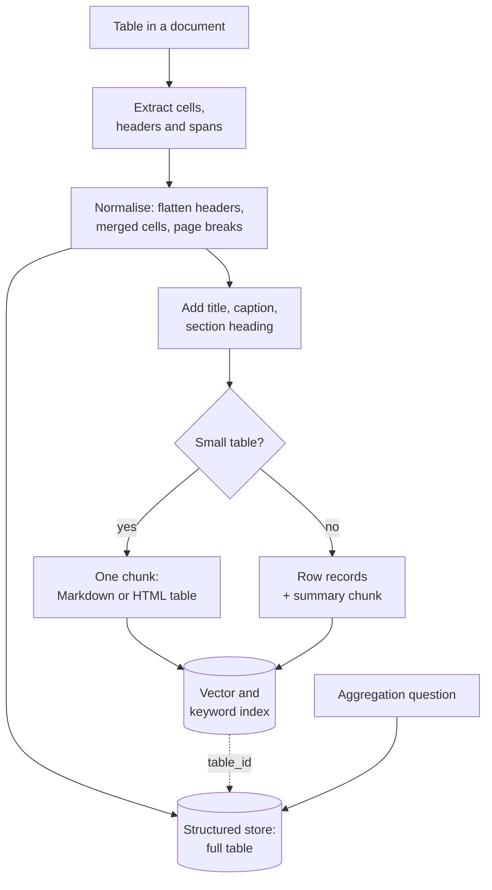

A table is a compact way of saying many facts at once. The cell in the "Team" row and the "SAML single sign-on" column says *the Team plan does not include SAML single sign-on*, but only because of where it sits. Take the cell out of its grid and it is just the word "No". Plain text extraction does exactly that: it reads the cells out one after another and throws the grid away. Chunking can then cut the result in half, leaving one chunk with the column headers and another with the values.

This lesson is about representing tables so that both halves of a RAG system can use them: the retriever must be able to find the right part of the table, and the generator must be able to read off the right value. You will compare several representations on the same table, see where each wins, and learn when a table should not be embedded at all but loaded into a database and queried. Getting tables *out* of PDFs and web pages is covered in [Tables and structured content](/learn/advanced-document-parsing/tables-and-structured-content); splitting large tables into chunks is covered in [Table chunking](/learn/advanced-chunking-strategies/table-chunking). Here the focus is the representation in between.

## Learning objectives

- Explain why plain-text extraction and naive chunking destroy the meaning of table cells.
- Detect and extract a ruled table from a PDF with PyMuPDF and load it into a DataFrame.
- Serialise a table as Markdown, as CSV and as self-contained row records, and choose between them for a given table and question type.
- Normalise merged header and body cells, and recognise when that normalisation produces misleading records.
- Decide when a table's questions should be answered by SQL over the table rather than by retrieval over text.

## Prerequisites

- [Images](/learn/multimodal-ingestion/images): the general pattern of a retrievable surrogate pointing at a stored original.
- [Tables and structured content](/learn/advanced-document-parsing/tables-and-structured-content): how tables are detected and extracted from documents.
- [Query-document matching](/learn/rag-architecture-fundamentals/query-document-matching): how a query is scored against a chunk.
- [JSON and CSV](/learn/data-processing/json-and-csv): reading and writing tabular data in Python.

## Why this matters

Tables hold a disproportionate share of the precise facts in business documents: price lists, plan comparisons, service hours, configuration limits, error-code catalogues, approval matrices. They are also where users ask the most exact questions ("does the Team plan include single sign-on?") and where a wrong answer is most clearly wrong.

Four failures recur when tables are ingested as ordinary text:

1. **Cells lose their headers.** Text extraction produces "Team 50 1 year Yes No". The generator must work out that the fifth value belongs to the fifth column. With five columns it might; with fifteen, and some empty cells, it will not.
2. **Chunks cut tables apart.** A 200-row table becomes several chunks. Only the first contains the header row, so the others are columns of unlabelled numbers.
3. **Retrieval cannot single out a row.** One embedding for a whole table is an average over every row. A question about one row competes against that average, and against other tables on similar subjects.
4. **Aggregation questions have no single answer chunk.** "Which plans include single sign-on?" or "how many error codes relate to the VPN?" need every row. Top-k retrieval returns a few rows and the generator answers from a partial list without knowing it is partial.

## The intuition

Imagine reading a train timetable over the phone to a friend. If you read it the way a text extractor does, left to right and top to bottom ("Station, 07:10, 07:40, 08:10, Oxford, 07:22, 07:52..."), your friend will be lost within seconds. A better approach is to read it row by row and repeat the context each time: "The 07:40 from London reaches Oxford at 08:32." Every sentence then stands on its own. If your friend wants one train, you read one sentence.

But if your friend asks "how many trains reach Oxford before nine?", reading sentences is the wrong tool altogether. You would rather they had the timetable in front of them and could count. Tables need both: self-contained sentences for finding one fact, and the intact table for questions about many.

## How it works

### Where tables come from

The source format decides how much work extraction takes and how much structure survives:

- **Natively structured sources.** HTML `<table>` elements, tables in DOCX files, spreadsheets, Markdown tables and CSV exports already know their rows, columns and header cells. Structure comes for free; the work is normalising it.
- **PDF tables with ruling lines.** A PDF has no table object, only text placed at coordinates and lines drawn on the page. A detector finds the grid of lines and assigns text to cells. This usually works well.
- **PDF tables without lines.** Columns are implied by alignment and white space. Detection is harder and errors (two columns merged, a wrapped cell treated as two rows) are common.
- **Tables as images.** Scanned pages and pasted screenshots need OCR with table-structure recognition, or a vision-language model asked to transcribe the table into Markdown or HTML. Both can misread digits; validate the result against the image on a sample before trusting it.

### Structural complications

Real tables are rarely a tidy rectangle with one header row. Before serialising, handle:

- **Multi-row headers.** "Hours" spanning "Weekdays" and "Weekends". Each column's full header is the path through the header rows: "Hours, Weekdays".
- **Merged body cells.** A value spanning two rows applies to both rows. Expanding it (copying it into each spanned cell) makes each row self-contained, but see the warning below.
- **Tables continued across pages.** The header usually repeats on the next page, or does not. Stitch continuation pieces into one logical table and drop repeated header rows.
- **Units and footnotes.** "Price (GBP)" or a footnote marker "¹ excluding VAT" changes how every value in a column reads. Keep units in the header text and attach footnotes to the table record.
- **Totals and subtotals.** A "Total" row is not a record like the others, and summing a column that already contains a total double-counts.
- **Transposed tables.** Some tables put the records in columns (one column per plan) and the attributes in rows. Identify which axis holds the records before you serialise by row.

> [!WARNING]
> Expanding merged cells can change meaning. When a cell spans two columns because it states one thing about both ("Answered within one working day" across Weekdays and Weekends), copying it into each column produces a record that says email is answered within one working day *at weekends*, which may not be what the author meant. Inspect merged cells in important tables rather than expanding them blindly.

### Four representations

| Representation | What a chunk contains | Good for | Weak at |
| --- | --- | --- | --- |
| Flattened text | Cells in reading order, no structure | Nothing; it is what you get by accident | Reading off values; any table wider than a few columns |
| Markdown or HTML table | The whole table (or a slice) with its header | Small tables; giving the generator the full grid | Large tables; pinpointing one row in retrieval |
| Row records | One row per chunk, each value labelled with its column header, plus the table title | Lookup questions about one row; large tables | Questions about many rows; costs more tokens |
| Table summary | A short description of what the table covers: subject, columns, row keys | Finding the right table; routing | Answering specific values |

Markdown is compact and models read it well, but it has no way to express merged cells. HTML can (`rowspan`, `colspan`) at the cost of more tokens. Row records repeat the header for every row, which makes each one self-contained and, as the mathematics below shows, makes the table two to three times larger in tokens.

A fifth option sits outside the vector index entirely: **load the table into a database**. Questions that filter, count, sum or compare across rows are database questions. Retrieval finds the table; SQL answers the question.

### The pipeline, step by step

1. **Extract the table** with its structure: cells, header rows, spans, bounding box and page.
2. **Normalise.** Flatten multi-row headers into one header per column, expand or annotate merged cells, stitch multi-page tables, separate total rows, attach units and footnotes.
3. **Capture context.** The table's title or caption, the heading of the section it sits in, and the sentence that introduces it.
4. **Choose the record key.** Find the column that identifies each row (Plan, Error code, Channel). Row records lead with it.
5. **Write representations.** For a small table, one chunk holding the whole Markdown or HTML table plus its title. For a large one, row records (or slices of a few rows each, every slice with the header) plus a summary chunk.
6. **Store the full table** as structured data (a DataFrame saved as Parquet or CSV, or a database table), with an identifier that every chunk carries.
7. **At answer time**, give the generator the retrieved rows with their header, or the whole table when it is small enough, and route aggregation questions to the structured copy.



### Lookup questions and aggregation questions

The deciding question for a table's representation is what people will ask of it.

A **lookup question** concerns one row or one cell: "how long is data kept on the Starter plan?". Row records serve it well: the right row is retrieved, it carries its own labels, and the generator reads the value off.

An **aggregation question** concerns a set of rows: "which plans include single sign-on?", "how many error codes are about the VPN?", "what is the cheapest plan with CSV export?". Top-k retrieval is structurally unable to guarantee these. If five rows match and you retrieve three, the answer is wrong and nothing in the pipeline knows it. Two remedies exist. For small tables, retrieve the whole table as one chunk, so the generator sees every row. For large tables, keep the table in a database and let the system answer with a query, either a fixed one behind a known question type or one generated by a model and checked before it runs. Generating SQL from questions is its own discipline; the point at ingestion time is to **keep a structured copy**, so that the option exists.

## The mathematics

### The token cost of self-contained rows

**Intuition.** Row records repeat the column headers in every row. That repetition is what makes each row readable on its own, and it is also pure overhead in tokens. How much overhead depends on how long the headers are compared with the values.

For a table with $r$ rows, let $h$ be the number of tokens in the header (all column names) and $v$ the average number of tokens in one row's values. Ignoring punctuation:

$$
T_{\text{csv}} \approx h + r\,v
\qquad
T_{\text{rows}} \approx r\,(h + v)
\qquad
\frac{T_{\text{rows}}}{T_{\text{csv}}} \approx \frac{r\,(h + v)}{h + r\,v} \xrightarrow{\;r \to \infty\;} \frac{h + v}{v}
$$

$T_{\text{csv}}$ is the token count of the table written once with a single header line; $T_{\text{rows}}$ is the total over all row records. As the table grows, the header's one-off cost in CSV vanishes and the ratio tends to $(h + v)/v$: one plus the header-to-value ratio.

**By hand.** The Meridian Reports plan table has a header of $h = 17$ tokens and values averaging $v = 10$ tokens per row (both measured below). For the 3-row table: $T_{\text{csv}} \approx 17 + 3 \times 10 = 47$ and $T_{\text{rows}} \approx 3 \times 27 = 81$, a ratio of $81/47 \approx 1.7$. For a 200-row table with the same columns: $T_{\text{csv}} \approx 17 + 2000 = 2017$ and $T_{\text{rows}} \approx 200 \times 27 = 5400$, a ratio of about 2.7, close to the limit $(17 + 10)/10 = 2.7$.

So for a table with long column names and short values (very common: "SAML single sign-on" over "Yes"), row records can cost several times what the bare table costs. That is usually a price worth paying for retrieval, and it is a reason not to send all the row records of a table to the generator when the table itself would do.

```python
import pandas as pd
import tiktoken

enc = tiktoken.get_encoding("cl100k_base")    # an OpenAI tokeniser, used here as a yardstick
n = lambda s: len(enc.encode(s))

df = pd.DataFrame(
    [["Starter", "10", "90 days", "Yes", "No"],
     ["Team", "50", "1 year", "Yes", "No"],
     ["Enterprise", "Unlimited", "3 years", "Yes", "Yes"]],
    columns=["Plan", "Max users", "Data retention", "PDF/CSV export", "SAML single sign-on"],
)
md = df.to_markdown(index=False, tablefmt="pipe")
csv = df.to_csv(index=False)
rows = ["; ".join(f"{c}: {v}" for c, v in zip(df.columns, r)) for r in df.values]

print("header tokens (csv line):", n(",".join(df.columns)))
print("markdown table tokens:   ", n(md))
print("csv tokens:              ", n(csv))
print("row records tokens:      ", sum(n(r) for r in rows), "=", [n(r) for r in rows])
```

```output
header tokens (csv line): 17
markdown table tokens:    99
csv tokens:               47
row records tokens:       92 = [31, 31, 30]
```

The CSV count matches the hand estimate exactly. Row records come to 92 rather than 81 because of the colons and semicolons the formula ignores. The surprise is Markdown at 99 tokens: pandas pads every cell with spaces so the columns line up, and runs of spaces cost tokens. Stripping the padding (or writing the pipes yourself without alignment) brings Markdown close to CSV. The exact counts depend on the tokeniser; Claude's tokeniser differs from this one, but the proportions behave the same way.

## In code

### Extracting a PDF table with its structure

**The problem.** A PDF page holds Meridian Reports' plan comparison as a ruled table. Show what plain text extraction gives you, then recover the grid.

**Dependencies.** PyMuPDF and pandas.

```bash
pip install pymupdf pandas tabulate
```

```python
import pymupdf

page = pymupdf.open("plans.pdf")[0]

print("--- plain text extraction ---")
print(page.get_text("text").strip())

print("\n--- find_tables ---")
tables = page.find_tables()
print("tables found:", len(tables.tables))
table = tables[0]
print("bbox:", [round(v) for v in table.bbox], "shape:", (table.row_count, table.col_count))
df = table.to_pandas()
print(df.to_string(index=False))
```

```output
--- plain text extraction ---
Meridian Reports: plan comparison
Plan
Max users
Data retention
PDF/CSV export
SAML single sign-on
Starter
10
90 days
Yes
No
Team
50
1 year
Yes
No
Enterprise
Unlimited
3 years
Yes
Yes

--- find_tables ---
Consider using the pymupdf_layout package for a greatly improved page layout analysis.
tables found: 1
bbox: [50, 100, 545, 188] shape: (4, 5)
      Plan Max users Data retention PDF/CSV export SAML single sign-on
   Starter        10        90 days            Yes                  No
      Team        50         1 year            Yes                  No
Enterprise Unlimited        3 years            Yes                 Yes
```

**What the output means.** The plain extraction is a list of 21 lines. Nothing in it says that the second "No" belongs to Team and to single sign-on; you can work it out only by counting. `find_tables()` detects the ruled grid, reports its bounding box and shape (4 rows including the header, 5 columns), and `to_pandas()` returns a DataFrame using the first row as column names. The line about `pymupdf_layout` is an informational message printed by this PyMuPDF version, not an error.

**Common errors.** `find_tables()` relies on ruling lines by default; for tables laid out with white space only, read its documentation for the text-based strategy options and check results carefully. A header row that wraps onto two lines may be read as two rows. When a table continues on the next page you get two tables, and you must stitch them yourself.

### Three serialisations, one retriever

**The problem.** Compare flattened text, a Markdown table and row records for three lookup questions, in a small corpus that also contains prose about the same product.

```bash
pip install sentence-transformers pandas tabulate
```

```python
import pandas as pd
from sentence_transformers import SentenceTransformer

df = pd.DataFrame(
    [["Starter", "10", "90 days", "Yes", "No"],
     ["Team", "50", "1 year", "Yes", "No"],
     ["Enterprise", "Unlimited", "3 years", "Yes", "Yes"]],
    columns=["Plan", "Max users", "Data retention", "PDF/CSV export", "SAML single sign-on"],
)
title = "Meridian Reports: plan comparison"

def flattened(df):                       # what a plain text extractor gives you
    cells = list(df.columns) + df.values.ravel().tolist()
    return title + "\n" + "\n".join(cells)

def markdown(df):                        # whole table, structure kept
    return title + "\n\n" + df.to_markdown(index=False)

def row_records(df, key="Plan"):         # one self-contained record per row
    out = []
    for _, row in df.iterrows():
        pairs = "; ".join(f"{col}: {row[col]}" for col in df.columns if col != key)
        out.append(f"{title}. {key}: {row[key]}. {pairs}.")
    return out

print(markdown(df), "\n")
for r in row_records(df):
    print(r)

prose = [
    "Meridian Reports exports any dashboard as a PDF or CSV file from the Share menu.",
    "Single sign-on lets staff log in to Meridian Reports with their company identity provider.",
    "To add users to Meridian Reports, an administrator sends invitations from Settings.",
]
corpora = {
    "flattened table": prose + [flattened(df)],
    "markdown table":  prose + [markdown(df)],
    "row records":     prose + row_records(df),
}
queries = [
    "Does the Team plan include SAML single sign-on?",
    "How long is data kept on the Starter plan?",
    "Which plan allows unlimited users?",
]
model = SentenceTransformer("sentence-transformers/all-MiniLM-L6-v2")
Q = model.encode(queries, normalize_embeddings=True)
for name, chunks in corpora.items():
    S = Q @ model.encode(chunks, normalize_embeddings=True).T
    print(f"\n== {name}")
    for qi, q in enumerate(queries):
        best = S[qi].argmax()
        label = chunks[best].replace("\n", " ")[:60]
        print(f"  {q:<48} {S[qi, best]:.3f}  {label}...")
```

```output
Meridian Reports: plan comparison

| Plan       | Max users   | Data retention   | PDF/CSV export   | SAML single sign-on   |
|:-----------|:------------|:-----------------|:-----------------|:----------------------|
| Starter    | 10          | 90 days          | Yes              | No                    |
| Team       | 50          | 1 year           | Yes              | No                    |
| Enterprise | Unlimited   | 3 years          | Yes              | Yes                   | 

Meridian Reports: plan comparison. Plan: Starter. Max users: 10; Data retention: 90 days; PDF/CSV export: Yes; SAML single sign-on: No.
Meridian Reports: plan comparison. Plan: Team. Max users: 50; Data retention: 1 year; PDF/CSV export: Yes; SAML single sign-on: No.
Meridian Reports: plan comparison. Plan: Enterprise. Max users: Unlimited; Data retention: 3 years; PDF/CSV export: Yes; SAML single sign-on: Yes.

== flattened table
  Does the Team plan include SAML single sign-on?  0.515  Meridian Reports: plan comparison Plan Max users Data retent...
  How long is data kept on the Starter plan?       0.499  Meridian Reports: plan comparison Plan Max users Data retent...
  Which plan allows unlimited users?               0.451  Meridian Reports: plan comparison Plan Max users Data retent...

== markdown table
  Does the Team plan include SAML single sign-on?  0.483  Meridian Reports: plan comparison  | Plan       | Max users ...
  How long is data kept on the Starter plan?       0.422  Meridian Reports: plan comparison  | Plan       | Max users ...
  Which plan allows unlimited users?               0.379  Meridian Reports: plan comparison  | Plan       | Max users ...

== row records
  Does the Team plan include SAML single sign-on?  0.641  Meridian Reports: plan comparison. Plan: Team. Max users: 50...
  How long is data kept on the Starter plan?       0.472  Meridian Reports: plan comparison. Plan: Starter. Max users:...
  Which plan allows unlimited users?               0.464  Meridian Reports: plan comparison. Plan: Enterprise. Max use...
```

**What the output means.** With a table this small, every representation retrieves the table ahead of the prose, so retrieval is not where they differ. The difference is in *what the generator receives*. With flattened text it gets a column of words and must count positions. With Markdown it gets the grid, which models read reliably for small tables. With row records it gets exactly the row asked about, labelled, and nothing else: the Team row scores highest of anything for the single sign-on question, and the Starter and Enterprise rows come back for their questions.

Now imagine the table had 300 rows. The Markdown table would no longer fit one chunk; a splitter would cut it into pieces, and only the first piece would carry the header. The row records would be unchanged: 300 self-contained chunks. That is the case for row records.

Notice also that the unlimited-users question succeeds only because the value "Unlimited" happens to appear in the row. A question such as "which plan has the most users?" needs a comparison across rows, which none of these representations can guarantee. That is the next example.

### Merged cells in an HTML table

**The problem.** The support desk hours table uses a two-row header and merged body cells. Normalise it into one header per column and self-contained rows.

```python
from io import StringIO
import pandas as pd

html = """
<table>
  <caption>Support desk hours (UK time)</caption>
  <tr><th rowspan="2">Channel</th><th colspan="2">Hours</th></tr>
  <tr><th>Weekdays</th><th>Weekends</th></tr>
  <tr><td>Phone</td><td rowspan="2">08:00 to 18:00</td><td>Closed</td></tr>
  <tr><td>Chat</td><td>Closed</td></tr>
  <tr><td>Email</td><td colspan="2">Answered within one working day</td></tr>
</table>
"""
df = pd.read_html(StringIO(html))[0]
print(df.columns.tolist())
df.columns = [" ".join(dict.fromkeys(c)) for c in df.columns]   # flatten the two header rows
print(df.to_string(index=False))
print()
for _, row in df.iterrows():
    print("Support desk hours. " + "; ".join(f"{c}: {v}" for c, v in row.items()) + ".")
```

```output
[('Channel', 'Channel'), ('Hours', 'Weekdays'), ('Hours', 'Weekends')]
Channel                  Hours Weekdays                  Hours Weekends
  Phone                  08:00 to 18:00                          Closed
   Chat                  08:00 to 18:00                          Closed
  Email Answered within one working day Answered within one working day

Support desk hours. Channel: Phone; Hours Weekdays: 08:00 to 18:00; Hours Weekends: Closed.
Support desk hours. Channel: Chat; Hours Weekdays: 08:00 to 18:00; Hours Weekends: Closed.
Support desk hours. Channel: Email; Hours Weekdays: Answered within one working day; Hours Weekends: Answered within one working day.
```

**The important lines.** `pd.read_html` expands `rowspan` and `colspan`, copying the spanned value into every cell it covers, and returns a two-level column index for the two header rows. `dict.fromkeys(c)` removes the repeated "Channel" while keeping order, giving one readable header per column. The Phone and Chat rows are now correct and self-contained: the shared "08:00 to 18:00" has been copied into both.

The Email row shows the danger from the warning above. The author merged two cells to say one thing about email in general; expansion has produced a record claiming email is answered within one working day *at weekends*. Whether that is true is a question for the table's owner, not for the parser. For important tables, flag rows with column-spanning cells for review, or write them as one value under the parent header ("Hours: Answered within one working day").

### Keeping a structured copy for aggregation

**The problem.** Answer questions that span rows exactly, which retrieval cannot guarantee.

```python
import sqlite3
import pandas as pd

df = pd.DataFrame(
    [["Starter", 10, 90, "Yes", "No"],
     ["Team", 50, 365, "Yes", "No"],
     ["Enterprise", None, 1095, "Yes", "Yes"]],          # None = unlimited
    columns=["plan", "max_users", "retention_days", "pdf_csv_export", "saml_sso"],
)
con = sqlite3.connect(":memory:")
df.to_sql("reports_plans", con, index=False)

queries = {
    "plans with SSO": "SELECT plan FROM reports_plans WHERE saml_sso = 'Yes'",
    "plans with at least a year of retention":
        "SELECT plan, retention_days FROM reports_plans WHERE retention_days >= 365 ORDER BY retention_days",
    "number of plans with a user cap": "SELECT COUNT(*) FROM reports_plans WHERE max_users IS NOT NULL",
}
for label, sql in queries.items():
    print(f"{label}: {con.execute(sql).fetchall()}")
```

```output
plans with SSO: [('Enterprise',)]
plans with at least a year of retention: [('Team', 365), ('Enterprise', 1095)]
number of plans with a user cap: [(2,)]
```

**The important lines.** Typing matters here in a way it did not for text. "1 year" and "3 years" became the integers 365 and 1095 so that they can be compared; "Unlimited" became `NULL` with a comment saying what it means. That conversion is a decision about meaning, so make it explicitly at ingestion and record it, rather than leaving a model to compare "90 days" with "1 year" as strings. SQLite's in-memory database (`":memory:"`) stands in here for whatever store you use in production.

**Extending it.** Store a short table summary chunk ("Meridian Reports plan comparison: one row per plan, columns for maximum users, data retention, export and SAML single sign-on") with the table's identifier. When that chunk is retrieved for a question that asks "which", "how many", "all" or "the most", the application can fetch the whole table, or run a query, instead of relying on the top-k rows.

## A real-world example

Meridian's Atlas platform team publishes an error-code catalogue: a 340-row table with columns for code, component, severity, message and remedy. AskMeridian ingested it from the PDF manual with the general text pipeline, and support staff quickly found that questions such as "what does E-4021 mean?" got confident answers about the wrong code.

The investigation found two problems. The PDF text came out in reading order, and the chunker, set to about 500 tokens, cut the catalogue into roughly two dozen pieces. Only the first piece held the header row, so most chunks were runs of codes, component names and sentences with nothing to say which was the message and which the remedy. Worse, a chunk boundary sometimes fell mid-row, leaving one code's message and the next code's remedy in the same chunk. The model joined them.

The fix had three parts. The catalogue was extracted as a table and each row written as a record: "Atlas error code catalogue. Code: E-4021. Component: VPN client. Severity: Medium. Message: Client out of date. Remedy: Update the client from the IT portal." The code column was also indexed for exact keyword match, because error codes are the classic case where embeddings blur near neighbours. And the whole catalogue was loaded into a small database table, so that a question such as "which error codes come from the VPN client?" was answered by a filter rather than by whichever few rows retrieval happened to return.

Lookup accuracy on the support desk's test questions improved markedly, and the class of "two codes merged into one answer" errors disappeared entirely, because no chunk contained two codes any more.

## Common mistakes

- **Letting the general text splitter cut tables.** Most chunks lose the header row; values become unlabelled numbers and the generator guesses which column they belong to.
- **Embedding a large table as one chunk.** The embedding averages over every row, a question about one row matches weakly, and the chunk may exceed the embedding model's input limit and be silently truncated.
- **Answering aggregation questions from top-k rows.** The answer is built from a partial set, and nothing in the system knows that it is partial.
- **Expanding merged cells without checking.** A value merged across columns for a reason is copied into places where it is not true.
- **Keeping numbers as strings.** "1 year" and "90 days" cannot be compared, and "1,200" sorts before "900".
- **Dropping the table's title and units.** "Price: 40" means nothing without "GBP per user per month" from the header or caption.
- **Treating a totals row as a record.** Sums and counts are then wrong by exactly the total.

## Best practices

- Detect tables during parsing and give them their own path through the pipeline; never send them through the prose splitter.
- Choose representation by size: a small table as one Markdown or HTML chunk; a large one as row records, or slices of a few rows each with the header repeated, plus a summary chunk.
- Lead each row record with the table title and the row's key column, and label every value with its full column header.
- Store the normalised table as structured data with a stable `table_id`, and carry that identifier on every chunk derived from it.
- Convert types explicitly at ingestion (dates, durations, money, booleans) and record how you did it.
- Index identifier columns (codes, SKUs, names) for exact keyword match as well as embedding them.
- Validate extracted tables: same number of cells in every row, no empty header, numeric columns parse as numbers, totals equal the sum of their rows.

## Performance considerations

**Token volume.** Row records cost roughly $(h + v)/v$ times the bare table, as the mathematics showed. For the 340-row error catalogue, if the header is 12 tokens and a row's values average 40 tokens (long remedy text), row records cost about $52/40 = 1.3$ times the table: cheap. For a feature matrix with long column names and Yes/No values, the ratio can exceed 3. Embedding cost grows in proportion, and so does index size: 340 records instead of perhaps 25 chunks means 340 vectors.

**Index size.** Each 384-dimensional float32 vector is $384 \times 4 = 1536$ bytes. Even 100,000 row records are only about 154 MB of vectors, which is small. The heavier cost is usually that row records dominate the top-k results for any query near the table's subject, crowding out prose. Grouping results by `table_id` after retrieval (keeping the best few rows per table) controls that.

**Generator context.** Sending a 200-row Markdown table to the generator to answer a one-row question wastes thousands of tokens on every query. Send the retrieved rows with their header for lookups; send the whole table only when the question needs it or the table is small.

**Extraction cost.** Detecting tables in a born-digital PDF is local computation, typically fast enough to be negligible next to embedding. Tables in scanned images need OCR or a vision model, which is far slower and costs per page; only route pages that actually contain tables to that path.

## Security considerations

- **Row-level sensitivity.** A table may mix public and restricted rows (salary bands, customer lists). Once rows are separate records, access control must be applied per record, inherited from the source document at least, and never relaxed because a row "looks harmless" on its own.
- **SQL over ingested data.** If questions are translated into SQL, the generated query runs against data you ingested. Use a read-only connection limited to the specific tables, set a timeout, and never interpolate user text into SQL strings. Treat cell values from untrusted documents as data: a cell containing instructions is prompt injection if it reaches the generator unmarked.
- **Spreadsheet formulas.** CSV and spreadsheet sources can contain formulas. When you export ingested tables back to spreadsheets for review, a cell beginning with `=`, `+`, `-` or `@` may be executed by the spreadsheet application (CSV or formula injection). Escape such cells on export.

## Summary

- A table cell's meaning comes from its row and column headers; plain extraction and naive chunking throw those away.
- Small tables work well as one Markdown or HTML chunk; large tables need self-contained row records (or header-carrying slices) plus a summary chunk.
- Row records cost extra tokens, roughly a factor of $(h + v)/v$, in exchange for every row being readable on its own.
- Normalise multi-row headers, merged cells, page breaks, units and totals before serialising, and check merged cells for meaning.
- Lookup questions suit retrieval; aggregation questions need the whole table or a structured copy queried with SQL.

## Exercises

1. **Diagnose.** A chunk retrieved for "what is the remedy for E-4032?" reads: "...Medium | Certificate expired | Reinstall from IT portal\nE-4032 | Sync | High | Quota exceeded...". What went wrong in ingestion, and what will the generator probably answer?

<details><summary>Show solution</summary>

The catalogue was split by a general text splitter, and the chunk boundary fell in the middle of a row: the chunk begins with the tail of the previous code's row and contains no header. The generator sees "Reinstall from IT portal" immediately before "E-4032" and may well report it as the remedy for E-4032, which belongs to a different code. Because the header is missing, it also cannot be sure which column is the remedy. The fix is row records (one code per chunk, each value labelled), so no chunk can contain parts of two rows.

</details>

2. **Serialise a transposed table.** Some documents put plans in columns and features in rows. Write a function that takes such a DataFrame (first column "Feature", one column per plan) and produces the same row records as `row_records` in this lesson, one per plan.

<details><summary>Show solution</summary>

Transpose so that plans become rows, then reuse the same logic.

```python
import pandas as pd

def records_from_transposed(df, title, key_name="Plan"):
    t = df.set_index("Feature").T            # plans are now the index
    t.index.name = key_name
    t = t.reset_index()
    out = []
    for _, row in t.iterrows():
        pairs = "; ".join(f"{c}: {row[c]}" for c in t.columns if c != key_name)
        out.append(f"{title}. {key_name}: {row[key_name]}. {pairs}.")
    return out

wide = pd.DataFrame({
    "Feature": ["Max users", "SAML single sign-on"],
    "Starter": ["10", "No"], "Team": ["50", "No"], "Enterprise": ["Unlimited", "Yes"],
})
for r in records_from_transposed(wide, "Meridian Reports: plan comparison"):
    print(r)
```

```output
Meridian Reports: plan comparison. Plan: Starter. Max users: 10; SAML single sign-on: No.
Meridian Reports: plan comparison. Plan: Team. Max users: 50; SAML single sign-on: No.
Meridian Reports: plan comparison. Plan: Enterprise. Max users: Unlimited; SAML single sign-on: Yes.
```

The hard part in practice is not the transpose but detecting that a table is transposed. A useful signal: the first row's cells look like entity names (and are all distinct) while the first column's cells look like attribute names.

</details>

3. **Design decision.** The HR team's 25-row "leave entitlement by country" table has columns Country, Annual leave days, Public holidays, Carry-over rule. Staff ask both "how many days of leave do I get in Germany?" and "which countries give more than 25 days?". Design the representation.

<details><summary>Show solution</summary>

Twenty-five rows of four short columns is small: the whole table in Markdown is a few hundred tokens. Index (a) one chunk containing the whole table with its title, which serves the comparison question because the generator sees every row, and (b) row records keyed by country, which serve the lookup question precisely and match country names well. Store the table structured, with leave days as integers, so that "more than 25 days" can also be answered with a filter if the generator proves unreliable at comparing numbers. Group results by `table_id` so the 25 row records do not flood the top-k for every leave question.

</details>

4. **Validation.** Write three automatic checks you would run on every extracted table before indexing it, and say what failure each one catches.

<details><summary>Show solution</summary>

- **Rectangular shape**: every row has the same number of cells as the header. Catches merged columns, cells split by wrapped text and mis-detected boundaries.
- **Header sanity**: no empty or duplicated column names after flattening, and the header row is not mostly numbers. Catches tables whose header was missed (so the first data row became the header) and multi-row headers that were not flattened.
- **Type consistency**: in each column, the fraction of values that parse as numbers (or dates) is either near 0 or near 1. A column that is 90% numeric with a few text values often means shifted cells or an included totals or footnote row. Where a "Total" row exists, check it equals the sum of the rows above.

Tables that fail go to a review queue with the page image rather than into the index.

</details>

## Check your understanding

```quiz
[
  {"q": "Why does a general-purpose text splitter damage a 300-row table?", "options": ["It removes all numbers", "Only the first chunk keeps the header row, so the other chunks contain unlabelled values", "It converts the table to HTML", "It always produces one chunk per row"], "answer": 1, "why": "The splitter cuts by length, so the header row ends up in one chunk and the remaining chunks lose the column labels that give values their meaning."},
  {"q": "Which question is a top-k row retriever structurally unable to guarantee a correct answer to?", "options": ["What is the data retention on the Team plan?", "Does Enterprise include SAML single sign-on?", "Which plans include PDF/CSV export?", "How many users does Starter allow?"], "answer": 2, "why": "It needs every matching row. If more rows match than are retrieved, the answer is silently incomplete."},
  {"q": "A table has a 30-token header and rows whose values average 10 tokens. Roughly how many times larger are row records than the bare table, for a large number of rows?", "options": ["1.3 times", "2 times", "3 times", "4 times"], "answer": 3, "why": "The ratio tends to (h + v) / v = (30 + 10) / 10 = 4."},
  {"q": "`pd.read_html` expands a cell with `colspan=\"2\"` by copying its value into both columns. When is this dangerous?", "options": ["When the merged value describes the two columns jointly and is not true of each separately", "When the table has fewer than ten rows", "Never; expansion is always correct", "When the columns contain numbers"], "answer": 0, "why": "Expansion asserts the value for each column individually, which can create records the author never intended."},
  {"q": "Why convert \"1 year\" and \"90 days\" to integers at ingestion when keeping a structured copy of a table?", "options": ["Integers embed better", "So that comparisons and filters such as retention of at least 365 days work correctly", "Because SQLite rejects text", "To reduce the token count of row records"], "answer": 1, "why": "Strings compare alphabetically, not by meaning. Explicit conversion makes filters and sorting correct and records the interpretation."}
]
```

## Further reading

- PyMuPDF documentation, "Page.find_tables" and the table recipes: [pymupdf.readthedocs.io](https://pymupdf.readthedocs.io/)
- pandas documentation, `read_html`, `to_markdown` and `to_sql`: [pandas.pydata.org/docs](https://pandas.pydata.org/docs/)
- Herzig, J. et al. (2020). *TaPas: Weakly Supervised Table Parsing via Pre-training*. A well-known model for answering questions over tables. [arXiv:2004.02349](https://arxiv.org/abs/2004.02349)
- Smock, B., Pesala, R. and Abraham, R. (2022). *PubTables-1M: Towards comprehensive table extraction from unstructured documents*, the dataset and approach behind Microsoft's Table Transformer.
- SQLite documentation: [sqlite.org/docs.html](https://www.sqlite.org/docs.html)
