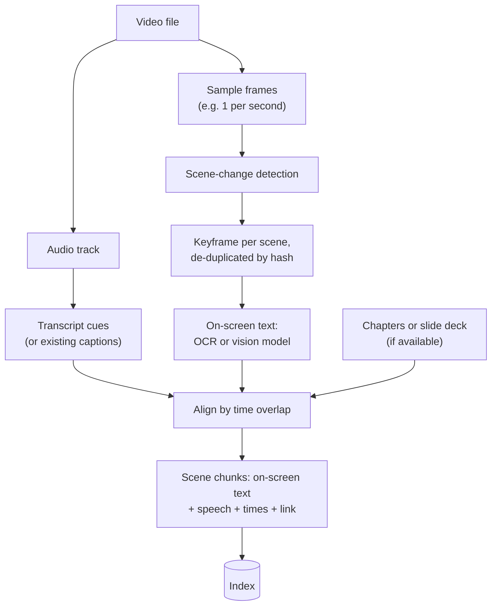

A video is an audio track with pictures attached, and for many videos the pictures carry half the meaning. A presenter says "if you see this error, just update the client" while the slide behind them shows *Error E-4021*. A screen recording says "click here, then here" while the cursor moves across a settings page. A transcript of the audio alone contains "this error" and "here"; the words that would make the passage findable are on screen.

This lesson extends [Audio transcripts](/learn/multimodal-ingestion/audio-transcripts) to video. The speech pipeline stays the same; what is new is the **visual channel**: detecting when the picture changes, choosing a representative frame for each scene, reading the text and content of those frames, and aligning that visual text with the speech by time, so that each chunk says both what was said and what was shown. You will also see the cheaper sources to check first (existing captions, chapter markers, the slide deck the presentation was made from) and how to make answers link to the right moment.

## Learning objectives

- Explain what a speech-only transcript misses in presentations, demos and screen recordings, with examples.
- Detect scene changes in a sequence of frames with histogram and pixel-difference measures, and explain when each fails.
- Align on-screen text with transcript cues by time-interval overlap to build scene-based chunks.
- Choose sources in order of cost and reliability: existing captions and chapters, source slide decks, then frame analysis.
- Estimate the frame-processing cost of a video library and reduce it with scene detection and de-duplication.

## Prerequisites

- [Audio transcripts](/learn/multimodal-ingestion/audio-transcripts): transcription, cues, glossary normalisation, timed chunks and deep links.
- [Images](/learn/multimodal-ingestion/images): image descriptions, visible-text transcription and perceptual hashing.
- [Chunk overlap](/learn/chunking-fundamentals/chunk-overlap): repeating content across chunk boundaries.

## Why this matters

Organisations accumulate video quickly: recorded presentations, training courses, product demos, screen-recorded how-tos, webinars. Meridian has a library of short IT how-to videos and recordings of every product launch for Meridian Sync, Meridian Relay and Meridian Reports. People ask questions that these videos answer, and they ask in the words on the slides: product names, error codes, menu paths, feature names.

Treating video as audio only produces three recurring failures:

1. **Deictic gaps.** Presenters point. "This error", "this button", "as you can see here", "these three options". The transcript records the pointing words and not the thing pointed at. A query for "E-4021" cannot match a chunk that says "this error".
2. **Silent content.** Screen recordings often have long stretches with no speech while the presenter types or clicks, and slides often contain more than the presenter reads aloud: a table, a URL, a list of steps. None of it reaches a speech-only transcript.
3. **Weak structure.** A presentation has an outline, its slides, and that outline is the natural chunk boundary. A transcript chunked by a fixed time window cuts across slides, mixing the end of one topic with the start of the next.

## The intuition

Think of reading the minutes of a meeting where someone presented slides. Good minutes do not just record what was said; they say "(Slide 4: VPN requirements)" before the discussion of slide 4, and they copy the key figure from the slide into the text. A reader can find the discussion of the VPN by scanning for slide titles, and the minutes make sense without the slides.

Video ingestion writes those minutes automatically. It notices when the slide changes, reads the new slide, and files what was said underneath it.

## How it works

### Sources, from cheapest to most expensive

Before analysing a single frame, check what already exists:

1. **Captions and subtitles.** Most video platforms store caption tracks, often WebVTT, either human-written or auto-generated. Human captions are usually better than anything you will generate; auto-generated ones are a free first draft. Parse them exactly as in [Audio transcripts](/learn/multimodal-ingestion/audio-transcripts).
2. **Chapters.** Many platforms let authors mark chapters with titles and start times. Chapters are a ready-made outline and the best available chunk boundaries.
3. **The source slide deck.** A recorded presentation was usually given from a deck that exists as a file. Its slide text is exact, unlike text read off video frames. If you can obtain it, you need frame analysis only to find *when* each slide was shown, which is a much easier task than reading the slide.
4. **Frame analysis.** Extract frames, detect scene changes, read the keyframes with OCR or a vision model. This is the general fallback, and the only option for screen recordings and demos.

### The pipeline, step by step

1. **Extract the audio track** and produce a timed, speaker-labelled transcript, or parse existing captions.
2. **Sample frames.** Decoding every frame is wasteful (a 30 frames-per-second video has 108,000 frames an hour). Sample at a low fixed rate, such as one frame per second, or use the video decoder's scene-change detection directly.
3. **Detect scene changes** by comparing consecutive sampled frames; a large difference marks the start of a new scene (a new slide, a new screen).
4. **Choose a keyframe** for each scene, typically a frame a little after the change so that transitions and animations have finished.
5. **De-duplicate keyframes** with a perceptual hash, as in [Images](/learn/multimodal-ingestion/images): a presenter who returns to an earlier slide produces a repeated keyframe that need only be read once.
6. **Read each keyframe.** OCR for slides and screens that are mostly text (see [OCR pipelines](/learn/multimodal-ingestion/ocr-pipelines)); a vision model where layout or imagery matters, asked to transcribe visible text and briefly describe what is shown.
7. **Align** speech and visuals by time: assign each transcript cue to the scene it overlaps most.
8. **Chunk** by scene (or by chapter, if chapters exist), merging very short scenes and splitting very long ones by time.
9. **Attach metadata**: video identifier, title, scene start and end, a deep link, and a thumbnail of the keyframe for display.



### Scene-change detection

A **scene change** (in film, a "cut" or "shot boundary") is where the picture changes substantially. For presentations and screen recordings, it is mostly a new slide or a new window. Two simple measures, computed between consecutive sampled frames, cover most cases:

- **Histogram difference.** Compare the distribution of brightness (or colour) values. A cut from a dark title slide to a white content slide changes the distribution completely. The measure ignores *where* pixels are, which makes it robust to small movements such as a mouse cursor, but blind to changes that keep the same distribution: two white slides with black text have nearly identical histograms even when every word differs.
- **Pixel difference.** Compare the frames position by position, on down-scaled greyscale copies. It sees a change of text on a white slide, because the dark pixels move. It also sees motion: a presenter's camera inset, a moving cursor or a video playing within a slide all register as change, so its threshold has to sit above that background level.

Production tools combine measures and add refinements: comparing against the last *keyframe* rather than the previous frame (to catch slow fades), requiring a minimum scene length (to ignore flashes), and handling gradual transitions. FFmpeg's `select` filter exposes a scene-change score, and PySceneDetect is a widely used open-source library built for this task. For slide-based content, a simple pixel-difference detector with a sensible threshold and a minimum scene length is often enough, as the code below shows.

### Aligning speech with scenes

Each transcript cue has a time interval, and so does each scene. A cue belongs to the scene it **overlaps most**. Assigning by start time alone fails at boundaries: presenters often start talking about the next slide a moment before clicking, or finish a sentence after the slide has changed. Overlap handles both.

Once aligned, a scene chunk looks like this:

```text
[4-9s] On screen: Using the VPN | Required on public Wi-Fi | Error E-4021: update the client
Said: First, always connect to the VPN when you're on public Wi-Fi. If you see this error, just update the client.
```

"This error" is now resolved by the line above it. The chunk matches a query for "E-4021", reads coherently, and covers exactly one slide's topic.

### What to read from a keyframe

Slides and screens are mostly text, so start with text: titles, bullets, labels, URLs, error messages, transcribed verbatim. For demos, add a short description of the state of the screen ("Meridian Reports settings page, Single sign-on tab open, SAML metadata URL field highlighted"). For camera footage of a person talking, there is usually nothing worth reading, and the keyframe can be skipped: the scene detector will find few changes, and a vision model asked to classify the frame can say "speaker only" and stop there.

Read only keyframes, not every sampled frame. A 30-minute presentation with 25 slides needs about 25 reads, not 1,800.

### Very long and very short scenes

Scene boundaries are content boundaries, but not always good chunk sizes. A slide left up for ten minutes of discussion produces a scene with thousands of words of speech; split it by time (with overlap), repeating the slide's on-screen text at the top of each piece so every piece keeps its context. A screen recording with rapid changes produces many two-second scenes; merge consecutive short scenes until each chunk reaches a minimum duration, keeping all their on-screen text.

## The mathematics

### Two frame-difference measures

**Intuition.** A histogram difference asks "has the mix of light and dark changed?"; a pixel difference asks "has anything moved?". They agree on dramatic cuts and disagree on subtle ones, which is why it helps to understand both.

**Histogram distance.** Split brightness (0 to 255) into $B$ bins and let $p_k$ and $q_k$ be the fraction of pixels in bin $k$ for frames $P$ and $Q$. The **total variation distance** between the two distributions is

$$
D_{\text{hist}}(P, Q) = \frac{1}{2} \sum_{k=1}^{B} \lvert p_k - q_k \rvert
$$

It is 0 when the distributions are identical and 1 when they share no bins at all. The factor $\tfrac12$ is there because every pixel that leaves one bin arrives in another, so the raw sum counts each moved fraction twice.

**Pixel distance.** For two greyscale frames of $N$ pixels with values $a_i$ and $b_i$, the normalised **mean absolute difference** is

$$
D_{\text{pix}}(P, Q) = \frac{1}{255\,N} \sum_{i=1}^{N} \lvert a_i - b_i \rvert
$$

It is 0 for identical frames and 1 for a pure black frame against a pure white one.

**Interval overlap.** For a cue $[s_1, e_1]$ and a scene $[s_2, e_2]$, the overlap in seconds is $\max\big(0, \min(e_1, e_2) - \max(s_1, s_2)\big)$.

**By hand.** Take 4-bin histograms. A white content slide: $p = (0.05, 0.05, 0.10, 0.80)$. A dark title slide: $q = (0.80, 0.05, 0.05, 0.10)$. Differences: $0.75, 0, 0.05, 0.70$; sum $1.50$; $D_{\text{hist}} = 0.75$, a clear cut. A second white slide with different text: $q' = (0.06, 0.04, 0.10, 0.80)$. Differences: $0.01, 0.01, 0, 0$; $D_{\text{hist}} = 0.01$: the histogram barely notices, although every line of text changed.

Now pixels. Four pixels of the first white slide: $(245, 60, 245, 60)$, where the 60s are text. On the second slide the text has moved: $(60, 245, 245, 60)$. Absolute differences: $185, 185, 0, 0$; mean $92.5$; divided by 255, $D_{\text{pix}} \approx 0.36$. The pixel measure sees what the histogram missed.

Overlap: a cue from 6.6 s to 9.4 s against a scene from 4 s to 9 s overlaps by $\min(9.4, 9) - \max(6.6, 4) = 9 - 6.6 = 2.4$ s; against the next scene, 9 s to 14 s, by $9.4 - 9 = 0.4$ s. The cue goes to the first scene.

## In code

### Detecting slide changes in a screen recording

**The problem.** Find the scene boundaries in a 14-second screen recording, sampled at one frame per second: a dark title slide, then a VPN slide, then a laptop slide with the same white layout. A cursor moves throughout and the encoder adds a little noise.

**Dependencies.** NumPy and Pillow. The frames are generated in code so the example is reproducible; with a real video you would get the same arrays from a decoder (see the FFmpeg commands after this example).

```bash
pip install numpy pillow
```

```python
import numpy as np
from PIL import Image, ImageDraw

rng = np.random.default_rng(0)

def slide(kind, t):
    """Render one 160x90 frame of a screen recording at second t."""
    if kind == "title":
        im = Image.new("L", (160, 90), 40)                       # dark title slide
        ImageDraw.Draw(im).rectangle((20, 35, 140, 50), fill=230)
    else:
        im = Image.new("L", (160, 90), 245)                      # white content slide
        d = ImageDraw.Draw(im)
        d.rectangle((10, 8, 150, 18), fill=30)                   # title bar
        rows = [25, 40, 55] if kind == "vpn" else [30, 50, 70]   # different bullet layout
        for y in rows:
            d.rectangle((15, y, 120 if kind == "vpn" else 90, y + 5), fill=60)
    ImageDraw.Draw(im).rectangle((60 + 2 * t % 40, 70, 64 + 2 * t % 40, 74), fill=0)  # moving cursor
    px = np.asarray(im, dtype=np.float64)
    return np.clip(px + rng.normal(0, 2, px.shape), 0, 255)      # a little encoder noise

timeline = ["title"] * 4 + ["vpn"] * 5 + ["laptop"] * 5           # one frame per second
frames = [slide(k, t) for t, k in enumerate(timeline)]

def hist_distance(a, b, bins=16):
    ha = np.histogram(a, bins=bins, range=(0, 256))[0] / a.size
    hb = np.histogram(b, bins=bins, range=(0, 256))[0] / b.size
    return 0.5 * np.abs(ha - hb).sum()                           # 0 = same, 1 = disjoint

def pixel_distance(a, b):
    return np.abs(a - b).mean() / 255                            # mean absolute difference

HIST_T, PIXEL_T = 0.3, 0.05
print(" t   hist  cut?   pixel  cut?")
cuts = []
for t in range(1, len(frames)):
    h, p = hist_distance(frames[t - 1], frames[t]), pixel_distance(frames[t - 1], frames[t])
    if p > PIXEL_T:
        cuts.append(t)
    print(f"{t:2d}  {h:.3f}  {'yes' if h > HIST_T else '-':<4}  {p:.3f}  {'yes' if p > PIXEL_T else '-'}")
print("scene starts (s):", [0] + cuts)
```

```output
 t   hist  cut?   pixel  cut?
 1  0.000  -     0.009  -
 2  0.000  -     0.009  -
 3  0.000  -     0.009  -
 4  0.978  yes   0.580  yes
 5  0.001  -     0.010  -
 6  0.002  -     0.010  -
 7  0.002  -     0.010  -
 8  0.002  -     0.010  -
 9  0.040  -     0.156  yes
10  0.004  -     0.009  -
11  0.001  -     0.009  -
12  0.002  -     0.009  -
13  0.001  -     0.009  -
scene starts (s): [0, 4, 9]
```

**What the output means.** At second 4 the dark title slide gives way to a white slide: both measures jump, the histogram to 0.978. At second 9 the VPN slide gives way to the laptop slide. Same background, same title bar, different bullets: the histogram distance is only 0.040, far below its threshold, so a histogram-only detector would merge the two slides into one scene. The pixel distance, 0.156, is clearly above the background level of about 0.01 produced by the moving cursor and noise. The detector returns scenes starting at 0, 4 and 9 seconds.

The thresholds come from looking at the numbers: background motion sits around 0.01, real changes well above 0.1, and 0.05 separates them. On real recordings, measure the background level on a few videos of each kind (talking-head inset, screen recording, slides) and set thresholds per kind. Down-scaling frames before comparing, as here at 160 by 90, reduces both cost and sensitivity to noise.

**Extending it.** Add a minimum scene length (ignore a "scene" shorter than, say, two seconds, which is usually an animation or transition) and compare each frame with the current scene's keyframe rather than the previous frame, so that a slow build-up of bullet points eventually registers as a change.

### Aligning speech with scenes

**The problem.** Given the three scenes, the on-screen text read from each keyframe, and the transcript cues, build one chunk per scene.

The on-screen text is given as data here; in production it comes from OCR or a vision model reading each keyframe.

```python
scene_starts, video_end = [0, 4, 9], 14.0
scenes = [(s, e) for s, e in zip(scene_starts, scene_starts[1:] + [video_end])]

# On-screen text of each scene's keyframe (from OCR or a vision model)
slide_text = [
    "IT onboarding: VPN and laptops",
    "Using the VPN | Required on public Wi-Fi | Error E-4021: update the client",
    "Your laptop | Refreshed every 3 years | Report a loss to the support desk at once",
]
# Transcript cues: (start, end, text)
cues = [
    (0.5, 3.8, "Hi everyone, this short video covers two things."),
    (4.1, 6.6, "First, always connect to the VPN when you're on public Wi-Fi."),
    (6.6, 9.4, "If you see this error, just update the client."),
    (9.4, 12.0, "Second, laptops are replaced on a three-year cycle."),
    (12.0, 13.9, "And if you lose one, tell us immediately."),
]

def overlap(a, b):
    """Length of the intersection of two time intervals (seconds)."""
    return max(0.0, min(a[1], b[1]) - max(a[0], b[0]))

segments = [{"start": s, "end": e, "slide": slide_text[i], "speech": []} for i, (s, e) in enumerate(scenes)]
for start, end, text in cues:
    best = max(segments, key=lambda seg: overlap((start, end), (seg["start"], seg["end"])))
    best["speech"].append(text)

for seg in segments:
    print(f"[{seg['start']:.0f}-{seg['end']:.0f}s] On screen: {seg['slide']}")
    print(f"          Said: {' '.join(seg['speech'])}\n")
```

```output
[0-4s] On screen: IT onboarding: VPN and laptops
          Said: Hi everyone, this short video covers two things.

[4-9s] On screen: Using the VPN | Required on public Wi-Fi | Error E-4021: update the client
          Said: First, always connect to the VPN when you're on public Wi-Fi. If you see this error, just update the client.

[9-14s] On screen: Your laptop | Refreshed every 3 years | Report a loss to the support desk at once
          Said: Second, laptops are replaced on a three-year cycle. And if you lose one, tell us immediately.
```

**The important lines.** `overlap` is the interval-intersection formula from the mathematics section. The cue from 6.6 to 9.4 seconds runs past the slide change at 9 seconds; by overlap (2.4 s against 0.4 s) it correctly stays with the VPN slide, whereas assigning by end time would have moved it to the laptop slide.

**What the output means.** Each chunk now pairs a slide with the speech about it. The VPN chunk contains "E-4021", which was never spoken, and "this error" is resolved by the line above it. The laptop chunk contains "support desk", which the presenter replaced with "tell us". A query for either term now finds the right moment in the video.

**Common errors.** Off-by-one scene ends (a scene ends where the next starts, not one sample earlier); timestamps from captions and from frame sampling using different zero points (for example, captions offset by an intro clip that was cut); and cues that span two long scenes almost equally, which are better duplicated into both than forced into one.

### Extracting audio and frames with FFmpeg

**The problem.** Get the inputs for the steps above from a real video file.

**Dependencies.** The FFmpeg command-line tool, installed from your operating system's package manager. These commands were **not executed** for this lesson, because FFmpeg is not available in the sandbox.

```bash
# Audio only, mono, 16 kHz: the format most speech recognisers expect
ffmpeg -i launch-demo.mp4 -vn -ac 1 -ar 16000 launch-demo.wav

# One frame per second, scaled to 320 pixels wide, as numbered PNGs
ffmpeg -i launch-demo.mp4 -vf "fps=1,scale=320:-1" frames/%05d.png

# Only frames whose scene-change score exceeds 0.3, with their timestamps logged by showinfo
ffmpeg -i launch-demo.mp4 -vf "select='gt(scene,0.3)',showinfo" -fps_mode vfr keyframes/%04d.png
```

`-vn` drops the video stream; `-ac 1 -ar 16000` makes the audio mono at 16,000 samples per second. The `fps=1` filter samples one frame per second; frame number $n$ (starting at 1) then corresponds to roughly second $n - 1$. The `select` filter keeps frames whose built-in scene score (between 0 and 1) exceeds the threshold, and `showinfo` prints each kept frame's presentation timestamp to the log, which you parse to know *when* each keyframe occurred. `-fps_mode vfr` stops FFmpeg from duplicating frames to fill the gaps; older FFmpeg versions use `-vsync vfr` instead. Check your FFmpeg version's documentation for the exact option names.

## A real-world example

Meridian's product team records a 20-minute launch demo for every release of Meridian Reports, Meridian Sync and Meridian Relay, and customer-facing staff use them to learn what changed. The team asked for AskMeridian to answer questions such as "how do I set up SAML single sign-on in Reports?" from these videos.

The Platform team first ingested only the auto-generated captions, chunked by 60-second windows. Answers were vague. The demos were screen recordings narrated in the language of someone clicking through an interface: "so we go in here, open this tab, and paste the URL into that field". The transcript never said "Settings", "Single sign-on" or "SAML metadata URL"; those words were on screen. The chunks also cut across steps, so an answer might start mid-procedure.

The second version added the visual channel. Frames were sampled at one per second and compared by pixel difference; the threshold was tuned on three demos so that cursor movement and typing did not trigger cuts but switching tabs did. A minimum scene length of three seconds removed flicker from menus opening and closing. Each keyframe was sent to a vision model asking for verbatim visible text plus one sentence describing the screen state, and duplicate keyframes (the presenter often returned to the same settings page) were read once, matched by perceptual hash. Speech was aligned to scenes by overlap, short scenes were merged into chunks of at least 20 seconds, and every chunk carried a deep link and a thumbnail.

The SAML question now retrieved a chunk whose on-screen text included "Settings > Security > Single sign-on (SAML) | Enterprise plan", with the narration beside it, and the answer linked to the moment in the demo. The team noted one remaining limit: steps performed silently and quickly, within a single scene, were still only partly captured, and they asked presenters to say what they were clicking.

## Common mistakes

- **Indexing only the audio of presentations and demos.** On-screen terms, error codes and menu paths, often the exact words users search for, are lost, and "this" and "here" are left unresolved.
- **Reading every frame.** Sending every sampled frame to OCR or a vision model multiplies cost by the number of frames per scene, typically tens to hundreds, for no extra information.
- **Relying on histogram differences for slides.** Slides sharing a template have near-identical histograms; changes are missed and different slides are merged.
- **Thresholds set without measuring background motion.** A camera inset or moving cursor triggers constant false cuts, or a threshold set too high misses real ones.
- **Assigning cues to scenes by start time.** Speech that straddles a slide change lands in the wrong chunk.
- **Ignoring existing captions, chapters and slide decks.** Re-deriving, at cost and with errors, what already exists exactly.
- **Chunking by fixed time windows when scenes are available.** Chunks mix the end of one topic with the start of the next.

## Best practices

- Check for human captions, chapters and the source slide deck before analysing frames.
- Sample frames sparsely, detect scenes, and read only de-duplicated keyframes.
- Use pixel-difference (or combined) scene detection for slides and screen recordings, with thresholds measured per content type and a minimum scene length.
- Align speech to scenes by interval overlap, and chunk by scene, merging short scenes and splitting long ones with the on-screen text repeated.
- Put on-screen text first in each chunk, labelled as such, followed by the speech.
- Store video identifier, scene start and end, a deep link and a keyframe thumbnail with every chunk.
- Classify keyframes and skip those with nothing to read, such as a speaker on camera.

## Performance considerations

Decoding is the first cost. Decoding a full-resolution video and keeping one frame per second still decodes every frame internally, but modern decoders run many times faster than real time on ordinary hardware, so for most libraries decoding is not the bottleneck.

Reading keyframes is the main cost, and scene detection is what controls it. Consider a library of 300 videos averaging 20 minutes. At one frame per second, that is $300 \times 20 \times 60 = 360{,}000$ sampled frames. If each video has around 40 distinct scenes, there are $300 \times 40 = 12{,}000$ keyframes, and de-duplication might remove a quarter, leaving about 9,000 reads. Reading every sampled frame would be 40 times more work than reading keyframes. If a keyframe read costs about 1,000 input tokens of image plus a couple of hundred output tokens (an assumption; see [Images](/learn/multimodal-ingestion/images) for how image tokens are counted), 9,000 reads is roughly 9 million image tokens, against 360 million for every frame.

Frame comparison itself is cheap: comparing two 160 by 90 greyscale frames is 14,400 subtractions. 360,000 comparisons is about 5 billion simple operations, a matter of seconds with NumPy.

Transcription costs are as in [Audio transcripts](/learn/multimodal-ingestion/audio-transcripts): 6,000 minutes of audio for this library, at whatever real-time factor or per-minute price applies.

Storage: keep the video in its existing store, and store keyframe thumbnails (a few tens of kilobytes each) for display; 9,000 thumbnails at 30 KB is about 270 MB.

## Security considerations

- **Screens show more than intended.** Screen recordings capture notifications, open email, chat messages, customer records, browser tabs, and occasionally passwords or API keys typed on screen. Once read by OCR or a vision model, these become searchable text. Scan on-screen text for secrets (patterns for keys and tokens) and personal data, and redact or exclude before indexing.
- **People on camera.** Video of people is personal data. Indexing what was said and shown, by whom, needs the same consent and access considerations as audio, plus care about thumbnails that show faces.
- **Text in frames is untrusted input.** A slide or screen can contain text crafted to manipulate a model. Treat on-screen text like any other document content: data, not instructions.
- **Untrusted media files.** Video containers and codecs are complex, and media-parsing libraries have a history of vulnerabilities. Process uploaded videos in an isolated worker with a current FFmpeg build, and limit file size and duration.

## Summary

- Video adds a visual channel that often carries the searchable terms: slide titles, error codes, menu paths, on-screen labels.
- Check captions, chapters and source slide decks first; analyse frames only where needed.
- Detect scenes by comparing sampled frames; pixel differences catch slide changes that histograms miss, and thresholds must sit above background motion.
- Read only de-duplicated keyframes, and align speech to scenes by time overlap.
- Chunk by scene, with on-screen text and speech together, and carry times, deep links and thumbnails as metadata.

## Exercises

1. **Histogram by hand.** Two frames have 4-bin brightness histograms $p = (0.10, 0.20, 0.30, 0.40)$ and $q = (0.40, 0.30, 0.20, 0.10)$. Compute the total variation distance. Would a threshold of 0.3 call this a cut?

<details><summary>Show solution</summary>

Differences: $|0.10 - 0.40| = 0.30$, $|0.20 - 0.30| = 0.10$, $|0.30 - 0.20| = 0.10$, $|0.40 - 0.10| = 0.30$. Sum $0.80$; half of it, $D_{\text{hist}} = 0.40$. Yes, $0.40 > 0.3$, so it is a cut: the brightness distribution has roughly reversed, as when a light slide is followed by a dark one.

</details>

2. **Minimum scene length.** Write a function `apply_min_length(scene_starts, video_end, min_len)` that removes scene boundaries creating scenes shorter than `min_len` seconds, merging each short scene into the scene before it. Test it on starts `[0, 4, 5, 9, 13.5]` with a 14-second video and `min_len=2`.

<details><summary>Show solution</summary>

```python
def apply_min_length(scene_starts, video_end, min_len):
    kept = [scene_starts[0]]
    for start, nxt in zip(scene_starts[1:], scene_starts[2:] + [video_end]):
        if nxt - start >= min_len:     # the scene starting here is long enough
            kept.append(start)
    return kept                        # short scenes are absorbed by the scene before them

print(apply_min_length([0, 4, 5, 9, 13.5], 14.0, 2))
```

```output
[0, 5, 9]
```

The scene from 4 to 5 seconds (one second) and the one from 13.5 to 14 (half a second) are too short; dropping their start times merges them into the preceding scenes. Note the side effect: the first scene now runs from 0 to 5, absorbing what was probably a transition. In practice you might prefer to merge a short scene into whichever neighbour is more similar, by comparing keyframes.

</details>

3. **Diagnose.** After adding scene detection to a webinar library, the number of scenes per hour varies from about 30 to over 2,000 across videos. What is the likely cause of the very high counts, and how would you fix it?

<details><summary>Show solution</summary>

The high-count videos probably contain continuous motion that the detector reads as change: a webcam inset of the presenter, a video playing inside a slide, live demos with scrolling, or animated backgrounds. A single global pixel-difference threshold suited to static slides fires on every second of these. Fixes: measure the background change level per video (for example the median frame difference) and set the threshold relative to it; mask out the region of a known webcam inset before comparing; compare frames with the current keyframe rather than the previous frame; and enforce a minimum scene length. Report the scenes-per-minute figure as an ingestion metric so outliers are noticed.

</details>

4. **Design decision.** Meridian has 150 recorded all-hands meetings: a speaker on camera most of the time, occasional shared slides, and a Q&A section. Human captions exist for all of them. Design the ingestion, saying which parts of this lesson's pipeline you would use and which you would skip.

<details><summary>Show solution</summary>

Use the human captions as the transcript; skip speech recognition. Chunk the speech as in [Audio transcripts](/learn/multimodal-ingestion/audio-transcripts): by time and speaker turn with overlap, keeping Q&A questions with their answers. For the visual channel, run cheap scene detection to find the stretches where slides are shared (large, persistent changes away from the camera view); classify keyframes and skip "speaker on camera" frames entirely; read only slide keyframes, de-duplicated. Align slide text with the speech in those stretches. The result is mostly speech chunks, with slide text added where slides appear. This keeps keyframe reads to the few dozen slides per meeting rather than thousands of camera frames. Apply access controls and check consent for indexing the Q&A, where staff speak unscripted.

</details>

## Check your understanding

```quiz
[
  {"q": "A presenter says \"if you see this error, update the client\" while the slide shows Error E-4021. Why does a speech-only index fail a query for E-4021?", "options": ["The embedding model cannot read codes", "The code appears only on screen, so no indexed text contains it", "Error codes are removed by normalisation", "The transcript is in the wrong language"], "answer": 1, "why": "The spoken words point at the error without naming it; the identifying text is in the visual channel, which a speech-only pipeline never reads."},
  {"q": "Two consecutive slides share a white template and differ only in their bullet text. Which detector is most likely to miss the change?", "options": ["Brightness histogram difference", "Pixel-wise mean absolute difference", "Comparing perceptual hashes", "Reading both frames with OCR"], "answer": 0, "why": "Histograms ignore position; two text slides on the same template have nearly the same mix of light and dark pixels."},
  {"q": "A cue runs from 8.2 s to 10.0 s. Scene A spans 4 s to 9 s and scene B spans 9 s to 14 s. Where does assignment by overlap put it?", "options": ["Scene A, overlap 0.8 s", "Both scenes equally", "Scene B, overlap 1.0 s", "Neither scene"], "answer": 2, "why": "Overlap with A is 9 - 8.2 = 0.8 s; with B, 10 - 9 = 1.0 s. B wins."},
  {"q": "Why read keyframes rather than every sampled frame?", "options": ["Keyframes have higher resolution", "OCR only works on keyframes", "Vision models reject consecutive frames", "Frames within a scene show the same content, so reading them all multiplies cost without adding information"], "answer": 3, "why": "A scene is by definition a stretch where the picture stays essentially the same; one read per scene captures it."},
  {"q": "Which source should be checked first when ingesting a recorded presentation?", "options": ["A vision model's description of every frame", "Existing captions, chapters and the source slide deck", "The video's file size", "Pixel-difference scene detection"], "answer": 1, "why": "They are cheaper and usually more accurate than anything derived from frames, and slide decks give exact slide text."}
]
```

## Further reading

- FFmpeg documentation, the `select`, `fps`, `scale` and `showinfo` filters: [ffmpeg.org/ffmpeg-filters.html](https://ffmpeg.org/ffmpeg-filters.html)
- PySceneDetect documentation, detectors and thresholds for shot-boundary detection: [scenedetect.com](https://www.scenedetect.com/)
- W3C, *WebVTT: The Web Video Text Tracks Format*: [w3.org/TR/webvtt1](https://www.w3.org/TR/webvtt1/)
- Smeaton, A. F., Over, P. and Doherty, A. R. (2010). *Video shot boundary detection: Seven years of TRECVid activity*. Computer Vision and Image Understanding, 114(4). A survey of the evaluation campaign that shaped shot-boundary detection methods.
