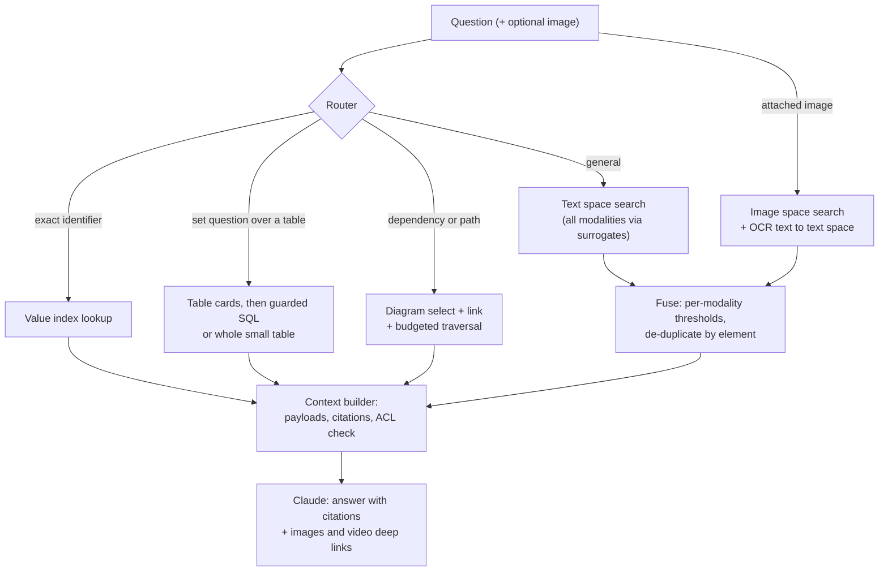

This assessment covers all nine lessons of *Multimodal RAG*: image retrieval, visual embeddings, image-text matching, audio RAG, video RAG, table retrieval, diagram retrieval, multimodal vector databases and cross-modal search. The multiple-choice section has 18 questions; the pass mark is 14 correct (about 75%). The conceptual questions, coding exercises, design challenge and troubleshooting scenarios are not scored automatically: attempt each before opening its solution, and treat any you could not answer as a pointer back to the relevant lesson. Token counts, sizes and timings that appear are assumptions for arithmetic practice, not quotes from any provider.

```quiz
[
  {"q": "Two runbook screenshots show the same VPN dialog with different error codes, E-4021 and E-4012. A user uploads a photo of the E-4021 dialog. Why does a CLIP-style visual index alone struggle to pick the right screenshot?", "options": ["CLIP cannot embed screenshots", "Screenshots must be converted to PDF first", "General-purpose image encoders read small printed text poorly, so the two screenshots get almost the same vector", "Visual indexes only support exact pixel matches"], "answer": 2, "why": "The screenshots differ only in their text; reading that text with OCR and sending identifiers to a keyword index is what separates them."},
  {"q": "A 4,000-pixel office floor plan is embedded with an encoder that sees 224 by 224 pixels. Questions about one room's label fail. What is the usual remedy?", "options": ["Embed overlapping tiles, each storing the parent image's identifier", "Increase the embedding dimension", "Convert the image to greyscale", "Use a larger top-k"], "answer": 0, "why": "Downscaling to the encoder's input size erases fine detail; tiles keep it, and a tile match retrieves the parent image."},
  {"q": "What does the symmetric contrastive loss used to train CLIP-style models directly optimise?", "options": ["That each image's cosine with its own caption is close to 1", "That image and text vectors have the same mean", "That every caption is classified into a fixed label set", "That each image is more similar to its own caption than to the other captions in the batch, and vice versa"], "answer": 3, "why": "The objective is relative within the batch, which is one reason absolute image-text cosines stay low and the modality gap can persist."},
  {"q": "What does this print?\n```python\nk = 60\nprint(round(1/(k+1) + 1/(k+3), 4))\n```", "options": ["0.0328", "0.0323", "0.0317", "0.0645"], "answer": 1, "why": "1/61 + 1/63 = 0.016393 + 0.015873 = 0.032266, which rounds to 0.0323: the reciprocal rank fusion score of an item ranked 1st in one list and 3rd in another."},
  {"q": "An audio RAG system indexes all-hands recordings. Which stored unit best supports answering 'what did the CTO say about the migration?' with a link the user can play?", "options": ["One vector for the whole recording", "The raw audio waveform in the payload", "Transcript segments with speaker labels and start and end timestamps, linking to the recording at that time", "A summary of each recording only"], "answer": 2, "why": "Speaker-labelled, time-stamped segments are retrievable, citable and can deep-link to the exact moment."},
  {"q": "In video RAG, why are transcript segments and keyframe descriptions aligned by timestamp?", "options": ["To reduce storage", "Because embeddings require timestamps", "To avoid using a vision model", "So that what was said and what was shown at the same moment can be retrieved and cited together"], "answer": 3, "why": "Time is the shared key between the audio and visual tracks; aligning on it lets one result carry both kinds of evidence and a deep link."},
  {"q": "'How many Meridian Sync error codes are there?' has 3 matching rows; row retrieval returns k = 2. What is the best possible outcome?", "options": ["A wrong count, because at most 2 of the 3 rows can be present", "A correct answer if the two rows are the right ones", "A correct answer if a reranker is added", "A correct answer if the rows are self-contained"], "answer": 0, "why": "With k smaller than the number of matching rows, completeness is impossible; set questions need SQL or the whole table."},
  {"q": "Tables are ranked by the score of their best-matching row. Why does this favour large tables?", "options": ["Large tables have longer descriptions", "The expected maximum of many unrelated scores rises with the number of rows", "Large tables are indexed first", "Cosine similarity is larger for longer texts"], "answer": 1, "why": "More rows give more chances for a high score by chance, roughly growing with the square root of 2 ln n; one card per table avoids the bias."},
  {"q": "A model generates SQL to answer table questions. Which control reliably prevents it from modifying data?", "options": ["A system prompt that forbids writes", "A regular expression requiring the query to start with SELECT", "Asking the model to double-check its SQL", "A read-only database role or authoriser that allows reads only on allow-listed tables"], "answer": 3, "why": "Only permissions enforced by the database cannot be talked around; prompts and string checks are at best a first filter."},
  {"q": "With a sentence embedding model, 'The retriever queries the Qdrant cluster' and 'The Qdrant cluster queries the retriever' had a cosine of 0.989. What should a diagram retriever do?", "options": ["Use edge statements in the passive voice", "Increase top-k", "Parse the question's direction and apply it when traversing the stored graph", "Store only undirected edges"], "answer": 2, "why": "Embeddings barely encode argument order, so direction has to be handled explicitly, outside the embedding."},
  {"q": "What does this print?\n```python\nimport networkx as nx\ng = nx.DiGraph([(\"A\", \"B\"), (\"B\", \"C\"), (\"D\", \"C\")])\nprint(sorted(nx.ancestors(g, \"C\")))\n```", "options": ["['A', 'B', 'D']", "['B', 'D']", "[]", "['A', 'B', 'C', 'D']"], "answer": 0, "why": "Ancestors are all nodes with a directed path to C: B and D directly, and A through B. C itself is not included."},
  {"q": "In a diagram, the ingestion worker has an arrow to the employee handbook labelled 'reads'. A user asks how handbook content reaches the vector database. What is the risk?", "options": ["None; arrows always show data flow", "The generator may describe the flow backwards unless told that arrows mean 'calls or reads', since content flows against this arrow", "The path cannot be computed", "The handbook node cannot be linked"], "answer": 1, "why": "Call direction and data flow can be opposite; the arrow convention must be stated in the prompt."},
  {"q": "In a Qdrant collection with named vectors `text` and `image`, how should a plain text chunk be stored?", "options": ["With a zero vector in `image`", "With a random unit vector in `image`", "With only the `text` vector; the `image` vector is omitted", "In a separate collection"], "answer": 2, "why": "Named vectors are optional per point in Qdrant; omitting the vector keeps the chunk out of image searches and saves memory."},
  {"q": "Using bytes ≈ N(d·b + 2M·4), roughly how much memory do 1,000,000 float32 vectors of 384 dimensions need with M = 16?", "options": ["About 1.7 GB", "About 0.17 GB", "About 17 GB", "About 170 MB per dimension"], "answer": 0, "why": "1,000,000 × (1,536 + 128) bytes is about 1.66 × 10^9 bytes, roughly 1.7 GB."},
  {"q": "Where should a multimodal RAG system keep the original image files?", "options": ["Base64-encoded in the vector payload", "Inside the HNSW graph", "Only in the user's browser cache", "In object storage, referenced by URI in the payload and served by short-lived signed URLs after permission checks"], "answer": 3, "why": "Large binaries in the payload inflate memory and responses; object storage plus signed URLs keeps them out of the index and under access control."},
  {"q": "A team puts CLIP text vectors of handbook chunks and CLIP image vectors of photos in one shared space and ranks by raw cosine. What do they most likely observe?", "options": ["Photos dominate every result list", "Text chunks outrank photos, even the photo that answers the question", "Scores are identical for text and images", "The search returns nothing"], "answer": 1, "why": "The modality gap places text and images in different regions; text-text cosines are systematically higher than text-image cosines."},
  {"q": "Per-modality rank fusion is used for a query for which no image is relevant. What happens?", "options": ["The best image is still promoted near the top, because rank fusion ignores absolute scores", "No image appears", "The fusion raises an error", "All images are ranked last"], "answer": 0, "why": "Rank fusion acts like a quota; a per-modality threshold on raw or calibrated scores is needed to let a modality contribute nothing."},
  {"q": "A user uploads a photo of a docking station and types 'how do I connect this to my laptop?'. Which design fits best?", "options": ["Embed only the typed text and search the text space", "Average the image and text vectors into one query vector", "Send the photo to the image space and the text (plus any text read from the photo) to the text space, then fuse with per-modality thresholds and de-duplicate by element", "Search the image space with the typed text using the text model"], "answer": 2, "why": "Each signal goes to the space that can use it; fusion with thresholds combines the visual match with the instructions, and de-duplication avoids returning one element twice."}
]
```

## Conceptual questions

**1.** Explain the difference between *bridging through text* and *a shared embedding space* for cross-modal search. Give one kind of content for which each is the better choice, and say why most document-centred systems lead with bridging.

<details><summary>Show model answer</summary>

Bridging converts every non-text item into text (captions, descriptions, OCR text, transcripts, edge statements, table rows) and searches all of it with one text model. A shared space embeds images (or audio) and text with one multimodal model so that a text query can be compared directly with image vectors.

Bridging is better for content whose meaning is in words or structure: screenshots of error dialogs (the code is text), tables, diagrams, recordings of talks. A shared space is better for content whose meaning is visual and hard to describe exhaustively: photos of equipment or places, product images, visually distinctive slides.

Document systems usually lead with bridging because it gives one score scale (no modality gap to correct), keyword search over identifiers, readable and auditable representations, and a strong dedicated text model. A shared-space image retriever is then added as a second path for images that descriptions capture poorly.

</details>

**2.** Why can top-k retrieval never be trusted to answer "which" and "how many" questions over a table, however good the embedding model is? What are the two reliable alternatives, and when would you choose each?

<details><summary>Show model answer</summary>

Top-k returns the k most similar rows, not all matching rows. The number of matching rows m is unknown at query time, and when m exceeds k the answer is incomplete; even when m ≤ k, any matching row ranked below k is lost, and nothing in the pipeline detects it. Completeness is Recall@k, which similarity cannot guarantee.

The alternatives: send the **whole table** to the generator when it is small enough that its tokens are cheap (tens of rows), so the model sees every row; or answer with **SQL** over the structured copy when the table is large, with the query generated from the selected tables' schemas and executed read-only with allow-lists and limits. Choose by table size and by how sensitive the data is (personal data argues for fixed, parameterised queries instead of free-form SQL).

</details>

**3.** A colleague proposes storing each figure as two points, one holding its text-surrogate vector and one holding its image vector, both with the same payload. Argue for one point with named vectors instead, and name one situation where a separate collection is still right.

<details><summary>Show model answer</summary>

With two points per figure, the payload (permissions, document ID, asset URI, dates) exists twice and can drift: an ACL update or a deletion applied to one point and not the other leaks or resurrects content. Search can also return the same figure twice. With one point and two named vectors there is one ID, one payload and one permission model; filters apply identically whichever space is searched; deletion by `doc_id` is one operation; and server-side fusion can combine both spaces in one request.

A separate collection is still right for representations with a different lifecycle, such as a time-limited trial of a new image model or an experimental page-image retriever that may be abandoned, or where a space's size and hardware needs differ enough to warrant independent sizing.

</details>

**4.** Why do audio and video RAG systems store timestamps with every retrievable segment? Give two distinct uses at answer time.

<details><summary>Show model answer</summary>

A recording is long and linear; a segment without a location is a quotation nobody can check. Timestamps make each segment addressable. Uses: **citation and deep links**, so the answer can say "at 14:32" and open the player at that moment for the user to verify; **alignment across tracks**, so the transcript segment and the keyframe or slide shown at the same time can be retrieved together and the answer can describe what was said and shown; and also context expansion, fetching the neighbouring segments by time when one segment is too short to stand alone.

</details>

**5.** When should a retrieved image be sent to a vision-capable generator as pixels, rather than represented by its text surrogate? Give the main trade-off.

<details><summary>Show model answer</summary>

Send pixels when the answer depends on visual detail the surrogate may not have captured: reading a specific value from a screenshot or chart, describing where something is in a photo, or answering from a diagram whose graph could not be extracted reliably. Use the surrogate when the question is about what the image is or contains at the level the description already states, or when the image is one of many retrieved results.

The trade-off is accuracy against cost and latency: each image costs many input tokens (the exact cost depends on image size and the provider), so a common compromise sends surrogates for all retrieved images and pixels only for the top one or two. Images are also untrusted content and may carry injected instructions as rendered text.

</details>

## Coding exercises

### 1. Per-modality z-score fusion with thresholds

Write `fuse(results, thresholds, k)` where `results` is a list of `(element_id, modality, raw_score)` from several spaces. It must: compute z-scores per modality; drop items whose raw score is below their modality's threshold; de-duplicate by element ID, keeping the best z-score; and return the top k. Test it on a list where the same figure is found both through its text surrogate and through its image vector.

<details><summary>Show solution</summary>

```python
import numpy as np

def fuse(results, thresholds, k=5):
    """results: list of (element_id, modality, raw_score). Returns top-k by per-modality z-score,
    after dropping items below their modality's raw threshold and de-duplicating by element."""
    by_mod = {}
    for eid, mod, s in results:
        by_mod.setdefault(mod, []).append((eid, s))
    fused = {}
    for mod, items in by_mod.items():
        scores = np.array([s for _, s in items])
        mu, sd = scores.mean(), scores.std() or 1.0
        for eid, s in items:
            if s < thresholds[mod]:
                continue
            z = (s - mu) / sd
            if eid not in fused or z > fused[eid][1]:
                fused[eid] = (mod, round(float(z), 2))
    return sorted(fused.items(), key=lambda x: -x[1][1])[:k]

results = [
    ("txt-e4021", "text", 0.82), ("txt-e4012", "text", 0.71), ("txt-leave", "text", 0.55),
    ("txt-expenses", "text", 0.52), ("txt-remote", "text", 0.50),
    ("fig-vpn-dialog", "image", 0.31), ("fig-dock", "image", 0.19), ("fig-floorplan", "image", 0.17),
    ("fig-chart", "image", 0.18), ("fig-vpn-dialog", "text", 0.66),   # same figure, found via its surrogate
]
for item in fuse(results, thresholds={"text": 0.45, "image": 0.25}):
    print(item)
```

```output
('fig-vpn-dialog', ('image', 1.72))
('txt-e4021', ('text', 1.69))
('txt-e4012', ('text', 0.73))
('txt-leave', ('text', -0.67))
('txt-expenses', ('text', -0.93))
```

The VPN dialog, found in both spaces, appears once, with its better z-score (from the image space, where it stands far above the other images). The other images fall below the image threshold of 0.25 and contribute nothing, which is the point of per-modality thresholds. The statistics are computed over all candidates of a modality, including those later dropped, so that the threshold does not change the scale. In production, `k` would be smaller or a minimum z would also apply, since the last two text items are below their modality's average.

</details>

### 2. Budgeted dependents traversal

Write `dependents(g, node, max_nodes)` returning the ancestors of `node` in a directed diagram graph, nearest first (breadth-first by hop), stopping once `max_nodes` have been collected. Make the order deterministic.

<details><summary>Show solution</summary>

```python
import networkx as nx

g = nx.DiGraph([("Chat UI", "Chat API"), ("Chat API", "Retriever"), ("Retriever", "Qdrant cluster"),
                ("Ingestion worker", "Qdrant cluster"), ("Scheduler", "Ingestion worker"),
                ("Admin console", "Chat API"), ("Retriever", "Embedding service")])

def dependents(g, node, max_nodes):
    """Ancestors of node in breadth-first order (nearest first), at most max_nodes of them."""
    seen, frontier, out = {node}, [node], []
    while frontier and len(out) < max_nodes:
        nxt = []
        for n in frontier:
            for p in sorted(g.predecessors(n)):
                if p not in seen and len(out) < max_nodes:
                    seen.add(p); out.append(p); nxt.append(p)
        frontier = nxt
    return out

print(dependents(g, "Qdrant cluster", max_nodes=10))
print(dependents(g, "Qdrant cluster", max_nodes=3))
```

```output
['Ingestion worker', 'Retriever', 'Scheduler', 'Chat API', 'Admin console', 'Chat UI']
['Ingestion worker', 'Retriever', 'Scheduler']
```

Breadth-first order puts direct dependents first, so a budget cuts the most distant (and usually least important) nodes. `sorted` makes ties deterministic, which matters for caching and testing. `nx.ancestors` would return the same set without the budget or the ordering. The Embedding service is correctly absent: the retriever depends on it, not the other way round.

</details>

### 3. Exact-value lookup before ranking

Build a value index over table rows keyed by each table's key column, and write `exact_lookup(query)` that finds error codes (pattern `E-` plus four digits, any case) and known key words in a question and returns the matching rows, or signals a fallback when there is no hit.

<details><summary>Show solution</summary>

```python
import re

rows = [
    {"table": "error_codes", "code": "E-4012", "meaning": "VPN certificate expired"},
    {"table": "error_codes", "code": "E-4021", "meaning": "VPN client is out of date; update it from the IT portal"},
    {"table": "error_codes", "code": "E-4150", "meaning": "Sync token revoked; sign in again"},
    {"table": "reports_plans", "plan": "Enterprise", "saml_sso": "Yes"},
]
KEY_COLUMNS = {"error_codes": "code", "reports_plans": "plan"}

value_index = {}
for r in rows:
    key = r[KEY_COLUMNS[r["table"]]]
    value_index.setdefault(key.casefold(), []).append(r)

def exact_lookup(query):
    hits = []
    for code in re.findall(r"\bE-\d{4}\b", query, flags=re.IGNORECASE):
        hits += value_index.get(code.casefold(), [])
    for word in re.findall(r"[A-Za-z]+", query):
        hits += value_index.get(word.casefold(), [])
    return hits

for q in ["What does e-4021 mean?", "Does Enterprise include SAML?", "What does E-4999 mean?"]:
    print(q, "->", exact_lookup(q) or "no exact hit: fall back to hybrid retrieval")
```

```output
What does e-4021 mean? -> [{'table': 'error_codes', 'code': 'E-4021', 'meaning': 'VPN client is out of date; update it from the IT portal'}]
Does Enterprise include SAML? -> [{'table': 'reports_plans', 'plan': 'Enterprise', 'saml_sso': 'Yes'}]
What does E-4999 mean? -> no exact hit: fall back to hybrid retrieval
```

`casefold` makes the lookup case-insensitive, so "e-4021" finds "E-4021". An unknown code returns nothing rather than a near neighbour, which is exactly the behaviour you want from an identifier lookup: the fallback can then say the code is not documented instead of answering with E-4021's meaning. Single words match key values such as plan names; multi-word keys would need n-gram matching.

</details>

## Architecture design challenge

Meridian wants AskMeridian to answer from four new kinds of content alongside the handbook and runbooks: screenshots embedded in the IT runbooks (about 3,000), error-code and plan tables (about 200 tables, the largest with 2,000 rows), architecture and process diagrams (about 300, most authored in Mermaid or draw.io), and recorded IT training videos (about 150 hours). Users type questions, and can attach a photo or screenshot. Answers must cite their source, show images and video links where relevant, respect existing permissions (some HR material is restricted), and keep the current median response time of around 3 seconds. The system runs on the existing Qdrant cluster.

Design the indexing and query paths. State what goes into which store, how a question is routed, how results from different modalities are combined, and the main trade-offs.

<details><summary>Show reference design</summary>

**Stores.**

- One Qdrant collection, `meridian_elements`, one point per element, with named vectors `text` (the existing text model, for every element through text surrogates: chunks, screenshot descriptions with OCR text, table row records, table cards, diagram summaries and neighbourhood records, transcript segments, keyframe descriptions) and `image` (a CLIP-style image vector, only for screenshots and keyframes). Payload: `modality`, `doc_id`, `acl`, `asset_uri`, `t_start`/`t_end` for video, `table_id` or `diagram_id`, model versions. Payload indexes on `modality`, `acl`, `doc_id`.
- Object storage for screenshots, keyframes and video, referenced by URI, served by signed URLs.
- A read-only SQLite or PostgreSQL copy of all tables, rebuilt at each ingestion.
- Diagram graphs as JSON keyed by `diagram_id`, loaded into memory by the retrieval service.

**Query path.**



Every Qdrant query, and the SQL and diagram paths, filter by the user's ACL groups. Video results resolve to transcript excerpts with a deep link at `t_start`; screenshots resolve to surrogate text plus a thumbnail, with pixels sent to the model only for the top image when the question needs visual detail.

**Trade-offs.**

- **Bridging as the backbone.** All content is searchable in one text space with one score scale, so most questions need no cross-modal calibration. Cost: describing 3,000 screenshots and keyframes at ingestion, and descriptions miss what they do not mention. The image space covers query-by-example, where it is strong, rather than text-to-image across a modality gap.
- **Routing adds rules to maintain**, but set questions and dependency questions are answered correctly instead of plausibly. Unclassified questions take the general path, so routing failures degrade to ordinary retrieval, not to errors.
- **Latency.** The general path is one embedding plus one or two prefetches and the generation call. The SQL path adds a model call (about one second, assumed); the diagram path adds negligible traversal time. Sending image pixels adds input tokens, so it is limited to one image.
- **Memory.** The text space grows with segments and records; transcripts of 150 hours at, say, one segment per 30 seconds add about 18,000 points, small next to the existing chunks. The image space holds a few tens of thousands of vectors at most.
- **Consistency.** One point per element and deletion by `doc_id`, followed by object deletion, keeps the index and storage aligned; a nightly job sweeps orphaned objects.

</details>

## Troubleshooting scenarios

### 1. Photos stopped appearing after a "simplification"

To reduce the number of models, the team replaced the text model with a CLIP model's text encoder and put CLIP text vectors of all chunks and CLIP image vectors of all photos in one vector field. Since then, photos almost never appear in results, and text answers have become slightly worse. What is happening, and what would you do?

<details><summary>Show diagnosis and fix</summary>

**Diagnosis.** Two effects. The modality gap: text-text cosines in CLIP's space are systematically higher than text-image cosines, so in one mixed ranking every text chunk outranks every photo, even the right one. And CLIP's text encoder is generally weaker for text-to-text retrieval than a dedicated text model, which explains the slight decline in text answers. Confirm by measuring average text-text and text-image cosines on a sample, and checking where the correct photo ranks for a few labelled questions.

**Fix.** Restore the dedicated text model for chunks and surrogates in a `text` named vector. Keep photos in a separate `image` named vector, searched with CLIP's text encoder for photo-seeking questions. Combine the two with per-modality normalisation (z-scores or mean-centred vectors) and per-modality thresholds, or route explicit photo requests to the image space. Add short captions for photos to the text space so most photo questions are answered by bridging.

</details>

### 2. "How many" answers are confidently wrong

Users report that AskMeridian answers "how many error codes does Meridian Relay have?" with 2, and "list the plans that include PDF export" with two of the three plans. Retrieval logs show relevant rows in every result list. What is wrong?

<details><summary>Show diagnosis and fix</summary>

**Diagnosis.** These are set questions answered from top-k rows. The retrieved rows are relevant (so the logs look healthy), but some matching rows ranked below k or were displaced by prose chunks, and the generator counted what it saw. Nothing flags the missing rows. Confirm by running the equivalent SQL against the source table and comparing.

**Fix.** Add a router that recognises set questions (count, list, which, cheapest, most) by rules with a model fallback. For such questions, select the table through table cards; if it is small, send the whole table; otherwise generate one SQL `SELECT` from the selected table's schema, run it under a read-only role or authoriser with an allow-list, row limit and timeout, and give the generator the result and the SQL. Log the route and SQL for every answer and evaluate routing accuracy on a labelled set of questions.

</details>

### 3. Outage answers miss the user impact and reverse arrows

During an incident, "what is affected if the Qdrant cluster is down?" returned only the retriever and the ingestion worker, not the chat interface. "What does the embedding service depend on?" returned "the retriever", which actually calls the embedding service. Diagram records are indexed as edge statements and neighbourhood records.

<details><summary>Show diagnosis and fix</summary>

**Diagnosis.** Both are retrieval failures on relationship questions. The first is multi-hop: similarity search returns edges that mention Qdrant, while the chat API and chat UI depend on it only through the retriever, and their edges score low. The second is direction: sentence embeddings barely distinguish "A calls B" from "B calls A", so an edge pointing the wrong way was retrieved and read as an answer.

**Fix.** Add a diagram path: select the diagram by summary similarity plus entity coverage, link "Qdrant cluster" and "embedding service" to nodes (with an alias table), classify the question's direction (dependents, downstream, path), and traverse the stored graph with a node budget: ancestors for "what is affected", descendants for "what does X depend on" (since edges point from caller to callee). Give the generator the subgraph as edge statements with the arrow convention stated, and show the diagram with the traversed nodes highlighted and its last-modified date.

</details>
