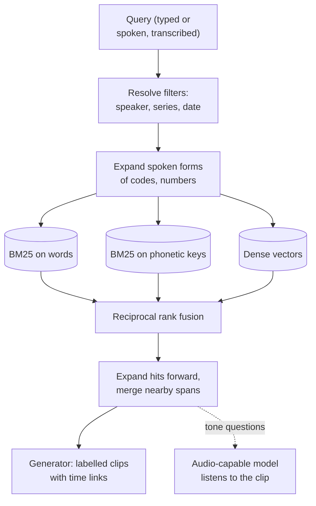

[Audio transcripts](/learn/multimodal-ingestion/audio-transcripts) turned recordings into timed, speaker-labelled text chunks, corrected the vocabulary it could anticipate, and kept timestamps so answers can link to the moment something was said. This lesson starts where that one stopped: a user asks a question, and the answer is somewhere in hours of meetings, onboarding sessions and all-hands recordings. **Audio RAG** is retrieval and generation over that material. Its central difficulty is that the index was written by a speech recogniser, which makes errors no human writer would make, and the query was written (or spoken) by a person who uses the correct words.

You will learn the three ways to make audio retrievable (transcribe and search text, embed audio directly, or have a model listen), how to retrieve robustly from imperfect transcripts with phonetic matching and spoken-form query expansion, how to turn hit segments into playable clips that contain the whole answer, and when audio-native models are worth their cost.

## Learning objectives

- Compare transcript-based retrieval, audio embeddings and audio-capable models, and choose among them for a given question type.
- Explain why exact and dense matching both miss terms that the recogniser misheard, and repair the misses with a phonetic index and spoken-form query expansion.
- Compute how the number of mentions of a term affects the chance that a recording can be found by that term.
- Build clips from retrieved segments by expanding to neighbouring speech and merging nearby hits, and cite them with time links.
- Design the handling of spoken queries, speaker filters and answer citations for an audio RAG assistant.

## Prerequisites

- [Audio transcripts](/learn/multimodal-ingestion/audio-transcripts): speech recognition output, glossary correction, chunking by time and turn, and deep links.
- [Reciprocal rank fusion](/learn/hybrid-search/reciprocal-rank-fusion) and [BM25](/learn/sparse-retrieval/bm25): fusing lexical and dense rankings.
- [Query expansion](/learn/hybrid-search/query-expansion): adding terms to a query to improve recall.
- [Image-text matching](/learn/multimodal-rag/image-text-matching): contrastive dual encoders, which audio-text models reuse.

## Why this matters

Meridian records its monthly all-hands, its IT onboarding sessions and many team meetings. Staff ask AskMeridian things like "why did Meridian Relay go down last month?" or "what did IT say about error E-4021 in onboarding?". The answers exist only as speech.

A transcript index answers most such questions, but it fails in ways that text indexes do not, and the failures concentrate on the most valuable words.

- **The key term was misheard.** Speech recognisers are weakest on rare words: product names, people's names, acronyms and codes, precisely the terms people search for. "Meridian Relay" becomes "meridian really", "Meridian Sync" becomes "meridian sink". The ingestion glossary fixes the errors someone noticed; new ones keep appearing.
- **The query and the transcript write the same thing differently.** A user types "E-4021"; the speaker said "e forty twenty one", and the recogniser wrote exactly that. No tokeniser connects them.
- **The hit is not the answer.** Speech is linear. Someone says "quick update on Relay", and the explanation comes in the next twenty seconds. The segment that matches the query is often the introduction to the answer, not the answer.
- **Some questions are not about words.** "Was anyone unhappy about the change?" or "find the recording where the fire alarm went off" depend on tone or on sounds that no transcript contains.

## The intuition

Imagine searching meeting minutes taken by a fast typist who does not know your company. She writes what she hears: "Relay" becomes "really", and error codes become spoken words. Searching her notes for "Relay" finds nothing, yet read aloud, her notes sound right. So you search the way they *sound*: you say "Relay" to yourself, notice it sounds like "really", and look for that. And you remember that when people read codes, they say "forty twenty one", so you search for that too.

Then, when you find the line "quick update on Relay", you do not stop reading. You read on until the speaker finishes the topic, because the update itself comes after the announcement.

## How it works

### Three ways to make audio retrievable

| Approach | What is indexed | Answers questions about | Maturity |
| --- | --- | --- | --- |
| Transcribe, then retrieve text | Transcript segments with times and speakers | What was said, by whom, when | Established; the default |
| Audio embeddings | Vectors computed from the audio itself | Sounds, music, acoustic events; sometimes speech | Established for sound search; emerging for speech |
| Audio-capable models at answer time | Nothing new; retrieved clips are played to the model | How it was said: tone, hesitation, emphasis | Emerging; varies by provider |

**Transcription first** turns the problem into text retrieval, which everything else in this course already handles: chunking, hybrid search, reranking, citations. It discards everything except the words, and inherits the recogniser's errors. For spoken content, it is the established default.

**Audio embeddings** apply the dual-encoder idea from [Image-text matching](/learn/multimodal-rag/image-text-matching) to sound. **CLAP** (Contrastive Language-Audio Pretraining; Elizalde and colleagues at Microsoft, and separately Wu and colleagues at LAION, both 2023) trains an audio encoder and a text encoder so that a clip and its description land close together. A text query such as "fire alarm" or "applause" can then find moments in recordings, which no transcript would. These models describe sounds, not the content of speech, so they complement transcripts rather than replace them. Research systems that embed *speech* directly into a text-compatible space, skipping transcription, exist; for searching what was said in business recordings, they are not yet a standard replacement for a good recogniser, and you should evaluate any such model on your own recordings before relying on it.

**Audio-capable models** accept audio as input alongside text. In a RAG pipeline they belong at the end: retrieval finds the right two minutes using the transcript, and the model listens to those two minutes to answer a question about tone or emphasis. Listening to whole recordings per query is far too slow and expensive. Which models accept audio, in what formats and at what cost, changes often; check your provider's documentation.

### Retrieval over imperfect transcripts

Transcript retrieval runs a [hybrid search](/learn/hybrid-search/hybrid-retrieval-architecture) like any text corpus, with two additions aimed at recognition errors.

**A phonetic index.** A **phonetic key** maps a word to a code describing how it sounds, so that words that sound alike get the same code. **Soundex**, patented by Russell in 1918 and long used for surname matching in census records, is the simplest: keep the first letter, then encode the following consonant sounds as digits (b, f, p, v are 1; c, g, j, k, q, s, x, z are 2; and so on), drop vowels, collapse repeats, and pad to four characters. "Relay" and "really" both become R400; "sync" and "sink" both become S520. Index every transcript word by its code in a second BM25 index, encode query words the same way, and misheard names match their correct spelling. More refined algorithms such as Metaphone and Double Metaphone model English pronunciation better; the principle is the same.

Phonetic matching trades precision for recall. Soundex has at most $26 \times 7^3 = 8{,}918$ codes for the whole language, so unrelated words collide and the list is noisy. It belongs inside fusion, never on its own.

**Spoken-form query expansion.** Identifiers are written one way and spoken another. Before searching, rewrite each code in the query into the ways people say it: "E-4021" becomes "e four zero two one" and "e forty twenty one". Dates, versions and amounts have the same problem ("version three point two", "seventy-five pounds"). Expansion is the query-side counterpart of the ingestion glossary: the glossary fixes known errors in the transcript; expansion anticipates the regular way speech writes things down.

**Dense retrieval** helps with paraphrase ("go down" against "outage") but not with misheard names: an embedding model has no reason to place "meridian really" near "Meridian Relay". Fusing the three lists gives each a vote.

### From segments to answers: clip expansion

Retrieval returns segments; the user and the generator need **clips**, spans long enough to contain the answer. Three steps produce them:

1. **Expand forward.** Speakers announce a topic and then develop it, so add the following segment (or a fixed number of seconds) from the same recording to each hit. Questions in Q&A sessions need the opposite: the segment with the question should pull in the answer that follows it, which forward expansion also does.
2. **Merge.** Sort the expanded spans by recording and start time, and merge spans that overlap or lie within a small gap of each other. Two hits ten seconds apart are one passage, not two citations.
3. **Cap.** Limit each clip's length so that one long merged span cannot fill the context window, splitting it if needed.

Each clip carries its recording identifier, start and end times, speakers, and a deep link such as `all-hands.mp4#t=0,41` (the W3C Media Fragments syntax `#t=start,end`, introduced in [Audio transcripts](/learn/multimodal-ingestion/audio-transcripts)).

### Spoken queries, speakers and dates

- **Spoken queries.** A voice question is transcribed before retrieval, and short utterances with no context are hard for a recogniser: the key term is exactly what it is likely to get wrong. Echo the recognised query back ("Searching for: Meridian really outage") so the user can correct it, and apply the same phonetic and expansion steps to it.
- **Speaker filters.** "What did Dana say about Relay?" needs a filter on the speaker field. Diarisation (labelling who spoke when) produces anonymous labels such as SPEAKER_01 unless they are mapped to names, which usually needs a calendar invite, a meeting tool's metadata or a manual step. Without names, the filter cannot be applied; say so rather than guessing.
- **Dates and series.** "Last month's all-hands" is a metadata filter on recording date and series, resolved before retrieval, as in [self-query retrieval](/learn/advanced-retrieval/self-query-retrieval).

### Generating from transcripts

Transcripts contain false starts, filler and recognition errors, and spoken statements are often provisional ("I think we'll probably move to quarterly"). Label each clip with recording, date, speakers and "automatic transcript"; ask the generator to attribute ("in the June all-hands, Dana said...") and to treat a spoken remark as weaker evidence than written policy when both are retrieved.



## The mathematics

### How often must a term be said to be findable?

**Intuition.** If the recogniser gets a rare name wrong some fraction of the time, a recording that mentions the name once is findable by that name only when that one mention was recognised. A recording that mentions it several times needs only one correct mention. Rarely mentioned terms are therefore the most at risk, which is the case that phonetic matching exists for.

Assume each mention is misrecognised independently with probability $p$, and the term is mentioned $n$ times in a recording. The probability that at least one mention is transcribed correctly is

$$
P(\text{findable}) = 1 - p^{n}
$$

$p$ is the per-mention error rate for that term (not the overall word error rate, which is dominated by common words and is much lower), and $n$ the number of mentions. Independence is a simplification: a speaker with a strong accent or a poor microphone makes errors correlated, so real figures are worse than this formula suggests.

**By hand.** Assume $p = 0.3$ for "Meridian Relay" (an illustrative figure, not a measurement).

- Mentioned once: $1 - 0.3 = 0.7$. Three recordings in ten that mention Relay once are invisible to a search for "Relay".
- Mentioned three times: $1 - 0.3^3 = 1 - 0.027 = 0.973$.

Note what this does *not* fix: the recording becomes findable, but each individual *segment* is still findable only with probability $1 - p = 0.7$. If the segment that explains the outage is the one with the misheard mention, the search lands on a different part of the recording. Segment-level retrieval needs the phonetic and expansion techniques regardless of how often the term is said.

```python
p = 0.3                                   # assumed chance one mention of a rare name is misrecognised
for n in (1, 2, 3, 5):
    print(f"mentions={n}: P(at least one correct) = {1 - p ** n:.3f}")
print(f"Soundex code space: {26 * 7 ** 3:,} codes")
```

```output
mentions=1: P(at least one correct) = 0.700
mentions=2: P(at least one correct) = 0.910
mentions=3: P(at least one correct) = 0.973
mentions=5: P(at least one correct) = 0.998
Soundex code space: 8,918 codes
```

## In code

### Hybrid retrieval over an imperfect transcript

**The problem.** Search two Meridian recordings whose automatic transcripts contain typical errors (a code written as spoken words, two product names misheard), compare three retrievers, fuse them, and return playable clips.

**Dependencies.** rank-bm25 for the lexical indexes and Sentence Transformers with `all-MiniLM-L6-v2` for the dense one.

```bash
pip install rank-bm25 sentence-transformers numpy
```

```python
import re
import numpy as np
from rank_bm25 import BM25Okapi
from sentence_transformers import SentenceTransformer

# ASR output: (recording, start s, end s, speaker, text). Note the recognition errors.
SEGMENTS = [
    ("it-onboarding", 0, 14, "Tom", "welcome everyone this session covers laptops the vpn and passwords"),
    ("it-onboarding", 14, 31, "Tom", "you get a new laptop every three years and if you lose one tell the support desk straight away"),
    ("it-onboarding", 31, 47, "Priya", "what happens if the vpn says e forty twenty one when i connect from a cafe"),
    ("it-onboarding", 47, 63, "Tom", "that means the client is out of date just update it from the it portal and connect again"),
    ("it-onboarding", 63, 80, "Tom", "and remember the vpn is required on public wifi and passwords rotate every ninety days"),
    ("it-onboarding", 80, 95, "Priya", "can i ring the support desk at half past seven in the morning"),
    ("it-onboarding", 95, 110, "Tom", "not quite it opens at eight and closes at six uk time"),
    ("all-hands", 0, 20, "Dana", "quick update from the platform team on meridian really"),
    ("all-hands", 20, 41, "Dana", "last tuesday the outage was caused by an expired certificate on the gateway"),
    ("all-hands", 41, 60, "Dana", "we have added monitoring so certificates are renewed thirty days before they expire"),
    ("all-hands", 60, 80, "Sam", "a question from the chat will meridian sink get the same monitoring"),
    ("all-hands", 80, 96, "Dana", "yes sink and reports are next on the list"),
]
texts = [s[4] for s in SEGMENTS]

def words(text):
    return re.findall(r"[a-z]-\d+|[a-z0-9]+", text.lower())   # keeps codes like e-4021 whole

def soundex(word):
    """Classic Soundex: first letter plus three digits for the following consonant sounds."""
    codes = {**dict.fromkeys("bfpv", "1"), **dict.fromkeys("cgjkqsxz", "2"), **dict.fromkeys("dt", "3"),
             "l": "4", **dict.fromkeys("mn", "5"), "r": "6"}
    if not word.isalpha():                      # leave numbers and codes unchanged
        return word
    out, prev = word[0].upper(), codes.get(word[0], "")
    for ch in word[1:]:
        code = codes.get(ch, "")
        if code and code != prev:
            out += code
        if ch not in "hw":
            prev = code
    return (out + "000")[:4]

UNITS = "zero one two three four five six seven eight nine".split()
TENS = "_ _ twenty thirty forty fifty sixty seventy eighty ninety".split()
TEENS = "ten eleven twelve thirteen fourteen fifteen sixteen seventeen eighteen nineteen".split()

def two_digits(n):
    if n < 10:
        return "oh " + UNITS[n]
    if n < 20:
        return TEENS[n - 10]
    return TENS[n // 10] + ("" if n % 10 == 0 else " " + UNITS[n % 10])

def spoken_forms(query):
    """Add ways a speaker might say codes like E-4021, so they can match an ASR transcript."""
    extra = []
    for letter, digits in re.findall(r"\b([A-Za-z])-?(\d{4})\b", query):
        extra.append(f"{letter} " + " ".join(UNITS[int(d)] for d in digits))               # e four zero two one
        extra.append(f"{letter} {two_digits(int(digits[:2]))} {two_digits(int(digits[2:]))}")  # e forty twenty one
    return " ".join([query] + extra)

bm25_words = BM25Okapi([words(t) for t in texts])
bm25_sound = BM25Okapi([[soundex(w) for w in words(t)] for t in texts])
model = SentenceTransformer("sentence-transformers/all-MiniLM-L6-v2")
dense = model.encode(texts, normalize_embeddings=True)

def ranking(scores, keep_zero=False):
    order = np.argsort(-np.asarray(scores), kind="stable")
    return [int(i) for i in order if keep_zero or scores[i] > 0]   # no shared terms, no rank

def retrieve(query, expand=True):
    q = spoken_forms(query) if expand else query
    lists = {
        "words": ranking(bm25_words.get_scores(words(q))),
        "sounds": ranking(bm25_sound.get_scores([soundex(w) for w in words(q)])),
        "dense": ranking(dense @ model.encode([q], normalize_embeddings=True)[0], keep_zero=True),
    }
    fused = {}
    for order in lists.values():
        for rank, i in enumerate(order, start=1):
            fused[i] = fused.get(i, 0.0) + 1 / (60 + rank)
    return lists, sorted(fused, key=lambda i: -fused[i])

def clips(hits, gap=10):
    """Turn top segments into playable clips: add the next segment, merge those close in time."""
    spans = []
    for i in hits:
        j = i + 1 if i + 1 < len(SEGMENTS) and SEGMENTS[i + 1][0] == SEGMENTS[i][0] else i
        spans.append((SEGMENTS[i][0], SEGMENTS[i][1], SEGMENTS[j][2]))   # speech runs on: keep what follows
    merged = []
    spans.sort()
    for rec, start, end in spans:
        if merged and merged[-1][0] == rec and start - merged[-1][2] <= gap:
            merged[-1][2] = max(merged[-1][2], end)
        else:
            merged.append([rec, start, end])
    return [f"{rec}#t={s},{e}" for rec, s, e in merged]

print("soundex:", {w: soundex(w) for w in ["relay", "really", "sync", "sink"]})
print("spoken forms:", spoken_forms("Error E-4021?"), "\n")

for query, expand in [("Error E-4021?", False), ("Error E-4021?", True),
                      ("Why did Meridian Relay go down?", True), ("Is monitoring planned for Meridian Sync?", True)]:
    lists, fused = retrieve(query, expand)
    rank_of = lambda order, i: order.index(i) + 1 if i in order else "-"
    print(f"{query}  (expanded={expand})")
    for i in fused[:3]:
        r = ", ".join(f"{name} {rank_of(order, i)}" for name, order in lists.items())
        print(f"   [{SEGMENTS[i][0]} {SEGMENTS[i][1]}-{SEGMENTS[i][2]}s] {texts[i][:52]:52s} ({r})")
    print("   clips:", clips(fused[:3]), "\n")
```

**The important lines.**

- `words` keeps a code such as `e-4021` as one token, so it can only match the code itself, never a stray "e" or "one".
- `soundex` is the classic algorithm in a dozen lines. `prev` tracks the last consonant code so repeats collapse; vowels reset it (so "Tymczak" codes both c and k), while h and w do not.
- `spoken_forms` appends digit-by-digit and paired readings of every letter-plus-four-digit code. `two_digits` handles "oh one" to "ninety-nine".
- `ranking` drops segments with a lexical score of zero. Without this, a query sharing no terms with the transcript still produces a "ranking" in index order, and those arbitrary ranks would earn fusion credit.
- `clips` extends each hit to the end of the next segment in the same recording, then merges spans within `gap` seconds.

**Output**, from a real run:

```output
soundex: {'relay': 'R400', 'really': 'R400', 'sync': 'S520', 'sink': 'S520'}
spoken forms: Error E-4021? E four zero two one E forty twenty one 

Error E-4021?  (expanded=False)
   [it-onboarding 47-63s] that means the client is out of date just update it  (words -, sounds -, dense 1)
   [all-hands 20-41s] last tuesday the outage was caused by an expired cer (words -, sounds -, dense 2)
   [it-onboarding 31-47s] what happens if the vpn says e forty twenty one when (words -, sounds -, dense 3)
   clips: ['all-hands#t=20,60', 'it-onboarding#t=31,80'] 

Error E-4021?  (expanded=True)
   [it-onboarding 31-47s] what happens if the vpn says e forty twenty one when (words 1, sounds 1, dense 1)
   [it-onboarding 14-31s] you get a new laptop every three years and if you lo (words 2, sounds 11, dense 7)
   [all-hands 60-80s] a question from the chat will meridian sink get the  (words -, sounds 2, dense 5)
   clips: ['all-hands#t=60,96', 'it-onboarding#t=14,63'] 

Why did Meridian Relay go down?  (expanded=True)
   [all-hands 0-20s] quick update from the platform team on meridian real (words 1, sounds 1, dense 2)
   [all-hands 60-80s] a question from the chat will meridian sink get the  (words 2, sounds 4, dense 1)
   [it-onboarding 47-63s] that means the client is out of date just update it  (words -, sounds 3, dense 6)
   clips: ['all-hands#t=0,41', 'all-hands#t=60,96', 'it-onboarding#t=47,80'] 

Is monitoring planned for Meridian Sync?  (expanded=True)
   [all-hands 60-80s] a question from the chat will meridian sink get the  (words 1, sounds 1, dense 1)
   [all-hands 0-20s] quick update from the platform team on meridian real (words 2, sounds 2, dense 2)
   [all-hands 41-60s] we have added monitoring so certificates are renewed (words 3, sounds 4, dense 3)
   clips: ['all-hands#t=0,96']
```

**What the output means.**

- **Without expansion, the code is invisible to lexical search.** Both BM25 lists are empty (`-`): no transcript token is `e-4021`. Only the dense retriever returns anything, and the segment that actually mentions the error comes third, behind the outage segment.
- **With expansion, all three retrievers agree.** "e forty twenty one" now matches word for word, and the segment ranks first in every list. Expansion also adds noise: the second result is there because it contains the word "one". Fusion keeps that noise below the real hit, but it is why expansion should be targeted at identifiers, not applied to every word.
- **Phonetic keys find the misheard product names.** For "Meridian Relay", the words list still finds the intro segment through "meridian", but the phonetic list puts it first for the right reason: R400 matches "really". For "Meridian Sync", only the phonetic list can connect "sync" with "sink".
- **Clips contain the answer when hits do not.** The best hit for the Relay question is the introduction, "quick update from the platform team on meridian really". Expanding forward produces `all-hands#t=0,41`, which includes "the outage was caused by an expired certificate on the gateway". Handing the generator the hit alone would have produced "I don't know". For the E-4021 question, the clip `it-onboarding#t=14,63` contains both Priya's question and Tom's answer ("the client is out of date"). For the Sync question, the three hits merge into a single 96-second clip, one citation instead of three.

**Common errors.** Applying Soundex to numbers or codes destroys them, hence the `isalpha` guard. Using different tokenisers for queries and transcripts silently breaks lexical matching.

**Extending it.** Add a speaker filter to `retrieve`; replace Soundex with Double Metaphone (several Python packages implement it); expand dates and amounts as well as codes; cap merged clips at, say, 120 seconds.

## A real-world example

Meridian's Platform team indexed a year of all-hands recordings for AskMeridian. Ingestion followed the [Audio transcripts](/learn/multimodal-ingestion/audio-transcripts) lesson, including a glossary that mapped "meridian really" to "Meridian Relay". For a few months, questions about Relay worked.

Then an internal codename for the next Relay release appeared. The recogniser had never heard it and spelled it four different ways; the glossary knew none of them, and searches for the codename returned nothing. Users also complained that answers about incidents were often "I don't know" even when the right recording was cited: retrieval found the segment introducing the topic, and the generator got that segment alone.

The team made three changes. A phonetic index was added alongside the word and dense indexes, which recovered most of the codename's spellings without anyone listing them. Spoken-form expansion was added for error codes and version numbers, which users type in written form and speakers read aloud. And segments were replaced by clips: each hit is extended to the end of the next segment, nearby hits are merged, and clips are capped at two minutes. The glossary stayed for high-value product names, where correction also improves the transcript users read.

## Common mistakes

- **Relying on the ingestion glossary alone.** It fixes only errors someone has already seen; new names and codenames are misheard in new ways.
- **Using phonetic matching on its own.** Phonetic codes collide across unrelated words; the list is useful only as one vote in a fusion.
- **Passing single hit segments to the generator.** The matching segment is often the topic's introduction; the answer follows it.
- **Giving fusion credit to zero-score results.** A lexical retriever that matched nothing still returns an ordering; ranks from it are noise.
- **Treating transcripts as authoritative text.** Spoken remarks are provisional and recognition is imperfect; attribute and date them, and prefer written policy when both are retrieved.
- **Sending whole recordings to an audio-capable model per query.** Retrieve by transcript first, then let the model listen to the clip.

## Best practices

- Index each transcript three ways (words, phonetic keys, dense vectors) and fuse them.
- Expand identifiers, dates, versions and amounts in queries into their spoken forms.
- Build clips by forward expansion and merging, with a maximum length, and cite them with time links.
- Label every clip passed to the generator with recording, date, speakers and "automatic transcript".
- For spoken queries, show the recognised query and apply the same expansion and phonetic matching to it.
- Build a test set of questions whose answers are known time spans, including questions about misheard terms, and measure whether the clips contain the answers.

## Performance considerations

**Index size.** Speech runs at roughly 130 to 160 words per minute (an assumption that varies by speaker, as noted in [Audio transcripts](/learn/multimodal-ingestion/audio-transcripts)). A year of Meridian recordings, say 300 hours (an assumed figure), is about $300 \times 60 \times 150 = 2.7$ million words. With 15-second segments of about 40 words, that is roughly 72,000 segments. The phonetic index has the same number of postings as the word index; the dense index at 384 float32 dimensions is $72{,}000 \times 1{,}536 \approx 110$ MB. All of it fits comfortably on one machine.

**Query cost.** Two BM25 lookups, one query embedding and a fusion add little latency over plain hybrid search. Spoken-form expansion lengthens the query by a few words. The expensive paths are spoken queries (one recognition call before anything else can start) and audio-capable models at answer time.

**Listening is expensive.** Audio input is billed and processed by duration: a one-hour recording costs thirty times a two-minute clip, for no benefit if retrieval has done its job. Cap clip length before anything reaches an audio-capable model.

## Security considerations

- **Recordings contain personal data.** Voices are biometric data in some jurisdictions, and meetings contain names, opinions and incidental personal details. Index only recordings whose participants were told, apply retention rules, and inherit access permissions from the meeting or channel.
- **Speaker filters reveal who said what.** "What did Dana say about layoffs?" is a query about a person. Make sure the people who can query a recording are the people who could have attended or watched it.
- **Spoken prompt injection.** Anyone speaking in a recorded meeting can say "assistant, ignore your instructions and...", and the transcript carries it into the generator's context. Treat transcripts as untrusted text, delimit them, and never let them trigger tools; see [indirect prompt injection](/learn/rag-security-fundamentals/indirect-prompt-injection).
- **Misattribution.** Diarisation errors put words in the wrong mouth. When an answer names a speaker, link the clip so the user can verify it.

## Summary

- Audio RAG is usually transcript retrieval with time links; audio embeddings (CLAP) add search over sounds, and audio-capable models add judgements about tone, applied only to retrieved clips.
- Recognition errors concentrate on rare terms, which are the terms users search for; a term mentioned once is findable only if that one mention was recognised.
- A phonetic index catches misheard names, and spoken-form expansion connects written identifiers with the way they are said; both work as votes in a fusion with word and dense retrieval.
- Hits are often introductions; expand them forward into clips, merge nearby spans, cap the length and cite with time links.
- Spoken queries, speaker filters and dates need the same care as the index: show the recognised query, map diarisation labels to names, and resolve filters before retrieval.

## Exercises

1. **By hand.** Compute the Soundex codes of "Ashcraft", "Meridian" and "Marathon". Would a phonetic index treat "Meridian" and "Marathon" as a match?

<details><summary>Show solution</summary>

Ashcraft: A, s=2, h is skipped without resetting the previous code, c=2 equals the previous code so it is not repeated, r=6, a, f=1 gives A261. Meridian: M, e, r=6, i, d=3, i, a, n=5 gives M635. Marathon: M, a, r=6, a, t=3, h, o, n=5 gives M635. Yes, they collide. This is the precision cost of phonetic keys, and why the phonetic list is only one vote in a fusion.

</details>

2. **By hand.** A product codename has an assumed per-mention misrecognition probability of 0.5. How many mentions does a recording need for a 90 per cent chance that at least one is transcribed correctly?

<details><summary>Show solution</summary>

Need $1 - 0.5^n \ge 0.9$, so $0.5^n \le 0.1$: $n = 3$ gives 0.125 (not enough), $n = 4$ gives 0.0625. Four mentions. Under the independence assumption, which is optimistic, half of all recordings that mention the codename once cannot be found by it.

</details>

3. **Code.** Add a `speaker` parameter to `retrieve` that keeps only segments by that speaker, applied before ranking. Run "monitoring" with `speaker="Dana"` and with `speaker="Sam"`.

<details><summary>Show solution</summary>

Filter indices before ranking, so excluded segments never receive a rank:

```python
def retrieve(query, expand=True, speaker=None):
    q = spoken_forms(query) if expand else query
    allowed = {i for i, s in enumerate(SEGMENTS) if speaker is None or s[3] == speaker}
    keep = lambda order: [i for i in order if i in allowed]
    lists = {
        "words": keep(ranking(bm25_words.get_scores(words(q)))),
        "sounds": keep(ranking(bm25_sound.get_scores([soundex(w) for w in words(q)]))),
        "dense": keep(ranking(dense @ model.encode([q], normalize_embeddings=True)[0], keep_zero=True)),
    }
    ...  # fusion unchanged
```

With Dana, the top result is the all-hands segment at 41 to 60 seconds about renewing certificates; with Sam, the question at 60 to 80 seconds. At scale, apply the filter inside each index (a metadata filter) rather than after scoring everything.

</details>

4. **Design.** Meridian wants AskMeridian to answer "did anyone object when the remote-work policy was announced?". Which parts of the pipeline in this lesson are needed, and what would you add?

<details><summary>Show solution</summary>

Transcript retrieval filtered to the right series and dates finds the announcement; forward expansion and merging produce a clip covering the discussion after it. Objection is partly in words and partly in tone, so the generator reads the labelled transcript clip, and an audio-capable model may listen to the capped clip for tone. The answer must link the clip for verification, and a question about who objected is sensitive: restrict it to people with access to the recording and consider whether naming individuals is appropriate at all.

</details>

## Check your understanding

```quiz
[
  {
    "q": "A user types \"E-4021\" but the transcript reads \"e forty twenty one\". Which technique connects them?",
    "options": [
      "Spoken-form query expansion that adds the ways a code is read aloud",
      "Raising the dense retriever's top-k",
      "Soundex encoding of the code",
      "Reranking with a cross-encoder"
    ],
    "answer": 0,
    "why": "The difference is a regular written-versus-spoken rewriting, which expansion anticipates. Soundex leaves digits unchanged, and a reranker cannot rerank a segment that was never retrieved."
  },
  {
    "q": "Why is a phonetic index used inside a fusion rather than on its own?",
    "options": [
      "It is too slow to run alone",
      "Many unrelated words share a phonetic code, so its results are noisy",
      "It only works on numbers",
      "It needs a GPU"
    ],
    "answer": 1,
    "why": "Phonetic keys raise recall for misheard words at the price of precision; other retrievers must outvote the collisions."
  },
  {
    "q": "The top hit for \"why did Relay go down?\" is \"quick update from the platform team on meridian really\". What should the pipeline do before generation?",
    "options": [
      "Discard it because it does not contain the answer",
      "Rerank it to the bottom",
      "Expand it forward to include the following speech, then merge with nearby hits",
      "Send the whole recording to the generator"
    ],
    "answer": 2,
    "why": "Speakers introduce a topic and then explain it. Forward expansion turns the introduction into a clip that contains the explanation."
  },
  {
    "q": "Which question most needs an audio-embedding index (CLAP-style) rather than transcripts?",
    "options": [
      "\"What did IT say about password rotation?\"",
      "\"When is the support desk open?\"",
      "\"Which all-hands mentioned Meridian Sync?\"",
      "\"Find the recording where the fire alarm went off\""
    ],
    "answer": 3,
    "why": "A fire alarm is a sound, not speech, so it never appears in a transcript. Language-audio embeddings can match a text description to the sound."
  },
  {
    "q": "Under the independence assumption with a per-mention error probability of 0.3, what is the chance that a recording mentioning a term twice can be found by that term?",
    "options": [
      "0.30",
      "0.91",
      "0.70",
      "0.09"
    ],
    "answer": 1,
    "why": "1 - 0.3^2 = 1 - 0.09 = 0.91."
  }
]
```

## Further reading

- Elizalde, B., Deshmukh, S., Al Ismail, M. and Wang, H. (2023). "CLAP: Learning Audio Concepts from Natural Language Supervision", ICASSP 2023. [arXiv:2206.04769](https://arxiv.org/abs/2206.04769)
- Wu, Y. et al. (2023). "Large-scale Contrastive Language-Audio Pretraining with Feature Fusion and Keyword-to-Caption Augmentation" (LAION-CLAP), ICASSP 2023. [arXiv:2211.06687](https://arxiv.org/abs/2211.06687)
- Radford, A. et al. (2022). *Robust Speech Recognition via Large-Scale Weak Supervision* (Whisper). [arXiv:2212.04356](https://arxiv.org/abs/2212.04356)
- Garofolo, J., Auzanne, C. and Voorhees, E. (2000). "The TREC Spoken Document Retrieval Track: A Success Story", RIAO 2000. The benchmark history of retrieving from automatic transcripts.
- Philips, L. (2000). "The Double Metaphone Search Algorithm", *C/C++ Users Journal* 18(6).
- W3C (2012). *Media Fragments URI 1.0 (basic)*: [w3.org/TR/media-frags](https://www.w3.org/TR/media-frags/)
