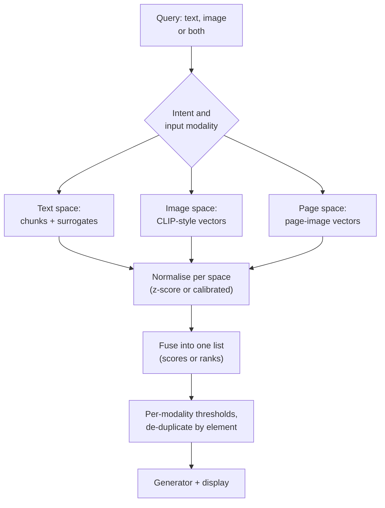

Cross-modal search means the question arrives in one modality and the answer may be in another: a typed question that should return a screenshot, a photo that should return the runbook paragraph explaining it, a spoken query that should find a slide. Earlier lessons in this module covered the parts: how images become vectors ([Visual embeddings](/learn/multimodal-rag/visual-embeddings)), how a model learns to put a caption and its picture close together ([Image-text matching](/learn/multimodal-rag/image-text-matching)), and how a database holds several vector spaces ([Multimodal vector databases](/learn/multimodal-rag/multimodal-vector-databases)).

This lesson is about putting them together into one search that returns the right mixture of results. The central difficulty is not finding a matching image in an image index; it is deciding, for a single ranked list, whether the third-best paragraph is more useful than the best image, when their scores come from different models, different regions of a shared space, or different scales entirely. You will see why raw scores across modalities are not comparable, measure the effect of the **modality gap** on a mixed index, and compare the remedies: per-modality normalisation, mean-centring, rank fusion, and routing.

## Learning objectives

- Distinguish the three architectures for cross-modal search: a shared embedding space, bridging through text, and separate per-modality retrievers with fusion.
- Explain the modality gap and predict its effect on a mixed index of text and image embeddings.
- Normalise scores per modality with z-scores and mean-centring, and compute both by hand.
- Compare score normalisation, rank fusion and intent routing for building a mixed result list, including what each does when no item of one modality is relevant.
- Design an evaluation that measures cross-modal search per modality and for the mixed list.

## Prerequisites

- [Image-text matching](/learn/multimodal-rag/image-text-matching): contrastive models such as CLIP and how they score an image against a caption.
- [Multimodal vector databases](/learn/multimodal-rag/multimodal-vector-databases): named vector spaces and in-database fusion.
- [Reciprocal rank fusion](/learn/hybrid-search/reciprocal-rank-fusion): combining rankings by position.
- [Score calibration](/learn/advanced-retrieval-optimisation/score-calibration): making scores comparable and meaningful.
- [Embedding space geometry](/learn/embedding-mathematics/embedding-space-geometry): anisotropy and why cosines rarely approach 1.

## Why this matters

An organisation's knowledge is spread across modalities that answer different needs. "Where is the asset tag on my laptop?" is best answered by a photo; "what does E-4021 mean?" by a sentence; "show me the AskMeridian architecture" by a diagram; "what did the CTO say about the migration at the all-hands?" by a timestamped transcript and a video link. A search that returns only text misses half of these, and a search that blends modalities naively gets the mixture wrong in predictable ways.

**One modality crowds out the other.** In a single shared embedding space, text queries tend to score all text items above all images, because text embeddings sit closer to each other than to images. The best photo never makes the top five.

**Thresholds misfire.** A cut-off tuned on text scores (say, "drop anything below 0.5") deletes every image, whose correct matches may score 0.3. A cut-off tuned on images admits irrelevant text.

**Forced mixtures mislead.** Interleaving one image after every text result guarantees images appear, including when none is relevant, and the generator receives an unrelated picture labelled as evidence.

Each is a problem of making scores comparable, or of not needing them to be.

## The intuition

Two judges score a baking competition. One marks generously, between 6 and 10; the other is strict, between 1 and 5. A cake that gets 4 from the strict judge may be the best that judge has ever tasted, while a 7 from the generous judge is merely average. If you rank all cakes by raw marks, every cake the generous judge tasted beats every cake the strict judge tasted. To compare fairly you ask each judge, "how far above *your own* average is this cake?", or you take each judge's ranking and merge the lists.

Text and image scores in a cross-modal search are the two judges. The modality gap is the generous judge's habit of marking high. The remedies are standardising each judge's marks (z-scores), adjusting for their habits before marking (mean-centring), merging their rankings (rank fusion), or deciding beforehand which judge's opinion the question needs (routing).

## How it works

### Three architectures

**1. A shared embedding space.** One model embeds every modality into one vector space: CLIP-style models for images and text, and models trained on other pairings (audio and text, or several modalities at once, as in ImageBind) for others. A text query is embedded with the text encoder and compared directly with image vectors. This is "true" cross-modal search: it can find a photo of an asset tag that has no caption at all. Its weaknesses: the shared space is usually weaker for text-to-text retrieval than a dedicated text model; it reads text inside images poorly; and the modality gap makes mixed rankings unreliable.

**2. Bridging through text.** Convert every non-text item into text (captions and descriptions for images, transcripts for audio and video, computed summaries for charts, edge statements for diagrams), as the [Multimodal Ingestion](/learn/multimodal-ingestion) module did, and search everything with one text model. Cross-modal search becomes text search over surrogates: the query "laptop asset tag photo" matches the description "Photo of the underside of a laptop showing the asset tag sticker". Strengths: one model, one score scale, keyword search works, results are explainable. Weaknesses: it finds only what the description mentions, and describing every image costs a model call.

**3. Separate retrievers with fusion.** Keep each modality in its own space with its best model (a text model for text and surrogates, an image model for images, a page-image model for slides), run the query against each space it can address, and combine the results. Query-by-example images go only to the image space; typed questions go to the text space and, through a text encoder that shares the image space, to images as well. Strengths: each modality gets its best model. Weakness: you must combine results whose scores are not comparable. [Image retrieval](/learn/multimodal-rag/image-retrieval) fused two image indexes by rank; here the lists hold different modalities, which is the subject of the rest of this lesson.

In practice, document-centred RAG systems usually lead with bridging (architecture 2) and add a shared-space image retriever (architecture 1 or 3) for photos, screenshots and visually distinctive content that descriptions capture poorly.



### The modality gap

Contrastive models such as CLIP are trained to make each image closer to its own caption than to other captions in the batch. They are not trained to make an image and its caption close in absolute terms. Liang and colleagues (2022) showed that in such models image embeddings and text embeddings occupy two separate regions of the space, the **modality gap**, and that the gap arises from a combination of how the networks are initialised and how the contrastive loss behaves. In practice:

- Text-to-text cosines for unrelated pairs are typically higher than text-to-image cosines for *matching* pairs.
- Within the image region, ranking by a text query works well: the right image beats the wrong images.
- Across regions, raw cosine comparisons are biased: all text items tend to outrank all images.

So a shared space supports cross-modal *ranking within a modality* far better than *mixed ranking across modalities*. The gap is a property of the model, not of your data, and different models have gaps of different sizes. Measure it for yours: embed a sample of text and images, and compare the average text-text, image-image and text-image cosines.

### Making scores comparable

Four techniques, from simplest to most demanding.

**Per-modality z-scores.** For each query, compute the scores of candidates in each modality, then express each score as standard deviations above that modality's mean for this query. An image that stands out among images now competes fairly with a text item that stands out among texts. It needs enough candidates per modality (a few dozen) for the mean and standard deviation to be stable, and it always promotes *some* item from each modality to a positive z-score, so it must be combined with a threshold.

**Mean-centring.** Estimate each modality's average embedding over the corpus, subtract it from every vector of that modality (and from queries, using the query's modality mean), and renormalise. This removes much of the constant offset between regions. It is cheap, done once at indexing, and applies to the vectors themselves, so it works with any vector database. It is a heuristic: it removes the average offset, not every difference between the regions, and should be validated on labelled queries.

**Rank fusion.** Rank each modality separately and merge by position, for example with reciprocal rank fusion. Scores are ignored, so the gap is irrelevant. The cost is that rank fusion has no notion of absolute relevance: the best image always lands near the top of the merged list, whether it is excellent or useless. It behaves like a quota.

**Learned calibration.** Fit, per modality, a function mapping raw scores to a probability of relevance (logistic regression on labelled query-result pairs is the usual starting point). Calibrated probabilities are comparable across modalities and support one meaningful threshold. This is the most accurate approach and needs labelled data per modality, which most teams do not have at first. See [Score calibration](/learn/advanced-retrieval-optimisation/score-calibration).

### Routing by intent

Often the question says which modality it wants. "Show me", "picture of", "photo", "screenshot", "diagram of", "where on the laptop" signal an image; "what did ... say", "in the recording" signal transcripts; an uploaded image signals image search. Routing these explicitly (by rules first, a classifier for the rest, as in [Query routing](/learn/agentic-rag/query-routing)) is often more reliable than any score-blending: a question that wants a photo searches the image space and returns images, with text as supporting context. Score comparability then only matters for the large middle ground of questions with no stated preference.

### Building a cross-modal search, step by step

1. **Inventory the modalities** and how each can be searched: text space (always, via surrogates), image space (for photos, screenshots, figures), page space, transcript segments.
2. **Measure the gap** if you use a shared space: average within-modality and cross-modality cosines on a sample.
3. **Route by intent and input**: an uploaded image goes to the image space; explicit modality words restrict or boost a modality; otherwise search all applicable spaces.
4. **Retrieve per space** with a candidate limit large enough for per-modality statistics.
5. **Make scores comparable**: z-scores per modality, mean-centred vectors, or calibrated probabilities; or use rank fusion when scores cannot be trusted.
6. **Apply per-modality thresholds**, so a modality with no good match contributes nothing.
7. **De-duplicate by element**: an image found by both its surrogate (text space) and its pixels (image space) is one result.
8. **Evaluate** per modality and on the mixed list (see Best practices).

## The mathematics

### Measuring the gap

**Intuition.** If the two modalities occupy different regions, their average vectors point in different directions, and the distance between those averages measures the gap.

$$
\boldsymbol{\Delta} = \frac{1}{n_I}\sum_{j=1}^{n_I} \mathbf{v}_j - \frac{1}{n_T}\sum_{i=1}^{n_T} \mathbf{u}_i
$$

- $\mathbf{u}_i$ are the unit-length text embeddings, $n_T$ of them; $\mathbf{v}_j$ the unit-length image embeddings, $n_I$ of them.
- $\boldsymbol{\Delta}$ is the gap vector, the difference of the two modality means; $\lVert \boldsymbol{\Delta} \rVert$ summarises its size, following Liang and colleagues.

Mean-centring subtracts each modality's mean from its own vectors, which removes $\boldsymbol{\Delta}$ by construction, then renormalises.

### Per-modality z-scores

**Intuition.** Replace each score by how unusual it is among scores of the same modality for the same query.

$$
z_x = \frac{s(q, x) - \mu_{m(x)}(q)}{\sigma_{m(x)}(q)}
$$

- $s(q, x)$ is the raw similarity between query $q$ and item $x$.
- $m(x)$ is the modality of $x$.
- $\mu_{m}(q)$ and $\sigma_{m}(q)$ are the mean and standard deviation of the scores of all retrieved candidates of modality $m$ for this query.

**Worked by hand.** For a text query, text candidates score with mean 0.63 and standard deviation 0.08; image candidates with mean 0.10 and standard deviation 0.09. The matching text scores 0.87, an unrelated text 0.70, the matching image 0.34, an unrelated image 0.12.

- Matching text: $(0.87 - 0.63)/0.08 = 3.00$.
- Unrelated text: $(0.70 - 0.63)/0.08 = 0.875$.
- Matching image: $(0.34 - 0.10)/0.09 \approx 2.67$.
- Unrelated image: $(0.12 - 0.10)/0.09 \approx 0.22$.

By raw score the matching image (0.34) ranks below the unrelated text (0.70); by z-score it ranks second, right behind the matching text. The unrelated image stays low.

```python
def z(score, mean, sd):
    return (score - mean) / sd

print(f"matching text    z = {z(0.87, 0.63, 0.08):.2f}")
print(f"unrelated text   z = {z(0.70, 0.63, 0.08):.2f}")
print(f"matching image   z = {z(0.34, 0.10, 0.09):.2f}")
print(f"unrelated image  z = {z(0.12, 0.10, 0.09):.2f}")
```

```output
matching text    z = 3.00
unrelated text   z = 0.87
matching image   z = 2.67
unrelated image  z = 0.22
```

(The unrelated text prints 0.87 because Python rounds 0.875 to two places using the binary value of the result.)

## In code

### Simulating the gap and its remedies

**The problem.** Measure what the modality gap does to a mixed index, and compare raw cosine, per-modality z-scores, mean-centring and rank fusion on the same queries.

**Why a simulation.** The effect depends only on geometry, and a controlled simulation lets you see it without a model download: each item's vector is its *concept* (what it is about) plus a fixed *modality offset* plus noise. Eight Meridian concepts each have one text item and one image item, and each concept gets one text query. The offsets play the role of the modality gap; the real-model version follows afterwards.

**Dependencies.** NumPy only.

```bash
pip install numpy
```

```python
import numpy as np

rng = np.random.default_rng(7)
d = 64
concepts = ["VPN error dialog", "expense receipt", "laptop asset tag", "org chart",
            "office floor plan", "network diagram", "leave calendar", "support desk"]
C = rng.normal(size=(len(concepts), d))                    # what each item is about
gap_text, gap_image = rng.normal(size=d) * 1.5, rng.normal(size=d) * 1.5   # modality offsets

def embed(concept_ids, gap, noise=0.6):
    x = C[concept_ids] + gap + rng.normal(scale=noise, size=(len(concept_ids), d))
    return x / np.linalg.norm(x, axis=1, keepdims=True)

ids = np.arange(len(concepts))
texts, images = embed(ids, gap_text), embed(ids, gap_image)   # one text and one image per concept
queries = embed(ids, gap_text)                                 # text queries, one per concept

def mean_cos(A, B):
    return float(np.mean(A @ B.T))
print(f"mean cosine text-text   {mean_cos(queries, texts):.3f}")
print(f"mean cosine text-image  {mean_cos(queries, images):.3f}")
print(f"matching pairs: text-text {np.mean(np.sum(queries * texts, 1)):.3f}, "
      f"text-image {np.mean(np.sum(queries * images, 1)):.3f}\n")

def evaluate(name, score_fn):
    """Rank of the matching image (1 = top) in a mixed list of 8 texts + 8 images."""
    ranks, top3_modalities = [], []
    for k in ids:
        s_text, s_img = score_fn(queries[k])
        mixed = np.concatenate([s_text, s_img])
        order = np.argsort(-mixed)
        ranks.append(int(np.where(order == len(texts) + k)[0][0]) + 1)
        top3_modalities.append(sum(o >= len(texts) for o in order[:3]))
    print(f"{name:<28} mean rank of matching image {np.mean(ranks):>5.2f}   "
          f"images in top 3: {np.mean(top3_modalities):.2f}")

# 1. One mixed index, raw cosine
evaluate("raw cosine", lambda q: (texts @ q, images @ q))

# 2. Per-modality z-scores: compare each item with its own modality's distribution
def zscore(q):
    st, si = texts @ q, images @ q
    return (st - st.mean()) / st.std(), (si - si.mean()) / si.std()
evaluate("per-modality z-score", zscore)

# 3. Mean-centring: remove each modality's average vector, renormalise
mu_t, mu_i = texts.mean(0), images.mean(0)
def unit(x): return x / np.linalg.norm(x, axis=-1, keepdims=True)
Tc, Ic = unit(texts - mu_t), unit(images - mu_i)
evaluate("mean-centred cosine", lambda q: (Tc @ unit(q - mu_t), Ic @ unit(q - mu_t)))

# 4. Separate rankings per modality, fused by reciprocal rank (k = 60)
def rrf(q, k=60):
    st, si = texts @ q, images @ q
    rt = np.empty(len(st)); rt[np.argsort(-st)] = np.arange(1, len(st) + 1)
    ri = np.empty(len(si)); ri[np.argsort(-si)] = np.arange(1, len(si) + 1)
    return 1 / (k + rt), 1 / (k + ri)
evaluate("per-modality rank fusion", rrf)
```

```output
mean cosine text-text   0.628
mean cosine text-image  0.098
matching pairs: text-text 0.871, text-image 0.338

raw cosine                   mean rank of matching image  9.00   images in top 3: 0.00
per-modality z-score         mean rank of matching image  2.00   images in top 3: 1.75
mean-centred cosine          mean rank of matching image  1.62   images in top 3: 1.62
per-modality rank fusion     mean rank of matching image  2.00   images in top 3: 1.00
```

**The important lines.**

- `embed` builds each vector as concept plus modality offset plus noise, then normalises. Two items about the same concept share `C[k]`; two items of the same modality share the offset. This is the simplest model with a modality gap.
- `evaluate` builds, for each query, one mixed list of 16 scores (8 texts, then 8 images), sorts it, and records where the matching image landed and how many of the top three are images.
- `zscore` standardises text and image scores separately, per query.
- The mean-centring line subtracts `mu_t` from texts and from the (text) query, and `mu_i` from images, then renormalises everything.
- `rrf` replaces each score with $1/(k + \text{rank})$ within its own modality; with both lists ranked independently, the top item of each gets the same fused score.

**What the output means.**

- **The gap is large in this simulation.** Unrelated text pairs average 0.628, while *matching* text-image pairs average 0.338. Every unrelated text outscores the right image.
- **Raw cosine buries the images.** The matching image ranks ninth on average, below all eight texts: no image appears in any top three. This is the crowding failure from "Why this matters", in its pure form.
- **Z-scores and mean-centring fix the ranking.** The matching image moves to rank 2 (z-score) or about 1.6 (mean-centring), typically right next to the matching text. Both use only geometry or statistics, with no labelled data.
- **Rank fusion fixes it by quota.** The matching image averages rank 2 and exactly one image sits in every top three: the first image is placed beside the first text whatever its quality. Here every query has a relevant image, so that is fine. When a query has no relevant image, rank fusion still promotes one; z-scores do too, which is why per-modality thresholds (on raw or calibrated scores) are step 6 of the pipeline, not an optional extra.

**Errors people commonly hit.** Computing z-scores over too few candidates (with three images, the standard deviation is noise). Mean-centring the corpus but not the query. Estimating the modality means on a tiny or unrepresentative sample. Reading the simulation's numbers as properties of any real model: they are properties of the chosen offsets.

### The same measurement with a real model

The following measures the gap for a real CLIP model on your own sample of images and captions. It was not executed for this lesson, so no output is shown; on CLIP-style models, expect matching image-caption cosines well below typical text-text cosines, which is the gap.

```python
import numpy as np
from PIL import Image
from sentence_transformers import SentenceTransformer

model = SentenceTransformer("sentence-transformers/clip-ViT-B-32")
paths = ["fig_vpn_dialog.png", "fig_asset_tag.jpg", "fig_floor_plan.png"]   # your images
captions = ["VPN client error dialog", "Asset tag sticker under a laptop", "Office floor plan"]

V = model.encode([Image.open(p) for p in paths], normalize_embeddings=True)
U = model.encode(captions, normalize_embeddings=True)

gap = V.mean(0) - U.mean(0)
print("gap norm:", round(float(np.linalg.norm(gap)), 3))
print("matching image-caption cosines:", np.round(np.sum(U * V, axis=1), 3))
print("mean caption-caption cosine:", round(float(np.mean(U @ U.T)), 3))
```

Use a few hundred images and captions from your own corpus, not three; the means need a representative sample. With `mu_t = U.mean(0)` and `mu_i = V.mean(0)` you can then mean-centre exactly as in the simulation.

**How to extend it.** Add a third modality (transcript segments) with its own offset; add queries that have no relevant image and measure how often each method still puts an image in the top three; then add a per-modality raw-score threshold and measure again.

## A real-world example

Meridian's Platform team added photos to AskMeridian: pictures of the office (floor plans, where the support desk is, which meeting room has which equipment) and of hardware (asset tags, docking stations). To save effort they put CLIP image vectors and CLIP text vectors of all handbook chunks into one shared space, and searched it with the CLIP text encoder.

Staff noticed that "where is the asset tag on my laptop?" never showed the asset-tag photo, while the handbook paragraph about laptop refresh cycles came first. The team measured the gap on a sample: unrelated handbook passages scored higher against queries than correct photos did, exactly the crowding failure.

They first tried rank fusion over separate text and image rankings. Photos now appeared, but so did a photo of a docking station for "how many days of annual leave do I get?", because the top image is always promoted. The final design used three pieces: handbook chunks in the text space with the existing text model (CLIP's text encoder was noticeably worse for text-to-text questions); photos in an image space searched by CLIP's text encoder, with mean-centred vectors and a threshold on the image score chosen from a small labelled set; and intent rules ("photo", "picture", "where is", "show me") that boost images. Every photo also got a short human-written caption in the text space, so most photo questions were in fact answered by bridging, with the image space as a fallback for photos nobody had captioned.

## Common mistakes

- **Mixing modalities in one shared space and ranking by raw cosine.** Text crowds out images because of the modality gap.
- **One threshold for all modalities.** It deletes every image or admits irrelevant text.
- **Treating rank fusion as relevance.** It guarantees each modality a place near the top, relevant or not.
- **Using a multimodal model's text encoder for text-to-text retrieval.** Dedicated text models are usually much better at it.
- **Forgetting text inside images.** CLIP-style models read text in images poorly; screenshots and slides need OCR or descriptions in the text space.
- **Not de-duplicating.** An image found by its surrogate and by its pixels appears twice.
- **Evaluating only the mixed list.** A good overall score can hide one modality that never retrieves anything.

## Best practices

- Prefer bridging (text surrogates) as the backbone, and add a shared-space image retriever for content that descriptions capture poorly.
- Search each modality in its own space with its best model, and combine results deliberately.
- Measure the modality gap of any shared-space model you use; mean-centre or z-score before mixing.
- Set thresholds per modality, ideally from calibrated scores fitted on labelled pairs.
- Route by intent when the question names a modality, and by input when the query is an image.
- De-duplicate by element ID after fusion.
- Evaluate per modality (Recall@k for images, for text, for transcripts) and for the mixed list (nDCG with graded labels), and track the modality mix of returned results over time.

## Performance considerations

**Several spaces, several searches.** A query that addresses three spaces runs three approximate searches. With HNSW each is typically a few milliseconds, and they can run in parallel or as prefetches in one database request, so latency grows little; the query-encoding step (one text encoder, possibly a second text encoder for the shared image space) often costs more.

**Candidate limits for normalisation.** Z-scores need a few dozen candidates per modality. Retrieving 50 per space instead of 10 is cheap in the database but increases data returned; return IDs and scores only, and fetch payloads for the final list.

**Mean-centring is nearly free at query time.** It is a vector subtraction at indexing time and one per query. The cost is operational: the means are a property of the corpus, so when the corpus changes substantially, recompute them and re-index the centred vectors. Store the means with a version number beside the model version.

**Bridging moves cost to ingestion.** Captioning 100,000 images with a vision model is a one-off ingestion cost per image (which you can estimate from your provider's pricing), after which every query is a cheap text search. A shared-space retriever has no captioning cost but an extra encoder and index.

## Security considerations

- **Images can carry instructions.** Text rendered inside an image (a screenshot containing "ignore your instructions") reaches a vision-capable generator. Treat retrieved images as untrusted content, exactly like retrieved text; see [Indirect prompt injection](/learn/rag-security-fundamentals/indirect-prompt-injection).
- **Adversarial images.** Images can be perturbed to embed close to an unrelated text query, making them surface for that query. Restrict who can add images to the index, and keep provenance so a suspicious result can be traced.
- **Query images are personal data.** A photo a user uploads may show faces, screens or documents. Process it transiently, do not log it by default, and apply the same retention rules as other personal data.
- **Permissions across modalities.** An image and its caption must carry the same access controls; a restricted diagram must not leak through its unrestricted surrogate.

## Summary

- Cross-modal search can use a shared embedding space, bridging through text, or separate retrievers per modality with fusion; most document systems combine bridging with a shared-space image retriever.
- Contrastive models such as CLIP have a modality gap: within-modality scores are systematically higher than cross-modality scores, so raw cosine in a mixed index buries the minority modality.
- Per-modality z-scores and mean-centring make scores comparable without labels; calibrated probabilities do so best with labels.
- Rank fusion sidesteps the gap but behaves like a quota, so per-modality thresholds are essential.
- Route by intent and input when possible, de-duplicate by element, and evaluate each modality as well as the mixed list.

## Exercises

**1.** A text query's text candidates have mean 0.55 and standard deviation 0.05; image candidates have mean 0.20 and standard deviation 0.04. An image scores 0.29 and a text item scores 0.61. Which ranks higher after per-modality z-scoring, and by how much?

<details><summary>Show solution</summary>

Image: $(0.29 - 0.20)/0.04 = 2.25$. Text: $(0.61 - 0.55)/0.05 = 1.2$. The image ranks higher, by about one standard deviation, although its raw score is less than half the text item's.

</details>

**2.** In the simulation, add four queries whose concept has no image in the corpus (append four new text-only concepts with text items and queries). For each method, measure how often the top three contains an image. What does this show?

<details><summary>Show solution</summary>

Draw four new concept rows `C2 = rng.normal(size=(4, d))`, build text items and queries from them with `gap_text` and noise as `embed` does, stack the new items under `texts`, recompute the means, and count images in each top three for the four new queries only. With the lesson's seed, continuing the same random stream, this gives on average 0 images in the top three for raw cosine, 2.0 for z-scores, 1.5 for mean-centring and 1.25 for rank fusion, although the best raw image score for these queries is only 0.23 to 0.31. Raw cosine is "right" here only by accident (the gap keeps images low). The other three promote images that match nothing, because each judges an image relative to other images. The lesson: normalisation and fusion need a per-modality threshold on an absolute (raw or calibrated) score, so that a modality with no good match contributes nothing.

</details>

**3.** Design decision. Meridian records its all-hands meetings and wants AskMeridian to answer from them alongside the handbook. Choose between (a) transcripts in the text space with the handbook, (b) a separate audio-embedding space with an audio-text model, (c) both. Justify the choice for questions like "what did the CTO say about the Qdrant migration?".

<details><summary>Show solution</summary>

(a). The questions are about what was said, which a transcript captures directly, with speaker labels and timestamps for deep links (as in the module's [Audio RAG](/learn/multimodal-rag/audio-rag) lesson). Transcript segments in the text space share the text model's score scale with the handbook, so no cross-modal calibration is needed, and keyword search finds names such as "Qdrant". An audio-embedding space (b) helps with non-speech sounds or tone, which these questions do not need, and adds a second scale to calibrate. Consider (c) only if users search by sound, which is rare for meetings. Add a modality filter or boost for questions that mention a meeting or recording.

</details>

## Check your understanding

```quiz
[
  {"q": "In a shared CLIP-style space, a text query is compared with text chunks and images together. What typically happens?", "options": ["Images dominate because they are larger", "Scores are identical across modalities", "Text items tend to outrank all images, even the matching one, because of the modality gap", "The query fails because the spaces differ"], "answer": 2, "why": "Text embeddings sit closer to each other than to images, so unrelated text can outscore a matching image."},
  {"q": "What does per-modality z-scoring do to a score?", "options": ["Expresses it as standard deviations above the mean score of its own modality for this query", "Converts it to a probability of relevance", "Divides it by the vector dimension", "Replaces it with its rank"], "answer": 0, "why": "Each modality's scores are standardised separately, so an item that stands out within its modality can compete fairly."},
  {"q": "Why can reciprocal rank fusion over per-modality rankings mislead when no image is relevant?", "options": ["It ignores the text ranking", "It requires calibrated scores", "It only works for two items", "It always places the top image near the top of the merged list, whatever its quality"], "answer": 3, "why": "Rank fusion uses positions only, so the best image is promoted even when it is irrelevant; it acts like a quota."},
  {"q": "What does mean-centring do?", "options": ["Averages the text and image vectors of each element", "Subtracts each modality's average vector from that modality's vectors and renormalises, removing the constant offset between regions", "Sets all scores to have mean zero", "Trains a new model"], "answer": 1, "why": "Removing each modality's mean vector cancels the gap vector by construction; it is cheap but heuristic, so validate it."},
  {"q": "A user uploads a photo of a docking station and asks 'how do I connect this?'. Which design is most appropriate?", "options": ["Search only the text space with the question", "Use the image's file name as the query", "Route the image to the image space and the question to the text space, then fuse with per-modality thresholds", "Average the image and text vectors into one query"], "answer": 2, "why": "Each input goes to the space it can address; fusion with thresholds combines the visual match with the relevant instructions."}
]
```

## Further reading

- Liang, W., Zhang, Y., Kwon, Y., Yeung, S. and Zou, J. (2022). *Mind the Gap: Understanding the Modality Gap in Multi-modal Contrastive Representation Learning*. NeurIPS 2022. The analysis behind this lesson's central problem.
- Radford, A. et al. (2021). *Learning Transferable Visual Models From Natural Language Supervision*. ICML 2021. CLIP.
- Girdhar, R. et al. (2023). *ImageBind: One Embedding Space To Bind Them All*. CVPR 2023. A shared space for six modalities, aligned through images.
- Cormack, G. V., Clarke, C. L. A. and Büttcher, S. (2009). *Reciprocal Rank Fusion Outperforms Condorcet and Individual Rank Learning Methods*. SIGIR 2009.
- [Sentence Transformers documentation](https://www.sbert.net/): the image search examples show text-to-image and image-to-image search with CLIP models.
