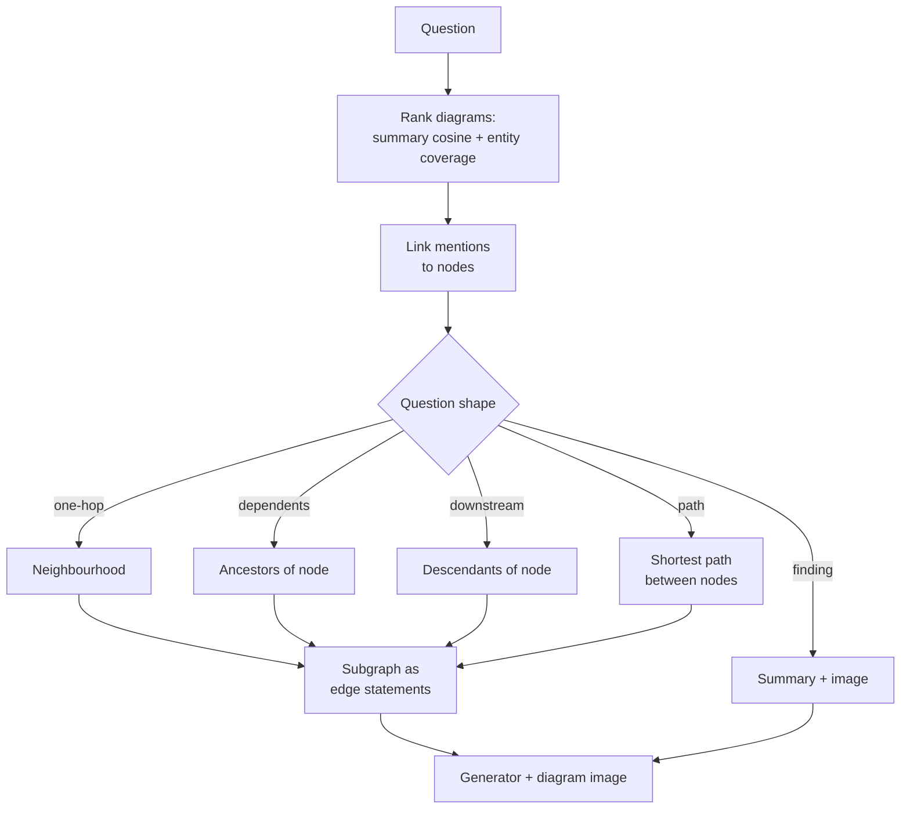

People ask diagrams questions that prose rarely answers well: "what is affected if the Qdrant cluster goes down?", "what happens after my manager approves the claim?", "how does a handbook page end up in an answer?". The answers live in the arrows. [Diagrams](/learn/multimodal-ingestion/diagrams) in the ingestion module recovered those arrows as a graph and wrote text records from it (a summary, edge statements, neighbourhood records), keeping the graph itself beside them. This lesson is about using all of that at query time.

You will see why similarity search over edge statements cannot answer most relationship questions, even with perfect records: embeddings barely notice arrow direction, and top-k retrieval returns the edges that *look* most like the question, not the edges that are *connected* to the answer. The fix is a small, explicit pipeline: find the diagram, link the question's words to nodes, work out which direction the question points, traverse the stored graph, and give the generator the subgraph as text, with the diagram image for the user.

## Learning objectives

- Classify diagram questions into finding, one-hop, multi-hop and path questions, and name the retrieval each needs.
- Demonstrate that sentence embeddings are nearly insensitive to the direction of a relationship, and explain the consequence for edge-statement retrieval.
- Implement entity linking from a question to diagram nodes, and direction-aware traversal (dependents, downstream, path) over a stored diagram graph.
- Rank candidate diagrams by combining semantic similarity with entity coverage, and bound the size of a traversal by a token budget.
- Decide when to return the diagram image, the subgraph text or both.

## Prerequisites

- [Diagrams](/learn/multimodal-ingestion/diagrams): recovering a diagram's graph, edge statements and neighbourhood records.
- [Graph traversal](/learn/graph-rag/graph-traversal): breadth-first search, neighbourhoods and paths.
- [Multimodal document representation](/learn/multimodal-ingestion/multimodal-document-representation): retrieving by surrogate and returning the payload.
- [Image retrieval](/learn/multimodal-rag/image-retrieval): finding pictures by their content.

## Why this matters

Architecture diagrams, process flows and network maps are heavily consulted, and they are where text-only RAG fails most quietly. Three failures are typical.

**Direction is lost.** "Which services call the Embedding service?" and "Which services does the Embedding service call?" are opposite questions with different answers. If the retriever cannot tell them apart, the generator is handed edges pointing the wrong way, and often reverses the relationship in its answer.

**Multi-hop answers are partial.** "What is affected if Qdrant goes down?" has a transitive answer: the retriever that queries it, the chat API that calls the retriever, the user interface behind that. Similarity search returns the edges that mention Qdrant and stops there. The answer sounds complete and omits the user-facing impact.

**The wrong diagram.** A large organisation has dozens of diagrams containing a box called "Retriever" or "API". A question about one system can be answered from another system's diagram, with every edge correct for the wrong system.

All three are retrieval failures, fixed by treating the diagram as a graph at query time as well as at ingestion.

## The intuition

Imagine asking a colleague, with a whiteboard architecture sketch in front of them, "what breaks if the database dies?". They put a finger on the database box, then trace backwards along every arrow that points into it, and keep tracing until there is nothing left. They do not read every label on the board and pick the three that sound most like "database dies".

That finger is **entity linking**: deciding which box the question is about. "Backwards along arrows" is **direction**: the question asks about things that depend on the box, not things it depends on. "Keep tracing" is **traversal**. And the whiteboard itself, which the colleague would show you while answering, is the **image** that travels with the answer.

## How it works

### Four kinds of diagram question

| Kind | Example | What answers it |
| --- | --- | --- |
| Finding | "Is there a diagram of the AskMeridian architecture?" | Diagram summary record; return the image |
| One-hop | "What does the retriever connect to?" | Neighbourhood record of one node |
| Multi-hop | "What is affected if the Qdrant cluster goes down?" | Traversal: all ancestors (or descendants) of a node |
| Path | "How does the employee handbook reach the Qdrant cluster?" | Shortest path between two nodes |

The ingestion lesson's records serve the first two well: a summary record finds the diagram, and a neighbourhood record answers one-hop questions in a single chunk. The last two need the graph. A question router decides which applies, in the same spirit as the lookup-versus-set routing in [Table retrieval](/learn/multimodal-rag/table-retrieval).

### Why similarity search loses direction

A sentence embedding model turns "The retriever queries the Qdrant cluster" and "The Qdrant cluster queries the retriever" into vectors. Both sentences contain the same words, and the models used for retrieval are trained mainly to capture topic and meaning, not argument order. The two vectors come out almost identical (the code below measures a cosine of 0.989). An edge statement index therefore cannot reliably distinguish "X calls Y" from "Y calls X", so a question's direction must be handled outside the embedding: parsed from the question and applied in the traversal.

### Why top-k loses hops

Top-k similarity returns the edges most similar to the question. For "what is affected if Qdrant goes down?", those are the edges that mention Qdrant. The edge "Chat API retrieves from Retriever" does not mention Qdrant and scores low, yet it is part of the answer, because the chat API depends on the retriever which depends on Qdrant. Relevance in a dependency question is defined by *connectivity*, which similarity cannot see. The [Graph RAG](/learn/graph-rag) module develops this for corpus-wide knowledge graphs; diagrams are the easy case, because each graph is small, authored deliberately and already stored.

### Entity linking

Linking maps the words of a question to nodes. Diagram labels are short and specific ("Qdrant cluster", "Ingestion worker"), which makes three cheap techniques effective, in order:

1. **Exact and alias match.** Normalise case and punctuation, and test whether a label's words all appear in the question. Keep an alias table for common variants ("Qdrant" for "Qdrant cluster", "vector DB" for it too), maintained by the team that owns the diagrams.
2. **Fuzzy match** on character n-grams for typos and plurals.
3. **Embedding match** of question phrases against labels, with a threshold, for paraphrases ("the vector database"). Use it last: it links confidently to the wrong node when two labels are similar.

When a mention matches nodes in several diagrams, the diagram choice decides which node is meant. That is why diagram selection comes first.

### Choosing the diagram

A diagram's summary record can be ranked by cosine similarity like any chunk, but similarity alone is weak for diagrams: summaries are lists of component names, and many diagrams share vocabulary. A strong second signal is **entity coverage**: the fraction of entities mentioned in the question that are nodes of the diagram. A question naming "Ingestion worker" and "Qdrant cluster" should prefer a diagram that contains both over one whose summary merely sounds similar. The mathematics below combines the two.

### Direction and traversal

Once the diagram and nodes are known, the question's shape selects a traversal. Edge direction must be defined consistently at ingestion; here an edge points from the component that *acts* (calls, reads, sends) to the one acted on, and from an earlier step to a later one in a process.

- **Dependents** ("what is affected if X fails?", "what relies on X?"): every node with a path *to* X, its **ancestors**.
- **Downstream** ("what happens after X?", "what does X call?"): every node reachable *from* X, its **descendants**.
- **Path** ("how does A reach B?"): the shortest path between two linked nodes. Search it on the undirected graph when the question is about connection rather than flow, because data often flows against the arrows: the ingestion worker *reads* the handbook (arrow from worker to handbook) while content travels from handbook to worker.
- **Neighbours** (one-hop, the default): predecessors and successors of the node.

Direction can be parsed with rules ("affected", "depends on", "after", "from ... to") for the common phrasings, with a small model classifier for the rest.

### The query-time pipeline, step by step

1. **Select candidate diagrams** with summary similarity plus entity coverage; keep the top one or two.
2. **Link entities** in the question to nodes of the selected diagram: exact and alias match, then fuzzy, then embedding.
3. **Classify the question**: finding, one-hop, dependents, downstream or path.
4. **Traverse** the stored graph accordingly, with a depth or size limit.
5. **Serialise the subgraph** as edge statements, in a stable order, with the diagram title and source as a header.
6. **Generate**, instructing the model what arrows mean in this diagram, and **return the image** (ideally with the subgraph highlighted) so the user can check the answer against the picture.
7. **Fall back** when linking fails: return the diagram's summary and image, and say which components it contains, instead of guessing.



### When there is no graph

Some diagrams reach the index only as images with a description but no reliable graph. They can still be *found*, by their description or by visual embeddings (see [Visual embeddings](/learn/multimodal-rag/visual-embeddings) and [Cross-modal search](/learn/multimodal-rag/cross-modal-search)), and a vision-capable model can be shown the image at answer time. That works for finding and simple one-hop questions on clear diagrams; for multi-hop questions it relies on the model tracing arrows by eye, which becomes unreliable as diagrams grow denser. Mark such answers as read from an image, and treat recovering the graph as the real fix.

## The mathematics

### Ranking diagrams by similarity and coverage

**Intuition.** A diagram is a good candidate when its summary is about the same thing as the question *and* it contains the components the question names. Neither signal alone is enough: summaries of different systems sound alike, and a component name can appear in many diagrams.

**The formula.**

$$
s(D) = \alpha \cdot \cos(\mathbf{q}, \mathbf{d}_D) + (1 - \alpha) \cdot \frac{|E_q \cap V_D|}{|E_q|}
$$

- $\mathbf{q}$ is the question embedding and $\mathbf{d}_D$ the embedding of diagram $D$'s summary record.
- $E_q$ is the set of entities mentioned in the question (after alias normalisation), and $V_D$ the set of node labels of $D$.
- $|E_q \cap V_D| / |E_q|$ is the entity coverage, between 0 and 1. If the question names no entity, set the term to 0 and rank by cosine alone.
- $\alpha$, between 0 and 1, weighs the two signals. Cosines from small embedding models rarely exceed 0.6 even for good matches, while coverage spans the full range, so tune $\alpha$ on labelled questions rather than assuming 0.5.

**Worked by hand.** A question names "Ingestion worker" and "Qdrant cluster". The architecture diagram's summary has cosine 0.31 with the question and contains both nodes; a runbook overview diagram has cosine 0.42 but contains only Qdrant. With $\alpha = 0.5$: architecture $0.5 \times 0.31 + 0.5 \times 2/2 = 0.155 + 0.5 = 0.655$; overview $0.5 \times 0.42 + 0.5 \times 1/2 = 0.21 + 0.25 = 0.46$. Coverage overturns the cosine ranking.

### How big a traversal gets

**Intuition.** Each hop multiplies the number of nodes reached by roughly the average number of connections. Traversals that are tiny at one hop become large at three or four, and every node reached costs context tokens.

**The formula.** If every node has at most $b$ neighbours in the direction of travel, the number of nodes reachable within $k$ hops is at most

$$
|N_k| \le \sum_{i=1}^{k} b^{i} = \frac{b\,(b^{k} - 1)}{b - 1}
$$

- $b$ is the branching factor (out-degree for downstream, in-degree for dependents).
- $k$ is the number of hops.
- The bound is reached only in a tree with no shared nodes; real diagrams have shared nodes and reach fewer.

**Worked by hand.** With $b = 3$: one hop reaches at most 3 nodes, two hops $3 + 9 = 12$, three hops $3 + 9 + 27 = 39$, four hops 120. At about 12 tokens per edge statement (an assumption), four hops can cost about 1,400 tokens, still affordable for one diagram, but the same traversal over an organisation-wide graph of linked diagrams would not be. Set a node budget, not only a hop limit.

**In Python:**

```python
def score(cos, matched, mentioned, alpha=0.5):
    coverage = matched / mentioned if mentioned else 0.0
    return alpha * cos + (1 - alpha) * coverage

# Query mentions "Ingestion worker" and "Qdrant cluster"
print(f"architecture diagram: {score(0.31, 2, 2):.3f}")   # both entities are nodes
print(f"runbook overview:     {score(0.42, 1, 2):.3f}")   # higher cosine, one entity

def max_neighbourhood(b, k):
    return sum(b**i for i in range(1, k + 1))
for k in (1, 2, 3, 4):
    n = max_neighbourhood(3, k)
    print(f"k={k}: up to {n:>3} nodes, about {n * 12:>4} tokens of edge statements")
```

```output
architecture diagram: 0.655
runbook overview:     0.460
k=1: up to   3 nodes, about   36 tokens of edge statements
k=2: up to  12 nodes, about  144 tokens of edge statements
k=3: up to  39 nodes, about  468 tokens of edge statements
k=4: up to 120 nodes, about 1440 tokens of edge statements
```

## In code

**The problem.** Two Meridian diagrams are stored as Mermaid source: the AskMeridian architecture and the expense approval flow. Show that embeddings ignore direction and that top-k over edge statements misses hops; then answer dependency, downstream and path questions by selecting the diagram, linking entities, classifying direction and traversing.

**Dependencies.** NetworkX, NumPy and sentence-transformers with the local `all-MiniLM-L6-v2` model. No API key.

```bash
pip install networkx numpy sentence-transformers
```

```python
import re
import networkx as nx
import numpy as np
from sentence_transformers import SentenceTransformer

model = SentenceTransformer("sentence-transformers/all-MiniLM-L6-v2")

# ---- 0. Embeddings do not see arrow direction ---------------------------------
a, b = model.encode(["The retriever queries the Qdrant cluster.",
                     "The Qdrant cluster queries the retriever."], normalize_embeddings=True)
print(f"cosine(A->B, B->A) = {a @ b:.3f}\n")

# ---- 1. Diagrams as Mermaid source (what ingestion stored) --------------------
DIAGRAMS = {
    "askmeridian-architecture": ("AskMeridian architecture", """
        UI["Chat UI"] -->|sends question| API["Chat API"]
        API -->|retrieves| RET["Retriever"]
        RET -->|embeds query| EMB["Embedding service"]
        RET -->|vector search| QD["Qdrant cluster"]
        ING["Ingestion worker"] -->|upserts vectors| QD
        ING -->|reads| HB["Employee handbook"]
        ING -->|reads| RB["IT runbooks"]
        API -->|generates answer| LLM["Claude API"]
    """),
    "expense-approval": ("Expense claim approval flow", """
        S["Employee submits claim"] -->|within 30 days| R{"Over £75?"}
        R -->|yes| RC["Attach receipt"]
        R -->|no| M["Line manager approves"]
        RC --> M
        M --> F["Finance department checks"]
        F --> P["Paid with next payroll"]
    """),
}
EDGE = re.compile(r'(\w+)(?:\[\"([^\"]+)\"\]|\{\"([^\"]+)\"\})?\s*-->\s*(?:\|([^|]+)\|)?\s*(\w+)(?:\[\"([^\"]+)\"\]|\{\"([^\"]+)\"\})?')

def parse(src):
    g = nx.DiGraph()
    for m in EDGE.finditer(src):
        s, sl1, sl2, lab, t, tl1, tl2 = m.groups()
        for node, label in ((s, sl1 or sl2), (t, tl1 or tl2)):
            if label: g.add_node(node, label=label)
            elif node not in g: g.add_node(node, label=node)
        g.add_edge(s, t, label=(lab or "then").strip())
    return g

graphs = {d: parse(src) for d, (_, src) in DIAGRAMS.items()}
summaries = {d: f"{title}: " + ", ".join(nx.get_node_attributes(graphs[d], 'label').values())
             for d, (title, _) in DIAGRAMS.items()}
sum_vecs = model.encode(list(summaries.values()), normalize_embeddings=True)

# ---- 2. Query-time: pick diagram, link entities, read direction, traverse ----
def pick_diagram(query):
    s = sum_vecs @ model.encode([query], normalize_embeddings=True)[0]
    return list(summaries)[int(s.argmax())], float(s.max())

def link_entities(query, g):
    """Nodes whose every label word appears in the query (cheap, exact)."""
    words = set(re.findall(r"[a-z0-9£]+", query.lower()))
    hits = []
    for n, label in g.nodes(data="label"):
        toks = set(re.findall(r"[a-z0-9£]+", label.lower())) - {"the"}
        if toks and toks <= words:
            hits.append(n)
    return hits

def direction(query):
    q = query.lower()
    if re.search(r"affected|depends on|relies on|breaks if|goes down|upstream", q):
        return "dependents"          # who points at X, transitively
    if re.search(r"after|next|then|downstream|what does .* call", q):
        return "downstream"
    if re.search(r"\bfrom\b.*\bto\b|path|how does .* reach", q):
        return "path"
    return "neighbours"

def statements(g, edges):
    L = nx.get_node_attributes(g, "label")
    return [f'{L[u]} --{g.edges[u, v]["label"]}--> {L[v]}' for u, v in edges]

def answer_context(query):
    d, score = pick_diagram(query)
    g = graphs[d]
    nodes, mode = link_entities(query, g), direction(query)
    if mode == "dependents":
        keep = set(nodes) | set().union(*(nx.ancestors(g, n) for n in nodes))
    elif mode == "downstream":
        keep = set(nodes) | set().union(*(nx.descendants(g, n) for n in nodes))
    elif mode == "path" and len(nodes) >= 2:
        und = g.to_undirected(as_view=True)
        keep = set(nx.shortest_path(und, nodes[0], nodes[1]))
    else:
        keep = set(nodes) | set().union(*(set(g.predecessors(n)) | set(g.successors(n)) for n in nodes))
    sub = g.subgraph(keep)
    return d, round(score, 3), [g.nodes[n]["label"] for n in nodes], mode, statements(g, sub.edges)

# Baseline: plain top-3 retrieval over all edge statements
all_facts = [f for d in graphs for f in statements(graphs[d], graphs[d].edges)]
fact_vecs = model.encode(all_facts, normalize_embeddings=True)
q = "What is affected if the Qdrant cluster goes down?"
top = np.argsort(-(fact_vecs @ model.encode([q], normalize_embeddings=True)[0]))[:3]
print("baseline top-3:", [all_facts[i] for i in top], "\n")

for q in ["What is affected if the Qdrant cluster goes down?",
          "What happens after the line manager approves a claim?",
          "How does the employee handbook reach the Qdrant cluster?"]:
    d, score, linked, mode, facts = answer_context(q)
    print(f"Q: {q}\n  diagram={d} ({score})  linked={linked}  mode={mode}")
    for f in facts:
        print("   ", f)
```

```output
cosine(A->B, B->A) = 0.989

baseline top-3: ['Ingestion worker --upserts vectors--> Qdrant cluster', 'Retriever --vector search--> Qdrant cluster', 'Ingestion worker --reads--> IT runbooks'] 

Q: What is affected if the Qdrant cluster goes down?
  diagram=askmeridian-architecture (0.202)  linked=['Qdrant cluster']  mode=dependents
    Chat UI --sends question--> Chat API
    Chat API --retrieves--> Retriever
    Retriever --vector search--> Qdrant cluster
    Ingestion worker --upserts vectors--> Qdrant cluster
Q: What happens after the line manager approves a claim?
  diagram=expense-approval (0.574)  linked=['Line manager approves']  mode=downstream
    Line manager approves --then--> Finance department checks
    Finance department checks --then--> Paid with next payroll
Q: How does the employee handbook reach the Qdrant cluster?
  diagram=askmeridian-architecture (0.467)  linked=['Qdrant cluster', 'Employee handbook']  mode=path
    Ingestion worker --upserts vectors--> Qdrant cluster
    Ingestion worker --reads--> Employee handbook
```

**The important lines.**

- `EDGE` is a regular expression for the subset of Mermaid used here: `id["label"]` or `id{"label"}` nodes and `-->` edges with an optional `|label|`. It is enough for a demonstration; a production parser should handle the full syntax (other arrow types, subgraphs, multi-line labels), as the ingestion lesson describes.
- `link_entities` links a node when every word of its label appears in the question: precise and cheap, but blind to paraphrase ("the vector database").
- `direction` maps phrasings to a traversal mode. The order of the tests matters: "affected" is checked before "after", because a dependency question may also contain words like "then".
- `nx.ancestors(g, n)` returns every node with a directed path to `n`; `nx.descendants` every node reachable from it. `g.subgraph(keep)` keeps only edges between kept nodes, so the output is exactly the connected evidence.
- For paths, `to_undirected(as_view=True)` lets the search follow edges in either direction without copying the graph.

**What the output means.**

- **Direction is invisible to the embedding.** Swapping subject and object leaves the cosine at 0.989. Any ranking of edge statements by similarity treats "A queries B" and "B queries A" as the same evidence.
- **Top-k gets the obvious edges and misses the impact.** The baseline returns the two edges that mention Qdrant, plus an irrelevant "reads IT runbooks" edge. It omits the chat API and chat UI, which are the user-visible consequences of the outage.
- **Traversal gets the whole dependency chain.** Ancestors of the Qdrant node include the retriever, the chat API, the chat UI and the ingestion worker; the four edges between them are the evidence a generator needs to say "chat answers and ingestion both stop".
- **The process question follows the flow.** Downstream of "Line manager approves" are the finance check and payment. Note that the diagram score was 0.574 here but only 0.202 for the Qdrant question; the architecture diagram still won, but a low absolute score is a warning that a second signal such as entity coverage is worth having.
- **The path shows why direction must be interpreted, not just followed.** The path from handbook to Qdrant goes through the ingestion worker, but the edge between worker and handbook points *from* the worker ("reads"). Content flows against the arrow. The generator must be told what arrows mean, or it will say the handbook sends data to the worker, which is the right flow by the wrong mechanism.

**Errors people commonly hit.** `nx.shortest_path` on the directed graph raises `NetworkXNoPath` when the only connection runs against an arrow; decide deliberately whether the question is about flow (directed) or connection (undirected). `set().union(*[])` with no linked nodes returns an empty set, so the code silently returns nothing; check for an empty link result and fall back to the summary. Mermaid node identifiers (`QD`) are not labels; always show labels to users and models.

**How to extend it.** Add aliases and an embedding fallback to `link_entities`, the coverage score to `pick_diagram` (exercise 3), a node budget, and a rendering of the diagram with kept nodes highlighted.

**Answering from the subgraph.** The generation call is the standard one from this course; the part specific to diagrams is the prompt, which must state what the arrows mean. This was not executed here (it needs an API key):

```python
import anthropic

client = anthropic.Anthropic()  # reads ANTHROPIC_API_KEY from the environment

d, _, _, mode, facts = answer_context("What is affected if the Qdrant cluster goes down?")
prompt = (
    f"Diagram: {DIAGRAMS[d][0]}. Each line is an edge 'A --label--> B', meaning A calls, "
    "reads from or sends to B. If B is unavailable, A is affected.\n\n"
    + "\n".join(facts)
    + "\n\nQuestion: What is affected if the Qdrant cluster goes down?"
)
response = client.messages.create(
    model="claude-opus-5-5",
    max_tokens=1024,
    system="Answer only from the provided diagram edges. If the answer is not there, say you don't know.",
    messages=[{"role": "user", "content": prompt}],
)
answer = "".join(block.text for block in response.content if block.type == "text")
```

## A real-world example

Meridian's Platform team indexed the AskMeridian architecture diagram, the network diagram and several IT process flows with the ingestion pipeline from the previous module: summaries, edge statements and neighbourhood records in Qdrant, graphs stored as JSON beside them.

During a planned maintenance window for the Qdrant cluster, the on-call engineer asked AskMeridian "what will be affected while Qdrant is down?". The answer listed the retriever and the ingestion worker, and said nothing about the chat interface, which is what staff would actually notice. A later question, "what does the embedding service depend on?", was answered with "the retriever", which has the arrow backwards: the retriever calls the embedding service.

Both faults came from retrieval, not generation. The team added a diagram path to the router: questions with dependency, downstream or path phrasing that name a known component go to diagram selection with entity coverage, then budgeted traversal. The prompt now states the arrow convention, and the response shows the diagram with the traversed nodes highlighted. One more rule came from the incident review: because the network diagram had last been edited long before the current architecture, every diagram record now carries a `last_modified` date, and answers from diagrams older than the systems they describe say so.

## Common mistakes

- **Answering dependency questions by similarity over edge statements.** The answer covers the edges that mention the component and misses everything further away.
- **Relying on embeddings to tell "A calls B" from "B calls A".** They barely can; parse direction from the question and apply it in traversal.
- **Leaving the arrow convention implicit.** The generator invents a reading, and data flow is often confused with call direction.
- **Linking entities before choosing the diagram.** "Retriever" matches nodes in many diagrams; the answer comes from the wrong system.
- **Unbounded traversal.** A dependents query on a hub node pulls in most of the graph, filling the context with weakly relevant edges.
- **Treating old diagrams as current.** Diagrams go stale faster than prose; without a date, an outdated arrow is presented as fact.

## Best practices

- Route relationship questions (dependents, downstream, path) to graph traversal, and keep similarity search for finding diagrams and one-hop questions.
- Rank diagrams by summary similarity combined with entity coverage.
- Maintain an alias table for component names, owned by the teams that draw the diagrams.
- Define one edge-direction convention per diagram type at ingestion and state it in the generation prompt.
- Cap traversals by node count and depth; prefer the shortest path for "how does A reach B" questions.
- Return the diagram image, ideally with the used subgraph highlighted, and the diagram's date.
- Fall back to the summary and image when entity linking finds nothing, rather than guessing a node.

## Performance considerations

**Traversal and memory are negligible.** Diagrams have tens of nodes; traversals on graphs that size are effectively free, and a 50-node graph as JSON is a few kilobytes, so ten thousand diagrams fit in memory in the retrieval service. The real costs are the query embedding and the generation call.

**Context tokens.** The subgraph is usually far smaller than the full set of records. From the mathematics, a three-hop traversal with branching factor 3 reaches at most 39 nodes, about 470 tokens of edge statements at an assumed 12 tokens each, compared with sending every neighbourhood record of a large diagram. An image sent to a vision-capable model can cost more than the text (it depends on image size; check the provider's documentation), so send it to the model only when the graph is missing or doubtful, and always to the user interface, which costs no tokens.

**Linked diagrams.** If diagrams are joined into one organisation-wide graph (shared node identifiers across diagrams), traversals cross diagram boundaries and the branching bound matters. That is a knowledge graph in all but name; see [Hybrid graph-vector retrieval](/learn/graph-rag/hybrid-graph-vector-retrieval).

## Security considerations

- **Diagrams reveal infrastructure.** Network and architecture diagrams name hosts, data stores and trust boundaries. Apply the same access control to diagram records, graphs and images as to the source documents, and filter at retrieval time by the user's entitlements.
- **Labels are untrusted text.** Box labels and edge labels from a contributed diagram (or one extracted from an image) reach the prompt; a label reading "ignore previous instructions" is an injection attempt. Treat them as data, delimit them clearly in the prompt, and see [Indirect prompt injection](/learn/rag-security-fundamentals/indirect-prompt-injection).

## Summary

- Diagram questions come in four shapes: finding, one-hop, multi-hop and path; only the first two are served well by similarity search.
- Sentence embeddings are nearly blind to relationship direction, so direction must be parsed from the question and applied in traversal.
- Top-k similarity over edges misses multi-hop answers; traversal of the stored graph returns the connected evidence.
- Choose the diagram before linking entities, using summary similarity plus entity coverage; bound traversals by a node budget.
- Give the generator the subgraph with the arrow convention stated, and give the user the image, with its date.

## Exercises

**1.** For each question, name the traversal mode and the nodes it would return from the AskMeridian architecture diagram: (a) "What does the Chat API call?" (b) "What depends on the Embedding service?"

<details><summary>Show solution</summary>

(a) Downstream from Chat API: Retriever and Claude API (one hop), then Embedding service and Qdrant cluster (two hops). If the question means only direct calls, use successors only. (b) Dependents of Embedding service: Retriever, then Chat API, then Chat UI. Note that the lesson's `direction` function sends (a) to "downstream" only because of the pattern `what does .* call`; "what does the Chat API connect to?" would fall to "neighbours".

</details>

**2.** The question "What happens after I attach the receipt?" links to "Attach receipt" in the expense flow. Without running code, list the downstream nodes. Then explain what goes wrong for "What happens after a claim is submitted?" with the lesson's `link_entities`.

<details><summary>Show solution</summary>

Downstream of "Attach receipt": Line manager approves, Finance department checks, Paid with next payroll. For "after a claim is submitted", the label "Employee submits claim" has the word "employee" and "submits", neither of which is in the question ("submitted" is a different string), so no node is linked and the traversal returns nothing. Fixes: lemmatise or stem words before comparison, add aliases ("submission", "submitted"), or fall back to embedding similarity between the question and each label above a threshold.

</details>

**3.** Implement the coverage-weighted diagram ranking in `pick_diagram`, using `link_entities` against every diagram to count matched entities, and test it on "What does the Ingestion worker write to in the Qdrant cluster?".

<details><summary>Show solution</summary>

```python
def pick_diagram(query, alpha=0.5):
    cos = sum_vecs @ model.encode([query], normalize_embeddings=True)[0]
    linked = {d: link_entities(query, graphs[d]) for d in graphs}
    mentioned = max(len(v) for v in linked.values()) or 1
    scores = {d: alpha * cos[i] + (1 - alpha) * len(linked[d]) / mentioned
              for i, d in enumerate(graphs)}
    best = max(scores, key=scores.get)
    return best, float(scores[best])
```

Here the number of mentioned entities is approximated by the best diagram's link count, because the code has no separate entity extractor; with a real extractor, divide by the number of entities found in the question. The architecture diagram links both "Ingestion worker" and "Qdrant cluster", gets coverage 1.0 and wins with a combined score of about 0.70. Note that "in Qdrant" alone would not link "Qdrant cluster" under the all-words rule; that is what the alias table is for.

</details>

**4.** Design decision. Meridian has 300 diagrams, many sharing components (the same Qdrant cluster appears in eleven). Should diagrams stay separate graphs, or be merged into one graph with shared node identifiers? Consider questions, staleness and maintenance.

<details><summary>Show solution</summary>

Merging enables cross-diagram questions ("everything that depends on Qdrant, across all systems") and removes the wrong-diagram problem for shared components. But it requires reliable entity resolution across diagrams (is "Qdrant" in the 2023 network map the same cluster?), it mixes diagrams of different ages, so one stale arrow pollutes many answers, and traversals on hub nodes grow quickly. A reasonable design keeps per-diagram graphs as the source of truth, with a separate **component index** mapping canonical component identifiers to the diagrams and nodes that contain them. Cross-diagram questions then run per-diagram traversals and union the results, each fact tagged with its diagram and date, so staleness stays visible. Promote to a merged graph only if cross-system dependency questions become central, and then treat it as a knowledge graph with its own ownership.

</details>

## Check your understanding

```quiz
[
  {"q": "Why can top-k similarity search over edge statements not answer 'what is affected if Qdrant goes down?' completely?", "options": ["Edge statements are too short to embed", "Qdrant cannot be embedded", "Relevance depends on connectivity: edges several hops away do not mention Qdrant and score low", "Top-k always returns duplicates"], "answer": 2, "why": "The chat API depends on Qdrant through the retriever, but its edge does not mention Qdrant, so similarity ranks it low; only traversal finds it."},
  {"q": "In the lesson, swapping subject and object in 'The retriever queries the Qdrant cluster' gave a cosine of 0.989. What is the practical consequence?", "options": ["Edge direction must be parsed from the question and applied in traversal, not left to the embedding", "The model is broken", "Edge statements should be written in the passive voice", "Use a larger embedding model, which always encodes direction"], "answer": 0, "why": "Sentence embeddings capture topic far better than argument order, so direction has to be handled explicitly."},
  {"q": "Edges point from the component that acts to the one acted on. Which nodes answer 'what depends on X'?", "options": ["Descendants of X", "Only the successors of X", "Nodes with the same label as X", "Ancestors of X"], "answer": 3, "why": "A node depends on X if it has a path to X, which is the definition of an ancestor in this convention."},
  {"q": "Two diagrams contain a node called 'Retriever'. What should happen before entity linking?", "options": ["Link to both and merge the answers", "Select the diagram, using summary similarity plus entity coverage", "Pick the diagram with more nodes", "Ask the model to guess"], "answer": 1, "why": "Ambiguous labels are resolved by choosing the right diagram first; otherwise the answer can come from the wrong system."},
  {"q": "With branching factor 3, how many nodes can a traversal reach within 3 hops at most?", "options": ["9", "27", "39", "81"], "answer": 2, "why": "3 + 9 + 27 = 39; the sum of the per-hop maxima."}
]
```

## Further reading

- NetworkX documentation, [Traversal and shortest paths](https://networkx.org/documentation/stable/reference/algorithms/index.html): `ancestors`, `descendants`, `shortest_path`, `ego_graph`.
- Mermaid documentation, [Flowchart syntax](https://mermaid.js.org/syntax/flowchart.html): the node and edge syntax parsed in this lesson.
- Edge, D. et al. (2024). *From Local to Global: A Graph RAG Approach to Query-Focused Summarization*. Microsoft Research. Retrieval over graphs extracted from text, the general case of which diagrams are the authored special case.
- Faysse, M. et al. (2024). *ColPali: Efficient Document Retrieval with Vision Language Models*. Page-image retrieval, relevant when diagrams are only available as pictures.
