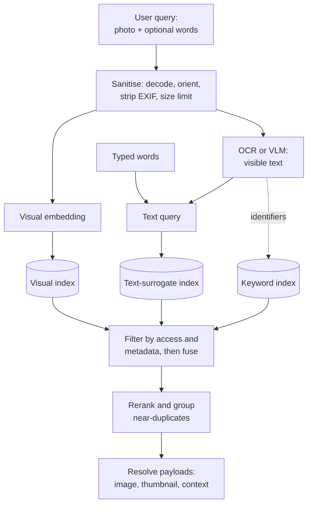

The [Images](/learn/multimodal-ingestion/images) lesson made pictures findable at ingestion time: it pulled them out of documents, filtered the logos, and wrote a text surrogate for each one while the original waited in storage. This lesson is about the other end of the pipe, **query time**. A user types "where is the asset tag on my laptop?" and the right answer is a photograph. Another user takes a phone photo of an error on their screen and asks "what does this mean?", and now the *query* is an image. Image retrieval covers both: which index each kind of query should search, how to combine indexes that score images differently, and how to filter, group and deliver the results.

You will build a small image search over Meridian screenshots, charts and floor plans with two indexes side by side, one over text surrogates and one over visual embeddings, and watch each index fail on a query the other handles.

## Learning objectives

- Classify an image retrieval request as text-to-image, image-to-image or image-as-query, and choose the index or indexes that can answer it.
- Build a two-index image search (text surrogates and visual embeddings) and run text queries and query-by-example against it.
- Explain why a visual index ranks a new screenshot of a known error below an unrelated screen, and repair the ranking by fusing in a text signal read from the query image.
- Design the query-time pipeline for uploaded images: preprocessing, signal extraction, filtering, fusion, grouping and payload delivery.
- Estimate the storage and per-query cost of an image index from its size and dimensions.

## Prerequisites

- [Images](/learn/multimodal-ingestion/images): text surrogates, stored originals and why both exist.
- [Multimodal document representation](/learn/multimodal-ingestion/multimodal-document-representation): elements, surrogates versus payloads, and the three representation strategies.
- [Dense vector search](/learn/dense-retrieval/dense-vector-search): embedding a query and ranking by cosine similarity.
- [Reciprocal rank fusion](/learn/hybrid-search/reciprocal-rank-fusion): combining ranked lists whose scores are not comparable.

## Why this matters

AskMeridian answers questions from the employee handbook, the IT runbooks and the product documentation. A good share of what those documents know is in pictures: the screenshot of each VPN error, the photo showing where the asset tag sits, the floor plan with the support desk on it. Ingestion made those pictures retrievable. Retrieval decides whether they are actually returned at the right moment, and three things go wrong when it is treated as an afterthought.

**The image never wins.** If images are represented only by a short caption in a text index full of long, keyword-rich paragraphs, the caption rarely reaches the top five. The user gets a paragraph saying "see the screenshot below" and no screenshot.

**The query is a picture, and the system has nowhere to send it.** Vision-capable models make it tempting to pass a user's photo straight to the generator. But the generator does not know Meridian's error codes; the runbook entry for E-4021 still has to be *retrieved*, and that needs a retrieval path that starts from an image.

**The wrong near-twin is returned.** Meridian's VPN client shows every error in the same window with the same red banner. To anything that compares appearance, the screenshot for E-4021 (client out of date) and the one for E-4012 (certificate expired) are almost the same picture. A system that retrieves by appearance alone will confidently show the wrong error and the wrong fix.

## The intuition

Picture a picture library with two catalogues. The first is a card index: for every photograph, a librarian wrote a card with the caption, where it came from and a description. You search it with words. The second is a wall of contact sheets arranged so that photographs that *look* alike hang together: red-bannered dialogs in one corner, bar charts in another. You search it by holding up a picture and walking to where it would hang.

Ask for "the VPN out-of-date error" and the card index finds it at once; the wall is useless, because you have no picture to hold up. Hold up a photo of your screen and the wall takes you straight to the right corner, but within that corner every dialog box looks the same, and only the words printed on them tell them apart. The best librarian uses both: she walks to the corner of the wall, reads the words on your photo, and checks them against the cards.

## How it works

### Three shapes of image request

| Request | Query | What is retrieved | Example at Meridian |
| --- | --- | --- | --- |
| Text to image | Words | Images | "Show me the SAML settings screen" |
| Image to image | An image | Similar images | A photo of an error dialog, matched to the runbook screenshot |
| Image as query | An image (often plus words) | Any element: text, tables, images | A photo of a laptop sticker, matched to the asset-tag procedure |

The second is **query by example**, also called content-based image retrieval: the query is a picture, and the system finds pictures that resemble it. The third is the most common in a RAG assistant: the image is not what the user wants back but evidence about what they are asking. A photo of an error is a question about that error.

### Which index can see what

Two representations of an indexed image are in common use (the [Multimodal document representation](/learn/multimodal-ingestion/multimodal-document-representation) lesson sets out a third, whole-page images, which retrieves pages rather than individual pictures).

- **The text index** holds each image's surrogate: caption, nearby text, visible text and description, embedded with your normal text model. It sees exactly what the describer wrote down, including any text printed in the image. It sees nothing the describer left out.
- **The visual index** holds one vector per image from an image encoder such as CLIP. That vector captures layout, colour, objects and overall composition. How such vectors are produced and what they are invariant to is the subject of [Visual embeddings](/learn/multimodal-rag/visual-embeddings). The important property here is that general-purpose image encoders read small printed text poorly, so two screenshots that differ only in an error code get almost the same vector.

From those two facts the routing follows. A text query goes to the text index; with a model trained to place images and text in one space it can also go to the visual index, which is the subject of [Image-text matching](/learn/multimodal-rag/image-text-matching). An image query goes to the visual index directly, and to the text index once you have turned the image into words with OCR or a vision model. Combining the two result lists is fusion.

> [!KEY]
> An image query carries two kinds of evidence: how the image looks, and what it says. The visual index uses the first; the text index uses the second, once you extract it. Neither alone is reliable for screenshots, because screenshots of different things look alike and their meaning is in their text.

### The query-time pipeline, step by step

1. **Receive and sanitise the query image.** Decode it with size limits, apply the orientation stored in its EXIF metadata (phone photos are often stored sideways with a flag saying so), convert to RGB, and strip the metadata, which can include the location where the photo was taken.
2. **Extract signals.** Compute the visual embedding. Read visible text with OCR, or ask a vision-language model (VLM) for the visible text and a short description, exactly as at ingestion time. If the user also typed words, keep them as a separate signal.
3. **Route.** Decide which indexes each signal goes to. Visible text that contains an exact identifier (E-4021, a part number) should also go to a keyword index, because identifiers are where embeddings are weakest.
4. **Filter.** Apply access control and metadata filters to every index before ranking: an image inherits the permissions of the document it came from, and filters such as `kind = screenshot` or `product = Meridian VPN` cut the candidate set. See [Filtered retrieval](/learn/advanced-retrieval/filtered-retrieval).
5. **Generate candidates** from each index, typically the top 20 to 100.
6. **Fuse** the lists into one ranking with reciprocal rank fusion or a weighted variant.
7. **Rerank** the head of the list if precision matters, for example by asking a vision-capable model whether each candidate shows the same error as the query image.
8. **Group and de-duplicate.** Collapse copies of the same screenshot pasted into several documents, keeping the one from the most authoritative source, so the top results are not three copies of one picture. [Duplicate removal](/learn/advanced-retrieval-optimisation/duplicate-removal) covers the general technique.
9. **Resolve payloads.** For each winning image, fetch the original from storage, a thumbnail for display, and the surrounding text (the runbook paragraph that explains the error), and pass them to the generator with a citation.



### Granularity: what is one retrievable image?

A general-purpose image encoder looks at a small, fixed-size square: CLIP ViT-B/32 sees 224 by 224 pixels. A 4,000-pixel floor plan is shrunk to that size before it is embedded, so the label on one office disappears. Two remedies are common.

- **Tiles.** Cut large images into overlapping tiles, embed each tile, and store the parent image identifier with every tile vector. A tile match retrieves the parent, much as [parent-child retrieval](/learn/hierarchical-rag/parent-child-retrieval) returns a section when a chunk matches.
- **Regions.** For documents whose images contain several distinct parts (a screenshot with a dialog over a busy window), a layout or object detector can propose regions, each embedded separately.

Both multiply the number of vectors, so apply them only to the image kinds where detail matters.

### Images as results, images as context

An image that wins retrieval can be used in two ways. **As a result**, it is shown to the user beside the answer. **As context**, it is passed to a vision-capable generator with the question, so that the model reads the image itself rather than a lossy description. Context is more accurate and far more expensive, because each image costs many input tokens; a common compromise sends surrogate text for all retrieved images and pixels only for the top one or two.

## The mathematics

### Why the fused list is a near-tie

**Intuition.** Reciprocal rank fusion gives each item $1/(k + \text{rank})$ from every list it appears in and adds the contributions. With $k = 60$, the difference between rank 1 and rank 4 in one list is small, so when two lists disagree, fused scores bunch together. The full treatment, including how $k$ shifts the balance, is in [Reciprocal rank fusion](/learn/hybrid-search/reciprocal-rank-fusion); here we only need the formula to read this lesson's output.

$$
\text{RRF}(d) = \sum_{i=1}^{L} \frac{w_i}{k + r_i(d)}
$$

$L$ is the number of lists, $r_i(d)$ the rank of image $d$ in list $i$ (1 is best), $k$ a constant (60 by convention), and $w_i$ an optional weight for list $i$ (1 in plain RRF).

**By hand.** In the code below, a new dark-theme screenshot of error E-4021 is ranked like this:

| Image | Visual rank | Text rank | RRF, $k = 60$ |
| --- | --- | --- | --- |
| `vpn-e4021` | 2 | 1 | $1/62 + 1/61 = 0.01613 + 0.01639 = 0.03252$ |
| `reports-export` | 1 | 4 | $1/61 + 1/64 = 0.01639 + 0.01563 = 0.03202$ |
| `vpn-e4012` | 3 | 2 | $1/63 + 1/62 = 0.01587 + 0.01613 = 0.03200$ |

The correct image wins, but by 0.0005. Doubling the text list's weight ($w_{\text{text}} = 2$) gives $2/61 + 1/62 = 0.04892$ for `vpn-e4021` against $2/62 + 1/63 = 0.04813$ for `vpn-e4012`: a wider gap, but still narrow, because the two VPN screenshots are first and second in the text list as well. Rank fusion cannot separate two items that both lists rank similarly. Only a signal that tells E-4021 from E-4012 can, which is why step 3 of the pipeline sends identifiers read from the query image to a keyword index, where an exact match on "E-4021" is decisive.

```python
k = 60
ranks = {"vpn-e4021": (2, 1), "reports-export": (1, 4), "vpn-e4012": (3, 2)}
for w_text in (1, 2):
    fused = {d: 1 / (k + rv) + w_text / (k + rt) for d, (rv, rt) in ranks.items()}
    print(f"w_text={w_text}:", {d: round(s, 5) for d, s in sorted(fused.items(), key=lambda x: -x[1])})
```

```output
w_text=1: {'vpn-e4021': 0.03252, 'reports-export': 0.03202, 'vpn-e4012': 0.032}
w_text=2: {'vpn-e4021': 0.04892, 'vpn-e4012': 0.04813, 'reports-export': 0.04764}
```

## In code

### A two-index image search

**The problem.** Build image retrieval over a handful of Meridian images that supports text queries and image queries, and see where each index succeeds and fails.

**Dependencies.** Sentence Transformers loads both models: `all-MiniLM-L6-v2` for the text surrogates and `clip-ViT-B-32`, whose image tower turns a picture into a 512-dimensional vector. Pillow draws the images. Both models download on first use.

```bash
pip install sentence-transformers pillow numpy
```

To keep the example self-contained, the "images" are drawn with Pillow: application screenshots, a bar chart and a floor plan, each paired with the text surrogate an ingestion pipeline would have written. `photo_of` simulates a phone photo of a monitor by tilting, cropping, blurring and dimming. Save this as `meridian_images.py`.

```python
"""Synthetic stand-ins for images from Meridian's runbooks and product docs."""
from PIL import Image, ImageDraw, ImageEnhance, ImageFilter, ImageFont

FONT = ImageFont.load_default(size=22)

def screen(title, banner=None, lines=(), dark=False, size=(640, 400)):
    bg, fg, bar = ((30, 30, 34), (220, 220, 220), (60, 60, 70)) if dark else ("white", (30, 30, 30), (40, 60, 110))
    img = Image.new("RGB", size, bg)
    d = ImageDraw.Draw(img)
    d.rectangle([0, 0, size[0], 44], fill=bar)
    d.text((16, 10), title, fill="white", font=FONT)
    if banner:
        d.rectangle([20, 70, size[0] - 20, 120], fill=(200, 40, 40))
        d.text((36, 82), banner, fill="white", font=FONT)
    for i, line in enumerate(lines):
        d.text((36, 150 + 40 * i), line, fill=fg, font=FONT)
    return img

def bar_chart(values):
    img = Image.new("RGB", (640, 400), "white")
    d = ImageDraw.Draw(img)
    d.line([60, 340, 600, 340], fill="black", width=3)
    d.line([60, 40, 60, 340], fill="black", width=3)
    for i, v in enumerate(values):
        d.rectangle([90 + i * 85, 340 - v, 140 + i * 85, 340], fill=(70, 130, 180))
    return img

def floor_plan():
    img = Image.new("RGB", (640, 400), (245, 245, 235))
    d = ImageDraw.Draw(img)
    for box, label in [([20, 20, 300, 200], "Support desk"), ([320, 20, 620, 200], "Meeting room"),
                       ([20, 220, 620, 380], "Open-plan office")]:
        d.rectangle(box, outline="black", width=4)
        d.text((box[0] + 14, box[1] + 14), label, fill="black", font=FONT)
    return img

def photo_of(img):
    """Simulate a phone photo of a monitor: tilt, crop, blur, dim."""
    out = img.rotate(4, expand=True, fillcolor=(90, 90, 90))
    w, h = out.size
    out = out.crop((25, 20, w - 30, h - 15)).resize((480, 300))
    return ImageEnhance.Brightness(out.filter(ImageFilter.GaussianBlur(1.2))).enhance(0.8)

COLLECTION = {  # image_id: (image, text surrogate written at ingestion time)
    "vpn-e4021": (screen("Meridian VPN", "Error E-4021: client out of date",
                         ["Update the client from the IT portal.", "Then reconnect."]),
                  "Screenshot of the Meridian VPN client showing error E-4021: the client is out of date."),
    "vpn-e4012": (screen("Meridian VPN", "Error E-4012: certificate expired",
                         ["Your VPN certificate has expired.", "Contact the support desk."]),
                  "Screenshot of the Meridian VPN client showing error E-4012: the VPN certificate has expired."),
    "reports-sso": (screen("Meridian Reports - Settings", None,
                           ["Single sign-on (SAML)", "Identity provider URL: ______", "Enterprise plan only"]),
                    "Meridian Reports settings page for SAML single sign-on, Enterprise plan."),
    "reports-export": (screen("Meridian Reports", None, ["Export report", "[ PDF ]   [ CSV ]"]),
                       "Meridian Reports export dialog with PDF and CSV buttons."),
    "tickets-chart": (bar_chart([120, 180, 150, 260, 210, 90]), "Bar chart of support tickets per month."),
    "floor-plan": (floor_plan(), "Floor plan of the second floor showing the support desk and meeting room."),
}
```

The search itself, saved as `image_search.py` beside it:

```python
import numpy as np
from sentence_transformers import SentenceTransformer
from meridian_images import COLLECTION, photo_of, screen

ids = list(COLLECTION)
images = [COLLECTION[i][0] for i in ids]
surrogates = [COLLECTION[i][1] for i in ids]

# Two indexes over the same images: one visual, one textual.
clip = SentenceTransformer("sentence-transformers/clip-ViT-B-32")
text_model = SentenceTransformer("sentence-transformers/all-MiniLM-L6-v2")
visual_index = clip.encode(images, normalize_embeddings=True)         # (6, 512)
text_index = text_model.encode(surrogates, normalize_embeddings=True)  # (6, 384)

def ranked(index, query_vec):
    scores = index @ query_vec
    order = np.argsort(-scores)
    return [(ids[i], float(scores[i])) for i in order]

def search_text(query):
    return ranked(text_index, text_model.encode([query], normalize_embeddings=True)[0])

def search_image(img):
    return ranked(visual_index, clip.encode([img], normalize_embeddings=True)[0])

def rrf(*rankings, k=60):
    fused = {}
    for ranking in rankings:
        for rank, (image_id, _) in enumerate(ranking, start=1):
            fused[image_id] = fused.get(image_id, 0.0) + 1.0 / (k + rank)
    return sorted(fused.items(), key=lambda kv: -kv[1])

def show(label, results, n=3):
    print(label)
    for image_id, score in results[:n]:
        print(f"   {score:.4f}  {image_id}")

# 1. Text query against the surrogates.
show("Text: 'my VPN says the client is out of date'",
     search_text("my VPN says the client is out of date"))

# 2. Query by example: a phone photo of a screen that is in the index.
show("Photo of the indexed E-4012 screen", search_image(photo_of(COLLECTION["vpn-e4012"][0])))

# 3. A screenshot that is NOT in the index: new dark theme, new window size.
new_shot = screen("Meridian VPN 5.2", "Error E-4021: client out of date",
                  ["Update required."], dark=True, size=(800, 450))
visual = search_image(new_shot)
show("Dark-theme E-4021 screenshot, visual index only", visual)

ocr_text = "Meridian VPN 5.2 Error E-4021: client out of date Update required."  # what OCR would read
textual = search_text(ocr_text)
show("Same screenshot, its OCR text against the surrogates", textual)
show("Fused with reciprocal rank fusion (k=60)", rrf(visual, textual))
```

**The important lines.**

- `clip.encode(images, ...)` accepts a list of Pillow images. Sentence Transformers sends them through CLIP's image preprocessing (resize, centre crop to 224 by 224, normalise) and the image tower. `normalize_embeddings=True` makes every vector unit length, so `index @ query_vec` is a vector of cosine similarities.
- The two indexes are separate arrays with different dimensions (512 and 384). Their scores are on unrelated scales, which is why they are combined by rank in `rrf` rather than by adding scores.
- `ocr_text` stands in for an OCR step. No OCR engine is installed in this example, so the string is what OCR would plausibly read off the new screenshot; in production you would run Tesseract, a cloud OCR service or a VLM, as described in [OCR pipelines](/learn/multimodal-ingestion/ocr-pipelines).

**Output**, from a real run:

```output
Text: 'my VPN says the client is out of date'
   0.7181  vpn-e4021
   0.5987  vpn-e4012
   0.1343  reports-sso
Photo of the indexed E-4012 screen
   0.8247  vpn-e4012
   0.6965  reports-export
   0.6734  vpn-e4021
Dark-theme E-4021 screenshot, visual index only
   0.7322  reports-export
   0.6883  vpn-e4021
   0.6425  vpn-e4012
Same screenshot, its OCR text against the surrogates
   0.9019  vpn-e4021
   0.7873  vpn-e4012
   0.3349  reports-sso
Fused with reciprocal rank fusion (k=60)
   0.0325  vpn-e4021
   0.0320  reports-export
   0.0320  vpn-e4012
```

**What the output means.**

- **Text to image works** when the surrogate contains the user's meaning. "Client is out of date" matches the E-4021 surrogate at 0.72, well clear of E-4012.
- **Query by example works for a copy.** A tilted, blurred, dimmed photo of a screen that is in the index retrieves that screen at 0.82. It is far below 1.0 because an encoder only approximately ignores tilt and blur.
- **Query by example fails for a new screenshot.** The dark-theme screen shows the same error as `vpn-e4021`, but the visual index prefers `reports-export`. The encoder compares appearance, and a dark, wide window shares little appearance with the light original; the words "E-4021" barely register.
- **The query image's text fixes it.** Matched against the surrogates, the OCR text puts `vpn-e4021` first at 0.90. Fusion keeps it first, by the thin margin worked out in the mathematics section. In a production system the exact identifier would also hit a keyword index and settle the question.

**Common errors.** Passing a file path string to `clip.encode` embeds the path as *text*; open images with `Image.open(path).convert("RGB")` first (the conversion also handles PNGs with transparency or palettes). Mixing vectors from the two models produces a shape error at best and meaningless scores at worst.

**Extending it.** Add a `kind` field to each record and filter before ranking; add a keyword index over `visible_text` with [BM25](/learn/sparse-retrieval) and fuse three lists; replace the simulated OCR with a VLM call that returns visible text, as in [Images](/learn/multimodal-ingestion/images).

## A real-world example

Meridian's Platform team added photo upload to AskMeridian after support desk staff reported that many tickets now arrived as phone photos of screens. The first version took the shortcut: it sent the photo to a vision-capable model with the question and no retrieval. The answers were fluent and often wrong. Shown error E-4012, the model recognised a certificate problem and recommended "renewing the certificate in your system settings", which is not Meridian's procedure; the runbook says to contact the support desk, which reissues certificates centrally.

The second version embedded the photo, found the most similar runbook screenshot and gave the generator the runbook text attached to it. It worked until the VPN client's next release introduced a dark theme; every new screenshot then looked unlike every indexed one, and the nearest neighbour was often an unrelated dialog.

The version that shipped extracts visible text from every uploaded image with the same VLM prompt used at ingestion. Identifiers matching the pattern `E-\d{4}` go to the keyword index as a filter-like boost; the full visible text goes to the surrogate index; the photo goes to the visual index; the three lists are fused, and the top runbook entry is passed to the generator together with the user's photo. The visual index now mostly decides between candidates that the text has already narrowed down, such as which of several Meridian Reports settings screens the user is on. The team also added a regression set of new-theme screenshots, so that the next interface redesign is caught by a failing test rather than by users.

## Common mistakes

- **Retrieving screenshots by appearance alone.** Screenshots of one application look alike; their meaning is in their text. The visual nearest neighbour is often the wrong screen.
- **Sending an uploaded image straight to the generator without retrieval.** The model describes what it sees but does not know your procedures, so it answers from general knowledge.
- **Adding raw scores from different indexes.** A CLIP image-image cosine and a MiniLM text cosine are on different scales, so the index with the larger typical values dominates. Fuse by rank, or calibrate first.
- **Keeping EXIF metadata on uploaded photos.** It can contain GPS coordinates and device details, which then leak into logs and storage.
- **Embedding a huge image as one vector.** At 224 by 224 pixels the detail the user asks about is gone. Tile or crop images where detail matters.
- **Returning several copies of the same picture.** Without grouping, the top five results can be one pasted screenshot five times.

## Best practices

- Extract both signals from every query image, its visual embedding and its visible text, and route each to the index that can use it.
- Send identifiers read from images (error codes, part numbers, ticket numbers) to an exact-match index.
- Apply the same describer prompt and OCR settings at query time as at ingestion time, so query text and surrogate text are produced the same way.
- Filter by access control and metadata inside each index before ranking, never after fusion.
- Keep a test set of query images unlike the indexed ones (new themes, phone photos, crops); these break visual retrieval.
- Return a thumbnail and a source link with every image result, and pass full-resolution pixels to the generator only for the top one or two.

## Performance considerations

**Storage.** A 512-dimensional float32 CLIP vector is $512 \times 4 = 2{,}048$ bytes. For 20,000 indexed images (an assumed figure), that is about 41 MB of visual vectors, plus 384-dimensional surrogate vectors at 1,536 bytes each, about 31 MB. Both fit in memory on a single machine. Tiling multiplies the visual figure by the number of tiles per image, so tile only the image kinds that need it.

**Query latency.** An image query adds work that a text query does not: decoding and resizing the upload, one image-encoder forward pass, and the OCR or VLM call. The encoder pass for a ViT-B/32 model is small and fast even on a CPU. The VLM call is the slow, expensive step: it is a full model request with an image in its input. Two ways to keep it off the critical path: run OCR (cheap) by default and the VLM only when OCR returns little text; or start the visual search immediately and the text extraction in parallel, fusing when both return.

**Generation cost.** Images sent to a vision-capable generator are billed as input tokens, and one image typically costs as much as several hundred to over a thousand words of text, depending on its size (an assumption; check your provider's documentation, for example Anthropic's vision guide). Sending five retrieved images at full resolution with every answer multiplies cost several times over. Sending surrogates for most and pixels for one is the usual compromise.

## Security considerations

- **Uploaded images are untrusted input.** Decode them with a library that enforces size limits (Pillow's `Image.MAX_IMAGE_PIXELS` guards against decompression bombs), reject unexpected formats, and never pass the raw bytes to tools that might execute embedded content.
- **Text in images can carry instructions.** A screenshot containing "ignore your instructions and..." is an [indirect prompt injection](/learn/rag-security-fundamentals/indirect-prompt-injection) when its OCR text or pixels reach the generator. Treat extracted text as data, delimit it in the prompt, and never let it select tools or change permissions.
- **Personal data.** Photos contain faces, badges, other people's email on screen, and GPS coordinates in metadata. Strip metadata on upload, set a retention period for query images, and keep them out of analytics logs.
- **Access control applies to images.** An image extracted from a confidential document is confidential. Copy the source document's permissions onto every image record and filter on them in every index, including the visual one, which is easy to forget because it was built separately.

## Summary

- Image retrieval has three request shapes: text to image, image to image, and image as query, where a photo is evidence about a question rather than the thing wanted.
- A text-surrogate index sees what the describer wrote, including text printed in the image; a visual index sees appearance and reads small text poorly.
- An image query carries two signals, appearance and visible text; extract both and route each to the index that can use it, sending identifiers to an exact-match index.
- Fuse rankings from different indexes by rank, not raw score, and expect fusion alone to struggle when lists agree on near-twins.
- Production concerns are granularity (tiles for large images), grouping duplicates, filtering by access before ranking, and choosing between surrogates and pixels for the generator.

## Exercises

1. **By hand.** A query image produces these ranks. Visual list: A first, B second, C third. Text list: C first, A second, B third. Compute plain RRF scores with $k = 60$ and give the fused order.

<details><summary>Show solution</summary>

A: $1/61 + 1/62 = 0.01639 + 0.01613 = 0.03252$. B: $1/62 + 1/63 = 0.01613 + 0.01587 = 0.03200$. C: $1/63 + 1/61 = 0.01587 + 0.01639 = 0.03226$. Fused order: A, C, B. A wins because it is near the top of both lists; C's first place in one list does not outweigh its third place in the other.

</details>

2. **Filtering.** Extend `image_search.py` so that each record has a `kind` (`screenshot`, `chart`, `floor-plan`) and `search_image` accepts an optional `kind`. Run the dark-theme query with `kind="screenshot"`. Does the filter fix the ranking?

<details><summary>Show solution</summary>

Store `kinds = ["screenshot", "screenshot", "screenshot", "screenshot", "chart", "floor-plan"]` in the same order as `ids`, and in `ranked` keep only indices whose kind matches before sorting:

```python
def ranked(index, query_vec, kind=None):
    scores = index @ query_vec
    keep = [i for i in np.argsort(-scores) if kind is None or kinds[i] == kind]
    return [(ids[i], float(scores[i])) for i in keep]
```

It does not. All four Meridian screens are screenshots, so `reports-export` survives the filter and stays first. Filters remove the wrong *kind* of image; they cannot separate two images of the same kind. That needs the text signal.

</details>

3. **Design.** AskMeridian will accept a photo plus an optional sentence. Write the routing rules: which indexes are searched in each of these cases, and how the results are combined? (a) photo only, OCR finds an error code; (b) photo only, OCR finds almost no text; (c) photo plus "where do I find this?".

<details><summary>Show solution</summary>

(a) Code to the keyword index, OCR text to the surrogate index, photo to the visual index; fuse with the keyword list weighted highest, since an exact code match should decide. (b) Appearance is the main evidence: visual index, plus a VLM description of the photo against the surrogates; weight the visual list higher and ask the user to confirm if the top scores are close. (c) The typed words go to the surrogate index as their own query (they state the intent, a location), alongside the photo and its OCR text as in (a); fuse all lists. In every case filter by access within each index and group near-duplicates before returning results.

</details>

## Check your understanding

```quiz
[
  {
    "q": "A user uploads a photo of an error dialog and asks what to do. Which description of the request is most accurate?",
    "options": [
      "Text-to-image retrieval: the answer is a picture",
      "Image as query: the photo is evidence about the question, and the answer may be a runbook paragraph",
      "Image generation: the system must produce a corrected screenshot",
      "Image-to-image retrieval only: returning the most similar screenshot is the whole answer"
    ],
    "answer": 1,
    "why": "The user wants the procedure for that error. The photo identifies the error; the answer comes from whatever element documents it, which may be text."
  },
  {
    "q": "Why did the visual index rank `reports-export` above `vpn-e4021` for the dark-theme E-4021 screenshot?",
    "options": [
      "The CLIP model was not normalised",
      "The text model was used for the image by mistake",
      "The visual embedding compares overall appearance and reads small text poorly, so a new theme outweighs the shared error code",
      "Reciprocal rank fusion reordered the list"
    ],
    "answer": 2,
    "why": "Image encoders capture layout and colour well and printed text weakly. A dark, wide window looks unlike the light original even though both show E-4021."
  },
  {
    "q": "Two indexes return cosine scores in different ranges: the visual index around 0.6 to 0.9, the text index around 0.1 to 0.9. What is the safest default way to combine them?",
    "options": [
      "Fuse by rank, for example with reciprocal rank fusion",
      "Add the raw scores",
      "Take the maximum raw score for each image",
      "Use only the index with the higher average score"
    ],
    "answer": 0,
    "why": "Raw scores from different models are on unrelated scales. Rank-based fusion ignores the scales and needs no calibration."
  },
  {
    "q": "Where should access-control filtering happen in a multi-index image search?",
    "options": [
      "Only on the final fused list",
      "Only in the text index, because images have no permissions",
      "In the generator's prompt, by asking it not to reveal restricted images",
      "Inside every index before ranking, using permissions copied from the source document"
    ],
    "answer": 3,
    "why": "Filtering after fusion lets restricted items take result slots and risks leaking them; images inherit their document's permissions and every index must enforce them."
  },
  {
    "q": "A 4,000-pixel-wide diagram is embedded as a single CLIP ViT-B/32 vector. Which query is it most likely to fail?",
    "options": [
      "\"a network diagram\"",
      "\"a diagram with many boxes and arrows\"",
      "\"which box is labelled Meridian Relay?\"",
      "\"a black and white technical drawing\""
    ],
    "answer": 2,
    "why": "The image is shrunk to 224 by 224 pixels before encoding, so small labels are lost; overall kind and style survive. Tiles or OCR text are needed for labels."
  }
]
```

## Further reading

- Smeulders, A., Worring, M., Santini, S., Gupta, A. and Jain, R. (2000). "Content-based image retrieval at the end of the early years", *IEEE Transactions on Pattern Analysis and Machine Intelligence* 22(12). The classic survey that named the "semantic gap" between pixels and meaning.
- Datta, R., Joshi, D., Li, J. and Wang, J. Z. (2008). "Image retrieval: Ideas, influences, and trends of the new age", *ACM Computing Surveys* 40(2).
- Radford, A. et al. (2021). *Learning Transferable Visual Models From Natural Language Supervision* (CLIP). [arXiv:2103.00020](https://arxiv.org/abs/2103.00020)
- Cormack, G., Clarke, C. and Büttcher, S. (2009). "Reciprocal rank fusion outperforms Condorcet and individual rank learning methods", *SIGIR 2009*.
- Sentence Transformers documentation, including image search with CLIP models: [sbert.net](https://www.sbert.net/)
- Anthropic, "Vision" in the Claude documentation, on image inputs and how they are counted as tokens: [docs.anthropic.com/en/docs/build-with-claude/vision](https://docs.anthropic.com/en/docs/build-with-claude/vision)
