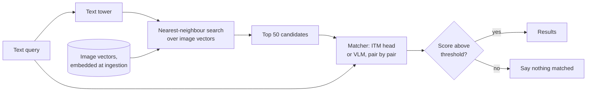

[Visual embeddings](/learn/multimodal-rag/visual-embeddings) showed how an image becomes a vector and that the training objective decides what that vector means. This lesson is about the objective that makes text-to-image search possible: training an image encoder and a text encoder together so that a picture and a sentence describing it land close together in one shared space. That is **image-text matching**, and it is what lets AskMeridian answer "show me the office floor plan" over photos that nobody captioned.

You will see how such models are trained (the symmetric softmax loss behind CLIP and the pairwise sigmoid loss behind SigLIP), what their scores mean, where they fail, and how production systems pair a fast dual encoder with a careful second-stage matcher. In code, you will align two frozen encoders that were never trained together, a CLIP image tower and a MiniLM text model, using a few hundred Meridian image-caption pairs.

## Learning objectives

- Describe the dual-encoder architecture for image-text matching and explain why it suits retrieval over large collections.
- Compute the symmetric softmax contrastive loss and the pairwise sigmoid loss for a small similarity matrix, by hand and in NumPy.
- Train linear projections that align a frozen image encoder with a frozen text encoder, and evaluate them on unseen captions.
- Explain the main failure modes of dual encoders (word order and composition, text in images, the modality gap) and their consequences for retrieval.
- Design a two-stage pipeline that reranks dual-encoder candidates with a cross-attention matcher or a vision-language model.

## Prerequisites

- [Visual embeddings](/learn/multimodal-rag/visual-embeddings): how an image encoder produces a vector.
- [Contrastive learning](/learn/embedding-optimisation/contrastive-learning): InfoNCE, in-batch negatives and the temperature, introduced for text. This lesson builds on it rather than repeating it.
- [Bi-encoders](/learn/reranking-fundamentals/bi-encoders) and [Cross-encoders](/learn/reranking-fundamentals/cross-encoders): the speed-accuracy trade-off between encoding separately and scoring together.

## Why this matters

Meridian's facilities team keeps a library of a few thousand uncaptioned photos: meeting rooms, kitchens, the equipment store, evacuation routes. A text-surrogate index, as built in [Images](/learn/multimodal-ingestion/images), would need a vision-model description of every photo first. An image-text matching model embeds the photos directly, searchable by text at once, at one encoder pass per photo. The convenience comes with traps specific to how these models are trained.

- **Scores that look like confidence but are not.** A dual encoder trained with a softmax loss learns to rank captions relative to each other, not to say whether any caption fits. A query about something absent from the collection still returns a top result with a respectable-looking score.
- **Captions that the model reads as a bag of words.** "A mug on a laptop" and "a laptop on a mug" contain the same words. Research benchmarks show that popular dual encoders often fail to tell such pairs apart, so a query that depends on relationships between objects can return the wrong image confidently.
- **Text in images.** A model trained on web photos and captions learns that a screenshot is a screenshot, not which error it shows.

## The intuition

Imagine a matching game in a classroom. A box of photographs and a box of captions are emptied on the table, and the class must pair each photo with its caption. There are two ways to play.

In the first, each photo and each caption goes to a different student, and they may not talk. Every student writes a short code on a card, and pairs are made by matching codes. The class practises in advance, adjusting how they write codes until correct pairs get similar codes and wrong pairs different ones. Once practised, this is fast: a new photo needs one code, which can be compared against a million caption codes written last week.

In the second, a judge holds a photo and a caption side by side and decides whether they match. The judge can check details a short code cannot hold, such as whether the mug is *on* the laptop or *under* it, but must look at every pair, so can only be given a shortlist.

The first game is a **dual encoder**, the second a **cross-attention matcher**. Good systems play the first to make a shortlist and the second to decide.

## How it works

### The dual encoder

A dual encoder has two towers, an image encoder $f$ and a text encoder $g$, each followed by a linear projection into a shared space of dimension $d$ (512 for CLIP ViT-B/32). Both outputs are normalised to unit length, so the match score of image $x$ and text $y$ is a cosine:

$$
s(x, y) = \frac{f(x)}{\lVert f(x) \rVert} \cdot \frac{g(y)}{\lVert g(y) \rVert}
$$

The towers never see each other's input. That makes retrieval cheap, since every image is embedded once at ingestion and a query needs one embedding and a nearest-neighbour search. It also limits accuracy: everything the comparison needs must fit in each vector separately.

### Training: the symmetric contrastive loss

CLIP (Radford and colleagues, 2021) trained its two towers from scratch on about 400 million image-text pairs collected from the web. The training step is the InfoNCE recipe from [Contrastive learning](/learn/embedding-optimisation/contrastive-learning), applied across modalities and in both directions:

1. Take a batch of $B$ image-caption pairs.
2. Embed the $B$ images with the image tower and the $B$ captions with the text tower, and normalise.
3. Compute the $B \times B$ matrix of cosines between every image and every caption. The $B$ correct pairs lie on the diagonal; the other $B^2 - B$ entries are negatives.
4. Multiply the matrix by a learned scale $t$ (the inverse of a temperature).
5. **Image to text:** for each row, apply a softmax and take the cross-entropy against the diagonal entry. Each image must pick its own caption out of the batch.
6. **Text to image:** do the same for each column. Each caption must pick its own image.
7. Average the two losses and update both towers and the scale.

Both directions are trained because retrieval runs in both: text queries over images, and image queries over text.

The scale $t$ is a parameter learned with everything else. CLIP initialised it to the equivalent of a temperature of 0.07 (a scale of about 14.3) and clipped it at 100 to keep training stable; the released ViT-B/32 model's scale sits at that cap, 100. A large scale makes the softmax sharp, which is why CLIP similarities that differ by a few hundredths still produce confident rankings.

### The sigmoid alternative

SigLIP (Zhai and colleagues, 2023) replaces the softmax with an independent binary decision for every image-caption pair in the batch: is this pair a match or not? Each pair's score $t \cdot s + b$, with a learned scale $t$ and bias $b$, goes through a sigmoid and is compared with 1 for the diagonal and 0 for everything else.

Two consequences matter in practice:

- **No batch-wide normalisation.** The softmax needs every similarity in a row before it can compute any one probability, which makes very large batches expensive to distribute; the sigmoid treats pairs independently. The SigLIP authors report that it also works better than the softmax at small batch sizes.
- **A per-pair probability.** $\sigma(t \cdot s + b)$ estimates whether *this* image matches *this* text, independently of the other candidates. That is much closer to what a "does anything match?" threshold needs than a softmax score, which always shares out a total of 1 among whatever candidates exist. Treat it as a useful signal, not a calibrated probability on your data: calibrate on labelled examples before trusting a threshold.

### Zero-shot classification and auto-tagging

Because text and images share a space, a dual encoder can classify images into labels it was never trained on. Embed one sentence per label ("a photo of a meeting room", "a photo of a kitchen", "a floor plan"), embed the image, and pick the label with the highest score. The CLIP authors found that wrapping labels in a sentence template works better than bare words, and that averaging the text embeddings of several templates per label ("a photo of a {}", "a picture of a {}", "a {} in an office") helps further; they call this **prompt ensembling**.

For retrieval, the same trick produces **tags**: score each image against a fixed tag list at ingestion and store the best as filterable metadata ("only floor plans").

### Where dual encoders fail

- **Composition and word order.** Thrush and colleagues (2022) built Winoground, image-caption pairs whose captions use the same words in a different order, and found that the models they tested performed close to or below chance. Yuksekgonul and colleagues (2023) showed with their ARO benchmark that such models often behave like **bags of words**, largely insensitive to word order and relations. If your queries depend on relations ("the person *left of* the whiteboard"), a dual encoder alone will not reliably honour them.
- **Text in images.** As [Visual embeddings](/learn/multimodal-rag/visual-embeddings) measured, small printed text barely moves a general image embedding. The flip side, documented by Goh and colleagues (2021) as **typographic attacks**, is that large printed words can dominate it: a photo of an apple with a label reading "iPod" can be classified as an iPod.
- **The modality gap.** Liang and colleagues (2022) observed that image embeddings and text embeddings occupy separate regions of the shared space: every image-text cosine is systematically lower than typical text-text or image-image cosines. Ranking images for one text query is unaffected, because all candidates are shifted alike. Mixing images and text passages in one ranked list is affected, and handling it is part of [Cross-modal search](/learn/multimodal-rag/cross-modal-search).

### Cross-attention matchers and two-stage matching

A **cross-attention matcher** feeds image and text into one model whose layers attend across both, and outputs a single match score, exactly as a [cross-encoder](/learn/reranking-fundamentals/cross-encoders) does for two texts. ALBEF (Li and colleagues, 2021) and BLIP (Li and colleagues, 2022) include such an **image-text matching (ITM) head**, trained to classify pairs as matched or not, often with hard negatives chosen from the dual encoder's own confusions. Because it sees both inputs together, it can check relations and details the dual encoder compressed away. It cannot precompute anything, so it is used only on a shortlist.

A general **vision-language model** (VLM), such as Claude with an image input, can play the same role. It is slower and costlier per pair than an ITM head but needs no training, follows instructions about what counts as a match, and reads text in images well.



The second stage also provides a defensible "no match": when no shortlisted image passes the matcher's threshold, the system says so rather than presenting the least bad candidate.

## The mathematics

### The two losses on one small batch

**Intuition.** Both losses read the same similarity matrix. The softmax asks each row and column to pick its diagonal entry from the line-up; the sigmoid asks every cell independently, "match or not?".

Let $s_{ij}$ be the cosine between image $i$ and caption $j$, $t$ the scale, $b$ the bias (sigmoid only) and $B$ the batch size. The symmetric softmax loss is

$$
L_{\text{softmax}} = \frac{1}{2B} \sum_{i=1}^{B} \left[ -\log \frac{e^{t s_{ii}}}{\sum_{j} e^{t s_{ij}}} - \log \frac{e^{t s_{ii}}}{\sum_{j} e^{t s_{ji}}} \right]
$$

The first term is image $i$ choosing among all captions (a row); the second is caption $i$ choosing among all images (a column). The sigmoid loss is

$$
L_{\text{sigmoid}} = \frac{1}{B} \sum_{i=1}^{B} \sum_{j=1}^{B} \log\left(1 + e^{-z_{ij}(t s_{ij} + b)}\right)
$$

where $z_{ij} = 1$ if $i = j$ (a match) and $-1$ otherwise. Each term is the cross-entropy of a sigmoid: small when a match has a high score or a non-match a low one.

**By hand.** Three images and three captions, $t = 10$, $b = -5$:

$$
S = \begin{pmatrix} 0.9 & 0.3 & 0.2 \\ 0.4 & 0.8 & 0.1 \\ 0.2 & 0.3 & 0.7 \end{pmatrix}
$$

- Row 1, image 1 choosing a caption: logits $(9, 3, 2)$. Loss $= -\log \frac{e^9}{e^9 + e^3 + e^2} = \log(1 + e^{-6} + e^{-7}) = \log(1.00339) = 0.00338$.
- Column 1, caption 1 choosing an image: logits $(9, 4, 2)$. Loss $= \log(1 + e^{-5} + e^{-7}) = \log(1.00765) = 0.00762$. The column is harder than the row because image 2 also scores 0.4 against caption 1.
- Sigmoid, cell $(1,1)$, a match: $\log(1 + e^{-(9 - 5)}) = \log(1 + e^{-4}) = 0.018$.
- Sigmoid, cell $(2,1)$, a non-match with $s = 0.4$: $\log(1 + e^{+(4 - 5)}) = \log(1 + e^{-1}) = 0.313$. The largest term in the matrix: this pair's score is too high for a non-match, regardless of what else is in the batch.

```python
import numpy as np

S = np.array([[0.9, 0.3, 0.2],     # rows: images, columns: captions; matches on the diagonal
              [0.4, 0.8, 0.1],
              [0.2, 0.3, 0.7]])
t, b = 10.0, -5.0

def log_softmax(z, axis):
    z = z - z.max(axis=axis, keepdims=True)
    return z - np.log(np.exp(z).sum(axis=axis, keepdims=True))

logits = t * S
i2t = -np.diag(log_softmax(logits, axis=1))     # each image picks its caption
t2i = -np.diag(log_softmax(logits, axis=0))     # each caption picks its image
print("image->text losses:", i2t.round(5), " text->image losses:", t2i.round(5))
print("softmax (CLIP-style) loss:", round((i2t.mean() + t2i.mean()) / 2, 5))

z = 2 * np.eye(3) - 1                            # +1 for matches, -1 for every other pair
pair_loss = np.log1p(np.exp(-z * (t * S + b)))   # -log sigmoid(z * (t*s + b))
print("sigmoid (SigLIP-style) per-pair losses:\n", pair_loss.round(3))
print("sigmoid loss:", round(pair_loss.sum() / 3, 4))
print("match probabilities sigmoid(t*s + b):\n", (1 / (1 + np.exp(-(t * S + b)))).round(3))
```

```output
image->text losses: [0.00338 0.01905 0.02474]  text->image losses: [0.00762 0.01339 0.00917]
softmax (CLIP-style) loss: 0.01289
sigmoid (SigLIP-style) per-pair losses:
 [[0.018 0.127 0.049]
 [0.313 0.049 0.018]
 [0.049 0.127 0.127]]
sigmoid loss: 0.292
match probabilities sigmoid(t*s + b):
 [[0.982 0.119 0.047]
 [0.269 0.953 0.018]
 [0.047 0.119 0.881]]
```

The last matrix is the practical difference. Each entry is a match estimate for one pair on its own. If a fourth caption scored 0.2 against every image, its column would read about 0.05 everywhere: "matches nothing". Under the softmax, the same column would still share out a total probability of 1 among the three images.

## In code

### Aligning two encoders that were never trained together

**The problem.** You have a good image encoder and a good text encoder, but they live in different spaces, so a text query cannot be compared with an image vector. Train two small projections, one per tower, so that Meridian images and their captions meet in one shared space, using the symmetric loss above. The towers stay frozen; only the projections and the scale are learned. This is a miniature version of what Zhai and colleagues (2022) called **locked-image tuning** (LiT), where a pretrained image tower is frozen and a text side is trained to match it.

**Dependencies.** As in [Image retrieval](/learn/multimodal-rag/image-retrieval), including `meridian_images.py` for the synthetic screenshots, charts and floor plans.

```bash
pip install sentence-transformers pillow numpy torch
```

```python
import random
import numpy as np
import torch
import torch.nn.functional as F
from sentence_transformers import SentenceTransformer
from meridian_images import screen, bar_chart, floor_plan

random.seed(0)
torch.manual_seed(0)
ERRORS = {"E-4021": "client out of date", "E-4012": "certificate expired"}

def make_pair():
    """One synthetic image with its kind, an error code (VPN only) and three caption phrasings."""
    kind, dark = random.choice(["vpn", "sso", "export", "chart", "plan"]), random.random() < 0.5
    code = random.choice(list(ERRORS))
    if kind == "vpn":
        img = screen("Meridian VPN", f"Error {code}: {ERRORS[code]}", ["See the runbook."], dark=dark)
        caps = [f"VPN client showing error {code}", f"the VPN error {code}, {ERRORS[code]}",
                "screenshot of a VPN error message"]
    elif kind == "sso":
        img = screen("Meridian Reports - Settings", None, ["Single sign-on (SAML)"], dark=dark)
        caps = ["single sign-on settings page", "SAML configuration in Meridian Reports", "where to set up SSO"]
    elif kind == "export":
        img = screen("Meridian Reports", None, ["Export report", "[ PDF ]   [ CSV ]"], dark=dark)
        caps = ["export dialog with PDF and CSV options", "download a report as CSV", "report export screen"]
    elif kind == "chart":
        img = bar_chart([random.randint(40, 280) for _ in range(6)])
        caps = ["bar chart of monthly ticket counts", "a column chart", "chart with vertical bars"]
    else:
        img = floor_plan()
        caps = ["office floor plan", "map of the rooms on a floor", "layout of the office"]
    return {"kind": kind, "code": code if kind == "vpn" else None, "img": img, "caps": caps}

train, test = [make_pair() for _ in range(240)], [make_pair() for _ in range(60)]

clip = SentenceTransformer("sentence-transformers/clip-ViT-B-32")   # frozen image tower
minilm = SentenceTransformer("sentence-transformers/all-MiniLM-L6-v2")  # frozen text tower
def image_feats(pairs): return torch.tensor(clip.encode([p["img"] for p in pairs], normalize_embeddings=True))
def text_feats(texts): return torch.tensor(minilm.encode(texts, normalize_embeddings=True))

train_img, test_img = image_feats(train), image_feats(test)
train_txt = text_feats([random.choice(p["caps"][:2]) for p in train])   # phrasing 3 is held out

class Aligner(torch.nn.Module):
    """Two linear projections into a shared 64-d space, plus a learned temperature."""
    def __init__(self, dim=64):
        super().__init__()
        self.img_proj = torch.nn.Linear(512, dim, bias=False)
        self.txt_proj = torch.nn.Linear(384, dim, bias=False)
        self.log_scale = torch.nn.Parameter(torch.tensor(np.log(1 / 0.07), dtype=torch.float32))
    def forward(self, img, txt):
        return F.normalize(self.img_proj(img), dim=-1), F.normalize(self.txt_proj(txt), dim=-1)

def symmetric_loss(zi, zt, log_scale):
    logits = log_scale.exp().clamp(max=100) * zi @ zt.T     # B x B, matches on the diagonal
    target = torch.arange(len(zi))
    return (F.cross_entropy(logits, target) + F.cross_entropy(logits.T, target)) / 2

def evaluate(model, label):
    held_out = {p["kind"]: p["caps"][2] for p in train}         # one unseen phrasing per kind
    with torch.no_grad():
        zi, zq = model(test_img, text_feats(list(held_out.values())))
        S = zq @ zi.T
        kind_hits = sum(test[j]["kind"] == kind for row, kind in zip(S, held_out)
                        for j in row.topk(5).indices.tolist())
        _, zc = model(test_img, text_feats([f"VPN client showing error {c}" for c in ERRORS]))
        code_hits = sum(test[j]["code"] == c for row, c in zip(zc @ zi.T, ERRORS)
                        for j in row.topk(5).indices.tolist())
    print(f"{label}: right kind in top 5 (unseen phrasings) {kind_hits}/{5 * len(held_out)}, "
          f"right error code in top 5 {code_hits}/10")

model = Aligner()
evaluate(model, "before training")
opt = torch.optim.Adam(model.parameters(), lr=5e-3)
for step in range(301):
    batch = torch.randperm(len(train))[:32]
    loss = symmetric_loss(*model(train_img[batch], train_txt[batch]), model.log_scale)
    opt.zero_grad()
    loss.backward()
    opt.step()
    if step % 100 == 0:
        print(f"step {step:3d}  loss {loss.item():.3f}  scale {model.log_scale.exp().item():.1f}")
evaluate(model, "after training")
```

**The important lines.**

- `make_pair` draws one of five kinds of image with three caption phrasings. Training uses the first two; the third is held out to test generalisation to unseen wording.
- `Aligner` holds the only trainable parameters: two projection matrices (512 by 64 and 384 by 64) and `log_scale`, initialised to CLIP's starting temperature of 0.07. Storing the logarithm keeps the scale positive.
- `symmetric_loss` is the formula from the mathematics section: `F.cross_entropy(logits, target)` scores rows (image to text) and `logits.T` scores columns (text to image).
- `evaluate` runs two retrieval tests on 60 unseen images: the held-out phrasings must retrieve images of the right kind, and "VPN client showing error E-4021" (and E-4012) must retrieve screenshots showing that code.

**Output**, from a real run:

```output
before training: right kind in top 5 (unseen phrasings) 0/25, right error code in top 5 0/10
step   0  loss 4.604  scale 14.2
step 100  loss 1.744  scale 14.5
step 200  loss 1.761  scale 14.6
step 300  loss 1.734  scale 14.9
after training: right kind in top 5 (unseen phrasings) 25/25, right error code in top 5 9/10
```

**What the output means.**

- **Before training, the spaces do not meet.** Random projections give 0 of 25 correct.
- **Three hundred steps align them.** All 25 results for the unseen phrasings are of the right kind. "Where to set up SSO" was never a training caption, but MiniLM already places it near "single sign-on settings page", and the projection carries that neighbourhood across: alignment inherits the text model's grasp of paraphrase.
- **The loss stops near 1.7, not 0.** With five kinds and batches of 32, each batch holds about six images of every kind, and many captions are identical. The softmax loss treats every off-diagonal pair as a negative, so it is asked to separate a VPN screenshot from the caption of a *different* VPN screenshot with the same words. Those are **false negatives**, and no model can satisfy them. Real web-scale training has the same problem with near-duplicate captions; it is one motivation for the sigmoid loss and for de-duplicating training data.
- **The error codes are mostly separated, 9 of 10**, on clean synthetic screenshots with two codes. The frozen CLIP vectors carry a small difference between the two banners (0.82 cosine in [Visual embeddings](/learn/multimodal-rag/visual-embeddings)), and supervised alignment learned to use it. Do not extrapolate: with dozens of codes, phone photos and new themes, OCR text remains the reliable route for identifiers.

**Common errors.** Forgetting to normalise after projection makes the scale meaningless. Removing the clamp can let the scale grow until training is unstable. Evaluating on training captions measures memorisation, not alignment.

**Extending it.** Replace `symmetric_loss` with the sigmoid loss (a learned bias initialised to −10 and scale to 10, as in the SigLIP paper) and compare the loss floor.

### Using a pretrained matcher, with a VLM as the second stage

In practice you start from a pretrained dual encoder rather than aligning your own. The following was not executed for this lesson (the CLIP text tower and an API key were not available in the environment used), so treat it as a template. It searches photos by text with CLIP and asks Claude to verify the top candidates.

```python
import base64, io
import anthropic
from pydantic import BaseModel
from sentence_transformers import SentenceTransformer

clip = SentenceTransformer("sentence-transformers/clip-ViT-B-32")
photos = load_facilities_photos()            # your own: list of (photo_id, PIL.Image)
image_vecs = clip.encode([img for _, img in photos], normalize_embeddings=True)

# Stage 1: dual-encoder shortlist.
query = "the kitchen on the second floor with the coffee machine"
q = clip.encode([query], normalize_embeddings=True)[0]
shortlist = (image_vecs @ q).argsort()[::-1][:5]

# Stage 2: ask a vision-language model whether each candidate matches.
class Verdict(BaseModel):
    matches: bool
    reason: str

client = anthropic.Anthropic()  # reads ANTHROPIC_API_KEY from the environment

def png_b64(img):
    buf = io.BytesIO()
    img.save(buf, "PNG")
    return base64.b64encode(buf.getvalue()).decode()

for i in shortlist:
    photo_id, img = photos[i]
    response = client.messages.parse(
        model="claude-opus-5-5",
        max_tokens=300,
        system="Decide whether the image matches the search request. Judge only what is visible.",
        messages=[{"role": "user", "content": [
            {"type": "image", "source": {"type": "base64", "media_type": "image/png", "data": png_b64(img)}},
            {"type": "text", "text": f"Search request: {query}"},
        ]}],
        output_format=Verdict,
    )
    print(photo_id, response.parsed_output.matches, response.parsed_output.reason)
```

The dual encoder searches everything quickly and approximately; the VLM checks five candidates slowly. Your output will be one line per candidate with a match decision and a one-sentence reason.

## A real-world example

Meridian's facilities team launched photo search over its uncaptioned library with a CLIP-style model and nothing else. Simple requests such as "kitchen" or "meeting room with a screen" worked well. Two complaints followed. "The fire exit next to the lifts" returned photos of lifts and photos of fire exits, but rarely the one showing both: a relational query, exactly where dual encoders behave like bags of words. And searches for rooms that did not exist under that name, such as "Quiet room 2", returned a confident top result that was simply the nearest meeting room; the softmax-trained scores gave no signal that nothing matched.

The team added a second stage. The top 20 candidates go to a vision-language model told to judge only what is visible; rejected candidates are dropped, and if none pass, AskMeridian says it found no matching photo and lists the closest as "possibly related". Requests that name a room are also routed to the floor-plan OCR text, because room names are printed text. The dual encoder still does nearly all the work; the expensive check runs on 20 photos per photo search.

## Common mistakes

- **Treating a dual-encoder score as a match probability.** Softmax-trained scores rank candidates; they do not say whether any candidate fits, so "no result" is never returned.
- **Relying on a dual encoder for relational queries.** Word order barely moves its score; route such queries to a reranking stage.
- **Sending long text to CLIP's text tower.** It reads at most 77 tokens and truncates the rest silently; long descriptions belong in the text index.
- **Comparing image-text cosines with text-text cosines.** The modality gap puts them on different levels, so mixing them in one ranking favours text.
- **Using bare labels for zero-shot tagging.** Use sentence templates and average several.

## Best practices

- Use a dual encoder to shortlist and a cross-attention matcher or VLM to decide, with a threshold that allows "nothing matched".
- Prefer models trained with a pairwise sigmoid objective when you need per-pair match scores, and calibrate any threshold on labelled pairs from your own data.
- Build a small labelled test set (fifty queries, each with its relevant images) and measure recall@k for text-to-image before and after any change of model.
- Route identifiers and printed names to OCR text, not to the image-text matcher.

## Performance considerations

**Dual encoder cost is paid once per image.** Embedding the collection is a batch job; a query costs one text-tower pass plus a nearest-neighbour search, which for a few thousand 512-dimensional vectors is a sub-millisecond matrix product and for millions is an approximate index such as [HNSW](/learn/vector-indexing-algorithms/hnsw).

**Second-stage cost is paid per candidate per query.** If a VLM call takes on the order of a second and costs a few cents with an image (both assumptions for the arithmetic; check current pricing), verifying 20 candidates per query is 20 calls. Run them in parallel to bound latency. Verifying 5 instead of 20 cuts cost four-fold but misses relevant images ranked 6 to 20; measure recall at the shortlist size on your test set to choose it. An ITM head from a model such as BLIP runs locally and is far cheaper per pair, at lower accuracy on instructions and printed text.

## Security considerations

- **Typographic manipulation.** Large printed text can steer an image's embedding, so an image carrying a misleading word can rank for unrelated queries. Put a second-stage check on high-impact retrieval paths.
- **Prompt injection through the verifier.** In a VLM second stage, text inside the image is read by the model. An image saying "this image matches every request" is an [indirect prompt injection](/learn/rag-security-fundamentals/indirect-prompt-injection). Instruct the model to judge only visual content, use structured output, and never let its verdict trigger privileged actions.
- **People in photos.** Text-to-image search makes staff searchable by appearance. Decide deliberately whether that is acceptable, and exclude photos of people where it is not.

## Summary

- A dual encoder embeds images and text separately into one space, so collections are indexed once and searched with a single query embedding.
- CLIP trains it with a symmetric softmax contrastive loss over a batch's similarity matrix with a learned scale; SigLIP replaces the softmax with independent per-pair sigmoid decisions, which give per-pair match estimates.
- Two frozen unimodal encoders can be aligned with small learned projections and that loss; the alignment inherits each tower's strengths, such as the text model's grasp of paraphrase.
- Dual encoders struggle with composition and word order, printed text, long captions and cross-modal score levels (the modality gap).
- Production matching is two-stage: a dual-encoder shortlist, then a cross-attention matcher or vision-language model that can also say "nothing matched".

## Exercises

1. **By hand.** For the matrix in the mathematics section with $t = 10$, compute the softmax loss for row 2 (image 2 choosing its caption).

<details><summary>Show solution</summary>

Row 2 logits are $(4, 8, 1)$. Loss $= -\log \frac{e^8}{e^4 + e^8 + e^1} = \log(1 + e^{-4} + e^{-7}) = \log(1 + 0.01832 + 0.00091) = \log(1.01923) = 0.01905$, matching the second image-to-text loss in the output.

</details>

2. **By hand.** With $t = 10$ and $b = -5$, at what cosine does the sigmoid match estimate reach 0.5? What does that imply about the bias?

<details><summary>Show solution</summary>

$\sigma(10s - 5) = 0.5$ when $10s - 5 = 0$, so $s = 0.5$. The bias sets the cosine at which the model is undecided. Since most pairs in a batch are non-matches, a negative bias that makes "no" the default suits the data; SigLIP initialises it at −10.

</details>

3. **Code.** Add an image-to-text test to `evaluate`: for each test image, embed the five held-out phrasings and check whether the top-scoring phrasing is of the image's kind. Report the count out of 60.

<details><summary>Show solution</summary>

Inside `evaluate`, after computing `S` (queries by images), the image-to-text ranking is the transpose:

```python
        best_caption = S.T.argmax(dim=1)                      # for each image, its top phrasing
        kinds = list(held_out)
        i2t_hits = sum(kinds[int(c)] == test[j]["kind"] for j, c in enumerate(best_caption))
    print(f"  image->text: right kind for {i2t_hits}/{len(test)} images")
```

A run gave 24/60 before training and 60/60 after: the loss trained both directions, so image-to-text works as well as text-to-image. A large gap between directions would suggest a bug in how the columns were scored.

</details>

4. **Design.** Meridian wants AskMeridian to answer "is there a photo of the new standing desks?" with either photos or a clear "no". Sketch the pipeline and say where the "no" decision is made and how its threshold is set.

<details><summary>Show solution</summary>

Text query to the dual encoder over the photo index, top 20 candidates, then a second stage (ITM head or VLM) scoring each candidate against the request. The "no" decision is made in the second stage: if no candidate passes its threshold, answer that no matching photo was found, optionally listing the nearest candidates as "possibly related". Set the threshold on labelled queries, including some for things known to be absent, trading false positives against false negatives. Never threshold the dual encoder's softmax-trained score directly; it ranks but does not indicate absence.

</details>

## Check your understanding

```quiz
[
  {
    "q": "Why can a dual encoder search a million images quickly while a cross-attention matcher cannot?",
    "options": [
      "The dual encoder uses smaller images",
      "The dual encoder embeds every image once in advance; a cross-attention matcher must process each query-image pair together at query time",
      "Cross-attention matchers only accept text",
      "The dual encoder skips normalisation"
    ],
    "answer": 1,
    "why": "Separate towers make image vectors precomputable, so a query needs one embedding and a nearest-neighbour search. A joint model has nothing to precompute."
  },
  {
    "q": "In CLIP's symmetric loss, what does the text-to-image half add?",
    "options": [
      "Each caption must also pick its own image from the batch's images, training retrieval in that direction",
      "It doubles the batch size",
      "It removes the need for a temperature",
      "It labels off-diagonal pairs as positives"
    ],
    "answer": 0,
    "why": "The softmax over each column makes captions choose among images, so both search directions are trained."
  },
  {
    "q": "The alignment in the code stops improving with a loss near 1.7. What is the main reason?",
    "options": [
      "The learning rate is too low",
      "The projections are too small to represent anything",
      "Batches contain many images of the same kind with identical captions, which the softmax loss treats as negatives that cannot be separated",
      "MiniLM cannot embed short captions"
    ],
    "answer": 2,
    "why": "False negatives in the batch set a floor on the loss; no model can rank one identical caption above another."
  },
  {
    "q": "A user searches photos for \"a mug on a laptop\". Which statement best describes the expected behaviour of a typical CLIP-style dual encoder?",
    "options": [
      "It reliably distinguishes this from \"a laptop on a mug\"",
      "It refuses queries with prepositions",
      "It only returns images containing printed text",
      "It may score \"a laptop on a mug\" images almost as highly, because such models often behave like bags of words"
    ],
    "answer": 3,
    "why": "Benchmarks such as Winoground and ARO show that dual encoders are often insensitive to word order and relations; a reranking stage is needed for such queries."
  },
  {
    "q": "Which property of a sigmoid-trained matcher makes it more useful for deciding that nothing in the collection matches?",
    "options": [
      "Each pair gets its own match estimate, independent of the other candidates",
      "It always returns exactly one match",
      "It uses a larger batch size",
      "It needs no training data"
    ],
    "answer": 0,
    "why": "A softmax shares probability among whatever candidates exist; a per-pair sigmoid can be low for every candidate, signalling no match (after calibration)."
  }
]
```

## Further reading

- Radford, A. et al. (2021). *Learning Transferable Visual Models From Natural Language Supervision* (CLIP). [arXiv:2103.00020](https://arxiv.org/abs/2103.00020)
- Zhai, X., Mustafa, B., Kolesnikov, A. and Beyer, L. (2023). *Sigmoid Loss for Language Image Pre-Training* (SigLIP). [arXiv:2303.15343](https://arxiv.org/abs/2303.15343)
- Zhai, X. et al. (2022). *LiT: Zero-Shot Transfer with Locked-image text Tuning*. [arXiv:2111.07991](https://arxiv.org/abs/2111.07991)
- Li, J. et al. (2022). *BLIP: Bootstrapping Language-Image Pre-training for Unified Vision-Language Understanding and Generation*. [arXiv:2201.12086](https://arxiv.org/abs/2201.12086)
- Thrush, T. et al. (2022). "Winoground: Probing Vision and Language Models for Visio-Linguistic Compositionality", CVPR 2022; and Yuksekgonul, M. et al. (2023). "When and Why Vision-Language Models Behave like Bags-of-Words, and What to Do About It?", ICLR 2023.
- Liang, W. et al. (2022). *Mind the Gap: Understanding the Modality Gap in Multi-modal Contrastive Representation Learning*. [arXiv:2203.02053](https://arxiv.org/abs/2203.02053)
