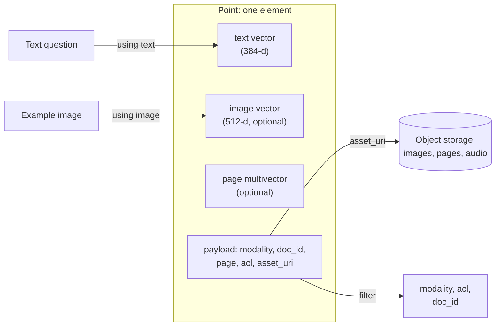

A multimodal RAG system stores several kinds of vector: text embeddings of chunks and surrogates, image embeddings of figures and screenshots, perhaps many-vector embeddings of whole page images. They come from different models, have different dimensions, cover different subsets of the content, and are queried in different ways. The vector database has to hold all of them, keep them attached to the right element and its original file, filter them by modality and permission, and combine their results in one request.

This lesson is about that storage layer. It does not re-teach how to embed images (that is [Visual embeddings](/learn/multimodal-rag/visual-embeddings)) or how late-interaction scoring works (that is [Late interaction](/learn/reranking-models/late-interaction)). It covers the decisions that are specific to holding many modalities: the data model of a multimodal point, one collection or several, where binary files live, how queries choose and combine vector spaces, how to re-embed one modality without disturbing the others, and what it all costs in memory.

## Learning objectives

- Design a multimodal point: named vectors per model, a payload with modality, provenance and an object-storage reference, and the indexes that support filtering.
- Choose between one collection with named vectors, separate collections per modality, and a single shared embedding space, with reasons.
- Query a multimodal collection by text, by example image and by both at once with in-database rank fusion, using Qdrant's Query API.
- Estimate the memory of a multimodal collection from point counts, dimensions and index parameters, and the effect of quantisation.
- Plan a model upgrade for one modality without re-embedding the others.

## Prerequisites

- [Collections](/learn/advanced-vector-database-engineering/collections): named vectors, and when to use one collection or several.
- [Payload indexes](/learn/advanced-vector-database-engineering/payload-indexes): indexing payload fields for fast filtering.
- [Visual embeddings](/learn/multimodal-rag/visual-embeddings): how images become vectors.
- [Multimodal document representation](/learn/multimodal-ingestion/multimodal-document-representation): the element schema, surrogates and payloads.

## Why this matters

Text-only RAG needs one vector per chunk from one model. Multimodal RAG breaks each of those assumptions, and a schema designed for text breaks with it.

**More than one vector per element.** A screenshot is worth indexing twice: by its text surrogate (so "what does the VPN error dialog say?" finds it) and by its image embedding (so a user's own screenshot finds it). Forcing that into a text-shaped schema means two points with duplicated payloads that drift apart when one is updated and the other is not.

**Not every element has every vector.** Text chunks have no image vector. Page-image vectors exist only for documents processed that way. A schema that requires all vectors for every point forces placeholder vectors, which pollute search.

**Binary payloads.** The thing the user wants to see is often a file: the image, the page, the audio clip. Putting megabytes of base64 in the vector database's payload bloats memory, slows every request that returns payloads, and complicates backups.

**Separate lifecycles.** Image and text models improve on different schedules; if replacing one means rebuilding everything, nobody will.

## The intuition

Think of a museum's catalogue. Each object has one catalogue record: an accession number, a description, where it is stored, who may handle it. The record can be found in several ways: by the words in its description, by its photograph in a visual search, by its location. You do not create one record per way of finding it; you attach several finding aids to one record. And the object itself is in the stores, not in the catalogue drawer; the record says which shelf.

A multimodal point is that record: **named vectors** are the finding aids, the **payload** holds description and permissions, and an **object-storage URI** is the shelf reference.

## How it works

### The multimodal point

A point represents one element (a text chunk, an image, a table, a chart, a diagram, a transcript segment, a page), following the element schema from the ingestion module. In a database with named vectors, such as Qdrant, it looks like this:

| Part | Contents | Notes |
| --- | --- | --- |
| Identifier | Stable element ID, derived from document ID and position | Deterministic IDs make re-ingestion idempotent |
| `text` vector | Text-model embedding of the chunk or surrogate (e.g. 384-d) | Present for every element that has text or a surrogate |
| `image` vector | Image-model embedding (e.g. 512-d CLIP) | Only figures, screenshots, photos |
| `page` multivector | Late-interaction page embedding (many 128-d vectors) | Only pages processed by a page-image retriever |
| `sparse` vector | Keyword weights for hybrid search | Optional; see [Hybrid search](/learn/hybrid-search) |
| Payload | `modality`, `doc_id`, `page`, `bbox`, `source_uri`, `asset_uri`, `model_versions`, `acl`, timestamps | Keep it small; index the fields you filter on |

Three properties make this work.

1. **Named vectors are independent spaces.** Each has its own dimension, distance metric and index. A query names the space it searches (`using="image"`). Scores from different spaces are never compared directly.
2. **Vectors are optional per point.** In Qdrant a point may carry any subset of the declared named vectors; a text chunk simply has no `image` vector and is invisible to image searches. Not every engine allows this; some require every vector field on every row, which forces a separate table per modality.
3. **The payload holds references, not files.** `asset_uri` points to object storage (S3, Azure Blob, Google Cloud Storage, or a file server). The application resolves it, ideally to a short-lived signed URL, after permission checks.

### One collection, several, or one shared space

There are three common layouts.

**One collection with named vectors.** Every element is one point; each point carries the vectors that apply to it. Strengths: one ID, one payload and one permission model per element; payload filters behave identically whichever space you search; fusion across spaces happens in one request. Weakness: all spaces share the collection's shards, replicas and lifecycle, so a heavy page-multivector space shapes the sizing of the whole collection.

**Separate collections per modality.** Text chunks in one collection, figures in another, pages in a third. Strengths: each can be sized, sharded, quantised and rebuilt independently, and an experimental modality cannot hurt the main one. Weaknesses: an element indexed in two spaces exists as two points whose payloads must be kept in sync; permissions must be enforced in every collection; fusion happens in the application, with one request per collection.

**One shared embedding space.** A single multimodal model (a CLIP-style model) embeds text and images into one vector field; text chunks and images live side by side and one query searches both. Strength: simplicity, and genuine cross-modal search with one index. Weaknesses: such models are generally weaker at text-to-text retrieval than dedicated text models, and text and image vectors from contrastive models tend to occupy different regions of the space (the modality gap), so a text query ranks text above images almost regardless of relevance. [Cross-modal search](/learn/multimodal-rag/cross-modal-search) treats this in detail.

A practical default for document RAG is the first layout: one collection, a text space covering every element (through surrogates), and extra named spaces only for modalities with a real query path (image-by-example, page images). Use a separate collection for anything with a different lifecycle, such as a two-week trial of a new image model, following the rule from [Collections](/learn/advanced-vector-database-engineering/collections).



### Query patterns

With named vectors, each query decides which spaces to use.

- **Text question, any modality.** Search the `text` space. Because every element has a text surrogate, this finds text chunks and figures alike. This is the workhorse.
- **Text question, one modality.** The same, with a payload filter: `modality = "image"` to answer "show me the screenshot of...", or `modality != "text"` for figures only. Index the `modality` field so the filter is cheap.
- **Query by example.** The user supplies an image (a screenshot of an error, a photo of a device). Embed it with the image model and search the `image` space.
- **Image plus text.** The user supplies a screenshot *and* types "what does this mean?". Search both spaces and fuse (the full query pipeline is in [Image retrieval](/learn/multimodal-rag/image-retrieval)). Qdrant's Query API does this server-side: several `Prefetch` sub-queries, each with its own `using`, combined by a `FusionQuery` with reciprocal rank fusion (or distribution-based score fusion). Other engines offer similar hybrid queries; Milvus, for example, runs several vector-field searches and combines them with a reranker such as RRF.
- **Coarse then fine.** Prefetch candidates with a cheap single vector, then rescore them with the expensive page multivector. This is the late-interaction pattern from [Late interaction](/learn/reranking-models/late-interaction), applied to page images.

### Model versions per space

Every named vector should record which model produced it, either in the space's name (`image_clip_b32`) or in the payload (`model_versions.image`). When a better image model arrives you can:

1. Declare a new named vector space for it. Whether a space can be added to an existing collection depends on the engine and its version; where it cannot, this means a new collection and a planned migration. Check your engine's documentation.
2. Or, if the new model has the same dimension and metric, overwrite the old space point by point with Qdrant's `update_vectors`, which replaces only the named vectors you pass and leaves the others and the payload untouched.
3. Switch queries for that space only, then remove the old vectors (`delete_vectors` removes named vectors from points without deleting the points).

The text space, payloads and IDs are untouched throughout. This independence is the main operational argument for named vectors over one shared space.

### Building it, step by step

1. **Fix the element ID scheme** so re-ingestion overwrites rather than duplicates. Large binaries live in object storage, graphs and tables in structured stores ([Diagram retrieval](/learn/multimodal-rag/diagram-retrieval), [Table retrieval](/learn/multimodal-rag/table-retrieval)); the point holds vectors and a small payload.
2. **Declare the named vector spaces**: one per model you will actually query, each with its dimension and metric. Name them after the model or record the model in the payload.
3. **Create payload indexes** on every field you filter by: `modality`, `doc_id`, ACL fields, dates.
4. **Upload binaries to object storage first**, then upsert points with the URI, so a point never references a file that does not exist.
5. **Upsert each point with the vectors that apply to it**, and nothing else; no placeholder vectors.
6. **Query with an explicit `using`**, a modality filter where the question implies one, and server-side fusion when several spaces apply.
7. **Delete consistently**: when a document is removed, delete its points and its objects, in that order, so search never returns a point whose file is gone and orphaned files are swept later.

## The mathematics

### Memory of a multimodal collection

**Intuition.** Every named vector space costs memory twice: the vectors themselves and the graph index built over them. A space's cost depends on how many points actually carry that vector, not on the size of the collection, which is why optional vectors matter.

**The formula.** For a space with $N$ vectors of dimension $d$, stored with $b$ bytes per value, and an HNSW graph with parameter $M$, a common approximation (used, for example, in the hnswlib documentation) is

$$
\text{bytes} \approx N \cdot (d \cdot b + 2M \cdot 4)
$$

- $N$ is the number of points that carry this named vector.
- $d \cdot b$ is the size of one vector: 4 bytes per value for float32, 1 for int8 scalar quantisation.
- $2M \cdot 4$ is the bottom layer of the HNSW graph: about $2M$ neighbour links per node, 4 bytes each. Upper layers add little.
- Payloads, payload indexes and engine overheads come on top and are not counted here.

**Worked by hand.** Meridian's collection has 1,000,000 text chunks and 100,000 figures. Every element has a 384-d text vector, so $N_\text{text} = 1{,}100{,}000$. Only figures have a 512-d image vector, so $N_\text{image} = 100{,}000$. Take $M = 16$ and float32.

- Text vectors: $1{,}100{,}000 \times 384 \times 4 \approx 1.69 \times 10^9$ bytes, about 1.57 GiB. Graph: $1{,}100{,}000 \times 128 \approx 1.4 \times 10^8$ bytes, about 0.13 GiB.
- Image vectors: $100{,}000 \times 512 \times 4 \approx 2.0 \times 10^8$ bytes, about 0.19 GiB. Graph: about 0.01 GiB.
- Total about 1.9 GiB. Had every point been forced to carry an image vector, the image space alone would be 11 times larger, about 2.1 GiB of vectors that match nothing.

With int8 scalar quantisation kept in RAM (originals on disk for rescoring), vector memory falls by a factor of four. A page multivector space is a different order of magnitude; the ingestion lesson's arithmetic put a single page at roughly 258 KB, so it is usually the space that decides the hardware.

**In Python:**

```python
def gib(n_bytes):
    return n_bytes / 2**30

def space_bytes(n_points, dim, m=16, bytes_per_value=4):
    vectors = n_points * dim * bytes_per_value
    graph = n_points * 2 * m * 4          # bottom-layer links, 4-byte ids
    return vectors, graph

spaces = {"text (all 1.1M points)": (1_100_000, 384), "image (100k figures)": (100_000, 512)}
total = 0
for name, (n, d) in spaces.items():
    v, g = space_bytes(n, d)
    v8, _ = space_bytes(n, d, bytes_per_value=1)
    total += v + g
    print(f"{name:<24} vectors {gib(v):.2f} GiB  graph {gib(g):.2f} GiB  int8 vectors {gib(v8):.2f} GiB")
print(f"total float32 + graphs: {gib(total):.2f} GiB")
```

```output
text (all 1.1M points)   vectors 1.57 GiB  graph 0.13 GiB  int8 vectors 0.39 GiB
image (100k figures)     vectors 0.19 GiB  graph 0.01 GiB  int8 vectors 0.05 GiB
total float32 + graphs: 1.91 GiB
```

## In code

**The problem.** Build one Qdrant collection for Meridian elements with two named vector spaces (text and image), where text chunks carry only a text vector and figures carry both. Query it by text, by text with a modality filter, by example screenshot, and by screenshot plus text with server-side fusion.

**Dependencies.** `qdrant-client` (local in-memory mode, no server), sentence-transformers with the local `all-MiniLM-L6-v2` model for text and `clip-ViT-B-32` for images, and Pillow to draw stand-in figures.

```bash
pip install qdrant-client sentence-transformers pillow
```

Pillow draws the figures, so no image files are needed. Only CLIP's image encoder is used.

```python
from PIL import Image, ImageDraw
from qdrant_client import QdrantClient, models
from sentence_transformers import SentenceTransformer

text_model = SentenceTransformer("sentence-transformers/all-MiniLM-L6-v2")   # 384-d
image_model = SentenceTransformer("sentence-transformers/clip-ViT-B-32")      # 512-d (image tower used)

# ---- Synthetic images standing in for extracted figures -----------------------
def dialog(code, size=(320, 200)):
    im = Image.new("RGB", size, "white"); d = ImageDraw.Draw(im)
    d.rectangle((10, 10, size[0] - 10, size[1] - 10), fill="#e8e8e8", outline="black", width=3)
    d.rectangle((10, 10, size[0] - 10, 40), fill="#2a5db0")
    d.ellipse((30, 70, 80, 120), fill="red"); d.text((100, 85), f"Error {code}", fill="black")
    d.rectangle((size[0] - 110, size[1] - 55, size[0] - 30, size[1] - 25), outline="black")
    return im
def bar_chart():
    im = Image.new("RGB", (320, 200), "white"); d = ImageDraw.Draw(im)
    d.line((30, 180, 300, 180), fill="black", width=2); d.line((30, 20, 30, 180), fill="black", width=2)
    for i, h in enumerate([60, 110, 90, 140]):
        d.rectangle((50 + i * 60, 180 - h, 90 + i * 60, 180), fill="#4a7")
    return im
def architecture():
    im = Image.new("RGB", (320, 200), "white"); d = ImageDraw.Draw(im)
    for x, y in [(20, 80), (130, 20), (130, 140), (240, 80)]:
        d.rectangle((x, y, x + 60, y + 40), outline="black", width=2)
    for a, b in [((80, 100), (130, 40)), ((80, 100), (130, 160)), ((190, 40), (240, 100))]:
        d.line(a + b, fill="black", width=2)
    return im

# ---- Elements: text chunks have only a text vector; figures have both -----------
elements = [
    {"id": 1, "modality": "text", "text": "Error E-4021: the VPN client is out of date. Update it from the IT portal."},
    {"id": 2, "modality": "text", "text": "Error E-4012: the VPN certificate has expired. Reinstall it from the IT portal."},
    {"id": 3, "modality": "text", "text": "Expenses must be submitted within 30 days. Anything over £75 needs a receipt."},
    {"id": 4, "modality": "image", "text": "Screenshot of the VPN client error dialog showing E-4021.",
     "image": dialog("E-4021"), "uri": "s3://askmeridian-assets/runbooks/vpn/fig3.png"},
    {"id": 5, "modality": "chart", "text": "Bar chart of VPN support tickets per quarter.",
     "image": bar_chart(), "uri": "s3://askmeridian-assets/reports/q-tickets.png"},
    {"id": 6, "modality": "diagram", "text": "AskMeridian architecture diagram: retriever, Qdrant, ingestion.",
     "image": architecture(), "uri": "s3://askmeridian-assets/platform/arch.png"},
]

client = QdrantClient(":memory:")
client.create_collection(
    "meridian_elements",
    vectors_config={
        "text": models.VectorParams(size=384, distance=models.Distance.COSINE),
        "image": models.VectorParams(size=512, distance=models.Distance.COSINE),
    },
)
client.create_payload_index("meridian_elements", "modality", models.PayloadSchemaType.KEYWORD)

points = []
for e in elements:
    vectors = {"text": text_model.encode(e["text"], normalize_embeddings=True).tolist()}
    if "image" in e:
        vectors["image"] = image_model.encode(e["image"], normalize_embeddings=True).tolist()
    payload = {"modality": e["modality"], "text": e["text"], "uri": e.get("uri")}
    points.append(models.PointStruct(id=e["id"], vector=vectors, payload=payload))
client.upsert("meridian_elements", points)

def show(title, hits):
    print(title)
    for h in hits.points:
        print(f"  {h.id}  {h.score:.3f}  {h.payload['modality']:<8} {h.payload['text'][:55]}")

# 1. Text query against the text space, all modalities
q_text = text_model.encode("What does error E-4021 mean?", normalize_embeddings=True).tolist()
show("1. text query, using='text'",
     client.query_points("meridian_elements", query=q_text, using="text", limit=3))

# 2. Same query, restricted to figures with a payload filter
only_figures = models.Filter(must_not=[models.FieldCondition(key="modality", match=models.MatchValue(value="text"))])
show("2. text query, figures only",
     client.query_points("meridian_elements", query=q_text, using="text", query_filter=only_figures, limit=2))

# 3. Query by example: a user's own screenshot (different code, different size)
q_img = image_model.encode(dialog("E-4012", size=(360, 220)), normalize_embeddings=True).tolist()
show("3. screenshot query, using='image'",
     client.query_points("meridian_elements", query=q_img, using="image", limit=3))

# 4. Screenshot plus typed question: prefetch from both spaces, fuse by rank
show("4. screenshot + text, RRF fusion",
     client.query_points("meridian_elements",
         prefetch=[models.Prefetch(query=q_img, using="image", limit=3),
                   models.Prefetch(query=q_text, using="text", limit=3)],
         query=models.FusionQuery(fusion=models.Fusion.RRF), limit=4))
```

In local mode the client also prints a warning that payload indexes have no effect without a server (filters still work, by scanning); it is omitted from the output below.

```output
1. text query, using='text'
  4  0.639  image    Screenshot of the VPN client error dialog showing E-402
  1  0.596  text     Error E-4021: the VPN client is out of date. Update it 
  2  0.423  text     Error E-4012: the VPN certificate has expired. Reinstal
2. text query, figures only
  4  0.639  image    Screenshot of the VPN client error dialog showing E-402
  5  0.079  chart    Bar chart of VPN support tickets per quarter.
3. screenshot query, using='image'
  4  0.966  image    Screenshot of the VPN client error dialog showing E-402
  5  0.684  chart    Bar chart of VPN support tickets per quarter.
  6  0.652  diagram  AskMeridian architecture diagram: retriever, Qdrant, in
4. screenshot + text, RRF fusion
  4  1.000  image    Screenshot of the VPN client error dialog showing E-402
  5  0.333  chart    Bar chart of VPN support tickets per quarter.
  1  0.333  text     Error E-4021: the VPN client is out of date. Update it 
  6  0.250  diagram  AskMeridian architecture diagram: retriever, Qdrant, in
```

**The important lines.**

- `vectors_config={"text": ..., "image": ...}` declares two named spaces with different sizes. Each gets its own index.
- In the upsert loop, `vectors` always has `"text"` and gets `"image"` only for figures. Text chunks carry no image vector at all, so query 3 cannot return them.
- `payload` holds the modality, the text surrogate and the object-storage URI. The image itself is not stored in Qdrant. The `s3://` URIs are illustrative; nothing is uploaded in this example.
- `query_points(..., using="text")` chooses the space; there is no default space when every vector is named.
- `models.Filter(must_not=[...])` excludes text chunks, leaving figures of any kind.
- The fusion query sends two `Prefetch` sub-queries, one per space, and combines their rankings with `Fusion.RRF` in the database, in one round trip.

**What the output means.**

1. **The text space finds the screenshot and the runbook text together.** The screenshot's surrogate scores 0.639 and the runbook chunk 0.596: one space, two modalities, comparable scores because both came from the same text model.
2. **The modality filter returns a weak second result.** Restricting to figures still returns `limit=2` results, and the second, the bar chart, scores 0.079: essentially unrelated. A filter narrows candidates; it does not make the remainder relevant. Apply a per-space score threshold before showing results.
3. **Query by example works across differences in detail.** The user's screenshot shows a different code at a different size, yet the stored dialog scores 0.966. Note the scores of the unrelated chart and diagram: 0.684 and 0.652. In this CLIP image space, unrelated simple graphics still score well above 0.6, whereas in the text space an unrelated element scored 0.079. Each space has its own baseline, which is why scores from different spaces must not be compared or thresholded with one number.
4. **Fusion combines the two intents.** The screenshot is first in both rankings and leads the fused list with the top score. The runbook chunk for E-4021, which the image space cannot see, enters the results through the text prefetch. The fused values (1.000, 0.333, 0.250) are rank-fusion scores, functions of positions only; the chart and the runbook chunk tie because each was second in one list. In a real system you would apply per-space thresholds in each prefetch (`score_threshold`) so that the chart, a weak image match, does not ride in on rank alone.

**Errors people commonly hit.**

- A `using` name the collection does not declare, or no `using` at all on a collection with only named vectors. The local client raises `ValueError: Dense vector img is not found in the collection`; a server returns a similar error.
- Dimension mismatch on upsert: a 512-d CLIP vector sent to the 384-d text space. Name spaces clearly and validate dimensions before upserting.
- Storing images as base64 in the payload. It works in a demo and becomes a memory and latency problem at scale.

**How to extend it.** Add a `page` multivector space with `multivector_config` and prefetch-then-rescore, as in the late-interaction lesson; add `score_threshold` to each prefetch, calibrated per space; add an `acl` payload field and filter by the user's groups on every query.

**Updating one modality.** To replace a point's image vector after re-embedding with a newer model of the same dimension, without touching its text vector or payload (this runs in the same local session and returns a `COMPLETED` status):

```python
new_vec = image_model.encode(elements[3]["image"], normalize_embeddings=True).tolist()
client.update_vectors(
    collection_name="meridian_elements",
    points=[models.PointVectors(id=4, vector={"image": new_vec})],
)
```

## A real-world example

Meridian's Platform team first added figures to AskMeridian by creating a second Qdrant collection, `figures`, holding CLIP vectors, next to the existing `handbook` collection of text chunks. Figures also had text surrogates, which went into `handbook` as ordinary chunks.

Within a month there were three problems. A retired runbook page's chunks were deleted from `handbook`, but its screenshot stayed in `figures` and kept being returned. Permissions added to `handbook` for a confidential HR section were missing from `figures`, so the HR org chart was visible to everyone. And screenshot-plus-text answers needed two queries and application-side fusion, written slightly differently in two services.

The team migrated to one collection, `meridian_elements`, with `text` and `image` named vectors, one point per element, and the payload carrying `modality`, `doc_id`, `acl` and `asset_uri`. Deletion became one filter on `doc_id`; permissions became one filter applied to every query; the screenshot-plus-question path became one request with two prefetches and fusion. They kept one deliberate exception: a trial of a page-image retriever for slide decks went into its own collection, because it might be abandoned, and its lifecycle differed from the main one. The migration, a full re-ingestion, was the expensive part: the argument for getting the data model right first.

## Common mistakes

- **One point per vector instead of one point per element.** Payloads are duplicated and drift; deleting a document misses some of its points.
- **Placeholder vectors for missing modalities.** Zero or random vectors appear in search results and inflate memory.
- **Binary files in the payload.** Memory, backup size and response latency all grow with every image.
- **Comparing or thresholding scores across spaces with one number.** Each space has its own score distribution, as the CLIP baseline of about 0.65 for unrelated images showed.
- **No model version recorded per space.** After an upgrade, nobody knows which vectors came from which model.
- **Permissions on some collections only.** With per-modality collections, a missing ACL in one leaks content.

## Best practices

- Model one element as one point, with a named vector per model you query and only the vectors that apply.
- Keep binaries in object storage; store a URI and serve short-lived signed URLs after permission checks.
- Index payload fields you filter on (`modality`, `doc_id`, `acl`) and filter by permission on every query.
- Fuse spaces server-side with prefetch and RRF when the engine supports it, with per-space score thresholds.
- Record the model of every space; upgrade spaces independently with `update_vectors`, or use a separate collection for experiments.
- Size each space by the number of points that carry it, and quantise the large ones.

## Performance considerations

**Memory scales per space.** As the mathematics shows, each named space costs vectors plus graph for the points that carry it. In the Meridian example the text space dominates; adding a page multivector space would dominate everything. Quantise the large spaces (int8 cuts float32 vector memory by four) and keep originals on disk for rescoring.

**Each prefetch is one search**, plus a cheap merge. Keep prefetch limits modest: 1,000 candidates per space adds latency and rarely changes the top ten.

**Payload size affects every response.** If each point returns a 2 KB payload and a query returns 20 points, that is 40 KB per response; returning 200 KB base64 images instead would be 4 MB. Use `with_payload` selectively to return only the fields needed.

**Filtering.** A `modality` filter is cheap with a payload index; very restrictive filters interact with approximate search (see [Filtered retrieval](/learn/advanced-retrieval/filtered-retrieval)).

**Product support varies.** Named or multiple vector fields per record exist in Qdrant, Weaviate, Milvus, Elasticsearch and OpenSearch, and pgvector allows several vector columns per table. They differ on whether vectors are optional per record, whether multivectors are supported, and whether fusion runs in the database. Check the current documentation of your engine; these features have changed quickly.

## Security considerations

- **Permissions belong on the element, in every space.** One point per element makes this natural: the ACL in the payload filters every query, whichever space it uses.
- **Asset URIs are not access control.** A raw object-storage URI or a long-lived public URL bypasses your permission checks. Resolve URIs only after checking the user's access, and return short-lived signed URLs.
- **Images can carry hidden data.** EXIF metadata can include locations and device details, and images can contain personal data (faces, names on screens). Strip metadata at ingestion and apply the same classification rules as to text.
- **Query-by-example uploads are untrusted input.** Validate type and size, decode in a sandboxed service, and do not keep users' query images without reason and notice.

## Summary

- A multimodal point is one element with several named vectors (one per model), a small payload, and a reference to the binary in object storage.
- Named vectors are independent spaces: each has its own dimension, metric, index and score distribution, and is optional per point.
- One collection with named vectors is the usual default; use separate collections for different lifecycles, and a single shared space only with care for the modality gap.
- Query by text, by example image, or both with server-side prefetch and rank fusion, using per-space thresholds.
- Memory is vectors plus graph per space, counted over the points that carry each vector; quantise large spaces and upgrade spaces independently.

## Exercises

**1.** Meridian has 1,000,000 text chunks, 100,000 figures and 20,000 slide pages. Every element has a 384-d text vector; figures also have a 512-d image vector; slide pages have a multivector of about 1,000 vectors of 128 dimensions stored as float16 and no HNSW graph on the multivector. Estimate the memory of each space (ignore payloads; use $M = 16$ for the HNSW spaces).

<details><summary>Show solution</summary>

Text: 1,120,000 points × (384 × 4 + 128) bytes ≈ 1.86 × 10^9 bytes, about 1.74 GiB. Image: 100,000 × (2,048 + 128) ≈ 2.2 × 10^8 bytes, about 0.20 GiB. Pages: 20,000 × 1,000 × 128 × 2 = 5.12 × 10^9 bytes, about 4.8 GiB. The slide pages, under 2% of the points, take about 70% of the memory. Quantising or storing that space on disk, and prefetching with the text space before rescoring, is the obvious first optimisation.

</details>

**2.** In the lesson's output, the bar chart appears in the fused results for a screenshot-plus-question query. Change query 4 so that weak image matches cannot enter through the image prefetch, and explain how you would choose the threshold.

<details><summary>Show solution</summary>

Add `score_threshold` to the image prefetch: `models.Prefetch(query=q_img, using="image", limit=3, score_threshold=0.85)`. The chart (0.684) and diagram (0.652) are excluded, and the fused list becomes the dialog (4), then the two runbook chunks (1 and 2). Choose the threshold per space from labelled data: collect pairs of query images with relevant and irrelevant stored images, plot the two score distributions in the image space, and pick a value that separates them at the precision you need. Never reuse the text space's threshold.

</details>

**3.** Add an `acl` payload field (a list of group names) to every point and make every query in the lesson filter by the user's groups. Where must the filter go in the fusion query?

<details><summary>Show solution</summary>

Add `"acl": ["all-staff"]` (or a restricted group) to each payload, and build:

```python
def acl_filter(groups):
    return models.Filter(must=[models.FieldCondition(key="acl", match=models.MatchAny(any=groups))])
```

Pass `query_filter=acl_filter(user_groups)` to simple queries. In the fusion query, put `filter=acl_filter(user_groups)` on **each** `Prefetch` (and the top-level `query_filter` as well). Filtering only at the top level can leave too few permitted candidates after the prefetch limits are applied, and relying on it alone makes it easy to forget in future edits; filtering in every sub-query keeps forbidden points out of every stage.

</details>

**4.** Design decision. Meridian wants to trial a new image model with 768-dimensional output on the figure collection for two weeks, comparing it with CLIP on live queries. Choose between adding a named vector to `meridian_elements` and creating a separate collection, and describe the cut-over if the trial succeeds.

<details><summary>Show solution</summary>

A separate collection, `figures_trial`, with the figure points' IDs and payloads and one 768-d vector. The trial may be abandoned, and the dimension differs, so `update_vectors` on the 512-d `image` space is not an option. Route a share of image queries to the trial and compare. If it wins, build a new `meridian_elements` with an `image_v2` space of 768 dimensions, populate it, switch with an alias (as in the collections lesson), and record `model_versions.image` in payloads so the transition is auditable.

</details>

## Check your understanding

```quiz
[
  {"q": "Why is one point per element, with several named vectors, usually preferable to one point per vector?", "options": ["It makes vectors smaller", "Named vectors are always faster to search", "One ID, one payload and one permission model per element, so updates, deletions and filters cannot drift between copies", "It removes the need for payload indexes"], "answer": 2, "why": "Several points for one element duplicate payloads and permissions, which drift apart when one copy is updated or deleted."},
  {"q": "A text chunk has no image. What should its point contain in the `image` named vector space?", "options": ["Nothing: the vector is simply omitted", "A zero vector", "A random unit vector", "The text vector padded to 512 dimensions"], "answer": 0, "why": "Named vectors are optional per point in Qdrant; omitting it keeps the chunk out of image searches and saves memory."},
  {"q": "In the lesson, unrelated figures scored about 0.65 in the image space, while an unrelated element scored 0.079 in the text space. What follows?", "options": ["The image model is broken", "Image scores should be divided by ten", "Cosine similarity is not valid for images", "Scores from different spaces have different baselines, so thresholds must be set per space"], "answer": 3, "why": "Each embedding model has its own score distribution; one threshold or a direct comparison across spaces is meaningless."},
  {"q": "Where should the image files themselves be stored?", "options": ["As base64 in the vector database payload", "In object storage, referenced by a URI in the payload and served by signed URLs after permission checks", "Inside the vector itself", "In the HNSW graph"], "answer": 1, "why": "Large binaries bloat memory and responses; object storage is built for them, and signed URLs keep access control in the application."},
  {"q": "Using the approximation N(d·b + 2M·4), roughly how much memory do 100,000 float32 vectors of 512 dimensions with M = 16 need?", "options": ["About 20 MB", "About 2 GB", "About 0.2 GB", "About 20 GB"], "answer": 2, "why": "100,000 × (2,048 + 128) bytes is about 218 million bytes, roughly 0.2 GB."}
]
```

## Further reading

- Qdrant documentation, [Vectors](https://qdrant.tech/documentation/concepts/vectors/): named vectors, sparse vectors and multivectors.
- Qdrant documentation, [Hybrid and multi-stage queries](https://qdrant.tech/documentation/concepts/hybrid-queries/): `Prefetch`, fusion and rescoring in the Query API.
- Malkov, Y. A. and Yashunin, D. A. (2018). *Efficient and Robust Approximate Nearest Neighbor Search Using Hierarchical Navigable Small World Graphs*. IEEE TPAMI. The index behind each named space, and the source of its memory structure.
- Radford, A. et al. (2021). *Learning Transferable Visual Models From Natural Language Supervision*. ICML 2021. CLIP, the image model used here.
- Milvus documentation, [Multi-Vector Hybrid Search](https://milvus.io/docs/multi-vector-search.md): the equivalent feature in another engine.
