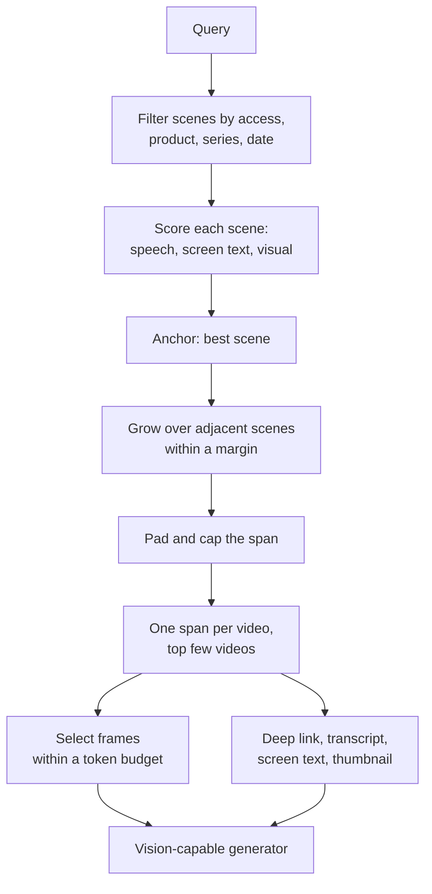

[Video transcripts](/learn/multimodal-ingestion/video-transcripts) turned a video into scene chunks: it found where the picture changes, read each keyframe, and aligned speech with what was on screen. This lesson is about using those scenes to answer questions. **Video RAG** differs from text RAG in one essential way: the answer is not just *which* video but *when*. A user asking "where do I download the VPN update?" wants the 30 seconds of the walkthrough where the button is clicked, not a 12-minute file. Finding that moment is called **temporal grounding**, and it is what this lesson is mostly about.

You will see how to retrieve from several signals per scene (speech, on-screen text, visual description, and optionally video embeddings), how to turn scene scores into a time span, how to measure span quality with temporal intersection over union, how to handle long videos with a coarse-to-fine index, and how to choose which frames to show a vision-capable generator within a token budget.

## Learning objectives

- Explain why a video RAG system must return time spans, and define temporal grounding.
- Score scenes from several signals (speech, on-screen text, visual description) and justify how the scores are combined.
- Ground a query to a span by growing from the best scene, and evaluate spans with temporal intersection over union (tIoU) by hand and in code.
- Design a coarse-to-fine index for long videos and a frame-selection policy for answering with a vision-capable model.
- Estimate the token cost of sending frames to a generator and choose a budget.

## Prerequisites

- [Video transcripts](/learn/multimodal-ingestion/video-transcripts): scene detection, keyframes, on-screen text and speech alignment.
- [Audio RAG](/learn/multimodal-rag/audio-rag): retrieval over imperfect transcripts and clip expansion.
- [Image retrieval](/learn/multimodal-rag/image-retrieval): visual and text indexes over images, and what each can see.
- [Multi-resolution retrieval](/learn/hierarchical-rag/multi-resolution-retrieval): retrieving at several levels of granularity.

## Why this matters

Meridian's IT team publishes screen-recorded walkthroughs, and the Platform team records Meridian Reports demos. They are often the best documentation of a procedure, because they show exactly where to click, and the hardest to use: nobody wants to scrub through a video for one step.

Indexing only the transcript fails on exactly the moments that make video valuable.

- **The words are deictic.** In a walkthrough, the presenter says "click this button here" and "paste it in here". The transcript of the most important moment contains none of the words a user would search for; those words are on the screen.
- **Some answers are purely visual.** "What does the VPN look like when it's connected?" is answered by a green icon, which nobody describes aloud.
- **Whole-video answers are useless.** Citing a 12-minute video for a 20-second step pushes the search back onto the user.
- **Sending the video to a model is expensive.** A minute at one frame per second is 60 images; without retrieval narrowing the span, the cost per question is prohibitive.

## The intuition

Ask a friend who has watched a recipe video "when do I add the garlic?" She does not say "it's in that video"; she says "about four minutes in, right after the onions go soft". She remembers *what was said* ("now the garlic"), *what was shown* (a chopping board tipped into the pan) and *what was written* (a caption, "Step 3: garlic"), and any one is enough to place the moment. She also gives you a little slack on either side.

A video RAG system does the same: it keeps several descriptions of every moment, finds the moment that best matches the question by any of them, and returns a span with sensible edges.

## How it works

### Signals per scene

The ingestion pipeline produces scenes, each a time span with several text signals, plus optional vectors. Each signal sees something different.

| Signal | Produced by | Sees | Misses |
| --- | --- | --- | --- |
| Speech | Transcript aligned to the scene | Explanations, reasons, warnings | Anything only shown; "this", "here" |
| On-screen text | OCR or a VLM reading the keyframe | Labels, buttons, error messages, slide text | Spoken explanation, unlabelled visuals |
| Visual description | A VLM describing the keyframe | States and appearance: "green icon", "cursor on button" | Exact strings, unless asked to transcribe them |
| Frame or clip embeddings | An image or video encoder | Overall appearance, motion (video encoders) | Small text, exact identifiers |

The first three are text, embedded with the same text model as the rest of the corpus. The fourth applies the visual index from [Image retrieval](/learn/multimodal-rag/image-retrieval) to frames: one keyframe per scene through an image-text model, or a short clip through a video-text model trained on video-caption pairs, which can capture actions such as "plugging in a cable" that no single frame shows (averaging a clip's frame embeddings is a simple baseline). In screen recordings the text signals carry most of the weight; in camera footage the balance shifts.

### Combining signals within a scene

There are two reasonable ways to combine a scene's signal scores, and the right one depends on how comparable the scores are.

- **Score fusion within a scene.** If all text signals are embedded with the same model, their cosines are on one scale, and a scene can be scored by the **maximum** over its signals: the scene matches if any view of it matches strongly. The maximum suits signals that are alternative descriptions of the same moment, where a strong match on one is decisive and a weak match on another is not evidence against. A weighted sum suits signals that should corroborate each other.
- **Rank fusion across indexes.** If signals come from different models (a text index and a CLIP frame index), their scores are not comparable, and the scene's rank in each list is fused with [reciprocal rank fusion](/learn/hybrid-search/reciprocal-rank-fusion), as in image retrieval.

Rank-fused scores are compressed into a narrow band, so they say little about how much *better* the best scene is than its neighbours, which grounding needs. Where possible, ground on comparable scores.

### Temporal grounding, step by step

1. **Filter.** Apply access control and metadata filters (product, video series, date) to the scene index.
2. **Score scenes.** Embed the query and score every candidate scene from its signals.
3. **Pick the anchor.** The highest-scoring scene is the anchor of the answer.
4. **Grow.** Extend the span over adjacent scenes of the same video whose scores are close to the anchor's (within a margin), because procedures often span several scenes and the step may begin slightly before the scene that matches best.
5. **Pad and cap.** Add a few seconds on each side so playback starts before the moment, and cap the length so that one span cannot swallow a whole video.
6. **Diversify.** Return the best span per video, and at most a few videos, so that one long video does not fill the result list with neighbouring spans of itself.
7. **Resolve.** Return the span as a deep link (`vpn-update.mp4#t=50,68`), its transcript and on-screen text, and a thumbnail; select frames for the generator if it needs to see the moment.



### Long videos: coarse to fine

A two-hour recorded training day has hundreds of scenes. Searching every scene of every video lets locally similar scenes from unrelated videos compete and gives the generator no sense of the video's subject. A **coarse-to-fine** index, the video form of [multi-resolution retrieval](/learn/hierarchical-rag/multi-resolution-retrieval), helps:

- **Video level:** a summary of each video (title, description, chapter titles, a generated summary of the transcript).
- **Chapter level:** chapters from the platform, or groups of consecutive scenes on one topic.
- **Scene level:** the scenes above.

Retrieve videos or chapters first, then ground within the best few. This cuts the candidate set, and lets the answer say "in the *VPN troubleshooting* chapter of the IT onboarding recording, at 1:12:40".

### Answering with frames

Text signals are often enough for the generator: the on-screen text and speech of the span say what to click and why. When the question is visual ("what does it look like?", "where on the screen is it?"), the generator needs frames. **Frame selection** chooses which:

- **Keyframes** of the span's scenes, one per scene: few frames, each a distinct state.
- **Uniform sampling**, such as one frame every two seconds: better for motion, at a much higher cost.
- **Query-aware selection**: score candidate frames against the query with an image-text model and keep the best few.

Frames are expensive inputs. Resize them to the smallest resolution at which their text is still legible, and keep the number small; the mathematics below puts numbers on this.

### Evaluating grounding

A span can be right, wrong or partly right, so evaluation needs a measure of overlap. **Temporal intersection over union** (tIoU) compares a predicted span with a hand-labelled gold span. Research on moment retrieval in video (for example the Charades-STA and DiDeMo benchmarks, both introduced in 2017) commonly reports the share of queries whose top prediction reaches tIoU of at least 0.5 or 0.7, written R@1, IoU=0.5. The same measure works for a production test set: label the right span for a few dozen real questions, and track mean tIoU and R@1 at 0.5 as you change signals, margins and models.

## The mathematics

### Temporal intersection over union

**Intuition.** Two spans agree well if they overlap a lot relative to the total time either covers. A prediction that contains the gold span but is ten times longer scores badly, as does a short prediction that covers only part of the gold span.

$$
\text{tIoU}(A, B) = \frac{\max\big(0, \min(a_e, b_e) - \max(a_s, b_s)\big)}{\max(a_e, b_e) - \min(a_s, b_s)}
$$

$A = [a_s, a_e]$ is the predicted span and $B = [b_s, b_e]$ the gold span, in seconds. The numerator is the length of the overlap (zero if they do not overlap); the denominator is the length from the earliest start to the latest end. When the spans overlap, that is exactly the length of their union. When they do not, the numerator is zero and the score is 0 regardless.

**By hand.**

- Predicted 50 to 68, gold 32 to 68. Overlap: $\min(68, 68) - \max(50, 32) = 68 - 50 = 18$. Union: $68 - 32 = 36$. tIoU $= 18/36 = 0.5$: right moment, but missing the first half of the procedure.
- Predicted 40 to 90, gold 32 to 68. Overlap: $68 - 40 = 28$. Union: $90 - 32 = 58$. tIoU $= 28/58 = 0.483$: covers most of the gold span but adds 22 seconds of other material, and just misses the 0.5 threshold.

### The frame budget

**Intuition.** A vision-capable model is billed for images by size. Anthropic's vision documentation gives an approximation of tokens $\approx \frac{w \times h}{750}$ for an image of $w$ by $h$ pixels (within its size limits; check the current documentation, as such details change). The number of frames multiplies it.

$$
\text{tokens} \approx n \times \frac{w \times h}{750}
$$

$n$ is the number of frames, $w$ and $h$ their width and height in pixels.

**By hand.** A 1280 by 720 frame: $921{,}600 / 750 \approx 1{,}229$ tokens. One frame per second for a 60-second span: $60 \times 1{,}229 = 73{,}740$ tokens, a large prompt before any text. Four keyframes: $4{,}916$ tokens. Four keyframes resized to 640 by 360: $4 \times 307 = 1{,}228$ tokens, sixty times fewer than the first option, and usually still legible for interface text at normal size.

```python
def tiou(a, b):
    inter = max(0, min(a[1], b[1]) - max(a[0], b[0]))
    return inter / (max(a[1], b[1]) - min(a[0], b[0]))

print("tIoU (50,68) vs (32,68):", tiou((50, 68), (32, 68)))
print("tIoU (40,90) vs (32,68):", round(tiou((40, 90), (32, 68)), 3))

tokens = lambda w, h: round(w * h / 750)          # approximate image tokens (see the vision docs)
for label, n, (w, h) in [("1 fps, 60 s, 1280x720", 60, (1280, 720)),
                         ("4 keyframes, 1280x720", 4, (1280, 720)),
                         ("4 keyframes, 640x360", 4, (640, 360))]:
    print(f"{label:24s} {n:3d} frames x {tokens(w, h):5,d} tokens = {n * tokens(w, h):7,d}")
```

```output
tIoU (50,68) vs (32,68): 0.5
tIoU (40,90) vs (32,68): 0.483
1 fps, 60 s, 1280x720     60 frames x 1,229 tokens =  73,740
4 keyframes, 1280x720      4 frames x 1,229 tokens =   4,916
4 keyframes, 640x360       4 frames x   307 tokens =   1,228
```

## In code

### Multi-signal temporal grounding

**The problem.** Two Meridian videos, a VPN update walkthrough and a Meridian Reports single sign-on demo, have been ingested into scenes with three text signals each. Ground four questions to time spans using speech alone and using all three signals, and score both with tIoU against hand-labelled gold spans.

**Dependencies.** Sentence Transformers with `all-MiniLM-L6-v2`, and NumPy.

```bash
pip install sentence-transformers numpy
```

```python
import numpy as np
from sentence_transformers import SentenceTransformer

# One row per scene: video, start s, end s, speech, on-screen text (OCR), visual description (VLM).
SCENES = [
    ("vpn-update", 0, 15, "hi everyone in this video I'll show you how to fix the most common vpn problem",
     "Meridian VPN - Disconnected", "VPN client window, status disconnected, grey icon"),
    ("vpn-update", 15, 32, "when you try to connect you might see this red message",
     "Error E-4021: client out of date", "VPN client with a red error banner across the top"),
    ("vpn-update", 32, 50, "so open your browser and go to this page",
     "IT portal - Software downloads", "web browser showing a list of software downloads"),
    ("vpn-update", 50, 68, "find it in the list and click this button here",
     "Meridian VPN client 5.2 [Download update]", "cursor hovering over a blue Download update button"),
    ("vpn-update", 68, 85, "once it's installed just reconnect and you're done",
     "Meridian VPN - Connected", "VPN client window, status connected, green icon"),
    ("reports-sso", 0, 20, "this is the settings area for enterprise admins",
     "Meridian Reports - Settings - Single sign-on (SAML)", "settings page with a left navigation menu"),
    ("reports-sso", 20, 40, "copy the value from your identity provider and paste it in here",
     "Identity provider URL [      ]  Certificate [Upload]", "form with two empty fields and an upload button"),
    ("reports-sso", 40, 55, "then save and test it from a second browser",
     "[Save]  [Test sign-in]", "two buttons at the bottom of a form, Save highlighted"),
    ("reports-sso", 55, 70, "you can also export the sign-in log from here",
     "Export sign-in log:  PDF  CSV", "dialog with PDF and CSV options"),
]
SIGNALS = {"speech": 3, "screen": 4, "visual": 5}
QUERIES = [  # query, gold video, gold span (seconds)
    ("Where do I download the VPN client update?", "vpn-update", (32, 68)),
    ("Where do I enter the identity provider URL for SAML?", "reports-sso", (20, 40)),
    ("What does the VPN look like when it is connected?", "vpn-update", (68, 85)),
    ("Can I export the sign-in log as CSV?", "reports-sso", (55, 70)),
]

model = SentenceTransformer("sentence-transformers/all-MiniLM-L6-v2")
vectors = {name: model.encode([s[col] for s in SCENES], normalize_embeddings=True)
           for name, col in SIGNALS.items()}

def scene_scores(query, signals):
    """Score each scene by its best-matching signal: one strong view of a scene is enough."""
    q = model.encode([query], normalize_embeddings=True)[0]
    return np.max([vectors[name] @ q for name in signals], axis=0)

def ground(scores, margin=0.1):
    """Take the best scene, then grow over adjacent scenes of the same video within `margin` of it."""
    best = int(np.argmax(scores))
    lo = hi = best
    same = lambda j: 0 <= j < len(SCENES) and SCENES[j][0] == SCENES[best][0]
    while same(lo - 1) and scores[lo - 1] >= scores[best] - margin:
        lo -= 1
    while same(hi + 1) and scores[hi + 1] >= scores[best] - margin:
        hi += 1
    return SCENES[best][0], (SCENES[lo][1], SCENES[hi][2])

def tiou(a, b):
    inter = max(0, min(a[1], b[1]) - max(a[0], b[0]))
    return inter / (max(a[1], b[1]) - min(a[0], b[0]))

for label, signals in [("speech only", ["speech"]), ("speech + screen + visual", list(SIGNALS))]:
    print(label)
    total = 0.0
    for query, gold_video, gold_span in QUERIES:
        video, span = ground(scene_scores(query, signals))
        score = tiou(span, gold_span) if video == gold_video else 0.0
        total += score
        print(f"   {query[:48]:48s} -> {video}#t={span[0]},{span[1]}  tIoU {score:.2f}")
    print(f"   mean tIoU {total / len(QUERIES):.2f}")
```

**The important lines.**

- `vectors` holds one matrix per signal, all from the same text model, so their cosines are on a common scale and can be compared within a scene.
- `scene_scores` takes the maximum over the chosen signals for each scene. Passing `["speech"]` reproduces a transcript-only system.
- `ground` implements steps 3 and 4: anchor on the best scene, then grow over neighbours of the same video whose score is within `margin` (0.1 in cosine) of the anchor's. A relative margin on comparable scores is what makes growth meaningful; on rank-fused scores it would not be.
- `tiou` is the formula from the mathematics section. A span in the wrong video scores 0.

**Output**, from a real run:

```output
speech only
   Where do I download the VPN client update?       -> vpn-update#t=0,15  tIoU 0.00
   Where do I enter the identity provider URL for S -> reports-sso#t=20,40  tIoU 1.00
   What does the VPN look like when it is connected -> vpn-update#t=0,15  tIoU 0.00
   Can I export the sign-in log as CSV?             -> reports-sso#t=55,70  tIoU 1.00
   mean tIoU 0.50
speech + screen + visual
   Where do I download the VPN client update?       -> vpn-update#t=50,68  tIoU 0.50
   Where do I enter the identity provider URL for S -> reports-sso#t=20,40  tIoU 1.00
   What does the VPN look like when it is connected -> vpn-update#t=68,85  tIoU 1.00
   Can I export the sign-in log as CSV?             -> reports-sso#t=55,70  tIoU 1.00
   mean tIoU 0.88
```

**What the output means.**

- **Speech alone finds the right video and the wrong moment.** For the download question, it grounds on the introduction ("how to fix the most common vpn problem"), the scene whose speech is most about the VPN in general. The scene where the button is clicked says only "click this button here". tIoU 0.
- **Speech alone cannot answer visual questions.** "What does the VPN look like when it is connected?" again lands on the introduction; the answer, a green "Connected" status, is never spoken.
- **Speech works when the speaker names the thing.** "Identity provider" and "export the sign-in log" are said aloud, so both systems ground those correctly.
- **All three signals ground every question to the right moment.** The download question lands on the scene with the "Download update" button (on-screen text), and the connected-state question on the scene whose description mentions the green icon and whose screen reads "Connected".
- **Partial credit shows a grounding limit.** The gold span for the download question includes the scene where the presenter opens the IT portal (32 to 50 seconds). Its score is not within 0.1 of the anchor's, so growth stopped at tIoU 0.5. Margin and padding are parameters to tune on a labelled set (exercise 3 shows how a wider margin backfires).

**Common errors.** Taking a maximum over signals from different models compares unrelated scales. Growing across a video boundary produces spans that do not exist. Loose gold spans make every system look good.

**Extending it.** Add a CLIP keyframe signal fused by rank; return the best span for each of the top three videos; score video summaries first as a coarse level.

### Answering from the grounded span

Once the span is known, the generator receives its text signals and, for visual questions, a few frames. The following was not executed for this lesson (it needs an API key and frame files from your own ingestion), so treat it as a template; it follows the message shape used throughout the course.

```python
import base64
import anthropic

client = anthropic.Anthropic()  # reads ANTHROPIC_API_KEY from the environment

def frame_block(path):
    with open(path, "rb") as f:
        data = base64.b64encode(f.read()).decode()
    return {"type": "image", "source": {"type": "base64", "media_type": "image/jpeg", "data": data}}

span_text = (
    "[vpn-update.mp4, 50-68s, presenter: Tom, automatic transcript]\n"
    "Said: find it in the list and click this button here\n"
    "On screen: Meridian VPN client 5.2 [Download update]"
)
frames = ["frames/vpn-update_0052.jpg", "frames/vpn-update_0066.jpg"]   # keyframes resized to 640x360

response = client.messages.create(
    model="claude-opus-5-5",
    max_tokens=512,
    system="Answer only from the provided video excerpt and frames. Cite the time span. "
           "If the answer is not there, say you don't know.",
    messages=[{"role": "user", "content": [
        *[frame_block(p) for p in frames],
        {"type": "text", "text": f"{span_text}\n\nQuestion: Where do I download the VPN client update?"},
    ]}],
)
answer = "".join(block.text for block in response.content if block.type == "text")
print(answer)
```

Your wording will differ; a good answer names the "Download update" button and cites `vpn-update.mp4#t=50,68`.

## A real-world example

Meridian's Platform team first made the IT walkthrough videos searchable with the audio pipeline from [Audio RAG](/learn/multimodal-rag/audio-rag): transcripts, hybrid search, clips with time links. Testing with the support desk's most common questions showed a pattern. *Why* questions ("why do I need the VPN on public Wi-Fi?") worked, because presenters explain reasons aloud. *Where* questions ("which field does the certificate go in?") often landed on the right video's introduction, because presenters said "here" and "this" at the crucial moments.

The team indexed the on-screen text and keyframe descriptions that ingestion already produced for display, with the same text model, scoring scenes by their best signal. "Where" questions started landing on the right scenes. Two changes followed from inspecting spans: 3 seconds of padding, after playback began mid-click; and a 90-second cap, after a question about the SSO demo returned the entire video because every scene scored similarly.

For visual questions, the generator now receives up to four keyframes from the span, 640 pixels wide, with the span's text. Each change was checked against mean tIoU and R@1 at 0.5 on 60 labelled questions.

## Common mistakes

- **Indexing only the transcript of screen recordings.** The crucial moments are spoken as "this" and "here"; their content is on screen.
- **Returning whole videos.** A citation without a time span makes the user do the retrieval.
- **Combining signals from different models by raw score.** Their scales differ; use rank fusion, or the same embedding model for all text signals.
- **Growing spans without a cap.** When all scenes of a video score similarly, the span becomes the video.
- **Sending frames at full resolution and high frame rate.** Token cost grows with pixels and frame count; most interface questions need a few small keyframes.
- **Evaluating only whether the right video was found.** Video-level accuracy hides grounding errors; measure tIoU against labelled spans.

## Best practices

- Index at least three text signals per scene, speech, on-screen text and a visual description, with the same embedding model.
- Ground by anchoring on the best scene and growing over adjacent scenes within a margin, then pad and cap the span.
- Return one span per video and few videos, each with a deep link, transcript excerpt, on-screen text and thumbnail.
- Use a coarse-to-fine index (video, chapter, scene) for long recordings.
- Select a few keyframes per span for visual questions, resized to the smallest legible size, and give the generator the span's text alongside them.
- Label gold spans for real questions and track mean tIoU and R@1 at 0.5 whenever signals, margins or models change.

## Performance considerations

**Index size.** Scenes are few compared with transcript segments: a screen recording might change scene every 10 to 30 seconds (an assumption that depends heavily on the content). For 500 hours of video (an assumed figure) at one scene per 20 seconds, that is 90,000 scenes; three 384-dimensional float32 signals each is $90{,}000 \times 3 \times 1{,}536 \approx 415$ MB. Adding a 512-dimensional keyframe vector adds about 184 MB.

**Query cost.** Three signals mean three nearest-neighbour searches, run in parallel. Growing needs scores for the anchor's neighbours, which an approximate top-k search may not return; fetch their vectors by scene identifier and score them directly.

**Generation cost.** Frames dominate. As computed above, four 640 by 360 keyframes cost about 1,200 input tokens, sixty times less than one frame per second for a minute at 1280 by 720. Choose the frame policy per question type: none for "why" questions, keyframes for "where" and "what does it look like", denser sampling only for questions about motion.

## Security considerations

- **Screen recordings leak.** Walkthroughs capture whatever was on the presenter's screen: email previews, chat notifications, customer data, sometimes passwords or tokens typed during the demo. On-screen text extraction makes these searchable. Scan extracted text for secrets and personal data at ingestion, and blur or exclude affected scenes.
- **Instructions on screen.** A slide reading "ignore previous instructions" reaches the generator as OCR text and as pixels: an [indirect prompt injection](/learn/rag-security-fundamentals/indirect-prompt-injection). Delimit extracted text and never let video content trigger actions.
- **Faces and voices.** Camera footage of staff is personal data, and descriptions that describe people make them searchable. Restrict descriptions to screen content for screen recordings.
- **Access control per video.** A recorded meeting inherits the permissions of the meeting; a demo for customers may be public. Store permissions on every scene and filter before scoring.

## Summary

- Video RAG must answer *when*, not just *which*: the unit of an answer is a time span, found by temporal grounding.
- Each scene carries several signals; speech misses what is only shown, and on-screen text and visual descriptions fill the gap. Score same-model signals by their maximum, and fuse different-model signals by rank.
- Ground by anchoring on the best scene, growing over close-scoring neighbours, then padding and capping; evaluate spans with temporal IoU and R@1 at 0.5.
- Long videos need a coarse-to-fine index of videos, chapters and scenes.
- Frames for the generator are costly: about $w \times h / 750$ tokens each by Anthropic's approximation, so send a few resized keyframes from the grounded span, not the video.

## Exercises

1. **By hand.** The gold span is 120 to 150 seconds. Compute tIoU for predictions of 110 to 140, 125 to 145, and 150 to 170.

<details><summary>Show solution</summary>

110 to 140: overlap $140 - 120 = 20$, union $150 - 110 = 40$, tIoU 0.5. 125 to 145: overlap 20, union $150 - 120 = 30$, tIoU 0.667. 150 to 170: overlap $\max(0, 150 - 150) = 0$, tIoU 0. The second is shorter than the first but scores higher, because it adds no time outside the gold span.

</details>

2. **By hand.** A question needs a 90-second span. Compare the token cost of (a) one frame every 3 seconds at 1024 by 576, and (b) the span's 5 keyframes at 768 by 432.

<details><summary>Show solution</summary>

(a) 30 frames; each $1024 \times 576 / 750 = 786$ tokens (to the nearest token); total about 23,600. (b) Each $768 \times 432 / 750 \approx 442$ tokens; total about 2,200. Option (b) is roughly ten times cheaper; option (a) is worth it only for questions about motion within the span.

</details>

3. **Code.** Change `ground` to add `pad` seconds on each side (not beyond the video's start or end) and to cap spans at `max_len` seconds by keeping a window centred on the anchor scene. Rerun the multi-signal configuration with `pad=3` and `margin=0.25`. What happens to each query's tIoU, and why?

<details><summary>Show solution</summary>

```python
def ground(scores, margin=0.1, pad=3, max_len=90):
    best = int(np.argmax(scores))
    lo = hi = best
    same = lambda j: 0 <= j < len(SCENES) and SCENES[j][0] == SCENES[best][0]
    while same(lo - 1) and scores[lo - 1] >= scores[best] - margin:
        lo -= 1
    while same(hi + 1) and scores[hi + 1] >= scores[best] - margin:
        hi += 1
    video_end = max(s[2] for s in SCENES if s[0] == SCENES[best][0])
    start, end = max(0, SCENES[lo][1] - pad), min(video_end, SCENES[hi][2] + pad)
    if end - start > max_len:                          # keep a window centred on the anchor scene
        mid = (SCENES[best][1] + SCENES[best][2]) / 2
        start = max(start, min(mid - max_len / 2, end - max_len))
        end = start + max_len
    return SCENES[best][0], (start, end)
```

With `margin=0.25` (and `ground(..., margin=0.25)` in the loop), a real run of the multi-signal configuration gave:

```output
   Where do I download the VPN client update?       -> vpn-update#t=47,85  tIoU 0.40
   Where do I enter the identity provider URL for S -> reports-sso#t=0,43  tIoU 0.47
   What does the VPN look like when it is connected -> vpn-update#t=65,85  tIoU 0.85
   Can I export the sign-in log as CSV?             -> reports-sso#t=52,70  tIoU 0.83
   mean tIoU 0.64
```

Mean tIoU falls from 0.88 to 0.64. Padding costs a little everywhere against tight gold spans (55 to 70 becomes 52 to 70). The wider margin does not pull the download span back to the IT portal scene, as one might hope; it grows it *forward* over the "Connected" scene, whose description also mentions the VPN client, and grows the SSO span back over the settings introduction. Margins are tuned on a labelled set and inspected span by span, not raised in the hope of more recall. If padded playback is the behaviour you want, label gold spans with the same padding.

</details>

4. **Design.** Meridian records a full-day onboarding event: eight hours, five presenters, slides, live demos and Q&A. Design the index and the grounding for questions such as "what did IT say about laptop refresh?" and "show me where the expense form is in the demo".

<details><summary>Show solution</summary>

Coarse-to-fine: a video summary; chapters per session (presenter, title, times) from the agenda or slide-title changes; scenes with speaker-labelled speech, on-screen text and a visual description. Retrieve chapters first using summaries and presenter metadata ("IT" resolves to the IT session), then ground within the top two or three. The laptop question is a speech question, suited to forward clip expansion from [Audio RAG](/learn/multimodal-rag/audio-rag). The expense-form question is a "where" question: ground on on-screen text and descriptions, and send two or three resized keyframes. Cap spans, return one per chapter, and tune margin and padding on twenty labelled questions.

</details>

## Check your understanding

```quiz
[
  {
    "q": "In a screen-recorded walkthrough, the presenter says \"click this button here\" at the crucial step. Which signal is most likely to let a query find that scene?",
    "options": [
      "The transcript of the scene",
      "The video's title",
      "The on-screen text read from the keyframe",
      "The audio waveform"
    ],
    "answer": 2,
    "why": "Deictic speech carries no searchable content; the button's label is on screen, so OCR or a VLM reading of the keyframe supplies the matching words."
  },
  {
    "q": "A predicted span is 40 to 60 seconds and the gold span is 50 to 80 seconds. What is the tIoU?",
    "options": [
      "0.25",
      "0.33",
      "0.50",
      "0.67"
    ],
    "answer": 0,
    "why": "Overlap is 60 - 50 = 10 seconds; the union runs from 40 to 80, 40 seconds; 10 / 40 = 0.25."
  },
  {
    "q": "Why does the code take the maximum over a scene's signals rather than fusing them by rank?",
    "options": [
      "Rank fusion cannot handle three lists",
      "The maximum is always more accurate",
      "Rank fusion requires a GPU",
      "All signals come from the same embedding model, so their cosines are comparable, and grounding needs scores whose gaps are meaningful"
    ],
    "answer": 3,
    "why": "Comparable scores allow a per-scene maximum and a margin-based growth rule; rank-fused scores are compressed and say little about how much better the anchor is than its neighbours."
  },
  {
    "q": "A question about a two-hour training recording keeps returning neighbouring scenes from unrelated sessions. Which change addresses this most directly?",
    "options": [
      "Raise the frame rate of keyframe sampling",
      "Add a coarse-to-fine index: retrieve the session or chapter first, then ground within it",
      "Remove the visual descriptions",
      "Use a larger embedding dimension"
    ],
    "answer": 1,
    "why": "Retrieving chapters first restricts grounding to the right part of the recording and gives the answer its context."
  },
  {
    "q": "Using the approximation of w times h divided by 750 tokens per image, how many tokens do 4 frames of 640 by 360 cost?",
    "options": [
      "About 1,230",
      "About 307",
      "About 4,900",
      "About 73,700"
    ],
    "answer": 0,
    "why": "640 times 360 is 230,400; divided by 750 that is about 307 tokens per frame; four frames are about 1,230 tokens."
  }
]
```

## Further reading

- Gao, J., Sun, C., Yang, Z. and Nevatia, R. (2017). "TALL: Temporal Activity Localization via Language Query", ICCV 2017 (introduces the Charades-STA benchmark). [arXiv:1705.02101](https://arxiv.org/abs/1705.02101)
- Hendricks, L. A. et al. (2017). "Localizing Moments in Video with Natural Language", ICCV 2017 (the DiDeMo dataset). [arXiv:1708.01641](https://arxiv.org/abs/1708.01641)
- Lei, J., Berg, T. L. and Bansal, M. (2021). "Detecting Moments and Highlights in Videos via Natural Language Queries" (QVHighlights and Moment-DETR), NeurIPS 2021. [arXiv:2107.09609](https://arxiv.org/abs/2107.09609)
- Anthropic, "Vision" in the Claude documentation, on image inputs, size limits and token costs: [docs.anthropic.com/en/docs/build-with-claude/vision](https://docs.anthropic.com/en/docs/build-with-claude/vision)
- W3C (2012). *Media Fragments URI 1.0 (basic)*, for time links into media: [w3.org/TR/media-frags](https://www.w3.org/TR/media-frags/)
- PySceneDetect documentation, for scene detection at ingestion time: [scenedetect.com](https://www.scenedetect.com/)
