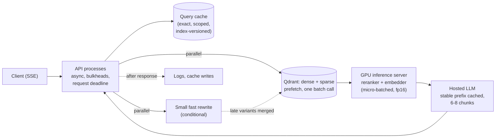

This assessment covers the whole Performance Optimisation module: latency measurement and the critical path, caching in its exact, semantic and query forms, batch processing, parallel retrieval, async execution, streaming and GPU acceleration. Work through the quiz first; a score of 14 out of 18 or better (about 75%) shows a solid grasp. Then attempt the open questions, coding exercises, design challenge and troubleshooting scenarios before opening the model answers. The coding solutions run locally with Python 3.11 or later and no API key.

```quiz
[
  {"q": "A RAG request's p95 latency is 4.0 s, of which reranking accounts for 0.4 s. What is the most you can save on that p95 by optimising reranking alone?", "options": ["About 4.0 s", "About 0.4 s", "About 2.0 s", "It depends on the cache hit rate"], "answer": 1, "why": "By Amdahl's law, a stage can save at most the time it takes on the critical path. Removing reranking entirely saves 0.4 s."},
  {"q": "A cache has a hit rate of 0.3, a lookup cost of 2 ms and a miss cost of 1,000 ms. What is the expected latency?", "options": ["302 ms", "700 ms", "702 ms", "1,002 ms"], "answer": 2, "why": "Expected latency is lookup + (1 - h) x miss = 2 + 0.7 x 1,000 = 702 ms; the lookup is paid on every request."},
  {"q": "Which item must be part of a retrieval-results cache key in a multi-tenant RAG system?", "options": ["The user's permission scope and the index version", "The time of day", "The response's token count", "The client's IP address"], "answer": 0, "why": "The key must contain everything the cached value depends on. Without permission scope, one user could be served another's results; without the index version, stale results survive re-indexing."},
  {"q": "A semantic cache serves stored answers when a new question's embedding has cosine similarity above 0.92 with a cached one. What is its characteristic failure?", "options": ["It never hits", "It doubles generation cost", "It cannot be invalidated", "It can return a confident answer to a different question that happens to be close in embedding space, such as one with a different error code"], "answer": 3, "why": "Embeddings measure topical similarity, not answer equivalence. Near-misses such as E-4012 versus E-4021 can exceed any practical threshold."},
  {"q": "A popular query's cache entry expires and 200 identical requests arrive within the 0.5 s it takes to recompute. Without any protection, how many recomputations happen?", "options": ["1", "Up to 200", "2", "None, because the old value is served"], "answer": 1, "why": "Every request that misses before the first recomputation finishes starts its own. Request coalescing (single-flight) reduces this to one."},
  {"q": "Why does embedding 10,000 chunks in batches of 64 usually beat 10,000 single-text calls, even on a CPU?", "options": ["Batching changes the embeddings", "Batching skips tokenisation", "Fixed per-call costs (Python overhead, kernel launches, network round trips) are shared across the batch, and matrix operations use the hardware better", "Single calls are rate-limited by the operating system"], "answer": 2, "why": "A call costs roughly a fixed amount plus a per-item amount; batching amortises the fixed part."},
  {"q": "An index is split over 4 shards. To get an exact global top 10 from a scatter-gather, each shard must return how many results?", "options": ["10", "3", "40", "Any number, if scores are normalised"], "answer": 0, "why": "All 10 global winners may live on one shard, so each must return 10; the coordinator keeps the best 10 of 40."},
  {"q": "A team runs four FAISS shard searches in four Python threads and sees no speed-up; CPU usage is very high. What is the most likely cause?", "options": ["The GIL blocks FAISS", "FAISS cannot search shards", "Threads are slower than processes for all work", "Each FAISS call also starts its own OpenMP threads, oversubscribing the cores"], "answer": 3, "why": "FAISS releases the GIL, so threads can overlap, but nested OpenMP parallelism oversubscribes the CPU. Set FAISS to one thread when parallelising across shards."},
  {"q": "Hedging a search after its p95 delay, with independent replicas, mainly changes which statistics?", "options": ["It halves the median", "It doubles throughput", "It sharply reduces the tail (p99) for about 5% extra requests", "It removes the need for timeouts"], "answer": 2, "why": "Only slow requests trigger the hedge, so the median is untouched and extra load is about the share that exceed the p95."},
  {"q": "What does this code print?\n```python\nimport asyncio, time\n\nasync def handler():\n    time.sleep(0.1)\n\nasync def main():\n    t0 = time.perf_counter()\n    await asyncio.gather(*(handler() for _ in range(5)))\n    print(round(time.perf_counter() - t0, 1))\n\nasyncio.run(main())\n```", "options": ["0.1", "0.5", "0.0", "It raises an error"], "answer": 1, "why": "time.sleep blocks the event loop, so the five handlers run one after another: about 0.5 s. With await asyncio.sleep it would be about 0.1 s."},
  {"q": "A service wraps each local embedding call in `asyncio.to_thread`. Event-loop lag falls, but throughput does not improve. Why?", "options": ["Threads keep the loop responsive but do not add CPU capacity; per-request model calls still do the same total work", "to_thread is broken", "The GIL prevents all threading", "The thread pool has only one worker"], "answer": 0, "why": "Offloading protects the loop. Throughput gains come from micro-batching concurrent requests or more hardware."},
  {"q": "A request has a 6 s deadline. Retrieval took 1.5 s and reranking 0.7 s. With deadline propagation, what is the most generation may take?", "options": ["6 s", "Its own configured timeout", "4.5 s", "3.8 s"], "answer": 3, "why": "Each stage gets the time remaining from one request-wide deadline: 6 - 1.5 - 0.7 = 3.8 s."},
  {"q": "Why should a bulkhead around a hosted reranker cap the number of waiting requests, not only those in flight?", "options": ["To raise the reranker's throughput", "So that during a slowdown requests fail fast or skip reranking instead of queueing while holding memory and connections", "Because semaphores cannot queue", "To reduce token usage"], "answer": 1, "why": "Unbounded waiting lines grow during slowdowns and mostly time out anyway; shedding early protects the rest of the service."},
  {"q": "A streamed answer's first text event arrives at the client 3 ms before the final event, though the server yields text over 4 seconds. What is the most likely cause?", "options": ["The model is slow", "Coalescing at 50 ms", "A buffering hop such as a proxy or compression middleware", "Prompt caching is disabled"], "answer": 2, "why": "All events arriving together at the end is the signature of buffering somewhere between server and client."},
  {"q": "Which change most directly shortens time to first token in a RAG pipeline?", "options": ["Coalescing deltas into 100 ms flushes", "Increasing max_tokens", "Sending a done event earlier", "Cutting the prompt from 20 retrieved chunks to 6, after checking quality"], "answer": 3, "why": "The model must prefill the whole prompt before its first token, and prefill time grows with prompt length. Coalescing affects smoothness, not TTFT."},
  {"q": "Which RAG workload usually gains least from moving to a GPU?", "options": ["Embedding one short query per request at low traffic", "Re-embedding 2 million chunks", "Reranking 100 candidates per query with a cross-encoder", "Serving a self-hosted language model"], "answer": 0, "why": "A single short query offers too little parallel work to fill a GPU; fixed overheads dominate. The others are heavy and batchable."},
  {"q": "For a self-hosted model serving long RAG prompts, what usually limits concurrent requests per GPU?", "options": ["Tokeniser speed", "The number of CUDA cores", "Memory for the KV cache of sequences in flight", "Disk speed"], "answer": 2, "why": "The KV cache grows with every token of every sequence; with prompts of thousands of tokens it fills memory before arithmetic saturates."},
  {"q": "A team measures a GPU reranker at 0.3 ms per query. What should they suspect first?", "options": ["fp16 is very fast", "The timer stopped before the asynchronous GPU work finished", "The candidates were cached", "The batch size was too large"], "answer": 1, "why": "GPU launches return immediately. Timing without synchronisation (or a copy back to the CPU) measures only the launch."}
]
```

## Conceptual questions

1. **Latency versus throughput.** Explain, with an example from this module, an optimisation that improves latency without improving throughput, and one that improves throughput while making some requests slower.

<details><summary>Show model answer</summary>

Parallel shard search improves latency without improving throughput: four shards searched at once finish in about a quarter of the time, but the total CPU work is the same plus coordination, so at saturation the cluster serves no more requests. Streaming is another latency-only change: it moves the first visible text earlier but leaves total time and cost unchanged.

Micro-batching improves throughput while making some requests slower: a lone request may wait up to `max_wait` for a batch to fill, but at high traffic each model call does far more work, so the service handles many more requests per second. GPU batching of decoding in an inference server is the same trade at larger scale: each sequence decodes a little more slowly than alone, but the GPU serves many sequences at once.

</details>

2. **Three caches, three risks.** Compare an exact answer cache, a query (retrieval-results) cache and a semantic cache for AskMeridian: what each saves, what can go wrong, and what each key must contain.

<details><summary>Show model answer</summary>

An **exact answer cache** keyed on the normalised question saves the whole pipeline, including generation, but only for literal repeats. Its risk is staleness and leakage: the key must include the permission scope, index version and prompt or model version, or a user may see an answer built from documents they cannot access or from a superseded handbook.

A **query cache** stores retrieval results (ideally chunk ids) for exact repeats. It saves embedding, search and reranking but keeps generation in the loop, so a stale or slightly wrong retrieval is less damaging. Its key must contain the normalised query, filters, permission scope, index version and retrieval configuration (k, reranker, fusion settings).

A **semantic cache** serves stored answers for questions whose embeddings are close. It has the highest hit rate and the highest risk: near-miss questions (a different error code, a different product) can exceed the threshold and receive a confidently wrong answer. It needs the same scoping as the others, plus a threshold chosen from labelled pairs, guards for identifiers, and ideally a verifier; caching retrieved context rather than answers reduces the damage of a near-miss.

</details>

3. **Why fan-out hurts the tail.** A request fans out to 12 branches, each slow (over its own p99) on 1% of calls, independently. What fraction of requests have at least one slow branch, and name two mitigations with their costs.

<details><summary>Show model answer</summary>

$1 - 0.99^{12} \approx 0.114$: about 11% of requests wait for a slow branch, so the request's p90 is already affected by what is each branch's p99. Mitigations: a **deadline with optional branches**, which caps the wait but can lose recall when a late branch held relevant results; and **hedged requests**, which send a backup to another replica after a delay near the p95, cutting the tail for about 5% extra load but requiring replicas and idempotent operations, and helping less when slowness is shared across replicas. Reducing the number of branches, by batching query variants into one call per collection, attacks the cause.

</details>

4. **What belongs on the event loop.** State the rule for deciding whether work may run directly in a coroutine, and classify: building a prompt, parsing a 40-page PDF, a cross-encoder rerank in-process, and a call to a hosted vector database.

<details><summary>Show model answer</summary>

Any code between two awaits delays every other request on the process by its duration, so only work measured in microseconds to well under a millisecond belongs on the loop; everything that waits on the network belongs there too, but through an async client. Building a prompt: on the loop. Parsing a 40-page PDF: off the loop, in a process pool or an ingestion worker, since it is CPU-bound and pure Python parsing does not parallelise in threads. A cross-encoder rerank in-process: off the loop, in a thread with batching, or better in a separate inference service. A hosted vector database call: on the loop through an async client, behind a bulkhead with a deadline.

</details>

5. **When a GPU is worth it.** AskMeridian answers 3 questions per second at peak with a hosted language model. Argue for or against GPUs for query embedding, reranking and generation.

<details><summary>Show model answer</summary>

Query embedding: against. A small embedding model embeds one query in a few milliseconds on a CPU; at 3 per second, a GPU would be idle almost all the time. Reranking: for, if the pipeline uses a cross-encoder over tens of candidates; a shared GPU inference server can cut reranking from seconds to a few hundred milliseconds and be shared by every API process, and it can also run monthly re-embedding jobs. Generation: against at this volume, unless data rules forbid hosted models; serving a language model needs substantial GPU memory for weights and KV cache and an operations burden that 3 questions per second does not justify. The general principle is to pay for GPUs where work is heavy and batchable.

</details>

## Coding exercises

### Exercise 1: coalesce concurrent cache misses

Write an asyncio cache whose `get(key)` computes a missing value once even when many coroutines ask for the same key at the same moment. Test it with 50 concurrent requests for one query and 30 for another, where computing takes 0.2 s, and report how many computations ran and the total time.

<details><summary>Show solution</summary>

```python
import asyncio

class CoalescingCache:
    """A cache whose concurrent misses for the same key share one computation."""
    def __init__(self, compute):
        self.compute = compute
        self.values: dict[str, str] = {}
        self.inflight: dict[str, asyncio.Future] = {}
        self.computations = 0

    async def get(self, key: str) -> str:
        if key in self.values:
            return self.values[key]
        if key in self.inflight:                       # someone is already computing it
            return await asyncio.shield(self.inflight[key])
        fut = asyncio.get_running_loop().create_future()
        self.inflight[key] = fut
        try:
            self.computations += 1
            value = await self.compute(key)
            self.values[key] = value
            fut.set_result(value)
            return value
        except BaseException as exc:
            fut.set_exception(exc)                     # waiters see the same failure
            raise
        finally:
            del self.inflight[key]

async def retrieve(query: str) -> str:
    await asyncio.sleep(0.2)                           # embedding + search + rerank
    return f"chunks for {query!r}"

async def main():
    cache = CoalescingCache(retrieve)
    queries = ["annual leave"] * 50 + ["vpn error e-4012"] * 30
    loop = asyncio.get_running_loop()
    t0 = loop.time()
    results = await asyncio.gather(*(cache.get(q) for q in queries))
    print(f"{len(results)} requests, {cache.computations} computations, "
          f"{loop.time() - t0:.2f} s")
    await cache.get("annual leave")
    print(f"after a repeat: {cache.computations} computations")

asyncio.run(main())
```

```output
80 requests, 2 computations, 0.20 s
after a repeat: 2 computations
```

The first request for each key creates a future and computes; the others find the future in `inflight` and await it. `asyncio.shield` stops a waiter's cancellation (for example its own timeout) from cancelling the shared future that other waiters depend on. Errors are propagated to every waiter, and `finally` removes the in-flight entry so a later request can retry. A production version adds a TTL, a size bound and a scoped key, as in [Query caching](/learn/performance-optimisation/query-caching).

</details>

### Exercise 2: a hedged request

Write `hedged(delay)` that starts a search, starts a backup search if the first has not finished after `delay` seconds, returns whichever finishes first and cancels the other. Simulate searches that take 40 ms normally and 500 ms on 10% of calls. Compare p50, p95 and maximum latency over 200 searches with and without hedging at 60 ms, and report the extra requests sent.

<details><summary>Show solution</summary>

```python
import asyncio
import random

random.seed(3)

async def search(replica: str) -> str:
    stalled = random.random() < 0.1                     # 10% of calls stall
    await asyncio.sleep(0.5 if stalled else 0.04)
    return replica

async def hedged(delay: float) -> tuple[str, int]:
    """Start one search; if it is not done after `delay`, start a backup. First wins."""
    first = asyncio.create_task(search("primary"))
    done, _ = await asyncio.wait({first}, timeout=delay)
    if done:
        return first.result(), 1
    backup = asyncio.create_task(search("backup"))
    done, pending = await asyncio.wait({first, backup}, return_when=asyncio.FIRST_COMPLETED)
    for task in pending:
        task.cancel()                                   # stop the loser
    return done.pop().result(), 2

async def timed(coro):
    loop = asyncio.get_running_loop()
    t0 = loop.time()
    result = await coro
    return loop.time() - t0, result

async def main():
    plain = [(await timed(search("primary")))[0] for _ in range(200)]
    hedge = [await timed(hedged(0.06)) for _ in range(200)]
    lat = sorted(t for t, _ in hedge)
    sent = sum(n for _, (_, n) in hedge)
    p = lambda xs, q: sorted(xs)[int(q * len(xs)) - 1]
    print(f"plain : p50 {p(plain, .5)*1000:4.0f} ms  p95 {p(plain, .95)*1000:4.0f} ms  max {max(plain)*1000:4.0f} ms")
    print(f"hedged: p50 {p(lat, .5)*1000:4.0f} ms  p95 {p(lat, .95)*1000:4.0f} ms  max {max(lat)*1000:4.0f} ms")
    print(f"requests sent: {sent} for 200 searches ({sent / 200 - 1:.0%} extra)")

asyncio.run(main())
```

```output
plain : p50   41 ms  p95  501 ms  max  502 ms
hedged: p50   41 ms  p95  102 ms  max  502 ms
requests sent: 219 for 200 searches (9% extra)
```

Hedging cut the p95 from about 500 ms to about 100 ms (the 60 ms delay plus one normal search) for 9% more requests, close to the 10% stall rate. The median is unchanged. The maximum is still 500 ms: in about 1% of hedged searches both attempts stalled, which is why hedging shrinks the tail but cannot remove it, and why it helps far less when stalls are correlated across replicas.

</details>

## Architecture design challenge

Meridian is rolling AskMeridian out to all 400 staff and expects peak traffic of about 10 questions per second on Monday mornings. Targets: p95 time to first visible text under 1 s, p95 total time under 6 s, and no increase in wrong answers. The current pipeline is sequential: a language-model query rewrite, dense search in Qdrant, BM25, a cross-encoder rerank of 50 candidates on CPU inside the API process, then streamed generation from a hosted model with 15 chunks in the prompt. The handbook changes a few times a month; runbooks change weekly. Design the performance architecture and justify the trade-offs.

<details><summary>Show reference design</summary>



**Request path.** The API sends a `status` event immediately. It checks an exact query cache whose key includes the normalised question, permission scope, index version and retrieval configuration; a hit skips retrieval. On a miss, dense and sparse search run as one Qdrant call with server-side prefetch and fusion, starting at once on the original question. The rewrite moves to a small, fast model, runs only for questions a cheap classifier flags as ambiguous, and runs in parallel; its variants are added if they arrive before the retrieval deadline. Candidates go to a shared GPU inference server that micro-batches reranking (fp16, after checking rankings against fp32 on the golden set) and query embedding. Sources are streamed as soon as reranking finishes. The prompt keeps stable instructions first, marked for provider prompt caching, and carries 6 to 8 chunks instead of 15, a reduction validated against answer-quality metrics.

**Robustness.** One deadline per request (for example 8 s) is propagated through every stage. The reranker has a 300 ms cap and a bulkhead with a bounded queue; when it is slow or full, the request continues with the fused first-stage order. Logging and cache writes happen after the response, tracked and bounded. Concurrent cache misses for the same key are coalesced.

**Caching choices.** No semantic answer cache at first: the risk of near-miss answers (error codes, products) conflicts with "no increase in wrong answers". The exact query cache uses versioned keys, so re-indexing the handbook or runbooks invalidates entries automatically, plus a TTL with jitter.

**Capacity arithmetic.** At 10 questions per second and 6-second streams, about 60 streams are open at once, easily handled by async processes. Reranking 50 candidates for 10 queries per second is 500 pairs per second, within one GPU-backed inference server; a second instance provides availability. Generation concurrency is bounded by the provider's rate limit: by Little's law, 10 per second at 5 s each needs about 50 in flight, which sets the LLM bulkhead and must fit the account's limits.

**Trade-offs.** Fewer chunks and a cheaper rewrite risk recall; they are accepted only after the golden-set evaluation shows no quality loss. The GPU server adds a component to operate, justified by reranking latency rather than embedding. Dropping reranking under overload trades some precision for availability, which is preferable to timeouts. Streaming and early sources improve perceived latency but not cost.

</details>

## Troubleshooting scenarios

### Scenario 1: fast in staging, frozen in production

After a release that moved query embedding from a hosted API to a local MiniLM model "to save money", AskMeridian's p95 latency is fine overnight but climbs past 10 s every morning, and the orchestrator restarts API pods because health checks time out. Traces show embedding spans of only 4 ms each. What is happening, and how do you fix it?

<details><summary>Show diagnosis and fix</summary>

The local model is being called directly inside `async def` handlers, so each 4 ms encode runs on the event loop and blocks every other request on the process. At morning traffic the loop's utilisation approaches 1 (for example 200 requests per second times 4 ms is 0.8 of one loop, before any other on-loop work), queueing explodes, and the health-check coroutine waits behind dozens of encodes. Traces show short spans because each encode is fast; the time is lost waiting for the loop. Confirm with an event-loop lag metric, which will show hundreds of milliseconds at peak.

Fix in two steps: move encoding off the loop (`asyncio.to_thread`) to stop the restarts, then add a micro-batcher (for example 32 items or 5 ms) so that concurrent queries share one model call, which restores throughput. At larger scale, move embedding to a shared inference service. Add event-loop lag to the dashboards with an alert, and a load test at peak concurrency to the release checklist.

</details>

### Scenario 2: streaming works for some offices and not others

Users in the London office see answers appear word by word. Users in the Manchester office say answers "arrive all at once after a long pause". The server code is identical and server-side TTFT metrics look the same for both. What do you check, and how do you prevent a recurrence?

<details><summary>Show diagnosis and fix</summary>

The difference is in the network path, not the server: something between the service and Manchester users is buffering the response. Candidates are a corporate proxy or secure web gateway for that office, a different load-balancer route, or compression applied on that path. Server-side metrics cannot see this, which is why they look identical.

Measure from the client side: record, per answer, time to first byte, time to first text and total time, segmented by office or network. In Manchester, first text will arrive within a few milliseconds of the end. Then test the path directly with a streaming client from that network. Fixes: exempt the streaming route or `text/event-stream` from buffering and compression on the proxy (with nginx, `proxy_buffering off` or the `X-Accel-Buffering: no` response header), and send periodic SSE comment heartbeats so idle timeouts do not close long streams. Prevent recurrence with a synthetic check from each office network that fails when the first text arrives too close to the last.

</details>

### Scenario 3: the cache that made answers worse

A week after adding a semantic answer cache with a similarity threshold of 0.88, hit rate is a pleasing 35%, but the support desk reports that AskMeridian told one user that error E-4021 means "VPN certificate expired" (that is E-4012) and told a contractor they could claim the home-office equipment budget. What went wrong, and what do you change?

<details><summary>Show diagnosis and fix</summary>

Two separate failures. First, near-miss questions: "What does E-4021 mean?" and "What does E-4012 mean?" are almost identical in embedding space, so the cache served the stored E-4012 answer. A threshold high enough to separate them would destroy most legitimate hits, so the threshold alone cannot fix it. Second, missing scope: the contractor matched an answer generated for an employee, because the key did not include the user's eligibility or permission scope.

Changes: scope every entry by tenant, role or permission group and index version; add identifier guards that refuse a hit when the questions contain different codes, product names or numbers; choose the threshold from labelled paraphrase and near-miss pairs weighted by the cost of a wrong answer; consider caching retrieved context instead of final answers, so the generator still reads the correct documents; and add a TTL plus invalidation when source documents change. Purge the existing cache, since it may contain other mis-scoped entries, and add the two failing cases to the regression test set.

</details>
