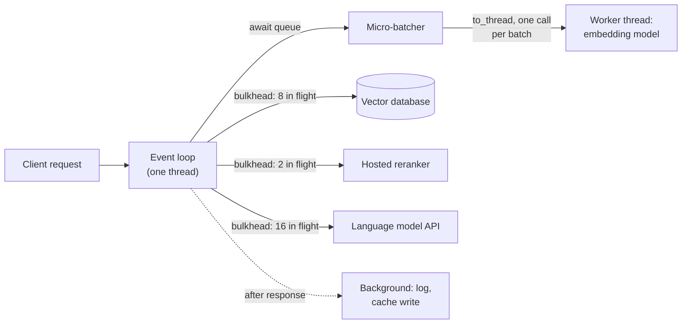

Making a RAG service asynchronous is not the same as writing `async def` in front of its functions. [Async programming](/learn/python-for-rag-engineering/async-programming) taught the language: coroutines, the event loop, tasks, semaphores and timeouts. This lesson is about **async execution** as an architecture for a service under load: deciding which work may run on the event loop and which must not, coalescing concurrent requests into batches, giving every request one deadline that all its stages respect, isolating each dependency so that one slow service cannot take the others down, and handling the work that should happen after the user has their answer.

You will measure, with a real embedding model, the cost of CPU work on the event loop, in threads and micro-batched, and build a handler with a propagated deadline and a load-shedding bulkhead.

## Learning objectives

- Measure event-loop lag and use it to decide whether a piece of work may run on the loop, in a thread, or in a separate process or service.
- Implement a micro-batcher that coalesces concurrent embedding requests into one model call, and choose its batch size and wait time from measured costs.
- Propagate one request deadline through every stage with `asyncio.timeout_at`.
- Protect each dependency with a bulkhead that limits concurrency and sheds load, and explain why unbounded waiting queues make overload worse.
- Run work off the critical path without losing it or leaking tasks.

## Prerequisites

- [Async programming](/learn/python-for-rag-engineering/async-programming): coroutines, the event loop, `TaskGroup`, semaphores, `asyncio.timeout` and `asyncio.to_thread`.
- [Parallel retrieval](/learn/performance-optimisation/parallel-retrieval): fan-out, deadlines and the latency-throughput distinction.
- [Batch processing](/learn/performance-optimisation/batch-processing): why one call over many inputs is cheaper than many calls.
- [Retrieval latency](/learn/retrieval-fundamentals/retrieval-latency): percentiles, queueing and Little's law.

## Why this matters

An AskMeridian request spends most of its life waiting on the vector database, the reranker and the language model, so asynchronous I/O lets one process hold hundreds at once. The failures come from the parts that compute instead of waiting, and from dependencies slower than expected. Four patterns recur:

- **The frozen loop.** A local model or parser runs directly in a coroutine. Every other request stops for its duration, health checks included, and the orchestrator restarts the process under load.
- **The thread pool that is not a CPU.** Wrapping the model in `asyncio.to_thread` revives the loop but not throughput: 64 threads calling a model one query at a time do the same work as one, plus contention.
- **The timeout that adds up.** Per-stage timeouts of 1 s, 2 s and 30 s against a 10 s user budget let a slow request run 33 s, spending tokens on an answer nobody reads.
- **The contagious outage.** A slow reranker accumulates waiting requests, each holding memory and a connection, until requests that never needed it fail too.

## The intuition

Think of the event loop as a single waiter in a busy restaurant. A good waiter never cooks. He takes an order, passes it to the kitchen, and while it is being prepared he takes other orders, refills glasses and brings bills. One waiter can serve twenty tables because almost all the time at each table is spent waiting for the kitchen.

Now imagine the waiter decides to make a salad himself. For three minutes nobody gets served, nobody can pay, and the manager peering in sees a dining room where nothing moves. That is CPU work on the event loop.

The fixes are restaurant practice. Hand cooking to the kitchen (a thread or process). Cook identical orders together (micro-batching). Do not start a course that cannot arrive before the table leaves for the theatre (a deadline). Limit the slow pastry chef's orders and tell later tables dessert is off rather than letting them wait an hour (a bulkhead that sheds load). Clear tables after the diners leave (work off the critical path).

## How it works

### The anatomy of an async RAG request



The loop owns the request but does almost none of the work. The design questions are about the arrows: what crosses to a thread, what is batched, how many calls may be in flight to each dependency, and for how long.

### What may run on the loop

Between two `await`s a coroutine has the loop to itself: $x$ milliseconds of compute delays every other request on the process by up to $x$ milliseconds.

| Work | Typical duration | Where it belongs |
| --- | --- | --- |
| Building a prompt, merging result lists, parsing a small JSON reply | Microseconds to well under a millisecond | On the loop |
| Tokenising a long document, parsing a PDF page, a regex over megabytes | Milliseconds to seconds | A thread (if the library releases the GIL) or a process |
| Running a local embedding model or cross-encoder | Milliseconds per call, more per batch | A thread with batching, or a separate inference service |
| Calling any network service | Any | On the loop, through an async client |

The measurement that checks this is **event-loop lag**: schedule a 5 ms timer and record how late it fires. Healthy lag is a millisecond or less; tens or hundreds of milliseconds mean something is computing on the loop. Export it as a metric.

### Threads are an escape hatch, not extra capacity

`asyncio.to_thread(fn, ...)` runs `fn` in the loop's default thread pool, which has two limits.

- **It is finite.** Python's default `ThreadPoolExecutor` has `min(32, os.cpu_count() + 4)` workers. Beyond that, calls queue. Starlette, underneath FastAPI, runs plain `def` endpoints in a pool limited to 40 by default. A slow synchronous dependency can exhaust either.
- **It does not add CPU.** PyTorch releases the GIL, so threads can overlap, but it already uses several cores per call; 32 parallel calls mostly add contention.

For CPU-heavy inference the real fix is fewer, larger calls (micro-batching), or moving inference into a dedicated embedding server ([GPU acceleration](/learn/performance-optimisation/gpu-acceleration)), so the web process only makes network calls.

### Micro-batching concurrent requests

A transformer processes 32 short queries in far less than 32 times the time of one: fixed per-call costs (Python overhead, kernel launches, moving weights through caches) are shared and the matrix operations use the hardware better. In a live service queries arrive one at a time, so the batch is built dynamically. This is **micro-batching**, or dynamic batching:

1. Each request puts its text and a fresh **future** (a placeholder for a result that will arrive later) on an `asyncio.Queue`, then awaits the future.
2. A single background worker takes the first item from the queue, then keeps taking items until either the batch reaches `max_batch` items or `max_wait` milliseconds have passed since the first one.
3. The worker runs one model call for the whole batch, in a thread so the loop stays free.
4. It sets each future's result to the corresponding vector, which wakes each waiting request.
5. It goes back to step 2.

`max_wait` is the latency a lone request pays at light traffic; `max_batch` caps the duration and memory of one model call. At high traffic batches fill instantly and throughput rises. Dedicated inference servers (Hugging Face Text Embeddings Inference, NVIDIA Triton, vLLM for generation) do this internally.

### One deadline, not many timeouts

A **timeout** says "this call may take at most 2 s"; a **deadline** says "this request must finish by 10:00:03.250". Per-stage timeouts add up past the user's budget, and a late-starting stage still gets its full allowance. A deadline is computed once on arrival, and each stage gets the smaller of its own cap and the time remaining.

`asyncio.timeout_at(when)` (Python 3.11 and later) takes an absolute time on the loop's clock, `loop.time()`, which makes this direct:

1. On arrival: `deadline = loop.time() + budget`.
2. For each optional stage: `async with asyncio.timeout_at(min(deadline, loop.time() + stage_cap))`, and fall back if it fires.
3. For the final required stage: `async with asyncio.timeout_at(deadline)`.
4. Before starting expensive work, check whether enough time remains for it to be useful; if not, skip it or fail immediately.
5. When calling another service of your own, send the remaining time with the request (gRPC carries deadlines natively; over HTTP, a header that the callee reads), so it can stop work that will be thrown away.

Without step 5 the callee keeps computing answers the caller has abandoned, and under overload much of the system's capacity can go on such wasted work.

### Bulkheads and load shedding

A ship's bulkheads stop one flooded compartment sinking it. A software **bulkhead** is a separate concurrency limit per dependency, implemented with a semaphore: say 8 calls in flight to the vector database, 2 to the reranker, 16 to the language model. A slow reranker can then tie up only its own 2 slots.

A semaphore alone is not enough, because its waiting line is unbounded. When a dependency slows, the queue grows as long as arrivals exceed completions, and every queued request holds memory and a connection and will usually time out anyway. The remedy is **load shedding**: cap the waiting line too, and when it is full, fail immediately with a clear signal. For an optional stage such as reranking, "fail" means "skip it and use the first-stage order"; for a required stage, it means returning a fast error (HTTP 503 with a retry hint) rather than a slow one.

A **circuit breaker** goes further: after a run of failures it stops calling the dependency for a cool-off period, then lets a trial request through, so a sick dependency is not hammered while it recovers.

### Work off the critical path

Writing to a [cache](/learn/performance-optimisation/caching), recording traces and logging questions for evaluation can happen after the response is sent. Three rules keep this safe:

- **Keep a reference.** An unstored task from `asyncio.create_task` may be garbage-collected mid-flight. Keep tasks in a set and discard each when done (`task.add_done_callback(tasks.discard)`), or use FastAPI's `BackgroundTasks`, which runs work after the response is sent.
- **Bound it.** A burst of cache writes can saturate the cache's connection pool and slow foreground reads; give background work its own bulkhead.
- **Make it durable if it matters.** In-process tasks die with the process; give them a few seconds to finish at shutdown, and put anything that must not be lost (billing, audit logs) on a durable queue.

### Async across the stack

Use asynchronous clients for every network dependency (`httpx.AsyncClient`, `anthropic.AsyncAnthropic`, `qdrant_client.AsyncQdrantClient`), created once per process. Each holds a connection pool that is itself a concurrency limit, so size it consistently with that dependency's bulkhead. The Anthropic client accepts `timeout` and `max_retries` arguments; set them from your deadline policy, remembering that automatic retries also consume the deadline. A faster loop implementation such as `uvloop` cuts per-operation overhead but cannot help a blocked loop.

## The mathematics

### Choosing micro-batch parameters

**Intuition.** A model call has a fixed cost that does not depend on the batch, plus a cost per item. Bigger batches spread the fixed cost, so throughput rises, but each call takes longer and the first request may wait for the batch to fill.

Model the time of one call on a batch of $b$ items as linear:

$$
c(b) = a + \beta b, \qquad \text{throughput}(b) = \frac{b}{a + \beta b}, \qquad \text{added latency} \le w + c(b)
$$

$a$ is the fixed cost per call in milliseconds, $\beta$ the marginal cost per item, $b$ the batch size, and $w$ the maximum wait (`max_wait`). Throughput approaches $1/\beta$ as $b$ grows, so beyond the point where $\beta b$ dominates $a$, larger batches buy little and only add latency.

**By hand.** Take $a = 2$ ms and $\beta = 0.3$ ms (roughly what the measurement below finds for MiniLM on a laptop CPU).

- $b = 1$: $c = 2.3$ ms, throughput $1/2.3 \approx 0.43$ queries per ms, about 430 per second.
- $b = 32$: $c = 2 + 9.6 = 11.6$ ms, throughput $32 / 11.6 \approx 2.76$ per ms, about 2,760 per second.
- The ceiling is $1/\beta$, about 3,300 per second; $b = 32$ already reaches over 80% of it.
- With $w = 5$ ms, the worst added latency at $b = 32$ is $5 + 11.6 = 16.6$ ms, small next to a language-model call.

**In Python.** Time the encoder at several batch sizes and fit the line:

```python
import time
import numpy as np
from sentence_transformers import SentenceTransformer

model = SentenceTransformer("sentence-transformers/all-MiniLM-L6-v2", device="cpu")
q = "How many days of annual leave do I get?"
model.encode([q] * 8)                                   # warm-up
sizes, times = [1, 2, 4, 8, 16, 32, 64], []
for b in sizes:
    runs = []
    for _ in range(7):
        t0 = time.perf_counter(); model.encode([q] * b); runs.append(time.perf_counter() - t0)
    times.append(1000 * np.median(runs))
beta, a = np.polyfit(sizes, times, 1)                  # c(b) = a + beta * b
print(f"fit: c(b) = {a:.1f} ms + {beta:.2f} ms x b")
for b, t in zip(sizes, times):
    print(f"batch {b:2d}: {t:5.1f} ms per call, {1000 * b / t:6.0f} queries/s")
```

```output
fit: c(b) = 2.0 ms + 0.31 ms x b
batch  1:   2.4 ms per call,    411 queries/s
batch  2:   2.8 ms per call,    721 queries/s
batch  4:   3.4 ms per call,   1185 queries/s
batch  8:   4.7 ms per call,   1695 queries/s
batch 16:   6.9 ms per call,   2327 queries/s
batch 32:  11.0 ms per call,   2907 queries/s
batch 64:  22.5 ms per call,   2842 queries/s
```

Throughput rises steeply up to about 16 and flattens by 32; 64 doubles the call time for no gain. On this hardware, `max_batch = 32` is a sensible choice. The numbers are specific to this machine and to short, identical queries; real queries vary in length, and padding to the longest in a batch adds cost, so measure with your own traffic.

### Loop utilisation

**Intuition.** CPU work on the loop is a single-server queue: every request's on-loop compute must pass through one thread.

If each request spends $s$ seconds computing on the loop and requests arrive at $\lambda$ per second, the loop's utilisation is $\rho = \lambda s$. It must stay well below 1. With $s = 3$ ms of on-loop encoding and $\lambda = 200$ per second, $\rho = 0.6$; by the single-server queue formula from [Retrieval latency](/learn/retrieval-fundamentals/retrieval-latency), the mean time spent passing through the loop is already $s/(1-\rho) = 7.5$ ms, and the process cannot exceed $1/s \approx 333$ requests per second however many requests are waiting on I/O. Moving that 3 ms off the loop removes the ceiling entirely.

## In code

**The problem.** AskMeridian embeds each question locally with MiniLM before searching. The Platform team wants to know what that costs a busy process, and which of three designs to use: encode directly in the coroutine, offload each encode to a thread, or micro-batch concurrent questions. The test sends a burst of 64 concurrent questions; the vector search and model call are simulated with `asyncio.sleep` so that only the embedding design varies, and a monitor task measures event-loop lag throughout.

```bash
pip install sentence-transformers numpy
```

```python
import asyncio
import time

import numpy as np
from sentence_transformers import SentenceTransformer

model = SentenceTransformer("sentence-transformers/all-MiniLM-L6-v2", device="cpu")
QUESTIONS = [f"How many days of annual leave do I get in year {i}?" for i in range(64)]

async def search_and_generate(vec):
    await asyncio.sleep(0.03)            # vector database round trip
    await asyncio.sleep(0.10)            # language-model call (shortened)
    return "answer"

# Design A: call the blocking encoder directly on the event loop.
async def handle_blocking(q):
    vec = model.encode([q], normalize_embeddings=True)[0]
    return await search_and_generate(vec)

# Design B: run each encode in a worker thread.
async def handle_thread(q):
    vec = (await asyncio.to_thread(model.encode, [q], normalize_embeddings=True))[0]
    return await search_and_generate(vec)

# Design C: a micro-batcher gathers concurrent queries into one encode call.
class MicroBatcher:
    def __init__(self, max_batch=32, max_wait=0.005):
        self.queue: asyncio.Queue = asyncio.Queue()
        self.max_batch, self.max_wait = max_batch, max_wait
        self.batches = 0

    async def embed(self, text):
        fut = asyncio.get_running_loop().create_future()
        await self.queue.put((text, fut))
        return await fut

    async def run(self):
        while True:
            items = [await self.queue.get()]                 # wait for the first item
            deadline = time.perf_counter() + self.max_wait
            while len(items) < self.max_batch:
                timeout = deadline - time.perf_counter()
                if timeout <= 0:
                    break
                try:
                    items.append(await asyncio.wait_for(self.queue.get(), timeout))
                except TimeoutError:
                    break
            texts = [t for t, _ in items]
            vecs = await asyncio.to_thread(model.encode, texts, normalize_embeddings=True)
            self.batches += 1
            for (_, fut), v in zip(items, vecs):
                if not fut.cancelled():
                    fut.set_result(v)

async def loop_lag_monitor(samples, interval=0.005):
    """Measures how late the event loop wakes a 5 ms timer: a direct sign of blocking."""
    while True:
        t0 = time.perf_counter()
        await asyncio.sleep(interval)
        samples.append(time.perf_counter() - t0 - interval)

async def run(name, handler):
    lag = []
    monitor = asyncio.create_task(loop_lag_monitor(lag))
    async def timed(q):
        t0 = time.perf_counter()
        await handler(q)
        return time.perf_counter() - t0
    t0 = time.perf_counter()
    latencies = await asyncio.gather(*(timed(q) for q in QUESTIONS))
    total = time.perf_counter() - t0
    monitor.cancel()
    p50, p95 = np.percentile(latencies, [50, 95]) * 1000
    print(f"{name:22s} total {total*1000:5.0f} ms  p50 {p50:5.0f} ms  p95 {p95:5.0f} ms  "
          f"max loop lag {max(lag)*1000:4.0f} ms")

async def main():
    model.encode(["warm-up"])                          # load weights before timing
    await run("A: encode on the loop", handle_blocking)
    await run("B: to_thread per query", handle_thread)
    batcher = MicroBatcher()
    worker = asyncio.create_task(batcher.run())
    await run("C: micro-batched", lambda q: _batched(batcher, q))
    print(f"   C used {batcher.batches} encode calls for {len(QUESTIONS)} queries")
    worker.cancel()

async def _batched(batcher, q):
    vec = await batcher.embed(q)
    return await search_and_generate(vec)

asyncio.run(main())
```

```output
A: encode on the loop  total   286 ms  p50   178 ms  p95   247 ms  max loop lag  150 ms
B: to_thread per query total   301 ms  p50   233 ms  p95   287 ms  max loop lag   10 ms
C: micro-batched       total   168 ms  p50   160 ms  p95   167 ms  max loop lag    1 ms
   C used 2 encode calls for 64 queries
```

Timings are from a laptop CPU and vary from run to run; the comparison between rows is what matters.

**The important lines.**

- In design A, `model.encode(...)` inside a coroutine never yields. The 64 encodes run back to back on the loop, and the 5 ms lag monitor was held up for 150 ms; a health check would have been just as late.
- In design B, `asyncio.to_thread` moves each encode off the loop and lag falls, but total time barely changes and the median worsens: 64 single-query encodes now compete for the CPU.
- In design C, `embed` parks a future on the queue and awaits it. The worker's inner loop collects up to 32 items or 5 ms' worth, whichever comes first, and makes one `to_thread` call per batch. Two calls served all 64 questions.
- `if not fut.cancelled()` matters: if a request times out while waiting, its future is cancelled, and setting a result on a cancelled future raises `InvalidStateError`, which would kill the worker.

**What the output means.** Every design spends 130 ms of simulated I/O per request; the rest is embedding and queueing. Micro-batching removed almost all of it: p95 fell from 247 ms (on the loop) and 287 ms (threads) to 167 ms and the loop stayed responsive throughout. The lesson in row B is the one teams most often miss: offloading to threads cures the frozen loop but does not create capacity.

**Common errors.** `RuntimeError: ... attached to a different loop` means the queue or futures were created outside the running loop; create them inside it. A batcher that hangs usually has no running worker task. Latency added at low traffic is `max_wait`; reduce it.

**Extending it.** Make requests arrive at a steady rate (for example one every 2 ms) instead of all at once, and plot p95 latency against arrival rate for designs B and C. Then add a cap on the queue length so that the batcher sheds load when the model falls behind.

### A deadline and a bulkhead

The second piece combines a single request deadline with a load-shedding bulkhead around a hosted reranker. Six requests arrive together; the reranker takes 120 ms, allows 2 calls in flight and at most 3 waiting.

```python
import asyncio

class Bulkhead:
    """A per-dependency concurrency limit that sheds load instead of queueing without bound."""
    def __init__(self, name: str, limit: int, max_waiting: int):
        self.name, self.sem = name, asyncio.Semaphore(limit)
        self.max_waiting, self.waiting = max_waiting, 0

    async def call(self, fn, *args):
        if self.sem.locked() and self.waiting >= self.max_waiting:
            raise RuntimeError(f"{self.name} overloaded")      # fail fast: shed load
        self.waiting += 1
        try:
            await self.sem.acquire()                            # may be cancelled while waiting
        finally:
            self.waiting -= 1
        try:
            return await fn(*args)
        finally:
            self.sem.release()

async def rerank(ids):
    await asyncio.sleep(0.12)                 # a hosted reranker
    return sorted(ids)

async def generate(ids):
    await asyncio.sleep(0.2)                  # the language model (shortened)
    return f"answer from {ids[0]}"

reranker = Bulkhead("reranker", limit=2, max_waiting=3)

async def handle(i: int, budget: float = 0.8) -> str:
    loop = asyncio.get_running_loop()
    deadline = loop.time() + budget           # one deadline for the whole request
    ids = [f"doc{i}-b", f"doc{i}-a"]          # first-stage order
    try:
        # Reranking may use at most 0.3 s, and never more than the request has left.
        async with asyncio.timeout_at(min(deadline, loop.time() + 0.3)):
            ids = await reranker.call(rerank, ids)
        note = "reranked"
    except TimeoutError:
        note = "rerank timed out"
    except RuntimeError as exc:
        note = str(exc)
    async with asyncio.timeout_at(deadline):  # generation gets whatever time is left
        answer = await generate(ids)
    return f"request {i}: {note:19s} -> {answer}, {deadline - loop.time():.2f} s spare"

async def main():
    for line in await asyncio.gather(*(handle(i) for i in range(6))):
        print(line)

asyncio.run(main())
```

```output
request 0: reranked            -> answer from doc0-a, 0.48 s spare
request 1: reranked            -> answer from doc1-a, 0.48 s spare
request 2: reranked            -> answer from doc2-a, 0.36 s spare
request 3: reranked            -> answer from doc3-a, 0.36 s spare
request 4: rerank timed out    -> answer from doc4-b, 0.30 s spare
request 5: reranker overloaded -> answer from doc5-b, 0.60 s spare
```

Requests 0 and 1 take the two slots and finish at 0.12 s; 2 and 3 waited for them and finish at 0.24 s. Request 4 also waited, would have started at 0.24 s and finished at 0.36 s, past its 0.3 s rerank cap, so the deadline cancelled it while running and it fell back to the first-stage order (`doc4-b` first). Request 5 found both slots taken and three requests already waiting, so it was refused at once and lost no time at all: it has the most time to spare. The `try`/`finally` around `acquire` keeps the waiting count correct when a request is cancelled while queued; without it, the counter slowly fills until every request is shed.

## A real-world example

AskMeridian ran as four async FastAPI processes, each embedding queries locally with a small sentence-transformer. One Monday, after staff were asked to re-read the updated leave policy, traffic tripled for an hour. Requests failed, not from dependency timeouts, but because the orchestrator was restarting processes whose health checks failed.

Embedding spans in the traces were a few milliseconds each and looked harmless, but event-loop lag sat between 200 and 600 ms. Every embedding ran on the loop; at triple traffic the loop's utilisation approached 1 and the health-check coroutine, queued behind dozens of encodes, missed its deadline.

The first patch, `asyncio.to_thread` around the encoder, stopped the restarts but left p95 latency high. The lasting fix was a micro-batcher with `max_batch = 32` and `max_wait = 5` ms, chosen from a fitted cost curve like the one above, plus a cap of 256 queued embedding requests beyond which the service returned 503 with a retry hint. The team also replaced three timeouts with one 8-second request deadline and put a bulkhead around the hosted reranker, so its slowdowns degrade to "no reranking". Event-loop lag above 50 ms now pages the on-call engineer.

## Common mistakes

- **CPU work in a coroutine.** Encoding, tokenising or parsing on the loop delays every request on the process and can fail health checks under load.
- **Treating `to_thread` as capacity.** It protects the loop but runs the same work on the same cores; per-request model calls in threads do not raise throughput.
- **Independent per-stage timeouts.** They add up to more than the user's budget, and later stages get their full allowance however late they start.
- **Not propagating the deadline.** Callees keep computing answers callers have abandoned.
- **Unbounded waiting at a semaphore.** A slow dependency accumulates requests that hold resources and time out anyway.
- **Untracked, unbounded background tasks.** They can vanish mid-flight, hide exceptions and starve foreground calls.
- **Swallowing cancellation in cleanup code.** A broad `except` that catches `CancelledError` defeats deadlines; cleanup belongs in `finally`.

## Best practices

- Export event-loop lag and alert on sustained values above a few tens of milliseconds.
- Keep only microsecond-scale compute on the loop; move the rest to threads, processes or dedicated inference services.
- Micro-batch local model calls, choosing `max_batch` and `max_wait` from a measured cost curve.
- Use one deadline per request for every stage, and pass the remaining time downstream.
- Give each dependency its own bulkhead with a bounded waiting line; shed load early with a clear error or a defined fallback.
- Run non-essential work after the response, tracked and bounded; put work that must not be lost on a durable queue.

## Performance considerations

The capacity of one async process is bounded by the first of these limits to be reached:

- **Loop compute.** If each request needs $s$ seconds of on-loop CPU, the process cannot exceed $1/s$ requests per second; at 0.5 ms that is 2,000, at 5 ms only 200.
- **Thread pool size.** With the default executor's `min(32, cpu_count + 4)` workers and an offloaded call of 20 ms, at most about $32 / 0.02 = 1,600$ offloaded calls per second can be served, and fewer if the calls contend for cores.
- **Dependency concurrency.** By Little's law, a bulkhead of 16 in-flight language-model calls averaging 4 s supports $16/4 = 4$ requests per second. This is usually the binding limit for RAG, and the provider's rate limit sets it.
- **Memory.** Each in-flight request holds its prompt and chunks: 1,000 at 50 KB is 50 MB, but without load shedding an outage lets the queue grow without bound.

Scale out with several processes rather than more threads, keeping shared state such as caches external. With many lightly loaded processes, one shared embedding service batches better than per-process batchers.

## Security considerations

Load shedding and deadlines are also defences: without them, one client sending many expensive requests can occupy every slot of a shared dependency. Apply per-user rate limits before the bulkheads, cap input length before embedding, and make sure a shed or timed-out request releases everything it held. When propagating deadlines to downstream services, treat a deadline supplied by an external client as a request, not an instruction: clamp it to your own maximum so a caller cannot ask your service to work on one request indefinitely.

## Summary

- Async execution is an architecture: the event loop coordinates, while computation runs in threads, processes or separate services.
- Event-loop lag is the key health metric; any compute between awaits delays every request on the process.
- Threads keep the loop responsive but do not add capacity; micro-batching concurrent requests is what raises model throughput.
- One propagated request deadline keeps total latency within budget and stops abandoned work.
- Per-dependency bulkheads with bounded queues stop one slow dependency taking down the service.

## Exercises

1. **Loop budget.** A request spends 0.8 ms building its prompt and 4 ms running a local reranker, both on the event loop. What is the maximum request rate one process can sustain, and what changes if the reranker moves to a separate service?

<details><summary>Show solution</summary>

On-loop time is $s = 4.8$ ms, so the ceiling is $1/0.0048 \approx 208$ requests per second, and latency rises sharply well before that (at 150 per second, $\rho = 0.72$). With the reranker remote, $s = 0.8$ ms and the loop's ceiling becomes 1,250 per second; the binding limit then moves to the reranker service and the language model's concurrency.

</details>

2. **Micro-batch tuning.** Using the fitted cost $c(b) = 2 + 0.31b$ ms, a service receives 1,500 queries per second. What is the smallest `max_batch` that keeps the encoder below 80% utilisation, and what latency does it add in the worst case with `max_wait = 5` ms?

<details><summary>Show solution</summary>

Utilisation is $\rho = 1.5\,c(b)/b$ (arrivals per ms over queries handled per ms). For $b = 8$: $c = 4.48$, $\rho = 0.84$. For $b = 10$: $c = 5.1$, $\rho = 0.77$. So `max_batch` must be at least 10; 16 ($\rho = 0.65$) leaves more headroom. At 1,500 per second, 16 queries take about 10.7 ms to arrive, so batches are usually cut by the 5 ms wait; worst-case added latency is about $5 + c(16) \approx 12$ ms plus any wait for the previous batch.

</details>

3. **Deadline propagation.** Rewrite the `handle` function from the second example so that it skips reranking entirely, without calling the bulkhead, when less than 0.5 s of the request's budget remains. Test it with `budget=0.6` and explain why checking before starting is better than relying on the timeout.

<details><summary>Show solution</summary>

Insert before the `try`:

```python
remaining = deadline - loop.time()
if remaining < 0.5:
    note = "rerank skipped"
else:
    ...  # the existing try/except block
```

indenting the existing block under `else`. With `budget=0.6` the check passes (0.6 s remain), so behaviour is unchanged. With `budget=0.45`, every request skips reranking at once:

```output
request 0: rerank skipped      -> answer from doc0-b, 0.25 s spare
request 1: rerank skipped      -> answer from doc1-b, 0.25 s spare
request 2: rerank skipped      -> answer from doc2-b, 0.25 s spare
request 3: rerank skipped      -> answer from doc3-b, 0.25 s spare
request 4: rerank skipped      -> answer from doc4-b, 0.25 s spare
request 5: rerank skipped      -> answer from doc5-b, 0.25 s spare
```

 Checking first avoids taking a bulkhead slot for work likely to be cancelled; a cancelled rerank still consumed reranker capacity another request could have used.

</details>

## Check your understanding

```quiz
[
  {"q": "A FastAPI service with `async def` endpoints runs a local cross-encoder directly inside the endpoint. What is the most likely symptom under load?", "options": ["The cross-encoder returns wrong scores", "Only reranked requests slow down; others are unaffected", "All requests on the process slow down together, including health checks, and event-loop lag rises", "The process uses more memory but latency is unchanged"], "answer": 2, "why": "Compute inside a coroutine never yields, so the single event-loop thread cannot serve any other request until it finishes."},
  {"q": "Moving per-request embedding calls into `asyncio.to_thread` mainly achieves which of these?", "options": ["It keeps the event loop responsive, while the same CPU work still has to be done", "It multiplies embedding throughput by the number of threads", "It removes the GIL", "It batches requests automatically"], "answer": 0, "why": "Threads let the loop keep scheduling I/O, but they share the same cores; throughput gains come from batching or more hardware."},
  {"q": "A request has a 5 s budget. Retrieval took 1.2 s and reranking 0.9 s. Using deadline propagation, how long may generation take at most?", "options": ["5 s", "3.8 s", "Its own configured timeout, whatever that is", "2.9 s"], "answer": 3, "why": "With one deadline, each stage gets the time that remains: 5 - 1.2 - 0.9 = 2.9 s."},
  {"q": "Why should a bulkhead cap the number of waiting requests as well as the number in flight?", "options": ["Because semaphores cannot count above 100", "Because an unbounded waiting line grows during a slowdown, holding memory and connections for requests that will mostly time out anyway", "Because waiting requests are cancelled automatically", "Because it raises the dependency's throughput"], "answer": 1, "why": "Shedding load early turns a slow failure into a fast one and protects the rest of the process."},
  {"q": "In a micro-batcher, what is the effect of raising `max_wait` from 5 ms to 50 ms at low traffic?", "options": ["Lower latency, because batches are larger", "No effect, because batches fill instantly", "Higher latency for lone requests, which may wait up to 50 ms for a batch that never fills", "Lower throughput at high traffic"], "answer": 2, "why": "At low traffic batches are cut by the wait timer, so every lone request pays it. At high traffic batches fill by size and the wait rarely matters."}
]
```

## Further reading

- [Python `asyncio` documentation](https://docs.python.org/3/library/asyncio.html): tasks, queues, `timeout_at`, executors and the developing-with-asyncio guide on blocking calls.
- [FastAPI documentation](https://fastapi.tiangolo.com/): async versus sync endpoints and background tasks.
- Michael T. Nygard (2007; 2nd edition 2018), *Release It!*, Pragmatic Bookshelf. The standard source for bulkheads, circuit breakers, timeouts and load shedding.
- Jeffrey Dean and Luiz André Barroso (2013), "The Tail at Scale", *Communications of the ACM* 56(2). Latency tail behaviour in fan-out services.
- [Hugging Face Text Embeddings Inference](https://huggingface.co/docs/text-embeddings-inference/index): an embedding server that implements dynamic batching.
