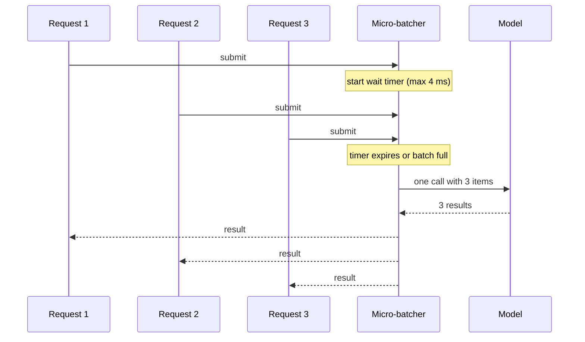

Calling a model has a fixed cost that has nothing to do with how much text you send: a network round trip, request parsing, launching the computation, moving weights through the processor's memory. **Batch processing** sends many items in one call so that the fixed cost is paid once for all of them, and so that hardware built to do many multiplications at once actually gets many to do. It is how an indexing job embeds a million chunks in hours instead of days, how a reranker scores fifty candidates in one pass, and how an evaluation run of ten thousand questions costs a fraction of the interactive price.

This lesson covers batching at three levels: inside a model call (batch size, padding and length sorting), across concurrent online requests (micro-batching, where you trade a few milliseconds of waiting for throughput), and across whole jobs (provider batch APIs and bulk writes to the vector database). The operational side of a batch ingestion job, with its checkpoints, retries and atomic publishing, is in [Batch ingestion](/learn/understanding-document-ingestion/batch-ingestion); this lesson is about the throughput mechanics underneath it. Running models on GPUs, where batching matters most, is in [GPU acceleration](/learn/performance-optimisation/gpu-acceleration).

## Learning objectives

- Model the time of a batched call as a fixed cost plus a per-item cost, and compute throughput and its ceiling as batch size grows.
- Measure embedding throughput against batch size, and explain the effect of padding and length sorting with a padding-efficiency calculation.
- Design a micro-batcher for online requests with a maximum batch size and a maximum wait, and predict its latency cost at low and high load.
- Use a provider batch API for offline language-model work, handling asynchronous completion, unordered results and per-request failures.
- Choose batch sizes for embedding, reranking and vector-database writes within memory, rate-limit and latency constraints.

## Prerequisites

- [Latency optimisation](/learn/performance-optimisation/latency-optimisation): throughput versus latency, and the levers that trade one for the other.
- [Model inference](/learn/understanding-large-language-models/model-inference): what a forward pass is, and continuous batching in inference servers.
- [Batch ingestion](/learn/understanding-document-ingestion/batch-ingestion): the job around the batches.
- [Async programming](/learn/python-for-rag-engineering/async-programming): queues, futures and timeouts, used by the micro-batcher.

## Why this matters

Re-embedding a corpus after a model change, generating a summary for every chunk, scoring an evaluation set with a model judge: each is millions of model calls, and the difference between overnight and a week is usually batching. Online it matters too: a service that runs one request per forward pass has a fixed capacity set by the per-call cost, and past it queues grow and latency explodes, as [Retrieval latency](/learn/retrieval-fundamentals/retrieval-latency) showed. Batching raises that ceiling without new hardware.

Done carelessly it backfires: mixed-length batches spend most of their computation on padding, oversized batches crash a job hours in, a generous online wait adds latency when traffic is light, and a provider batch API behind an interactive feature leaves users waiting for hours.

## The intuition

A minibus between an airport and a city centre has a fixed cost per trip (driver, fuel, the journey) whether it carries one passenger or fourteen, so the cost per passenger falls almost fourteen-fold when it is full. But passengers arrive at random, so the rule has to be "leave when full, or after five minutes, whichever comes first": at rush hour the bus fills in seconds, at night it leaves after five minutes with two people. That is micro-batching. And if every row must be fitted out for the tallest passenger in the trip, grouping passengers by height saves effort: that is padding, and length sorting.

## How it works

### Why a batch is cheaper per item

A transformer forward pass is dominated by matrix multiplications. Processing one sequence of 40 tokens multiplies a 40-row matrix by each weight matrix; processing 32 sequences multiplies a 1,280-row matrix by the same weights. Modern processors, and GPUs above all, are built to do many multiply-adds in parallel, and a single short sequence leaves most of that capacity idle. Meanwhile, the weights must be read from memory for every call regardless of how many sequences use them. Batching shares that memory traffic, the Python and framework overhead, the kernel launches and any network round trip across all the items.

The benefit is not unlimited. Once the batch keeps the hardware busy, each additional item costs nearly its full share of computation, and throughput levels off.

### Padding and length sorting

A batch is a rectangular tensor: every sequence in it must have the same length. Tokenisers therefore **pad** shorter sequences to the length of the longest in the batch, and the model computes over the padding positions even though an attention mask makes them ignored in the result. A batch containing one 250-token chunk and thirty-one 30-token chunks costs nearly as much as thirty-two 250-token chunks.

**Padding efficiency** measures the waste: real tokens divided by tokens computed. **Length sorting** (grouping texts of similar length into the same batch) raises it towards 100%. sentence-transformers already sorts by length *within* a single `encode()` call, which is one reason to hand it a large list rather than calling it once per small batch. When you split work yourself (across workers, or in an ingestion job that sends batches to an embedding service), sort or bucket by length first and restore the original order afterwards.

### Choosing a batch size

1. **Start from the hardware.** On a GPU, increase the batch size until throughput stops improving or memory runs out; on a CPU the useful range is usually small.
2. **Mind the longest input.** Memory use grows with batch size times sequence length (and attention with the square of length), so a batch size that works for short chunks can fail on the one long table extracted from a PDF. Cap sequence length, or bucket by length.
3. **Mind the API limits.** Hosted embedding APIs cap the number of inputs and total tokens per request and enforce rate limits; batch up to those caps, not beyond.
4. **Mind latency for online work.** A bigger batch takes longer to compute, and every item in it waits for the whole batch.

### Micro-batching online requests

Online, requests arrive one at a time from different users. A **micro-batcher** (also called dynamic batching) sits in front of the model, collects requests into a queue, and dispatches a batch when it reaches a maximum size *or* when the oldest request has waited a maximum time, whichever comes first.



The two settings trade against each other:

- **Maximum wait** bounds the latency added at low load, where batches rarely fill. Typical values are a few milliseconds, small next to the model call itself.
- **Maximum batch size** bounds the compute time of one call (and memory) at high load.

At low load the batcher behaves like no batcher plus a small wait; at high load it fills batches, and its capacity rises far above one-at-a-time serving. Inference servers for transformer models such as Hugging Face Text Embeddings Inference and NVIDIA Triton provide dynamic batching built in; for generation, servers such as vLLM use **continuous batching**, which adds and removes sequences at every decoding step (see [Model inference](/learn/understanding-large-language-models/model-inference)). You write your own micro-batcher mainly when you serve a model in-process.

### Batch APIs for offline LLM work

Many RAG tasks call a language model for every item in a large set, with nobody waiting: generating contextual descriptions for chunks ([Contextual retrieval](/learn/advanced-retrieval/contextual-retrieval)), summarising documents for a [summary index](/learn/hierarchical-rag/summary-indexes), producing synthetic test questions, grading an evaluation set with a model judge. Providers offer **asynchronous batch APIs** for exactly this: you submit many requests in one job, the provider runs them when it has capacity, and you collect results later, at a lower price than interactive calls.

For the Anthropic Message Batches API, at the time of writing, batched requests cost half the standard price, most batches finish within an hour, and a batch can take up to 24 hours; there are limits on the number of requests and total size per batch. Check the current documentation for these numbers. The mechanics:

1. **Submit** a list of requests, each with your own `custom_id` and the normal Messages API parameters.
2. **Poll** the batch until its processing status is `ended` (or receive a notification, depending on the integration).
3. **Stream the results** and match each to its input by `custom_id`. Results can arrive in **any order**; never match by position.
4. **Handle each result's outcome** individually: succeeded, errored, cancelled or expired. Resubmit the failures in a new batch.

It is the wrong tool for anything a user is waiting for.

### Bulk writes

The same fixed-cost logic applies to the vector database. Upserting points one request at a time pays a network round trip and an index update per point; sending them in batches of a few hundred pays it once per batch. Client libraries provide helpers for this: Qdrant's Python client, for example, has `upload_points(collection_name, points, batch_size=64, parallel=1)`, which splits an iterable of points into batches and can send them from several workers. As with embedding, the right batch size is limited by request-size limits on the server and by how much work you are willing to redo if a batch fails.

## The mathematics

### Throughput of a batched call

**Intuition.** Each call pays a fixed cost once and a per-item cost for every item. More items per call spread the fixed cost thinner.

$$
t(B) = a + bB, \qquad X(B) = \frac{B}{a + bB} \xrightarrow{B \to \infty} \frac{1}{b}
$$

$t(B)$ is the time of one call with $B$ items, $a$ the fixed cost per call, $b$ the marginal cost per item and $X(B)$ the throughput in items per unit time. The ceiling $1/b$ is set by the per-item cost alone; batching cannot go beyond it. Half the ceiling is reached at $B = a/b$, a useful rule for where the curve starts to flatten.

**By hand.** Assume $a = 8$ ms and $b = 0.5$ ms (the values the micro-batching simulation below uses).

- $B = 1$: $t = 8.5$ ms, $X = 1/8.5$ per ms $= 118$ items/s.
- $B = 32$: $t = 8 + 16 = 24$ ms, $X = 32/24$ per ms $= 1{,}333$ items/s.
- Ceiling: $1/0.5$ per ms $= 2{,}000$ items/s. Half of it is reached at $B = 8/0.5 = 16$.

Batching 32 items multiplies throughput by 11; batching 128 adds only a third more, while each call takes three times as long.

### Padding efficiency

**Intuition.** Every sequence in a batch is padded to the longest one, so the computation is proportional to the batch size times the maximum length, not the sum of lengths.

$$
\eta = \frac{\sum_i L_i}{\sum_{\text{batches } j} |B_j| \cdot \max_{i \in B_j} L_i}
$$

$L_i$ is the length in tokens of text $i$, $B_j$ is the $j$-th batch and $|B_j|$ its size. $\eta = 1$ means no padding.

**By hand.** Four texts of 12, 40, 15 and 38 tokens, in batches of two. In arrival order the batches are (12, 40) and (15, 38): real tokens $12 + 40 + 15 + 38 = 105$, computed $2 \times 40 + 2 \times 38 = 156$, $\eta = 67.3\%$. Sorted into (12, 15) and (40, 38): computed $2 \times 15 + 2 \times 40 = 110$, $\eta = 95.5\%$. Same texts, a third less computation.

```python
a_ms, b_ms = 8.0, 0.5            # fixed cost per call and cost per item (assumed)
for B in [1, 8, 32, 128]:
    t = a_ms + b_ms * B
    print(f"B={B:>3}  call time={t:>5.1f} ms  throughput={1000 * B / t:>6.0f} items/s")
print(f"ceiling 1/b = {1000 / b_ms:.0f} items/s")

lengths = [12, 40, 15, 38]       # tokens in four texts
for order in [[0, 1, 2, 3], [0, 2, 1, 3]]:
    batches = [[lengths[i] for i in order[:2]], [lengths[i] for i in order[2:]]]
    real = sum(map(sum, batches)); padded = sum(max(b) * len(b) for b in batches)
    print(f"batches {batches}: {real} real / {padded} computed = {real / padded:.1%}")
```

```output
B=  1  call time=  8.5 ms  throughput=   118 items/s
B=  8  call time= 12.0 ms  throughput=   667 items/s
B= 32  call time= 24.0 ms  throughput=  1333 items/s
B=128  call time= 72.0 ms  throughput=  1778 items/s
ceiling 1/b = 2000 items/s
batches [[12, 40], [15, 38]]: 105 real / 156 computed = 67.3%
batches [[12, 15], [40, 38]]: 105 real / 110 computed = 95.5%
```

## In code

### Throughput against batch size, padding and order

**The problem.** Measure how batch size and length sorting change embedding throughput for sentence-sized chunks, and relate the result to padding efficiency.

**Dependencies.** sentence-transformers, `datasets` and NumPy.

```bash
pip install sentence-transformers datasets numpy
```

```python
import re
import time
import numpy as np
import torch
from datasets import load_dataset
from sentence_transformers import SentenceTransformer

torch.manual_seed(0)
corpus = load_dataset("BeIR/scifact", "corpus", split="corpus")
# Sentence-sized chunks of varied length, the kind of short text RAG systems embed in bulk.
sentences = [s for t in corpus["text"][:400] for s in re.split(r"(?<=[.!?])\s+", t) if len(s) > 20]
docs = sentences[:1024]

model = SentenceTransformer("sentence-transformers/all-MiniLM-L6-v2")
print("device:", model.device)
lengths = np.array([len(model.tokenizer(d)["input_ids"]) for d in docs])
lengths = np.minimum(lengths, model.max_seq_length)
print(f"{len(docs)} chunks, tokens per chunk: min {lengths.min()}, median {np.median(lengths):.0f}, "
      f"max {lengths.max()}")

def padding_efficiency(order, batch_size):
    """Real tokens / tokens computed (every sequence in a batch is padded to the batch's longest)."""
    real = padded = 0
    for start in range(0, len(order), batch_size):
        batch = lengths[order[start:start + batch_size]]
        real += batch.sum()
        padded += batch.max() * len(batch)
    return real / padded

def throughput(order, batch_size, repeats=3):
    """Embed the chunks in the given order, one encode() call per batch; best of `repeats` runs."""
    model.encode(docs[:batch_size], batch_size=batch_size)            # warm-up
    best = float("inf")
    for _ in range(repeats):
        t0 = time.perf_counter()
        for start in range(0, len(order), batch_size):
            batch = [docs[i] for i in order[start:start + batch_size]]
            model.encode(batch, batch_size=batch_size, normalize_embeddings=True)
        best = min(best, time.perf_counter() - t0)
    return len(order) / best

rng = np.random.default_rng(42)
shuffled = rng.permutation(len(docs))
by_length = np.argsort(lengths)

print(f"\n{'order':<10}{'batch':>6}{'chunks/s':>10}{'padding efficiency':>20}")
for name, order, bs in [("shuffled", shuffled, 1), ("shuffled", shuffled, 8),
                        ("shuffled", shuffled, 32), ("shuffled", shuffled, 128),
                        ("by length", by_length, 32), ("by length", by_length, 128)]:
    print(f"{name:<10}{bs:>6}{throughput(order, bs):>10.0f}{padding_efficiency(order, bs):>20.1%}")
```

sentence-transformers picks the best available device; on this Apple-silicon laptop that was the built-in GPU (`mps`). Your numbers will differ, and on a CPU-only machine the gains will be smaller; the padding efficiencies depend only on the data and tokenizer.

```output
device: mps:0
1024 chunks, tokens per chunk: min 8, median 35, max 173

order      batch  chunks/s  padding efficiency
shuffled       1       128              100.0%
shuffled       8       606               55.9%
shuffled      32       773               44.2%
shuffled     128       646               34.0%
by length     32      1358               91.3%
by length    128      1303               70.7%
```

**The important lines.**

- The chunks are sentences from SciFact abstracts: short and varied (8 to 173 tokens, median 35), like many real RAG chunks.
- `padding_efficiency` replays the batching and counts real tokens against the padded rectangle each batch would compute.
- `throughput` calls `encode()` once per batch, in the given order, takes the best of three runs after a warm-up, and `by_length = np.argsort(lengths)` groups similar lengths together.

**What the output means.**

- **Batching helps a lot at first.** One chunk per call gives 128 chunks/s; batches of 8 give 606, about 4.7 times as much, because the fixed cost per call is shared.
- **Padding eats the gain.** With shuffled order, efficiency falls from 100% to 56%, 44% and 34% as batches grow, since each batch is padded to its longest chunk. Throughput therefore peaks around batch 32 and then falls back (646 at 128), even though larger batches should amortise overhead better.
- **Sorting by length fixes it.** The same chunks, sorted, reach 91% efficiency at batch 32 and 1,358 chunks/s, about 1.8 times the best shuffled result and 10.6 times one-at-a-time. At batch 128 efficiency is lower (70.7%) because the longest chunks sit together and the last batches are padded to long lengths; larger batches over sorted data are not automatically better.

**Errors people commonly hit.** Out-of-memory failures when one batch contains a very long input (cap `max_seq_length`), and forgetting to restore the original order after sorting, so vectors attach to the wrong chunks (keep the index array and invert it).

### A micro-batcher for online requests

**The problem.** Requests arrive at random times from many users. Collect them into batches with a maximum size and a maximum wait, and compare latency with serving each request on its own, at several arrival rates.

The "model" here is a stand-in that sleeps for $8 + 0.5B$ milliseconds, the cost model from the mathematics section, so the behaviour of the batcher is visible without hardware effects. Standard library and NumPy only.

```python
import asyncio
import time

import numpy as np

A_MS, B_MS = 8.0, 0.5                     # model call: 8 ms fixed + 0.5 ms per item (assumed)

async def model(batch):
    await asyncio.sleep((A_MS + B_MS * len(batch)) / 1000)
    return [f"vec({q})" for q in batch]


class MicroBatcher:
    """Collects concurrent requests into one model call: at most max_batch items, waiting at most max_wait_ms."""

    def __init__(self, max_batch=32, max_wait_ms=4.0):
        self.max_batch, self.max_wait = max_batch, max_wait_ms / 1000
        self.queue = asyncio.Queue()
        self.batch_sizes = []

    async def submit(self, item):
        future = asyncio.get_running_loop().create_future()
        await self.queue.put((item, future))
        return await future

    async def run(self):
        while True:
            batch = [await self.queue.get()]            # block until there is work
            deadline = time.perf_counter() + self.max_wait
            while len(batch) < self.max_batch:
                timeout = deadline - time.perf_counter()
                if timeout <= 0:
                    break
                try:
                    batch.append(await asyncio.wait_for(self.queue.get(), timeout))
                except asyncio.TimeoutError:
                    break
            self.batch_sizes.append(len(batch))
            results = await model([item for item, _ in batch])
            for (_, future), result in zip(batch, results):
                future.set_result(result)


async def one_at_a_time_worker(queue):
    while True:
        item, future = await queue.get()
        future.set_result((await model([item]))[0])


async def simulate(rate_per_s, n=2000, batched=True, seed=0):
    rng = np.random.default_rng(seed)
    arrivals = np.cumsum(rng.exponential(1 / rate_per_s, size=n))   # Poisson arrival times (s)
    if batched:
        batcher = MicroBatcher()
        worker = asyncio.create_task(batcher.run())
        submit = batcher.submit
    else:
        queue = asyncio.Queue()
        worker = asyncio.create_task(one_at_a_time_worker(queue))
        async def submit(item):
            future = asyncio.get_running_loop().create_future()
            await queue.put((item, future))
            return await future

    latencies = []
    async def request(i):
        t0 = time.perf_counter()
        await submit(f"q{i}")
        latencies.append((time.perf_counter() - t0) * 1000)

    start = time.perf_counter()
    tasks = []
    for i, t in enumerate(arrivals):
        await asyncio.sleep(max(0.0, start + t - time.perf_counter()))  # keep to the schedule
        tasks.append(asyncio.create_task(request(i)))
    await asyncio.gather(*tasks)
    worker.cancel()
    mean_batch = np.mean(batcher.batch_sizes) if batched else 1.0
    return np.percentile(latencies, 50), np.percentile(latencies, 95), mean_batch

async def main():
    print(f"{'arrivals/s':>10}  {'mode':<12}{'p50 ms':>8}{'p95 ms':>8}{'mean batch':>11}")
    for rate in [50, 100, 400]:
        for batched in [False, True]:
            if not batched and rate > 100:
                print(f"{rate:>10}  {'one-by-one':<12}  overloaded: capacity is 1000 / 8.5 = 118 per second")
                continue
            p50, p95, mb = await simulate(rate, batched=batched)
            mode = "micro-batch" if batched else "one-by-one"
            print(f"{rate:>10}  {mode:<12}{p50:>8.1f}{p95:>8.1f}{mb:>11.1f}")

asyncio.run(main())
```

```output
arrivals/s  mode          p50 ms  p95 ms mean batch
        50  one-by-one      10.6    29.9        1.0
        50  micro-batch     15.7    25.3        1.3
       100  one-by-one     110.5   260.4        1.0
       100  micro-batch     16.1    25.8        1.8
       400  one-by-one    overloaded: capacity is 1000 / 8.5 = 118 per second
       400  micro-batch     20.7    29.2        6.5
```

**The important lines.**

- `submit` puts the item and a future on a queue and awaits the future; the caller sees an ordinary async call.
- `run` blocks for the first item, then keeps taking items until the batch is full or `max_wait` since the first one has passed, using `asyncio.wait_for` with the remaining time as timeout. It then makes one model call and resolves every future.
- Arrivals are scheduled against the start time, so a slow loop iteration does not slow the arrival process (the load generator stays on schedule).

**What the output means.**

- **At 50 requests per second** the model is idle most of the time, batches average 1.3 items, and micro-batching mostly adds waiting: median 15.7 ms against 10.6 ms. Its p95 is no worse (25 against 30 ms), because occasional back-to-back arrivals that would queue one-by-one are served together.
- **At 100 requests per second**, close to the 118 per second one-at-a-time capacity, one-by-one serving queues: p50 110 ms and p95 260 ms. Micro-batching averages 1.8 items per call and holds p50 at 16 ms.
- **At 400 requests per second** one-by-one serving cannot keep up at all, while the micro-batcher averages 6.5 items per call and keeps p95 under 30 ms. Capacity rose without any change to the model.

The stand-in model's cost ($8 + 0.5B$ ms) is an assumption; with a real model, measure $a$ and $b$ first.

**Errors people commonly hit.** Not propagating exceptions (if `model` raises, every waiting future must receive it or callers hang; Exercise 3 fixes this), and a maximum wait that is large compared with the model call.

### Offline generation with the Message Batches API

**The problem.** Generate a one-sentence context for every chunk of the employee handbook, for [contextual retrieval](/learn/advanced-retrieval/contextual-retrieval), without paying interactive prices or managing thousands of concurrent calls. This needs an API key and was not executed here.

```python
import time

import anthropic
from anthropic.types.message_create_params import MessageCreateParamsNonStreaming
from anthropic.types.messages.batch_create_params import Request

client = anthropic.Anthropic()  # reads ANTHROPIC_API_KEY from the environment

def context_prompt(document: str, chunk: str) -> str:
    return (f"<document>\n{document}\n</document>\n"
            f"Here is a chunk from the document:\n<chunk>\n{chunk}\n</chunk>\n"
            "Write one sentence that situates this chunk within the document, "
            "to improve search retrieval. Reply with the sentence only.")

# jobs: list of (chunk_id, document_text, chunk_text) built by the indexing pipeline
batch = client.messages.batches.create(requests=[
    Request(custom_id=chunk_id,
            params=MessageCreateParamsNonStreaming(
                model="claude-opus-5-5",
                max_tokens=200,
                messages=[{"role": "user", "content": context_prompt(doc, chunk)}]))
    for chunk_id, doc, chunk in jobs
])

while client.messages.batches.retrieve(batch.id).processing_status != "ended":
    time.sleep(60)

contexts, failed = {}, []
for result in client.messages.batches.results(batch.id):
    if result.result.type == "succeeded":
        message = result.result.message
        contexts[result.custom_id] = "".join(b.text for b in message.content if b.type == "text")
    else:                                    # errored, canceled or expired
        failed.append(result.custom_id)
print(f"{len(contexts)} contexts generated, {len(failed)} to resubmit")
```

**The important lines.** `custom_id` carries the chunk ID through the job, and results are keyed by it in `contexts`, because they come back in any order. Each result has its own outcome, so one failure does not lose the batch; failed IDs are collected for a second batch. The chunk IDs must be unique within the batch and must satisfy the API's format rules for `custom_id`. Because every request for chunks of the same document repeats the document text, putting the document first and marking it for prompt caching (see [Caching](/learn/performance-optimisation/caching)) can reduce cost further; check the documentation for how caching interacts with batches.

## A real-world example

The Platform team decided to switch AskMeridian's embedding model and needed to re-embed every chunk of the handbook, the IT runbooks and the product documentation. The first attempt ran the ingestion job's embedding step as it had always run during incremental updates: one chunk per call to the team's internal embedding service. Extrapolated from the first hour, the re-embed would take most of a week.

Leila profiled the job. The embedding service itself was mostly idle; the job spent its time on per-call overhead (an HTTP round trip and request handling for every chunk), and the GPU behind the service received one short sequence at a time. Changing the client to send 64 chunks per request, sorted by length within each document batch, cut the projected time to well under a day. A second issue appeared during the run: one runbook contained a very large table that the chunker had emitted as a single chunk of several thousand tokens, and the batch containing it exceeded the service's memory limit and failed repeatedly. Capping chunk length at the model's maximum sequence length, which the old model had silently truncated at anyway, fixed it.

The same week, the evaluation team moved its weekly model-judge run from interactive calls to the Message Batches API. The run no longer competed with production traffic for rate limits, it cost less, and the four-hour delay in getting results did not matter for a weekly report.

## Common mistakes

- **One item per call in bulk jobs.** Fixed per-call costs dominate and the hardware idles. Batch embedding, reranking and writes.
- **Large batches of unsorted mixed-length texts.** Most of the computation goes on padding. Sort or bucket by length.
- **Batch sizes chosen for the average input.** The one very long input in a batch runs out of memory hours into a job. Cap sequence length and test with the longest inputs.
- **Using an asynchronous batch API for interactive features.** Results can take hours; users cannot wait for them.
- **Matching batch results by position.** Provider batch results can come back in any order; use the custom ID.

## Best practices

- Model each call as $a + bB$; measure $a$ and $b$ for your hardware and model, and pick a batch size near where throughput flattens.
- Pass whole lists to `encode()` so the library can sort by length, or sort yourself when you split work.
- Cap sequence length at the model's maximum and handle oversized chunks at chunking time.
- Keep micro-batching waits to a few milliseconds and set a maximum batch size from the latency budget.
- Use provider batch APIs for every large offline LLM workload: evaluation, synthetic data, summaries, contextual descriptions.
- Key every batched item by a stable ID, and make retries per item.

## Performance considerations

**Throughput and cost.** For self-hosted models, throughput is cost: if batching raises a GPU's output from 500 to 5,000 embeddings per second, the cost per embedding falls tenfold. For hosted embedding APIs priced per token, batching does not change the token price but cuts per-request overhead and rate-limit pressure, and batch endpoints where offered reduce the price itself.

**Latency.** Within a request, batching the reranker's candidate pairs reduces latency, because one call replaces many. Across requests, micro-batching adds up to the maximum wait plus the extra compute of a larger batch, and in exchange lowers latency at high load by preventing queues from building. Choose the wait from the latency budget: 4 ms of wait is invisible in front of a 2-second answer and significant in front of a 10 ms embedding service.

**Memory.** Activation memory grows roughly with batch size times sequence length for the feed-forward layers and with the square of sequence length for attention scores in standard implementations. Doubling the batch size roughly doubles activation memory; doubling the maximum sequence length can more than double it.

**Failure cost.** Larger batches lose more work when they fail; checkpoint per batch (see [Batch ingestion](/learn/understanding-document-ingestion/batch-ingestion)).

## Summary

- Batching pays a call's fixed cost once for many items and keeps parallel hardware busy; throughput is $B/(a + bB)$ and approaches a ceiling of $1/b$.
- Batches are padded to their longest member, so mixed lengths waste computation; sorting by length restores efficiency.
- Micro-batching collects concurrent online requests with a maximum size and a maximum wait: almost free at high load, a small added wait at low load, and a much higher capacity than one-at-a-time serving.
- Provider batch APIs run large offline LLM workloads asynchronously and more cheaply; results are unordered and per-item, and the latency is hours, not seconds.
- Choose batch sizes from measurements, memory limits, API limits and the latency budget, and batch writes to the vector database too.

## Exercises

**1.** With $a = 8$ ms and $b = 0.5$ ms, find the batch size at which throughput reaches 90% of its ceiling. Is it worth running batches that large for an online service with a 50 ms latency budget?

<details><summary>Show solution</summary>

$X(B)/(1/b) = bB/(a + bB) = 0.9$ gives $bB = 9a$, so $B = 9 \times 8/0.5 = 144$. One call then takes $8 + 72 = 80$ ms, over the 50 ms budget before any waiting. A batch of about 60 ($t = 38$ ms) is the largest that fits comfortably, with throughput $60/38 = 1{,}579$ items/s, 79% of the ceiling.

</details>

**2.** Chunks of 10, 90, 20, 80, 30 and 70 tokens are batched three at a time. Compute padding efficiency in arrival order and after sorting.

<details><summary>Show solution</summary>

Real tokens: $10 + 90 + 20 + 80 + 30 + 70 = 300$. Arrival order: batches (10, 90, 20) and (80, 30, 70) are padded to 90 and 80, so $3 \times 90 + 3 \times 80 = 510$ and $\eta = 300/510 = 58.8\%$. Sorted: (10, 20, 30) and (70, 80, 90) pad to 30 and 90, so $90 + 270 = 360$ and $\eta = 83.3\%$.

</details>

**3.** Write the part of the micro-batcher that is missing from the lesson: if `model` raises, every request in the batch must receive the exception.

<details><summary>Show solution</summary>

Replace the final lines of `run` with:

```python
            self.batch_sizes.append(len(batch))
            try:
                results = await model([item for item, _ in batch])
            except Exception as exc:
                for _, future in batch:
                    future.set_exception(exc)      # every waiter sees the failure
                continue                            # keep serving later batches
            for (_, future), result in zip(batch, results):
                future.set_result(result)
```

Without this, the exception ends the `run` task, no future is ever resolved, and every caller hangs.

</details>

**4.** Design question. AskMeridian must (a) embed 600,000 chunks after a model change, (b) embed each user query, (c) generate a contextual sentence for each of the 600,000 chunks, (d) rerank 40 candidates per query. For each, say which kind of batching applies and what you would configure.

<details><summary>Show solution</summary>

(a) Offline bulk batching: sort chunks by length, batches sized to the largest that fits in memory (tens to a few hundred), checkpoint per batch, bulk upsert hundreds of points at a time. (b) Micro-batching if the model is served in-process or behind a server with dynamic batching, with a wait of a few milliseconds and a maximum batch from the latency budget; a hosted API may need none. (c) A provider batch API: no user is waiting, results are keyed by chunk ID, failures are resubmitted. (d) Intra-request batching: all 40 pairs in one `predict` call, since they arrive together and one call replaces forty.

</details>

## Check your understanding

```quiz
[
  {
    "q": "With a fixed cost of 10 ms per call and 1 ms per item, what is the throughput ceiling as batch size grows?",
    "options": [
      "100 items per second",
      "500 items per second",
      "1,000 items per second",
      "It grows without bound"
    ],
    "answer": 2,
    "why": "Throughput B/(a + bB) tends to 1/b = 1 item per ms = 1,000 items per second; batching removes the fixed cost but not the per-item cost."
  },
  {
    "q": "Why can larger batches of unsorted texts lower throughput?",
    "options": [
      "Larger batches use more network bandwidth",
      "Each batch is padded to its longest text, so computation is wasted on padding",
      "The tokenizer slows down",
      "Models cannot process more than 8 items at once"
    ],
    "answer": 1,
    "why": "Padding efficiency falls as batches grow when lengths are mixed (56%, 44%, 34% in the lesson's run), so more of each batch's computation is spent on padding."
  },
  {
    "q": "A micro-batcher has max_wait 4 ms and max_batch 32. At very low traffic, what happens to a request?",
    "options": [
      "It waits for 32 requests",
      "It is served after about 4 ms with a batch of one or two",
      "It is rejected",
      "It bypasses the model"
    ],
    "answer": 1,
    "why": "The timer starts at the first request; at low load the batch rarely fills, so the wait cap fires and the request pays up to 4 ms extra."
  },
  {
    "q": "You submit 5,000 requests to a provider batch API and read the results. How do you match each result to its request?",
    "options": [
      "By position in the results stream",
      "By the custom_id you supplied",
      "By token count",
      "By arrival time"
    ],
    "answer": 1,
    "why": "Batch results can come back in any order, so each request must carry a custom_id and results are matched by it."
  },
  {
    "q": "Which workload is a poor fit for a provider batch API?",
    "options": [
      "Generating synthetic test questions",
      "Grading a weekly evaluation set with a model judge",
      "Answering a user's question in a chat window",
      "Producing contextual descriptions for chunks at index time"
    ],
    "answer": 2,
    "why": "Batch jobs can take up to hours; a user waiting for an answer needs an interactive call. The other three are offline work."
  }
]
```

## Further reading

- Sentence Transformers documentation, `SentenceTransformer.encode` and its `batch_size` argument, [sbert.net](https://www.sbert.net). How the library batches and sorts inputs.
- Hugging Face Text Embeddings Inference documentation, [huggingface.co/docs/text-embeddings-inference](https://huggingface.co/docs/text-embeddings-inference). A production embedding server with dynamic batching.
- Woosuk Kwon and colleagues (2023), "Efficient Memory Management for Large Language Model Serving with PagedAttention", [arxiv.org/abs/2309.06180](https://arxiv.org/abs/2309.06180). The vLLM paper; continuous batching and memory for generation.
- Anthropic documentation, Message Batches, [platform.claude.com/docs/en/build-with-claude/batch-processing](https://platform.claude.com/docs/en/build-with-claude/batch-processing). Current limits, pricing and result handling.
- Qdrant documentation, bulk upload of points, [qdrant.tech/documentation](https://qdrant.tech/documentation/). Batch sizes and parallel uploads.
