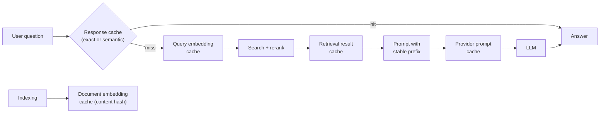

A **cache** keeps the result of an expensive computation so that the next request for the same thing can be answered from memory instead of being computed again. RAG systems are full of expensive, repeatable computations: embedding a text, searching an index, reranking candidates, sending a long prompt to a model. They are also used by people who ask the same questions again and again. Caching is therefore one of the largest levers in [Latency optimisation](/learn/performance-optimisation/latency-optimisation), and frequently the largest in cost as well.

It is also a reliable source of bugs. A cache that serves the wrong value is worse than no cache, because it is fast, confident and wrong. This lesson covers the mechanics every cache in a RAG system shares: what goes into a key, how hit rate is determined by the shape of the traffic, how entries are evicted and expired, how to invalidate them when the underlying data changes, where in the pipeline caches belong, and how a model provider's prompt cache differs from your own. The next two lessons specialise: [Semantic caching](/learn/performance-optimisation/semantic-caching) matches questions by meaning, and [Query caching](/learn/performance-optimisation/query-caching) designs exact-match caches for retrieval results.

## Learning objectives

- Define hit rate, eviction, expiry and invalidation, and compute the expected latency of a cached stage from its hit rate.
- Design a cache key that contains everything that can change the cached value.
- Explain how skewed (Zipf-like) traffic determines hit rate, and predict the effect of cache capacity on it.
- Choose an eviction policy, a time to live and an invalidation strategy for a given RAG cache layer.
- Structure a prompt so that a provider's prefix-based prompt cache can reuse it, and read the usage fields that confirm it did.

## Prerequisites

- [Latency optimisation](/learn/performance-optimisation/latency-optimisation): the levers, and where time goes in a RAG request.
- [Model inference](/learn/understanding-large-language-models/model-inference): prefill, decoding and the key-value cache inside the model.
- [Embedding costs](/learn/cost-engineering/embedding-costs): content-hash caching of document embeddings during indexing.
- [Redis](/learn/vector-database-ecosystem/redis): the in-memory store most shared caches are built on.

## Why this matters

An uncached AskMeridian request pays for an embedding, a search, a cross-encoder pass and a language model call over thousands of tokens. On the first working day of January, a large share of staff ask some version of "how many days of leave carry over?", and every one of those requests repeats work whose result is already known. Because traffic is skewed, caches recover a lot of that waste. The risks are equally concrete:

- **Stale answers.** The handbook changes, but the cache keeps serving last month's answer until something removes it.
- **Wrong or leaked answers.** The key omitted something that matters (a filter, the model version, the caller's permissions), so a value computed for one situation, perhaps from HR-only documents, is served in another.
- **Unbounded memory.** A cache with no capacity limit or expiry grows until the process is killed.

Each of these follows from a decision about keys, expiry or invalidation, which is why those decisions are the core of this lesson.

## The intuition

Picture the reference desk of a busy library. Most questions are about a few dozen popular books, so the librarian keeps those books on the desk rather than walking to the stacks each time. The desk is small, so when a new book is needed and the desk is full, the one that has not been asked for in the longest time goes back to the shelves. Some books carry a sticky note with a date after which they are swapped for a fresh copy. And when a corrected edition arrives, the old copy on the desk must go at once, or patrons keep reading the wrong text.

That is all of caching: a small, fast store in front of a large, slow one (the desk and the stacks), a rule for what to remove when full (**eviction**), a shelf life (**expiry**), and a way to remove things the moment they become wrong (**invalidation**). The desk is useful only because requests are skewed; if every patron asked for a different book, the desk would never have the one you want.

## How it works

### Vocabulary

- **Key, value, hit, miss.** The cache maps a key (an identifier for the computation) to a value (its result). A **hit** finds the key; a **miss** does not, so the computation runs and its result is usually stored. The **hit rate** $h$ is the fraction of lookups that hit.
- **Capacity and eviction.** The maximum number of entries or bytes, and the removal of an entry to make room.
- **Time to live (TTL) and invalidation.** A maximum age after which an entry counts as absent (**expiry**), and the removal of entries because their source data changed.

The common pattern is **cache-aside**: the application checks the cache, and on a miss computes the value and writes it back.

### What goes into the key

A cache is correct only if two requests with the same key would produce the same value. So the key must include **everything that can change the value**, and nothing that cannot (or the hit rate collapses).

For an embedding, the value depends on the exact text, the model and its revision, and any options such as normalisation or a query prefix. Hence the key used in this lesson's code: a SHA-256 hash of the model name and the exact text. [Embedding costs](/learn/cost-engineering/embedding-costs) shows the same idea applied to document chunks during re-indexing.

For a retrieval result, the value depends on far more: the query, the metadata filters, the caller's permissions, the index version, `top_k`, the reranker. For a generated answer, add the prompt template, the model and the conversation context. The further down the pipeline a cache sits, the more the key must contain, and the more ways there are to get it wrong. [Query caching](/learn/performance-optimisation/query-caching) treats that key design in detail.

Two rules make keys robust:

1. **Canonicalise before hashing.** Serialise structured parts in a fixed order (JSON with sorted keys) so the same logical request always yields the same bytes.
2. **Put a version in the key.** A prefix such as `emb:v2:` lets you invalidate every entry at once by changing code, without touching the store.

### Hit rate is set by the traffic

Real query traffic is skewed. A good model of the skew is **Zipf's law**: the $i$-th most popular item is requested with probability proportional to $1/i^s$, with $s$ around 1. Web requests have long been observed to follow Zipf-like distributions (Breslau and colleagues, 1999), and search and assistant query logs show the same long-tailed shape: a few questions are asked constantly, and a long tail is asked once.

So a **small cache captures a large share of traffic**, **returns diminish quickly** as capacity grows into the rarely requested tail, and some misses are unavoidable: the first request for any item is a **compulsory miss**. The code below measures all three.

### Eviction policies

When a full cache must admit a new entry, the eviction policy chooses what leaves.

- **LRU (least recently used)** evicts the entry unused for longest. It adapts quickly to shifting interest and is simple to build with an ordered dictionary or a linked list plus a hash map. It is the default in most caches, including Python's `functools.lru_cache`.
- **LFU (least frequently used)** evicts the entry with the fewest hits; it resists bursts of one-off requests but is slow to forget formerly popular items. **FIFO** ignores use entirely, and adaptive policies such as ARC (Megiddo and Modha, 2003) balance recency and frequency automatically.

Redis offers approximated LRU and LFU as `maxmemory-policy` settings. For RAG workloads LRU is a sensible default.

### Expiry and invalidation

Eviction manages space. Expiry and invalidation manage **correctness**, and they solve different problems.

A **TTL** bounds staleness: no entry can reflect data older than the TTL. It requires no knowledge of when the source changes, which is its strength, and it is approximate, which is its weakness. A 24-hour TTL on answers means that after the handbook changes, users may be told the old policy for up to a day.

**Invalidation** removes entries as soon as their source changes. Three strategies are common:

1. **Explicit deletion.** When a document changes, delete every cache entry derived from it. This requires knowing which entries those are, for example by storing the source document IDs with each entry and keeping a reverse index from document to entries.
2. **Versioned namespaces.** Put a version (an index build ID, a corpus generation number) into every key. Publishing a new index changes the version, so new requests compute new keys and old entries are never read again; they age out through TTL or eviction. This is simple and safe, at the cost of discarding the whole cache on every change.
3. **Event-driven invalidation.** The ingestion pipeline emits a "document changed" event that cache owners consume. This combines naturally with [event-driven ingestion](/learn/understanding-document-ingestion/event-driven-ingestion).

In practice the strategies are layered: a version in the key for wholesale changes, a TTL as a backstop against bugs, and explicit invalidation where staleness is costly.

### Where caches sit in a RAG system



| Layer | Key | Saves | Main risk |
| --- | --- | --- | --- |
| Document embedding cache | model + chunk text hash | re-embedding unchanged chunks | key omits model version |
| Query embedding cache | model + exact query text | one embedding call | low; vectors do not go stale unless the model changes |
| Retrieval result cache | query + filters + permissions + index version + config | search and rerank | stale or permission-crossing results |
| Response cache (exact or semantic) | as above + prompt and model | the whole pipeline | stale, wrong or leaked answers |
| Provider prompt cache | the prompt prefix itself | prefill time and input cost | none to correctness; savings depend on prefix stability |
| KV cache inside the model | managed by the inference engine | recomputing attention per token | none to you; see [Model inference](/learn/understanding-large-language-models/model-inference) |

**Caches near the start of the pipeline are safe and save little; caches near the end save a lot and are risky.**

### In-process or shared

An **in-process** cache (a dictionary, `functools.lru_cache`) costs microseconds but is private to one replica: with $n$ replicas behind a load balancer each sees $1/n$ of the traffic, pays its own compulsory misses, and must be invalidated separately. A **shared** cache (Redis, Memcached) costs a network round trip, typically under a millisecond inside one data centre, but gives one hit rate, one copy and one place to invalidate, and survives restarts. A common design puts a small in-process LRU with a short TTL in front of a shared cache.

### Provider prompt caching

Model providers offer a different kind of cache. When many requests start with the same long **prefix** (a system prompt, tool definitions, a fixed set of examples, or earlier turns of a conversation), the provider can keep the model's internal state for that prefix and skip recomputing it. This shortens prefill, so it reduces time to first token, and providers charge less for cached input tokens.

With the Anthropic API you mark the end of the reusable prefix with `cache_control`. Caching is an exact **prefix match**: any change to a byte in the prefix (a timestamp in the system prompt, a reordered list) makes it a different prefix. So the prompt must be laid out with stable content first and per-request content last.

```python
import anthropic

client = anthropic.Anthropic()  # reads ANTHROPIC_API_KEY from the environment

SYSTEM_PROMPT = open("askmeridian_system_prompt.txt").read()   # long, identical for every request

response = client.messages.create(
    model="claude-opus-5-5",
    max_tokens=1024,
    system=[{"type": "text", "text": SYSTEM_PROMPT, "cache_control": {"type": "ephemeral"}}],
    messages=[{"role": "user", "content": prompt}],          # retrieved chunks + question: varies
)
u = response.usage
print("written to cache:", u.cache_creation_input_tokens,
      "read from cache:", u.cache_read_input_tokens,
      "uncached input:", u.input_tokens)
```

This snippet needs an API key and was not executed. The first request writes the prefix (`cache_creation_input_tokens` > 0); a request soon after with an identical prefix reads it (`cache_read_input_tokens` > 0). If reads stay at zero, something in the prefix is changing.

Several properties matter for RAG, and the exact values change, so check the provider's prompt caching documentation:

- **Entries are short-lived.** The default lifetime is a few minutes, refreshed on each use, with a longer option at a higher write price. Caching helps steady traffic; a prefix used once an hour gains nothing at the default lifetime.
- **There is a minimum prefix length**, which depends on the model. Shorter prefixes are silently not cached.
- **Writing costs more than ordinary input and reading costs much less**, so a prefix must be reused at least once or twice to pay off.
- **Retrieved chunks are usually not cacheable**, because they differ per question. In single-turn RAG the cacheable part is the system prompt and fixed instructions or examples; in multi-turn conversations, earlier turns form a growing prefix that caches well.

## The mathematics

### Expected latency with a cache

**Intuition.** Every request pays for the lookup; only misses pay for the computation.

$$
\mathbb{E}[T] = t_{\text{lookup}} + (1 - h)\, t_{\text{miss}}
$$

$h$ is the hit rate, $t_{\text{lookup}}$ the cost of checking the cache (paid by hits and misses alike) and $t_{\text{miss}}$ the cost of computing and storing the value. Without a cache, $\mathbb{E}[T] = t_{\text{miss}}$, so the cache helps when $t_{\text{lookup}} < h\, t_{\text{miss}}$, that is, when the hit rate exceeds the **break-even hit rate**

$$
h^{*} = \frac{t_{\text{lookup}}}{t_{\text{miss}}}
$$

**By hand.** A shared cache costs 1 ms per lookup in front of a 3.5 ms query embedding: $h^{*} = 1/3.5 = 0.29$. At $h = 0.7$, $\mathbb{E}[T] = 1 + 0.3 \times 3.5 = 2.05$ ms, a modest gain. The same 1 ms lookup in front of a 2,000 ms retrieve-rerank-generate pipeline has $h^{*} = 0.0005$: almost any hit rate pays. Cheap stages need cheap (in-process) caches; expensive stages can afford a network hop.

### How much traffic does a cache of size C capture?

**Intuition.** If the cache always held the $C$ most popular of $N$ items, its hit rate would be the share of requests going to those $C$ items.

$$
h_{\text{ideal}}(C) = \frac{\sum_{i=1}^{C} i^{-s}}{\sum_{i=1}^{N} i^{-s}} \;\overset{s=1}{=}\; \frac{H_C}{H_N}
$$

$i$ is popularity rank, $s$ the Zipf exponent, and $H_n = 1 + \tfrac12 + \dots + \tfrac1n \approx \ln n + 0.5772$ is the $n$-th harmonic number. This is the long-run hit rate of an ideal static cache; LRU approaches it on a long, stable stream and falls short on a short one, because it also pays compulsory misses and occasionally evicts popular items.

**By hand.** $N = 1000$, $s = 1$: $H_{1000} \approx \ln 1000 + 0.5772 = 7.485$. For $C = 100$, $H_{100} \approx 4.605 + 0.577 = 5.182$ (exactly 5.187), so $h \approx 5.187 / 7.485 = 0.693$. A cache holding 10% of the questions captures 69% of the traffic. For $C = 250$, $H_{250} \approx 6.10$ and $h \approx 0.815$: two and a half times the capacity buys 12 more points.

```python
import numpy as np

def harmonic(n):
    return np.sum(1 / np.arange(1, n + 1))

N = 1000
for C in [25, 100, 250, 500]:
    print(f"C={C:>3}  H_C={harmonic(C):.3f}  ideal hit rate={harmonic(C) / harmonic(N):.1%}")
print(f"break-even, 1 ms lookup before 3.5 ms embedding: {1 / 3.5:.2f}")
```

```output
C= 25  H_C=3.816  ideal hit rate=51.0%
C=100  H_C=5.187  ideal hit rate=69.3%
C=250  H_C=6.101  ideal hit rate=81.5%
C=500  H_C=6.793  ideal hit rate=90.7%
break-even, 1 ms lookup before 3.5 ms embedding: 0.29
```

## In code

**The problem.** Put an LRU cache with optional expiry in front of a query embedder, and measure how hit rate depends on capacity under Zipf-distributed traffic and how much time the cache saves.

**Dependencies.** sentence-transformers, `datasets` (for 1,000 real questions from BEIR SciFact) and NumPy.

```bash
pip install sentence-transformers datasets numpy
```

```python
import hashlib
import time
from collections import OrderedDict

import numpy as np
from datasets import load_dataset
from sentence_transformers import SentenceTransformer


class LRUCache:
    """Bounded cache: evicts the least recently used entry; entries also expire after ttl_s."""

    def __init__(self, capacity, ttl_s=None, clock=time.monotonic):
        self.capacity, self.ttl_s, self.clock = capacity, ttl_s, clock
        self.data = OrderedDict()                   # key -> (value, stored_at)
        self.hits = self.misses = self.evictions = 0

    def get(self, key):
        item = self.data.get(key)
        if item is not None and self.ttl_s is not None and self.clock() - item[1] > self.ttl_s:
            del self.data[key]                      # expired: treat as a miss
            item = None
        if item is None:
            self.misses += 1
            return None
        self.data.move_to_end(key)                  # mark as most recently used
        self.hits += 1
        return item[0]

    def put(self, key, value):
        if self.capacity == 0:
            return
        self.data[key] = (value, self.clock())
        self.data.move_to_end(key)
        if len(self.data) > self.capacity:
            self.data.popitem(last=False)           # drop the least recently used
            self.evictions += 1

    def hit_rate(self):
        total = self.hits + self.misses
        return self.hits / total if total else 0.0


class CachedEmbedder:
    """Embeds text through a cache keyed on (model, exact text)."""

    def __init__(self, model_name, cache):
        self.model_name, self.cache = model_name, cache
        self.model = SentenceTransformer(model_name)

    def key(self, text):
        return hashlib.sha256(f"{self.model_name}\x00{text}".encode()).hexdigest()

    def embed(self, text):
        k = self.key(text)
        vec = self.cache.get(k)
        if vec is None:
            vec = self.model.encode([text], normalize_embeddings=True)[0]
            self.cache.put(k, vec)
        return vec


# A skewed workload: 1,000 distinct questions, popularity following Zipf's law (s = 1).
texts = [r["text"] for r in load_dataset("BeIR/scifact", "queries", split="queries")][:1000]
rng = np.random.default_rng(42)
ranks = np.arange(1, len(texts) + 1)
p = (1 / ranks) / (1 / ranks).sum()
stream = rng.choice(len(texts), size=3000, p=p)
print(f"requests: {len(stream)}, distinct questions requested: {len(set(stream))}")
print(f"share of traffic from the top 10% of questions: {p[:100].sum():.1%}")

# 1. Hit rate against capacity (keys only, so this part is instant).
print("\ncapacity  hit rate  evictions")
for capacity in [0, 25, 100, 250, 500, 1000]:
    c = LRUCache(capacity)
    for i in stream:
        if c.get(i) is None:
            c.put(i, True)
    print(f"{capacity:>8}  {c.hit_rate():>8.1%}  {c.evictions:>9}")

# 2. Real embeddings, with and without a 250-entry cache.
for capacity in [0, 250]:
    emb = CachedEmbedder("sentence-transformers/all-MiniLM-L6-v2", LRUCache(capacity))
    emb.model.encode(["warm-up"])                    # load the model outside the timing
    t0 = time.perf_counter()
    for i in stream:
        emb.embed(texts[i])
    elapsed = time.perf_counter() - t0
    print(f"\ncapacity {capacity}: {elapsed:.2f} s for {len(stream)} requests, "
          f"{1000 * elapsed / len(stream):.2f} ms each, hit rate {emb.cache.hit_rate():.1%}")

# 3. Expiry with a fake clock: an entry older than the TTL is a miss.
now = [0.0]
c = LRUCache(capacity=10, ttl_s=300, clock=lambda: now[0])
c.put("q", "vector")
now[0] = 299; print("\nafter 299 s:", c.get("q"))
now[0] = 301; print("after 301 s:", c.get("q"))
```

```output
requests: 3000, distinct questions requested: 618
share of traffic from the top 10% of questions: 69.3%

capacity  hit rate  evictions
       0      0.0%          0
      25     35.3%       1916
     100     56.4%       1208
     250     69.5%        665
     500     78.5%        144
    1000     79.4%          0

capacity 0: 10.96 s for 3000 requests, 3.65 ms each, hit rate 0.0%

capacity 250: 3.65 s for 3000 requests, 1.22 ms each, hit rate 69.7%

after 299 s: vector
after 301 s: None
```

Timings are from an Apple-silicon laptop GPU; yours will differ, the hit rates will not.

**The important lines.**

- `OrderedDict` keeps keys in order of use. `move_to_end(key)` on every hit marks the key as most recent, and `popitem(last=False)` removes the least recent. Both are constant-time, so lookups stay fast at any size.
- `self.clock() - item[1] > self.ttl_s` implements expiry lazily, on the next lookup rather than by a background sweeper.
- The `clock` argument makes time injectable. The test at the end advances a fake clock instead of sleeping for five minutes, which is how cache expiry should be tested.
- `CachedEmbedder.key` hashes the model name together with the text. A cache keyed on text alone would return old vectors after a model change.

**What the output means.**

- **Skew makes small caches effective.** The 100 most popular questions receive 69.3% of the probability mass. A cache of 25 entries (2.5% of the questions) already serves 35% of requests, and 250 entries serve 70%.
- **Compulsory misses set a ceiling.** Only 618 distinct questions appear in 3,000 requests, so even an unlimited cache misses 618 times: the maximum hit rate is $(3000 - 618)/3000 = 79.4\%$, exactly what capacity 1,000 achieves. Capacity 500 gets within one point of it.
- **LRU on a short stream falls short of the ideal.** The formula predicted 81.5% for 250 entries in the long run; this 3,000-request stream achieves 69.5% because a quarter of its requests are first-time misses. On a long-running service the cold-start share shrinks and the measured rate moves towards the formula.
- **Latency follows the expected-value formula.** A miss costs about 3.65 ms; at a 69.7% hit rate the mean is 1.22 ms, close to $0.303 \times 3.65 = 1.11$ ms plus the cost of hashing and lookups. (The real run hits 0.2 points more often than the simulation because three of the 1,000 SciFact questions are duplicate texts, which the text-keyed cache correctly treats as one.)

**Errors people commonly hit.**

- **Caching mutable values.** A caller that modifies a returned array in place corrupts the cached copy.
- **Testing expiry with `time.sleep`.** Tests become slow and flaky. Inject a clock.

**Extending it.** Implement an LFU variant and compare hit rates on the same stream, or replace the dictionary with Redis (`SET key value EX 300` stores with a 5-minute TTL).

## A real-world example

The Platform team added an in-process LRU response cache to AskMeridian: exact question text in, answer out, 2,000 entries per replica, no TTL. The service ran eight replicas behind a round-robin load balancer. Two problems appeared within a month.

First, the hit rate was well below what an offline replay of query logs had predicted, because the replay assumed one cache. Each replica saw an eighth of the traffic, paid its own first-request misses for every popular question, and held its own copy of the same popular answers.

Second, HR published a revised remote-work policy, and for several days some staff were told the old rule. There was no TTL, and nothing connected the handbook update to the cache. A replica that happened to restart served the new answer, its neighbours the old one, so two people asking the same question at the same moment got different answers.

The fix had three parts: the cache moved to the shared Redis, giving one hit rate and one copy; the key gained the index build identifier, so publishing a new index made earlier entries unreachable at once; and entries got a 12-hour TTL as a backstop. The team also put hit rate and the age of served entries on the dashboard, because neither problem had shown up in latency graphs.

## Common mistakes

- **A key that omits something the value depends on.** Model version, filters, permissions, prompt template or index version left out of the key means one request's result is served for another. This is the most damaging caching bug because it produces wrong answers quickly.
- **No capacity bound or TTL.** Memory grows until the process is killed, and stale entries live forever.
- **Relying on TTL alone where staleness matters.** A long TTL serves outdated policy; a short one destroys the hit rate. Pair a moderate TTL with versioned keys or explicit invalidation.
- **Caching errors and empty results by accident.** A timeout that returns an empty list gets cached and served until expiry. Cache only successful results, or cache failures deliberately with a short TTL.
- **Changing the prompt prefix on every request.** A timestamp or request ID at the top of the system prompt silently disables the provider's prompt cache.

## Best practices

- Write down, for each cache, what the value depends on, and check that every item is in the key.
- Canonicalise structured key parts and prefix keys with a schema version.
- Bound every cache by capacity and give every entry a TTL, even when you also invalidate explicitly.
- Include the index or corpus version in keys for anything derived from retrieval.
- Prefer a shared cache once you run more than one replica; keep a small in-process tier only for the hottest, safest items.
- Lay out prompts with stable content first and confirm prompt-cache reads in the usage fields.
- Export hit rate, eviction rate and entry age as metrics alongside latency.

## Performance considerations

**Memory.** A 384-dimension float32 embedding is $384 \times 4 = 1{,}536$ bytes. With a 64-character hex key and per-entry overhead (assume about 100 bytes in Redis; measure yours), one million cached query embeddings take roughly $10^6 \times 1{,}700 \approx 1.7$ GB. Answers are larger: a 300-token answer is about 1.2 KB of text, plus source IDs and metadata. Size the cache from the hit-rate curve: the formula and the measurement above both show that the last half of capacity often buys only a few points.

**Latency.** An in-process lookup costs microseconds; a shared-cache lookup inside one data centre typically costs a fraction of a millisecond to around a millisecond including serialisation. Use the break-even formula: a network cache in front of a 3 ms stage is marginal, while in front of a multi-second pipeline it is always worthwhile.

**Cold starts.** A new deployment, a flush or a version bump starts at a hit rate of zero, so backend load spikes exactly then. Plan capacity for the cold state, or warm the cache by replaying popular recent queries.

## Security considerations

A shared cache is shared data, and everything that applies to the underlying data applies to it.

- **Permissions must be in the key** (or the cached value must be re-checked against the caller's permissions) for anything derived from access-controlled documents. Otherwise the cache becomes a way around [document-level permissions](/learn/access-control-and-privacy/document-level-permissions).
- **Cache poisoning.** If an attacker can cause a bad value to be computed and cached under a popular key, everyone receives it until expiry. Cache only validated results, and keep TTLs finite.
- **Personal data and retention.** Cached questions and answers may contain personal data, and they are copies that a deletion request must reach. Apply the same retention rules as the source, and avoid caching responses to questions that contain personal details.
- Protect the cache server like any database: authentication, network isolation, encryption in transit.

## Summary

- A cache trades memory for repeated computation; its value is set by the hit rate, and expected latency is $t_{\text{lookup}} + (1 - h)\,t_{\text{miss}}$.
- The key must contain everything the value depends on. Caches late in the pipeline (retrieval results, answers) need large keys and carry the most risk.
- Skewed traffic makes small caches effective; compulsory misses and diminishing returns set a ceiling. LRU is a sound default.
- Eviction manages space; TTL bounds staleness; invalidation (versioned keys, explicit deletion, events) removes entries when sources change. Use them together.
- Provider prompt caching reuses an exact prompt prefix; put stable content first and check the usage fields to confirm it works.

## Exercises

**1.** A shared cache costs 0.8 ms per lookup in front of a retrieval stage that takes 120 ms. What is the break-even hit rate, and what is the expected latency at a hit rate of 40%?

<details><summary>Show solution</summary>

$h^{*} = 0.8/120 = 0.0067$, so any hit rate above about 0.7% helps. At $h = 0.4$: $\mathbb{E}[T] = 0.8 + 0.6 \times 120 = 72.8$ ms, a 39% reduction.

</details>

**2.** For each item, say whether it must be in the key of a cache of *retrieved chunk IDs*, and why: (a) the user's ID, (b) the user's permission groups, (c) the metadata filter `{"source": "handbook"}`, (d) the time of day, (e) the reranker model name.

<details><summary>Show solution</summary>

(a) Not needed, and harmful to hit rate, unless results are personalised per user; permissions are what matter. (b) Yes: users in different groups may be allowed different chunks. (c) Yes: the filter changes the result set. (d) No: results do not depend on it, and including it would make every key unique. (e) Yes: a different reranker produces a different order.

</details>

**3.** Using the lesson's code, simulate eight replicas, each with its own LRU cache of 250 entries, with requests assigned round-robin. Compare the combined hit rate with one shared cache of 250 entries and with one shared cache of 2,000 entries.

<details><summary>Show solution</summary>

```python
caches = [LRUCache(250) for _ in range(8)]
for n, i in enumerate(stream):
    c = caches[n % 8]
    if c.get(i) is None:
        c.put(i, True)
hits = sum(c.hits for c in caches)
print(f"8 x 250 per replica: {hits / len(stream):.1%}")
```

```output
8 x 250 per replica: 54.0%
```

One shared cache of 250 entries achieved 69.5%, and a shared cache of 2,000 would reach the 79.4% ceiling. Each replica sees only 375 requests, so it pays its own first-time miss for every popular question: eight times the memory buys a lower hit rate than one shared cache of a single replica's size.

</details>

**4.** Design question. AskMeridian's system prompt is about 2,500 tokens and identical for every request; each request adds 3,000 to 6,000 tokens of retrieved chunks and the question. Conversations average four turns. Where would you place prompt-cache breakpoints, what would you remove from the system prompt, and what saving can you expect on the first turn compared with later turns?

<details><summary>Show solution</summary>

Put one breakpoint at the end of the system prompt and move anything variable (date, request ID, user name) out of it into the user message. In multi-turn conversations, also cache the conversation tail, so that earlier turns, including their retrieved chunks, are read from cache on the next turn.

On the first turn only the 2,500-token system prompt is cacheable, and only if a request used it within the cache lifetime; the chunks are new. On later turns the whole earlier conversation is a cached prefix, so the cacheable share grows each turn. Confirm with `cache_read_input_tokens`, and check the model's minimum cacheable length.

</details>

## Check your understanding

```quiz
[
  {
    "q": "A cache lookup costs 2 ms and the stage it protects costs 5 ms. Above which hit rate does the cache reduce mean latency?",
    "options": ["10%", "40%", "60%", "Any hit rate above 0%"],
    "answer": 1,
    "why": "Break-even is lookup cost divided by miss cost: 2/5 = 0.4. Below 40%, the lookup overhead paid by every request outweighs the savings on hits."
  },
  {
    "q": "In the lesson's run, 3,000 Zipf-distributed requests contained 618 distinct questions. What is the highest hit rate any cache could achieve on this stream?",
    "options": ["100%", "69.3%", "79.4%", "61.8%"],
    "answer": 2,
    "why": "The first request for each distinct question is a compulsory miss, so at least 618 of 3,000 requests miss: the ceiling is 2,382/3,000 = 79.4%."
  },
  {
    "q": "Which strategy makes every cached retrieval result unreachable the moment a new index is published, without deleting anything?",
    "options": ["A shorter TTL", "LFU eviction", "Putting the index version in the cache key", "Increasing the cache capacity"],
    "answer": 2,
    "why": "Once the version in the key changes, new requests compute new keys, so old entries are never read again and age out by TTL or eviction."
  },
  {
    "q": "A team's provider prompt cache shows zero cache-read tokens on every request, although the system prompt never changes in the code. What is the most likely cause?",
    "options": ["The answers are too long", "Something earlier in the prefix varies per request, such as a timestamp inserted into the system prompt", "Prompt caching only works with streaming", "The retrieved chunks are too short"],
    "answer": 1,
    "why": "Prompt caching is an exact prefix match. Any per-request content placed before the breakpoint, such as the current time, changes the prefix and prevents reads."
  },
  {
    "q": "Why are caches near the end of a RAG pipeline (retrieval results, answers) riskier than a query-embedding cache?",
    "options": ["They are slower to look up", "Their values depend on more inputs (filters, permissions, index version, prompt), so an incomplete key or stale source serves wrong answers", "They cannot use LRU eviction", "They cannot be stored in Redis"],
    "answer": 1,
    "why": "An embedding depends only on the model and the text. A retrieved set or an answer depends on many more things, each of which must be in the key or covered by invalidation."
  }
]
```

## Further reading

- Lee Breslau and colleagues (1999), "Web Caching and Zipf-like Distributions: Evidence and Implications", *IEEE INFOCOM*. Why skewed request popularity makes small caches effective.
- Nimrod Megiddo and Dharmendra S. Modha (2003), "ARC: A Self-Tuning, Low Overhead Replacement Cache", *USENIX FAST*. Balancing recency and frequency in eviction.
- Redis documentation, key eviction and `maxmemory-policy`, [redis.io/docs](https://redis.io/docs/). LRU and LFU approximations and expiry in the most common shared cache.
- Anthropic documentation, prompt caching, [platform.claude.com/docs/en/build-with-claude/prompt-caching](https://platform.claude.com/docs/en/build-with-claude/prompt-caching). Current lifetimes, minimum lengths, pricing and usage fields.
- Python documentation, `functools.lru_cache` and `collections.OrderedDict`, [docs.python.org/3/library/functools.html](https://docs.python.org/3/library/functools.html).
