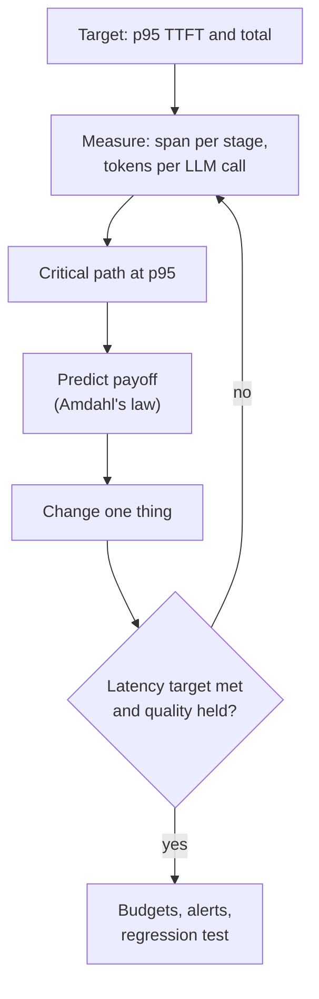

A RAG answer is the sum of many waits: the network, a query rewrite, an embedding, a search, a rerank, the model reading the prompt and the model writing the answer. Users feel the total, and they feel the slowest requests most. **Latency optimisation** is the discipline of making that total smaller without making the answers worse: finding where the time actually goes, choosing the change that removes the most of it for the least cost, and proving afterwards that quality held.

[Retrieval latency](/learn/retrieval-fundamentals/retrieval-latency) taught you to measure: percentiles, series and parallel stages, the critical path, queueing. [Model inference](/learn/understanding-large-language-models/model-inference) explained why the first token takes longer than the rest. This lesson is about acting on those measurements across the whole pipeline. It gives you a method, a catalogue of levers, the arithmetic for predicting what a lever is worth before you build it, and an experiment that trades latency against quality on a real benchmark. The rest of this module then takes the biggest levers one at a time: [caching](/learn/performance-optimisation/caching), [batching](/learn/performance-optimisation/batch-processing), [parallel retrieval](/learn/performance-optimisation/parallel-retrieval), [async execution](/learn/performance-optimisation/async-execution), [streaming](/learn/performance-optimisation/streaming) and [GPU acceleration](/learn/performance-optimisation/gpu-acceleration).

## Learning objectives

- Decompose end-to-end RAG latency into time to first token and total response time, and attribute each to pipeline stages.
- Apply a measure-first optimisation method: set a percentile target, find the critical path, change one thing, re-measure latency and quality.
- Use Amdahl's law to predict the end-to-end gain from speeding up one stage, and reject optimisations that cannot pay off.
- Estimate generation latency from input and output token counts, and explain why output length is usually the largest lever.
- Run a latency-quality experiment and choose a configuration that meets a latency budget without an unacceptable drop in nDCG.

## Prerequisites

- [Retrieval latency](/learn/retrieval-fundamentals/retrieval-latency): percentiles, the critical path, fan-out and queueing.
- [Model inference](/learn/understanding-large-language-models/model-inference): prefill, decoding, time to first token and tokens per second.
- [Cross-encoders](/learn/reranking-fundamentals/cross-encoders): what a reranker computes and why it is expensive.
- [NDCG](/learn/retrieval-evaluation/ndcg): the ranking metric used as the quality guard in the experiment.

## Why this matters

Speed is part of quality. An assistant that answers correctly in twelve seconds gets used less than one that answers almost as well in three. Latency also limits what you can add: every quality improvement in this course (rewriting, hybrid search, reranking, corrective loops) costs time, and a team with no spare budget cannot adopt them.

Without a method, latency work goes wrong in predictable ways. Teams optimise what is easy to see rather than what is slow, swapping the vector database to save 8 milliseconds while a 1.5-second query-rewriting call sits untouched. They make a stage faster without checking retrieval quality, so the system becomes quick and wrong. They report the mean and leave the p95 where it was. And they buy hardware to fix a design problem, such as a prompt that grew to 20,000 tokens because nobody capped the number of chunks.

The fix is to treat latency like any other engineering quantity: define it precisely, measure it per stage, predict the value of a change before making it, and verify the result against both a latency target and a quality target.

## The intuition

Think of a commute with legs: walk to the station, wait, ride the train, walk to the office. To arrive sooner you can:

- **Skip a leg.** If there is a direct bus, the walk to the station disappears.
- **Do something earlier.** Buy the ticket the night before instead of queueing at the machine.
- **Do things at once.** Read your email on the train rather than at your desk.
- **Go faster on a leg.** Take the express instead of the stopping train.
- **Make it feel shorter.** If you can start work on the train, arriving later matters less.

One rule governs all of them: shaving two minutes off a five-minute walk is pointless if the train takes ninety. Start with the longest leg, and check that the express actually stops in your town. In a RAG system the legs are stages, the express that skips your stop is a faster model that answers worse, and the train is almost always the language model.

## How it works

### Two numbers, not one

For an interactive RAG system, measure two end-to-end quantities.

- **Time to first token (TTFT):** from the user pressing Enter to the first word of the answer appearing. It contains everything before generation (request handling, query processing, retrieval, reranking, prompt assembly) plus the model's **prefill**, the pass in which it reads the whole prompt.
- **Total response time:** TTFT plus the time to **decode** every output token, one after another.

With streaming, TTFT is perceived responsiveness and total time is how long the answer took; without streaming they are the same, large number. A faster reranker improves both by the same amount; a shorter answer improves only total; a shorter prompt mostly improves TTFT. Track both as percentiles, never means.

### Where the time typically goes

A typical request for a hosted-model RAG system has this shape. The proportions vary by system, which is why you measure rather than assume, but the ordering is common:

| Stage | Order of magnitude | What drives it |
| --- | --- | --- |
| Network and request handling | milliseconds to tens | distance, TLS handshakes, connection reuse |
| Query rewriting or routing with an LLM | hundreds of ms to seconds | a full model call: prefill plus a short decode |
| Query embedding | milliseconds to tens | model size, hosted round trip |
| Vector and keyword search | milliseconds to tens | index type, filters, shards |
| Reranking | tens to hundreds of ms | number of candidates, chunk length, model size, hardware |
| Prompt prefill | hundreds of ms | input tokens, model size, provider load |
| Decoding the answer | seconds | output tokens times time per token |

The stages before generation are usually a minority of total time but a large share of TTFT, and any stage that calls a language model is in a different league from those that do not. When a team says "retrieval is slow", the slow part is often an LLM call living inside the retriever.

### The method

Latency optimisation is a loop, and it starts with measurement, not with ideas.

1. **Set the target.** Write it as a percentile on a named quantity: "p95 TTFT under 1.5 s and p95 total under 6 s at 20 requests per second". Without a target you cannot say when to stop.
2. **Instrument every stage.** Record a timed span per stage per request, ideally with [distributed tracing](/learn/rag-observability/distributed-tracing), and include token counts on LLM spans.
3. **Find the critical path at the percentile you care about.** The slowest stage at p50 is not always the slowest at p95: a cache-miss path, a long-tail document, or an occasional retry may dominate the tail.
4. **Predict the payoff of each candidate change** with Amdahl's law (below). Discard changes that cannot meet the target even if they work perfectly.
5. **Change one thing, then re-measure both latency and quality** on a fixed evaluation set. A latency gain that costs quality is a trade-off to be decided explicitly, not a free win.
6. **Lock it in.** Add the stage budgets to dashboards and alerts, and add a latency check to the regression suite so the next feature does not silently undo the work.



### The levers

Every latency optimisation is one of a small number of moves. Knowing the list stops you from fixating on one.

**1. Do less work.** The cheapest millisecond is the one you never spend.

- Remove or make conditional the stages that do not earn their time. A rewriting call that helps 3% of queries but adds a second to all of them belongs off the default path; route simple queries past it, and skip reranking when first-stage scores show a clear winner. [Adaptive RAG](/learn/advanced-rag-patterns/adaptive-rag) develops this idea.
- Shrink the work inside a stage. Rerank 20 candidates instead of 100; truncate chunks to the reranker's useful length; retrieve 5 chunks instead of 15 so the prompt is a third the size.
- Shorten the output. Decoding is sequential, so output tokens are the most expensive tokens in time. A system prompt that asks for a direct answer of a few sentences, plus a sensible `max_tokens`, often cuts more seconds than every retrieval optimisation combined.
- Use a smaller or faster model where quality allows: a small model for routing and grading, the large one only for the answer.

**2. Do work earlier.** Move computation from the request path to indexing time. Document embeddings, chunk summaries, keyword expansions, and per-document metadata are all computed offline. Model weights are loaded and warmed before the service accepts traffic, so the first user does not pay the cold start.

**3. Do work once.** If the same computation recurs, store its result: an embedding for a repeated query, retrieval results for a popular question, a prompt prefix the provider can reuse. That is the subject of the next three lessons: [Caching](/learn/performance-optimisation/caching), [Semantic caching](/learn/performance-optimisation/semantic-caching) and [Query caching](/learn/performance-optimisation/query-caching).

**4. Do work at the same time.** Independent stages need not wait for each other. Dense and keyword search can run concurrently, as can several sub-queries, and logging can happen after the response is sent. Concurrency turns a sum into a maximum; [Parallel retrieval](/learn/performance-optimisation/parallel-retrieval) and [Async execution](/learn/performance-optimisation/async-execution) cover how.

**5. Do work closer and faster.** Keep the application, vector database and reranker in the same region; reuse HTTP connections instead of paying a TLS handshake per call; run models on hardware that suits them ([GPU acceleration](/learn/performance-optimisation/gpu-acceleration)); group many small inferences into one ([Batch processing](/learn/performance-optimisation/batch-processing)).

**6. Make the wait feel shorter.** [Streaming](/learn/performance-optimisation/streaming) does not reduce total time, but it moves the moment the user sees progress from "answer complete" to "first token". Showing the retrieved sources while the answer is generated does the same.

**7. Cut the tail.** Timeouts with a fallback (answer without reranking rather than not at all), hedged requests to a second replica, and admission control that rejects load before queues explode all target p95 and p99 rather than the median.

### Quality is the constraint

Most levers trade accuracy for time, and they do it silently. A smaller reranker, fewer candidates, fewer chunks in the prompt, a smaller generator, a skipped rewriting step: each will make the system faster, and each may make some answers wrong. The only defence is to run every change against an evaluation set with retrieval metrics ([Recall@K](/learn/retrieval-evaluation/recall-k), [NDCG](/learn/retrieval-evaluation/ndcg)) and, for generator changes, answer metrics ([Faithfulness](/learn/generation-evaluation/faithfulness), [Answer correctness](/learn/generation-evaluation/answer-correctness)). The output of a latency experiment is therefore a table with two kinds of column, and the decision is a choice of row.

```playground
latency-cost
```

## The mathematics

### Amdahl's law: the most a stage can give you

**Intuition.** If a stage takes a fraction $p$ of the total time, then even making it infinitely fast removes only that fraction. The rest of the pipeline is untouched.

$$
S = \frac{1}{(1 - p) + \dfrac{p}{s}}
$$

$S$ is the overall speed-up (old total divided by new total), $p$ is the fraction of the original total spent in the stage you are improving, and $s$ is how many times faster that stage becomes. As $s \to \infty$, $S \to 1/(1-p)$: the ceiling set by everything else. This is Amdahl's law, stated by Gene Amdahl in 1967 for parallel computers; it applies to any pipeline of sequential stages.

**By hand.** A request takes 5.0 s in total: 0.3 s of retrieval, 0.4 s of reranking, 0.8 s of prefill and 3.5 s of decoding.

- Make the reranker 4 times faster: $p = 0.4/5.0 = 0.08$, so $S = 1 / (0.92 + 0.08/4) = 1/0.94 = 1.064$. The new total is $5.0/1.064 = 4.70$ s. A heroic reranker project saves 0.3 s, 6%.
- Halve the answer length instead, which halves decoding: $p = 3.5/5.0 = 0.7$, $s = 2$, so $S = 1/(0.3 + 0.35) = 1.538$. The new total is $3.25$ s, a 35% saving, from a change to the prompt.

Amdahl's law is applied to the quantity you care about. For TTFT, decoding is not part of the total at all, and the reranker is a much bigger fraction of it.

### A latency model for one RAG request

**Intuition.** Generation time is roughly a fixed cost per input token for prefill plus a fixed cost per output token for decoding, and decoding is far slower per token because it is sequential.

$$
T_{\text{first}} \approx t_{\text{pre}} + \frac{N_{\text{in}}}{r_{\text{prefill}}}, \qquad
T_{\text{total}} \approx T_{\text{first}} + \frac{N_{\text{out}}}{r_{\text{decode}}}
$$

$t_{\text{pre}}$ is everything before the model starts (network, retrieval, reranking, queueing at the provider); $N_{\text{in}}$ is the number of input tokens (system prompt, retrieved chunks, question); $r_{\text{prefill}}$ is the rate at which the model processes input tokens; $N_{\text{out}}$ is the number of output tokens; $r_{\text{decode}}$ is the output rate in tokens per second. The rates depend on the model, the hardware and the provider's load, and change often, so measure them for your deployment. The values below are **assumptions for illustration only**.

**By hand.** Assume $t_{\text{pre}} = 0.6$ s, $r_{\text{prefill}} = 8{,}000$ tokens/s and $r_{\text{decode}} = 60$ tokens/s. A prompt of 6,000 tokens (8 chunks of about 700 tokens plus instructions) and an answer of 400 tokens give

- $T_{\text{first}} = 0.6 + 6000/8000 = 0.6 + 0.75 = 1.35$ s
- $T_{\text{total}} = 1.35 + 400/60 = 1.35 + 6.67 = 8.02$ s

Now retrieve 4 chunks instead of 8 ($N_{\text{in}} = 3{,}200$) and ask for a 200-token answer: $T_{\text{first}} = 0.6 + 0.4 = 1.0$ s and $T_{\text{total}} = 1.0 + 3.33 = 4.33$ s. The output change saved 3.3 s; the input change saved 0.35 s.

**In Python:**

```python
def amdahl(p, s):
    return 1 / ((1 - p) + p / s)

total = 5.0
for name, stage_s, factor in [("reranker 4x faster", 0.4, 4), ("answer half as long", 3.5, 2)]:
    S = amdahl(stage_s / total, factor)
    print(f"{name:<20} p={stage_s / total:.2f}  speed-up={S:.3f}  new total={total / S:.2f} s")

def rag_latency(n_in, n_out, t_pre=0.6, r_prefill=8000, r_decode=60):   # assumed rates
    first = t_pre + n_in / r_prefill
    return first, first + n_out / r_decode

for n_in, n_out in [(6000, 400), (3200, 400), (6000, 200), (3200, 200)]:
    first, full = rag_latency(n_in, n_out)
    print(f"in={n_in:>5}  out={n_out:>3}  TTFT={first:.2f} s  total={full:.2f} s")
```

```output
reranker 4x faster   p=0.08  speed-up=1.064  new total=4.70 s
answer half as long  p=0.70  speed-up=1.538  new total=3.25 s
in= 6000  out=400  TTFT=1.35 s  total=8.02 s
in= 3200  out=400  TTFT=1.00 s  total=7.67 s
in= 6000  out=200  TTFT=1.35 s  total=4.68 s
in= 3200  out=200  TTFT=1.00 s  total=4.33 s
```

The model is crude (prefill is not perfectly linear, providers queue, reasoning models emit hidden tokens first), but it ranks candidate changes before you spend a week on one.

## In code

**The problem.** The retrieval half of a RAG pipeline (embed, search, rerank) must fit a budget, and the reranker is the obvious cost. Several cheaper configurations are available. Which one meets the budget while losing the least quality?

The experiment runs four configurations on 100 test queries from BEIR SciFact (5,183 scientific abstracts with relevance judgements) and reports, for each, the median time per stage, p50 and p95 end-to-end retrieval latency, and nDCG@10.

- **A**: the accurate baseline, `BAAI/bge-reranker-base` reranking 50 candidates.
- **B**: a smaller reranker, `cross-encoder/ms-marco-MiniLM-L-6-v2`, on the same 50.
- **C**: the smaller reranker on only 20 candidates.
- **D**: no reranker; the first-stage ranking is final.

**Dependencies.** sentence-transformers (which installs PyTorch) and Hugging Face `datasets`. The first run downloads the three models and the dataset.

```bash
pip install sentence-transformers datasets numpy
```

```python
import time
import numpy as np
from datasets import load_dataset
from sentence_transformers import SentenceTransformer, CrossEncoder

# --- Data: BEIR SciFact (5,183 abstracts, 300 test queries with judgements) ---
corpus = load_dataset("BeIR/scifact", "corpus", split="corpus")
doc_ids = [str(d) for d in corpus["_id"]]
doc_texts = [f"{t}. {x}" for t, x in zip(corpus["title"], corpus["text"])]
queries = {str(r["_id"]): r["text"] for r in load_dataset("BeIR/scifact", "queries", split="queries")}
qrels = {}
for r in load_dataset("BeIR/scifact-qrels", split="test"):
    qrels.setdefault(str(r["query-id"]), set()).add(str(r["corpus-id"]))
test_qids = sorted(qrels)[:100]                     # 100 test queries keep the run short

# --- Offline: embed the corpus once ---
embedder = SentenceTransformer("sentence-transformers/all-MiniLM-L6-v2")
doc_vecs = embedder.encode(doc_texts, batch_size=64, normalize_embeddings=True)

rerankers = {
    "bge-reranker-base": CrossEncoder("BAAI/bge-reranker-base", max_length=512),
    "ms-marco-MiniLM-L-6": CrossEncoder("cross-encoder/ms-marco-MiniLM-L-6-v2", max_length=512),
}

def ndcg_at_10(ranked, relevant):
    dcg = sum(1 / np.log2(i + 2) for i, d in enumerate(ranked[:10]) if d in relevant)
    idcg = sum(1 / np.log2(i + 2) for i in range(min(len(relevant), 10)))
    return dcg / idcg

def run(config):
    reranker = rerankers.get(config["reranker"])
    timings, scores = [], []
    for qid in test_qids:
        t0 = time.perf_counter()
        q_vec = embedder.encode([queries[qid]], normalize_embeddings=True)[0]
        t1 = time.perf_counter()
        sims = doc_vecs @ q_vec                      # exact search over 5,183 vectors
        top = np.argpartition(-sims, config["fetch_k"])[: config["fetch_k"]]
        top = top[np.argsort(-sims[top])]
        t2 = time.perf_counter()
        if reranker is not None:
            pairs = [(queries[qid], doc_texts[i]) for i in top]
            ce = reranker.predict(pairs, batch_size=64)
            top = top[np.argsort(-ce)]
        t3 = time.perf_counter()
        timings.append((t1 - t0, t2 - t1, t3 - t2, t3 - t0))
        scores.append(ndcg_at_10([doc_ids[i] for i in top], qrels[qid]))
    return np.array(timings) * 1000, float(np.mean(scores))

configs = [
    {"name": "A baseline",        "reranker": "bge-reranker-base",   "fetch_k": 50},
    {"name": "B smaller reranker","reranker": "ms-marco-MiniLM-L-6", "fetch_k": 50},
    {"name": "C fewer candidates","reranker": "ms-marco-MiniLM-L-6", "fetch_k": 20},
    {"name": "D no reranker",     "reranker": None,                  "fetch_k": 10},
]
run(configs[0] | {"fetch_k": 5})                     # warm-up: load weights, first-call overhead
print(f"{'config':<20}{'embed':>7}{'search':>8}{'rerank':>8}{'p50':>8}{'p95':>8}{'nDCG@10':>9}")
for c in configs:
    ms, ndcg = run(c)
    e, s, r, total = (np.median(ms[:, i]) for i in range(4))
    p95 = np.percentile(ms[:, 3], 95)
    print(f"{c['name']:<20}{e:>7.1f}{s:>8.1f}{r:>8.1f}{total:>8.1f}{p95:>8.1f}{ndcg:>9.3f}")
```

Run on an Apple-silicon laptop, where sentence-transformers placed both models on the built-in GPU (`mps`) automatically, the output was as follows. Your timings will differ with hardware; the nDCG values should match closely.

```output
config                embed  search  rerank     p50     p95  nDCG@10
A baseline              6.2     0.2  2250.4  2257.2  2747.1    0.702
B smaller reranker      5.1     0.2   369.2   374.6   446.2    0.692
C fewer candidates      4.9     0.2   148.1   154.5   179.2    0.695
D no reranker           4.7     0.2     0.0     4.9     6.2    0.644
```

All times are in milliseconds; embed, search and rerank are medians per stage, and p50 and p95 are of the end-to-end retrieval time.

**The important lines.**

- `doc_vecs = embedder.encode(doc_texts, ...)` runs once, before any query is timed. Corpus embedding is indexing work; including it in query latency is a common measurement error.
- `run(configs[0] | {"fetch_k": 5})` is a warm-up. The first call to each model allocates memory and initialises the device, and would otherwise inflate the first configuration's numbers.
- `time.perf_counter()` brackets each stage separately, so the table shows not just that the request is slow but which stage is.
- `reranker.predict(pairs, batch_size=64)` scores all candidate pairs in one batch; the cost grows with the number of pairs and their length.
- `ndcg_at_10` is computed on the final ranking of every configuration, so speed and quality come from the same run.

**What the output means.**

- **The reranker is the whole story.** Embedding takes about 5 ms and exact search over five thousand vectors 0.2 ms. In configuration A, the reranker accounts for more than 99% of retrieval time. By Amdahl's law, nothing done to embedding or search could improve A by more than 1%. Look at the critical path before choosing what to optimise.
- **The big model is slow for a small gain.** `bge-reranker-base` (12 layers, 768 wide) costs six times as long as the MiniLM cross-encoder (6 layers, 384 wide): 2,257 ms against 375 ms at p50, for 0.010 nDCG@10.
- **Cost scales with candidates.** Cutting `fetch_k` from 50 to 20 cut rerank time from 369 ms to 148 ms, about proportionally, and nDCG did not fall (0.695 against 0.692; on 100 queries, differences below about 0.01 are noise, so do not call it an improvement). The relevant documents for these queries are usually already in the first-stage top 20.
- **Removing the reranker is fast and costly.** Configuration D answers in 5 ms but loses 0.058 nDCG@10, roughly an 8% relative drop. Reranking earns its place; the question is how much of it.
- **The decision.** With a 300 ms p95 budget, A and B are out, C fits with headroom, and D fits but costs quality. C is the choice: about 15 times faster than A for a loss of 0.007 nDCG@10. Whether that loss is acceptable is a product decision, and the table is what makes it a decision rather than an accident.

**Errors people commonly hit.**

- **Timing the first call.** Without the warm-up, configuration A absorbs model initialisation and looks even worse than it is.
- **Forgetting the device.** A CPU run and a GPU run are not comparable; print `model.device`.

**Extending it.** Add a configuration with `max_length=256` to shorten every pair, or run the loop with several concurrent workers to see p95 under load, which single-request timing never shows.

## A real-world example

The Platform team at Meridian set a target for AskMeridian of p95 time to first token under 2 seconds and p95 total under 8 seconds. Measured p95 values were 3.4 s and 11 s, and the first proposal in the team channel was to move from the Qdrant cluster to a "faster vector database".

Ravi, who owned the latency work, asked for traces first. The p95 request looked like this: 40 ms of request handling, 1,300 ms for a query-rewriting call to a language model, 25 ms of embedding, 18 ms of vector search, 420 ms of reranking 60 candidates, about 700 ms of prefill on a prompt of twelve chunks, and then decoding an answer that was frequently 600 tokens long. Replacing the database could not have met the target even if search took zero time.

The team worked down the list by predicted payoff, checking each change against their 250-question evaluation set:

1. **Output length.** The system prompt asked for "a thorough answer". They changed it to ask for a direct answer of a few sentences with citations, followed by details only if needed. Answer correctness held; median output length roughly halved, and total time fell by several seconds.
2. **Conditional rewriting.** An analysis of logs showed that rewriting helped mainly on vague or conversational follow-ups. They added a cheap rule-based check and rewrote only when the question contained pronouns referring to earlier turns or was very short. Most requests skipped the 1.3 s call.
3. **Fewer candidates and chunks.** Reranking 25 candidates instead of 60, and sending 6 chunks instead of 12, cut both reranking time and prefill. Recall@6 on the evaluation set was unchanged within noise.
4. **Streaming and sources first.** The interface started showing the cited handbook sections as soon as retrieval finished, then streamed the answer.

Afterwards both targets were met with no hardware change and no new database. A latency assertion added to the regression suite later caught a change that quietly raised the chunk count to 15.

## Common mistakes

- **Optimising without a trace.** Engineers guess the vector database or the embedding model; the usual culprits are LLM calls and output length. Work done on the wrong stage is wasted, however good it is.
- **Optimising the mean.** A change that helps the median and leaves the tail alone will not change how the system feels. Targets and results must be percentiles.
- **Shipping a speed-up without a quality check.** Smaller rerankers, fewer chunks and smaller generators all make answers worse sometimes. Without an evaluation run the regression is discovered by users.
- **Ignoring output length.** Teams spend weeks on retrieval milliseconds while the model writes 700-token answers nobody reads in full. Decoding is usually the largest single cost in total time.
- **Optimising once.** Without budgets and a regression check, latency drifts back as features are added.

## Best practices

- Write the target down as percentiles on TTFT and total, at a stated load.
- Trace every request with a span per stage and token counts on every LLM call; make the p95 critical path visible on a dashboard.
- Predict the payoff of a change with Amdahl's law before building it.
- Prefer levers that remove work (shorter answers, fewer chunks, conditional stages) before levers that add infrastructure.
- Change one thing at a time and re-run both latency and quality measurements on a fixed evaluation set.
- Give slow optional stages a timeout and a fallback, so the tail degrades gracefully instead of failing.
- Keep per-stage budgets and add a latency test to continuous integration.

## Performance considerations

Latency and cost usually move together, but not always. Shorter prompts and shorter answers reduce both. Fewer reranking candidates reduce both. Hedged requests and speculative work reduce tail latency by spending extra compute: a hedge sent at the p95 duplicates about 5% of requests, which is cheap insurance for retrieval and expensive for an LLM call. Running stages in parallel reduces latency but not compute. A larger GPU reduces latency and raises the fixed cost.

Throughput is the other half. A reranker that takes 150 ms of GPU time per request can serve at most about $1000/150 \approx 6.7$ requests per second per GPU if requests are processed one at a time; queueing theory says latency climbs steeply well before that. Reducing per-request work therefore raises capacity as well as cutting latency; [batching](/learn/performance-optimisation/batch-processing) concurrent requests raises it further.

Provider-side levers (smaller model tiers, prompt caching, faster tiers at a higher price) change often; check current documentation and measure them in your own setting.

## Summary

- Measure two end-to-end numbers, time to first token and total time, as percentiles at a stated load, and attribute each to stages with traces.
- Optimise the critical path at the percentile you care about. Amdahl's law caps the gain from any stage at the fraction of time it takes.
- LLM calls dominate most RAG latency; output length is usually the largest single lever, and conditional LLM stages are often the second.
- The levers are few: do less, do it earlier, do it once, do it concurrently, do it closer and faster, make it feel faster, and cut the tail.
- Every speed-up is a candidate trade-off. Judge it against a quality metric on a fixed evaluation set, as the SciFact experiment did, and choose the cheapest configuration that keeps quality acceptable.

## Exercises

**1.** A request takes 4 s: 0.2 s retrieval, 0.6 s reranking, 0.7 s prefill, 2.5 s decoding. (a) What is the best possible speed-up from eliminating reranking entirely? (b) What speed-up do you get from making decoding 25% faster? Which is larger?

<details><summary>Show solution</summary>

(a) $p = 0.6/4 = 0.15$, $s \to \infty$: $S = 1/(1 - 0.15) = 1.176$, a new total of 3.4 s.

(b) "25% faster" means $s = 1.25$; $p = 2.5/4 = 0.625$. $S = 1/(0.375 + 0.625/1.25) = 1/(0.375 + 0.5) = 1.143$, a new total of 3.5 s.

Eliminating reranking entirely is slightly better, but it also costs quality, whereas the decoding speed-up (a faster model tier, or shorter answers) may not. For TTFT, decoding is irrelevant and reranking is $0.6/1.5 = 40\%$ of the total.

</details>

**2.** Using the latency model with the lesson's assumed rates ($t_{\text{pre}} = 0.6$ s, 8,000 input tokens/s, 60 output tokens/s), a system sends 10 chunks of 500 tokens plus a 600-token instruction block and produces 350-token answers. Compute TTFT and total. Then find the answer length that brings total time under 4 s.

<details><summary>Show solution</summary>

$N_{\text{in}} = 10 \times 500 + 600 = 5{,}600$. TTFT $= 0.6 + 5600/8000 = 0.6 + 0.7 = 1.3$ s. Total $= 1.3 + 350/60 = 1.3 + 5.83 = 7.13$ s.

For total under 4 s: $1.3 + N_{\text{out}}/60 < 4$, so $N_{\text{out}} < 162$ tokens. Halving the chunks would only save 0.31 s of prefill, so the answer length is the lever that can meet this target.

</details>

**3.** Re-run the experiment with all 300 test queries and add configuration E: the MiniLM cross-encoder on 30 candidates with `max_length=256`. Which configuration would you ship under a 200 ms p95 budget, and by what rule?

<details><summary>Show solution</summary>

Set `test_qids = sorted(qrels)`, add `"MiniLM-256": CrossEncoder("cross-encoder/ms-marco-MiniLM-L-6-v2", max_length=256)` to `rerankers`, and add `{"name": "E 30 short", "reranker": "MiniLM-256", "fetch_k": 30}`. Use the rule: among configurations whose p95 fits the budget, choose the highest nDCG@10, and if two are within about 0.01, the faster. On the 100-query run that rule picks C. Report the device with the results, since hardware decides which configurations fit.

</details>

**4.** Design question. AskMeridian must add a "grade the retrieved chunks with an LLM and retrieve again if they are poor" step (corrective RAG), which adds about 900 ms when it runs. The p95 TTFT target of 2 s is already nearly used up. Propose a design that adds the step without breaking the target for most users, and say what you would measure.

<details><summary>Show solution</summary>

Make the step conditional and cheap: run it only when a fast signal suggests retrieval failed (for example a top reranker score below a threshold calibrated on the evaluation set), use a small fast model for grading, show a "searching further" status while it runs, and give it a timeout after which the system answers from the first retrieval.

Measure the fraction of requests that trigger grading, p95 TTFT separately for triggered and untriggered requests, and answer correctness with and without the step. Keep it if it fixes enough failed retrievals to justify the slower tail on the triggered fraction.

</details>

## Check your understanding

```quiz
[
  {
    "q": "A request spends 2% of its time in vector search. A new index makes search 10 times faster. Roughly how much faster does the whole request become?",
    "options": ["About 10 times faster", "About 2% faster", "About 20% faster", "It depends only on the number of shards"],
    "answer": 1,
    "why": "Amdahl's law: with p = 0.02 and s = 10, S = 1 / (0.98 + 0.002), about 1.018. A stage that takes 2% of the time can save at most 2%."
  },
  {
    "q": "Which change reduces total response time but leaves time to first token essentially unchanged?",
    "options": ["Reranking fewer candidates", "Sending fewer chunks in the prompt", "Removing a query-rewriting LLM call", "Asking the model for shorter answers"],
    "answer": 3,
    "why": "Output length affects only decoding, which happens after the first token. The other three all happen before generation starts, so they reduce TTFT as well."
  },
  {
    "q": "In the SciFact experiment, configuration C (MiniLM cross-encoder, 20 candidates) scored nDCG@10 of 0.695 and B (same model, 50 candidates) 0.692, on 100 queries. What is the right conclusion?",
    "options": ["Reranking fewer candidates improves quality in general", "C is much faster and its quality is indistinguishable from B's on this sample", "B is broken", "nDCG cannot be compared across configurations"],
    "answer": 1,
    "why": "A 0.003 difference on 100 queries is within noise. The defensible claim is that C keeps quality while cutting rerank time by more than half, not that it is better."
  },
  {
    "q": "A team's p50 latency improved by 30% after an optimisation, but users report no difference. What is the most likely explanation?",
    "options": ["Users cannot perceive 30%", "The change helped the typical request but not the slow tail that users remember", "The p50 measurement was wrong", "Streaming hides all latency"],
    "answer": 1,
    "why": "Users notice the slow requests. If the p95 and p99 are set by a different path (a cache miss, a retry, a long answer), improving the median does not change the experience."
  },
  {
    "q": "Which of these moves work from the request path to indexing time?",
    "options": ["Streaming the answer", "Running dense and keyword search concurrently", "Precomputing chunk summaries and document embeddings when documents are ingested", "Hedging slow requests to a second replica"],
    "answer": 2,
    "why": "Doing work earlier means computing it offline, at ingestion, so no user waits for it. The other options overlap, perceive or hedge the work but still do it on the request path."
  }
]
```

## Further reading

- Gene M. Amdahl (1967), "Validity of the single processor approach to achieving large scale computing capabilities", *AFIPS Conference Proceedings* 30. The origin of Amdahl's law.
- Jeffrey Dean and Luiz André Barroso (2013), "The Tail at Scale", *Communications of the ACM* 56(2). Why tails dominate at scale, and hedged and tied requests.
- Betsy Beyer, Chris Jones, Jennifer Petoff and Niall Richard Murphy (eds.) (2016), *Site Reliability Engineering*, O'Reilly, chapter 4 "Service Level Objectives", [sre.google/sre-book/service-level-objectives](https://sre.google/sre-book/service-level-objectives/). Writing latency targets as percentiles.
- Nandan Thakur and colleagues (2021), "BEIR: A Heterogeneous Benchmark for Zero-shot Evaluation of Information Retrieval Models", [arxiv.org/abs/2104.08663](https://arxiv.org/abs/2104.08663). The source of SciFact.
- Sentence Transformers documentation, [sbert.net](https://www.sbert.net). Bi-encoder and cross-encoder usage, including batch sizes and devices.
