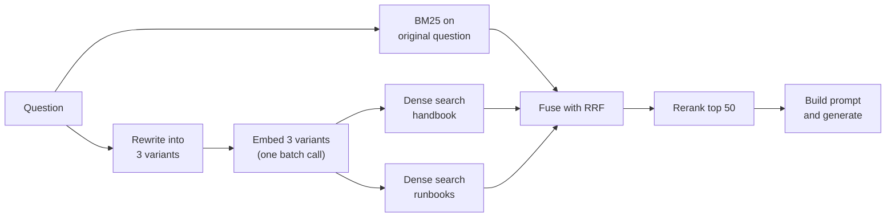

A modern RAG query rarely makes one search. It runs a dense search and a keyword search, perhaps over three rewrites of the question, against several collections, each of which may be split across shards. Done one after another, those searches add up to a retrieval stage that is slower than the language model. **Parallel retrieval** is the engineering of running them at the same time: deciding which searches are independent, where the parallel work should physically run, how to merge the partial results correctly, and what to do about the branch that is always last.

You will shard a real FAISS index, search the shards in parallel threads, prove the merged result identical to an unsharded search, see the merge bug that silently loses results, and simulate how hedged requests cut the tail.

## Learning objectives

- Draw the dependency graph of a retrieval request and identify which searches can run concurrently and which stage is on the critical path.
- Implement a scatter-gather search over shards that returns exactly the same top-k as an unsharded index, and explain why each shard must return $k$ results.
- Choose between threads, processes, asynchronous I/O and server-side batching for a given retrieval branch, and avoid thread oversubscription.
- Estimate the speed-up of parallelising retrieval with Amdahl's law, and the tail-latency effect and extra load of hedged requests.
- Explain why intra-request parallelism improves latency at low load but not throughput at saturation.

## Prerequisites

- [Retrieval latency](/learn/retrieval-fundamentals/retrieval-latency): percentiles, the critical path, fan-out tail amplification and queueing.
- [Async programming](/learn/python-for-rag-engineering/async-programming): tasks, `TaskGroup`, `gather`, timeouts and the GIL.
- [Hybrid retrieval architecture](/learn/hybrid-search/hybrid-retrieval-architecture): why a query goes to both a dense and a sparse retriever.
- [Flat indexes](/learn/vector-indexing-algorithms/flat-indexes): exact search by brute-force inner products.
- [Latency optimisation](/learn/performance-optimisation/latency-optimisation): how to find where a request spends its time before changing anything.

## Why this matters

Retrieval pipelines grow by accretion: one vector search, then BM25 for error codes, then [multi-query retrieval](/learn/advanced-retrieval/multi-query-retrieval) for paraphrases, then a second collection, then [sharding](/learn/advanced-vector-database-engineering/sharding) when the index outgrows one machine. The steps multiply: 2 retrievers, 3 query variants and 2 collections are 12 searches. At 40 ms each, sequential execution costs 480 ms before reranking has started.

Running independent searches concurrently brings that close to the time of the slowest single search. Three things go wrong when it is done naively:

1. **Wrong answers.** A scatter-gather that asks shards for too few results, or merges incomparable scores, returns a different top-k from the unsharded index. Nothing errors; recall simply drops.
2. **No speed-up.** Pure-Python threads do not overlap because of the GIL; nested native thread pools oversubscribe the CPU; 12 calls through a connection pool of 10 queue the last two.
3. **Worse tails and lower capacity.** The request waits for the slowest of 12 branches, so rare stalls become common, and at peak load the extra coordination reduces how many requests the cluster serves.

## The intuition

A librarian must find the ten best books on Meridian's leave policy in a library of four rooms, each with its own catalogue. Alone, she searches room after room. With four assistants, one per room, the rooms are searched at once and she picks the overall best from what they bring back. That is scatter-gather.

Three lessons follow. Each assistant must bring back their own ten best, not two or three, because all ten winners might sit in one room. She is only as fast as the slowest assistant, so a door that sticks now and then in any room delays the whole search; sending a second assistant after a short wait fixes much of that. And assistants do not reduce the total walking: when the library is busy, four assistants per patron means fewer patrons served at once.

## How it works

### Five sources of parallel work

Not every kind of parallelism looks the same, and each has its own correctness and cost rules.

| Source | Example in AskMeridian | Merge step | Main pitfall |
| --- | --- | --- | --- |
| Multiple retrievers | Dense search and BM25 for one question | Rank fusion such as RRF | Scores on different scales |
| Multiple query variants | Three rewrites from multi-query retrieval | Fusion or union, then dedupe | Fan-out multiplies with everything else |
| Multiple collections | Handbook, IT runbooks, product docs | Fusion, or per-collection quotas | One slow collection delays all |
| Shards of one collection | The runbook collection split over 4 nodes | Exact top-k merge by score | Each shard must return $k$; score comparability |
| Inside one index | FAISS using several cores for one search | Done by the library | Oversubscription with your own threads |

The first three are **logical** parallelism: you choose to run different searches. The fourth is **physical**, imposed by data size and usually handled by the vector database, though you must understand it to configure and debug it. The fifth happens inside a library call and competes for the same cores as everything else.

### The request as a dependency graph

To parallelise a request, draw it as a graph in which an arrow means "needs the output of". Anything without a path between them can run at the same time.



Reading the graph gives the procedure:

1. **List every stage and its inputs.** The BM25 search needs only the raw question; the dense searches need the embeddings; the embeddings need the rewrites.
2. **Start each stage as soon as its inputs exist.** BM25 starts at time zero, in parallel with the rewrite, not after it. Leaving such a branch waiting behind an unrelated stage is the commonest missed opportunity.
3. **Batch where one call can serve several branches.** The three variants are embedded in one request to the embedding model, not three; batching is covered in [Batch processing](/learn/performance-optimisation/batch-processing).
4. **Join at the merge.** Fusion waits for all branches (or for a deadline, below).
5. **Find the critical path.** The longest chain of dependent stages sets the latency. Here it is likely question, rewrite, embed, dense search, fuse, rerank. Making BM25 faster achieves nothing, because it is off that path.

### Scatter-gather over shards

**Sharding** splits one collection's vectors across several partitions, usually on different machines. A query is **scattered** to every shard; each shard returns its local best results; a coordinator **gathers** them and keeps the global best. Distributed vector databases such as Qdrant, Milvus, Elasticsearch and OpenSearch do this internally; FAISS offers `IndexShards` for the in-process case. Two rules make the gather correct.

**Rule one: every shard returns $k$.** The global top 10 may all live on one shard. If each of four shards returns only $\lceil 10/4 \rceil = 3$, the gather can never contain more than 3 results from any shard, and any query whose true top 10 is unevenly spread loses results. For exact search, asking each shard for $k$ guarantees the merge equals the unsharded answer: every one of the global top $k$ is in its own shard's top $k$, because at most $k - 1$ results anywhere can outrank it. The coordinator then sorts $S \times k$ candidates, which is trivial for RAG-sized $k$. With approximate indexes such as [HNSW](/learn/vector-indexing-algorithms/hnsw), the shard results are themselves approximate, so the merged result is approximately the unsharded one, and recall should be measured, not assumed.

**Rule two: scores must be comparable across shards.** Merging by score assumes a score of 0.71 means the same thing on every shard. For dense retrieval it holds, since a cosine depends only on the two vectors, provided every shard used the same model version (a half-finished re-embedding breaks it silently). For lexical scoring it does **not** hold by default: [BM25](/learn/sparse-retrieval/bm25) uses inverse document frequency and average document length, and a shard computes those from its own documents. A term that is rare on shard 2 but common elsewhere is over-weighted there. With random routing and large shards this rarely matters; with small or topic-routed shards it does. Elasticsearch and OpenSearch address this with a search type, `dfs_query_then_fetch`, that first collects term statistics from all shards and then scores with the global values, at the price of an extra round trip.

### Where the parallel work runs

Choosing the mechanism is a question of what each branch spends its time on.

- **Waiting on the network** (a hosted vector database, a search cluster, an embedding API). Use asynchronous I/O with a shared async client, as in [Async execution](/learn/performance-optimisation/async-execution).
- **Native code in your process** (FAISS, NumPy, PyTorch). Threads work, because these libraries release the GIL inside their heavy routines: while one thread is inside FAISS's search kernel, another can run. A `concurrent.futures.ThreadPoolExecutor` with one worker per shard is the simplest form.
- **Pure Python CPU work** (a hand-written scorer, `rank_bm25`'s Python-level loops). Threads do not help on the standard CPython build, because only one thread runs Python bytecode at a time. Use processes, or better, move the work into a search engine.
- **Inside the database.** Often the best option is not to fan out from your code at all. Qdrant's `query_batch_points` sends several queries to a collection in one request, and its `prefetch` mechanism runs dense and sparse sub-queries server-side and fuses them, so the fan-out happens next to the data with one network round trip. Elasticsearch's multi-search API (`_msearch`) does the same for several searches.

**Oversubscription** is the trap of mixing these. FAISS uses OpenMP to parallelise a single search across cores, and NumPy's linear algebra may use its own thread pool. If you run 4 shard searches in 4 threads and each search spawns 10 OpenMP threads, 40 threads compete for 10 cores, and the context switching can make the parallel version slower than the sequential one. The rule: decide at which level parallelism happens, and set the others to one thread (`faiss.omp_set_num_threads(1)`, or environment variables such as `OMP_NUM_THREADS`).

### Deadlines, partial results and hedging

[Retrieval latency](/learn/retrieval-fundamentals/retrieval-latency) showed how fan-out turns a rare slow call into a common slow request. Two tools limit the damage.

- **A deadline with required and optional branches.** When the fan-out's deadline fires, cancel the stragglers and continue with what arrived, provided every required branch (say, dense search over the main collection) is present. Missing one of three query variants costs a little recall; missing the only shard holding a document makes it unfindable, so shards are usually required. Log every partial result, so a persistently late branch shows up in monitoring.
- **Hedged requests** (Dean and Barroso, "The Tail at Scale", 2013). If a branch has not answered after a delay $d$, typically near its p95, send the same request to another replica, take whichever answers first and cancel the other. It needs replicas and is safe only for idempotent reads, which searches are. Only the slowest 5% are duplicated, so extra load is about 5%; the mathematics below quantifies the gain.

> [!WARNING]
> Cap hedges and retries. Duplicating every slow request turns a replica that is slow because it is overloaded into a doubly overloaded cluster. Production implementations limit hedges to a small share of traffic.

### Latency is not throughput

**Intra-request** parallelism cuts one request's latency by using more resources at once; it does not reduce total work, and it adds coordination. A server also exploits **inter-request** parallelism: different users' requests on different cores.

At low load, cores are idle, so lending them to one request is free and latency falls. At high load, every core is already busy with someone's request; splitting each request four ways only adds coordination overhead and lengthens queues. The benefit shrinks as utilisation rises and can turn slightly negative at saturation, which is why production systems pair fan-out with batching at the database and capacity planning that keeps utilisation well below 100%.

## The mathematics

### Critical path of a parallel stage

**Intuition.** Sequential stages add; parallel branches cost only their maximum.

$$
T_{\text{seq}} = \sum_{i=1}^{b} t_i, \qquad T_{\text{par}} = \max_{i} t_i + t_{\text{merge}}
$$

$b$ is the number of branches, $t_i$ the latency of branch $i$ and $t_{\text{merge}}$ the cost of the gather.

**By hand.** Branches of 60 ms (dense, handbook), 35 ms (BM25) and 80 ms (dense, runbooks), merge 5 ms. Sequential: $60 + 35 + 80 = 175$ ms. Parallel: $\max(60, 35, 80) + 5 = 85$ ms. To make the parallel stage faster, you must speed up the 80 ms branch; nothing else counts.

### Amdahl's law

**Intuition.** Only part of a request can be parallelised. However many workers you add, the serial part remains, and it caps the speed-up.

$$
S(n) = \frac{1}{(1 - p) + \dfrac{p}{n}}
$$

$S(n)$ is the speed-up with $n$ parallel workers, $p$ is the fraction of the original time that can be parallelised (between 0 and 1) and $1 - p$ is the serial fraction. As $n \to \infty$, $S \to 1/(1-p)$.

**By hand.** If 80% of retrieval time is shard search and 20% is query embedding, merge and reranking that cannot be split, then with 4 shards: $S(4) = 1 / (0.2 + 0.8/4) = 1 / 0.4 = 2.5$. With infinitely many shards: $1/0.2 = 5$. Doubling from 4 to 8 shards gives $1/(0.2 + 0.1) \approx 3.3$, a modest gain for twice the machines.

### Hedged requests

**Intuition.** With a hedge, the request is slow only if the first attempt is slow **and** the backup, started $d$ later, is also slow.

Let $X_1$ and $X_2$ be the latencies of two independent attempts and $d$ the hedge delay. The hedged latency is $T = \min(X_1, d + X_2)$, and for any $t > d$:

$$
P(T > t) = P(X_1 > t)\, P(X_2 > t - d)
$$

The expected extra load is the fraction of requests that trigger the hedge, $P(X_1 > d)$.

**By hand.** Suppose $P(X > 200\text{ ms}) = 0.01$ and $P(X > 150\text{ ms}) = 0.015$, and the hedge fires at $d = 50$ ms, around the p95, so $P(X > 50) = 0.05$. Then $P(T > 200) = 0.01 \times 0.015 = 0.00015$: a request that used to exceed 200 ms one time in a hundred now does so about three times in twenty thousand, for 5% more traffic. This assumes the two attempts are independent; if slowness is shared (an overloaded network link, a query that is slow on every replica), hedging helps much less.

The simulation below draws shard latencies that are usually around 40 ms but stall for 150 to 400 ms on 2% of calls, then applies a hedge at the measured p95.

```python
import numpy as np

rng = np.random.default_rng(7)

def shard_latency(n):
    """Mostly ~40 ms, but 2% of calls hit a stall (a GC pause, a busy neighbour) of 150-400 ms."""
    base = rng.lognormal(mean=np.log(40), sigma=0.25, size=n)
    stall = rng.random(n) < 0.02
    return base + stall * rng.uniform(150, 400, size=n)

n = 200_000
first = shard_latency(n)
d = np.percentile(first, 95)                 # hedge after the p95
second = shard_latency(n)                    # an independent replica
hedged = np.minimum(first, d + second)

for name, x in [("no hedge", first), ("hedge at p95", hedged)]:
    p50, p99, p999 = np.percentile(x, [50, 99, 99.9])
    print(f"{name:13s} p50 {p50:5.1f} ms   p99 {p99:5.1f} ms   p99.9 {p999:5.1f} ms")
print(f"hedge delay d = {d:.1f} ms; extra requests sent: {np.mean(first > d):.1%}")
```

```output
no hedge      p50  40.3 ms   p99 317.2 ms   p99.9 429.1 ms
hedge at p95  p50  40.3 ms   p99 104.2 ms   p99.9 126.6 ms
hedge delay d = 63.9 ms; extra requests sent: 5.0%
```

The median is untouched, because hedges only fire on slow requests. The p99 falls from about 317 ms to about 104 ms, for 5% more requests. The hedged p99 is roughly $d$ plus one normal latency: once the backup starts, it is almost always fast.

## In code

**The problem.** Meridian's runbook collection is to be split across four shards. Before trusting the change, the Platform team wants evidence of three things: the sharded search returns exactly the same results as the single index, the parallel version is actually faster, and the "divide $k$ between shards" shortcut a colleague proposed is wrong.

The example uses 400,000 random unit vectors of 384 dimensions (MiniLM's size) as stand-in chunk embeddings, large enough for search time to be measurable, and four query vectors standing in for four variants of one question.

```bash
pip install faiss-cpu numpy
```

```python
import math
import time
from concurrent.futures import ThreadPoolExecutor

import faiss
import numpy as np

faiss.omp_set_num_threads(1)          # one thread inside FAISS; we control parallelism

rng = np.random.default_rng(42)
N, DIM, SHARDS, K = 400_000, 384, 4, 10

vectors = rng.standard_normal((N, DIM), dtype=np.float32)
faiss.normalize_L2(vectors)
queries = rng.standard_normal((4, DIM), dtype=np.float32)   # e.g. 4 rewrites of one question
faiss.normalize_L2(queries)

# One big index, and the same vectors split into 4 shards with global ids.
full = faiss.IndexFlatIP(DIM)
full.add(vectors)
bounds = np.linspace(0, N, SHARDS + 1, dtype=int)
shards = []
for s in range(SHARDS):
    idx = faiss.IndexIDMap(faiss.IndexFlatIP(DIM))
    ids = np.arange(bounds[s], bounds[s + 1], dtype=np.int64)
    idx.add_with_ids(vectors[bounds[s]:bounds[s + 1]], ids)
    shards.append(idx)

def search_shard(index, k):
    return index.search(queries, k)            # (scores, ids), each shape (n_queries, k)

def merge(partials, k):
    """Gather step: concatenate every shard's candidates, keep the global top k."""
    scores = np.hstack([p[0] for p in partials])
    ids = np.hstack([p[1] for p in partials])
    order = np.argsort(-scores, axis=1)[:, :k]
    return np.take_along_axis(scores, order, 1), np.take_along_axis(ids, order, 1)

def timed(fn, repeats=5):
    fn()                                       # warm-up
    samples = []
    for _ in range(repeats):
        t0 = time.perf_counter()
        out = fn()
        samples.append(time.perf_counter() - t0)
    return out, 1000 * float(np.median(samples))

pool = ThreadPoolExecutor(max_workers=SHARDS)

(ref_scores, ref_ids), t_full = timed(lambda: full.search(queries, K))
(seq_s, seq_i), t_seq = timed(lambda: merge([search_shard(sh, K) for sh in shards], K))
(par_s, par_i), t_par = timed(lambda: merge(list(pool.map(lambda sh: search_shard(sh, K), shards)), K))
small_k = math.ceil(K / SHARDS)               # the tempting "share k between shards" mistake
(bad_s, bad_i), _ = timed(lambda: merge([search_shard(sh, small_k) for sh in shards], K))
faiss.omp_set_num_threads(SHARDS)              # alternative: let FAISS parallelise one index
_, t_omp = timed(lambda: full.search(queries, K))
faiss.omp_set_num_threads(1)

print(f"one index, 1 thread          : {t_full:6.1f} ms")
print(f"4 shards, one after another  : {t_seq:6.1f} ms")
print(f"4 shards, in parallel threads: {t_par:6.1f} ms  (speed-up {t_seq / t_par:.1f}x)")
print(f"one index, 4 FAISS threads   : {t_omp:6.1f} ms")
print("sharded top-10 identical to one index        :", np.array_equal(par_i, ref_ids))
overlap = np.mean([len(set(a) & set(b)) / K for a, b in zip(bad_i, ref_ids)])
print(f"recall of the merge when each shard returns {small_k}: {overlap:.2f}")
pool.shutdown()
```

```output
one index, 1 thread          :   55.1 ms
4 shards, one after another  :   66.9 ms
4 shards, in parallel threads:   15.9 ms  (speed-up 4.2x)
one index, 4 FAISS threads   :   27.5 ms
sharded top-10 identical to one index        : True
recall of the merge when each shard returns 3: 0.90
```

Timings come from a 10-core laptop and vary between runs; the shape is what matters.

**The important lines.**

- `faiss.omp_set_num_threads(1)` makes each FAISS call single-threaded, so the only parallelism is the thread pool's. Without it, each of the four threads would launch OpenMP threads of its own and oversubscribe the cores.
- `faiss.IndexIDMap(...)` with `add_with_ids` gives every vector its **global** id. Without it each shard would number its vectors from zero, and the gather would merge colliding ids. In a real system the id is the chunk's identifier.
- `pool.map(...)` submits all four shard searches at once. They run truly in parallel because FAISS releases the GIL during the search.
- `merge` concatenates the $4 \times 10$ candidates per query, sorts by score, and keeps 10. This is the gather step.
- `np.array_equal(par_i, ref_ids)` is the correctness test: same ids, same order.

**What the output means.** Sequential search over shards costs about the same as one big index, since the total work is the same. Running the shards in parallel threads cut latency by roughly the number of shards. Letting FAISS parallelise one index internally also helped, but less in this run. The sharded result is exactly the unsharded one, while asking each shard for 3 results lost a tenth of the top 10. On real embeddings, where similar documents cluster and may share a shard, the loss can be larger.

**Common errors.**

- A crash in `add_with_ids`: ids must be an `int64` NumPy array, one per vector.
- A parallel version no faster than sequential: check whether the work is pure Python (threads cannot help) and whether native libraries are using their own thread pools.

**Extending it.** Replace `IndexFlatIP` with `IndexHNSWFlat` in each shard and measure recall of the merged result against the exact `full` index. Exercise 3 adds a deadline.

## A real-world example

Meridian's Platform team extended AskMeridian to cover product documentation for Meridian Sync, Relay and Reports alongside the handbook and IT runbooks. The new design ran BM25 and dense search over three query variants against three collections: 2 × 3 × 3 = 18 searches, launched together with `asyncio.gather` against the Qdrant cluster. In single-user testing retrieval took about as long as before, so the team shipped it.

At the Monday morning peak, p99 retrieval latency rose sharply and Qdrant's CPU saturated. Three effects compounded. Each request made 18 network calls instead of 2, so the cluster handled nine times the call count, each with its own overhead. The HTTP connection pool, sized for the old design, queued calls beyond its limit, which appeared as search latency. And with 18 branches, the chance that one hit a slow moment (a segment merge on one node, say) was several times higher.

The redesign kept the parallelism but moved it closer to the data. Variants were embedded in one batch call. Each collection received one `query_batch_points` request carrying all variants, with dense and sparse sub-queries expressed as prefetches fused server-side, so 18 calls became 3. The three collection calls ran concurrently with a 250 ms deadline: the handbook and runbooks were required, product documentation optional, and a late optional result was dropped and logged. The team now load-tests any change that increases fan-out at peak concurrency.

## Common mistakes

- **Dividing $k$ among shards.** Each shard returns $k/S$ results, so a query whose best matches cluster on one shard loses them. Recall drops with no error.
- **Merging incomparable scores.** Sorting together BM25 scores from per-shard statistics, or cosines from two embedding models. The ranking becomes partly an artefact of where each score came from.
- **Threading pure Python.** The GIL serialises it; the pool only adds overhead.
- **Oversubscription.** Parallel shard searches that each spawn a full set of native threads thrash the machine.
- **Unbounded fan-out.** Multiplying variants, collections and shards without noticing that the database's call count grew by the same factor.
- **No deadline.** One stuck shard holds every request until the client gives up.
- **Silently partial results.** Unlogged drops let a late shard degrade quality invisibly.

## Best practices

- Draw the dependency graph and start every stage as soon as its inputs exist; check the critical path in traces before and after.
- Ask every shard for the full $k$, assign global ids, and test that sharded and unsharded search agree (exact) or measure recall (approximate).
- Prefer server-side fan-out (batch query APIs, prefetch and fusion inside the database) to many client-side calls.
- Choose one level of parallelism per process and pin the others to a single thread.
- Give the fan-out a deadline, classify branches as required or optional, and emit a metric for every partial result.
- Hedge only idempotent reads, at a delay near the branch's p95, with a cap on the share of traffic that may be hedged.
- Size connection pools with Little's law and load-test at peak, not with one user.

## Performance considerations

Do the fan-out arithmetic before building. With $b$ branches per request and $\lambda$ requests per second, the database sees $b\lambda$ calls per second: at 20 requests per second and $b = 18$, 360 calls against 40 before, each with fixed overhead on top of its search work. Batching variants into one call per collection divides the count by the number of variants.

Connection pools follow Little's law: in-flight calls equal call rate times call latency. At 360 calls per second and 40 ms per call, about 14 calls are in flight on average, and bursts go well above the average, so a pool of 10 connections queues even at normal load.

Memory at the coordinator scales with $S \times k$ candidates per query: negligible for $k = 10$, not for pipelines that fetch 200 per shard with full payloads. Fetch ids and scores, merge, then load payloads only for the survivors.

## Security considerations

Every branch must apply the same access-control filter. When a team adds a new collection or a new query-variant branch, it is easy to forget the tenant or permission filter in one of them, and the fused result then contains chunks the user may not see; the [Document-level permissions](/learn/access-control-and-privacy/document-level-permissions) lesson covers enforcing filters centrally. Fan-out also amplifies abuse: if a user's input controls the number of sub-queries (for example through [query decomposition](/learn/advanced-retrieval/query-decomposition)), a crafted question can generate dozens of searches. Cap branches per request whatever the planner asks for.

## Summary

- Retrieval requests contain independent searches (retrievers, query variants, collections, shards); running them concurrently reduces latency to roughly the slowest branch plus the merge.
- Scatter-gather is exact only if every shard returns $k$ results with global ids and scores comparable across shards; BM25 statistics are per shard unless the engine gathers global statistics.
- Use async I/O for network branches, threads for native code that releases the GIL, processes or a search engine for pure Python, and avoid stacking thread pools.
- Fan-out amplifies tail latency; deadlines with required and optional branches, and capped hedged requests, contain it.
- Intra-request parallelism buys latency at low load, not throughput at saturation; move fan-out into the database with batch queries where possible.

## Exercises

1. **Amdahl.** A retrieval stage takes 120 ms: 15 ms to embed the query, 90 ms of search over one collection that can be sharded, and 15 ms to rerank. What is the latency with 3 shards searched in parallel, ignoring merge cost, and what is the best possible with unlimited shards?

<details><summary>Show solution</summary>

With 3 shards the search takes 30 ms, so the total is $15 + 30 + 15 = 60$ ms, a speed-up of 2 (Amdahl with $p = 0.75$: $1/(0.25 + 0.25) = 2$). With unlimited shards the stage takes 30 ms, a speed-up of 4; merge overhead and the slowest shard's tail keep real systems above that floor.

</details>

2. **Shard-local IDF.** Using `rank_bm25`, build a BM25 index over six Meridian sentences, then split the same sentences into two shards of three, routed by topic (HR sentences on one shard, IT sentences on the other). Score the query "VPN certificate" on each shard and merge by score. Does the merged ranking match the single index? Explain why or why not.

<details><summary>Show solution</summary>

```python
from rank_bm25 import BM25Okapi

docs = [
    "Annual leave is 25 days a year.",                                    # shard A: HR
    "Staff may work remotely up to 3 days a week.",
    "Remote staff must connect through the VPN when working from home.",
    "Error E-4012 means the VPN certificate expired.",                    # shard B: IT
    "VPN is required on public Wi-Fi.",
    "Update the VPN client from the IT portal.",
]
tok = lambda s: s.lower().replace(".", "").split()
query = tok("VPN certificate")

full = BM25Okapi([tok(d) for d in docs]).get_scores(query)
print("single index :", [(i, round(float(full[i]), 2)) for i in sorted(range(6), key=lambda i: -full[i])[:4]])

merged = []
for shard in ([0, 1, 2], [3, 4, 5]):                    # routed by topic
    scores = BM25Okapi([tok(docs[i]) for i in shard]).get_scores(query)
    merged += [(float(s), i) for s, i in zip(scores, shard)]
top = sorted(merged, reverse=True)[:4]
print("merged shards:", [(i, round(s, 2)) for s, i in top])
```

```output
single index : [(3, 1.69), (4, 0.32), (5, 0.28), (2, 0.24)]
merged shards: [(3, 0.59), (2, 0.47), (4, 0.08), (5, 0.07)]
```

The ranking changes: document 2, the HR sentence about remote staff using the VPN, rises from fourth to second. On the IT shard every document contains "vpn", so the term's IDF there is close to zero (`rank_bm25` floors negative IDF values at a small positive number), and documents 4 and 5 score almost nothing. On the HR shard "vpn" is rare, so it carries a high weight. Across all six documents neither extreme holds. Topic-based routing makes the per-shard statistics maximally unrepresentative. Fixes are random routing (statistics converge as shards grow) or an engine that gathers global statistics before scoring (such as `dfs_query_then_fetch`).

</details>

3. **Deadline with partial results.** Extend the main example so that one shard sleeps for 50 ms before searching (simulate it with `time.sleep` inside a wrapper). Use `pool.submit` and `concurrent.futures.wait(..., timeout=0.03)` to merge only the shards that finished. Report the latency and the recall against the exact result. When would this be acceptable for AskMeridian, and when not?

<details><summary>Show solution</summary>

Submit each shard with `pool.submit`, call `done, not_done = wait(futures, timeout=0.03)` and merge only `[f.result() for f in done]`. Latency is about 30 ms instead of over 50 ms; recall drops by roughly the share of the true top 10 on the late shard (about a quarter with random routing). A thread cannot be forcibly stopped, so the late search still occupies a worker in the background; the pool needs spare capacity. This is acceptable when the late shard holds redundant or low-priority content and the miss is logged. It is not acceptable when that shard is the only home of documents a question depends on, such as the runbook for an error code; there, a hedge to a replica is better than dropping the shard.

</details>

## Check your understanding

```quiz
[
  {"q": "A collection is split over 5 shards and the application needs the top 8 results. How many results should each shard return for the merge to equal an exact unsharded search?", "options": ["2, since 5 times 2 is at least 8", "8", "40", "1, then re-query the best shard"], "answer": 1, "why": "All 8 global winners might be on one shard, so each shard must return 8. The coordinator then keeps the best 8 of the 40 candidates."},
  {"q": "Four threads each run a pure-Python scoring function over a quarter of the chunks, on standard CPython. What speed-up should you expect over one thread?", "options": ["About 4x", "About 2x", "It depends only on the number of cores", "Close to none, possibly a slow-down"], "answer": 3, "why": "The GIL lets only one thread execute Python bytecode at a time, so pure-Python CPU work does not overlap. Native libraries such as FAISS release the GIL, which is why threading them works."},
  {"q": "Why can a sharded BM25 index rank documents differently from the same documents in one index?", "options": ["Each shard computes IDF and average document length from its own documents", "BM25 is non-deterministic", "Shards use different tokenisers", "BM25 cannot be sharded at all"], "answer": 0, "why": "BM25's statistics are corpus-level. Per-shard statistics differ from global ones, especially with small or topic-routed shards, unless the engine first gathers global term statistics."},
  {"q": "A team hedges shard requests after the p95 delay. Roughly how much extra load does this add, assuming independent replicas?", "options": ["About 95% more requests", "None, because the losing request is cancelled before it is sent", "About 5% more requests", "Double the load"], "answer": 2, "why": "A hedge is sent only when the first attempt has not answered by the p95, which by definition happens for about 5% of requests."},
  {"q": "At low traffic, parallel shard search cut p50 latency by 3x. At peak, when every core is busy, what is the most likely effect of the same parallelism on throughput?", "options": ["Throughput rises 3x", "Throughput is roughly unchanged or slightly lower, because total work is the same plus coordination overhead", "Throughput doubles because of better cache use", "Throughput falls to a third"], "answer": 1, "why": "Intra-request parallelism uses idle cores to cut latency. When cores are already busy serving other requests, it cannot create capacity, and the extra coordination costs a little."}
]
```

## Further reading

- Jeffrey Dean and Luiz André Barroso (2013), "The Tail at Scale", *Communications of the ACM* 56(2). The origin of hedged and tied requests and the analysis of fan-out tail latency.
- Gene Amdahl (1967), "Validity of the single processor approach to achieving large scale computing capabilities", AFIPS Conference Proceedings. The source of Amdahl's law.
- [FAISS wiki](https://github.com/facebookresearch/faiss/wiki): index types, `IndexShards`, threading and the OpenMP settings used here.
- [Python `concurrent.futures` documentation](https://docs.python.org/3/library/concurrent.futures.html): thread and process pools, `wait` with timeouts.
- [Qdrant documentation](https://qdrant.tech/documentation/): batch queries, prefetch and hybrid queries, and distributed deployment with shards and replicas.
- Elasticsearch reference, "Search type" (`query_then_fetch` versus `dfs_query_then_fetch`), for how a distributed engine handles per-shard term statistics.
