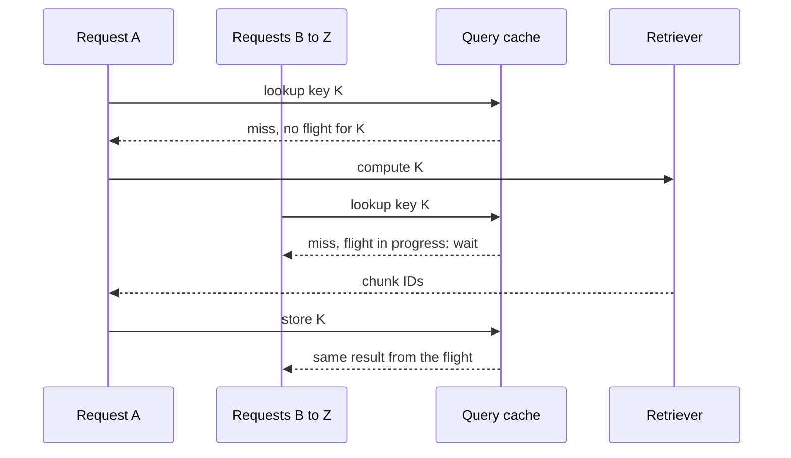

**Query caching** stores the result of processing a query, keyed on the query itself, so that the same query arriving again skips the work. Where a [semantic cache](/learn/performance-optimisation/semantic-caching) asks "have I seen a question that *means* the same?", a query cache asks the stricter question "have I seen *this* query, in *this* context, before?", and answers it exactly. Exact matching makes it safe enough to put in front of every request, and it is the cache most production RAG systems should build first.

Exact does not mean naive. Two requests with the same words can need different results (different permissions, filters or index), and two requests with slightly different strings can be the same query. This lesson is about getting both right: normalising queries so that trivially different strings share a key, composing keys from everything that affects the result, choosing what to store (chunk IDs, chunk text or the final answer), keeping entries fresh when the index changes, and stopping a popular query's expiry from turning into a flood of identical work. The general mechanics of eviction, TTL and hit rate are in [Caching](/learn/performance-optimisation/caching).

## Learning objectives

- Normalise query text so that formatting differences map to one key, and identify normalisations that are unsafe because they change meaning.
- Compose a cache key from the normalised query and every input that affects the result: filters, permissions, index version and retrieval configuration.
- Choose between caching chunk IDs, chunk payloads and final answers, and justify the choice by freshness and access-control risk.
- Invalidate query-cache entries on index changes with versioned keys, and estimate staleness under a TTL.
- Prevent cache stampedes with request coalescing, and estimate the duplicate load they cause without it.

## Prerequisites

- [Caching](/learn/performance-optimisation/caching): keys, hit rate, eviction, TTL and invalidation.
- [Async programming](/learn/python-for-rag-engineering/async-programming): coroutines, `asyncio.gather` and futures, used for coalescing.
- [Metadata filtering](/learn/advanced-vector-database-engineering/metadata-filtering): why filters change what a query returns.
- [Document-level permissions](/learn/access-control-and-privacy/document-level-permissions): why the caller's identity changes what a query may return.

## Why this matters

A retrieval request that embeds, searches, fuses and reranks costs tens to hundreds of milliseconds and a measurable amount of compute; with generation added it costs seconds and real money. Many requests repeat. Staff click a suggested question, a dashboard widget re-issues the same query every minute, a frontend retries after a timeout, and popular questions recur all day. An exact cache serves all of these for the price of a lookup, with none of the wrong-answer risk of semantic matching.

The failures of a badly designed query cache are serious, though, and they are almost always key failures:

- A key without the caller's permission groups serves an HR-only result set to an engineer who asked the same question.
- A key without the index version keeps serving results from yesterday's index after a corrected document is published.
- A key built from the raw string misses "How many days of leave do I get?" because yesterday's request was "how many days of leave do I get" without the question mark, so the hit rate is far lower than it should be.
- A popular key expires at 09:00 and two hundred simultaneous requests all miss at once, all recompute, and push the reranker into overload. This is a **cache stampede**.

## The intuition

Think of a pharmacy that has prepared a prescription for a customer. When someone asks for "the same as last time", the pharmacist checks three things before handing over the bag on the shelf. Is it really the same prescription, whatever way it was written ("amoxicillin 500mg" and "Amoxicillin 500 mg" are the same; "250 mg" is not)? Is it for the same patient, or someone entitled to collect it? And has the doctor changed the prescription since the bag was made up? If any answer is wrong, the bag on the shelf must not be handed over, however convenient.

And if ten people arrive at once for a prescription that is not ready, the pharmacist makes it up once and hands it to all ten, rather than starting ten copies.

Those are the four ideas of this lesson: normalisation, key composition, invalidation and coalescing.

## How it works

### Step 1: normalise the query

**Normalisation** maps different strings that mean exactly the same thing to one canonical string. The test for a normalisation is strict: it is safe only if no two queries that it merges could ever need different results.

Safe for most systems:

- **Unicode normalisation (NFKC).** Full-width characters, ligatures and compatibility forms become their standard equivalents, so a question typed with a full-width question mark (common with East Asian input methods) matches the ASCII one.
- **Case folding.** `casefold()` is a stronger form of lower-casing that also handles characters such as German ß. Identifiers in your corpus that are case-sensitive are the exception.
- **Whitespace collapsing and trimming.**
- **Removing trailing punctuation** such as `?`, `!` and `.`.

Unsafe, because they can merge queries with different answers:

- **Removing stop words.** "Can I work from home" and "I can't work from home" lose the difference.
- **Stemming or lemmatising.** Usually harmless for meaning but it can merge product names and codes.
- **Sorting words.** "VPN to office" and "office to VPN" are different requests in some systems.
- **Stripping internal punctuation or digits.** "E-4021" must not become "e4021" if "E-40-21" is a different code, and "£75" must not lose its number.

Normalisation is a precision decision, like a semantic threshold, but one you can reason about rule by rule. Anything more aggressive than the safe list belongs in a semantic cache, with its own evaluation.

### Step 2: compose the key

The key must contain every input that changes the result. For a cache of retrieval results, that is:

| Key component | Why it matters |
| --- | --- |
| Normalised query | the question itself |
| Metadata filters | `source=handbook` and `source=runbooks` return different chunks |
| Permission scope (tenant, groups) | different callers may retrieve different documents |
| Index version | a new build can return different chunks for the same query |
| Retrieval configuration | `top_k`, `fetch_k`, the reranker and the embedding model change the ranking |
| Conversation context, if used | a rewritten follow-up depends on earlier turns |

Things that do **not** change the result stay out: the user's ID (unless results are personalised), request IDs, timestamps. Each unnecessary component splits one key into many and lowers the hit rate.

Mechanically, serialise the components as canonical JSON (sorted keys, no insignificant whitespace, lists sorted where order is irrelevant), hash with SHA-256, and prefix the hash with a namespace and schema version such as `qc:v1:`. The hash keeps keys short and avoids storing raw query text in the key, and the schema prefix lets you change the key format without colliding with old entries.

### Step 3: decide what to store

A query cache can store three different values, from safest to most valuable.

1. **Ranked chunk IDs.** On a hit, the service still fetches chunk text and metadata from the document store by ID. Deleted chunks are simply missing; permission checks can run again on fetch; payloads are always current. The saving is embedding, search and rerank.
2. **Chunk payloads.** Faster (no fetch), but the cached text can go stale and the cached set cannot be re-checked against changed permissions without fetching anyway.
3. **Final answers.** The largest saving (no generation) and the largest key: add the prompt template version, the model and the generation settings. It inherits all the risks of the earlier layers and adds one more: the answer can be wrong in a way that is cached for everyone.

A common production design caches IDs for retrieval and caches answers only for a short TTL, or only for queries without personal context.

### Step 4: keep entries fresh

Three mechanisms from [Caching](/learn/performance-optimisation/caching) apply, and query caches use all three.

- **Versioned keys.** The index version is in the key. When a new index is published, requests compute new keys immediately, and old entries age out. This must be read **per request** from wherever the current version is published (a small in-process cache of the value for a few seconds is fine); a version read once at start-up never changes.
- **TTL with jitter.** Every entry expires. Adding a random jitter (for example ±10% of the TTL) spreads expiries out, so entries written together during a traffic spike do not all expire in the same second.
- **Targeted invalidation.** Store the source document IDs with each entry and delete matching entries when a document changes, for fresher results than waiting for the next index version.

Two refinements are common. **Negative caching** stores "no results" for a short TTL, so that a burst of queries about something absent from the corpus does not hit the backend repeatedly; keep that TTL short because the document may be added. **Stale-while-revalidate** serves an entry slightly past its TTL while one background task refreshes it, so popular keys never present a miss to users.

### Step 5: coalesce concurrent misses

When a popular entry expires (or the cache is flushed by a deployment), every request that arrives before the first recomputation finishes is also a miss. Without coordination, each one recomputes the same value. That is a **cache stampede**, also called the thundering herd, and it hits the backend at exactly the moment the cache is not protecting it.

The remedy is **request coalescing** (often called single-flight): the first miss for a key starts the computation and registers it as in flight; later misses for the same key wait for that computation instead of starting their own. Within one process this is a dictionary of futures. Across replicas it needs a shared lock, such as a Redis key set with `NX` (only if absent) and a short expiry, held by the replica doing the work while others wait briefly or serve a stale value.



## The mathematics

### Duplicate work in a stampede

**Intuition.** While one miss is being recomputed, every request for the same key that arrives also misses. The number that arrive is the key's arrival rate multiplied by the recomputation time.

$$
D \approx \lambda_k \, t_c
$$

$D$ is the number of duplicate computations, $\lambda_k$ the arrival rate of requests for key $k$ (requests per second) and $t_c$ the time to recompute the value (seconds). This is Little's law applied to the misses in flight.

**By hand.** A popular question arrives 40 times a second during the morning peak, and recomputing retrieval with reranking under that load takes 1.5 s. Without coalescing, $D = 40 \times 1.5 = 60$ identical computations start before the first finishes, and they compete for the same reranker, which makes $t_c$ longer and $D$ larger. With coalescing, $D = 0$.

### Staleness under a TTL

**Intuition.** With only a TTL, a cached result can reflect a source that has since changed. The longer the TTL and the more often the source changes, the more hits are stale.

Suppose the documents behind a key change at random, on average $\mu$ times per unit time, and hits are spread evenly over an entry's lifetime $T$. An entry of age $a$ is stale with probability $1 - e^{-\mu a}$, so the share of hits that are stale is the average over $a$ uniform in $[0, T]$:

$$
P_{\text{stale}} = 1 - \frac{1 - e^{-\mu T}}{\mu T} \approx \frac{\mu T}{2} \quad (\text{when } \mu T \text{ is small})
$$

**By hand.** The leave policy page changes on average once every 90 days, so $\mu = 1/90$ per day. With a TTL of one day, $\mu T = 0.0111$ and $P_{\text{stale}} \approx 0.0111/2 = 0.56\%$ of hits. With a week, about 3.8%. Versioned keys or targeted invalidation drive this towards zero; the TTL only bounds it.

```python
import math

# Stampede: duplicate computations while one miss is being recomputed.
rate, compute_s = 40, 1.5             # requests per second for one hot key; seconds to recompute
print(f"duplicate backend calls without coalescing: {rate * compute_s:.0f}")

# Staleness: a key's source changes on average once every 90 days; entries live for TTL days.
mu = 1 / 90                            # changes per day
for ttl in [1 / 24, 1, 7]:
    stale = 1 - (1 - math.exp(-mu * ttl)) / (mu * ttl)   # mean over entry ages uniform in [0, TTL]
    print(f"TTL {ttl * 24:>6.1f} h: share of hits that are stale {stale:.3%} (approx. {mu * ttl / 2:.3%})")
```

```output
duplicate backend calls without coalescing: 60
TTL    1.0 h: share of hits that are stale 0.023% (approx. 0.023%)
TTL   24.0 h: share of hits that are stale 0.554% (approx. 0.556%)
TTL  168.0 h: share of hits that are stale 3.790% (approx. 3.889%)
```

## In code

**The problem.** Build a query cache for retrieval results that normalises queries, builds keys from the full retrieval context, invalidates by index version, and coalesces concurrent misses. Measure what each feature does.

**Dependencies.** Standard library only (Python 3.9 or later). The retriever is a stand-in that sleeps for 200 ms, so the cache logic can be observed without a model.

```bash
python --version   # 3.9+; no packages needed
```

```python
import asyncio
import hashlib
import json
import re
import time
import unicodedata


def normalise(query: str) -> str:
    """Canonical form for exact-match caching: same meaning-preserving text -> same string."""
    q = unicodedata.normalize("NFKC", query)        # full-width forms, ligatures, odd spaces
    q = q.casefold()                                 # stronger than lower() for non-English text
    q = re.sub(r"\s+", " ", q).strip()               # collapse runs of whitespace
    q = re.sub(r"[?!.\s]+$", "", q)                  # trailing punctuation carries no meaning here
    return q


class QueryCache:
    """Caches retrieval results (chunk IDs) per normalised query and retrieval context."""

    def __init__(self, ttl_s=600, coalesce=True, clock=time.monotonic):
        self.ttl_s, self.coalesce, self.clock = ttl_s, coalesce, clock
        self.store = {}                              # key -> (chunk_ids, stored_at)
        self.inflight = {}                           # key -> Future shared by concurrent callers
        self.hits = self.misses = 0

    @staticmethod
    def key(query, *, filters, groups, index_version, config):
        payload = {
            "q": normalise(query),
            "filters": filters,                      # metadata filters change the answer
            "groups": sorted(groups),                # so do the caller's permissions
            "index": index_version,                  # a new index build invalidates everything
            "config": config,                        # top_k, reranker, embedding model ...
        }
        canonical = json.dumps(payload, sort_keys=True, separators=(",", ":"))
        return "qc:v1:" + hashlib.sha256(canonical.encode()).hexdigest()

    async def get_or_compute(self, key, compute):
        entry = self.store.get(key)
        if entry and self.clock() - entry[1] <= self.ttl_s:
            self.hits += 1
            return entry[0]
        self.misses += 1
        if self.coalesce and key in self.inflight:   # someone is already computing this key
            return await self.inflight[key]
        future = asyncio.get_running_loop().create_future()
        self.inflight[key] = future
        try:
            result = await compute()
            self.store[key] = (result, self.clock())
            future.set_result(result)
            return result
        except Exception as exc:
            future.set_exception(exc)                # waiters see the same failure; nothing cached
            raise
        finally:
            self.inflight.pop(key, None)


backend_calls = 0

async def retrieve(query):
    """Stand-in for embed + search + rerank: 200 ms of work."""
    global backend_calls
    backend_calls += 1
    await asyncio.sleep(0.2)
    return ["handbook-leave-01", "handbook-leave-02"]


async def main():
    global backend_calls
    ctx = dict(filters={"source": "handbook"}, groups=["all-staff"], index_version="2025-06-02",
               config={"top_k": 5, "reranker": "bge-reranker-base"})

    variants = ["How many days of annual leave do I get?",
                "  how many days of ANNUAL leave do I get  ",
                "How many days of annual leave do I get",
                "How many days of annual leave do I get？"]   # full-width question mark
    for v in variants:
        print(f"{normalise(v)!r:<46} {QueryCache.key(v, **ctx)[:18]}")

    q = variants[0]
    k = QueryCache.key(q, **ctx)
    print("\n50 concurrent requests for one uncached key:")
    for coalesce in [False, True]:
        backend_calls = 0
        cache = QueryCache(ttl_s=600, coalesce=coalesce)
        t0 = time.perf_counter()
        await asyncio.gather(*(cache.get_or_compute(k, lambda: retrieve(q)) for _ in range(50)))
        print(f"  coalesce={coalesce!s:<5}  backend calls: {backend_calls:>2}, "
              f"wall time {time.perf_counter() - t0:.2f} s")

    for v in variants[1:]:
        await cache.get_or_compute(QueryCache.key(v, **ctx), lambda: retrieve(v))
    print(f"\nafter 3 differently typed repeats: backend calls {backend_calls}, hits {cache.hits}")

    hr = ctx | {"groups": ["all-staff", "hr"]}
    new_index = ctx | {"index_version": "2025-06-09"}
    print("\nsame query, HR caller      ->", QueryCache.key(q, **hr) == k)
    print("same query, new index build ->", QueryCache.key(q, **new_index) == k)

asyncio.run(main())
```

```output
'how many days of annual leave do i get'       qc:v1:218cdde049fb
'how many days of annual leave do i get'       qc:v1:218cdde049fb
'how many days of annual leave do i get'       qc:v1:218cdde049fb
'how many days of annual leave do i get'       qc:v1:218cdde049fb

50 concurrent requests for one uncached key:
  coalesce=False  backend calls: 50, wall time 0.20 s
  coalesce=True   backend calls:  1, wall time 0.20 s

after 3 differently typed repeats: backend calls 1, hits 3

same query, HR caller      -> False
same query, new index build -> False
```

**The important lines.**

- `normalise` applies only the safe transformations: NFKC, `casefold()`, whitespace collapsing and trailing-punctuation removal. Internal punctuation such as the hyphen in `E-4021` is untouched.
- `QueryCache.key` builds a dictionary of every result-changing input, serialises it with `sort_keys=True` and compact separators so the bytes are canonical, hashes it, and prefixes `qc:v1:`.
- `groups` is sorted before hashing so that `["hr", "all-staff"]` and `["all-staff", "hr"]` produce the same key.
- `self.inflight` maps a key to an `asyncio` future. The first miss creates the future and computes; later misses for the same key `await` it.
- `future.set_exception(exc)` propagates a failure to every waiter and caches nothing, so an error is not served from the cache for the next ten minutes. The `finally` block always clears the in-flight entry, so a failed flight does not block the key forever.

**What the output means.**

- **Normalisation merges formatting variants.** Four strings that differ in case, spacing, a missing question mark and a full-width question mark all normalise to the same text and produce the same key (`qc:v1:218cdde049fb…`).
- **Coalescing removes the stampede.** Fifty concurrent requests for an uncached key produced 50 backend calls without coalescing and 1 with it. Wall time is 0.20 s in both cases here because the stand-in retriever does not slow down under load; a real one would, so the uncoalesced version would be slower as well as more expensive.
- **Repeats are hits.** The three differently typed variants are served from the cache without another backend call.
- **Context changes the key.** The same question from a caller in the HR group, or against a new index build, produces a different key, so neither can be served an entry computed for the original context.

**Errors people commonly hit.**

- **Forgetting to sort set-like lists** (groups, filter values) before hashing. Logically identical requests get different keys and the hit rate drops for no visible reason.
- **Calling `json.dumps` without `sort_keys=True`.** Dictionary order follows insertion order, which may differ between code paths.
- **Caching the exception path.** Storing an empty list after a timeout serves "no results" until the TTL expires.
- **Sharing one future across event loops or threads.** An `asyncio` future belongs to one event loop; for multi-process or multi-replica coalescing use a shared lock.

**Extending it.** Add TTL jitter (`ttl_s * random.uniform(0.9, 1.1)` per entry), store source document IDs and add `invalidate_document(doc_id)`, or move the store to Redis as below.

### A shared version with Redis

Across replicas, the store and the lock must be shared. The sketch below uses `redis-py`; it needs a running Redis server and was not executed here.

```python
import json
import time
import uuid

import redis

r = redis.Redis(host="localhost", port=6379, decode_responses=True)

def cached_retrieve(key: str, compute, ttl_s: int = 600, lock_ms: int = 5000):
    hit = r.get(key)
    if hit is not None:
        return json.loads(hit)
    token = str(uuid.uuid4())
    if r.set(f"lock:{key}", token, nx=True, px=lock_ms):      # this replica computes
        try:
            result = compute()
            r.set(key, json.dumps(result), ex=ttl_s)
            return result
        finally:
            if r.get(f"lock:{key}") == token:                  # release only our own lock
                r.delete(f"lock:{key}")
    for _ in range(50):                                        # another replica computes: wait briefly
        time.sleep(0.05)
        hit = r.get(key)
        if hit is not None:
            return json.loads(hit)
    return compute()                                           # give up waiting; compute ourselves
```

`SET ... NX PX` creates the lock only if it does not exist and expires it automatically, so a crashed replica cannot hold it forever. The get-then-delete release is not atomic; production code does the check and delete in one Lua script, as the Redis documentation on distributed locks describes. The index version in the key comes from a value such as `r.get("askmeridian:index:current")`, read on each request.

## A real-world example

AskMeridian's query cache had the index version in its key from the start, and the Platform team considered invalidation solved. Then the finance department corrected an error in the expenses policy (a receipt threshold that had been mistyped) and the corrected index was published at 11:00. At 15:00, staff were still being shown the old threshold.

Tom traced it in an hour. Each replica read the current index version from configuration once, when the process started, and kept it in a module-level variable. The new index was live in Qdrant, but every replica was still building keys with the old version and happily hitting the old entries. Only replicas that had restarted for unrelated reasons served the corrected answer, so the behaviour looked random.

The fix was to read the version from the shared store on every request, with an in-process copy that expires after five seconds. Two weeks later a different problem appeared: a deployment flushed the cache at 08:58 on a Monday, and the first minutes of the morning peak sent every popular query to the reranker at once, many of them several times over. Reranker latency spiked and requests timed out. The team added request coalescing within each replica and a Redis lock across replicas, plus a warm-up step that replays the previous day's most frequent queries against the new deployment before it receives traffic.

## Common mistakes

- **A key missing a result-changing input.** Permissions, filters, index version or retrieval configuration left out means one context's results are served in another, including across access boundaries.
- **Reading the index version once.** The key never changes after a publish, and the cache serves the old index indefinitely.
- **Over-normalising.** Removing stop words, digits or internal punctuation merges queries with different answers, producing exact-cache errors that look like semantic-cache errors.
- **Under-normalising.** Keying on the raw string loses hits to case, spacing and punctuation differences.
- **No coalescing on hot keys.** Expiry or a flush turns into a burst of identical work at peak time.
- **Synchronised expiry.** Entries written together expire together; without jitter, load arrives in waves.
- **Caching failures as results.** A timeout cached as "no results" is served to everyone until the TTL ends.

## Best practices

- Normalise with a short list of provably safe rules, and write a test for each rule with pairs that must and must not merge.
- Build keys from canonical JSON of every result-changing input, hash them, and prefix a schema version.
- Cache chunk IDs for retrieval and re-fetch payloads, so deletions and permission changes apply on every hit.
- Read the index version per request; combine versioned keys with a TTL and, where freshness matters, targeted invalidation by document.
- Coalesce misses within a process and lock across replicas for hot keys; add jitter to TTLs.
- Never cache error results; cache empty results only deliberately and briefly.
- Track hit rate per endpoint and the number of coalesced waiters, and warm the cache after deployments.

## Performance considerations

**Hit rate.** Query caches on assistant traffic typically see a hit rate set by the share of exact repeats after normalisation: suggested questions, retries, dashboards and popular questions. Measure it on your own logs by replaying them through the normalisation and key function before building the cache; the replay also shows how many hits each normalisation rule adds.

**Latency.** A Redis lookup costs a network round trip, typically under a millisecond in the same data centre. In front of a retrieval stage of 100 to 300 ms, the break-even hit rate from [Caching](/learn/performance-optimisation/caching) is under 1%, so the cache pays for itself almost immediately. Caching IDs adds a payload fetch on each hit; batch it into one request (a multi-get by ID), which most vector databases and document stores support.

**Memory.** A cached result of ten chunk IDs, scores and a few fields is a few hundred bytes. A million entries fit comfortably in a few hundred megabytes, far less than caching payloads or answers.

**Load protection.** Coalescing bounds backend calls per key to one per recomputation, so the worst-case backend load after a flush is set by the number of *distinct* hot keys, not the number of requests. That is the difference between a cache that protects the backend at peak and one that abandons it.

## Security considerations

- **Permissions belong in the key**, and caching IDs with a permission re-check on fetch is a second line of defence. Never serve a cached result set without one of the two.
- **Tenant isolation.** In multi-tenant systems, include the tenant in the key and preferably in a separate key namespace or database, so that a bug in key composition cannot cross tenants.
- **Raw queries in keys or logs.** Queries can contain personal data. Hashing the key avoids storing the text in the key itself; avoid logging raw queries next to cache keys, and apply retention rules to any stored query text.
- **Cache-key collisions engineered by users.** With SHA-256 over canonical JSON, collisions are not a practical concern; with ad hoc string concatenation (`query + "|" + filter`), a crafted query containing the delimiter can produce another context's key. Always serialise structurally.

## Summary

- A query cache stores results keyed on the query and its full retrieval context, and serves exact repeats for the cost of a lookup without the wrong-answer risk of semantic matching.
- Normalise with safe rules only (NFKC, case folding, whitespace, trailing punctuation); anything that could change meaning belongs in a semantic cache.
- The key must contain everything that changes the result: filters, permission scope, index version and retrieval configuration, serialised canonically and hashed.
- Prefer caching chunk IDs and re-fetching payloads; read the index version per request; add TTL with jitter and targeted invalidation.
- Coalesce concurrent misses so that a popular key's expiry costs one recomputation, not $\lambda_k t_c$ of them.

## Exercises

**1.** For each pair, say whether a query cache should treat the two as the same key, and why: (a) "VPN required on public wifi?" and "vpn required on public wifi"; (b) "Can I expense taxis?" and "Can't I expense taxis?"; (c) "What does E-4021 mean" and "What does E-4012 mean"; (d) the same query with `groups=["hr"]` and `groups=["all-staff"]`.

<details><summary>Show solution</summary>

(a) Same: they differ only in case and trailing punctuation. (b) Different: the negation changes the question; any normalisation that merged them would be unsafe. (c) Different: different error codes; the digits must survive normalisation. (d) Different: permission scope is part of the key, because the two callers may be allowed different documents.

</details>

**2.** A dashboard query arrives 5 times a second and recomputing it takes 0.8 s. A news-style announcement query arrives 120 times a second at 09:00 and takes 1.2 s. Estimate the duplicate computations each causes on expiry without coalescing, and the TTL-only stale share for the announcement if its source changes on average once a day and the TTL is 10 minutes.

<details><summary>Show solution</summary>

Dashboard: $D = 5 \times 0.8 = 4$. Announcement: $D = 120 \times 1.2 = 144$, enough to overload a reranker.

Staleness: $\mu = 1$ per day $= 1/1440$ per minute, $T = 10$ minutes, $\mu T = 0.00694$, so $P_{\text{stale}} \approx 0.00694/2 = 0.35\%$ of hits. Because the announcement is published at a known time, targeted invalidation when it changes is cheap and better than relying on the TTL.

</details>

**3.** Extend the lesson's `QueryCache` with negative caching: when the retriever returns an empty list, store it with a TTL of 60 seconds instead of the normal TTL. Show that a second request within 60 seconds is a hit and one after 61 seconds is a miss, using an injected clock.

<details><summary>Show solution</summary>

Store the TTL with each entry and use it on lookup:

```python
class NegCachingQueryCache(QueryCache):
    def __init__(self, ttl_s=600, negative_ttl_s=60, **kw):
        super().__init__(ttl_s=ttl_s, **kw)
        self.negative_ttl_s = negative_ttl_s

    async def get_or_compute(self, key, compute):
        entry = self.store.get(key)
        if entry:
            ttl = self.negative_ttl_s if entry[0] == [] else self.ttl_s
            if self.clock() - entry[1] <= ttl:
                self.hits += 1
                return entry[0]
            del self.store[key]
        return await super().get_or_compute(key, compute)

async def empty():
    return []

async def demo():
    now = [0.0]
    c = NegCachingQueryCache(clock=lambda: now[0])
    await c.get_or_compute("k", empty)
    now[0] = 59; await c.get_or_compute("k", empty); print("hits after 59 s:", c.hits)
    now[0] = 61; await c.get_or_compute("k", empty); print("hits after 61 s:", c.hits)

asyncio.run(demo())
```

```output
hits after 59 s: 1
hits after 61 s: 1
```

At 59 s the empty result is served from the cache (hits becomes 1). At 61 s it is more than 60 s old, so the request misses and recomputes, and the hit count stays at 1. Prepend the lesson's code (without its final `asyncio.run(main())`) to run this.

</details>

**4.** Design question. AskMeridian must add a "recently updated" boost that ranks documents changed in the last 7 days higher. How does this interact with the query cache, and what would you change in the key or the TTL?

<details><summary>Show solution</summary>

The ranking now depends on time: the same query, index and context can return a different order tomorrow, when a document leaves the 7-day window, without any index change. Two options. Put a time bucket into the key, such as the current date, so entries are recomputed at least daily and never cross a window boundary by more than a day. Or keep the key and cap the TTL well below a day, accepting a small staleness. The date bucket is the cleaner choice because it makes the dependency explicit; combine it with the index version, and note that every key changes at midnight, so stagger warm-up or expect a brief dip in hit rate.

</details>

## Check your understanding

```quiz
[
  {
    "q": "Which normalisation is unsafe for an exact-match query cache?",
    "options": ["Unicode NFKC normalisation", "Case folding with casefold()", "Removing stop words such as 'not' and 'can'", "Collapsing repeated whitespace"],
    "answer": 2,
    "why": "Removing stop words can merge queries with different meanings, such as 'can I' and 'can't I'. The other three only remove formatting differences."
  },
  {
    "q": "A query cache keys on normalised query, filters and retrieval configuration. Which missing component can cause an access-control breach?",
    "options": ["The request timestamp", "The caller's permission scope", "The client's IP address", "The response format"],
    "answer": 1,
    "why": "If permissions are not in the key (and not re-checked on fetch), a result set computed for a caller with wider access can be served to one with narrower access."
  },
  {
    "q": "A hot key receives 30 requests per second and takes 2 seconds to recompute. Roughly how many duplicate computations start on expiry without coalescing?",
    "options": ["2", "15", "30", "60"],
    "answer": 3,
    "why": "D is approximately the arrival rate times the recomputation time: 30 x 2 = 60 requests arrive while the first recomputation is in flight."
  },
  {
    "q": "Why is caching ranked chunk IDs, rather than chunk text, often preferred for retrieval results?",
    "options": ["IDs make the hit rate higher", "On each hit the payloads are fetched fresh, so deletions, edits and permission re-checks apply", "IDs never need a TTL", "Vector databases cannot return chunk text"],
    "answer": 1,
    "why": "Fetching by ID on each hit keeps text current and allows a permission check at fetch time, at the cost of one batched lookup."
  },
  {
    "q": "Every replica includes the index version in its cache keys, yet staff see results from the old index hours after a new one is published. What is the most likely cause?",
    "options": ["SHA-256 collisions", "The replicas read the current index version once at start-up and never again", "The TTL is too short", "Normalisation is too aggressive"],
    "answer": 1,
    "why": "A version read once never changes, so keys keep pointing at old entries. The version must be read per request, with at most a few seconds of local caching."
  }
]
```

## Further reading

- Redis documentation, `SET` with the `NX` and `PX` options and the distributed locks pattern, [redis.io/docs](https://redis.io/docs/). The building blocks of a cross-replica lock.
- Python documentation, `unicodedata.normalize` and `str.casefold`, [docs.python.org/3/library/unicodedata.html](https://docs.python.org/3/library/unicodedata.html). What NFKC and case folding change.
- Go `singleflight` package documentation, [pkg.go.dev/golang.org/x/sync/singleflight](https://pkg.go.dev/golang.org/x/sync/singleflight). The canonical small implementation of request coalescing, worth reading even if you write Python.
- Rajesh Nishtala and colleagues (2013), "Scaling Memcache at Facebook", *USENIX NSDI*. Leases against stampedes and stale sets in a very large query cache.
