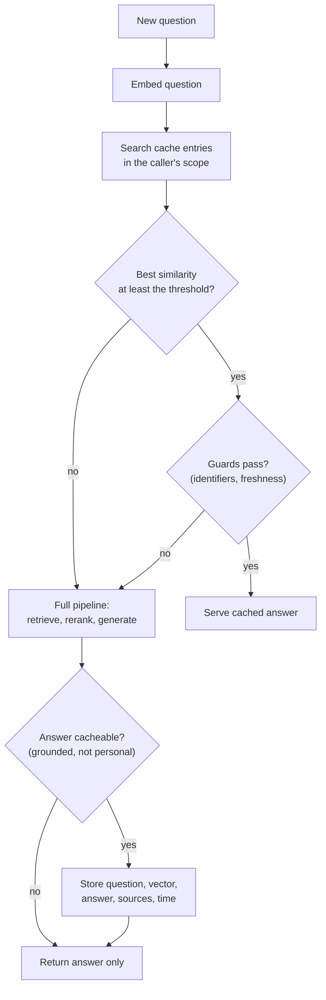

An exact-match cache answers a question only if it has seen precisely that string before. People rarely type the same string twice: "how much holiday do I get?", "what's my annual leave entitlement?" and "how many days of leave per year?" are three strings and one question. A **semantic cache** matches questions by meaning instead. It embeds each incoming question, looks for a previously answered question whose embedding is close enough, and if it finds one, returns the stored answer without retrieving or generating anything.

When it works, the saving is the whole pipeline. When it fails, it gives a fluent, confident answer to a *different* question. This lesson explains how a semantic cache works, why "close enough" is the entire problem, how to measure and choose a similarity threshold with labelled data, which guards and scopes make it safe, and when not to use one. It builds on [Caching](/learn/performance-optimisation/caching) for keys, expiry and invalidation; [Redis](/learn/vector-database-ecosystem/redis) covers storing such a cache in Redis.

## Learning objectives

- Describe the lookup and write paths of a semantic cache and the scope that must surround them.
- Explain why no similarity threshold separates paraphrases from near-misses perfectly, using measured similarities.
- Choose a threshold by evaluating correct hits and wrong answers on labelled question pairs, weighted by the cost of each.
- Add guards (identifier matching, scoping by permissions and index version, source-based invalidation) that remove classes of false hits.
- Decide whether to cache final answers or retrieval results, and which questions should never be served from a semantic cache.

## Prerequisites

- [Caching](/learn/performance-optimisation/caching): hit rate, TTL, invalidation and key design.
- [Cosine similarity](/learn/embedding-mathematics/cosine-similarity): the score the cache thresholds.
- [Sentence embeddings](/learn/embedding-fundamentals/sentence-embeddings): how a question becomes a vector.
- [Retrieval thresholding](/learn/advanced-retrieval-optimisation/retrieval-thresholding): the same thresholding problem applied to retrieved chunks.

## Why this matters

Assistants like AskMeridian receive the same few dozen questions in endless phrasings, and an exact-match cache catches only literal repeats. Semantic caching promises milliseconds and zero model cost, and libraries ship it ready-made, which makes it tempting to switch on with a default threshold.

The danger is specific. "How many days of sick leave do I get?" and "How many days of annual leave do I get?" differ by one word and sit close together in embedding space. A retriever that confuses them fetches a slightly wrong chunk, and the generator often recovers. A semantic cache that confuses them returns "25 days" for sick leave with no generator in the loop, and repeats the error for every user until the entry expires.

So semantic caching is a precision problem first and a speed problem second.

## The intuition

Imagine a help desk where the receptionist keeps a binder of questions already answered by the specialists. When someone asks a question, the receptionist looks for one in the binder that "sounds the same" and, if found, reads out the specialist's answer instead of sending the person upstairs.

A cautious receptionist reads from the binder only when the questions are obviously the same: many people go upstairs unnecessarily, but nobody gets a wrong answer. A careless one reads whenever questions sound similar, so "is VPN required at home?" gets the answer recorded for public Wi-Fi.

How similar counts as "the same" is the similarity threshold. Three habits make the receptionist safer: checking that numbers and codes match, keeping separate binders for people with different access, and tearing out pages when the policy they quote changes.

## How it works

### The lookup and write paths



**Lookup.**

1. **Embed the question.** On a miss, reuse this vector for retrieval if the retriever uses the same model.
2. **Search only the entries in the caller's scope**: same tenant, permission groups and index version. Searching outside it leaks answers across permission boundaries.
3. **Compare the best similarity with the threshold** $\tau$; below it, miss.
4. **Apply guards**, cheap checks for near-misses the similarity cannot see.
5. **Serve** the stored answer with its citations, and log the matched question and similarity so wrong hits can be investigated.

**Write.** After the full pipeline produces an answer, decide whether it is cacheable, then store the question, its vector, the answer, the IDs of the source documents and a timestamp. Answers that should not be stored include refusals and "I don't know" answers (the next phrasing might be answerable), answers that failed a groundedness check, answers to questions about the user personally ("how many days of leave do *I* have left?"), and answers to time-dependent questions ("is the support desk open now?").

The search itself is ordinary vector search: an exact scan for a few thousand entries, an ANN index or a store such as Redis beyond that.

### Why the threshold cannot be perfect

Embedding models are trained so that texts about the same thing land close together. A paraphrase is about the same thing, so it lands close. But a **near-miss** (a question about the same topic with a different answer) is also about the same thing, and it lands close too. The embedding measures topical similarity; the cache needs **answer equivalence**, which is a stricter relation that the embedding was not trained to capture.

The consequence, which the code below demonstrates, is that the similarity distributions of paraphrases and near-misses **overlap**. Some near-misses score higher than some genuine paraphrases. Any threshold either rejects some good hits or accepts some wrong ones; usually both. Raising the threshold buys precision with hit rate.

Typical near-miss patterns are a different identifier or number (E-4021 / E-4030), a sibling entity (annual / sick leave, laptops / monitors), a different condition (VPN on public Wi-Fi / at home), a different subject (what is the budget / can contractors claim it) and negation. The first can be caught mechanically; the rest need a verifier or a decision not to cache that topic.

### Guards and verification

Guards trade a little computation for precision.

- **Identifier matching.** Require the sets of error codes, numbers, product names and dates in both questions to be equal: cheap, deterministic, and aimed at what embeddings handle worst.
- **Scope** by tenant, permission groups and index version, as for an exact-match key, to prevent leaks and stale answers after re-indexing.
- **Source-based invalidation.** Store the source document IDs of each answer and delete the answer when any of them changes.
- **Verification.** For hits just above the threshold, ask a cross-encoder or small model whether the cached answer answers the new question. It costs latency and is itself imperfect, so measure it.
- **TTL** as a backstop on how long any wrong or stale entry survives.

### Cache answers, or cache retrieval?

A semantic cache can store two things.

- **Final answers.** Maximum saving (no generation) and maximum risk: a near-miss gets the wrong answer verbatim.
- **Retrieved context.** On a hit, reuse the stored chunks but still run the generator on the *new* question. The saving is smaller (search and rerank, not generation), but the generator sees the actual question, so "how many days of annual leave do I get after 5 years?" served with the leave chunks can still produce a correct, appropriately hedged answer. Near-misses become much less harmful because the cached object is evidence, not a conclusion.

Retrieval-level caching is the safer default for policy questions; answer-level caching suits narrow, stable FAQs.

### Conversations

A follow-up such as "and for contractors?" means nothing alone. Rewrite follow-ups into standalone questions before the lookup (see [Multi-turn RAG](/learn/generation-strategies/multi-turn-rag)) or bypass the cache for them.

## The mathematics

### Choosing a threshold by expected value

**Intuition.** Every correct hit saves something; every wrong answer costs something, usually much more. The best threshold maximises the total.

For threshold $\tau$, let $C(\tau)$ be the number of correct hits and $W(\tau)$ the number of wrong answers served on a labelled sample. The net value of the cache on that sample is

$$
V(\tau) = b\,C(\tau) - \ell\,W(\tau)
$$

where $b$ is the benefit of one correct hit (latency and cost saved) and $\ell$ is the cost of one wrong answer (a user misled, a support ticket, lost trust). Only the ratio $r = \ell / b$ matters for choosing $\tau$. Lowering the threshold from $\tau_1$ to $\tau_2$ is worth it only if

$$
\frac{C(\tau_2) - C(\tau_1)}{W(\tau_2) - W(\tau_1)} > r
$$

that is, if each additional wrong answer comes with more than $r$ additional correct hits. Two further quantities summarise a threshold: the **cache precision** $C/(C+W)$, the share of served answers that are right, and the **hit rate**, the share of all requests served from the cache.

**By hand.** Take the measured results below and suppose a wrong answer is 20 times as costly as a saved call ($r = 20$). With $b = 1$:

- $\tau = 0.85$: $C = 3$, $W = 0$, $V = 3$.
- $\tau = 0.80$: $C = 4$, $W = 1$, $V = 4 - 20 = -16$.
- $\tau = 0.60$: $C = 12$, $W = 4$, $V = 12 - 80 = -68$.

Moving from 0.85 to 0.80 adds 1 correct hit per wrong answer, far below 20, so the threshold stays at 0.85. Only at small $r$ does a low threshold win: at $r = 2$, going from 0.85 to 0.60 gains 9 correct hits for 4 wrong answers, a ratio of 2.25.

```python
results = {0.60: (12, 4), 0.70: (8, 4), 0.75: (6, 2), 0.80: (4, 1), 0.85: (3, 0), 0.90: (1, 0)}
for r in [2, 20]:
    best = max(results, key=lambda t: results[t][0] - r * results[t][1])
    values = ", ".join(f"{t:.2f}: {c - r * w:+d}" for t, (c, w) in results.items())
    print(f"r={r:>2}  {values}  -> best threshold {best:.2f}")
```

```output
r= 2  0.60: +4, 0.70: +0, 0.75: +2, 0.80: +2, 0.85: +3, 0.90: +1  -> best threshold 0.60
r=20  0.60: -68, 0.70: -72, 0.75: -34, 0.80: -16, 0.85: +3, 0.90: +1  -> best threshold 0.85
```

With 24 labelled pairs this illustrates the method; a production threshold needs hundreds of pairs from your own logs.

## In code

### Measuring the overlap

**The problem.** Given questions already in the cache and new questions labelled with the cached entry whose answer is correct for them (or none), measure the similarity of each new question to its nearest cached question, and count correct hits and wrong answers at several thresholds.

**Dependencies.** sentence-transformers and NumPy.

```bash
pip install sentence-transformers numpy
```

```python
import re
import numpy as np
from sentence_transformers import SentenceTransformer

model = SentenceTransformer("sentence-transformers/all-MiniLM-L6-v2")
embed = lambda texts: model.encode(texts, normalize_embeddings=True)

# Questions already answered and stored in the cache (answers abbreviated).
cached = [
    ("How many days of annual leave do I get?", "25 days a year."),
    ("How many unused leave days can I carry over?", "Up to 5, used by 31 March."),
    ("How many days a week can I work from home?", "Up to 3 days a week."),
    ("What is the home-office equipment budget?", "£400."),
    ("How long do I have to submit expenses?", "Within 30 days."),
    ("When do I need a receipt for an expense?", "For anything over £75."),
    ("How often must I change my password?", "Every 90 days."),
    ("Do I need the VPN on public Wi-Fi?", "Yes, always."),
    ("How often are laptops replaced?", "Every 3 years."),
    ("What are the support desk hours?", "08:00 to 18:00 UK time."),
    ("What does error E-4021 mean?", "The VPN client is out of date."),
    ("What does error E-4012 mean?", "The VPN certificate has expired."),
]
# New questions, each labelled with the cached entry whose answer is correct for it (None = no entry is).
probes = [
    ("how much holiday do I get per year", 0), ("what's my annual leave entitlement?", 0),
    ("can I roll over unused holiday days?", 1), ("how many leave days carry over to next year?", 1),
    ("how many WFH days am I allowed each week?", 2), ("what's the allowance for home office kit?", 3),
    ("what is the deadline for an expense claim?", 4), ("do I need to keep receipts for expenses?", 5),
    ("how frequently do passwords need rotating?", 6), ("is VPN required on café wifi?", 7),
    ("how often do we get new laptops?", 8), ("when is the IT help desk open?", 9),
    ("what does E-4021 mean", 10), ("meaning of error code E-4012", 11),
    ("How many days of sick leave do I get?", None), ("What is the budget for team offsites?", None),
    ("How long do I have to submit my timesheet?", None), ("How often must I renew my VPN certificate?", None),
    ("What are the canteen opening hours?", None), ("What does error E-4030 mean?", None),
    ("Do I need the VPN at home?", None), ("How often are monitors replaced?", None),
    ("How do I reset my password?", None), ("Can contractors claim the home-office budget?", None),
]
C = embed([q for q, _ in cached])
P = embed([q for q, _ in probes])
sims = P @ C.T                                   # cosine similarities (unit vectors)
best, best_sim = sims.argmax(axis=1), sims.max(axis=1)
labels = [lab for _, lab in probes]

print("similarity  correct?  new question -> nearest cached question")
for i in np.argsort(-best_sim):
    ok = "yes" if labels[i] == best[i] else "NO"
    print(f"{best_sim[i]:>10.3f}  {ok:>8}  {probes[i][0]} -> {cached[best[i]][0]}")

def evaluate(threshold, guard=None):
    good = bad = 0
    for i, (q, lab) in enumerate(probes):
        if best_sim[i] < threshold or (guard and not guard(q, cached[best[i]][0])):
            continue                             # miss: run the full pipeline
        if lab == best[i]:
            good += 1
        else:
            bad += 1
    return good, bad

n_pos = sum(lab is not None for lab in labels)
print(f"\nthreshold  correct hits (of {n_pos})  wrong answers served")
for t in [0.60, 0.70, 0.75, 0.80, 0.85, 0.90]:
    good, bad = evaluate(t)
    print(f"{t:>9.2f}  {good:>21}  {bad:>20}")

# A guard: identifiers and numbers in the two questions must match exactly.
TOKENS = re.compile(r"\b[A-Z]-\d+\b|\d+")
same_ids = lambda a, b: set(TOKENS.findall(a)) == set(TOKENS.findall(b))
print("\nwith the identifier guard")
for t in [0.70, 0.75, 0.80]:
    good, bad = evaluate(t, same_ids)
    print(f"{t:>9.2f}  {good:>21}  {bad:>20}")
```

```output
similarity  correct?  new question -> nearest cached question
     0.947       yes  meaning of error code E-4012 -> What does error E-4012 mean?
     0.854       yes  how often do we get new laptops? -> How often are laptops replaced?
     0.852       yes  do I need to keep receipts for expenses? -> When do I need a receipt for an expense?
     0.820        NO  Do I need the VPN at home? -> Do I need the VPN on public Wi-Fi?
     0.807       yes  how many leave days carry over to next year? -> How many unused leave days can I carry over?
     0.788       yes  what does E-4021 mean -> What does error E-4021 mean?
     0.783       yes  is VPN required on café wifi? -> Do I need the VPN on public Wi-Fi?
     0.762        NO  How many days of sick leave do I get? -> How many days of annual leave do I get?
     0.749       yes  what's the allowance for home office kit? -> What is the home-office equipment budget?
     0.745        NO  What does error E-4030 mean? -> What does error E-4021 mean?
     0.706        NO  How often are monitors replaced? -> How often are laptops replaced?
     0.705       yes  how frequently do passwords need rotating? -> How often must I change my password?
     0.694       yes  what's my annual leave entitlement? -> How many days of annual leave do I get?
     0.684       yes  what is the deadline for an expense claim? -> How long do I have to submit expenses?
     0.616       yes  how many WFH days am I allowed each week? -> How many days a week can I work from home?
     0.601       yes  when is the IT help desk open? -> What are the support desk hours?
     0.584        NO  Can contractors claim the home-office budget? -> What is the home-office equipment budget?
     0.571       yes  can I roll over unused holiday days? -> How many unused leave days can I carry over?
     0.558        NO  How long do I have to submit my timesheet? -> How long do I have to submit expenses?
     0.541        NO  How do I reset my password? -> How often must I change my password?
     0.520        NO  What are the canteen opening hours? -> What are the support desk hours?
     0.491        NO  What is the budget for team offsites? -> What is the home-office equipment budget?
     0.476       yes  how much holiday do I get per year -> How many days of annual leave do I get?
     0.432        NO  How often must I renew my VPN certificate? -> How often must I change my password?

threshold  correct hits (of 14)  wrong answers served
     0.60                     12                     4
     0.70                      8                     4
     0.75                      6                     2
     0.80                      4                     1
     0.85                      3                     0
     0.90                      1                     0

with the identifier guard
     0.70                      8                     3
     0.75                      6                     2
     0.80                      4                     1
```

**The important lines.**

- `probes` labels each new question with the cached entry whose answer is correct for it, or `None`: 14 paraphrases and 10 near-misses that share a topic but need a different answer.
- `sims = P @ C.T` computes every cosine similarity at once, because the embeddings are normalised. `best` is the nearest cached question, which is what a cache would serve.
- `evaluate` counts a **correct hit** when the served entry matches the label and a **wrong answer** otherwise.
- `TOKENS` extracts codes such as `E-4021` and bare numbers. The guard requires both questions to contain the same set.

**What the output means.**

- **The distributions overlap.** The fourth-highest similarity, 0.820, is a wrong match: "Do I need the VPN at home?" against the cached public Wi-Fi question. Meanwhile "how much holiday do I get per year", a perfectly good paraphrase, scores 0.476, below every near-miss but one. No threshold puts all paraphrases above and all near-misses below.
- **The trade-off is steep.** At 0.60 the cache serves 12 of the 14 paraphrases but also 4 wrong answers (sick leave, E-4030, monitors, VPN at home). At 0.85 it serves no wrong answers but only 3 of the 14 paraphrases.
- **Changing one entity barely moves the vector.** "Sick leave" scores 0.762 against "annual leave", above eight genuine paraphrases.
- **The identifier guard removes a specific class.** E-4030 against E-4021 scores 0.745 and is served at 0.70; the guard rejects it because the codes differ. It cannot help with sick leave or monitors, which contain no identifiers.
- **Casual phrasing hurts recall.** The lowest-scoring correct matches use different words ("holiday", "roll over", "WFH", "help desk").

This small, adversarial sample shows the shape of the problem, not a production error rate.

### A scoped semantic cache

**The problem.** Wrap the mechanism in a component with the protections described above: scopes, a threshold, the identifier guard, TTL and source-based invalidation.

```python
import hashlib
import re
import time

import numpy as np
from sentence_transformers import SentenceTransformer

IDS = re.compile(r"\b[A-Z]-\d+\b|\d+")

def same_identifiers(a, b):
    """Codes and numbers must match exactly: E-4021 is not E-4030, 3 days is not 5 days."""
    return set(IDS.findall(a)) == set(IDS.findall(b))


class SemanticCache:
    def __init__(self, model_name, threshold=0.85, ttl_s=3600, clock=time.monotonic):
        self.model = SentenceTransformer(model_name)
        self.threshold, self.ttl_s, self.clock = threshold, ttl_s, clock
        self.scopes = {}                              # scope key -> list of entries

    @staticmethod
    def scope_key(tenant, groups, index_version):
        """Only questions asked under the same permissions and index may share answers."""
        raw = f"{tenant}|{','.join(sorted(groups))}|{index_version}"
        return hashlib.sha256(raw.encode()).hexdigest()[:16]

    def embed(self, text):
        return self.model.encode([text], normalize_embeddings=True)[0]

    def lookup(self, question, scope):
        now = self.clock()
        live = [e for e in self.scopes.get(scope, []) if now - e["at"] <= self.ttl_s]
        self.scopes[scope] = live                     # drop expired entries
        if not live:
            return None, "miss: scope empty"
        q = self.embed(question)
        sims = np.stack([e["vec"] for e in live]) @ q
        best = int(sims.argmax())
        entry, sim = live[best], float(sims[best])
        if sim < self.threshold:
            return None, f"miss: best similarity {sim:.3f}"
        if not same_identifiers(question, entry["question"]):
            return None, f"miss: identifiers differ (similarity {sim:.3f})"
        return entry["answer"], f"hit: {entry['question']!r} ({sim:.3f})"

    def store(self, question, answer, scope, sources):
        self.scopes.setdefault(scope, []).append({
            "question": question, "answer": answer, "vec": self.embed(question),
            "sources": set(sources), "at": self.clock()})

    def invalidate_source(self, doc_id):
        """Remove every cached answer that was generated from the given document."""
        for scope, entries in self.scopes.items():
            self.scopes[scope] = [e for e in entries if doc_id not in e["sources"]]


cache = SemanticCache("sentence-transformers/all-MiniLM-L6-v2", threshold=0.75)
staff = SemanticCache.scope_key("meridian", ["all-staff"], "idx-2025-06-02")
hr = SemanticCache.scope_key("meridian", ["all-staff", "hr"], "idx-2025-06-02")

cache.store("How many days of annual leave do I get?", "25 days a year.", staff, ["handbook/leave"])
cache.store("What does error E-4021 mean?", "The VPN client is out of date.", staff, ["runbooks/atlas-errors"])

for question, scope in [
    ("how many days of annual leave do I have?", staff),
    ("how many days of annual leave do I have?", hr),
    ("How many days of annual leave do I get after 5 years?", staff),
    ("What is the meaning of error E-4021?", staff),
]:
    answer, why = cache.lookup(question, scope)
    print(f"{question:<54} -> {answer!s:<31} [{why}]")

cache.invalidate_source("handbook/leave")             # HR publishes a new leave policy
print("after invalidation:", cache.lookup("how many days of annual leave do I have?", staff)[1])
```

```output
how many days of annual leave do I have?               -> 25 days a year.                 [hit: 'How many days of annual leave do I get?' (0.986)]
how many days of annual leave do I have?               -> None                            [miss: scope empty]
How many days of annual leave do I get after 5 years?  -> None                            [miss: identifiers differ (similarity 0.878)]
What is the meaning of error E-4021?                   -> The VPN client is out of date.  [hit: 'What does error E-4021 mean?' (0.962)]
after invalidation: miss: best similarity 0.024
```

**The important lines.**

- `scope_key` hashes tenant, sorted permission groups and index version. Entries are stored per scope, so a lookup only ever sees answers generated under the same permissions and index.
- `lookup` filters expired entries before searching, so TTL is enforced on read.
- Each miss reports its reason; logging reasons shows which guard is doing the work.
- `store` keeps the source document IDs with each answer, and `invalidate_source` removes every answer that used a changed document.

**What the output means.** The paraphrase scores 0.986 and is served; the same question under the HR scope misses. "…after 5 years?" scores 0.878, well above the threshold, but the guard rejects it because it adds a number: it asks something more specific than the cached answer covers. After `invalidate_source("handbook/leave")` the nearest remaining entry is the E-4021 answer at 0.024, so the leave question misses and will be answered from the new policy.

**Errors people commonly hit.**

- **Tuning the threshold on a different embedding model** from the one the cache uses; similarity scales differ between models.
- **Forgetting normalisation.** Without `normalize_embeddings=True`, the dot product is not the cosine and the threshold drifts with text length.

**Extending it.** Add a cross-encoder verification step for hits in the band just above the threshold, or store retrieved chunk IDs instead of answers and pass them to the generator on a hit.

## A real-world example

To cut AskMeridian's model costs, the Platform team proposed a semantic cache with a default threshold of 0.8. Nadia, who owned retrieval quality, ran it in **shadow mode** first: for two weeks every lookup decision was logged while users received fresh answers, a language-model judge compared each would-be cached answer with the fresh one, and she reviewed a sample of disagreements by hand.

The review found that wrong hits were not random. They clustered in a few patterns: sibling entities (sick versus annual leave, monitors versus laptops), conditions (VPN at home versus on public Wi-Fi), and the contractor exception to the home-office budget. Error-code questions were also at risk, because codes that differ in two digits embedded almost identically.

The team shipped a narrower design. Answer-level caching covered only IT runbook questions, with a high threshold, the identifier guard, the index version in the scope and a 24-hour TTL. For handbook policy questions the cache stored retrieved chunk IDs instead of answers, so the generator always saw the actual question. The hit rate was far below the first proposal's promise, but the shadow data had shown that design serving a steady stream of wrong policy answers, and a cheaper bill was not worth that.

## Common mistakes

- **Shipping a default threshold.** Thresholds depend on the model, the domain and the cost of errors; a published number is a starting point for measurement.
- **Measuring only hit rate.** A high hit rate with a few percent of wrong answers spreads wrong answers efficiently. Measure precision on labelled data or in shadow mode.
- **No scope.** Answers generated from documents one group may see are served to another, and answers from an old index survive a re-index.
- **Caching personal or time-dependent answers.** "How many days do I have left?" has a different answer for every user, and "is the desk open now?" for every hour.
- **No invalidation on source change.** The handbook changes and the cache keeps quoting the old rule until TTL, or forever without one.

## Best practices

- Start in shadow mode: log cache decisions, serve fresh answers, and compare before enabling.
- Choose the threshold from labelled paraphrase and near-miss pairs drawn from real logs, weighted by the cost of errors.
- Scope entries, invalidate by source, set a TTL, and guard identifiers.
- Prefer caching retrieval results for high-stakes or nuanced topics, and answers only for narrow, stable FAQs.
- Exclude personal, time-dependent, refused and low-groundedness answers from the write path.

## Performance considerations

**Latency.** A lookup costs one query embedding and a small vector search, milliseconds against seconds for the pipeline; a miss pays it on top. Using the expected-latency formula from [Caching](/learn/performance-optimisation/caching), with a lookup of about 10 ms in front of a 4-second pipeline the break-even hit rate is $10/4000 = 0.25\%$, so even a cautious cache pays for its latency. Reusing the lookup embedding for retrieval on a miss removes most of the overhead.

**Cost.** An answer-level hit saves a full generation; a retrieval-level hit saves only search and rerank. A verifier on uncertain hits must cost much less than the generation it replaces.

**Fragmentation.** Entries are small (a 1,536-byte vector plus text), but many small scopes split traffic and lower the hit rate; that is the price of correct permissions.

**Hit rate ceiling.** A semantic cache only hits on questions that recur in meaning. Measure the share of recurring intents in your logs before building one.

## Security considerations

- **Cross-user leakage.** Without permission-aware scopes, answers derived from restricted documents reach users who cannot read them.
- **Cache poisoning.** An answer manipulated through an injected document (see [Indirect prompt injection](/learn/rag-security-fundamentals/indirect-prompt-injection)) is served to everyone asking a similar question. Cache only answers that pass output validation, keep TTLs finite, and support purging by source document.
- **Probing and personal data.** Response times reveal whether a similar question was asked recently, so isolate tenants; keep personal details out of entries.

## Summary

- A semantic cache serves a stored answer when a new question's embedding is close to an answered one; a hit skips the whole pipeline.
- Embeddings measure topical similarity, not answer equivalence, so paraphrase and near-miss similarities overlap and every threshold trades correct hits for wrong answers.
- Choose the threshold from labelled pairs and the cost ratio of a wrong answer to a saved call.
- Scope entries by tenant, permissions and index version; add identifier guards, TTL and source-based invalidation; consider a verifier.
- Caching retrieved context instead of answers keeps the generator in the loop and makes near-misses much less harmful.

## Exercises

**1.** Using the measured table, compute the cache precision $C/(C+W)$ at thresholds 0.60, 0.75 and 0.85. Then, with $r = \ell/b = 5$, which threshold maximises $V(\tau)$?

<details><summary>Show solution</summary>

Precision: 0.60 gives $12/16 = 75\%$; 0.75 gives $6/8 = 75\%$; 0.85 gives $3/3 = 100\%$.

With $r = 5$: $V(0.60) = 12 - 20 = -8$; $V(0.70) = 8 - 20 = -12$; $V(0.75) = 6 - 10 = -4$; $V(0.80) = 4 - 5 = -1$; $V(0.85) = 3$; $V(0.90) = 1$. The best is 0.85.

</details>

**2.** For each question, say whether its answer should be written to an answer-level semantic cache, and why: (a) "What does error E-4012 mean?", (b) "How many leave days do I have left this year?", (c) "Is the support desk open right now?", (d) a question the system refused because nothing relevant was retrieved.

<details><summary>Show solution</summary>

(a) Yes, with the identifier guard: it is stable, general and the code makes near-misses detectable. (b) No: it is personal; the answer depends on the user's own records. (c) No: it is time-dependent; a cached "yes" becomes wrong at 18:00. (d) No: a refusal cached for one phrasing would block later phrasings that retrieval might answer, and the refusal may be fixed when documents are added.

</details>

**3.** Re-run the threshold study with `BAAI/bge-small-en-v1.5` instead of MiniLM. What happens to the similarities and to the 0.85 threshold?

<details><summary>Show solution</summary>

Change the model name and run again. On our run, BGE shifted every similarity upwards: all 14 paraphrases scored at least 0.753, but so did most near-misses ("VPN at home" 0.863, E-4030 0.854, sick leave 0.848). At 0.85 MiniLM served 3 correct hits and no wrong answers; BGE served 5 correct and 2 wrong. The overlap did not disappear; it moved. A threshold is a property of a model and a dataset, and changing either requires re-running the study.

</details>

**4.** Design question. AskMeridian serves two tenants, Meridian staff and a partner company with its own document set, and HR staff can read restricted HR documents. Design the scope key, the invalidation path and the policy for which topics use answer-level versus retrieval-level caching.

<details><summary>Show solution</summary>

**Scope key:** a hash of tenant ID, the sorted permission groups that affect retrieval, and that tenant's index version, so HR and other staff never share entries and the two tenants never do.

**Invalidation:** entries store source document IDs; a "document changed" event from ingestion deletes matching entries in every scope; a new index version makes old scopes unreachable; a TTL bounds any failure.

**Policy:** answer-level caching for narrow, stable, identifier-rich topics (runbooks, error codes) after a shadow-mode precision check; retrieval-level caching for policy topics full of siblings and exceptions (leave, expenses, eligibility); no caching for personal, time-dependent or un-rewritten follow-up questions.

</details>

## Check your understanding

```quiz
[
  {
    "q": "Why can't a similarity threshold perfectly separate questions with the same answer from questions with different answers?",
    "options": [
      "Cosine similarity is not deterministic",
      "Embeddings capture topical similarity, and near-misses on the same topic score as high as some paraphrases",
      "Thresholds only work with Euclidean distance",
      "The cache index is approximate"
    ],
    "answer": 1,
    "why": "Embedding models place texts about the same subject close together. A near-miss shares the subject, so its score overlaps with paraphrases; in the lesson, 'sick leave' scored 0.762 against 'annual leave', above eight genuine paraphrases."
  },
  {
    "q": "A wrong cached answer is judged 10 times as costly as the saving from one correct hit. Lowering the threshold would add 6 correct hits and 1 wrong answer on a labelled sample. Should you lower it?",
    "options": [
      "Yes, because hits increase",
      "No, because 6 additional correct hits per wrong answer is below the ratio of 10",
      "Yes, because precision stays above 80%",
      "It cannot be decided without latency data"
    ],
    "answer": 1,
    "why": "Lowering the threshold pays only if each extra wrong answer brings more than r = 10 extra correct hits. Here it brings 6, so net value falls."
  },
  {
    "q": "Which change most reduces the harm of near-miss hits while keeping some of the cache's saving?",
    "options": [
      "Raising the TTL",
      "Caching retrieved chunk IDs instead of final answers, so the generator still sees the new question",
      "Using a larger cache",
      "Removing the scope"
    ],
    "answer": 1,
    "why": "With retrieval-level caching, a near-miss reuses relevant evidence but the answer is generated for the actual question, so the generator can respond correctly or hedge."
  },
  {
    "q": "What must the scope of a semantic cache include in a system with document-level permissions?",
    "options": [
      "The user's display name",
      "The permission groups that determine which documents the user may retrieve, plus tenant and index version",
      "The time of day",
      "Only the embedding model name"
    ],
    "answer": 1,
    "why": "An answer generated from documents one group may read must never be served to another group; the index version ensures answers from an old index are not served after re-indexing."
  }
]
```

## Further reading

- Nils Reimers and Iryna Gurevych (2019), "Sentence-BERT: Sentence Embeddings using Siamese BERT-Networks", [arxiv.org/abs/1908.10084](https://arxiv.org/abs/1908.10084). The family of models used for question embeddings here.
- Model card for `sentence-transformers/all-MiniLM-L6-v2`, [huggingface.co/sentence-transformers/all-MiniLM-L6-v2](https://huggingface.co/sentence-transformers/all-MiniLM-L6-v2). Training data and intended use.
- GPTCache, an open-source semantic cache library, [github.com/zilliztech/GPTCache](https://github.com/zilliztech/GPTCache). Pluggable embedding, storage and similarity evaluation.
- RedisVL documentation, the `SemanticCache` component. A ready-made Redis-backed semantic cache with distance thresholds and TTLs; read it together with the [Redis](/learn/vector-database-ecosystem/redis) lesson.
