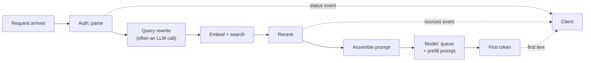

[Streaming responses](/learn/generation-strategies/streaming-responses) showed how to stream a RAG answer correctly: the provider's event model, an application event protocol, buffering partial citation markers, cancellation and mid-stream failures. This lesson treats streaming as a **performance** problem. Once an answer streams, the user's experience is governed by a handful of measurable quantities: how long until something appears, how long until the first word of the answer, how smoothly the rest arrives, and whether every hop between the model and the screen actually passes the stream through. Each can be engineered.

You will run a real streaming server locally, measure it from the client side, and watch five configurations change those quantities: a buffering proxy, plain streaming, early status events, a smaller prompt and coalesced flushing.

## Learning objectives

- Define and measure time to first byte, time to first token, inter-token gap and total time from the client's side, and explain which one users notice.
- Decompose time to first token in a RAG pipeline into its stages and identify which optimisations shorten it.
- Explain how prompt length, prompt caching and query rewriting affect time to first token, with arithmetic.
- Diagnose a stream that is buffered somewhere on its path, and configure the path so it is not.
- Choose a flushing interval that balances smoothness against per-event overhead, and handle slow clients without unbounded buffering.

## Prerequisites

- [Streaming responses](/learn/generation-strategies/streaming-responses): SSE, the event protocol, cancellation.
- [Model inference](/learn/understanding-large-language-models/model-inference): prefill, decoding, time to first token and tokens per second.
- [Async execution](/learn/performance-optimisation/async-execution): deadlines and work off the critical path.
- [Latency optimisation](/learn/performance-optimisation/latency-optimisation): latency budgets and finding the critical path.

## Why this matters

Once a RAG system streams, total generation time stops being what users judge it by. They judge it by the wait before anything happens and by whether text then flows or stutters. Two systems with identical total latency can feel completely different: one shows "Searching the handbook…" at once, sources at 0.4 s and text at 0.7 s; the other shows a spinner for 1.5 s and then text in bursts.

Switching on streaming and stopping there leaves most of the benefit unclaimed:

- **Time to first token is mostly the team's, not the model's.** Rewriting, retrieval, reranking and prompt assembly precede the first token, and a long prompt slows the model's prefill.
- **Streams are fragile in transit.** Reverse proxies, compression middleware, API gateways and corporate networks buffer by default. One buffering hop turns a perfect stream into a blocking response, and it shows up only in the deployed path.
- **Streaming changes capacity.** Each answer holds a connection for its whole duration, slow clients make servers hold data, and per-token events multiply network and rendering work.

## The intuition

A restaurant kitchen sends a meal out in courses. Diners judge the service mostly by two things: how long before bread arrives, and whether courses keep coming at a steady pace. A kitchen that cooks everything and then brings it all at once has the same total cooking time and feels far slower.

Getting bread on the table quickly is about what the kitchen does before cooking: taking the order, checking the larder, preparing the station. Those are the RAG stages before generation. A waiter who collects plates on a tray and only walks out when the tray is full is a buffering proxy: the kitchen is fast, the diner waits anyway. And a waiter who brings each pea separately is flushing every token: smooth, but exhausting for everyone.

## How it works

### Four numbers, measured at the client

Measure streaming where the user is, after every hop, not inside the server:

| Metric | Definition | What the user experiences |
| --- | --- | --- |
| Time to first byte (TTFB) | Request sent to first byte of the response | Whether the system reacted at all |
| Time to first token (TTFT) | Request sent to first character of answer text | When reading can begin |
| Inter-token gap | Time between consecutive text arrivals; report p50, p95 and the maximum | Smoothness, and visible stalls |
| Total time | Request sent to the final event | When the answer is complete and actions (copy, cite) are enabled |

Inference servers also report **time per output token**, the inverse of tokens per second. Report all of these as percentiles across requests, as [Retrieval latency](/learn/retrieval-fundamentals/retrieval-latency) explains; a good median with a terrible p95 TTFT means a fifth of users stare at a spinner.

### Where time to first token goes

In a RAG request, everything before the first answer token is on the critical path:



Optimising TTFT is a matter of removing, shortening or overlapping these stages:

1. **Remove model calls before generation where you can.** A query-rewriting or routing call to a language model costs a full model round trip, including its own TTFT and generation, before retrieval can start. Use a smaller, faster model for it, run it only for queries that need it, or run retrieval on the original question in parallel with the rewrite (see [Parallel retrieval](/learn/performance-optimisation/parallel-retrieval)).
2. **Shorten retrieval and reranking.** Rerank fewer candidates, use a smaller cross-encoder, or give reranking a deadline with a fallback.
3. **Shrink the prompt.** The model must read (prefill) the whole prompt before producing the first token, and prefill time grows with prompt length. Twenty chunks of 400 tokens are 8,000 tokens to read; five are 2,000. This is a quality trade-off, so measure answer quality as you reduce $k$.
4. **Make the static part of the prompt cacheable.** Providers including Anthropic offer **prompt caching**: a prefix of the prompt marked as cacheable is stored after the first request and reused by later requests with the identical prefix, which reduces the time and cost of processing it. In RAG, the system instructions and any fixed examples form a stable prefix; the retrieved chunks and question vary. Put the stable content first and mark it. Caching has a minimum prefix length that depends on the model, and a byte-level change anywhere in the prefix (a timestamp in the system prompt, for instance) silently defeats it.
5. **Send something immediately.** A `status` event at once and a `sources` event after retrieval do not shorten TTFT but replace a dead wait with visible progress. This is cheap and users notice it.

The Anthropic SDK call for a cached system prompt looks like the sketch below. It needs an API key and was not executed for this lesson.

```python
import anthropic

client = anthropic.Anthropic()  # reads ANTHROPIC_API_KEY from the environment

SYSTEM = "Answer only from the provided context. If the answer is not there, say you don't know. ..."  # long, stable

def stream_answer(context: str, question: str):
    with client.messages.stream(
        model="claude-opus-5-5",
        max_tokens=1024,
        system=[{"type": "text", "text": SYSTEM, "cache_control": {"type": "ephemeral"}}],
        messages=[{"role": "user", "content": f"Context:\n{context}\n\nQuestion: {question}"}],
    ) as stream:
        for text in stream.text_stream:
            yield text
        usage = stream.get_final_message().usage
        print("cache read tokens:", usage.cache_read_input_tokens)
```

If `cache_read_input_tokens` stays at zero across requests with the same system prompt, something in the prefix is changing, or the prefix is below the model's minimum cacheable length. See the [prompt caching documentation](https://platform.claude.com/docs/en/build-with-claude/prompt-caching) for current limits and pricing.

### The stream's journey to the screen

Between your server's `yield` and the user's screen, a streamed response passes through several layers, any of which can hold it back:

| Layer | How it buffers | Fix |
| --- | --- | --- |
| Your framework | A middleware that reads the full body (for example to compute a checksum or log it) | Exempt streaming routes from such middleware |
| Compression | gzip or brotli middleware accumulates bytes to compress efficiently | Do not compress `text/event-stream`, or use a middleware that flushes per event |
| Reverse proxy | nginx buffers upstream responses by default | `proxy_buffering off` for the route, or the response header `X-Accel-Buffering: no` |
| Load balancer or gateway | Some buffer whole responses or enforce response timeouts | Check the product's streaming support and idle timeout |
| Browser | `EventSource` over HTTP/1.1 counts against a small per-origin connection limit (six in common browsers) | Serve over HTTP/2, or multiplex streams |

Two further transit issues matter. **Idle timeouts**: a proxy may close a connection that carries no bytes for, say, 60 seconds, which can happen during a long prefill or a tool call. SSE allows comment lines (a line starting with `:`), which clients ignore; sending one every 15 seconds or so as a heartbeat keeps the connection alive. **Response headers**: send `Cache-Control: no-cache` so no intermediary caches the stream.

The only reliable test is end to end: a client that requests a streamed answer through the deployed path and asserts that the first text event arrives well before the final one. The main example builds exactly that measurement.

### How often to flush

A model produces tokens every few tens of milliseconds. Sending one event per token is smooth but has costs: each event is a separate write, often a separate TCP packet with its own headers, a separate parse in the browser and, for a naive interface, a separate re-render of the whole answer (re-rendering Markdown for every token makes long answers increasingly slow to display). **Coalescing** buffers text for a short interval (say 30 to 100 ms) and sends it as one event.

People do not perceive the difference between text arriving every 20 ms and every 50 ms as stutter, but they do notice gaps of several hundred milliseconds. So a flush interval of a few tens of milliseconds removes most of the event overhead at no perceptible cost. Coalescing composes with the citation buffering from [Streaming responses](/learn/generation-strategies/streaming-responses): the buffer is flushed on the timer, except for a trailing partial marker that waits for its close.

### Slow clients and backpressure

A client on a poor mobile connection may read more slowly than the model writes. **Backpressure** is the mechanism by which a slow consumer slows the producer: in an ASGI server such as uvicorn, sending to a client whose socket buffer is full waits until the client has read more, so your generator naturally pauses. That protects memory, but it also means the model stream upstream is not being read. Two policies are reasonable: keep reading the model into a bounded buffer and disconnect the client if the buffer fills (protecting the model call, which is expensive to restart), or let backpressure pause everything and rely on the provider's stream tolerating slow reads (simpler, but check its timeouts). An unbounded buffer between the model and a slow client is the one design that is never acceptable.

### Streaming and capacity

A streamed request holds a connection, a coroutine and some memory for the full generation time. By Little's law, connections in flight equal request rate times stream duration: 20 requests per second of 8-second answers is 160 concurrent streams. Async servers handle that easily; what needs planning is everything sized per connection (load-balancer connection limits, per-process file descriptors, any per-stream buffers). Long-lived streams also complicate deploys: a process being replaced must stop accepting new streams and let current ones finish, with a drain period at least as long as a typical answer.

Answers served from a [cache](/learn/performance-optimisation/caching) should still use the streaming protocol, so the client has one code path, but should be sent at once rather than replayed at an artificial typing speed: a cached answer's value is that it is instant.

## The mathematics

### Time to first token

**Intuition.** TTFT is a sum of everything on the critical path before generation, plus the model's prefill, which grows with prompt length.

$$
\text{TTFT} = \sum_{s \in S} t_s + t_{\text{queue}} + \frac{N_{\text{in}}}{r_{\text{prefill}}}
$$

$S$ is the set of pipeline stages before generation (rewrite, embed, search, rerank) and $t_s$ their times; $t_{\text{queue}}$ is waiting at the model provider; $N_{\text{in}}$ is the number of prompt tokens; $r_{\text{prefill}}$ is the rate at which the model processes prompt tokens. The linear prefill term is a simplification (attention cost grows faster than linearly for very long prompts, and providers' internals vary), but it captures the direction.

**By hand.** Assume (all figures illustrative) network and auth 0.03 s, a query-rewrite call 0.60 s, embedding 0.03 s, search 0.05 s, reranking 0.20 s, model queueing 0.10 s, and a prefill rate of 20,000 tokens per second. With $k = 20$ chunks of 400 tokens plus 1,000 tokens of instructions, $N_{\text{in}} = 9{,}000$, prefill takes $9{,}000/20{,}000 = 0.45$ s, and TTFT is $1.01 + 0.45 = 1.46$ s. With $k = 5$, $N_{\text{in}} = 3{,}000$, prefill 0.15 s, TTFT 1.16 s. Dropping the rewrite call as well gives 0.56 s. The rewrite call was the single largest item.

### Events per answer

**Intuition.** Coalescing turns a per-token event count into a per-interval count.

$$
E \approx \begin{cases} N_{\text{out}} & \text{one event per token} \\ \dfrac{N_{\text{out}} / r_{\text{out}}}{\Delta} & \text{flush every } \Delta \text{ seconds} \end{cases}
$$

$N_{\text{out}}$ is the answer length in tokens, $r_{\text{out}}$ the output rate in tokens per second and $\Delta$ the flush interval. A 300-token answer at 50 tokens per second lasts 6 s; flushing every 0.05 s gives about 120 events instead of 300, and every 0.1 s about 60.

```python
# Assumed figures for illustration; measure your own provider and pipeline.
stages = {"network + auth": 0.03, "query rewrite (LLM call)": 0.60, "embed query": 0.03,
          "vector search": 0.05, "rerank 50 candidates": 0.20, "queue at model": 0.10}
prefill_rate = 20_000                     # assumed prompt tokens processed per second
for k in (20, 5):
    prompt = 1_000 + 400 * k              # instructions + k chunks of ~400 tokens
    prefill = prompt / prefill_rate
    ttft = sum(stages.values()) + prefill
    print(f"k={k:2d}: prompt {prompt:5d} tokens, prefill {prefill:.2f} s, TTFT {ttft:.2f} s")
no_rewrite = sum(v for s, v in stages.items() if "rewrite" not in s) + (1_000 + 400 * 5) / prefill_rate
print(f"k= 5 without the rewrite call: TTFT {no_rewrite:.2f} s")
for interval_ms in (0, 50, 100):
    tokens, rate = 300, 50                # answer length and output rate (tokens/s)
    events = tokens if interval_ms == 0 else int(tokens / rate * 1000 / interval_ms)
    label = "every token " if interval_ms == 0 else f"every {interval_ms:3d} ms"
    print(f"flush {label}: about {events} events for a {tokens}-token answer")
```

```output
k=20: prompt  9000 tokens, prefill 0.45 s, TTFT 1.46 s
k= 5: prompt  3000 tokens, prefill 0.15 s, TTFT 1.16 s
k= 5 without the rewrite call: TTFT 0.56 s
flush every token : about 300 events for a 300-token answer
flush every  50 ms: about 120 events for a 300-token answer
flush every 100 ms: about 60 events for a 300-token answer
```

## In code

**The problem.** The Platform team wants to see, with numbers measured at a client, how each streaming decision changes what AskMeridian's users experience. The example runs a real FastAPI server under uvicorn on localhost, with a simulated retrieval pipeline and a simulated model whose prefill time grows with prompt length (the figures are assumptions chosen to be realistic in shape). A client using `httpx` streams each configuration and records when each event arrives:

- **A**: the whole stream collected and sent at once, standing in for a buffering proxy.
- **B**: plain streaming with 20 chunks in the prompt.
- **C**: B plus an immediate `status` event and a `sources` event after retrieval.
- **D**: C with 5 chunks instead of 20.
- **E**: D with text coalesced into 50 ms flushes.

```bash
pip install fastapi uvicorn httpx numpy
```

```python
import asyncio
import json
import threading
import time

import httpx
import numpy as np
import uvicorn
from fastapi import FastAPI
from fastapi.responses import StreamingResponse

ANSWER = ("Full-time staff receive 25 days of annual leave a year [S1]. Up to 5 unused days "
          "carry over and must be used by 31 March [S2]. ").split(" ") * 4   # ~80 word pieces

async def fake_model(prompt_tokens: int):
    """Stand-in for a streaming LLM: prefill time grows with the prompt, then ~100 pieces/s."""
    await asyncio.sleep(0.25 + prompt_tokens * 0.00005)   # assumed queue + prefill cost
    for piece in ANSWER:
        await asyncio.sleep(0.01)
        yield piece + " "

def sse(event: str, data) -> str:
    return f"event: {event}\ndata: {json.dumps(data)}\n\n"

async def rag_events(k: int, early: bool, coalesce_ms: float):
    if early:
        yield sse("status", "searching")
    await asyncio.sleep(0.15)                           # embed + vector search
    await asyncio.sleep(0.004 * k)                      # rerank cost grows with k
    if early:
        yield sse("sources", [f"S{i}" for i in range(1, 4)])
    prompt_tokens = 1_000 + 400 * k                     # assumed: instructions + k chunks
    buf, last = "", time.perf_counter()
    async for piece in fake_model(prompt_tokens):
        buf += piece
        if (time.perf_counter() - last) * 1000 >= coalesce_ms:
            yield sse("delta", buf)
            buf, last = "", time.perf_counter()
    if buf:
        yield sse("delta", buf)
    yield sse("done", {"prompt_tokens": prompt_tokens})

app = FastAPI()

@app.get("/ask")
async def ask(k: int = 20, early: bool = False, coalesce_ms: float = 0, buffered: bool = False):
    events = rag_events(k, early, coalesce_ms)
    if buffered:                                        # stand-in for a buffering proxy
        body = "".join([e async for e in events])
        return StreamingResponse(iter([body]), media_type="text/event-stream")
    return StreamingResponse(events, media_type="text/event-stream",
                             headers={"Cache-Control": "no-cache", "X-Accel-Buffering": "no"})

def measure(params: dict) -> str:
    t0 = time.perf_counter()
    first_any = first_delta = None
    arrivals = []
    with httpx.stream("GET", "http://127.0.0.1:8765/ask", params=params, timeout=30) as r:
        for line in r.iter_lines():
            now = time.perf_counter() - t0
            if line.startswith("event:"):
                first_any = first_any if first_any is not None else now
                if line == "event: delta":
                    first_delta = first_delta if first_delta is not None else now
                    arrivals.append(now)
    gaps = np.diff(arrivals) * 1000 if len(arrivals) > 1 else np.array([0.0])
    return (f"first event {first_any:4.2f} s | first text {first_delta:4.2f} s | "
            f"done {now:4.2f} s | {len(arrivals):3d} text events, gap p95 {np.percentile(gaps, 95):3.0f} ms")

server = uvicorn.Server(uvicorn.Config(app, host="127.0.0.1", port=8765, log_level="warning"))
thread = threading.Thread(target=server.run, daemon=True)
thread.start()
while not server.started:
    time.sleep(0.05)

configs = {
    "A buffered by a proxy, k=20  ": dict(k=20, buffered=True),
    "B streamed, k=20             ": dict(k=20),
    "C + status/sources early     ": dict(k=20, early=True),
    "D + k=5 smaller prompt       ": dict(k=5, early=True),
    "E + 50 ms coalescing         ": dict(k=5, early=True, coalesce_ms=50),
}
measure(dict(k=1))                                      # warm-up
for name, params in configs.items():
    print(name, measure(params))

server.should_exit = True
thread.join()
```

```output
A buffered by a proxy, k=20   first event 2.12 s | first text 2.12 s | done 2.12 s | 108 text events, gap p95   0 ms
B streamed, k=20              first event 0.95 s | first text 0.95 s | done 2.13 s | 108 text events, gap p95  11 ms
C + status/sources early      first event 0.00 s | first text 0.95 s | done 2.12 s | 108 text events, gap p95  11 ms
D + k=5 smaller prompt        first event 0.00 s | first text 0.59 s | done 1.76 s | 108 text events, gap p95  11 ms
E + 50 ms coalescing          first event 0.01 s | first text 0.60 s | done 1.77 s |  23 text events, gap p95  55 ms
```

**The important lines.**

- `StreamingResponse(events, ...)` passes the async generator to the server, which writes each yielded string as it is produced. In configuration A, `"".join([e async for e in events])` consumes the whole generator first, which is exactly what a buffering proxy does to your bytes.
- The `X-Accel-Buffering: no` header tells nginx (if one sits in front) not to buffer this response; it has no effect locally but belongs on every streaming route.
- `prompt_tokens * 0.00005` models prefill growing with prompt length, at an assumed 20,000 tokens per second.
- The coalescing test `(time.perf_counter() - last) * 1000 >= coalesce_ms` flushes the buffer when enough time has passed since the last flush; with `coalesce_ms=0` every piece is sent.
- The client measures on its own clock after the full HTTP path, as a user would; `server.should_exit = True` stops uvicorn cleanly.

**What the output means.** Read the rows top to bottom.

- **A** is the classic production bug: the first text arrives at the same moment as the end, 2.1 s. Every event is present (108 of them) but they arrive in one burst; the gap of 0 ms is the signature of buffering.
- **B** moves the first text to 0.95 s with no other change. Total time is identical: streaming changes perceived latency only.
- **C** adds an event at 0.00 s. TTFT is unchanged, but the user sees a reaction immediately and sources before text.
- **D** cuts TTFT from 0.95 s to 0.59 s by reading 3,000 prompt tokens instead of 9,000, and also shortens reranking. Total time falls by the same amount, because the prompt reduction is on the critical path.
- **E** sends 23 events instead of 108, with a p95 gap of 55 ms, still far below what a reader perceives as stutter. TTFT is unchanged because the first flush happens after the first 50 ms window.

**Common errors.** `httpx.ReadTimeout` during a long prefill means the client timeout is shorter than the time to the first byte; send a status event early or raise the read timeout. If every configuration looks like A, check for middleware wrapping the app (a compression or logging middleware). If the port is in use, change 8765.

**Extending it.** Add a `: heartbeat` comment line every 15 seconds while waiting for the model, and verify that `iter_lines` sees it while the browser's `EventSource` would ignore it. Then insert a deliberate stall (sleep 600 ms after the 40th piece) and check that the p95 gap barely moves while the maximum gap reveals it, which is why the maximum belongs on the dashboard.

## A real-world example

AskMeridian's dashboards reported a healthy median time to first token of about 0.7 s, measured inside the API service. Yet the support desk kept hearing that the assistant "sometimes sits there for ages". The Platform team added client-side measurement in the web interface, reporting TTFB, TTFT and maximum gap per answer.

Users' p95 TTFT was over 3 s, and a per-route breakdown showed two causes. Questions classified as ambiguous triggered a query-rewriting call to a language model before retrieval, adding a whole model round trip; these were about a fifth of questions, which is exactly why the median looked fine and the p95 did not. And users in one office reached the service through a corporate proxy that buffered responses; for them every answer arrived in one piece, a problem invisible to server-side metrics.

The rewrite moved to a small, fast model running in parallel with retrieval on the original question. The system prompt was restructured so that its stable part came first and was marked for prompt caching, and the team confirmed cache reads in the usage figures. The office proxy's administrators exempted `text/event-stream` from buffering, and a synthetic check now runs a streamed question through each office's path every five minutes, alerting when the first text arrives within 100 ms of the last. Finally, the interface began sending a status event at once and rendering sources as soon as they arrived. The team's lesson was that streaming metrics must be measured at the client, per route, at the tail.

## Common mistakes

- **Measuring TTFT inside the server.** It misses every buffering hop and the network, which is where the worst problems hide.
- **Watching only the median.** Routes with an extra model call or a slow reranker live in the tail.
- **A language-model call before retrieval on every request.** It roughly doubles TTFT for the queries that need it least.
- **Prompts stuffed with chunks "just in case".** Each extra chunk is paid for in prefill time on every request.
- **A volatile value at the start of the prompt.** A timestamp or request id in the system prompt defeats prompt caching silently.
- **Compressing or buffering `text/event-stream`.** Turns streaming back into a blocking response.
- **One event per token with a full re-render per event.** Long answers become slow to display and drain mobile batteries.
- **No heartbeat.** Idle timeouts in proxies close streams during long prefills or tool calls.

## Best practices

- Instrument TTFB, TTFT, gap percentiles and maximum gap at the client, broken down by route.
- Send a status event immediately and sources as soon as retrieval finishes.
- Keep model calls off the pre-generation path, or make them small, fast, conditional and parallel to retrieval.
- Choose $k$ and chunk size with TTFT in view, and measure the quality cost of every reduction.
- Order prompts with stable content first, mark it for caching, and verify cache reads in usage data.
- Disable buffering and compression for streaming routes at every hop; test the deployed path end to end.
- Coalesce text into flushes of a few tens of milliseconds; render incrementally on the client.
- Bound every buffer between the model and the client, send heartbeats, and drain streams on deploy.

## Performance considerations

Streaming does not change model cost or total generation time; its performance work is about the critical path before the first token and about transport overheads. The levers rank roughly as follows for a typical RAG service: removing or shrinking pre-generation model calls (hundreds of milliseconds each), reducing prompt length and enabling prompt caching (proportional to prompt tokens), shortening reranking (tens to hundreds of milliseconds), and fixing buffering (which can be the whole answer's duration). Coalescing saves events, not time to first token.

Capacity scales with stream duration. At $\lambda$ requests per second and answers lasting $D$ seconds, $\lambda D$ streams are open at once; per-stream memory (prompt, chunks, buffers) times that number is the memory you need, and load balancers must allow that many concurrent connections per backend. Cancellation on disconnect, covered in [Streaming responses](/learn/generation-strategies/streaming-responses), reduces both the open-stream count and the output tokens paid for.

Keep server-side work per event small: validation, buffering, logging and serialisation per token, across hundreds of streams, add measurable [event-loop lag](/learn/performance-optimisation/async-execution).

## Security considerations

Heartbeats and long-lived connections extend the window in which a client holds server resources, so cap the number of concurrent streams per user and the maximum stream duration. Prompt caching is scoped to the provider account and organisation, but within your application, do not put one user's private data into a prefix you intend to share across users: shared prefixes should contain only content every user may see, such as the system instructions. When disabling proxy buffering, do it for the streaming route only, not globally, so other protections that rely on buffering (request size limits, response inspection) stay in place for the rest of the API.

## Summary

- Users judge streamed answers by time to first byte, time to first token and smoothness, measured at the client and at the tail; total time matters less.
- TTFT is the sum of every stage before generation plus the model's prefill, which grows with prompt length; most of it is under the RAG team's control.
- The biggest TTFT levers are removing or shrinking pre-generation model calls, shortening prompts, prompt caching of the stable prefix and fast reranking.
- One buffering hop (proxy, compression, middleware) turns streaming into a blocking response; test the deployed path end to end.
- Coalesce flushes at tens of milliseconds, bound buffers for slow clients, send heartbeats and plan capacity for long-lived connections.

## Exercises

1. **TTFT budget.** A pipeline has auth 20 ms, embedding 30 ms, search 60 ms, reranking 250 ms, model queueing 100 ms and a prefill rate of 25,000 tokens per second (all assumed). The prompt has 1,200 tokens of instructions and $k$ chunks of 350 tokens. What is the largest $k$ that keeps TTFT under 1 s? What if reranking is cut to 100 ms?

<details><summary>Show solution</summary>

Fixed stages: $20 + 30 + 60 + 250 + 100 = 460$ ms, leaving 540 ms for prefill, which at 25,000 tokens per second is 13,500 tokens. So $1{,}200 + 350k \le 13{,}500$, giving $k \le 35.1$: $k = 35$. With reranking at 100 ms, 690 ms remain, or 17,250 tokens, and $k \le 45.9$: $k = 45$. In practice quality, not TTFT, would cap $k$ well before that; the point of the exercise is that at these assumed rates, prompt length is a smaller lever than a pre-generation model call, which alone could consume the whole budget.

</details>

2. **Find the buffer.** Modify the main example to add a middleware that buffers the whole response body before sending it (wrap the ASGI `send` and collect `http.response.body` messages until `more_body` is false). Confirm that configuration B now looks like A. Then exempt `text/event-stream` responses. What does this tell you about testing?

<details><summary>Show solution</summary>

A minimal ASGI middleware intercepts `send`: on `http.response.start` it stores the message and checks the `content-type` header; on each `http.response.body` it appends to a buffer and, when `more_body` is false, sends the stored start message and one body message. With it in place, B's first text time equals its total time, like A. Exempting `text/event-stream` (passing messages straight through when the content type matches) restores streaming. The lesson is that buffering is introduced by components added for unrelated reasons, so the streaming test must run through the complete stack, including all middleware and proxies, and must assert on timing, not just on content.

</details>

3. **Coalescing choice.** For a client that re-renders the whole answer as Markdown on each event, at a cost of 0.02 ms per token already displayed, estimate the total rendering cost for a 600-token answer with one event per token, and with events every 50 ms at 50 tokens per second. Which would you choose, and why might you still render incrementally?

<details><summary>Show solution</summary>

Per token: the $i$-th render costs $0.02i$ ms, so the total is $0.02 \times \sum_{i=1}^{600} i = 0.02 \times 180{,}300 \approx 3{,}600$ ms of rendering over the answer, growing quadratically with length. With 50 ms flushes at 50 tokens per second, each event adds about 2.5 tokens, so there are about 240 renders of an average 300 tokens: $240 \times 300 \times 0.02 = 1{,}440$ ms. Coalescing reduces it by about 2.5 times, but the cost is still quadratic. The real fix is incremental rendering (append new text, re-render only the last paragraph), which makes the cost linear; coalescing then mainly saves network events.

</details>

## Check your understanding

```quiz
[
  {"q": "Server-side metrics show a median time to first token of 0.6 s, but users complain of long waits before text appears. Which is the most useful next measurement?", "options": ["The model's tokens per second", "The average answer length", "CPU usage of the API server", "Client-side TTFB and TTFT percentiles broken down by route"], "answer": 3, "why": "Server-side metrics miss buffering hops and the network, and medians hide routes with extra pre-generation steps. Client-side, per-route percentiles reveal both."},
  {"q": "A streamed answer's first text event arrives 2 ms before its final event, although the server yields events over 3 seconds. What is the most likely cause?", "options": ["The model is slow", "Something on the path is buffering the response", "Coalescing is set to 50 ms", "The prompt is too long"], "answer": 1, "why": "All events arriving together at the end is the signature of a buffering hop such as a proxy or compression middleware."},
  {"q": "Which change reduces time to first token in a RAG pipeline that rewrites every query with a language model before retrieval?", "options": ["Running retrieval on the original question in parallel with a smaller, conditional rewrite", "Coalescing deltas into 100 ms flushes", "Sending a status event immediately", "Increasing max_tokens"], "answer": 0, "why": "The rewrite call is a full model round trip on the critical path. Making it smaller, conditional and parallel removes it from the path. A status event improves perceived responsiveness but not TTFT."},
  {"q": "Why does placing a timestamp at the start of the system prompt hurt latency?", "options": ["Timestamps are long", "The model must reason about time", "Prompt caching matches the prefix exactly, so a changing first line prevents any cache reuse", "It increases output length"], "answer": 2, "why": "Caches match a byte-identical prefix. A value that changes on every request at the start of the prompt invalidates everything after it."},
  {"q": "At 15 requests per second, streamed answers last 10 seconds on average. About how many streams are open at once?", "options": ["15", "150", "1.5", "25"], "answer": 1, "why": "By Little's law, concurrency equals arrival rate times duration: 15 times 10 = 150."}
]
```

## Further reading

- [Anthropic streaming documentation](https://platform.claude.com/docs/en/build-with-claude/streaming): the event types and SDK helpers for streamed messages.
- [Anthropic prompt caching documentation](https://platform.claude.com/docs/en/build-with-claude/prompt-caching): cache breakpoints, minimum lengths, lifetimes and pricing.
- [MDN: Using server-sent events](https://developer.mozilla.org/en-US/docs/Web/API/Server-sent_events/Using_server-sent_events): the SSE format, comment lines and the per-origin connection limit.
- [nginx `ngx_http_proxy_module` documentation](https://nginx.org/en/docs/http/ngx_http_proxy_module.html): `proxy_buffering` and the `X-Accel-Buffering` header.
- [Uvicorn documentation](https://www.uvicorn.org/): running ASGI apps, timeouts and graceful shutdown.
