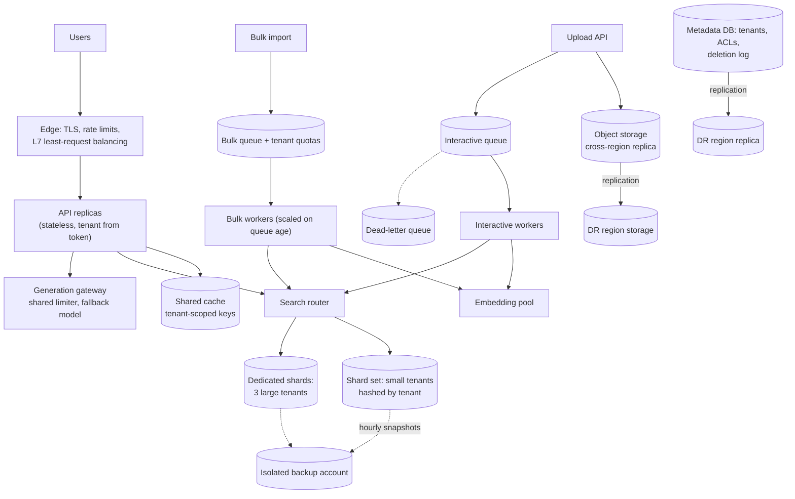

This assessment covers the whole Production Architecture module: scalable systems, multi-tenancy, high availability, fault tolerance, distributed ingestion, queue-based pipelines, horizontal scaling, load balancing and disaster recovery. Work through the quiz first without notes, then answer the open questions in your own words before opening the model answers. The pass mark for the quiz is 70 per cent (12 of 17). The coding exercises and design challenge are not scored automatically; compare your work with the reference solutions and note every difference you cannot justify.

```quiz
[
  {"q": "AskMeridian's generation stage has 20 slots and each answer holds a slot for 4 seconds. Retrieval and reranking can each do over 40 requests per second. What is the maximum sustainable request rate of the system?", "options": ["4 requests per second", "5 requests per second", "20 requests per second", "40 requests per second"], "answer": 1, "why": "Capacity is slots divided by service time: 20 / 4 = 5 per second. The smallest stage sets the system ceiling."},
  {"q": "Why is a target of about 100 per cent utilisation a poor design for an interactive stage?", "options": ["Servers fail more often at high utilisation", "Autoscalers cannot act above 90 per cent", "Utilisation above 90 per cent is not measurable", "Random arrivals form queues, and time in the system grows without bound as utilisation approaches 100 per cent"], "answer": 3, "why": "In the simplest queueing model, time in system is the service time divided by (1 - utilisation), so delay is flat at first and then vertical."},
  {"q": "A multi-tenant RAG API receives the tenant identifier from a request header supplied by the client. What is wrong?", "options": ["A client can name another tenant, so the identifier must come from the verified credential", "Headers cannot carry identifiers", "Nothing; it is a standard practice", "Headers are too slow to read"], "answer": 0, "why": "Tenant isolation depends on the server deriving the tenant from the authenticated token. A client-supplied identifier lets one tenant read another's data."},
  {"q": "Two services each have availability 99.9 per cent and a request needs both in series. What is the best estimate of the combined availability?", "options": ["99.99 per cent", "99.0 per cent", "99.9 per cent", "99.8 per cent"], "answer": 3, "why": "In series, availabilities multiply: 0.999 x 0.999 = 0.998001, about 99.8 per cent. A dependency chain is less available than its weakest link."},
  {"q": "Which problem does a circuit breaker address?", "options": ["Slow index builds", "Duplicate messages in a queue", "Repeatedly calling a failing dependency, which wastes time and keeps it overloaded", "Uneven shard sizes"], "answer": 2, "why": "After enough failures the breaker stops calling the dependency for a while and fails fast or degrades, giving it room to recover."},
  {"q": "What does this print?\n```python\nimport math\nprint(math.ceil(6 * 7.5 / 5))\n```\nIt applies the autoscaler rule with 6 current replicas, a measured metric of 7.5 and a target of 5.", "options": ["7", "8", "9", "10"], "answer": 2, "why": "6 x 7.5 / 5 = 9.0, and the ceiling of 9.0 is 9."},
  {"q": "A worker acknowledges a queue message and then writes the document's chunks to the index. It crashes between the two steps. What is the outcome?", "options": ["The message is lost and the document is never indexed", "The queue detects the crash and rolls back", "The chunks are written by the queue", "The message is redelivered and the document is indexed twice"], "answer": 0, "why": "Acknowledging first discards the message, so the work is never retried. Write first, acknowledge afterwards, and make the write idempotent."},
  {"q": "What does this print?\n```python\nprint([min(300, 5 * 2 ** (n - 1)) for n in (1, 4, 6, 8)])\n```", "options": ["[5, 40, 160, 300]", "[5, 20, 80, 300]", "[5, 40, 160, 640]", "[10, 80, 320, 300]"], "answer": 0, "why": "The values are 5, 40, 160 and 640, with the last capped at 300."},
  {"q": "Which statement about exactly-once delivery between a queue and a vector database is most accurate?", "options": ["It is the default in every managed queue", "A queue configured correctly guarantees it", "It cannot be guaranteed by the queue alone; at-least-once delivery with idempotent writes achieves the same result", "It is guaranteed by acknowledgements"], "answer": 2, "why": "The effect and the acknowledgement are separate operations that cannot be made atomic across systems, so you make repeated effects harmless instead."},
  {"q": "A bulk re-index of 2 million chunks is delaying every small upload. What is the best structural fix?", "options": ["Increase the visibility timeout", "Disable retries", "Add one more worker to the shared pool", "Use separate queues and worker pools for bulk and interactive work"], "answer": 3, "why": "A shared pool lets the bigger workload starve the smaller. Separate queues with separate capacity, or per-tenant quotas, isolate them."},
  {"q": "A RAG API spends most of its time waiting on a model provider. CPU stays at 15 per cent while latency climbs. Which autoscaling signal is most useful?", "options": ["In-flight requests per replica", "Memory use", "Disk throughput", "CPU utilisation"], "answer": 0, "why": "For an I/O-bound service CPU is a poor signal; in-flight requests per replica shows how close each replica is to its concurrency limit."},
  {"q": "A vector index is split over 6 shards and a query needs the top 10. How many results should each shard return?", "options": ["1", "2", "10", "60"], "answer": 2, "why": "All of the true top 10 could be on one shard, so each shard must return 10. The router merges 60 candidates and keeps the best 10."},
  {"q": "A cluster using hash(id) mod N grows from 4 shards to 5. Compared with consistent hashing, what is the effect?", "options": ["No data moves", "Consistent hashing moves more data", "About the same data moves", "Far more data moves, about four fifths against one fifth"], "answer": 3, "why": "Modulo hashing remaps most keys when N changes. Consistent hashing moves only about 1/(N+1) of them."},
  {"q": "Which load-balancing policy is best for requests whose durations vary from 50 ms to 30 s?", "options": ["Round-robin", "Random", "Least-connections or power of two choices", "Sticky to a single replica"], "answer": 2, "why": "Load-aware policies avoid stacking long requests on one replica and route around slow replicas; round-robin and random do not look at load."},
  {"q": "A gateway, an API and an embedding client each retry a failing call up to twice (three attempts each). What is the worst case at the embedding service for one user request?", "options": ["9", "6", "27", "3"], "answer": 2, "why": "Attempts multiply across layers: 3 x 3 x 3 = 27. Retrying at one layer with a budget avoids this."},
  {"q": "An index is restored from a snapshot 20 hours old after a regional outage. Which step is essential before sending traffic?", "options": ["Increase the replica count", "Rebuild the cloud network", "Re-apply the deletion log and re-ingest documents changed since the snapshot", "Delete the backup"], "answer": 2, "why": "A snapshot misses recent changes and can resurrect documents deleted afterwards, which may be a compliance problem."},
  {"q": "Recovery steps are: infrastructure 20 minutes; then database 30, index 50 and queue 10 in parallel; then API 10. What is the achievable recovery time?", "options": ["120 minutes", "80 minutes", "90 minutes", "60 minutes"], "answer": 1, "why": "The longest dependent chain is infrastructure (20) + index (50) + API (10) = 80 minutes; parallel branches do not add."}
]
```

## Conceptual questions

**1.** Explain why scaling the component that is easiest to scale is usually the wrong decision for a RAG system. Which component tends to saturate first, and why?

<details>
<summary>Show model answer</summary>

Scaling effort pays only at the bottleneck: the stage with the lowest capacity (slots divided by the time a request holds one) sets the system's ceiling, and adding capacity elsewhere changes nothing. The API tier is stateless and easy to replicate, but it mostly waits. In a RAG system generation usually saturates first: an answer holds a slot for seconds while the model produces tokens, a hosted provider enforces rate limits on concurrency and tokens, and a self-hosted model has finite accelerator memory for in-flight requests. Retrieval stages hold their resources for tens of milliseconds. More API replicas can even make things worse, because they raise demand on the same provider quota. The remedy is to measure per-stage utilisation, then add capacity at the saturated stage, reduce the work it does (caching, fewer context tokens, smaller models for easy questions) or raise the provider limit.

</details>

**2.** What does "at-least-once delivery with an idempotent consumer" mean, and why is it preferred to trying to obtain exactly-once delivery for document ingestion?

<details>
<summary>Show model answer</summary>

At-least-once means the queue keeps each message until it is acknowledged and redelivers it when no acknowledgement arrives, so no message is lost but some are delivered more than once. An idempotent consumer produces the same final state however many times it processes a message: for ingestion, chunk identifiers derived deterministically from document identifier, version and position, written with an upsert, and a version check that ignores messages older than what the index holds. Exactly-once cannot be guaranteed between independent systems, because the write to the index and the acknowledgement to the queue are two operations that cannot be made atomic; a crash between them leaves the queue unable to know whether the work happened. Losing a document is worse than processing it twice, so the practical design accepts duplicates and makes them harmless.

</details>

**3.** Describe three ways a multi-tenant RAG service can leak one tenant's data to another even when the vector search is correctly filtered, and how each is prevented.

<details>
<summary>Show model answer</summary>

(a) Caches: a response or semantic cache keyed only by the query text returns tenant A's answer to tenant B's identical question. Prevent it by including the tenant (and permission scope) in every cache key. (b) Prompts and conversation memory: per-tenant instructions, examples or history shared through a global store or prompt template can expose content across tenants. Keep them in the tenant registry and load them by tenant identifier from the verified token. (c) Telemetry and evaluation data: logs, traces and stored questions often contain retrieved text or user queries; if dashboards or evaluation sets mix tenants without access control, content leaks to operators or to other tenants' tooling. Apply tenant tags, access rules and retention to telemetry. A fourth is trusting a client-supplied tenant identifier rather than deriving it from the credential.

</details>

**4.** Distinguish high availability, fault tolerance and disaster recovery. Give one example of a failure each addresses and one it does not.

<details>
<summary>Show model answer</summary>

High availability uses redundancy and failure-domain separation so the service stays up through expected component failures: it handles a node or a zone dying, but not a deletion that is replicated to every node. Fault tolerance concerns how a request behaves when a dependency is slow or failing: timeouts, bounded retries, circuit breakers and degraded answers keep requests succeeding while the embedding service is struggling, but they cannot restore a lost database. Disaster recovery assumes the system is down or damaged and restores it, within a recovery time and with a bounded loss of recent data: it handles a regional outage, a deleted collection or ransomware, but it is too slow to keep individual requests succeeding during a brief dependency blip.

</details>

**5.** A teammate says the vector index can be rebuilt from the documents, so it does not need backing up. Give a reasoned reply.

<details>
<summary>Show model answer</summary>

It depends on arithmetic and on dependencies. Rebuild time is bounded by parsing and embedding throughput: ten million chunks at 500 embeddings per second take about 5.5 hours, which exceeds many recovery time objectives. A rebuild also needs the same embedding model that produced the original vectors and the same chunking and index settings, so the model weights (or a firm provider commitment), the configuration and the documents must all survive; a retired API model makes a faithful rebuild impossible. A snapshot restore followed by reconciliation (re-ingest what changed, re-apply the deletion log) is usually faster. The rebuild remains the fallback and should be rehearsed, but it should not be the only plan unless its measured time fits the RTO.

</details>

## Coding exercises

**1. Versioned, idempotent apply.** Write a class `VersionedIndex` with a method `apply(msg)` that returns `"applied"` or `"ignored"`. A message has a `doc`, a `version`, an `op` (`update` or `delete`) and optional `text`. A message is ignored if its version is not greater than the stored one. Deletes leave a tombstone. Show that a delete (version 4) arriving before an update (version 3) and a duplicate delivery of the delete leave the document deleted.

<details>
<summary>Show solution</summary>

```python
class VersionedIndex:
    """Applies messages idempotently and ignores stale or out-of-order ones."""
    def __init__(self):
        self.docs = {}        # doc_id -> (version, text); text None marks a tombstone

    def apply(self, msg):
        current = self.docs.get(msg["doc"], (0, None))[0]
        if msg["version"] <= current:
            return "ignored"
        self.docs[msg["doc"]] = (msg["version"], None if msg["op"] == "delete" else msg["text"])
        return "applied"

idx = VersionedIndex()
arrival = [
    {"doc": 7, "version": 4, "op": "delete"},
    {"doc": 7, "version": 3, "op": "update", "text": "old"},
    {"doc": 7, "version": 4, "op": "delete"},      # duplicate delivery
    {"doc": 8, "version": 1, "op": "update", "text": "hello"},
]
print([idx.apply(m) for m in arrival])
print(idx.docs)
```

```output
['applied', 'ignored', 'ignored', 'applied']
{7: (4, None), 8: (1, 'hello')}
```

The delete is applied first and records version 4; the late update (version 3) and the duplicate delete (version 4, not greater than 4) are both ignored, so document 7 stays deleted and the system is safe under reordering and redelivery. In a real index the version check and the write must be one atomic conditional operation.

</details>

**2. A retry budget.** Implement `RetryBudget(ratio=0.1, cap=10)`: each request adds `ratio` tokens (up to `cap`), each retry costs one token and is refused when fewer than one token remains. Simulate 10,000 requests with at most 3 retries each, at failure rates of 2 per cent and 100 per cent, with and without the budget, and report attempts per request.

<details>
<summary>Show solution</summary>

```python
import random

class RetryBudget:
    """Allow retries only up to `ratio` of the requests seen."""
    def __init__(self, ratio=0.1, cap=10.0):
        self.ratio, self.cap, self.tokens = ratio, cap, cap
    def on_request(self):
        self.tokens = min(self.cap, self.tokens + self.ratio)
    def try_retry(self):
        if self.tokens >= 1:
            self.tokens -= 1
            return True
        return False

def run(failure_rate, budgeted, n=10000, seed=1):
    rng, budget, attempts = random.Random(seed), RetryBudget(), 0
    for _ in range(n):
        budget.on_request()
        attempts += 1
        if rng.random() < failure_rate:
            tries = 0
            while tries < 3 and (budget.try_retry() if budgeted else True):
                tries += 1
                attempts += 1
                if rng.random() >= failure_rate:
                    break
    return attempts / n

for f in (0.02, 1.0):
    print(f"failure rate {f:4.0%}: attempts per request  unbudgeted {run(f, False):.2f}   budgeted {run(f, True):.2f}")
```

```output
failure rate   2%: attempts per request  unbudgeted 1.02   budgeted 1.02
failure rate 100%: attempts per request  unbudgeted 4.00   budgeted 1.10
```

When failures are rare the budget costs nothing and retries work. When the dependency is fully down, unbudgeted retries quadruple the load on it (one attempt plus three retries per request), while the budget caps the extra load near 10 per cent, 1.10 attempts per request, after the initial cap of 10 tokens is spent.

</details>

**3. Scale-down stabilisation.** Write `replicas_over_time(demand, target, window)`: each step the recommendation is `ceil(demand / target)`; scale up immediately; scale down only to the highest recommendation seen in the last `window` steps. Use demand `[40, 40, 10, 40, 10, 10, 40, 10, 10, 10]` and target 5, with windows 1 and 3, and explain the difference.

<details>
<summary>Show solution</summary>

```python
import math


def replicas_over_time(demand, target, window):
    """Scale up at once; scale down only to the highest recommendation seen in the last `window` steps."""
    recs, current, out = [], 1, []
    for d in demand:
        recs = (recs + [math.ceil(d / target)])[-window:]
        current = recs[-1] if recs[-1] > current else max(recs)
        out.append(current)
    return out


demand = [40, 40, 10, 40, 10, 10, 40, 10, 10, 10]    # total in-flight requests per step
print("no stabilisation:", replicas_over_time(demand, 5, 1))
print("window of 3:     ", replicas_over_time(demand, 5, 3))
```

```output
no stabilisation: [8, 8, 2, 8, 2, 2, 8, 2, 2, 2]
window of 3:      [8, 8, 8, 8, 8, 8, 8, 8, 8, 2]
```

Without stabilisation the fleet flaps between 8 and 2 replicas, paying start-up cost (model loading) each time and failing to be ready for the next burst. With a window of three, the fleet holds 8 replicas through the intermittent dips and scales down only after three consecutive quiet steps, which is the scale-up-fast, scale-down-slowly behaviour that suits slow-starting replicas.

</details>

## Architecture design challenge

**Brief.** Design the production architecture for "AskMeridian Cloud": the assistant becomes a product used by 300 customer companies. Most have under 50,000 chunks, three have over 5 million. Customers upload documents all day, with large imports on Monday mornings. Questions peak at 09:00 in several time zones. Targets: answers within 6 seconds at the 95th percentile, availability of 99.9 per cent, an RTO of 2 hours and an RPO of 1 hour, and strict isolation between customers. Describe the request path, the ingestion path, the scaling approach for each tier, the isolation model and the DR plan, and state your trade-offs.

<details>
<summary>Show reference design</summary>



**Request path.** Edge balancer (layer 7, least-request, outlier detection) to stateless API replicas. The tenant comes from the verified token; every cache key and filter includes it. Retrieval goes to a search router that targets the tenant's shard set. Generation goes through a gateway holding the shared provider limiter, retries (at that layer only, with a budget), and a fallback model or retrieval-only degraded mode.

**Isolation.** Small tenants are placed by tenant hash onto shared shards with a mandatory tenant filter and payload index; the three large tenants have dedicated shards, found through a tenant registry (tenant to shard set) so a tenant can be moved without touching the others. Per-tenant rate limits and token quotas, a tenant-scoped cache and prompts loaded by tenant identifier complete the model.

**Ingestion.** Uploads go to object storage and a message with identifiers and a version goes to a queue. Interactive uploads and Monday bulk imports use separate queues and worker pools; bulk work is rate-limited per tenant so one import cannot occupy the pool, and workers scale on queue age. Consumers are idempotent (deterministic chunk identifiers, upserts, version checks); permanent failures go to a dead-letter queue with an alert and a redrive runbook.

**Scaling.** API replicas scale on in-flight requests, with a minimum covering the 09:00 peak and a scheduled scale-up before it. Embedding and rerank pools scale on queue time with warm-up readiness checks. Search scales by replicas per shard for read throughput and by splitting a large tenant's data for capacity, using consistent hashing so resizing moves little data.

**Availability.** Replicas and shards spread over three zones with N+1 capacity; readiness covers only replica-local conditions; dependency failures are handled by timeouts, circuit breakers and degraded modes. Availability of 99.9 per cent allows about 8.8 hours of downtime a year, so the series chain (edge, API, search, metadata store, provider) must have each dependency better than the target or be made optional by degradation.

**Disaster recovery.** Pilot light in a second region: object storage and the metadata database replicate continuously (the deletion log lives in the metadata database); the vector index is snapshotted hourly into an isolated, immutable backup account and copied cross-region; infrastructure is defined as code and images and runbooks are stored outside the primary region. On failover, apply infrastructure, restore snapshots, replay the deletion log, re-ingest documents modified after the snapshot, verify counts and a question set, then cut DNS. The dependency graph's critical path (infrastructure, index restore, API, cutover) is measured in monthly drills against the 2-hour RTO; the hourly snapshot meets the 1-hour RPO.

**Trade-offs.** Dedicated shards cost more for large tenants but protect everyone from noisy neighbours. A pilot light is cheaper than warm standby but recovers in about an hour or more rather than minutes; if the business needs minutes, move the data layer to warm standby. Hourly snapshots add load on the index, so schedule them off-peak and use incremental snapshots if available. Per-tenant placement needs a registry and a migration procedure; that is worth building once because large tenants arrive unpredictably.

</details>

## Troubleshooting scenarios

**Scenario 1.** After a deployment, users report that answers sometimes appear twice in the search results, citing the same paragraph twice. Document counts in the index are 30 per cent higher than in the source store. The ingestion queue's dead-letter queue is empty, and workers have been restarted several times this week.

<details>
<summary>Show diagnosis and fix</summary>

Diagnosis: worker restarts caused messages to be redelivered after their visibility timeouts, and the consumer appends chunks with random identifiers, so every redelivery adds a duplicate set. The empty dead-letter queue is consistent with this: nothing failed permanently. Fix: derive chunk identifiers from document identifier, version and position and write with upsert; add a version check; reconcile existing duplicates by scanning the index for repeated (document, version, position) tuples and deleting the extras or re-indexing affected documents into a new collection and swapping the alias. Add a monitor comparing index counts with the source of truth, and test by killing a worker mid-job in staging.

</details>

**Scenario 2.** p95 latency doubles every Monday at 09:00. API CPU is 20 per cent, API replicas have been raised from 4 to 16 with no improvement, and the provider returns occasional rate-limit errors. The autoscaler uses CPU.

<details>
<summary>Show diagnosis and fix</summary>

Diagnosis: the bottleneck is generation, which is limited by the provider's rate limit and concurrency, not by the API tier. More replicas only add more waiting requests and more demand on the same quota, and the CPU-based autoscaler cannot see the saturation because the API is I/O-bound. Fix: confirm with per-stage timings, then raise the provider quota (a commercial step), cache the common Monday questions, centralise the limiter and retries in a gateway so replicas share one budget, cap prompt size, and switch the autoscaler to in-flight requests per replica with a scheduled scale-up before 09:00. Add load shedding with a fast, clear error above a queue-time limit, rather than letting requests wait for 30 seconds.

</details>

**Scenario 3.** During a short outage of the vector database, every API replica was removed from the load balancer and the whole assistant returned 503 for ten minutes, although the database recovered after two. The readiness probe calls the database.

<details>
<summary>Show diagnosis and fix</summary>

Diagnosis: the readiness check depends on a shared dependency, so a brief outage made every replica unready at once, the balancer had no healthy backends, and the recovery time extended to the time needed for probes to succeed again and for caches and pools to refill. Fix: make readiness cover replica-local conditions (model loaded, configuration valid) and handle the database failure inside the application with timeouts, a circuit breaker and a degraded response; report dependency health through metrics and alerts. Configure the balancer with a floor on the fraction of backends that may be ejected, use consecutive-success thresholds to avoid flapping, and test by taking the database down in staging.

</details>
