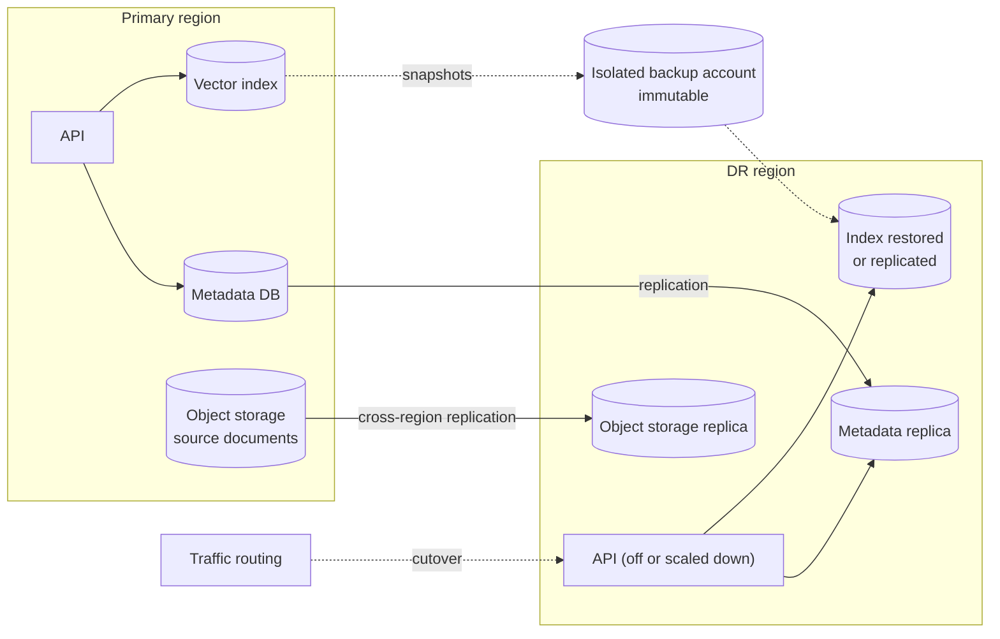

[High availability](/learn/production-architecture/high-availability) keeps a system running through the failures you expect: a machine dies, a zone loses power. **Disaster recovery** (DR) is what you do when the failures you did not survive have happened anyway: a whole region is unavailable, someone deletes the production collection, a compromised credential encrypts your storage, or a provider you depended on is gone. It is the discipline of getting the whole service back, in a known order and a known time, with a known amount of data lost.

The earlier lesson on [Backup and recovery](/learn/advanced-vector-database-engineering/backup-and-recovery) dealt with one component, the vector index, and defined the two numbers every plan is measured by. This lesson widens the view to the whole RAG system. A restored index is useless without the documents, the access-control data, the secrets, the pinned embedding model, the queue and the traffic routing around it, and these have to come back in the right order. You will model AskMeridian's recovery as a dependency graph, compute its critical path and spot a recovery-point gap before it becomes an incident.

## Learning objectives

- Distinguish disaster recovery from high availability, fault tolerance and backup, and classify disasters by what they destroy.
- Inventory a RAG system into source-of-truth data, derived data and configuration, and decide for each whether to restore or rebuild.
- Compare the four standard DR strategies (backup and restore, pilot light, warm standby, active-active) by recovery time, data loss and cost.
- Compute a system's recovery time as the critical path through its dependency graph, and find components whose recovery point misses the target.
- Plan reconciliation after a restore (documents, deletions, queue messages) and a drill programme that proves the plan works.

## Prerequisites

- [High availability](/learn/production-architecture/high-availability): failure domains, redundancy and the nines.
- [Fault tolerance](/learn/production-architecture/fault-tolerance): degraded modes and graceful failure of dependencies.
- [Backup and recovery](/learn/advanced-vector-database-engineering/backup-and-recovery): snapshots, RPO and RTO, restore versus rebuild for the index.
- [Index versioning](/learn/ci-cd-and-mlops/index-versioning) and [Reindexing](/learn/ci-cd-and-mlops/reindexing): rebuilding an index from sources.
- [Infrastructure configuration](/learn/deployment/infrastructure-configuration): describing infrastructure as code.

## Why this matters

Redundancy protects against independent failures. The disasters that end careers are **correlated**: one cause that hits every copy. A region outage takes the primary and its same-region replicas together. A mistaken command is replicated within milliseconds to every replica. Ransomware encrypts the primary data and whatever backups the same credentials can reach. A cloud account that is suspended or closed takes everything inside it. Replication, the usual answer to failure, faithfully copies each of these disasters to every node.

Without a DR plan, recovery is improvised under stress by whoever is on call, from memory, with unknown prerequisites. Teams discover that the backup exists but has never been restored, that the restore needs a secret stored only in the lost region, that the index snapshot was made with an embedding model the provider has since retired, or that nobody knows which service to start first. The plan costs a few days of engineering and a few hours of drill time per quarter. Its value is that the worst day becomes a procedure.

## The intuition

Consider a fire drill in an office building. Nobody expects a fire on a given Tuesday. The drill exists because a plan that has never been practised fails in ways nobody can predict: the stairwell door that is locked, the assembly point that the new starters have never heard of, the list of staff that is out of date. Practising reveals those in a calm hour.

DR is the same with data. You write down what you would do, you decide how long you can be without the service (the recovery time) and how much recent work you can afford to lose (the recovery point), and you rehearse. The rehearsal is not an optional extra; it is the only evidence that the plan works. A DR plan nobody has tested is a hypothesis.

## How it works

### What counts as a disaster

Classify disasters by what they destroy, because the defence differs.

| Disaster | What is lost | Does replication help? | What helps |
| --- | --- | --- | --- |
| Zone or region outage | Compute and storage in one location | Only if replicas are in another region | Cross-region replication or backups, a second region to run in |
| Accidental or malicious deletion, bad migration | Data, everywhere, immediately | No: it replicates the damage | Point-in-time backups, soft deletes, restore |
| Ransomware, compromised credentials | Data and possibly backups | No | Immutable, isolated backups in a separate account |
| Corruption (a bad re-index, a buggy writer) | The correctness of data, silently | No | Versioned indexes, validation, the ability to roll back ([Rollbacks](/learn/ci-cd-and-mlops/rollbacks)) |
| Provider or vendor loss (LLM, embedding API, managed database) | A dependency | n/a | A second provider or model, pinned artefacts, exit plans |
| Loss of the account, the identity provider or the CI system | The means to deploy and log in | n/a | Break-glass access, infrastructure as code held outside the account |

Note the difference from [fault tolerance](/learn/production-architecture/fault-tolerance): that lesson keeps individual requests succeeding while a dependency misbehaves. DR assumes the system is down or damaged and asks how it is rebuilt.

### Objectives and tiers

Two numbers bound the plan, defined in [Backup and recovery](/learn/advanced-vector-database-engineering/backup-and-recovery): the **recovery time objective (RTO)**, how long the service may be unavailable, and the **recovery point objective (RPO)**, how much recent data may be lost, measured in time. They are business decisions. A public customer-facing assistant may justify minutes of each; an internal tool like AskMeridian, whose users can fall back on the support desk for a few hours, may accept an RTO of two hours and an RPO of an hour, and no more spending than that justifies. Set targets per component tier, not one number for everything: query serving is more urgent than the evaluation dashboard.

### Four strategies

The terms below follow the widely used classification in the AWS whitepaper on disaster recovery of workloads; the ideas apply to any cloud or to your own data centres.

1. **Backup and restore.** Copy data to another region or account regularly; after a disaster, provision infrastructure and restore. Cheapest, with the longest recovery time (hours) and an RPO equal to the backup interval.
2. **Pilot light.** Keep the data layer continuously replicated in a second region and the application stack defined but switched off (or minimal). On disaster, start and scale it. Recovery is faster (tens of minutes to hours) and RPO is the replication lag.
3. **Warm standby.** A scaled-down but running copy of the whole stack in a second region, receiving replicated data. Failover means scaling it up and switching traffic. Recovery is minutes.
4. **Active-active (multi-site).** Both regions serve traffic. Failover is the loss of one region's share of capacity. Recovery can approach zero, but it is the most expensive and the hardest to get right: writes in two regions need conflict handling, and the system must survive either region carrying the full load.

Cost and complexity rise down the list, and RTO and RPO fall. Most RAG systems that are not customer-facing at large scale sit at the first two, with the data layer protected more heavily than the stateless compute, which is easy to rebuild.



### What a RAG system must recover

Sort everything the system needs into three kinds.

**Source of truth.** The data nothing can regenerate: the documents themselves (and their versions), the metadata database with document status, owners and **access-control lists**, tenant configuration, user feedback and evaluation datasets. These need real backups, cross-region replication and retention that outlasts a slow-moving corruption.

**Derived data.** The index, caches, and any pre-computed summaries. In principle all can be rebuilt from the source by re-running ingestion, which makes the index look disposable. Whether it is depends on arithmetic you can do in advance: how long does a full rebuild take (parse, chunk, embed millions of chunks at the embedding service's rate limit), and does that fit the RTO? Often it does not, so you restore a snapshot and then **reconcile**, bringing the index up to date with whatever changed after it (below). One trap deserves attention. A rebuild requires the same **embedding model** that produced the vectors. A model you called through a provider's API may be changed or retired, and a self-hosted model's weights may be lost with the region. Store the weights (or confirm the provider's deprecation policy) and record the exact model identifier in the index manifest ([Model versioning](/learn/ci-cd-and-mlops/model-versioning)).

**Configuration and code.** Container images, infrastructure as code, prompts, chunking and index settings, feature flags. They live in Git and an image registry, and the recovery question is whether those exist **outside** the failed region and account. Secrets (API keys, certificates, encryption keys) need a recovery path that does not depend on the failed region's key store; also keep a **break-glass** way to log in if your identity provider is unavailable.

### Recovery order and the critical path

Components depend on each other: the API needs its secrets, the metadata database and the index, and the index needs infrastructure and, if rebuilding, the documents. Write the dependencies down and recovery becomes a graph. Independent branches can proceed **in parallel**, so the total time is not the sum of the steps but the **critical path**: the longest chain of dependent steps. The maths section makes that exact, and the code computes it.

### Reconciliation after a restore

A restored component reflects its state at backup time; the others may be newer. The restored vector index may be 20 hours behind the document store. Three kinds of mismatch need explicit handling.

- **Missed changes.** Documents added or updated after the snapshot are missing or stale. Reconcile by scanning the source of truth for documents modified after the snapshot's timestamp and re-ingesting them through the normal queue. Because [queue consumers are idempotent](/learn/production-architecture/queue-based-pipelines), replaying work is safe.
- **Resurrected deletions.** A document deleted after the snapshot reappears in the restored index. For ordinary documents that is untidy; for personal data or a legal takedown it is a compliance breach. Keep a durable **deletion log** (identifier and time) outside the index and re-apply it after every restore, before traffic is switched.
- **Lost queue state.** Messages in flight when the primary region failed are gone. Since the queue is not a source of truth, rebuild it by a source scan rather than by trying to recover it.

Finally, verify before cutting over: compare document counts to the source, run a fixed set of test questions against the restored system, and check that the manifest's model and index settings match what the API expects.

### Failover, failback and dependencies

**Cutover** moves traffic: changing DNS (the record's time-to-live bounds how fast clients follow, so lower it in advance for critical names), switching a global load balancer, or flipping a feature flag. **Failback**, returning to the original region once repaired, is the step plans most often forget. It is a second migration, and data written in the DR region must be carried back. Decide whether you will fail back at all or make the DR region the new primary and build a new standby.

**Split brain**, two regions each believing they are primary and accepting writes, produces conflicting data that cannot be merged cleanly. Make promotion a deliberate, single-actor step, and fence the old primary (make sure it cannot accept writes) before promoting the replica.

**External dependencies** need their own plan. If the language-model provider or model is unavailable, a second provider or model whose prompts have been tested can take over (a prompt tuned for one model may behave differently on another, so test this in advance), or the system can return retrieval-only answers ([graceful degradation](/learn/production-architecture/fault-tolerance)). Record which dependencies have no substitute and accept that explicitly.

### Runbooks and drills

A **runbook** is a step-by-step procedure written so that a tired engineer can follow it: commands to run, expected output, who to call, how to decide it worked. Keep it next to the code and out of the systems it describes (a runbook hosted only in the failed region is no use). Then rehearse:

- **Restore tests** (monthly, automated): restore the latest backup into an isolated environment and run integrity and retrieval checks. A backup is only evidence once it has been restored.
- **Tabletop exercises** (quarterly): walk the team through a scenario on paper to find missing steps and owners.
- **Game days** (once or twice a year): perform a real failover, in a controlled window, and time it. Measured recovery time replaces estimated recovery time.

After each drill or incident, update the plan, since the drill will have found something.

## The mathematics

### Recovery time as a critical path

**Intuition.** Steps that depend on nothing in common can run side by side; only chains of dependencies add up.

Let $t_i$ be the time to bring component $i$ up once its dependencies are up, and $P(i)$ its dependencies. The earliest time component $i$ is available is

$$
F_i = t_i + \max_{j \in P(i)} F_j, \qquad F_i = t_i \text{ if } P(i) = \varnothing
$$

and the system's recovery time is $\text{RTO}_{\text{achievable}} = \max_i F_i$, the length of the longest path through the dependency graph.

**By hand.** In the plan coded below: infrastructure takes 25 minutes. The metadata database (20), the queue (10), the secrets (5) and the vector index (45) all start after infrastructure, finishing at 45, 35, 30 and 70 minutes (the index also needs object storage, which is replicated and needs 0). The API needs all four and so starts at 70 and takes 10, finishing at 80. Traffic cutover takes 5 more: 85 minutes. The critical path is infrastructure, vector index, API, cutover. Making the database restore twice as fast would change nothing; making the index restore 15 minutes faster would save 15 minutes, up to the point when the next path takes over.

### Recovery point

For a component restored from periodic backups taken every $T$ minutes, the worst case of lost data is $T$ (a disaster just before the next backup). For asynchronous replication, it is the replication lag at the moment of failure, which grows under load. For the system as a whole, RPO is the **maximum** over components: the oldest restored data sets the figure. A nightly index snapshot gives 1,440 minutes however good everything else is.

### Cost against recovery time

If a standby runs at a fraction $f$ of production capacity cost, the DR premium is about $f$ of the production bill (plus storage and transfer). Pilot light is typically a few per cent (data layer only), warm standby perhaps 20 to 50 per cent depending on how much capacity you keep running, and active-active at least 100 per cent because each region must be able to carry the whole load. These are planning assumptions: compute your own from your bill. Compare against the **cost of downtime**: if one hour of unavailability costs the business X, and the strategy shortens a 10-hour recovery to 1 hour, the avoided loss is $9X$ per disaster times the annual probability of one. Disasters are rare, so be honest about that probability and also about the cost of an unrecoverable loss, which no premium appears to cover.

## In code

**The problem.** Describe a recovery plan as data, compute its achievable recovery time from the dependency graph, and flag every component whose recovery point misses the target, so the check can run in CI whenever the plan changes.

**Dependencies.** NetworkX. The plan is a model of AskMeridian's recovery with illustrative durations (these are assumptions, not measurements: replace them with times from your own drills).

```bash
pip install networkx
```

```python
"""Check a disaster-recovery plan: critical-path recovery time and recovery-point gaps."""
from dataclasses import dataclass
import networkx as nx


@dataclass
class Component:
    name: str
    restore_min: int          # time to bring it back once its dependencies are up
    data_loss_min: int        # worst-case age of the data it restores to (0 for stateless)
    depends_on: tuple = ()


def analyse(components, rto_target, rpo_target):
    g = nx.DiGraph()
    for c in components:
        g.add_node(c.name, minutes=c.restore_min)
        for d in c.depends_on:
            g.add_edge(d, c.name)
    # Longest path by summed node time is the earliest finish time of the whole recovery.
    finish = {}
    for name in nx.topological_sort(g):
        start = max((finish[p] for p in g.predecessors(name)), default=0)
        finish[name] = start + g.nodes[name]["minutes"]
    last = max(finish, key=finish.get)
    path = [last]
    while list(g.predecessors(path[-1])):
        path.append(max(g.predecessors(path[-1]), key=finish.get))
    rto = finish[last]
    worst_loss = max(components, key=lambda c: c.data_loss_min)
    print(f"RTO {rto} min (target {rto_target}): {'OK' if rto <= rto_target else 'MISSED'}")
    print("  critical path:", " -> ".join(reversed(path)))
    print(f"RPO {worst_loss.data_loss_min} min from '{worst_loss.name}' (target {rpo_target}): "
          f"{'OK' if worst_loss.data_loss_min <= rpo_target else 'MISSED'}")
    for c in components:
        if c.data_loss_min > rpo_target:
            print(f"  gap: {c.name} restores to data {c.data_loss_min} min old")


plan = [
    Component("infrastructure", 25, 0),
    Component("secrets", 5, 0, ("infrastructure",)),
    Component("object-storage", 0, 15),               # cross-region replication lag
    Component("metadata-db", 20, 5, ("infrastructure",)),
    Component("vector-index", 45, 1440, ("infrastructure", "object-storage")),   # nightly snapshot
    Component("queue", 10, 0, ("infrastructure",)),
    Component("api", 10, 0, ("secrets", "metadata-db", "vector-index", "queue")),
    Component("traffic-cutover", 5, 0, ("api",)),
]
print("Plan A: nightly snapshot of the index")
analyse(plan, rto_target=120, rpo_target=60)

# Plan B: hourly index snapshots; each restore also replays a short change log, so it takes longer.
plan_b = [Component("vector-index", 60, 60, ("infrastructure", "object-storage")) if c.name == "vector-index" else c
          for c in plan]
print("Plan B: hourly snapshot plus replay of changes")
analyse(plan_b, rto_target=120, rpo_target=60)
```

```output
Plan A: nightly snapshot of the index
RTO 85 min (target 120): OK
  critical path: infrastructure -> vector-index -> api -> traffic-cutover
RPO 1440 min from 'vector-index' (target 60): MISSED
  gap: vector-index restores to data 1440 min old
Plan B: hourly snapshot plus replay of changes
RTO 100 min (target 120): OK
  critical path: infrastructure -> vector-index -> api -> traffic-cutover
RPO 60 min from 'vector-index' (target 60): OK
```

**The important lines.**

- `finish` implements the earliest-finish recurrence: iterate in topological order (dependencies first) and start each component when its slowest dependency finishes.
- Walking back from the last component through the predecessor with the greatest finish time recovers the critical path, the chain worth optimising.
- `worst_loss` takes the maximum `data_loss_min`, because the oldest restored data defines the system's RPO.

**What the output means.** The first plan recovers in 85 minutes, inside its 120-minute target, so recovery time is fine. But the recovery point is not: the nightly index snapshot restores to data 1,440 minutes (a day) old against a 60-minute target, and the check names the component responsible. The critical path shows why speeding up the database or the queue would have been wasted effort. The second plan takes hourly snapshots and replays a short change log on restore; the restore is slower (60 minutes) so the critical path becomes 100 minutes, still inside the target, and the RPO is now 60 minutes. (In the second plan the data loss is recorded conservatively as the snapshot interval, ignoring the benefit of the replay.) Making a trade-off visible, faster recovery against less data lost, is the point of the model.

**Common errors.** Estimating durations instead of measuring them in a drill, which makes every number optimistic. Leaving a dependency out (the secrets store, DNS, the identity provider) so the critical path is shorter than reality. Forgetting that parallel restores compete for the same network or the same embedding rate limit, so branches that look parallel on paper slow each other down.

**Extending it.** Read the plan from a YAML file in the repository, fail the CI job when either target is missed, and have the weekly restore drill write its measured durations back into the file. Add a `rebuild_min` alternative for derived components and let the tool choose the faster of restore and rebuild.

## A real-world example

The Harbour team runs a RAG assistant for a property-management company on a managed vector database in one region, with the source PDFs in object storage in the same region. Their plan is "the database is replicated, so we are safe". One Friday a maintenance script, run with the production configuration by mistake, deletes the main collection. The replicas delete it too, within seconds.

The managed service has snapshots, and an engineer finds one that is 22 hours old. Restoring takes 40 minutes and the assistant starts answering, but two things are wrong. Leases terminated during the previous day are missing, and a landlord's documents that were deleted last week at his request reappear, because the snapshot predates the deletion. Worse, one tenant's re-embedded collection was created with a newer embedding model that day, and the restore silently mixes dimensions in the configuration, so its searches fail. The team spends the weekend reconciling: scanning the source bucket for files modified since the snapshot, re-applying the deletion log (which existed only in a spreadsheet), and rebuilding the tenant's collection.

Afterwards they changed five things. Deletion requests are written to a durable log. Snapshots run hourly into a separate account that production credentials cannot write to or delete. The index manifest records the embedding model identifier and dimension, checked at start-up. A monthly automated drill restores the latest snapshot into a scratch environment and runs 50 test questions. And the production configuration is no longer usable by maintenance scripts without an explicit environment flag. The disaster cost them a weekend; the plan reduced the next one to an afternoon.

## Common mistakes

- **Confusing replication with backup.** Replication copies deletions and corruption to every node within moments; only point-in-time, isolated backups reverse them.
- **Never restoring.** An untested backup may be incomplete, encrypted with a lost key, or incompatible with the current software; you find out during the disaster.
- **Backups reachable by production credentials.** Ransomware or a compromised account deletes the backups along with the data. Use a separate account and immutability.
- **Assuming the index can always be rebuilt.** A rebuild may exceed the RTO, and needs the original embedding model, which may no longer be available.
- **Ignoring deletions.** A restored index resurrects documents that were deliberately removed, a possible compliance breach.
- **A single recovery-time number for everything.** Treating every component as equally urgent either overspends or under-protects.
- **Runbooks and credentials only in the failed region.** The instructions and the keys needed to recover are unreachable exactly when needed.
- **Forgetting failback.** The system is up in the DR region, but there is no plan to move data and traffic back, or to rebuild a standby.
- **Unpinned artefacts.** Container images, embedding model weights and prompts referenced by "latest" cannot be reproduced.

## Best practices

- Set RTO and RPO per component tier with the business, and write them down with the date they were agreed.
- Inventory source-of-truth data, derived data and configuration, and decide for each: replicate, back up, or rebuild.
- Keep backups in a separate account or project, immutable for a retention period, with cross-region copies; keep infrastructure as code, images and runbooks outside the primary region.
- Record the embedding model, dimension, chunking and index settings in a manifest stored with every snapshot, and keep the model weights or a deprecation commitment.
- Keep a durable deletion log and reapply it after every restore, before cutover.
- Verify every restore automatically: counts against the source, a fixed question set, and configuration compatibility.
- Make the dependency graph explicit, and measure the real duration of each step in drills.
- Plan the LLM provider fallback and test prompts on the fallback model.
- Hold game days, update the plan after each, and track measured RTO and RPO over time.

## Performance considerations

Recovery speed is dominated by data movement and by rebuild throughput, both of which you can calculate in advance. Restoring a 16 GB index snapshot over a link sustaining 100 MB per second needs about 160 seconds of transfer before any loading and index-building time, but the same snapshot across regions over a slower or shared link takes proportionally longer. A full rebuild is bounded by the slowest stage: ten million chunks at 500 embeddings per second need 20,000 seconds, about five and a half hours, which usually exceeds a two-hour RTO and is the reason for snapshots. Parallel recovery steps share bandwidth and rate limits, so they are not free. Replication has its own cost: a warm standby holds a copy of the data, roughly doubling storage, and cross-region transfer is billed. Frequent snapshots cost storage and read load on the index while they run; schedule them in quiet periods and use incremental snapshots where the database offers them.

## Security considerations

A DR environment is a second production environment and needs the same controls: the same access rules, encryption and tenant isolation, not a looser copy. Backups contain every document and every access-control list, so encrypt them, restrict who can read them, and make them immutable and separate from production credentials to resist ransomware and insider deletion. Keep encryption keys recoverable without the failed region, and test that you can use them. Restored data must respect deletion obligations: reapply the deletion log, and have a procedure for honouring a deletion request that arrives while a restore is under way. Break-glass access should be rare, logged and reviewed. Finally, the DR plan names your most sensitive systems and weakest links, so treat the plan itself as confidential.

## Summary

- Disaster recovery assumes the system is down or damaged and restores it; replication protects against hardware failure, not against deletion, corruption or ransomware, which it copies everywhere.
- Classify a RAG system into source of truth (back up, replicate), derived data (restore or rebuild by arithmetic) and configuration (keep outside the failed region), and pin the embedding model.
- The four strategies (backup and restore, pilot light, warm standby, active-active) trade recovery time and data loss against cost and complexity.
- Recovery time is the critical path of the dependency graph; recovery point is the oldest restored data across all components.
- After a restore, reconcile missed changes, re-apply the deletion log and rebuild queue state, then verify before cutover.
- Only drills turn a plan into evidence: automate restore tests and rehearse failover, then fix what they find.

## Exercises

**1. (Calculation)** A full rebuild of 6 million chunks embeds at 300 chunks per second, then writing and index building add a fixed 20 minutes. Your RTO for the index is 4 hours. Does rebuild fit? What is the alternative?

<details>
<summary>Show solution</summary>

Embedding takes $6{,}000{,}000/300 = 20{,}000$ s, about 5.6 hours; adding 20 minutes gives about 5.9 hours, which exceeds 4 hours. Rebuild does not fit. Restore a snapshot and reconcile (re-ingest only the documents modified since the snapshot), or raise embedding throughput (a higher provider limit, or more local GPU capacity) so that the rebuild fits, which costs money you must justify.

</details>

**2. (Reasoning)** A team says "our vector database has three replicas across zones, so we do not need backups". Give two disasters where this fails and what each needs.

<details>
<summary>Show solution</summary>

An engineer deletes the collection, or a bad write corrupts it: the replicas apply the same change, so all three are damaged. This needs point-in-time backups kept outside the database. A region-wide outage, or ransomware via compromised credentials, takes down or encrypts all replicas at once: this needs cross-region or isolated, immutable backups in a separate account.

</details>

**3. (Code)** Add a component `identity-provider` (restore 30 minutes, no dependencies, 0 data loss) on which `api` depends, to Plan A of the lesson's code. Predict the new RTO before running it.

<details>
<summary>Show solution</summary>

Append `Component("identity-provider", 30, 0)` and add `"identity-provider"` to the `depends_on` tuple of `api`. The API now waits for the latest of: the index (infrastructure 25 + 45 = 70), the database (45), the queue (35), secrets (30) and the identity provider (30). The maximum is still 70, so the API still finishes at 80 and the RTO stays 85 minutes: the new component is off the critical path. If it had no dependencies and took 80 minutes, it would become the critical path.

</details>

**4. (Design)** Write the post-restore checklist for AskMeridian after the vector index is restored from a snapshot taken 20 hours earlier, in the order you would perform it before sending traffic.

<details>
<summary>Show solution</summary>

1. Verify the manifest: embedding model identifier, dimension and index settings match the API's configuration. 2. Re-apply the deletion log for entries newer than the snapshot. 3. Scan the document store for files added or modified since the snapshot time and enqueue them for idempotent re-ingestion; wait until the queue is drained. 4. Compare the index's document count and a sample of identifiers with the metadata database. 5. Run the fixed question set and compare answers and sources with the last known-good results. 6. Check access control: confirm a user without permission cannot retrieve a restricted document. 7. Only then switch traffic, and keep the old state available for comparison.

</details>

## Check your understanding

```quiz
[
  {
    "q": "An engineer accidentally deletes the production collection. Why do three replicas not help?",
    "options": [
      "Replicas are read-only",
      "Replication applies the deletion to every replica within moments",
      "Replicas are always in the same region",
      "Replicas cannot be restored"
    ],
    "answer": 1,
    "why": "Replication copies every change, including destructive ones. Only a backup from before the deletion, held outside the replication path, can undo it."
  },
  {
    "q": "A system's components recover in 25 minutes (infrastructure), then in parallel 45 (index) and 20 (database), then the API takes 10. What is the recovery time?",
    "options": [
      "100 minutes",
      "80 minutes",
      "55 minutes",
      "45 minutes"
    ],
    "answer": 1,
    "why": "The index and database run in parallel after infrastructure, so the slower one (45) counts: 25 + 45 + 10 = 80 minutes. The sum of all steps (100) overstates it."
  },
  {
    "q": "The index is restored from a 20-hour-old snapshot. What must happen before traffic is switched to it?",
    "options": [
      "Nothing, because the snapshot is a complete copy",
      "Re-ingest documents changed since the snapshot and re-apply deletions made since",
      "Delete all documents older than 20 hours",
      "Rebuild the whole index from scratch"
    ],
    "answer": 1,
    "why": "The snapshot misses recent changes and may resurrect documents deleted afterwards. Reconciliation against the source of truth and the deletion log makes the restored index correct."
  },
  {
    "q": "Why does a rebuild-from-source plan depend on the embedding model's availability?",
    "options": [
      "The model sets the index file format",
      "Vectors from a different model are not comparable with queries embedded by the original model, so the rebuild must use the same model",
      "Rebuilds are cheaper with the same model",
      "The model stores the documents"
    ],
    "answer": 1,
    "why": "Queries and chunks must come from the same embedding model. If the original model is retired or its weights are lost, a rebuild produces an index inconsistent with the production query path, unless you re-embed everything and switch queries as well."
  },
  {
    "q": "Which DR strategy keeps the data replicated in a second region but the application stack switched off or minimal until needed?",
    "options": [
      "Backup and restore",
      "Pilot light",
      "Warm standby",
      "Active-active"
    ],
    "answer": 1,
    "why": "Pilot light keeps the data layer live and the rest of the stack defined but dormant. Warm standby keeps a scaled-down running copy, and active-active serves traffic from both regions."
  }
]
```

## Further reading

- Amazon Web Services, *Disaster Recovery of Workloads on AWS: Recovery in the Cloud*, whitepaper: the four strategies and the RTO and RPO framework (docs.aws.amazon.com).
- Amazon Web Services, *Well-Architected Framework: Reliability Pillar*: backup, recovery testing and failure management.
- Betsy Beyer and others, *Site Reliability Engineering* (O'Reilly, 2016), including the chapters on data integrity and on emergency response.
- National Institute of Standards and Technology, *Contingency Planning Guide for Federal Information Systems*, NIST SP 800-34 Rev. 1.
- Qdrant documentation, *Snapshots* and *Distributed deployment*: what a snapshot contains and its limits in a cluster (qdrant.tech/documentation).
